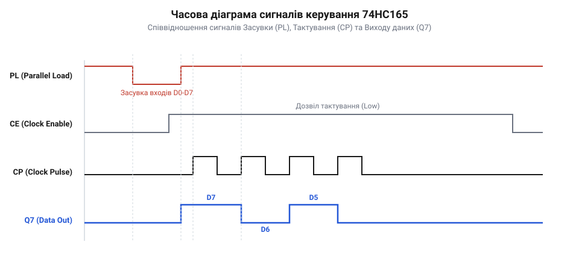
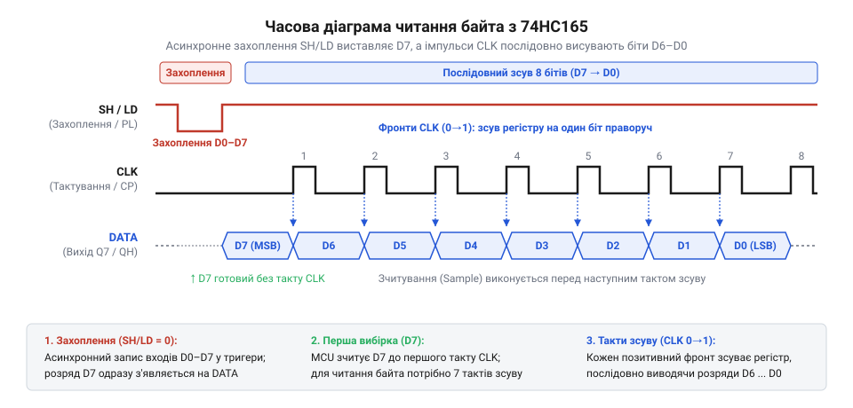

# Програмний інтерфейс драйвера зсувного регістра вводу

## Початкові концепції та фізичні принципи

Мікроконтролери мають обмежену кількість виводів для підключення зовнішніх сигналів. Коли пристрій вимагає зчитування десятків кнопок чи датчиків, пряме підключення швидко вичерпує вільні піни. Цю апаратну межу долають за допомогою мікросхеми 74HC165 — зсувного регістра, який збирає багато паралельних сигналів і передає їх у мікроконтролер послідовно через один провід. Програмний драйвер бере на себе керування цим процесом, перетворюючи електричні імпульси на зручні для коду змінні.

Щоб зрозуміти роботу драйвера, спершу варто поглянути на фізичні лінії керування чипом. Мікросхема має паралельні входи, лінію завантаження `SH/LD` (@@en|Shift/Load@@), лінію тактування `CLK` (@@en|Clock@@) та послідовний вихід `QH`. Процес починається із захоплення стану. У нормальному режимі регістр прозорий для змін на входах, але в момент зчитування ці стани потрібно зафіксувати. Програма подає низький рівень на лінію `SH/LD`, і мікросхема запам'ятовує поточні рівні напруги на входах у свої внутрішні комірки. Після повернення `SH/LD` у високий стан фіксація завершується, і чип готовий віддавати дані.

Тепер програма має витягнути збережені біти. На виході `QH` одразу з'являється значення останнього захопленого біта. Мікроконтролер зчитує цей рівень як логічний нуль або одиницю. Щоб отримати наступний біт, драйвер генерує тактовий імпульс — переводить лінію `CLK` спочатку у високий стан, а потім у низький. З кожним таким імпульсом 74HC165 зсуває внутрішні дані на одну позицію, виштовхуючи на вихід `QH` новий біт. Програмний інтерфейс має точно повторити цю послідовність необхідну кількість разів, збираючи окремі біти в одне ціле число.

*Часова діаграма взаємодії керуючих сигналів SH/LD, CLK та виходу QH показує фіксацію станів входів та покроковий зсув бітів на кожному такті.*

Фізична природа цих сигналів вимагає від драйвера чіткого дотримання часових затримок. Мікросхемі потрібен час на перемикання транзисторів між станами. Якщо програма перемикатиме піни швидше, ніж чип здатен відреагувати, дані будуть спотворені. Забезпечення детермінованості цих операцій стає головним завданням програмного інтерфейсу. До цих часових обмежень додається проблема логічних рівнів: сучасні мікроконтролери працюють від 3.3 В, тоді як 74HC165 часто живлять від 5 В для зчитування стандартної периферії. За такої різниці потенціалів сигнал у 3.3 В від контролера на лініях тактування чи завантаження чип може не розпізнати як логічну одиницю, а відповідь у 5 В з виходу `QH` просто спалить приймальний пін контролера. Щоб сигнали проходили безпечно, між мікросхемами ставлять перетворювач рівнів (@@en|level shifter@@) або виділяють толерантні до 5 В піни мікроконтролера; однак перетворювач неминуче вносить додаткову фізичну затримку в поширення кожного фронту, і якщо драйвер не врахує її у своїх таймінгах, швидке зчитування даних зламається.

## Внутрішня будова та алгоритми роботи

Програмна архітектура драйвера будується навколо функції зчитування, яка повністю інкапсулює апаратні маніпуляції з пінами. Основний застосунок не повинен знати про імпульси, засувки чи зсуви — він очікує отримати готовий масив байтів, де кожен біт однозначно відповідає стану фізичного контакту. Для цього драйвер перетворює послідовний протокол мікросхеми в зручну для пам'яті структуру.

Процес зчитування починається з фіксації стану входів — паралельного захоплення. Мікроконтролер опускає лінію засувки `SH/LD` в низький рівень, що змушує 74HC165 скопіювати напругу з усіх фізичних входів у внутрішню пам'ять тригерів. Після повернення `SH/LD` у високий рівень зсувний регістр переходить у режим послідовної передачі.

Тут криється перша апаратна пастка, на якій часто ламаються самописні драйвери. Щойно `SH/LD` піднімається, перший біт даних (стан входу найстаршого розряду `H`) **одразу** з'являється на виході `QH`, без жодного тактового імпульсу. Тому цикл зчитування повинен спочатку прочитати пін, і лише потім генерувати перепад на лінії `CLK`. Якщо драйвер спершу надішле тактовий імпульс, а потім прочитає дані, він втратить найстарший біт, а всі інші виявляться хибно зсунутими на одну позицію.

Алгоритм побітового читання — це класичне програмне керування пінами (@@en|bit-banging@@). Функція створює порожній байт-акумулятор. У циклі з восьми ітерацій мікроконтролер читає стан піна `QH` і за допомогою побітового зсуву `<< (7 - i)` ставить поточний біт на відповідне місце: від старшого розряду до молодшого. Після цього формується короткий імпульс на лінії `CLK`, який змушує мікросхему виштовхнути наступний біт.

:::tabs
:::code api-74hc165-driver-software-api/c/stm32/hc165-read.c
:::code api-74hc165-driver-software-api/cpp/arduino/hc165-read.cpp
:::

Цей підхід вразливий у системах реального часу. Під час виконання циклу планувальник може витіснити задачу драйвера, або ж спрацює високопріоритетне переривання. Затримка між імпульсами `CLK` розтягнеться непередбачувано. Сама мікросхема 74HC165 є статичною і не втратить дані в регістрі, але виникають дві проблеми. По-перше, прочитані дані виявляться застарілими: фізичні кнопки могли змінити стан, поки драйвер «спав» посеред циклу зчитування, тому програма зреагує із запізненням. По-друге, довга пауза робить лінію `CLK` мішенню для електромагнітних завад, які можуть сприйнятися мікросхемою як фальшивий тактовий імпульс і зсунути дані завчасно. Щоб уникнути цього, розробники виділяють апаратний [рівень транзакцій](root:sf-devices/riven-tranzaktsii) або перекладають завдання на [опитування, переривання чи DMA](root:sf-devices/opytuvannia-pereryvannia-chy-dma-u-draiveri).

Завдяки послідовній топології драйвер легко масштабується для каскаду з кількох мікросхем. Вихід `QH` першої мікросхеми підключається до послідовного входу наступної, утворюючи довгий ланцюг. Сигнал засувки `SH/LD` об'єднує всі чипи і фіксує їхні стани абсолютно синхронно, а імпульси `CLK` зсувають весь великий масив одночасно по всьому каскаду.

Порядок зчитування байтів визначається фізичним розташуванням мікросхем відносно контролера. Спочатку виходять біти тієї мікросхеми, чий вихід `QH` підключений безпосередньо до входу мікроконтролера (останньої в ланцюгу). Коли контролер надсилає перші 8 тактових імпульсів, дані з віддалених мікросхем лише перетікають ближче. Тому перший повністю зібраний байт належить найближчій мікросхемі, наступний — другій від контролера, і так до кінця ланцюга.

Програмно цей потік розкладають у масив. Замість однієї змінної драйвер виділяє буфер пам'яті, наприклад `uint8_t states[N]`. Зовнішній цикл проходить по всіх мікросхемах, а внутрішній щоразу зчитує 8 бітів і записує сформований байт у `states[i]`. Інверсія черги означає, що нульовий індекс масиву зберігатиме стан мікросхеми біля контролера, а останній індекс — найвіддаленішої. Це часто вимагає додаткового програмного відображення (@@en|remapping@@) перед передачею даних у бізнес-логіку, щоб логічна нумерація входів збігалася з фізичною нумерацією кнопок на платі.

## Апаратна реалізація та низькорівневий C/C++ код

Щоб драйвер працював надійно на будь-якому мікроконтролері, необхідно чітко розмежувати апаратні залежності та логіку роботи з даними. Коли апаратний рівень відділено від логічного, драйвер легко переносити на інші платформи, а сама програма не ламається при зміні мікроконтролера. 

Створення такого драйвера починається з визначення апаратних абстракцій. Усі операції з ніжками мікроконтролера, затримками та керуванням перериваннями ми ховаємо за [інтерфейсом драйвера](root:sf-devices/draiver-chypa). Це означає, що основна функція читання стану регістра не знатиме, як саме перемикаються піни. Вона викликатиме прості функції-обгортки.

У багатозадачних системах, зокрема під керуванням операційної системи реального часу (@@en|Real-Time Operating System, RTOS@@), ми стикаємось із проблемою перемикання контексту. Якщо під час зчитування бітів зсувного регістра операційна система перерве наш потік для виконання іншого завдання, часові інтервали між тактами збільшаться непрогнозовано. Хоча мікросхема 74HC165 є статичною і дозволяє зупиняти тактування (@@en|Clock@@) на довільний час без втрати даних, тривала затримка може призвести до того, що ми прочитаємо застарілі стани кнопок чи датчиків. Крім того, інша задача може випадково змінити стан тих самих пінів, якщо вони згруповані на одному порту.

Тому критичну секцію коду, де відбувається захоплення даних (перемикання виводу @@en|Shift/Load@@), варто захищати від витіснення. Найпростіший спосіб — тимчасово заборонити переривання або зупинити планувальник на ці кілька мікросекунд. Проте, потрібно зважати на [вибір між опитуванням та перериваннями](root:sf-devices/opytuvannia-pereryvannia-chy-dma-u-draiveri), щоб не затримати критично важливі системні події.

Розглянемо практичну реалізацію драйвера мовами C та C++. Ми використаємо структуру для зберігання номерів пінів та функції ініціалізації та читання. Зверніть увагу, як апаратні деталі інкапсулюються в об'єктах чи структурах.

:::tabs
:::code api-74hc165-driver-software-api/c/stm32/snippet-3.c
:::code api-74hc165-driver-software-api/cpp/arduino/shiftregister165.cpp
:::

У наведеному коді видно, що послідовність дій суворо регламентована. Спочатку ми робимо імпульс захоплення: опускаємо лінію завантаження донизу і повертаємо вгору. Після цього перший біт даних вже присутній на лінії виходу. Нам залишається лише прочитати його стан, після чого подати тактовий імпульс для зсуву наступного біта. 

*Часова діаграма зчитування байта показує співвідношення імпульсу завантаження SH/LD та восьми тактів CLK під час послідовного опитування пінів.*

Для роботи у високопродуктивних системах використання апаратних таймерів або прямий доступ до регістрів портів вводу-виводу замість стандартних функцій дає змогу скоротити час виконання до сотень наносекунд. Проте, мікросхема 74HC165 має свої граничні обмеження на мінімальну тривалість імпульсів. Якщо мікроконтролер працює на частоті сотень мегагерц, пряме смикання пінів (@@en|bit-banging@@) може генерувати імпульси коротші за 10 наносекунд. Старі мікросхеми логіки просто не встигнуть їх помітити. Тому [правильна послідовність ініціалізації](root:sf-devices/poslidovnist-initsializatsii-iakoi-nikhto) та дотримання апаратних таймінгів через додавання інструкцій `nop` (порожня операція) є критично важливими.

## Практичне застосування та відлагодження

Після того, як апаратна та програмна частини драйвера готові, настає етап інтеграції. У реальних системах зсувні регістри рідко існують ізольовано. Найчастіше їх застосовують для розширення кількості входів для кнопок, кінцевих вимикачів або оптичних датчиків. Тут виникає проблема древізгу контактів (@@en|contact bounce@@) та електромагнітних завад (@@en|EMI@@).

Оскільки мікросхема 74HC165 працює на високих швидкостях, будь-який короткий імпульс завади на тактовій лінії `CLK` буде сприйнятий як команда зсуву. Якщо тактова лінія спіймає заваду, усі дані зсунуться на один біт раніше, і мікроконтролер прочитає хибне значення. Ситуація погіршується, якщо фізичні дроти до плати регістра довгі. У таких випадках програмного драйвера вже недостатньо, і необхідно додавати апаратні RC-фільтри на тактовій лінії або застосовувати [рівень транзакцій](root:sf-devices/riven-tranzaktsii) для верифікації прочитаних даних, наприклад, через багатократне опитування та мажоритарне голосування.

Програмне усунення брязкоту контактів кнопок реалізується над драйвером. Сам драйвер 74HC165 відповідає лише за доставку сирих станів пінів у пам'ять мікроконтролера. Фізичну природу брязкоту контактів та апаратно-програмні засоби фільтрації помилкових спрацьовувань описано в статті про [древізг контактів та методи його усунення](root:hw-digital/contact-debounce).

Розглянемо практичний алгоритм фільтрації: запускаємо таймер в операційній системі реального часу, який кожні 10 мілісекунд викликає читання регістра. Прочитаний байт порівнюється з попереднім значенням. Якщо біт (кнопка) змінив свій стан і утримується новим протягом трьох послідовних читань (30 мілісекунд), система фіксує подію натискання.

Коли пристрій зібрано, але він не працює, розробники часто припускаються помилки: починають хаотично змінювати код драйвера. Насправді процес налагодження має бути систематичним. Найперший інструмент — логічний аналізатор. Підключивши його до пінів `SH/LD`, `CLK` та `DATA`, можна наочно побачити часову діаграму сигналів. Аналізатор відразу покаже, чи дотримуються таймінги захоплення, чи є паразитні сплески на тактовій лінії та чи правильно дані зсуваються по тактах.

Якщо ж аналізатора немає, можна виводити прочитане значення у послідовний порт. При цьому варто застосовувати тестові патерни: наприклад, жорстко підтягнути всі входи регістра до живлення і перевірити, чи читається байт з усіма одиницями. Потім замкнути один конкретний вхід на землю і подивитися, чи обнулиться відповідний біт.

У складніших випадках, наприклад, коли використовується каскадне підключення кількох мікросхем для [багатоосьової індикації](root:sf-devices/dro-multi-axis-synchronization), може виникнути розсинхронізація читання. Якщо під час процесу передачі стається системна помилка або таймаут шини, дані збиваються. Тому правильна архітектура передбачає [відновлення після помилок та повторну ініціалізацію](root:sf-devices/taimauty-pomylky-i-povtorna-initsializatsiia-chypa). Система повинна вміти виявити зависання і примусово надіслати новий імпульс `SH/LD` для скидання стану та початку нового циклу.