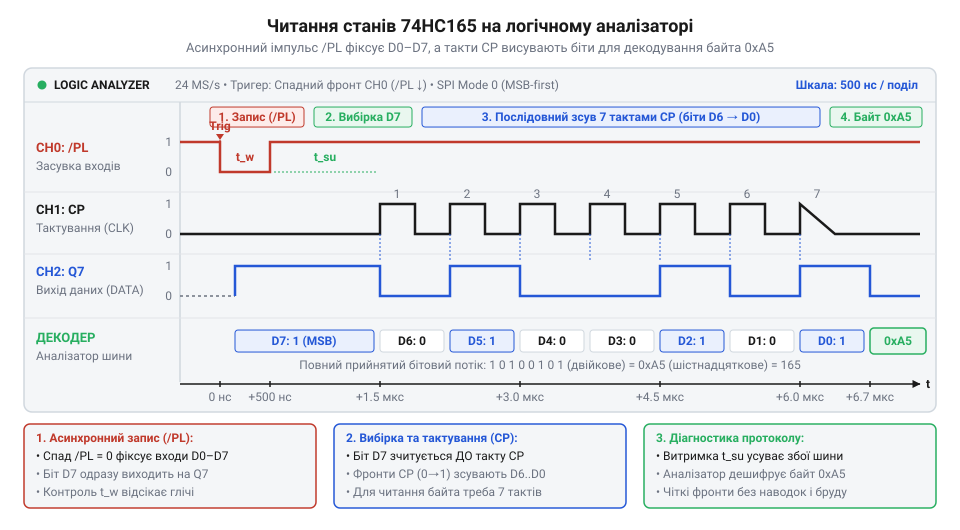

# Специфікація апаратного інтерфейсу та таймингів 74HC165

## Початкові концепції та фізичні принципи

Цифрові системи часто стикаються з проблемою нестачі портів вводу-виводу. Коли мікроконтролер має зчитати стан десятків кнопок, перемикачів чи датчиків, пряме підключення кожного з них до окремого піна швидко вичерпає доступні ресурси. Рішенням стає перетворення паралельних сигналів у послідовний потік даних.

Мікросхема @@en|74HC165@@ — це 8-бітний зсувний регістр з паралельним завантаженням та послідовним виходом. Вона захоплює одночасно вісім логічних рівнів зі своїх входів і, за командою тактового сигналу, видає їх по одному біту один за одним. Це дозволяє мікроконтролеру зчитувати стан восьми фізичних ліній, використовуючи лише три-чотири власні піни: для тактування, завантаження даних та отримання послідовного результату.

Фізично пристрій працює з цифровими рівнями напруги, типовими для логіки @@en|CMOS@@. Він швидко реагує на зміни керуючих сигналів, що робить його придатним для роботи з високошвидкісними шинами на кшталт @@en|SPI@@. Кілька таких мікросхем можна з'єднати каскадом (@@en|daisy chain@@): вихід однієї підключається до послідовного входу наступної. Завдяки цьому можна зчитувати 16, 24, 32 і більше входів, не збільшуючи кількість задіяних пінів мікроконтролера.

Для утворення каскаду вихід останнього біта першої мікросхеми з'єднують із послідовним входом другої, а лінії керування — тактовий сигнал і команду завантаження — підключають паралельно до всіх пристроїв. Коли мікроконтролер подає команду завантаження, усі регістри одночасно фіксують стан своїх фізичних входів. Під час зчитування кожен тактовий імпульс зсуває дані по всьому ланцюгу: біти з другої мікросхеми перетікають у першу, займаючи місце тих, що вже відправлені до мікроконтролера. Таким чином, усі з'єднані мікросхеми діють як один довгий зсувний регістр, і для отримання всіх даних процесору достатньо читати єдиний вихід першої мікросхеми, безперервно видаючи тактові імпульси, поки не буде вичитано весь каскад.

## Внутрішня будова та алгоритми роботи

Мікроконтролер може прочитати стан багатьох ліній через єдиний інформаційний пін, якщо ці лінії підключені до зсувного регістра. Мікросхема 74HC165 виконує саме цю функцію: вона фізично захоплює вісім паралельних сигналів у свою внутрішню пам'ять, а потім по черзі видає їх на один вихід. Цей механізм працює завдяки восьми внутрішнім тригерам, з'єднаним в один ланцюг.

Щоб мікросхема розуміла, коли треба запам'ятати стани входів, а коли — передавати збережене, у неї є два режими роботи. Вони перемикаються входом паралельного завантаження (@@en|PL@@, @@en|Parallel Load@@).

Коли на вхід `PL` подається низький рівень, мікросхема переходить у режим захоплення даних. Внутрішні зв'язки між тригерами розриваються, і кожен тригер підключається безпосередньо до свого зовнішнього виводу — від `D0` до `D7`. У цей момент логічні рівні з паралельних входів постійно та асинхронно записуються у тригери. Цей процес називають засувкою або захопленням (@@en|latch@@). Асинхронність означає, що мікросхемі байдуже на тактовий сигнал; тригери просто відстежують стан входів, поки `PL` залишається низьким.

Щойно на `PL` знову встановлюється високий рівень, тригери від'єднуються від зовнішніх пінів і знову з'єднуються у зсувний ланцюг. Відтепер їхні стани заморожені, і мікросхема готова до послідовної передачі. Захоплені дані більше не зміняться від того, що відбувається на входах.

Тепер мікроконтролер має ці дані витягти. Для цього він подає тактові імпульси на вхід (@@en|CP@@, @@en|Clock Pulse@@). Кожен перехід тактового сигналу з низького на високий рівень — тобто передній фронт — змушує дані всередині зсуватися на одну позицію ближче до виходу. Біт із сьомого тригера з'являється на виході (@@en|Q7@@), біт із шостого переходить у сьомий, і так далі. Оскільки на виході ми відразу бачимо значення останнього біта ще до першого тактового імпульсу, для читання восьми бітів потрібно подати лише сім імпульсів. Якщо є потреба тимчасово призупинити зсув, не зупиняючи джерело тактового сигналу, використовують вхід заборони тактування (@@en|CE@@, @@en|Clock Enable@@). Коли він активний, внутрішня логіка ігнорує імпульси на `CP`.

Під час перемикання входу `PL` та початку тактування `CP` криється головна апаратна пастка. Фізичні транзистори всередині мікросхеми мають ємність, тому сигнал не поширюється миттєво. Якщо підняти рівень на `PL` і одразу ж подати імпульс на `CP`, внутрішні логічні вентилі можуть не встигнути перемкнути з'єднання з паралельних на послідовні. Для цього виробники вказують час встановлення (@@en|setup time@@) — мінімальний проміжок часу, протягом якого керуючий сигнал має бути стабільним до приходу фронту тактового сигналу. 

Аналогічну природу має час утримання (@@en|hold time@@). Коли тактовий фронт уже прийшов і тригери фіксують новий стан, інформаційний чи керуючий сигнал має залишатися незмінним ще коротку мить, щоб перемикання гарантовано завершилось. На швидких сучасних мікроконтролерах програмна зміна ніжок відбувається за лічені наносекунди. Якщо писати код без урахування цих затримок, мікроконтролер порушить `setup time` регістра. У такому разі ви отримаєте зсув даних на один біт або випадкове сміття, і вам доведеться довго дебажити ваш [драйвер для чипа](root:sf-devices/draiver-chypa), перш ніж ви здогадаєтесь перевірити таймінги логічним аналізатором.

Після того, як дані зсунулися, перший тригер ланцюга звільняється. У нього записується значення з послідовного входу (@@en|DS@@, @@en|Data Serial@@). Це дозволяє з'єднати кілька таких регістрів в один довгий ланцюг, підключивши вихід `Q7` першої мікросхеми до `DS` наступної. Завдяки такому каскадуванню можна зчитувати десятки паралельних входів, не використовуючи додаткових пінів мікроконтролера.

## Апаратна реалізація та низькорівневий C/C++ код

Щоб зчитати стан виводів зсувного регістра, мікроконтролер повинен послідовно керувати його контрольними лініями. Першим кроком є захоплення паралельних даних: лінія PL (`Parallel Load`) переводиться в низький рівень. Саме в цю мить стан усіх восьми входів фіксується у внутрішніх тригерах. Після короткої затримки лінія PL повертається у високий рівень, і чип переходить у режим зсуву.

Далі починається читання бітів. На виході Q7 одразу з'являється значення старшого біта. Мікроконтролер зчитує цей стан через свій вхідний пін. Щоб отримати наступний біт, на лінію CP (`Clock Pulse`) подається один тактовий імпульс: перехід від низького до високого рівня і назад. Цей імпульс зсуває всі дані всередині регістра на одну позицію, і на виході Q7 з'являється наступний біт. Цей цикл повторюється вісім разів.

:::tabs
:::code api-74hc165-hardware-interface/c/esp-idf/hc165-init.c
:::code api-74hc165-hardware-interface/cpp/arduino/setup.cpp
:::

Цей програмний підхід називається програмним дриганням виводами (@@en|bit-banging@@). Він простий у реалізації, але вимагає процесорного часу на формування кожного імпульсу. Затримки між перемиканнями рівнів критично важливі. Хоча мікросхема 74HC165 може працювати на частотах до десятків мегагерц, реальні затримки гарантують, що ємність ліній зв'язку встигне зарядитися, і сигнали набудуть стабільних рівнів. Якщо лінія тактування CP довга, швидкі фронти імпульсів можуть викликати відбиття (@@en|reflections@@) сигналу, що спричинить подвійні спрацьовування тригерів.

Для підвищення ефективності замість ручного керування пінами використовують апаратний модуль SPI. У такому режимі мікроконтролер використовує лінію PL як сигнал вибору чипа, CP підключається до тактового виходу SCK, а Q7 — до входу MISO. Апаратний SPI автоматично генерує тактові імпульси з високою точністю і зчитує дані без затримок у циклі, розвантажуючи процесор. Проте, оскільки 74HC165 видає старший біт одразу після переходу PL у високий рівень, SPI контролер повинен підтримувати режим читання за правильним фронтом тактового сигналу.

## Практичне застосування та відлагодження

Регістр 74HC165 найчастіше застосовують для опитування матриць кнопок, кінцевих вимикачів у верстатах та датчиків в індустріальній автоматиці. У таких системах дроти можуть тягнутися на метри, утворюючи антени. Електромагнітні завади (@@en|EMI@@) від двигунів чи реле легко наводяться на ці лінії. 

Найуразливішою є лінія тактування CP. Короткий сплеск завади на цій лінії сприймається чипом як повноцінний тактовий імпульс. У результаті регістр зсуває дані на одну позицію раніше, і мікроконтролер отримує зміщений масив бітів. Щоб запобігти цьому, лінію CP шунтують невеликими керамічними конденсаторами (близько 100 пФ) біля самої мікросхеми, а також використовують термінуючі резистори для гасіння відбиттів.

Інша поширена проблема — брязкіт контактів (@@en|contact bounce@@) механічних кнопок чи вимикачів, підключених до паралельних входів регістра. Коли контакти замикаються, вони мікроскопічно пружинять, створюючи серію швидких перемикань. Якщо сигнал PL подається саме в момент брязкоту, регістр захопить випадковий перехідний стан. 

Щоб відфільтрувати брязкіт, мікроконтролер має зчитувати стан регістра періодично, наприклад кожні 10 мілісекунд, і фіксувати натискання лише тоді, коли зчитаний стан залишається стабільним протягом кількох циклів опитування.

*Аналіз шини: сигнал PL переходить у низький рівень для захоплення, після чого на Q7 фіксується перший біт. Наступні біти зчитуються синхронно з імпульсами на CP.*

Для відлагодження системи найкращим інструментом є логічний аналізатор. Підключивши його канали до ліній PL, CP та Q7, можна побачити справжній часовий хід сигналів. Якщо зчитані дані завжди зсунуті на один біт вліво чи вправо, це означає розбіжність між фазою тактування мікроконтролера та поведінкою чипа. Аналізатор відразу покаже, зчитується стан Q7 до початку тактового імпульсу чи після його фронту, що дозволить виправити налаштування SPI або скоригувати код опитування.