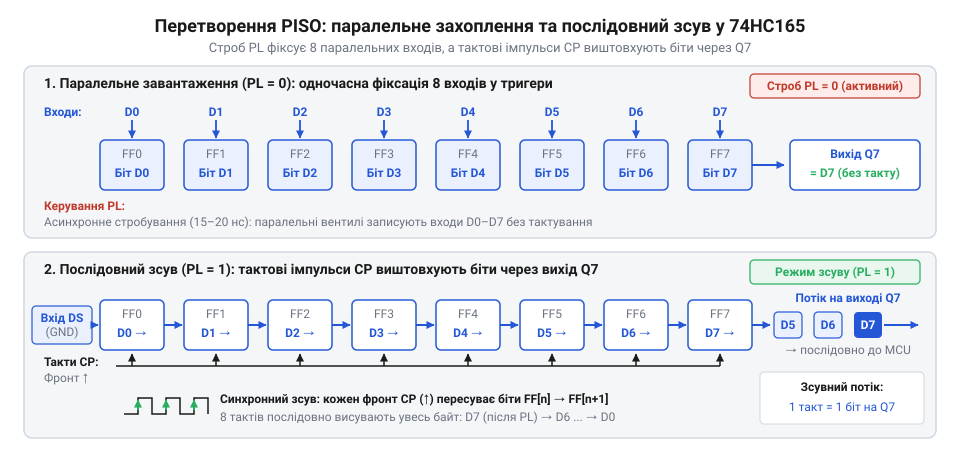
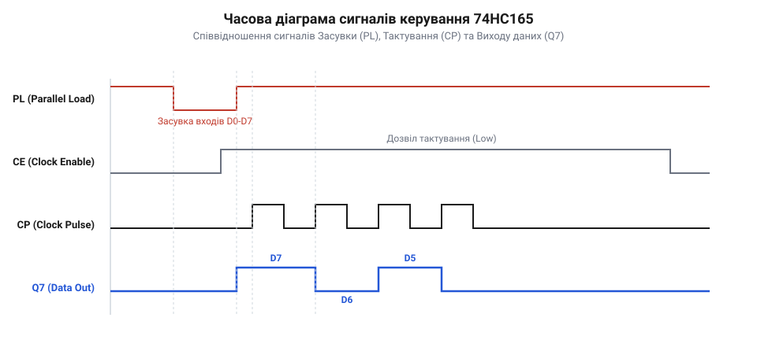

# Розрахунок таймингів та бітової збірки даних зсувного регістра

## Початкові концепції та фізичні принципи

Коли мікроконтролер має обмежену кількість виводів, а потрібно опитати багато цифрових датчиків чи кнопок, прямого підключення стає недостатньо. Кожен новий датчик вимагає окремого піна, і ресурси контролера швидко вичерпуються. Тут на допомогу приходить зсувний регістр — апаратний вузол, який перетворює паралельні сигнали від багатьох джерел у послідовний потік бітів. Він дозволяє зібрати стан восьми чи більше ліній і передати їх у мікроконтролер лише через кілька дротів.

Основою такої взаємодії є синхронізація. Мікроконтролер генерує тактовий сигнал, який керує процесом передачі. За кожним імпульсом тактового сигналу зсувний регістр видає один біт даних на свою вихідну лінію. Цей процес називається паралельно-послідовним перетворенням (@@en|Parallel-In Serial-Out@@, або @@en|PISO@@).

*Схема паралельно-послідовного перетворення (PISO) демонструє захоплення сигналів із восьми паралельних входів та їхній покроковий зсув у послідовний потік бітів за кожним тактовим імпульсом.*

Для зчитування стану входів регістр спочатку защіпає паралельні дані. Спеціальний сигнал переводить мікросхему в режим паралельного завантаження, фіксуючи логічні рівні на всіх її входах одночасно. Після цього мікросхема переходить у режим зсуву, і з кожним тактовим імпульсом збережені біти по черзі зсуваються до виходу. Математично це розгортає паралельний стан ліній у часову послідовність бітів `b_i`, де індекс `i` — номер такту. Мікроконтролер зчитує ці біти і збирає їх назад у цілі слова чи байти, обчислюючи на кожному кроці нове накопичене значення `V_{i+1}` із попереднього значення `V_i`:

        V_{i+1}
        = (V_i × 2) + b_i        [арифметичний зсув числа вліво та додавання нового біта]
        = (V_i << 1) | b_i       [еквівалентний запис через швидкі побітові операції]

Ця рекурентна формула гарантує, що старші біти поступово займуть правильні розряди в підсумковому числі, дозволяючи збирати ціле слово на льоту для подальшої обробки в програмі.

## Внутрішня будова та алгоритми роботи

Мікроконтролер бачить на своєму вході лише миттєвий рівень напруги на одному піні, тоді як прикладна програма потребує цілісних багатобітних значень. Програмний драйвер зсувного регістра розв'язує цю проблему, працюючи як синхронний перекладач: він генерує часові інтервали для керування мікросхемою та математично збирає послідовність окремих станів у єдину змінну.

Зчитування починається з фіксації даних на входах регістра. Драйвер формує імпульс на лінії защіпки (@@en|latch@@): опускає її в низький рівень, витримує мінімальний час, необхідний мікросхемі для захоплення електричних сигналів, і повертає у високий. Одразу після цього перший, найстарший біт даних з'являється на виході регістра і стає доступним для читання.

Щоб отримати решту бітів, драйвер запускає цикл тактування. Для кожного наступного розряду він генерує тактовий імпульс: переводить лінію тактування у високий рівень, чекає стабілізації сигналу, зчитує поточний стан інформаційної лінії і повертає лінію тактування вниз. Кожен такий зчитаний стан — це один розряд майбутнього числа, і його потрібно правильно розмістити серед інших.

*Часова діаграма сигналів защіпки, тактування та лінії даних ілюструє початкову фіксацію входів та появу чергового інформаційного біта на виході синхронно з фронтами тактових імпульсів.*

Оскільки біти надходять по одному, починаючи зі старшого, драйвер використовує побітовий зсув ліворуч та логічне АБО (@@en|bitwise OR@@) для накопичення результату. Нехай ми читаємо регістр у змінну `data`, яка спочатку дорівнює нулю. Коли приходить новий біт `b`, драйвер спочатку зсуває всі накопичені раніше біти вліво на одну позицію оператором `<<`. Це звільняє нульовий, наймолодший розряд змінної. Після цього новий біт записується в цей порожній розряд за допомогою логічного АБО.

**Накопичення послідовності бітів 1, 0, 1**

        data 
        = (00000000 << 1) | 1    [підстановка початкового нуля та першого зчитаного біта]
        = 00000000 | 1           [зсув попереднього значення вліво на одну позицію]
        = 00000001               [накладання нового біта через логічне АБО]
        = (00000001 << 1) | 0    [підстановка поточного накопичення та другого біта 0]
        = 00000010 | 0           [зсув накопичених даних вліво]
        = 00000010               [збереження нового біта в порожньому нульовому розряді]
        = (00000010 << 1) | 1    [підстановка накопичення та третього біта 1]
        = 00000100 | 1           [перехід попередньої історії в старші розряди]
        = 00000101               [додавання останнього біта, результат збережено]

Операція логічного АБО працює тут виключно як безпечне додавання без перенесення. Оскільки після зсуву наймолодший біт `data` гарантовано містить нуль, накладання нового біта `b` на цей нуль через `|` повністю зберігає значення `b` і жодним чином не зачіпає сусідні розряди. Кожен наступний зсув просуває найперший отриманий біт усе ближче до старших розрядів.

Затримки між зміною станів ліній є критичними для надійності читання. Якщо драйвер виконується під управлінням операційної системи реального часу (@@en|RTOS@@), планувальник може будь-якої миті перервати цикл опитування для виконання іншого завдання. Тоді імпульс тактування замість однієї мікросекунди триватиме тисячі, що може призвести до втрати синхронізації самою мікросхемою або спотворення сигналу через зовнішні завади. Щоб зберегти детермінованість, драйвер тимчасово забороняє переривання або загортає генерацію сигналів у критичні секції, гарантуючи, що інтервали затримок залежатимуть лише від тривалості команд процесора.

## Апаратна реалізація та низькорівневий C/C++ код

Щоб прочитати стан кнопок чи датчиків, мікроконтролер має керувати ніжками зсувного регістра у строгій послідовності. Якщо порушити таймінги або порядок перемикання, ми прочитаємо сміття замість реальних даних. Спочатку треба подати імпульс на лінію защіпки, а потім видавати тактові імпульси і зчитувати стан виходу після кожного з них.

Кожна операція з ніжкою мікроконтролера займає час. У системах реального часу важливо звести цей час до мінімуму, щоб не затримувати інші задачі. Використання абстракцій операційної системи для кожного перемикання ніжки є занадто повільним. Тому звертатися до портів вводу-виводу краще напряму через регістри мікроконтролера.

:::tabs
:::code math-piso-shift-timing-and-bitwise-assembly/c/stm32/hc165-read.c
:::code math-piso-shift-timing-and-bitwise-assembly/cpp/arduino/hc165-read.cpp
:::

Зверніть увагу, що у коді на C для STM32 ми використовуємо безпосередній запис у регістр порту. Це гарантує атомарність операції — переривання не зможе пошкодити стан порту під час перемикання ніжки. Функція `__NOP()` вставляє інструкцію порожньої операції, щоб забезпечити мінімальну тривалість імпульсу, яку вимагає апаратний регістр.

## Практичне застосування та відлагодження

При підключенні регістра на макетній платі часто трапляється так, що прочитані дані зсунуті на один біт, або містять випадкові значення. Це стається через шум на лініях зв'язку або неправильно налаштовані рівні сигналів. Зсувний регістр дуже чутливий до перешкод на лінії тактування: навіть короткий сплеск напруги він сприйме як додатковий такт.

Щоб знайти причину проблеми, лінію тактування та лінію даних варто перевірити логічним аналізатором.

Окрім апаратних проблем, помилка може ховатися в налаштуваннях портів. Якщо ніжка мікроконтролера, до якої підключено вихід регістра, не підтягнута до живлення або землі, вона буде збирати наведення, коли регістр нічого не передає. Налаштування порту на вхід з підтяжкою вирішує цю проблему.