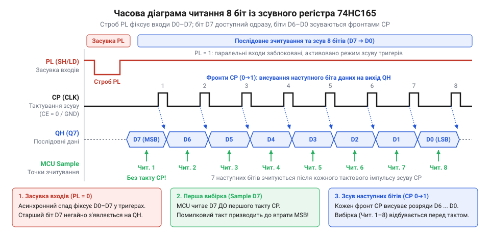

# Програмний драйвер 74HC165 методом Bit-Banging

## Початкові концепції та фізичні принципи

Мікроконтролер має обмежену кількість виводів, і коли їх не вистачає для зчитування стану десятків кнопок чи датчиків, розробник змушений шукати спосіб розширити цю кількість без заміни самого процесора. Пряме підключення кожної кнопки вимагає окремого виводу, що швидко вичерпує апаратні ресурси. Щоб обійти це обмеження, кілька паралельних сигналів можна зібрати разом і передати до мікроконтролера по одній лінії послідовно один за одним. Саме це завдання вирішує зсувний регістр 74HC165.

Цей чип має вісім паралельних входів для підключення зовнішніх сигналів і один послідовний вихід для передачі зібраних даних. Коли мікроконтролер подає спеціальний сигнал засувки, регістр фіксує поточні логічні рівні на всіх своїх входах одночасно. Після цього мікроконтролер подає тактові імпульси, і з кожним імпульсом чип видає на послідовний вихід стан наступного входу. Процес керування цими сигналами засувки та тактування вручну, перемикаючи виводи мікроконтролера безпосередньо з програмного коду, називають програмним формуванням сигналів (@@en|bit-banging@@).

Щоб збільшити кількість входів, кілька таких регістрів можна з'єднати ланцюжком — каскадувати. Для цього послідовний вихід одного чипа підключають до послідовного входу наступного, утворюючи єдиний довший зсувний регістр, де всі мікросхеми використовують спільні лінії засувки та тактування. Під час зчитування мікроконтролер просто генерує більше тактових імпульсів, і біти даних послідовно пересуваються від найвіддаленішого чипа в ланцюжку через усі проміжні прямо у процесор. Таке розширення дозволяє зчитувати десятки сигналів усе через ті самі три виводи мікроконтролера, проте пропорційно збільшує час опитування: каскад із двох чипів вимагає вже шістнадцяти тактів замість восьми, що робить ручне програмне формування сигналів ще відчутнішим навантаженням.

Використання @@en|bit-banging@@ дозволяє підключити 74HC165 до будь-яких вільних виводів мікроконтролера, не прив'язуючись до спеціалізованих апаратних блоків на кшталт SPI. Це дає гнучкість у розведенні плати, проте вимагає від процесора витрачати час на формування кожного фронту імпульсу. Якщо частота опитування низька, такі витрати є прийнятними, але при високих швидкостях програмна генерація сигналів може забирати значну частину часу, який міг би використовуватися для інших завдань.

## Внутрішня будова та алгоритми роботи

Робота драйвера починається з підготовки ліній зв'язку. Мікроконтролер налаштовує три або чотири виводи залежно від схемотехніки: один як цифровий вхід для прийому даних (підключається до послідовного виходу `Q7` або `QH` регістра), а решту як цифрові виходи. Два обов'язкові виходи керують засувкою (лінія `PL` або `SH/LD`) та тактуванням (лінія `CP` або `CLK`). У початковому стані лінія тактування утримується на низькому рівні, а лінія засувки — на високому.

Окремої уваги потребує вивід дозволу тактування — `CE` (від @@en|Clock Enable@@) або `CLK INH` (від @@en|Clock Inhibit@@). Його стан визначає, чи реагуватиме регістр на імпульси тактування. Якщо вивід підтягнуто до високого рівня, мікросхема ігнорує будь-які зміни на лінії `CLK`, і зсув даних стає неможливим. На практиці в багатьох схемах цей вивід апаратно заземлюють, щоб регістр завжди був готовий до зсуву. Проте, якщо архітектура передбачає програмне керування лінією `CE`, драйвер зобов'язаний перевести її в низький рівень перед початком читання і повернути у високий після його завершення. Це гарантує, що правильна [послідовність ініціалізації](root:sf-devices/poslidovnist-initsializatsii-iakoi-nikhto) не призведе до хибних зсувів.

Щоб розпочати читання, програмний драйвер опускає лінію засувки в низький рівень. У цей момент 74HC165 виконує асинхронне паралельне завантаження: він жорстко копіює та фіксує стан усіх восьми паралельних входів у своїх внутрішніх тригерах. Поки лінія засувки залишається низькою, регістр не реагує на тактові імпульси, а постійно транслює стан входів у тригери, тому будь-які коливання напруги на фізичних ніжках миттєво відображатимуться всередині. Далі драйвер повертає засувку у високий рівень. Цей перехід переводить мікросхему в режим зсуву: поточний стан зафіксовано, і тепер дані готові до послідовного виведення.

*Часова діаграма читання 8 біт ілюструє співвідношення сигналів засувки PL, тактування CP та послідовних даних QH, демонструючи асинхронну фіксацію паралельного входу й покроковий зсув бітів на кожному такті.*

*Часова діаграма ілюструє, як зміна рівня засувки фіксує дані, а тактові імпульси зсувають їх на вихід для зчитування мікроконтролером.*

Відразу після фіксації, ще до першого тактового імпульсу, на послідовному виході `QH` з'являється значення останнього, восьмого входу (пін `H` або `D7`). Тому мікроконтролер спершу зчитує цей стан із відповідного виводу і записує його як старший розряд у підготовлену байтову змінну. Якщо [драйвер чипа](root:sf-devices/draiver-chypa) намагатиметься спершу генерувати такт, а потім читати, старший біт буде незворотно втрачено.

Лише після прочитання першого біта драйвер формує короткий тактовий імпульс: переводить лінію тактування у високий стан і повертає в низький. По передньому фронту цього імпульсу 74HC165 синхронно зсуває всі збережені дані на одну позицію в бік старшого розряду. Стан сьомого входу переміщується на вихід `QH` і стає доступним для зчитування. Програма повторює цикл читання і тактування вісім разів. З кожним тактом драйвер записує лінію даних, формує новий імпульс і зсуває отримане значення в байтовій змінній, збираючи повне 8-бітне слово. Усю цю роботу бере на себе [рівень транзакцій](root:sf-devices/riven-tranzaktsii), повністю ховаючи протокол обміну.

Фізична природа мікросхеми диктує жорсткі часові обмеження. Затримки між змінами стану ліній повинні чітко відповідати часовим характеристикам чипа, описаним у документації. Якщо сучасний мікроконтролер перемикатиме виводи занадто швидко, внутрішні вентилі регістра просто не встигнуть перемкнутися, і прочитані дані будуть спотворені. Тому програмна реалізація @@en|bit-banging@@ обов'язково використовує точні мікросекундні затримки або підібрані порожні цикли. Це забезпечує мінімально допустимі паузи (наприклад, час утримання засувки чи тривалість тактового імпульсу), гарантуючи надійну та детерміновану роботу інтерфейсу незалежно від тактової частоти ядра мікроконтролера. Якщо мікросхема зависла через порушення таймінгів, може знадобитися [повторна ініціалізація чипа](root:sf-devices/taimauty-pomylky-i-povtorna-initsializatsiia-chypa).

Розкрито внутрішню будову та алгоритм побітового читання 74HC165, введено поняття виводу дозволу тактування CE (Clock Enable) та пояснено механізм фіксації даних засувкою. Показано важливість дотримання часових обмежень і правильну послідовність зчитування бітів для уникнення втрати старшого розряду.

## Апаратна реалізація та низькорівневий C/C++ код

Щоб перетворити алгоритм читання мікросхеми 74HC165 на робочий код, потрібно безпосередньо керувати станом логічних виводів мікроконтролера. Програмна реалізація, або @@en|bit-banging@@, вимагає точного дотримання послідовності сигналів: засувка фіксує дані, після чого тактові імпульси виштовхують їх біт за бітом. 

Оскільки ми керуємо сигналами вручну, ключовим завданням стає атомарність операцій та контроль швидкості. Мікроконтролер може перемикати виводи настільки швидко, що фізична лінія не встигне змінити ємнісний заряд, і мікросхема не розпізнає перехід. Тому між змінами стану ліній додають мікросекундні затримки.

Нижче наведено приклад реалізації читання одного байта з 74HC165. Функція приймає номери виводів і повертає зібраний байт. 

:::tabs
:::code proj-74hc165-bitbang-driver/c/esp-idf/read-74hc165.c
:::code proj-74hc165-bitbang-driver/cpp/arduino/read74hc165.cpp
:::

У цьому коді ми спочатку подаємо низький рівень на вивід PL, щоб мікросхема запам'ятала стан своїх входів. Потім у циклі читаємо лінію даних Q7 і формуємо короткий тактовий імпульс на лінії CP. Кожен такт зсуває внутрішній регістр мікросхеми, виводячи на Q7 наступний біт. Зібрані біти акумулюються у змінній `data` за допомогою побітового зсуву вліво. Затримки гарантують, що повільна периферія встигне за швидким ядром.

## Практичне застосування та відлагодження

У реальних вбудованих системах виводи 74HC165 часто підключають до механічних кнопок або тумблерів. Механічні контакти мають властивість брязкати: під час натискання лінія швидко перемикається між нулем і одиницею кілька десятків разів, перш ніж стан стабілізується. Якщо програма опитуватиме регістр саме в цей момент, вона прочитає хибні значення.

Вирішуючи, як будувати архітектуру, та обираючи [опитування, переривання чи DMA](root:sf-devices/opytuvannia-pereryvannia-chy-dma-u-draiveri), варто пам'ятати, що періодичне опитування діє як природний програмний фільтр. Якщо опитування регістра винести у періодичну задачу операційної системи реального часу (RTOS) з інтервалом від 20 до 50 мілісекунд, це буде достатньо мало, щоб людина не помітила затримки, і достатньо багато, щоб брязкіт контактів уже закінчився.

Типовою проблемою при відлагодженні такого драйвера є пропуск старшого біта. Якщо стан лінії даних зчитується після того, як подано перший тактовий імпульс, мікросхема вже встигне зсунути дані, і перший біт буде втрачено. Важливо пам'ятати, що 74HC165 виставляє поточний біт на вихід одразу після підняття лінії засувки. Саме тому в алгоритмі читання лінії даних відбувається перед формуванням тактового імпульсу, а не після нього.