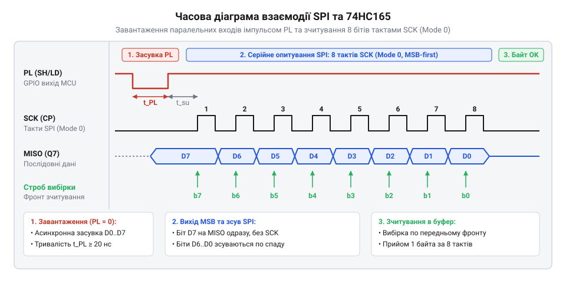
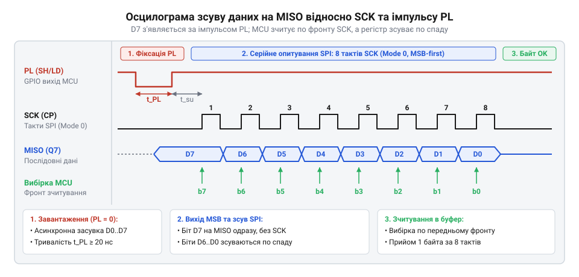

# Прискорене опитування 74HC165 через апаратний модуль SPI

## Початкові концепції та фізичні принципи

Мікроконтролер має обмежену кількість виводів загального призначення. Коли пристрій потребує опитування десятків кнопок, кінцевих вимикачів чи оптичних датчиків, пряме підключення кожного сигналу до окремого виводу швидко вичерпує апаратні ресурси. Щоб зібрати багато цифрових станів через мінімальну кількість ліній, застосовують мікросхему 74HC165 — зсувний регістр із паралельним завантаженням та послідовним виведенням (@@en|parallel-in, serial-out@@).

У класичному програмному рішенні керування таким регістром відбувається через пряме маніпулювання станом виводів. Мікроконтролер по черзі встановлює високий і низький рівні на лінії тактування, щоб зсунути кожен біт, і зчитує стан інформаційної лінії. Цей підхід марнує процесорний час: поки ядро зайняте формуванням імпульсів, воно не може виконувати корисні обчислення. Якщо кількість входів велика або опитування має бути частим, затримки стають критичними.

Фізична природа передачі даних у 74HC165 повністю збігається з протоколом апаратної шини SPI на рівні сигналів: вхід тактування регістра приймає імпульси від лінії SCK, а його послідовний вихід віддає дані на лінію MISO (@@en|Master In Slave Out@@). Модуль SPI генерує тактові імпульси й з кожним перепадом рівня паралельно приймає висунуті регістром вхідні біти, автоматично збираючи їх у цілі байти всередині своїх апаратних регістрів. Підключивши зсувний регістр до модуля SPI, ми перекладаємо рутинну роботу з формування бітів на спеціалізоване залізо. Процесору достатньо дати команду на прийом байта й забрати готовий результат. Завдяки цьому швидкість опитування зростає в десятки разів. Для проєктування надійної взаємодії необхідно правильно відділити логіку чипа від логіки шини, як описано в темі [Рівень транзакцій: відділити чип від шини](root:sf-devices/riven-tranzaktsii).

## Внутрішня будова та алгоритми роботи

Зсувний регістр 74HC165 призначений для збирання стану багатьох паралельних логічних сигналів і передачі їх однією послідовною лінією. Це необхідно тоді, коли пряме підключення до мікроконтролера неможливе через нестачу вільних виводів. Апаратне сполучення мікроконтролера та 74HC165 через шину SPI потребує трьох ліній зв'язку, при цьому лінія передачі даних від мікроконтролера MOSI залишається вільною, оскільки регістр працює виключно на віддачу. Вихід послідовних даних регістра `Q7` підключається до входу мікроконтролера MISO. Вхід тактування `CP` з'єднується з лінією SCK (@@en|Serial Clock@@). Вивід паралельного завантаження `PL` (@@en|Parallel Load@@) керується звичайним виводом мікроконтролера GPIO і виконує роль сигналу вибору чипа, хоча його логіка суттєво відрізняється від класичного CS (@@en|Chip Select@@).

Алгоритм читання розбивається на дві фази: фіксацію фізичного стану входів та його подальший зсув. Зсувний регістр не віддає дані автоматично під час появи тактових імпульсів, як це робить типова пам'ять SPI. Спочатку необхідно змусити 74HC165 зафіксувати поточні логічні рівні на його паралельних входах. Для цього мікроконтролер програмно опускає вивід `PL` у низький рівень. У цей момент мікросхема стає прозорою: вхідні стани проходять на внутрішні тригери. Щойно мікроконтролер повертає `PL` у високий рівень, тригери замикаються і стан фіксується. Цей імпульс завантаження має жорсткі апаратні межі: згідно з документацією на серію 74HC, тривалість низького рівня на `PL` має бути не меншою за певну величину — зазвичай 20 наносекунд при живленні 5 вольтів, і ще довшою при нижчих напругах. Сучасне ядро мікроконтролера здатне перемикати виводи за одиниці наносекунд, тому послідовний виклик функцій опускання та підняття GPIO без пауз часто призводить до того, що регістр не встигає зафіксувати дані. Розробник мусить гарантувати цей час, вставляючи в код кілька порожніх інструкцій `NOP` між перемиканнями.

Після фіксації даних перший біт, що відповідає паралельному входу `D7`, з'являється на виході `Q7` миттєво, без очікування першого тактового імпульсу. З цієї причини мікроконтролер має зчитувати стан лінії MISO до того, як згенерує спад на лінії SCK. Щоб запобігти збоям при читанні і гарантувати таку поведінку, модуль SPI налаштовується на роботу у відповідному режимі фази та полярності — найчастіше це режим 2 (CPOL=1, CPHA=0) або режим 0 (CPOL=0, CPHA=0). За цих налаштувань дані виставляються мікросхемою по спаду тактового імпульсу `CP`, а зчитуються мікроконтролером по фронту. Це забезпечує надійне вловлювання логічних рівнів, адже між зміною біта на виході регістра і його фіксацією в мікроконтролері минає половина періоду тактового сигналу. За цей час паразитні ємності шини встигають перезарядитися навіть на високих швидкостях.

*Часові діаграми взаємодії SPI та 74HC165 показують момент завантаження даних імпульсом PL та подальший зсув бітів по тактах SCK.*

Фіксуючи дані в пам'яті, мікроконтролер запускає транзакцію SPI. Апаратний модуль генерує вісім тактових імпульсів на лінії SCK, синхронно зчитуючи стан лінії MISO. З кожним імпульсом 74HC165 зсуває свої внутрішні дані на одну позицію, видаючи на вихід наступний біт. У мікроконтролері прийняті біти апаратно збираються в байт, позбавляючи ядро необхідності програмно керувати зсувом кожного біта.

Якщо в схемі послідовно з'єднано кілька регістрів 74HC165 у ланцюг, де вихід `Q7` попереднього чипа йде на послідовний вхід `DS` (@@en|Data Serial@@) наступного, мікроконтролер просто генерує кількість імпульсів, кратну восьми. Усі об'єднані регістри діють як один довгий зсувний регістр, безперервно віддаючи дані з шини. Залежно від жорсткості вимог системи до реального часу, розробник може застосувати механізми, які описує тема [Опитування, переривання чи DMA у драйвері](root:sf-devices/opytuvannia-pereryvannia-chy-dma-u-draiveri), щоб максимально розвантажити ядро під час таких довгих багатобайтових передач.

## Апаратна реалізація та низькорівневий C/C++ код

Щоб апаратний модуль SPI міг автоматично зчитати стан виводів 74HC165, мікроконтролер має спочатку завантажити паралельні дані в зсувний регістр. Без цього кроку SPI отримає лише старі дані або нулі. Завантаження відбувається через асинхронний вхід `PL`, яким мікроконтролер керує окремо від шини SPI, використовуючи звичайний вивід загального призначення @@en|GPIO@@.

Мікроконтролер опускає лінію `PL` у низький рівень, щоб зафіксувати стан входів, а потім повертає її у високий. Лише після цього можна запускати транзакцію SPI для вичитування бітів через лінію `MISO`. Оскільки 74HC165 не використовує лінію передачі від мікроконтролера `MOSI`, цей вивід залишається вільним або ігнорується.

Розглянемо реалізацію опитування регістра мовами C та C++. 

:::tabs
:::code proj-74hc165-spi-driver/c/esp-idf/init-74hc165.c
:::code proj-74hc165-spi-driver/cpp/arduino/setup.cpp
:::

У коді ми ініціалізуємо шину та явно керуємо виводом `PL`. Виклик передачі SPI генерує 8 тактів на `SCK` і одночасно зчитує 8 бітів з `MISO`. Це замінює ручне смикання ніжками в циклі, перекладаючи роботу на апаратний модуль.

## Практичне застосування та відлагодження

При підключенні кількох 74HC165 ланцюгом @@en|daisy chain@@, вихід `Q7` одного регістра з'єднується зі входом `DS` наступного. Щоб зчитати стан усіх входів, мікроконтролер один раз формує імпульс на `PL`, а потім читає стільки байтів, скільки регістрів у ланцюзі. Порядок читання відповідає фізичному розміщенню чипів: перший отриманий байт містить дані найвіддаленішого від мікроконтролера регістра.

Головна пастка під час відлагодження — нестабільне читання або зсув бітів на одну позицію. Це стається, коли фаза або полярність тактового сигналу SPI налаштовані неправильно. 74HC165 змінює дані на `MISO` по спадаючому фронту `SCK`, а мікроконтролер має зчитувати їх по зростаючому. Тому режим роботи SPI має бути 0 або 3. Якщо обрати інший режим, мікроконтролер зчитуватиме дані в момент їх зміни, що призведе до "сміття" у байті.

*Синхронізація ліній під час читання: після фронту на PL перший біт вже стоїть на MISO, а наступні біти зсуваються по спадаючому фронту SCK.*

Інша проблема — наводки на лінії тактування при довгому кабелі. Оскільки апаратний SPI працює швидко, відбиття сигналу на нетермінованій лінії `SCK` може сприйматися регістром як додатковий такт, зміщуючи всі дані. Щоб цього уникнути, частоту SPI знижують, а в лінію додають послідовний резистор на кілька десятків ом.