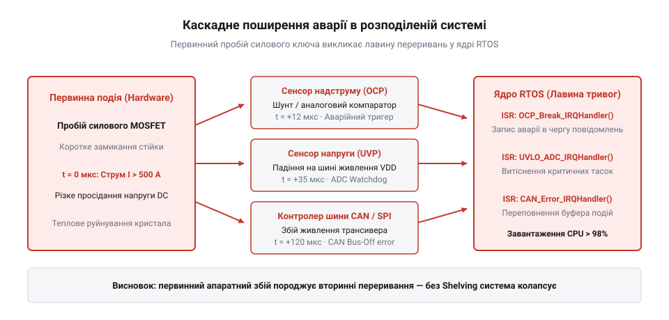

# Придушення лавини тривог: графи першопричин, режимне маскування та Alarm Shelving

<preknowlist>
- [Життєвий цикл сигналізації: стандарти ISA-18.2, IEC 62682 та раціоналізація тривог](root:sf-devices/alarm-management-lifecycle-isa18) — стадії життєвого циклу тривог за стандартами ISA-18.2 та IEC 62682, критерії визначення лавини тривог і принципи раціоналізації сигналізацій
- [Матриця раціоналізації тривог та визначення пріоритетів](root:sf-devices/alarm-rationalization-matrix) — розподіл аварійних сигналів за рівнями критичності, наслідками збоїв та часом реакції оператора
</preknowlist>

## Лавина тривог та каскадні збої

У силовому перетворювачі чи приводному модулі пробій одного силового транзистора розгортається за частки мікросекунди. Фізична першопричина аварії єдина, проте вона миттєво збурює суміжні контури: датчик струму фіксує коротке замикання, монітор шини живлення сигналізує про падіння напруги, драйвер виставляє апаратну помилку недонапруги, а оптичний енкодер фіксує аномальне гальмування ротора. Якщо прошивка обробляє кожен сигнал як незалежну аварію, мікроконтролер опиняється під штормом апаратних запитів від підпрограм обробки переривань @@en|ISR@@ (з англ. *interrupt service routine* — підпрограма обробки переривання). Вхідні черги повідомлень операційної системи реального часу @@en|RTOS@@ (з англ. *real-time operating system* — операційна система реального часу) переповнюються, а ядро процесора витрачає весь тактовий бюджет на збереження контексту замість локалізації несправності.

У теорії керування цей стан називають лавиною тривог — @@en|alarm flood@@ (з англ. *alarm* — тривога, *flood* — повінь, затоплення). За стандартами @@en|ISA-18.2@@ та @@en|IEC 62682@@ лавиною вважають потік понад десять сповіщень за десять хвилин, але у вбудованих пристроях сотні аварійних подій генеруються за мілісекунди. На людину-оператора або високорівневий діагностичний модуль лягає когнітивне перевантаження — @@en|cognitive overload@@ (з англ. *cognitive* — пізнавальний, *overload* — перевантаження) та втома від тривог — @@en|alarm fatigue@@ (з англ. *alarm* — тривога, *fatigue* — втома). Спроби реагувати на вторинні симптоми, як-от падіння напруги чи гальмування ротора, паралізують діагностику, бо ресурси системи витрачаються на наслідки, доки першопричина руйнує обладнання.

Фізична природа лавини криється у взаємозв'язку параметрів: збій одного вузла неминуче викликає каскадну реакцію залежних сенсорів. Для захисту від таких штормів інженери розробляють архітектуру відповідно до [життєвого циклу сигналізацій](root:sf-devices/alarm-management-lifecycle-isa18), розподіляють події за [матрицею раціоналізації тривог](root:sf-devices/alarm-rationalization-matrix) та налаштовують надійні [блокування й умови допуску](root:sf-devices/blokuvannia-i-umovy-dopusku-interlock), які ізолюють аварійний вузол до розвитку каскадного руйнування.


*Схема каскадного поширення аварії: первинний пробій транзистора викликає множинні вторинні тривоги та лавину переривань у RTOS.*

## Графове придушення, маскування та шелвінг

Щоб відокремити першопричину від каскадних симптомів, взаємозв'язки між аваріями описують причинно-наслідковою моделлю. Оскільки у фізичному світі час незворотний, а причина завжди передує наслідку, ця залежність не має замкнених циклів і утворює орієнтований ациклічний граф — @@en|DAG@@ (від англ. *directed acyclic graph* — орієнтований ациклічний граф). Вузли графу відповідають тривогам, а дуга `A → B` означає, що збій `A` породжує вторинний сигнал `B`. Коли спрацьовує вузол-батько `A`, прошивка застосовує батьківське витіснення — @@en|parent suppression@@ (з англ. *parent* — батько, *suppression* — придушення), примусово заглушаючи всі підпорядковані йому симптоми `B` та `C`.

У критичних вбудованих системах динамічне виділення пам'яті заборонене через небезпеку фрагментації купи та втрату часового детермінізму. Топологію графу розміщують у статичній пам'яті @@en|SRAM@@ (з англ. *static random-access memory* — статична оперативна пам'ять) у вигляді бітової матриці суміжності — @@en|adjacency matrix@@ (з англ. *adjacency* — суміжність, *matrix* — матриця). Для `N` сигналів кожен рядок матриці `DAG_Matrix[i]` є двійковою маскою @@en|bitmask@@ (з англ. *bit* — біт, *mask* — маска), де одиничні біти вказують на тривоги, які придушуються тривогою `i`.

Перед графовим аналізом потік тривог очищують від очікуваних відхилень за допомогою режимного маскування — @@en|mode masking@@ (з англ. *mode* — режим, *masking* — маскування). Скінченний автомат @@en|FSM@@ (від англ. *finite state machine* — скінченний автомат) прошивки визначає бітову маску дозволених сповіщень `M_mode` для станів пуску, роботи чи зупинки. Це запобігає [плутанині режимів і цілей](root:sf-devices/mode-and-target-confusion-hmi) під час перехідних процесів (наприклад, пускового струму двигуна) та утримує [динамічний конверт безпеки](root:sf-devices/operational-design-domain-limits). Додатково оператор може тимчасово відкласти тривогу за стандартом @@en|ISA-18.2@@ через процедуру @@en|Alarm Shelving@@ (з англ. *shelf* — полиця, тимчасове відкладення тривоги), якщо сенсор через апаратне брязкання генерує частий шум — @@en|chattering alarm@@ (з англ. *chattering* — брязкаючий, частий повтор). Правила шелвінгу вимагають обов'язкового таймера для автоматичного повернення — @@en|auto-unshelve@@ (з англ. *auto* — автоматичний, *unshelve* — зняття з полиці) та негайного зняття блокування, якщо параметр сягає аварійної межі вищого рівня.

Обчислимо підсумковий вектор активних першопричин `S_final` із сирого вектора сенсорів `S_raw`, маски дозволу поточного режиму `M_mode`, вектора відкладених тривог `S_shelved` та рядків матриці суміжності `DAG_Matrix`, використовуючи проміжний вектор кандидатів `S_candidate` і маску придушення `P_suppress`:

```
S_final = S_candidate ∧ ¬P_suppress                      [визначення через кандидатів і маску придушення]
        = (S_raw ∧ M_mode ∧ ¬S_shelved) ∧ ¬P_suppress    [підстановка кандидатів після маскування FSM та шелвінгу]
        = (S_raw ∧ M_mode ∧ ¬S_shelved) ∧ ¬(⋁ DAG_Matrix[i]) [розкриття маски придушення через рядки активних батьків]
```

Підсумковий вектор містить одиничні біти лише для справжніх першопричин, що дає змогу реалізувати [два шари рішення](root:sf-devices/reaktsiia-chy-plan) — миттєві апаратні захисти та детерміноване сповіщення оператора без перевантаження черг.