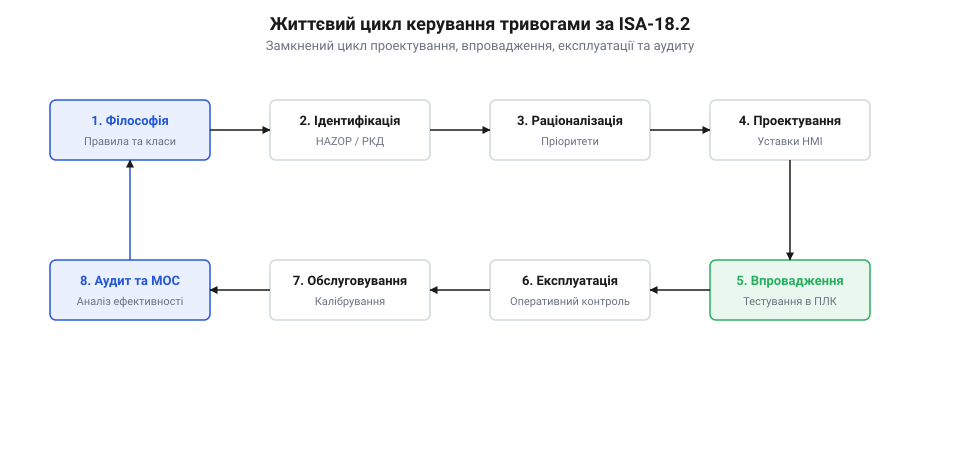
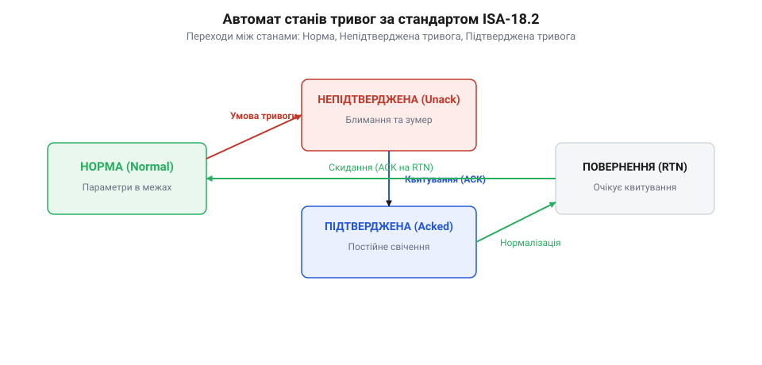
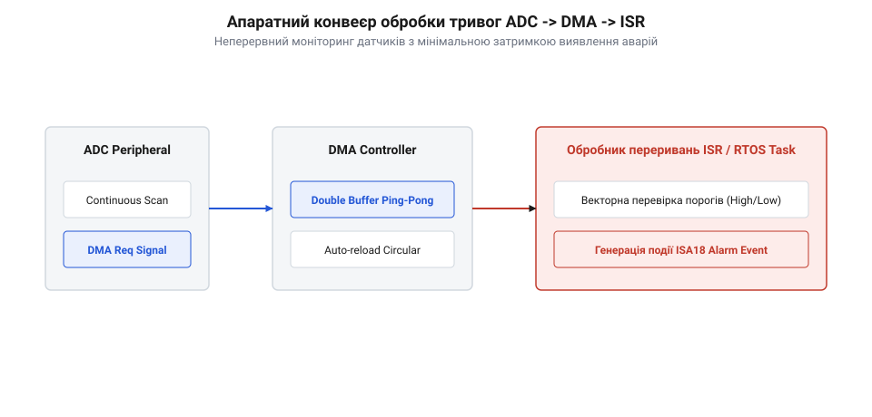
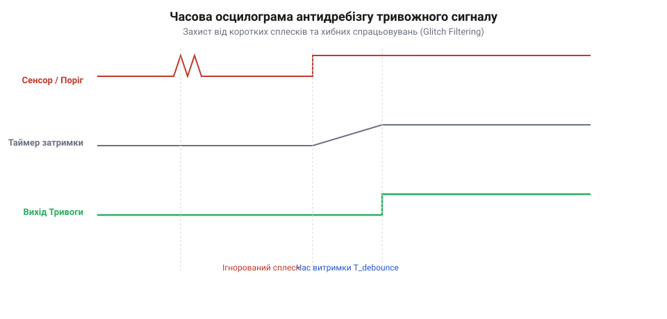

# Життєвий цикл сигналізації: стандарти ISA-18.2, IEC 62682 та раціоналізація тривог

## Початкові концепції та фізичні принципи

У вбудованих системах керування, автономних робототехнічних комплексах та промислових контролерах мікроконтролер безперервно зчитує фізичні параметри навколишнього середовища: тиск у гідравлічних магістралях, температуру силових ключів, струм обмоток електродвигунів, напругу акумуляторних батарей та швидкість обертання роторів. Фізичний сигнал, що надходить від первинного перетворювача (сенсора), ніколи не буває абсолютно чистим. Електромагнітні наводки, тепловий шум напівпровідникових елементів, механічні вібрації конструкції та дискретність аналогово-цифрового перетворення (@@en|ADC@@) додають до корисного сигналу високочастотну випадкову складову.

Якщо розробник вбудованої системи реалізує перевірку виходу параметра за безпечні межі через просте порівняння поточного значення з фіксованим порогом, виникає критична деструктивна ситуація. Коли фізичний параметр повільно наближається до межі спрацьовування та зупиняється поблизу неї, високочастотний шум змушує дискретний прапор тривоги перемикатися між станами «Норма» та «Тривога» десятки або сотні разів на секунду. Таке швидке хаотичне перемикання називається @@en|chattering alarm@@ (дребезг або тремтіння тривоги).

Коли у складній фізичній системі виникає динамічний перехідний процес — наприклад, стрибок тиску або просідання живлення, — межі спрацьовування одночасно перетинають десятки сенсорів. Якщо кожен із них генерує сотні повторних сповіщень на секунду, виникає @@en|alarm flood@@ (лавина тривог). За декілька секунд шина зв'язку вбудованого пристрою переповнюється, а шини сповіщення та інтерфейси оператора заповнюються тисячами однотипних повідомлень. Оператор втрачає здатність виявити першопричину аварії, а програмні алгоритми верхнього рівня не можуть своечасно виконати захисне відключення.

Для розв'язання цієї проблеми в промисловій автоматизації та розробці відповідальних вбудованих систем було розроблено міжнародні стандарти @@en|ISA-18.2@@ («Management of Alarm Systems for the Process Industries») та його еквівалент @@en|IEC 62682@@. Фундаментальний принцип @@en|ISA-18.2@@ полягає в суворому визначенні поняття тривоги: @@en|alarm@@ (тривога) — це операційне сповіщення, яке вказує на відхилення процесу за припустимі межі та вимагає обов'язкової негайної реакції оператора або автоматичного алгоритму для запобігання небажаним наслідкам. Якщо подія не вимагає дій для виправлення ситуації, вона не має права називатися тривогою — це лише системна подія або запис у журналі.

Стандарти @@en|ISA-18.2@@ та @@en|IEC 62682@@ формалізують повний @@en|Alarm Management Lifecycle@@ (Життєвий цикл керування тривогами), що охоплює десять послідовних стадій розробки та експлуатації:

1. **@@en|Alarm Philosophy@@** (Філософія сигналізації): Формування базового документа проєкту, який задає правила визначення пріоритетів, межі навантаження на оператора, вимоги до затримок та архітектуру обробки тривог в прошивці. 2. **@@en|Identification@@** (Ідентифікація): Виявлення потенційних небезпечних станів та збоїв обладнання на етапі аналізу фізичної системи, які потенційно потребують сповіщення. 3. **@@en|Rationalization@@** (раціоналізація, від латинського @@en|rationalis@@ — розумний): Системна оцінка кожної ідентифікованої тривоги. На цьому етапі доводиться необхідність тривоги, визначаються чіткі фізичні наслідки її ігнорування, обчислюється @@en|time to consequence@@ (максимально допустимий час реакції до настання пошкодження) та призначається пріоритет. 4. **@@en|Detailed Design@@** (Детальний дизайн): Проєктування порогових значень, вибір величини гістерезису (@@en|deadband@@ — мертва зона), визначення часових затримок фільтрації (@@en|on-delay@@, @@en|off-delay@@), розробка логіки придушення та маскування. 5. **@@en|Implementation@@** (Реалізація): Переклад спроєктованих правил у програмний код мікроконтролера, налаштування модулів @@en|RTOS@@, створення баз даних тривог та Людино-машинного інтерфейсу (@@en|HMI@@). 6. **@@en|Operation@@** (Експлуатація): Штатна робота прошивки пристрою, обробка поточних тривог, реєстрація дій підтвердження та квитування. 7. **@@en|Maintenance@@** (Технічне обслуговування): Періодичне калібрування сенсорів, перевірка працездатності каналів сповіщення та виведення несправних модулів у режим обслуговування. 8. **@@en|Monitoring & Assessment@@** (Моніторинг і оцінка): Неперервний статистичний аналіз роботи системи в рантаймі (вимірювання частоти виникнення @@en|chattering alarm@@, середньої кількості тривог за годину, пікового навантаження під час лавин). 9. **@@en|Management of Change@@** (@@en|MOC@@ — Менеджмент змін): Офіційна процедура погодження та внесення змін у конфігураційні параметри тривог (пороги, затримки) у робочій прошивці. 10. **@@en|Audit@@** (Аудит): Періодична перевірка відповідності реальної поведінки системи вимогам початкової @@en|Alarm Philosophy@@.

На рівні вбудованої прошивки фізичне придушення @@en|chattering alarm@@ базується на двох математичних та алгоритмічних механізмах: дедбенд-гістерезисі (гістерезис, від грецького @@en|hysteresis@@ — спізнення) та часових затримках спрацьовування (@@en|on-delay@@ і @@en|off-delay@@).

Нехай аналоговий сенсор вимірює параметр `x(t)`. Верхня небезпечна межа становить `Th_high`. Щоб уникнути тремтіння прапора при коливаннях `x(t)` навколо `Th_high`, вводиться дедбенд (від англійського @@en|deadband@@ — мертва зона) шириною `H`. Умова активування тривоги виконується, коли параметр перевищує поріг `Th_high`. Проте зворотний перехід у безпечний стан відбувається не при перетині `Th_high`, а лише тоді, коли параметр опускається нижче нижньої межі гістерезису `Th_high - H`.

Для запобігання реагуванню на поодинокі короткі сплески шуму використовується лічильник дебаунсу або часова затримка @@en|on-delay@@ тривалістю `T_on`. Сигнал вважається істинно аварійним лише тоді, коли умова `x(t) ≥ Th_high` виконується безперервно протягом інтервалу `T_on`. Аналогічно, затримка @@en|off-delay@@ тривалістю `T_off` утримує тривогу в активному стані доти, доки параметр не перебуватиме в безпечній зоні `x(t) < Th_high - H` безперервно протягом `T_off`.

Розглянемо дискретне рівняння лічильника дебаунсу для обчислювального циклу мікроконтролера з періодом `Δt`:

```
Counter(k) = Counter(k-1) + 1  якщо x(k) ≥ Th_high
Counter(k) = max(0, Counter(k-1) - 1)  якщо x(k) < Th_high - H

Condition_Triggered = 1  якщо Counter(k) ≥ N_on_delay
Condition_Triggered = 0  якщо Counter(k) == 0
```

де `N_on_delay` — необхідна кількість послідовних відліків `N_on_delay = T_on ÷ Δt`.

Коли вимірюваний параметр виходить за безпечні межі, система аналізує, чи не порушується [динамічний конверт безпеки](root:sf-devices/operational-design-domain-limits) робочого режиму. Якщо вихід за межі загрожує пошкодженням апаратних вузлів, прошивка повинна вжити захисних заходів ще до настання фатального пошкодження. При цьому в умовах складних динамічних процесів алгоритм має застосовувати [маскування та придушення](root:sf-devices/alarm-flood-suppression-and-shelving) вторинних сповіщень, щоб не відволікати обчислювальні ресурси на другорядні симптоми.


*Динаміка аналогового сигналу процесу при перетині порогу сигналізації з виконанням умов дедбенду H та затримок дебаунсу.*

## Внутрішня будова та алгоритми роботи

Реалізація вимог стандартів @@en|ISA-18.2@@ та @@en|IEC 62682@@ у прошивці мікроконтролера вимагає побудови детермінованого скінченного автомата (@@en|state machine@@) для кожного сигналу тривоги.

Згідно зі стандартом @@en|ISA-18.2@@, канал тривоги може перебувати в одному з семи формальних станів:

1. **@@en|Normal@@** (Нормальний стан): Фізичний параметр перебуває в безпечних межах, умова спрацьовування не виконується. 2. **@@en|Unacknowledged Alarm@@** (@@en|Unack Alarm@@ — тривога непідтверджена): Фізичний параметр перетнув поріг `Th_high` і витримав затримку `T_on`. Тривога активна, але оператор або система верхнього рівня ще не квитували (не підтвердили) отримання сповіщення. 3. **@@en|Acknowledged Alarm@@** (@@en|Ack Alarm@@ — тривога підтверджена): Аварійний стан триває, проте оператор натиснув кнопку квитування. Звукова та миготлива сигналізація вимикаються, а прапор активної тривоги залишається в пам'яті. 4. **@@en|Return to Normal Unacknowledged@@** (@@en|RTN Unack@@ — непідтверджене повернення до норми): Фізичний параметр повернувся в безпечну зону (нижче `Th_high - H`), проте тривога не була квитована оператором під час її активної фази. 5. **@@en|Shelved@@** (Тимчасово виведено з експлуатації / @@en|alarm shelving@@): Оператор вручну заблокував сповіщення від даного каналу на визначений таймаут через ненадійність сенсора або проведення випробувань. 6. **@@en|Suppressed by Design@@** (Придушено за проєктом): Прошивка автоматично заблокувала тривогу на основі поточного стану або режиму роботи обладнання (наприклад, блокування сповіщення про низький тиск масла при зупиненому двигуні). 7. **@@en|Out of Service@@** (@@en|OOS@@ — виведено з експлуатації): Канал повністю відключено сервісним персоналом для проведення ремонтних робіт або калібрування.


*Переходи між станами ISA-18.2 скінченного автомата обробки тривог в операційній системі реального часу.*

У вбудованих системах реального часу (@@en|RTOS@@, таких як @@en|FreeRTOS@@ або @@en|Zephyr@@) використання динамічної пам'яті (`malloc` або `new`) під час обчислювального циклу є неприпустимим. Фрагментація купи та неопределена затримка виділення пам'яті порушують детермінованість системи.

Усі структури даних тривог виділяються статично у вигляді масивів фіксованого розміру. Для оптимізації об'єму RAM та швидкості обробки в регістрах мікроконтролера використовуються компактні бітові поля (@@en|bitfields@@) та атомарні змінні.

Нижче наведено самодостатню та ідіоматичну реалізацію модуля обробки тривог стандарта @@en|ISA-18.2@@ мовами C та C++ для операційних систем реального часу:

:::tabs
@tab C (ESP-IDF / FreeRTOS)
:::code root\eng\sf-devices\alarm-management-lifecycle-isa18/alarm-management-lifecycle-isa18-d/c/esp-idf/alarm-channel-init.c c
@tab C++ (Zephyr RTOS)
:::code root\eng\sf-devices\alarm-management-lifecycle-isa18/alarm-management-lifecycle-isa18-d/cpp/zephyr/alarmstate.cpp cpp
:::

Окрім базового автомата станів, високоефективні рушії тривог у прошивках застосовують логіку першої тривоги (@@en|First-Out Logic@@) та безблокувальне записування подій через кільцевий буфер (@@en|ring buffer@@).

Під час каскадного аварійного відключення системи десятки тривог можуть активуватися з інтервалом у кілька мілісекунд. Щоб виявити істину першопричину зупинки, прошивка порівнює точні часові мітки `trip_timestamp_us`, отримані з апаратного таймера мікроконтролера. Канал із найменшою часовою міткою отримує прапор `ALARM_FLAG_FIRST_OUT` (первинне спрацьовування). Це дозволяє чітко розрізнити, що аварія почалася, наприклад, із падіння тиску масла, а не з наступного перегріву підшипника.

При критичних порушеннях технологічного процесу прошивка виконує [двошарове рішення реакції](root:sf-devices/reaktsiia-chy-plan) для негайного витіснення поточного режиму керування та активації безпечних сценаріїв. Якщо тривога вимагає апаратного відключення актуаторів, активуються [апаратні блокування й допуск](root:sf-devices/blokuvannia-i-umovy-dopusku-interlock), які запобігають повторному увімкненню силових кіл до повного скидання аварійного стану. У випадку збою виконання послідовності захисту вбудована система виконує [апаратний відкат транзакцій](root:sf-devices/hardware-compensating-transactions-rollback) для повернення виконавчих механізмів у безпечну вихідну позицію.

Для забезпечення детермінованості виконання та мінімізації накладних витрат обробка даних у критичних секціях здійснюється за допомогою цілочисельної арифметики з атомарним оновленням прапорців станів @@en|atomic flags@@, що виключає дрейф фази та блокування переривань.

## Апаратна реалізація та низькорівневий C/C++ код

У вбудованих системах реального часу, промислових контролерах та автономних пристроях зчитування аналогових параметрів (струму, напруги, тиску, температури) здійснюється за допомогою аналогово-цифрового перетворювача (від англійського @@en|Analog-to-Digital Converter@@, @@en|ADC@@). Якщо мікроконтролер опитує регістри @@en|ADC@@ програмним шляхом у циклі або за перериваннями завершення поодинокого вимірювання, операційна система витрачає значну частку процесорного часу на обслуговування переривань. При високій частоті дискретизації (наприклад, 10–100 кГц на канал) це призводить до виснаження ресурсів центрального процесора (від англійського @@en|Central Processing Unit@@, @@en|CPU@@) та виникнення джиттеру (від англійського @@en|jitter@@ — тремтіння фази) часових інтервалів.

Для забезпечення детермінованого зчитування даних без залучення @@en|CPU@@ застосовується модуль прямого доступу до пам'яті (від англійського @@en|Direct Memory Access@@, @@en|DMA@@). Контролер @@en|ADC@@ налаштовується у режим безперервного сканування каналів, а @@en|DMA@@ автоматично переносить виміряні значення у кільцевий або подвійний (@@en|ping-pong@@) буфер у оперативній пам'яті (від англійського @@en|Random Access Memory@@, @@en|RAM@@). По завершенні заповнення половини буфера (@@en|Half Transfer Complete@@) або всього буфера (@@en|Transfer Complete@@) контролер переривань (від латинського @@en|interruptus@@ — перерваний, @@en|Nested Vectored Interrupt Controller@@, @@en|NVIC@@) викликує процедуру обслуговування переривання (від англійського @@en|Interrupt Service Routine@@, @@en|ISR@@).

Спроба виконати повну логіку скінченного автомата стандарту @@en|ISA-18.2@@ — з оновленням часових затримок, форматуванням тексту повідомлень, записом у журнал та сповіщенням зовнішніх систем — безпосередньо всередині @@en|ISR@@ є серйозною архітектурною помилкою. Виконання тривалих операцій у контексті переривання збільшує затримку обслуговування інших високопріоритетних подій (наприклад, швидкодіючого захисту від короткого замикання або керування инвертором) і загрожує переповненням стека.

Тому апаратна реалізація модуля обробки тривог будується на дворанговій розділеній архітектурі:

1. **Первинна фільтрація та фіксація в @@en|ISR@@ (мікросекундний рівень):** Обслуговувач переривання @@en|DMA@@ виконує швидке порівняння сирих відліків @@en|ADC@@ із пороговими значеннями, оновлює атомарний бітмаск (від англійського @@en|bitmask@@) стану каналів та, у разі зміни стану, додає коротку подійну структуру у безблоковий кільцевий буфер (від англійського @@en|lock-free@@ @@en|ring buffer@@). 2. **Обробка автомата станів @@en|ISA-18.2@@ у задачі @@en|RTOS@@ (мілісекундний рівень):** Високопріоритетна задача операційної системи реального часу (від англійського @@en|Real-Time Operating System@@, @@en|RTOS@@, такої як @@en|FreeRTOS@@ або @@en|Zephyr@@) розблоковується за сигналом із @@en|ISR@@, зчитує події з безблокового буфера, обчислює часові затримки @@en|on-delay@@ та @@en|off-delay@@, виконує стадійні переходи автомата та розсилає сповіщення.


*Архітектурний потік зчитування сенсорних даних через DMA, дворангову фільтрацію в ISR та передачу подій безблоковим буфером до задач RTOS.*

У сучасних мікроконтролерах архітектури ARM Cortex-M7 або Cortex-M33, оснащених клейовим кешем даних (від англійського @@en|Data Cache@@, @@en|L1 Cache@@), виникає проблема узгодженості пам'яті (@@en|cache coherence@@). Коли модуль @@en|DMA@@ записує нові дані від @@en|ADC@@ безпосередньо у фізичну @@en|RAM@@, @@en|CPU@@ може прочитати застарілі значення із кеш-ліній, якщо вони не були інвалідовані. Застосування застарілих даних призводить до пропуску перевищення порогу або до хибних спрацьовувань.

Для запобігання розсинхронізації кешу пам'ять для буферів @@en|DMA@@ розміщують у некошованих областях за допомогою модуля захисту пам'яті (від англійського @@en|Memory Protection Unit@@, @@en|MPU@@) або явно виконують інвалідацію ліній кешу (`SCB_InvalidateDCache_by_Addr`) перед читанням буфера в @@en|ISR@@. Крім того, при передачі прапорів між @@en|ISR@@ та задачами @@en|RTOS@@ обов'язково застосовуються бар'єри пам'яті (`__DMB()` — @@en|Data Memory Barrier@@, `__DSB()` — @@en|Data Synchronization Barrier@@), які гарантують, що операції запису в атомарні змінні завершаться до виконання наступних інструкцій процесорного конвеєра.

Детермінованість часу реагування підтверджується розрахунком часового бюджету виконання. Загальний час від моменту перетину фізичного порогу до отримання сповіщення задачею керування `T_total` обчислюється за формулою:

```
T_total = T_adc_conv + T_dma_transfer + T_isr_entry + T_eval + T_rtos_switch
```

де `T_adc_conv` — час перетворення @@en|ADC@@, `T_dma_transfer` — тривалість передачі блоку по шині, `T_isr_entry` — апаратна затримка входу в переривання @@en|NVIC@@, `T_eval` — час розрахунку порогових умов, `T_rtos_switch` — тривалість перемикання контексту задач в @@en|RTOS@@.

Розглянемо приклад розрахунку часу оцінки `T_eval` для блоку з `N` каналів при використанні побітових паралельних операцій (від англійського @@en|SIMD Within A Register@@, @@en|SWAR@@):

```
T_eval = N_channels × (T_read + T_compare + T_bitwise_op)
= 32 × (3 нс + 4 нс + 5 нс)                              [підстановка стандартних таймінгів Cortex-M7 на 216 МГц]
= 384 нс                                                 [загальний час оцінки 32 каналів тривог]
```

Отриманий час у 384 наносекунди показує, що первинна обробка 32 каналів у перериванні займає менше одного мікровідліку процесора, залишаючи основний обчислювальний ресурс для задач керування.

Нижче наведено самодостатні, ідіоматичні реалізації апаратно-оптимізованого модуля тривог для вбудованих систем мовами C та C++:

:::tabs
@tab C (ESP-IDF / FreeRTOS)
:::code root\eng\sf-devices\alarm-management-lifecycle-isa18/alarm-management-lifecycle-isa18-d/c/esp-idf/alarm-hw-init-channel.c c
@tab C++ (STM32 / Bare-metal)
:::code root\eng\sf-devices\alarm-management-lifecycle-isa18/alarm-management-lifecycle-isa18-d/cpp/stm32/state.cpp cpp
:::

---

## Практичне застосування та відлагодження

Надійність роботи модуля тривог у складних промислових умовах визначається стійкістю алгоритмів до граничних і переходних режимів. Під час розробки прошивок для відповідальних пристроїв інженер повинен передбачити та проконтролювати чотири класи нестандартних ситуацій:

1. **Перехідні процеси під час включення живлення (від англійського @@en|Power-Up Transients@@):** Під час подачі напруги живлення сенсори, аналогові підсилювачі та джерела опорної напруги потребують часу для виходу на робочий режим (від десятків мілісекунд до кількох секунд). Якщо модуль тривог почне обробляти відліки @@en|ADC@@ одразу після скидання процесора, первинні нульові або нестабільні значення викличуть хибний спалах аварійних сповіщень. Для запобігання цьому в прошивці впроваджують таймер затримки ініціалізації (`boot_inhibit_timer`), який утримує всі канали тривог у стані `ALARM_STATE_SUPPRESSED` до повної стабілізації апаратних кіл. 2. **Обрив ліній зв'язку та вихід сенсорів з ладу:** Виміряне значення @@en|ADC@@, що відповідає крайнім межам діапазону (0 або 4095 для 12-бітного перетворювача), часто свідчить не про фізичне перевищення параметра, а про обрив кабелю або коротке замикання сенсора на землю. Прошивка повинна першочергово перевіряти апаратну цілісність каналу. При виявленні несправності сенсора відповідна тривога переводиться у стан `ALARM_STATE_OOS` (Out of Service), що блокує подальшу генерацію порогових сповіщень.

Коли виникає обрив лінії або відмова фізичного вузла, прошивка пристрою повертає управління в безпечний стан через [блокування й умови допуску](root:sf-devices/blokuvannia-i-umovy-dopusku-interlock), не дозволяючи виконавчим органам продовжувати рух. Якщо аварійний вимикач розмикає ланцюг живлення, система захисту може ініціювати [фізичні компенсаційні транзакції](root:sf-devices/hardware-compensating-transactions-rollback) для механічного повернення актуаторів у вихідне положення.

Для підтримки цілісності конфігурації у системах з високочастотним оновленням команд модуль сигналізації взаємодіє з механізмами фільтрації. При виникненні лавини сповіщень прошивка активує [дедуплікацію команд у прошивці](root:sf-devices/embedded-command-deduplication), захищаючи внутрішні черги від переповнення та запобігаючи втраті контролю над критичними процесами. У критичних автономних робототехнічних системах інформація про активні тривоги транслюється в [патерн рантайм-екранування](root:sf-devices/safety-shielding-cage-architecture), який корегує керуючі впливи та обмежує траєкторію руху в межах [динамічного конверта безпеки](root:sf-devices/operational-design-domain-limits).

3. **Переповнення системних таймерів (від англійського @@en|Timer Rollover@@):** Використання мікросекундних або мілісекундних системних лічильників (наприклад, 32-бітного лічильника `uint32_t`) призводить до їхнього періодичного обнулення (для 32-бітного мікросекундного таймера переповнення настає через ~71,5 хвилини). Якщо обчислення часової затримки виконати через пряме порівняння:

```
/* ПОМИЛКОВИЙ КОД: призводить до заклинювання тривоги при переповненні */
if (current_time_us >= (trip_start_us + delay_us)) { ... }
```

то в момент переповнення `current_time_us` скидається в 0, вираз стає хибним, і тривога заклинює в поточувальному стані на 71 хвилину.

Виправлення базується на властивостях беззнакової арифметики за модулем `2³²`. Обчислення різниці часу завжди є коректним при використанні віднімання:

```
/* КОРЕКТНИЙ КОД: стійкий до переповнення 32-бітного таймера */
uint32_t elapsed_us = (uint32_t)(current_time_us - trip_start_us);
if (elapsed_us >= delay_us) { ... }
```

4. **Джиттер періоду оновлення в багатозадачному середовищі:** Якщо задача обробки тривог викликається з нерегулярним інтервалом через витіснення іншими задачами @@en|RTOS@@, використання фіксованого інкремента лічильника відліків (`on_counter++`) призводить до похибки реального часу затримки. У таких умовах прошивка має розраховувати фактичний інтервал часу між викликами `Δt_us` та додавати його до акумулятора затримки:

```
accumulated_time_us = accumulated_time_us + delta_t_us      [інкремент затримки з урахуванням фактичного джиттеру]
```

Для виявлення та діагностики часових затримок у реальному часі розробник використовує апаратні інструменти відлагодження:

- **Трасування через виводи @@en|GPIO@@:** На час виконання переривання @@en|DMA@@ або задачі обробки тривог відповідний фізичний вивід мікроконтролера (від англійського @@en|General-Purpose Input/Output@@, @@en|GPIO@@) встановлюється в логічну одиницю, а при виході — в нуль. Підключення логічного аналізатора (від англійського @@en|Logic Analyzer@@) дозволяє з точністю до наносекунд виміряти тривалість обробки та затримку входу в переривання. - **Апаратне трасування @@en|ITM@@ / @@en|SWO@@:** Використання підсистеми трасування ARM Cortex-M (від англійського @@en|Instrumentation Trace Macrocell@@, @@en|ITM@@) через вивід однопровідного виводу трасування (від англійського @@en|Serial Wire Output@@, @@en|SWO@@) дозволяє передавати діагностичні маркери та ідентифікатори тривог без зупинки процесора та без затримок, властивих послідовним портам (від англійського @@en|Universal Asynchronous Receiver-Transmitter@@, @@en|UART@@).


*Часова діаграма трасування GPIO-пинів та ITM-подій під час вимірювання затримок спрацьовування дебаунсу й часового джиттеру.*

Тестування модуля тривог вимагає проведення процедур ін'єкції збоїв (від англійського @@en|Fault Injection@@). На етапі автоматизованого юніт-тестування замість реального @@en|ADC@@ підключають програмний симулятор сигналів, який випробовує автомат станів високочастотним шумом, східчастими стрибками та імітацією обриву зв'язку. Перевірка відповідності коду стандартам функціональної безпеки здійснюється статичними аналізаторами на дотримання правил @@en|MISRA C@@ / @@en|MISRA C++@@, що гарантує відсутність незаінціалізованих змінних, динамічного виділення пам'яті та потенційних заклинювань у циклах.