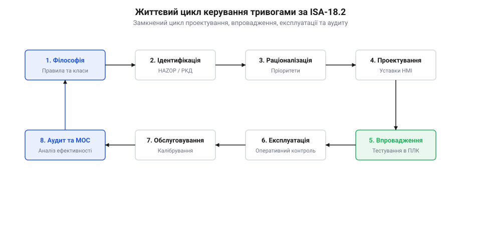
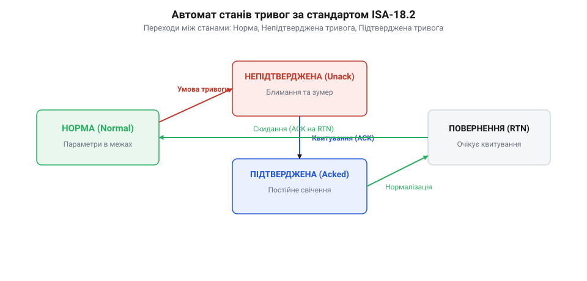

# Життєвий цикл сигналізації: стандарти ISA-18.2, IEC 62682 та раціоналізація тривог

<preknowlist>
- [Реакція чи план: два шари рішення](root:sf-devices/reaktsiia-chy-plan) — різниця між контуром миттєвої захисної реакції та плановою обробкою технологічного процесу
- [Блокування й умови допуску (interlock)](root:sf-devices/blokuvannia-i-umovy-dopusku-interlock) — механізми апаратного й програмного блокування силових приводів до зняття аварійного стану
</preknowlist>

## Тремтіння тривог, лавина сповіщень і дедбенд

Коли сенсор працює поблизу порогу, аналоговий шум змушує компаратор хаотично спрацьовувати десятки разів на секунду. Процесор безперервно шле сповіщення, перевантажуючи шину зв'язку та журнал подій. Це явище називають @@en|chattering alarm@@ (від англ. @@en|chatter@@ — швидко цокотіти) — тремтінням сигналізації. Під час аварійних перехідних процесів сотні сенсорів одночасно перетинають пороги, спричиняючи @@en|alarm flood@@ (від англ. @@en|flood@@ — повінь) — лавину тривог. Шквал однотипних повідомлень позбавляє оператора можливості вчасно виявити першопричину аварії.

Щоб придушити тремтіння, прошивка розводить пороги ввімкнення та вимкнення за допомогою гістерезису. Цю захисну смугу називають @@en|deadband@@ (від англ. @@en|dead@@ — мертвий та @@en|band@@ — смуга) — зоною нечутливості. Поріг вимкнення тривоги `T_reset` для верхньої межі визначається відніманням нечутливості `Δ` від порогу спрацьовування `T_trip`:

```
T_reset
= T_trip - Δ      [гістерезис повернення до норми]
```

Завдяки зміщенню `T_reset` виміряний сигнал мусить опуститися нижче аварійного рівня щонайменше на `Δ`, перш ніж прапорець скинеться. Від короткочасних завад захищають часові затримки — @@en|debounce@@ (від англ. @@en|bounce@@ — підстрибування). Затримка `on-delay` вимагає стійкого утримання сигналу в зоні небезпеки, а `off-delay` запобігає передчасному скиданню прапорця.


*Життєвий цикл сигналізації за ISA-18.2: замкнений контур раціоналізації та моніторингу мінімізує хибні тривоги.*

Стандарти @@en|ISA-18.2@@ (від англ. @@en|International Society of Automation@@) та @@en|IEC 62682@@ (від англ. @@en|International Electrotechnical Commission@@) висувають фундаментальну вимогу: кожна істинна тривога вимагає негайної коригувальної дії оператора. Інформаційні події переводять у статусні повідомлення. Пріоритет сповіщень встановлює [матриця раціоналізації тривог](root:sf-devices/alarm-rationalization-matrix), а під час перехідних процесів система вмикає [механізми придушення сповіщень](root:sf-devices/alarm-flood-suppression-and-shelving), що блокують вторинні тривоги.

## Скінченний автомат станів сигналізації ISA-18.2

Простий булевий прапорець не фіксує, чи бачив оператор тривогу і чи повернувся процес до норми: якщо параметр відновився до реакції людини, прапорець зникне безслідно. Щоб детерміновано керувати життєвим циклом сповіщення, кожен канал реалізують як @@en|finite state machine@@ (від англ. @@en|state@@ — стан) — скінченний автомат станів за стандартом @@en|ISA-18.2@@.

Автомат відстежує п'ять станів: безпечний стан @@en|Normal@@, несквитована тривога @@en|Unacknowledged@@, сквитована небезпека @@en|Acknowledged@@, повернення до норми без підтвердження @@en|Unacknowledged Normal@@ та режимне придушення @@en|Suppressed@@.


*Переходи автомата ISA-18.2: обов'язкове квитування оператором гарантує обробку кожного аварійного виходу за межі.*

Переходи між станами відбуваються за суворими подіями:
1. Вихід параметра за безпечну межу переводить канал із @@en|Normal@@ у @@en|Unacknowledged@@ з увімкненням звуку та миготіння індикатора. 2. Оператор виконує квитування — @@en|acknowledge@@ (від англ. @@en|acknowledge@@ — підтверджувати), перемикаючи канал у стан @@en|Acknowledged@@ з вимкненням звуку та постійним світінням. 3. Повернення параметра в норму до квитування переводить автомат у @@en|Unacknowledged Normal@@: сигнал вимагає підтвердження факту перехідного викиду. 4. Технічне обслуговування чи планова зупинка активують блокування @@en|Suppressed@@, приховуючи нерелевантні тривоги.

В операційних системах реального часу @@en|RTOS@@ (від англ. @@en|Real-Time Operating System@@) рушій тривог будують без динамічної пам'яті на статичних масивах дескрипторів фіксованого розміру. Стани кодують бітовими прапорцями, а взаємодію між перериваннями сенсорів та задачами забезпечують атомарні змінні.

Під час каскадних вимкнень спрацьовують десятки захистів. Щоб безпомилково визначити першопричину аварії, застосовують @@en|first-out logic@@ (від англ. @@en|first@@ — перший та @@en|out@@ — назовні) — логіку першої тривоги. Обробники переривань фіксують спрацьовування апаратними мікросекундними мітками часу. Канал із найпершою міткою позначається джерелом аварії, а сигнал тривоги активує [захисні апаратні блокування](root:sf-devices/blokuvannia-i-umovy-dopusku-interlock), відокремлюючи [контур негайної реакції](root:sf-devices/reaktsiia-chy-plan) від черги сповіщень.