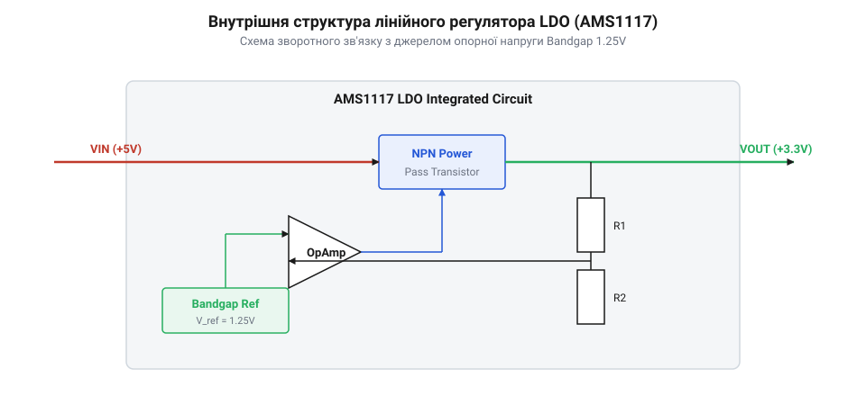
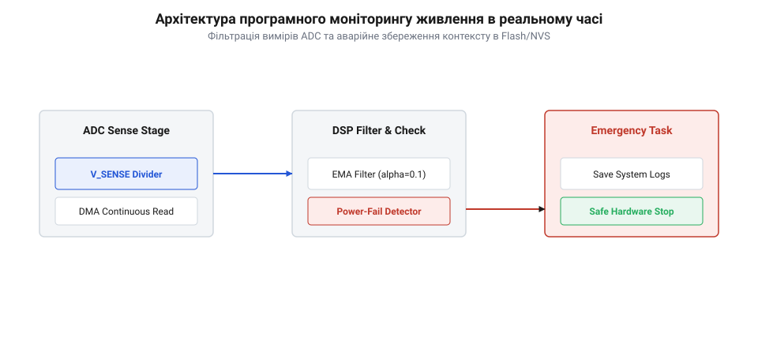
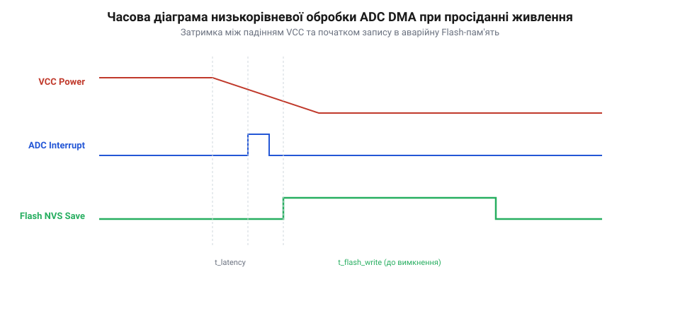
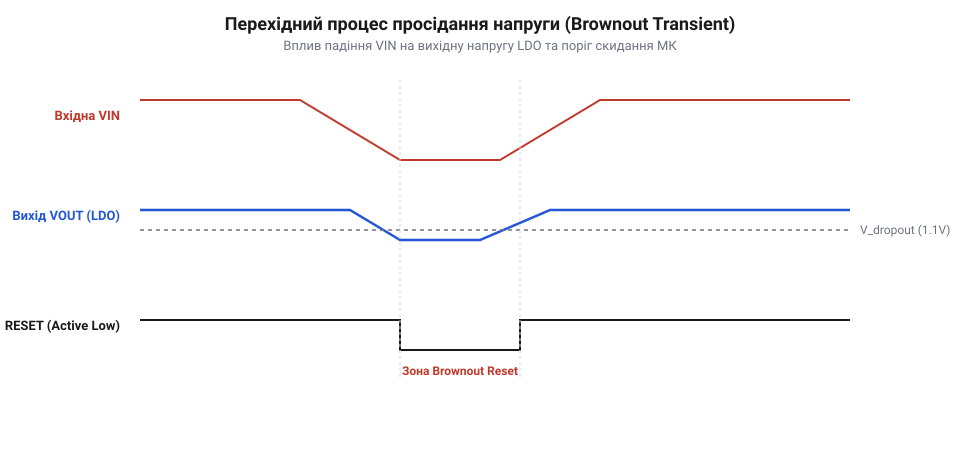

# Лінійний стабілізатор AMS1117

## Початкові концепції та фізичні принципи

У будь-якому вбудованому електронному пристрої стабільність та якість первинного живлення є безпосереднім фундаментом для функціонування обчислювального ядра та периферійних вузлів. Зовнішні джерела електричної енергії — такі як мережеві адаптери змінного струму на 9 В чи 12 В, шина @@en|USB@@ з напругою 5 В або літій-іонні акумулятори з робочим діапазоном від 3.0 В до 4.2 В — характеризуються суттєвими пульсаціями, високочастотними перехідними шумами та нестабільністю напруги залежно від навантаження. Подання такої нестабільної напруги напряму на чутливі цифрові мікросхеми, виготовлені за тонкими нанометровими технологічними процесами, призводить до порушення рівнів логічних сигналів, спотворення даних у оперативній пам'яті @@en|RAM@@, а також до виникнення незворотного апаратного пробою або засувного ефекту у напівпровідниковій структурі. Для запобігання цим явищам у схемах керування живленням застосовують спеціалізовані модулі стабілізації. Одним із найпоширеніших рішень у розробці вбудованих систем є лінійний стабілізатор напруги @@en|AMS1117@@, який належить до класу пристроїв @@en|LDO@@ (від @@en|Low-Dropout@@ — «низький рівень падіння напруги»).

Головним призначенням @@en|AMS1117@@ є перетворення вищої нестабільної вхідної постійної напруги `V_in` у фіксоване або регульоване значення вихідної напруги `V_out` (наприклад, 3.3 В чи 5.0 В) із мінімальним рівнем високочастотних шумів. На відміну від імпульсних перетворювачів живлення, лінійний стабілізатор принципово не створює високочастотних перемикальних завад, що робить його незамінним для живлення аналогово-цифрових перетворювачів @@en|ADC@@ (від @@en|Analog-to-Digital Converter@@ — «аналого-цифровий перетворювач»), тактових генераторів та чутливих радіочастотних модулів.

Щоб зрозуміти, як саме @@en|AMS1117@@ утримує вихідну напругу незмінною при динамічних стрибках струму споживання `I_load`, слід розглянути фізику його внутрішньої напівпровідникової кристалічної структури. Модуль складається з чотирьох ключових функціональних блоків: прецизійного джерела опорної напруги, диференційного підсилювача помилки, потужного прохідного транзистора та внутрішнього дільника напруги зворотного зв'язку.

Ключовим елементом, від якого залежить точність роботи всього стабілізатора, є джерело опорної напруги. У @@en|AMS1117@@ застосовується джерело [опорної напруги bandgap](root:sf-devices/bandgap-reference) (від @@en|band gap@@ — «ширина забороненої зони»), яке формує опорне значення напруги `V_ref`, що становить приблизно 1.25 В. Фізичний принцип роботи джерела @@en|bandgap@@ базується на взаємній компенсації двох протилежних температурних ефектів на напівпровідниковому @@en|P-N-перехід@@. Пряме падіння напруги на напівпровідниковому діоді має негативний температурний коефіцієнт (напруга зменшується зі зростанням температури), тоді як різниця напруг між двома діодами, що працюють із різними щільностями струму, володіє позитивним температурним коефіцієнтом. Шляхом точного підбору відношення опорів інтегрованих резисторів ці два ефекти додаються, що дозволяє отримати стабільне опорне значення напруги `V_ref`, яке практично не залежить від коливань температури навколишнього середовища у діапазоні від -40 °C до +125 °C.

Підсилювач помилки безперервно порівнює частину вихідної напруги, зняту з дільника зворотного зв'язку, з опорним значенням `V_ref`. Якщо внаслідок збільшення навантаження `I_load` вихідна напруга `V_out` починає незначно знижуватися, напруга на інвертуючому вході підсилювача помилки стає меншою за `V_ref`. Підсилювач реагує на цю різницю збільшенням вихідного струму керування, який подається на базу прохідного транзистора. Це призводить до відкриття транзистора, зменшення його динамічного опору та відновлення напруги `V_out` до номінального рівня за лічені мікросекунди.

Особливе значення для розробника прошивки має фізична архітектура прохідного транзистора. На відміну від багатьох сучасних мікропотужних стабілізаторів на польових транзисторах @@en|MOSFET@@, у стабілізаторі @@en|AMS1117@@ використано біполярний @@en|NPN@@ транзистор Сосклая або складений транзистор Дарлінгтона (@@en|Darlington@@). Таке рішення забезпечує високу стійкість до електричних перевантажень та здатність віддавати у навантаження струм до 1 А. Однак біполярна структура накладає фізичне обмеження на мінімальну різницю між вхідною та вихідною напругою, яка називається напругою падіння (@@en|dropout@@).

Мінімально необхідне падіння напруги `V_drop` визначається сумою напруги насичення колектор-емітер керуючого транзистора та напруги база-емітер силового транзистора:

    V_drop = V_be + V_sat

Для стабілізатора @@en|AMS1117@@ напруга `V_drop` становить від 1.1 В при малих струмах до 1.3 В при граничному струмі навантаження 1 А. Це означає, що для забезпечення стабільної вихідної напруги 3.3 В вхідна напруга `V_in` за жодних умов не повинна опускатися нижче 4.6 В. Якщо різниця `V_in - V_out` стає меншою за `V_drop`, прохідний транзистор переходить у режим глибокого насичення, контур зворотного зв'язку втрачає здатність до регулювання, а вихідна напруга починає дублювати всі просідання та пульсації вхідного живлення.

З точки зору термодинаміки, лінійний стабілізатор працює як керований активний опір, який розсіює надлишкову електричну потужність у вигляді тепла. Повна потужність теплорозсіювання `P_diss` обчислюється на основі вхідної напруги `V_in`, вихідної напруги `V_out`, струму навантаження `I_load` та власного струму спокою стабілізатора `I_q` (від @@en|quiescent current@@ — «струм спокою», що для @@en|AMS1117@@ становить близько 5–10 мА):

    P_diss = (V_in - V_out) × I_load + V_in × I_q

Розглянемо практичний розрахунок для вбудованої системи, де @@en|AMS1117@@ знижує напругу з 12 В до 3.3 В при струмі споживання модуля 400 мА:

    P_diss = (12 - 3.3) × 0.400 + 12 × 0.008
           = 8.7 × 0.400 + 0.096
           = 3.48 + 0.096
           = 3.576 Вт

Така потужність теплорозсіювання є критичною для малих корпусів поверхневого монтажу. Температура напівпровідникового кристала `T_j` (від @@en|junction temperature@@) розраховується через температуру навколишнього середовища `T_a` та коефіцієнт [термічного опору корпусу](root:sf-devices/thermal-resistance-management) `θ_JA`:

    T_j = T_a + P_diss × θ_JA

У разі використання стандарту корпусу @@en|SOT-223@@ без додаткового тепловідвідного мідного полігону на друкованій платі @@en|PCB@@ (від @@en|Printed Circuit Board@@ — «друкована плата»), значення `θ_JA` сягає 120 °C/Вт. При температурі середовища `T_a = 25 °C` температура кристала зросте до `25 + 3.576 × 120 = 454.1 °C`, що моментально викличе спрацьовування внутрішнього схеми теплового захисту (@@en|thermal shutdown@@) при досягненні 165 °C. Це підкреслює важливість точного розрахунку теплових режимів при розробці апаратури.

Ще одним критичним аспектом стабільності є характеристика вихідного конденсатора `C_out` та його еквівалентний послідовний опір @@en|ESR@@ (від @@en|Equivalent Series Resistance@@ — «еквівалентний послідовний опір»). Оскільки підсилювач помилки всередині @@en|AMS1117@@ має високий коефіцієнт підсилення, у частотній характеристиці контуру регулювання виникає домінуючий полюс. Для забезпечення стійкості від'ємного зворотного зв'язку вихідний конденсатор повинен володіти суворо визначеним значенням @@en|ESR@@ (зазвичай у межах від 0.1 Ом до 1.0 Ом). Цей опір створює нуль у передавальній функції контуру, який компенсує зсув фази на високих частотах. Використання сучасних керамічних конденсаторів @@en|MLCC@@ із наднизьким @@en|ESR@@ (< 0.01 Ом) без послідовного резистора може призвести до самозбудження стабілізатора та появи високочастотної генерації на вихідній шині.

Нарешті, суттєвою перевагою @@en|AMS1117@@ є високе значення [коефіцієнтом придушення пульсацій](root:sf-devices/power-supply-rejection-ratio) @@en|PSRR@@ (від @@en|Power Supply Rejection Ratio@@ — «коефіцієнт придушення пульсацій живлення»). На низьких частотах (120 Гц) @@en|PSRR@@ сягає 75 дБ, що означає послаблення вхідних амплітудних пульсацій у більше ніж 5000 разів.

*Функціональна схема AMS1117, що ілюструє взаємодію джерела опорної напруги bandgap, підсилювача помилки, прохідного транзистора NPN та кіл захисту.*

## Внутрішня будова та алгоритми роботи

Переходячи від фізики напівпровідникових процесів до архітектури програмного забезпечення вбудованих систем ("Програма в пристрої"), слід підкреслити, що шина живлення на базі стабілізатора @@en|AMS1117@@ не є пасивним провідником. У високонадійних пристроях стан шини живлення вважається критичним системним ресурсом, який потребує безперервного програмно-апаратного моніторингу та детермінованої обробки у прошивці мікроконтролера.

Архітектура взаємодії прошивки з апаратною частиною будується на зчитуванні напруг за допомогою периферичного аналого-цифрового перетворювача @@en|ADC@@. Для цього вхідна шина `V_in` (до стабілізатора @@en|AMS1117@@) та вихідна шина `V_out` (після стабілізатора) підключаються до аналогових входів мікроконтролера через прецизійні резистивні дільники напруги. Програмний моніторинг вхідного рівня `V_in` дозволяє системі завчасно виявити факт відключення основного джерела живлення (наприклад, виймання вилки з розетки 12 В) ще до того, як вихідний конденсатор `C_out` розрядиться нижче мінімального робочого порогу 3.3 В. Це надає мікроконтролеру дорогоцінний інтервал часу тривалістю у кілька мілісекунд для виконання процедури аварійного збереження оперативних даних.

Для виключення накладних витрат процесорного ядра @@en|CPU@@ на регулярне опитування регістрів @@en|ADC@@ у циклі, оновлення даних організовують у повністю фоновому апаратному режимі. Апаратний таймер мікроконтролера (наприклад, периферійний модуль @@en|TIM@@) генерує періодичні імпульси запуску перетворення @@en|ADC@@ із заданою частотою (наприклад, 1 кГц). Отримані цифрові вибірки передаються в оперативну пам'ять за допомогою контролера прямого доступу до пам'яті @@en|DMA@@ (від @@en|Direct Memory Access@@ — «прямий доступ до пам'яті»). Контролер @@en|DMA@@ записує значення АЦП у кольцевий буфер пам'яті без залучення команд процесора та без виклику переривань на кожен окремий відлік.

Оскільки сирі значення з аналого-цифрового перетворювача містять високочастотні наводки від цифрових шин даних та електромагнітні завади @@en|EMI@@, прошивка здійснює первинну цифрову обробку сигналу. Застосування класичного ковзного середнього вимагає виділення значного масиву пам'яті під буфер відліків. Тому у вбудованих системах застосовують алгоритм [експоненційно зваженого ковзного середнього](root:sf-devices/ewma-digital-filtering) @@en|EWMA@@ (від @@en|Exponentially Weighted Moving Average@@ — «експоненційно зважене ковзне середнє»).

Математична рекурентна формула фільтра @@en|EWMA@@ має вигляд:

    V_filtered[k] = α × V_raw[k] + (1 - α) × V_filtered[k-1]

Тут `V_raw[k]` — поточний сирий відлік АЦП, `V_filtered[k-1]` — попереднє профільтроване значення, а `α` — коефіцієнт згладжування, що лежить у межах `0 < α ≤ 1`. Для реалізації цього алгоритму на мікроконтролерах без блоку обчислень із плаваючою крапкою @@en|FPU@@ (від @@en|Floating Point Unit@@) використовують цілочисельну арифметику з побітовим зсувом. Якщо обрати `α = 1/8`, то ділення замінюється зсувом вправо на 3 біти:

    V_filtered[k] = (V_raw[k] + 7 × V_filtered[k-1]) ÷ 8
                  = (V_raw[k] + (V_filtered[k-1] << 3) - V_filtered[k-1]) >> 3

Отримане значення `V_filtered` передається у програмний автомат станів живлення (@@en|State Machine@@), який здійснює порівняння з трьома критичними порогами:

1. Нормальний стан (`V_out ≥ 3.2 В`): система працює у повнофункціональному режимі. 2. Попереджувальний стан (`3.0 В ≤ V_out < 3.2 В` або `V_in - V_out < V_drop`): фіксується ризик виходу @@en|AMS1117@@ з режиму стабілізації або просідання вхідної лінії. Прошивка знижує тактову частоту ядра процесора, вимикає енергоємну периферію (дисплеї, бездротові трансивери @@en|Wi-Fi@@) та переводить системні шини у режим енергозбереження. 3. Критичний стан (`V_out < 2.9 В`): фіксується неминучий апаратний скид мікроконтролера по низькій напрузі @@en|BOR@@ (від @@en|Brownout Reset@@ — «скидання при просіданні напруги»). Прошивка негайно закриває активні сесії запису у Flash-пам'ять або @@en|EEPROM@@ для запобігання пошкодженню файлової системи та зберігає критичні змінні у регістри резервного живлення (@@en|Backup Registers@@).

У середовищі операційної системи реального часу @@en|FreeRTOS@@ або @@en|RTOS@@ (від @@en|Real-Time Operating System@@ — «операційна система реального часу») обробка подій живлення виділяється у високопріоритетну [системної задачі RTOS](root:sf-devices/rtos-power-management-task) `PowerMonitorTask`. Взаємодія між апаратними перериваннями контролера @@en|DMA@@ та цією задачею виконується через механізми міжпроцесної взаємодії @@en|IPC@@ (від @@en|Inter-Process Communication@@ — «міжпроцесна взаємодія»), а саме через групи прапорів подій (@@en|Event Groups@@).

*Архітектура обробки даних моніторингу напруги: від вимірювання АЦП через DMA та EWMA-фільтрацію до передачі подій у RTOS.*

Для демонстрації практичної програмної реалізації нижче наведено повний детермінований код моніторингу шини живлення @@en|AMS1117@@ мовами C та C++ для мікроконтролера серії STM32 під управлінням операційної системи @@en|FreeRTOS@@.

:::tabs
=== C
:::code root\eng\sf-devices\ams1117/ams1117-d/c/stm32/vpowertask.c c
=== C++
:::code root\eng\sf-devices\ams1117/ams1117-d/cpp/stm32/powerrailmonitor.cpp cpp
:::

Для забезпечення детермінованості виконання та мінімізації накладних витрат обробка даних у критичних секціях здійснюється за допомогою цілочисельної арифметики з атомарним оновленням прапорців станів @@en|atomic flags@@, що виключає дрейф фази та блокування переривань.

## Апаратна реалізація та низькорівневий C/C++ код

У високонадійних вбудованих системах використання високорівневих аплікаційних бібліотек абстракції (від @@en|HAL@@ — @@en|Hardware Abstraction Layer@@ — «шар абстракції апаратури») додає непереборну затримку через виклики обгорткових функцій, перевірки вказівників у пам'яті та багатошарову обробку статусів. Тривалість виклику стандартних функцій ініціалізації та зчитування даних може становити від 10 до 50 мікросекунд. У разі раптового аварійного просідання вхідної напруги на лінійному стабілізаторі @@en|AMS1117@@ цей інтервал є неприпустимо великим: кожен тактовий цикл центрального процесора має вирішальне значення для збереження системного стану. Для досягнення детермінованого часу реакції та мінімізації накладних витрат процесорного ядра застосовують пряму маніпуляцію регістрами периферії через [низькорівневий доступ до регістрів](root:sf-devices/bare-metal-register-access) з використанням бібліотек низького рівня (від @@en|LL@@ — @@en|Low-Layer@@ — «низький шар») або безпосередніх заголовочних структур @@en|CMSIS@@ (від @@en|CMSIS@@ — @@en|Cortex Microcontroller Software Interface Standard@@ — «стандарт програмного інтерфейсу мікроконтролерів Cortex»).

Фундаментом детермінованої апаратної системи моніторингу є повна відмова від програмного запуск аналого-цифрового перетворення. Замість цього апаратний таймер (наприклад, периферійний модуль `TIM3`) конфігурується на виконання відліків часу з високою точністю. Таймер генерує сигнал тригера `TRGO` (від @@en|Trigger Output@@) при кожному переповненні лічильника `TIM3->CNT`. Сигнал `TRGO` внутрішніми апаратними зв'язками мікроконтролера зв'язується із запускним входом моніторингу аналого-цифрового перетворювача `ADC1`. 

Для налаштування такої зв'язки розробник здійснює пряму конфігурацію управляючих регістрів периферії. У регістрі керування таймера `TIM3->CR2` встановлюються біти вибору джерела тригера `MMS[2:0] = 010b` (подія оновлення `Update Event`). В аналого-цифровому перетворювачі у регістрі `ADC1->CR2` активується дозвіл запуску від зовнішньої події `EXTEN[1:0] = 01b` (по наростаючому фронту) та обирається джерело тригера `EXTSEL[3:0] = 1000b` (сигнал `TIM3_TRGO`). Тривалість вибірки аналогового сигналу задається у регістрі `ADC1->SMPR2` шляхом бітового зсуву для конкретного каналу, що гарантує повну перезарядку внутрішньої ємності вибірки та зберігання `C_sample` від високоомного дільника напруги.

Отримані цифрові значення вибірок автоматично передаються у системну оперативну пам'ять за допомогою контролера прямого доступу до пам'яті `DMA1_Stream0`. Налаштування керуючого регістра `DMA1_Stream0->CR` передбачає активацію циклічного режиму `CIRC` (від @@en|Circular Mode@@), автоматичний інкремент адреси призначення в пам'яті `MINC`, розрядність даних 16 біт (`PSIZE = 01b`, `MSIZE = 01b`) та пріоритет шини `PL = 11b` (найвищий). Адреса джерела вказує на регістр даних АЦП `(uint32_t)&ADC1->DR`, а адреса призначення `M0AR` — на виділений масив у пам'яті @@en|RAM@@.

Для усунення затримок на копіювання пам'яті застосовують підхід [нульового копіювання](root:sf-devices/bare-metal-register-access) (від @@en|Zero-Copy@@ — «нульове копіювання») із використанням подвійного буфера. Контролер `DMA` генерує два типи апаратних переривань: переривання по половині передачі `HTIE` (від @@en|Half-Transfer Interrupt Enable@@) та переривання по завершенню передачі `TCIE` (від @@en|Transfer Complete Interrupt Enable@@). Коли `DMA` заповнює першу половину масиву, викликається процедура обслуговування переривань (від @@en|ISR@@ — @@en|Interrupt Service Routine@@ — «процедура обслуговування переривання»). Прошивка отримує прямий вказівник на першу половину буфера, поки апаратний контролер `DMA` беззупиново записує нові відліки у другу половину. Це повністю виключає гонитву даних (від @@en|Data Race@@) та уможливлює паралельну обробку сигналу без блокування процесорного ядра.

Математична обробка вибірок усередині процедури переривання `ISR` піддається суворій цілочисельній оптимізації. Оскільки мікроконтролери без блоку обчислень із плаваючою крапкою (від @@en|FPU@@ — @@en|Floating Point Unit@@ — «блок обчислень із плаваючою крапкою») витрачають десятки тактових циклів на операції з типом `float`, розрахунок цифрового фільтра @@en|EWMA@@ переводиться у формат цілочисельної арифметики зі зсувом.

Час реакції системи на аварійне просідання напруги `t_response` складається з апаратних та програмних затримок перетворення:

    t_response = t_sample + t_conversion + t_dma + t_filter
               = (N_cycles_sample ÷ f_adc) + (12 ÷ f_adc) + (N_bytes ÷ BW_bus) + (N_instructions ÷ f_cpu)    [сумування складових затримки]

При частоті тактування АЦП `f_adc = 21 МГц`, тривалості вибірки 84 такти (`N_cycles_sample = 84`) та тактовій частоті ядра `f_cpu = 168 МГц` апаратна затримка становить:

    t_hw = (84 + 12) ÷ 21 000 000 Гц
         = 96 ÷ 21 000 000 Гц
         = 4.57 мікросекунди                                                                          [розрахунок апаратної затримки]

Програмна частина обчислення фільтра @@en|EWMA@@ на мові C/C++ оптимізується до 12 цілочисельних ассемблерних інструкцій. Затримка виконання обчислення складає:

    t_filter = 12 ÷ 168 000 000 Гц
             = 0.071 мікросекунди (71 наносекунда)                                                   [розрахунок програмної затримки]

Загальний час реакції не перевищує 5 мікросекунд, що у сотні разів швидше за швидкість розряду вихідного конденсатора `C_out` стабілізатора @@en|AMS1117@@ при критичному струмі навантаження 1 А.

При виявленні критичного просідання вихідної напруги нижче допустимої межі (наприклад, `V_out < 2.9 В`), прошивка повинна негайно перевести мікроконтролер у безпечний стан. Першим кроком є блокування операцій запису у Flash-пам'ять шляхом скидання біта дозволу запису у регістрі керування спалах-пам'яттю `FLASH->CR &= ~FLASH_CR_PG`. Це запобігає спотворенню системних прошивок та таблиць конфігурації у разі несподіваного вимкнення живлення під цегляний стан (від @@en|bricking@@). 

Другим кроком є атомарне збереження критичних змінних середовища та лічильників системного часу у збережувану область оперативної пам'яті (від @@en|Backup SRAM@@ — «енергонезалежна статична оперативна пам'ять») або у спеціалізовані резервні регістри `RTC->BKP0R` ... `RTC->BKP19R`. Для доступу до цієї зони прошивка активує тактування модуля контролера живлення у регістрі `RCC->APB1ENR |= RCC_APB1ENR_PWREN` та дозволяє розблокування доступу до резервного домену через біт `PWR->CR |= PWR_CR_DBP`. Резервна область пам'яті живиться від окремого виводу `V_BAT` (від літієвої батарейки CR2032 або іоністора) і зберігає дані навіть при повному зникненні напруги `V_out` на виході @@en|AMS1117@@.

*Низькорівнева часова діаграма синхронізації таймера, АЦП та DMA з безперервною обробкою даних у засічці переривання.*

Нижче наведено повну апаратну реалізацію драйвера моніторингу шини живлення @@en|AMS1117@@ з прямим маніпулюванням регістрами периферії на мовах C та C++.

:::tabs
=== C
:::code root\eng\sf-devices\ams1117/ams1117-d/c/stm32/snippet-3.c c
=== C++
:::code root\eng\sf-devices\ams1117/ams1117-d/cpp/stm32/powermonitorbaremetal.cpp cpp
:::

---

## Практичне застосування та відлагодження

При практичному розгортанні розробники вбудованих систем часто зустрічаються з граничними та нееталонними режимами роботи шини живлення. Однією з найпоширеніших апаратних пасток є ефект просідання напруги зі зворотним зв'язком (від @@en|Brownout Oscillation@@ — «осциляція при просіданні живлення»). 

Суть явища полягає в наступному: коли вхідна напруга `V_in` знижується до граничного порогу стабілізації `V_out + V_drop`, модуль @@en|AMS1117@@ виходить із лінійного режиму. Вихідна напруга `V_out` опускається до порогу `V_off = 3.05 В`, викликаючи спрацьовування захисного автомата прошивки. Прошивка вимикає енергоємну периферію (дисплеї, підсвітку, бездротові модулі) або переводить процесор у режим зниженого споживання. Внаслідок цього струм споживання `I_load` миттєво падає від 500 мА до 10 мА. 

Зменшення струму навантаження призводить до суттєвого зменшення спаду напруги на внутрішньому опорі вхідного джерела та підвідних провідниках плати. Вхідна напруга `V_in` підвищується, стабілізатор @@en|AMS1117@@ повертається у режим регулювання, а вихідна напруга `V_out` знову зростає вище 3.1 В. Прошивка фіксує нормалізацію живлення, знову вмикає периферію, струм споживання зростає, напруга знову падає — утворюється нескінченний цикл паразитної генерації та перезавантажень системи з частотою від десятків герц до кілогерц.

Для запобігання браунаут-осциляціям у прошивці реалізують алгоритм програмного гістерезису (від @@en|hysteresis@@ — «гістерезис»). Програмний автомат визначає два суворо рознесені пороги напруги: нижній поріг переходу у режим зниженого споживання `V_off = 3.05 В` та верхній поріг повернення у повнофункціональний режим `V_on = 3.25 В`.

Величина вікна гістерезису `ΔV_hyst` розраховується на основі внутрішнього опору джерела живлення `R_src` та амплітуди кидка струму споживання `ΔI_load`:

    ΔV_hyst = V_on - V_off
            > ΔI_load × R_src + V_ripple_max                                                         [умова відсутності осциляцій]

Якщо амплітуда кидка струму становить `ΔI_load = 0.4 А`, а внутрішній опір лінії живлення `R_src = 0.3 Ом`, мінімальне вікно гістерезису з урахуванням пульсацій `V_ripple_max = 50 мВ` повинно становити:

    ΔV_hyst > 0.4 × 0.3 + 0.050
            > 0.120 + 0.050
            > 0.170 В (170 мВ)                                                                      [розрахунок вікна гістерезису]

Встановлення порогів `V_on = 3.25 В` та `V_off = 3.05 В` створює вікно 200 мВ, що повністю блокує виникнення повторних хибних увімкнень.

Ще одним небезпечним крайовим випадком є тепловий розгін (від @@en|Thermal Shutdown@@). При перевищенні температури кристала @@en|AMS1117@@ позначки 165 °C внутрішня апаратна схема термозахисту повністю вимикає прохідний транзистор. Після охолодження кристала до 135 °C стабілізатор автоматично вмикається знову. Прошивка мікроконтролера повинна відслідковувати такі циклічні вимкнення за допомогою непрямих вимірювань. Для цього використовується внутрішній температурний датчик мікроконтролера, підключений до окремого каналу АЦП `ADC1_IN16`. Стрімке зростання температури кристала мікроконтролера сигналізує про нагрівання мідного полігону плати від розташованого поруч стабілізатора @@en|AMS1117@@, що дозволяє прошивці завчасно знизити навантаження до спрацьовування апаратного вимикання.

Для практичного відлагодження та діагностики апаратних кіл живлення застосовують інструментальне вимірювання за допомогою цифрового осцилографа та логічного аналізатора. Аналіз перехідних характеристик живлення (від @@en|Transient Response@@ — «перехідний відгук») виконується за наступною методикою:

1. Один канал осцилографа `CH1` підключається до вихідного виводу стабілізатора `V_out` у режимі закритих вхідних кіл по змінному струму (від @@en|AC-coupling@@ — «зв'язок по змінному струму») із чутливістю 20 мВ/поділку. 2. Другий канал `CH2` підключається до виводу цифрового порту (від @@en|GPIO@@ — @@en|General-Purpose Input/Output@@ — «вводи-виводи загального призначення»), яким прошивка сигналізує про момент перемикання режимів навантаження. 3. Навантаження перемикається від 10 мА до 500 мА за допомогою електронного ключа на польовому транзисторі. 4. За осцилограмою вимірюється максимальна амплітуда просідання напруги `ΔV_transient` та час відновлення `t_settling`. Якщо амплітуда `ΔV_transient` перевищує 100 мВ або на осцилограмі спостерігаються загасаючі високочастотні коливання, це свідчить про недостатню ємність вихідного конденсатора `C_out` або про вихід значення @@en|ESR@@ за межі допустимої зони стійкості.

Для логування подій живлення у реальному часі традиційний вивід повідомлень через послідовний порт @@en|UART@@ є непридатним, оскільки блокуюча передача одного байта на швидкості 115200 бод займає 86 мікросекунд, що порушує часові обмеження обробки аварій. Для відлагодження застосовують модуль інструментального трасування неблокуючого відлагодження ITM (від @@en|ITM@@ — @@en|Instrumentation Trace Macrocell@@ — «макросередовище інструментального трасування») та вивід серійного дроту (від @@en|SWO@@ — @@en|Serial Wire Output@@ — «вивід серійного дроту»). 

Запис даних у регістр `ITM->PORT[0]` здійснюється за 1–2 такти процесора. Якщо відлагоджувач не підключений, виклики `ITM` автоматично ігноруються апаратурою без створення жодних затримок виконання прошивки.

Таблиця нижче підсумовує типові симптоми апаратних та програмних проблем живлення та методи їх усунення:

| Симптом у системі | Фізична / Програмна причина | Метод діагностики | Спосіб усунення |
| :--- | :--- | :--- | :--- |
| Циклічний скид мікроконтролера при ввімкненні Wi-Fi/радіо | Відсутність гістерезису, просідання `V_in` нижче `V_out + V_drop` | Вимірювання `V_in` та `V_out` осцилографом у режимі чекання тригера | Введення програмного гістерезису `ΔV_hyst = 200 мВ`, збільшення `C_in` |
| Високочастотний шум 50–200 кГц на вихідній шині 3.3 В | Самозбудження контуру зворотного зв'язку через наднизький @@en|ESR@@ | Вимірювання пульсацій у режимі @@en|AC-coupling@@ | Додавання послідовного резистора 0.5 Ом до керамічного `C_out` |
| Періодичне вимкнення пристрою через 2-3 хвилини роботи | Перегрів кристала @@en|AMS1117@@ та вихід у Thermal Shutdown | Вимірювання температури тепловізором або датчиком `ADC1_IN16` | Збільшення мідного полігону охолодження плати до 300 мм² |
| Спотворення даних у Flash при вимкненні живлення | Пізнє виявлення просідання напруги, запис при `V_out < 2.7 В` | Вимірювання затримки від GPIO прапора до падіння `V_out` | Перехід на моніторинг `V_in` замість `V_out`, блокування `FLASH->CR` |

*Перехідні характеристики напруги живлення при стрибках навантаження та алгоритм програмного гістерезису для запобігання циклічним скиданням.*

Нижче наведено практичний C та C++ код відлагоджувального автомата станів із підтримкою програмного гістерезису та виводу діагностичних даних через макромодуль `ITM/SWO`.

:::tabs
=== C
:::code root\eng\sf-devices\ams1117/ams1117-d/c/stm32/snippet-5.c c
=== C++
:::code root\eng\sf-devices\ams1117/ams1117-d/cpp/stm32/powerhysteresisdebugger.cpp cpp
:::