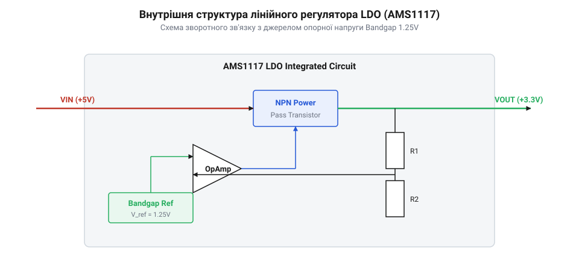
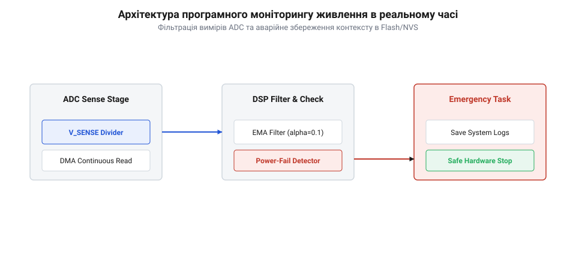
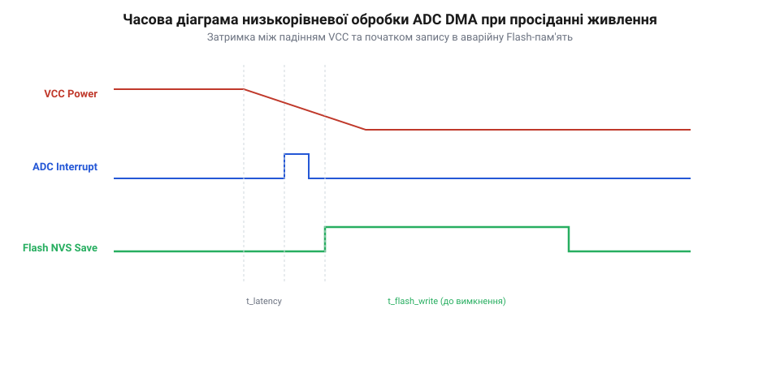
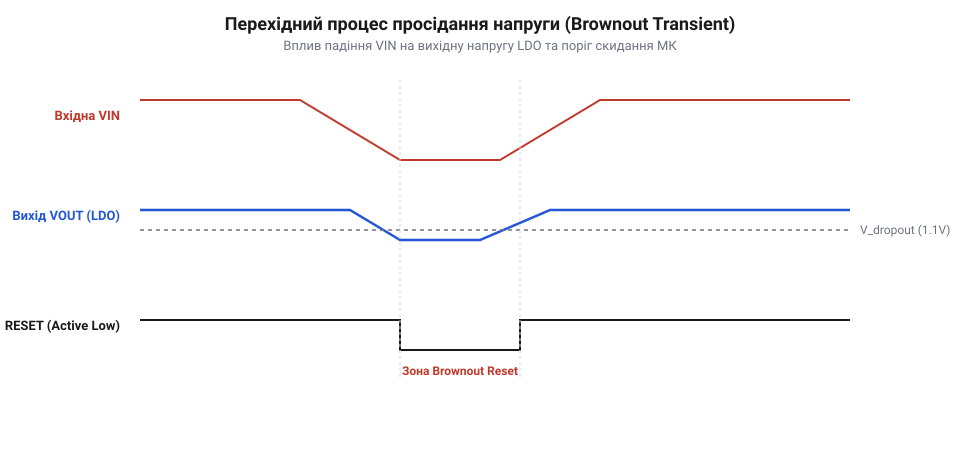

# Лінійний стабілізатор AMS1117

<preknowlist>
- [Організація кільцевого буфера ADC та DMA](root:sf-devices/adc-dma-circular-buffer) — принципи фонового перенесення вибірок АЦП до оперативної пам'яті через DMA без залучення процесора
- [Експоненційно зважене ковзне середнє EWMA у прошивці](root:sf-devices/ewma-digital-filtering) — математичні основи рекурентної фільтрації та реалізація згладжування шуму в цілочисельній арифметиці
- [Низькорівневий доступ до регістрів мікроконтролера](root:sf-devices/bare-metal-register-access) — пряма маніпуляція регістрами периферії для детермінованого керування апаратурою без затримок HAL
</preknowlist>

## Нестабільність первинного живлення та межі стабілізації

Пульсації та комутаційні завади первинного живлення спричиняють збої тактування мікроконтролера чи руйнування даних у пам'яті. Для згладжування коливань без високочастотного шуму застосовують лінійний регулятор @@en|LDO@@ (від англ. *low-dropout regulator* — стабілізатор із малим спадом напруги) на кшталт @@en|AMS1117@@. Вбудоване [джерело опорної напруги](root:sf-devices/bandgap-reference) та підсилювач помилки формують від'ємний зворотний зв'язок: вони керують прохідним біполярним транзистором, забезпечуючи детерміноване [придушення пульсацій живлення](root:sf-devices/power-supply-rejection-ratio).

Стабілізація можлива лише доки різниця напруг перевищує мінімальний спад — @@en|dropout@@ (від англ. *drop out* — спад напруги). Через складений транзистор Дарлінгтона цей перепад дорівнює сумі напруг насичення драйвера та база-емітер вихідного транзистора (1.1–1.3 В). Якщо вхідна напруга просяде нижче цієї межі, транзистор заходить у насичення, регулювання зривається, і вихідна напруга падає.

Термодинамічно надлишок потужності перетворюється на тепло:

```
P_d = (U_in - U_out) · I_load
```

де `U_in` — вхідна напруга, `U_out` — напруга стабілізації, а `I_load` — струм навантаження. За значного перепаду кристал розігрівається, що вимагає розрахунку [теплорозсіювання корпусів SOT-223](root:sf-devices/thermal-resistance-management). Крім того, для стійкості контуру вихідний конденсатор повинен мати еквівалентний послідовний опір — @@en|ESR@@ (від англ. *equivalent series resistance*) у межах 0.1–1 Ом.


*Контур лінійного стабілізатора: підсилювач помилки керує прохідним транзистором, розсіюючи надлишок напруги у тепло.*

## Фоновий моніторинг живлення та цифрова фільтрація

Шина живлення мікроконтролера є керованим системним ресурсом. Роздільне вимірювання напруг до і після стабілізатора надає прошивці запас часу у кілька мілісекунд: вхідна лінія просідає раніше, ніж почнуть розряджатися вихідні ємності живлення ядра.

Фоновий збір вибірок АЦП запускає апаратний таймер без участі процесора. Контролер @@en|DMA@@ (від англ. *Direct Memory Access* — прямий доступ до пам'яті) переносить результати вимірювань у [кільцевий буфер АЦП](root:sf-devices/adc-dma-circular-buffer) пам'яті.

Випадкові завади усуває фільтр [експоненційно зважене ковзне середнє](root:sf-devices/ewma-digital-filtering) класу @@en|EWMA@@ (від англ. *exponentially weighted moving average*). У цілочисельній арифметиці обчислення зводять до побітового зсуву:

```
U_filt = U_filt + ((U_raw - U_filt) >> 3)
```

де зсув на три біти праворуч задає ваговий коефіцієнт 1/8. Очищене значення аналізує автомат станів живлення: при перетині попереджувальної межі він завчасно скидає вторинні навантаження для збереження залишкового заряду.


*Потоковий моніторинг живлення: таймер і DMA збирають вибірки у буфер, а фільтр EWMA живить автомат скидання навантаження.*

## Низькорівневий аварійний захист та збереження даних

Під час остаточного знеструмлення вихідні ємності розряджаються за частки мілісекунди. Застосування бібліотечних функцій створює неприпустимі затримки у десятки мікросекунд, за які напруга падає нижче робочої межі ядра — @@en|brownout@@ (від англ. *brownout* — критичне просідання живлення).

Детерміновану реакцію до 5 мікросекунд забезпечує [прямий доступ до регістрів](root:sf-devices/bare-metal-register-access) периферії та подвійний буфер @@en|zero-copy@@ (від англ. *zero copy* — нульове копіювання). Контролер DMA викликає переривання після заповнення першої половини буфера, поки продовжує запис у другу. Обробник переривання миттєво зчитує статус аварії безпосередньо з регістрів.

Першою дією обробник блокує запис у пам'ять Flash встановленням захисного біта в регістрі керування. Якщо напруга просяде під час імпульсу програмування комірки, службові структури Flash незворотно пошкоджуються.

Після блокування Flash прошивка атомарно записує лічильники та змінні середовища в енергонезалежні регістри резервного домену, які живляться від автономної батареї.


*Аварійний часовий бюджет: пряма робота з регістрами блокує Flash і зберігає дані за 5 мікросекунд до скидання ядра.*

## Програмний гістерезис проти осциляцій живлення

Спроба відновити живлення вузлів одразу після нормалізації напруги породжує релаксаційні осциляції. Скидання навантаження знижує спад напруги на внутрішньому опорі джерела `R_int`, через що напруга на вході хибно зростає. Повторне увімкнення периферії знову просаджує лінію пусковим струмом, викликаючи паразитну генерацію.

Щоб запобігти цьому, [задача керування живленням](root:sf-devices/rtos-power-management-task) в RTOS запроваджує програмний @@en|hysteresis@@ (від грец. *ὑστέρησις* — відставання). Напруга відновлення роботи встановлюється вищою за поріг вимкнення на захисне вікно:

```
ΔU_hys > I_transient · R_int + U_ripple
```

де `I_transient` — стрибок струму навантаження, `R_int` — активний опір лінії, а `U_ripple` — максимальні пульсації.

Паралельно прошивка виконує непрямий моніторинг перегріву стабілізатора через внутрішній температурний датчик мікроконтролера, уникаючи апаратного теплового відключення. Перехідні процеси шини контролюють осцилографом за аварійним сигналом, а телеметрію виводять без затримок ядра через макрокомірку трасування @@en|ITM@@ (від англ. *Instrumentation Trace Macrocell*).


*Вікно програмного гістерезису: запас напруги розриває петлю коливань при коливаннях навантаження на лінії з внутрішнім опором.*