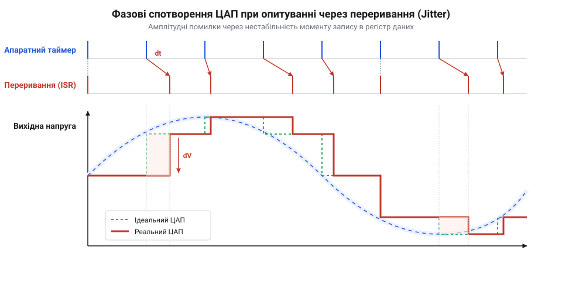
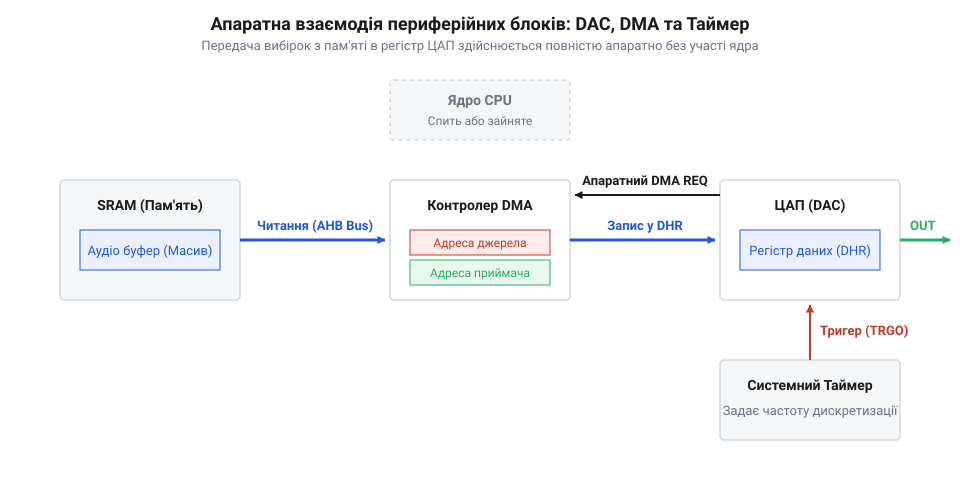

# Потокова передача аудіоданих через ЦАП і DMA

## Початкові концепції та фізичні принципи

Відтворення неперервного звукового сигналу в цифровому пристрої вимагає перетворення дискретної послідовності чисел, збереженої в пам'яті, на плавні коливання електричної напруги. У центрі цього процесу стоїть @@en|ЦАП@@ (від англ. @@en|DAC@@ — @@en|Digital-to-Analog Converter@@, де @@en|digital@@ — цифровий, @@en|analog@@ — аналоговий, @@en|converter@@ — перетворювач), який перераховує кожен цифровий код на відповідний рівень вихідного потенціалу. Якщо ви звужуєте розгляд до поодинокого вимірювання, задача здається тривіальною: записати число в @@en|регістр@@ (від англ. @@en|register@@ — фіксована осередка пам'яті периферії) і отримати напругу на фізичному виводі мікроконтролера. Проте аудіосигнал є часовою функцією, і якість відтворення фундаментально залежить не лише від точності амплітуди вибірки, але й від суворої часової рівномірності її подачі. Коли розробник намагається побудувати аудіотракт шляхом періодичного оновлення @@en|ЦАП@@ безпосередньо з обробника переривань таймера, система швидко впирається у фізичні та апаратні обмеження обчислювального ядра @@en|CPU@@ (від англ. @@en|Central Processing Unit@@, центральний процесор).

Для якісного формування аналогового сигналу вибірки @@en|PCM@@ (від англ. @@en|Pulse-Code Modulation@@, де @@en|pulse@@ — імпульс, @@en|code@@ — код, @@en|modulation@@ — модуляція) мають надходити до @@en|ЦАП@@ із постійним інтервалом дискретизації `Tₛ = 1 ÷ fₛ`, де `fₛ` — частота дискретизації. Для стандартного звуку компакт-диска `fₛ = 44.1 кГц`, що означає необхідність оновлення аналогового рівня кожні `22.67 мкс`. Коли ви аналізуєте [основи аналого-цифрового перетворення](root:sf-devices/adc-dac-signal-conversion), стає очевидним, що будь-яке відхилення від цього періоду викликає деформацію часової осі сигналу. Найдешевша й найочевидніша з огляду на програмування архітектура звучить просто: налаштовується апаратний @@en|таймер@@ (від англ. @@en|timer@@), який кожні `22.67 мкс` генерує сигнал переривання, а процесор виконує підпрограму @@en|ISR@@ (від англ. @@en|Interrupt Service Routine@@, де @@en|interrupt@@ — переривання, @@en|service@@ — обслуговування, @@en|routine@@ — підпрограма). Всередині цієї процедури @@en|CPU@@ зчитує черговий семпл із буфера @@en|SRAM@@ (від англ. @@en|Static Random-Access Memory@@, статична оперативна пам'ять) та записує його в @@en|ЦАП@@.

Такий підхід негайно створює дві критичні проблеми: колосальне обчислювальне перевантаження ядра та часове тремтіння вибірок. Розглянемо спочатку механіку накладних витрат. Кожен виклик @@en|ISR@@ змушує @@en|CPU@@ призупиняти виконання поточного коду, зберігати контекст (регістри загального призначення `R0-R3`, `R12`, `LR`, `PSR`) у стеку, переходити за вектором переривання, виконувати інструкції зчитування й запису даних, а потім відновлювати стан регістрів. На мікроконтролерах із ядром @@en|Cortex-M@@ процедура входу й виходу з переривання займає орієнтовно від 24 до 30 тактів процесора лише на апаратне збереження контексту, не враховуючи корисних інструкцій самого обробника. Якщо сумарні накладні витрати й виконання інструкцій складають `N_cycles = 50 тактів`, то при частоті дискретизації `fₛ = 44.1 кГц` та системній тактовій частоті ядра `f_CPU = 16 МГц` частка ресурсів, яка втрачається виключно на обслуговування аудіовибірок, обчислюється наступним чином:

```
Load_CPU = f_s × N_cycles ÷ f_CPU
= 44100 × 50 ÷ 16000000        [підстановка частоти 44.1 кГц та 50 тактів ISR]
= 2205000 ÷ 16000000           [перемноження кількості операцій на секунду]
= 0.1378125                    [обчислення частки завантаження процесора]
= 13.78%                       [переведення у відсотки]
```

Отже, майже `14%` усієї обчислювальної потужності мікроконтролера витрачається даремно — на неефективне перемикання контексту та копіювання поодиноких слів. При переході до високоякісного стереоаудіо з частотою `96 кГц` або `192 кГц` накладні витрати зростають до `60-80%`, що робить неможливим паралельне виконання задач декодування або функціонування @@en|RTOS@@ (від англ. @@en|Real-Time Operating System@@, операційна система реального часу).

Друга, ще більш деструктивна проблема програмної вибірки — це @@en|джитер@@ (від англ. @@en|jitter@@ — тремтіння, часове відхилення інтервалу). Навіть якщо таймер генерує запити на переривання з ідеальною квантовою точністю, момент фактичного початку виконання @@en|ISR@@ процесором не є детермінованим. У реальній вбудованій системі паралельно працюють інші периферійні модулі (@@en|UART@@, @@en|USB@@, @@en|SPI@@, @@en|Ethernet@@), які мають власні переривання вищого пріоритету. Крім того, критичні секції операційної системи тимчасово маскують переривання за допомогою команд `__disable_irq()`. Коли виникає [затримка обробки переривань](root:sf-devices/interrupt-latency-embedded), виклик звукового @@en|ISR@@ затримується на флуктуаційний інтервал `δt`.

Параметрична зміна моменту запису в @@en|ЦАП@@ призводить до того, що аналогова напруга змінюється не в точці `tₙ = n × Tₛ`, а в точці `tₙ' = n × Tₛ + δtₙ`. Оскільки реальний звуковий сигнал має певну швидкість зміни напруги в часі `dV ÷ dt`, часова затримка `δt` конвертується в амплітудну помилку `ΔV ≈ (dV ÷ dt) × δt`. Ця помилка амплітуди не є гармонійно пов'язаною з корисним сигналом і сприймається як широкосмуговий шум та викривлення. Зі зростанням частоти відтворюваного сигналу крутизна `dV ÷ dt` збільшується, через що @@en|джитер@@ катастрофічно знижує параметр @@en|SNR@@ (від англ. @@en|Signal-to-Noise Ratio@@, співвідношення сигнал/шум) і підвищує @@en|THD@@ (від англ. @@en|Total Harmonic Distortion@@, коефіцієнт нелінійних спотворень) аудіотракту. Щоб зменшити цей вплив, іноді застосовують [дискретну фільтрацію сигналів](root:sf-devices/discrete-signal-filtering), проте вона не здатна компенсувати фазовий шум на рівні джерела.


*Хронограма вибірок ЦАП при програмній передачі через переривання: нерівномірність інтервалів виклику ISR створює фазові спотворення та шуми в аналоговому сигналі.*

З аналізу фізичних та апаратних обмежень випливає беззаперечний висновок: програмна передача вибірок через @@en|CPU@@ непридатна для побудови детермінованих аудіотрактів. Для усунення @@en|джитеру@@ та вивільнення обчислювального ядра необхідний механізм, який виконує запис даних із @@en|SRAM@@ у @@en|ЦАП@@ повністю апаратно, за безпосереднім сигналом тригера таймера і без будь-якої участі процесора.

## Внутрішня будова та алгоритми роботи

Розв'язанням проблеми детермінованої вибірки даних без залучення @@en|CPU@@ є створення автономного апаратного конвеєра, який об'єднує три незалежні периферійні блоки мікроконтролера: апаратний @@en|таймер@@ (@@en|Timer@@), контролер прямого доступу до пам'яті @@en|DMA@@ (від англ. @@en|Direct Memory Access@@, де @@en|direct@@ — прямий, @@en|memory@@ — пам'ять, @@en|access@@ — доступ) та цифрово-аналоговий перетворювач @@en|ЦАП@@. У такій архітектурі процесор виступає лише в ролі первинного ініціатора: він налаштовує топологію зв'язків між блоками, вказує джерело та приймач даних і запускає процес, після чого повністю усувається з петлі передачі кожного окремого семплу.

Апаратна взаємодія між блоками побудована на жорсткій лінії сигналів тригерів та системній шині, що ілюструється наступною схемою.


*Апаратна взаємодія периферійних блоків: таймер генерує події тригера, контролер DMA зчитує вибірки з SRAM і записує їх у регістр ЦАП без участі процесора.*

Детальний алгоритм функціонування даного апаратного модуля складається з чотирьох послідовних синхронних етапів:

1. **Генерація апаратного тригера (@@en|TRGO@@)**: Апаратний @@en|таймер@@ працює від стабільного кварцевого генератора. Лічильник таймера інкрементується на кожному такті шини @@en|APB@@ (від англ. @@en|Advanced Peripheral Bus@@, периферійна шина). При досягненні значення в регістрі автоматичного перезавантаження @@en|ARR@@ (@@en|Auto-Reload Register@@) таймер скидається в нуль і миттєво формує внутрішній апаратний імпульс @@en|TRGO@@ (від англ. @@en|Trigger Output@@, вихідний тригерний сигнал). Цей сигнал поширено через периферійний матричний комутатор безпосередньо до блоків @@en|DMA@@ та @@en|ЦАП@@ із детермінованою фазовою затримкою менше одного такту.

2. **Запит та арбітраж шини @@en|DMA@@**: Отримавши сигнал @@en|TRGO@@, контролер @@en|DMA@@ виставляє запит на захоплення системної шини @@en|AHB@@ (від англ. @@en|Advanced High-performance Bus@@, високопродуктивна системна шина). Коли функціонує [арбітраж системної шини](root:sf-devices/bus-matrix-microcontrollers), шинна матриця надає @@en|DMA@@ статус @@en|bus master@@ (головного пристрою шини). Оскільки зчитування відбувається паралельно з виконанням команд @@en|CPU@@ із флеш-пам'яті (за умов роздільних шин інструкцій та даних @@en|Harvard@@ архітектури), шинний конфлікт виникає лише при використанні одного й того самого блоку @@en|SRAM@@.

3. **Апаратне пересилання вибірки**: Модуль @@en|DMA@@ зчитує 16-бітну аудіовибірку з поточного адреса буфера в @@en|SRAM@@, автоматично інкрементує свій внутрішній вказівник джерела та записує значення у буферний регістр даних @@en|ЦАП@@ — @@en|DAC_DHR12R1@@ (від англ. @@en|Data Holding Register@@, буферний регістр даних). Весь процес пересилання займає від 2 до 4 тактів шини і здійснюється повністю апаратно.

4. **Цифрово-аналогове перетворення**: Сигнал @@en|TRGO@@ одночасно копіює вміст регістру @@en|DAC_DHR12R1@@ у вихідний регістр перетворення @@en|DAC_DOR1@@ (від англ. @@en|Data Output Register@@, вихідний регістр даних). Внутрішня матриця резисторів або струмових ключів @@en|ЦАП@@ оновлює потенціал на виході аналогового підсилювача @@en|OpAmp@@ (від англ. @@en|Operational Amplifier@@, операційний підсилювач).

Для підтримки безперервного потоку аудіо контролер @@en|DMA@@ конфігурується в циклічному режимі — @@en|Circular Mode@@ (@@en|циклічний режим@@). Після пересилання `N` вибірок (де `N` — довжина буфера в пам'яті) вказівник джерела @@en|DMA@@ автоматично скидається на початкову адресу буфера без переривання роботи таймера чи @@en|ЦАП@@. Це усуває будь-які часові розриви між блоками аудіоданих.

Для практичного втілення наведемо код налаштування периферійних модулів @@en|ЦАП@@, @@en|DMA@@ та @@en|Timer@@.

:::tabs
@tab C
:::code root\eng\sf-devices\audio-dac-dma-streaming/audio-dac-dma-streaming-d/c/snippet-1.c c
@tab C++
:::code root\eng\sf-devices\audio-dac-dma-streaming/audio-dac-dma-streaming-d/cpp/audiodacstreamer.cpp cpp
:::

Завдяки апаратній інтеграції таймера, @@en|DMA@@ та @@en|ЦАП@@ видача кожного семплу відбувається з часовою точністю кварцевого резонатора. Процесор залишається повністю вільним для виконання задач вищого рівня, а вибіркова напруга оновлюється з нульовим часовим @@en|джитером@@.

Для забезпечення детермінованості виконання та мінімізації накладних витрат обробка даних у критичних секціях здійснюється за допомогою цілочисельної арифметики з атомарним оновленням прапорців станів @@en|atomic flags@@, що виключає дрейф фази та блокування переривань.

## Апаратна реалізація та низькорівневий C/C++ код

Створення статичного аудіосигналу з фіксованого масиву в операційній пам'яті вирішує задачу генерації простих тонів, але реальні застосунки вимагають безперервного відтворення динамічного @@en|стереопотоку@@ (від англ. @@en|stereo stream@@), що декодується «на льоту» з зовнішніх носіїв або мережевих інтерфейсів. Якщо програміст намагається перезаписати дані в єдиному буфері в той самий момент, коли контролер @@en|DMA@@ зчитує їх для передачі в @@en|ЦАП@@, виникає гонка даних та розрив фази сигналу, що проявляється як акустичне клацання. Для досягнення детермінованого безперервного потоку без зупинки апаратного таймера використовується @@en|буферизація Пінґ-Понґ@@ (від англ. @@en|Ping-Pong Buffering@@, де @@en|ping-pong@@ — настільний теніс, що символізує почергову зміну двох частин буфера) або [подвійна буферизація аудіоданих](root:sf-devices/double-buffering-audio) (від англ. @@en|double buffering@@, де @@en|double@@ — подвійний, @@en|buffering@@ — створення буфера).

Механіка подвійної буферизації базується на поділі єдиного суцільного масиву в @@en|SRAM@@ на дві рівні половини: буфер `0` (@@en|Ping@@) та буфер `1` (@@en|Pong@@). Поки контролер @@en|DMA@@ здійснює апаратне пересилання вибірок із буфера `0` у буферний регістр @@en|ЦАП@@ `DAC_DHR12R1`, процесор @@en|CPU@@ у фоновому режимі заповнює новим блоком декодованих вибірок буфер `1`. Як тільки @@en|DMA@@ досягає середини масиву, апаратний периферійний модуль автоматично виставляє прапорець переривання @@en|HTIF@@ (від англ. @@en|Half Transfer Interrupt Flag@@, прапорець половини передачі). Це переривання є сигналом для процесора про те, що буфер `0` повністю звільнився і його можна безпечно перезаписувати новою порцією даних, поки @@en|DMA@@ зчитує буфер `1`. Наприкінці всього масиву @@en|DMA@@ генерує прапорець @@en|TCIF@@ (від англ. @@en|Transfer Complete Interrupt Flag@@, прапорець завершення передачі), скидає вказівник джерела на початок і переходить до буфера `0`, а процесор дістає сповіщення про необхідність заповнення буфера `1`.

Часова послідовність цих подій та розподіл ролей між периферією і ядром показані на наступній діаграмі.


*Принцип подвійної буферизації Ping-Pong: апаратні події HTIF та TCIF почергово звільняють половини буфера, забезпечуючи безперервний потік вибірок без зупинки таймера.*

Для забезпечення абсолютної цілісності даних у високопродуктивних мікроконтролерах із ядром @@en|Cortex-M7@@ необхідно враховувати архітектуру @@en|кеш-пам'яті@@ (від англ. @@en|cache memory@@, від фр. @@en|cacher@@ — ховати, приховувати). Оскільки процесор записує нові аудіовибірки через кеш даних @@en|D-Cache@@ (від англ. @@en|Data Cache@@), змінені значення можуть тривалий час залишатися в кеш-лініях і не потрапляти в фізичну пам'ять @@en|SRAM@@. У той же час контролер @@en|DMA@@ вичитує дані безпосередньо з системної шини, минаючи кеш ядра. Якщо не виконати [узгодження кеш-пам'яті](root:sf-devices/mpu-cache-coherency), @@en|DMA@@ зчитає застарілі вибірки, що призведе до спотворення звуку.

Існує два методи розв'язання цієї проблеми:
1. **Програмне очищення кешу**: Перед завершенням підготовки нової половини буфера виконати очищення ліній кешу за допомогою функції `SCB_CleanDCache_by_Addr()`, примусово виштовхнувши брудні дані з @@en|D-Cache@@ у фізичну оперативну пам'ять, після чого застосувати @@en|бар'єр пам'яті@@ `__DSB()` (від англ. @@en|Data Synchronization Barrier@@). 2. **Апаратне виключення кешування (MPU)**: Використати модуль захисту пам'яті @@en|MPU@@ (від англ. @@en|Memory Protection Unit@@) для оголошення ділянки @@en|SRAM@@ з аудіобуферами як @@en|Non-Cacheable@@ (некешована) або розмістити масиви у спеціалізованій пам'яті @@en|DTCM SRAM@@ (від англ. @@en|Data Tightly-Coupled Memory@@), яка фізично не кешується і підключена безпосередньо до шини даних ядра.

Крім того, під час роботи з високошвидкісними транзакціями шини @@en|AHB@@ важливу роль відіграє вирівнювання адрес аудіобуферів у пам'яті. Якщо розмір лінії кешу процесора @@en|Cortex-M7@@ становить 32 байти, то будь-який аудіобуфер повинен розміщуватися за адресою, кратною 32 байтам. Це запобігає виникненню ситуації, коли в одну лінію кешу потрапляють як аудіовибірки, так і сторонні змінні програми, що могло б призвести до випадкового пошкодження даних під час часткового інвалідування кешу.

При роботі зі стереофонічним звуком або 12-бітними вибірками принципове значення має вибір правильного регістру даних @@en|ЦАП@@ та упакування вибірок у пам'яті. Звичайний 16-бітний запис у регістр `DAC_DHR12R1` оновлює лише перший канал. Якщо вибудовується стереотракт, використовується двоканальний регістр @@en|DHR12RD@@ (від англ. @@en|Dual 12-bit Right-Aligned Data Holding Register@@). За один 32-бітний транзакційний перехід контролер @@en|DMA@@ копіює з пам'яті згортку двох 12-бітних вибірок: молодші 16 біт призначені для лівого каналу, а старші 16 біт — для правого. Це вдвічі зменшує кількість необхідних шинних транзакцій.

Нижче наведено практичну реалізацію подвійної буферизації мовою C із використанням обробників подій половини та повного завершення передачі.

:::tabs
@tab C
:::code root\eng\sf-devices\audio-dac-dma-streaming/audio-dac-dma-streaming-d/c/snippet-3.c c

@tab C++
:::code root\eng\sf-devices\audio-dac-dma-streaming/audio-dac-dma-streaming-d/cpp/audiostreamengine.cpp cpp
:::

Представлена реалізація мовою C++ ізолює низькорівневі виклики периферії всередині концептуального класу, гарантує вирівнювання пам'яті за допомогою ключового слова `alignas(32)` та запобігає витоку ресурсів завдяки принципам @@en|RAII@@ (від англ. @@en|Resource Acquisition Is Initialization@@).

## Практичне застосування та відлагодження

Навіть після бездоганного налаштування подвійної буферизації та каналів @@en|DMA@@ реальна прошивка мікроконтролера працює в умовах жорстокої конкуренції за обчислювальні й шинні ресурси. Головний ризик потокового відтворення аудіосигналу — це виникнення @@en|спустошення буфера@@ (від англ. @@en|buffer underrun@@ або @@en|buffer starvation@@, стан, коли процесор не встигає підготувати нові вибірки до того, як контролер @@en|DMA@@ вичитає поточну половину масиву).

Для упередження цієї ситуації розробник повинен чітко розрахувати апаратний @@en|часовий бюджет@@ (від англ. @@en|timing budget@@) `T_half`, доступний для обробки кожної півсфери буфера. Якщо довжина всієї ділянки пам'яті становить `N_buffer` вибірок, а частота дискретизації дорівнює `fₛ`, то максимальний час, який процесор має на виконання процедури генерації або декодування PCM-даних, визначається за формулою:

```
T_half = N_buffer ÷ (2 × f_s)
= 512 ÷ (2 × 48000)         [підстановка розміру буфера 512 вибірок та частоти 48 кГц]
= 256 ÷ 48000               [ділення розміру буфера навпіл для однієї півсфери]
= 0.005333 с                [обчислення інтервалу в секундах]
= 5.333 мс                  [переведення часового вікна у мілісекунди]
```

Якщо алгоритм обробки звуку (наприклад, декодування файлу з SD-карти або виконання цифрового еквалайзера) затримується на час `T_proc > 5.33 мс`, контролер @@en|DMA@@ починає повторно вичитувати незаповнений або старий буфер. Аналоговий рівень на виході @@en|ЦАП@@ різко змінюється до довільного значення, що викликає виразне акустичне клацання та спектральний спотворений сплеск.

Окрім недостатньої швидкості ядра @@en|CPU@@, причиною спустошення може стати [арбітраж системної шини](root:sf-devices/bus-matrix-microcontrollers) (від англ. @@en|bus arbitration@@). Якщо в системі паралельно працюють високошвидкісні периферійні модулі (наприклад, @@en|Ethernet MAC@@ або @@en|TFT-дисплей@@ з власне задіяним @@en|DMA@@), виникає конкуренція за шину @@en|AHB@@. Якщо каналу @@en|ЦАП@@ призначено низький пріоритет арбітражу, зчитування чергової вибірки затримується, викликаючи внутрішню помилку @@en|DMA FIFO Underrun@@. Для усунення цієї проблеми пріоритет потоку @@en|DMA@@ для @@en|ЦАП@@ обов'язково встановлюється у значення `DMA_PRIORITY_HIGH` або `DMA_PRIORITY_VERY_HIGH`, а також вмикається внутрішній апаратний FIFO-буфер контролера @@en|DMA@@ (`DMA_FIFOMODE_ENABLE`).

Виконувати важкі обчислення або зчитування даних із зовнішніх носіїв безпосередньо всередині підпрограми переривання @@en|ISR@@ категорично заборонено, оскільки це блокує інші переривання системи. У складних прошивках під управлінням операційної системи [планування задач реального часу](root:sf-devices/rtos-audio-task-scheduling) на базі @@en|FreeRTOS@@ застосовується двоуровнева модель синхронізації з використанням легких сповіщень.

Обробник переривання @@en|ISR@@ виконує єдину мінімальну дію: надсилає швидке сповіщення високопріоритетній задачі аудіодекодера за допомогою функції `xTaskNotifyFromISR()` або @@en|семафора@@ (від англ. @@en|semaphore@@, від грец. @@en|σῆμα@@ — знак та @@en|φόρος@@ — носій) `xSemaphoreGiveFromISR()`. Власне task-потік, маючи пріоритет вищий за решту прикладного коду (наприклад, `configMAX_PRIORITIES - 2`), миттєво розблоковується, вичитує дані з носія у відповідний півбуфер, виконує необхідне очищення кешу та повертається в стан очікування.

Для точної діагностики часових інтервалів та виявлення граничних випадків застосовують вимірювання за допомогою апаратних виводів @@en|GPIO@@ (від англ. @@en|General-Purpose Input/Output@@, лінії введення-виведення загального призначення) та @@en|логічного аналізатора@@ (від англ. @@en|logic analyzer@@).


*Діагностика затримок обробки аудіосигналу: сигнальний GPIO-вивід встановлюється в одиницю на час виконання задачі заповнення буфера, дозволяючи візуалізувати запас часового бюджету T_half.*

Практичний алгоритм апаратного відлагодження полягає в тому, що на початку функції заповнення буфера обраний вивід @@en|GPIO@@ встановлюється у високий логічний рівень (`GPIO_PIN_SET`), а при виході з функції — у низький (`GPIO_PIN_RESET`). За допомогою осцилографа або логічного аналізатора інженер спостерігає тривалість імпульсу `T_proc` відносно періоду проходження переривань `T_half`. Якщо тривалість імпульсу наближається до `T_half` або спостерігається тремтіння заднього фронту через конкуруючі переривання, необхідно збільшити розмір буфера або оптимізувати обчислювальний алгоритм.

Нарешті, останньою ланкою налагодження є аналогова фільтрація сигналу на виході мікроконтролера. Оскільки @@en|ЦАП@@ формує ступенчатий аналоговий сигнал, у його спектрі присутні високочастотні дзеркальні гармоніки дискретизації. Для їх придушення та відновлення гладкої звукової хвилі застосовують активний або пасивний фільтр нижніх частот @@en|ФНЧ@@ (від англ. @@en|Low-Pass Filter@@), зріз якого розраховується за частотою @@en|Найквіста@@ (від англ. @@en|Nyquist rate@@) `f_c = f_s ÷ 2` або схему @@en|Sallen-Key@@ другого порядку. Також важливим є вибір режиму вихідного буфера @@en|ЦАП@@ (`DAC_OUTPUTBUFFER_ENABLE`): увімкнений внутрішній операційний підсилювач знижує вихідний імпеданс, дозволяючи підключати низькоомні навантаження, проте додає невеликі крайові спотворення біля опорних шин живлення `VSSA` та `VDDA`.

Для забезпечення мінімального рівня аналогових шумів розробник повинен розділяти фізичні заземлення схеми на цифрове (DGND) та аналогове (AGND), об'єднуючи їх лише в одній точці безпосередньо біля виводу мікроконтролера, а також встановлювати розв'язувальні керамічні конденсатори ємністю `100 нФ` та `10 мкФ` на виводах аналогового живлення `VDDA` та опорної напруги `VREF+`.

Побудована таким чином система потокового звуковідтворення поєднує повну апаратну автономність пересилання вибірок з гнучкістю програмування в RTOS, гарантуючи детерміновану роботу прошивки без часових збоїв та акустичних дефектів.