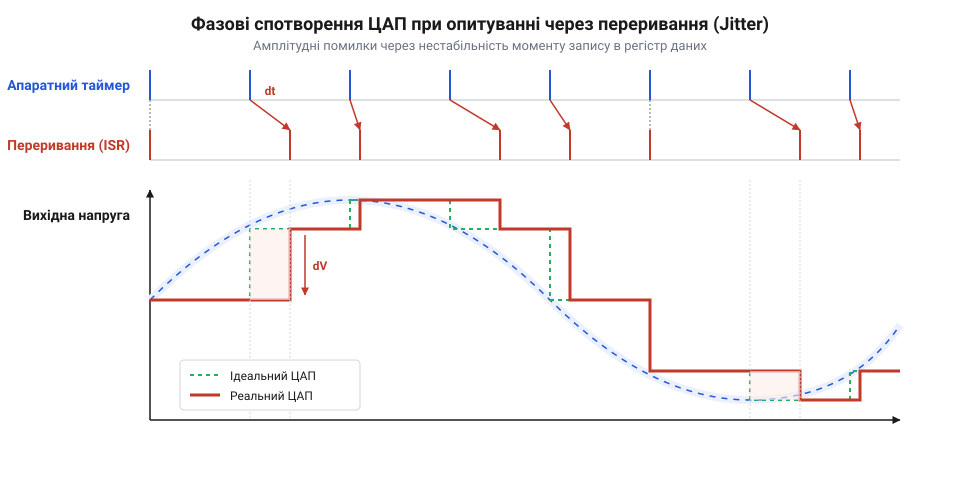
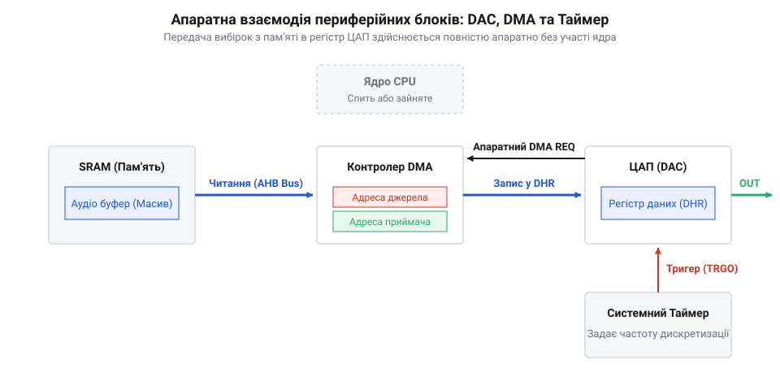

# Потокова передача аудіоданих через ЦАП і DMA

<preknowlist>
- [Аналого-цифрові та цифрово-аналогові перетворення сигналів](root:sf-devices/adc-dac-signal-conversion) — фізичні принципи дискретизації за часом, квантування за рівнем та перетворення цифрового коду в аналогову напругу
- [Архітектура шинної матриці та арбітраж DMA](root:sf-devices/bus-matrix-microcontrollers) — механізм прямого доступу до пам'яті, роль шинних майстрів та апаратний арбітраж транзакцій без участі ядра
- [Подвійна буферизація та синхронізація потокових даних](root:sf-devices/double-buffering-audio) — концепція почергового використання двох буферів для розділення операцій наповнення та зчитування потокових даних
</preknowlist>

## Проблема програмної вибірки та джитер

Відтворення неперервного звуку вимагає перетворення чисел із пам'яті на електричну напругу. Цю задачу виконує цифро-аналоговий перетворювач (@@en|ЦАП@@, від англ. @@en|DAC@@ — *Digital-to-Analog Converter*). Щоб зберегти форму хвилі, відліки мають надходити суворо з періодом `Tₛ = 1 ÷ fₛ`. Для аудіочастоти `fₛ = 44.1 кГц` новий семпл потрібен кожні `22.67 мкс`.

Спроба оновлювати @@en|ЦАП@@ через переривання таймера (@@en|timer@@, від англ. *time* — час) перевантажує процесор (@@en|CPU@@, від англ. *Central Processing Unit*). На кожен виклик обробника (@@en|ISR@@, від англ. *Interrupt Service Routine*) ядро зберігає й відновлює регістри контексту. На частоті `44.1 кГц` ці перемикання повторюються десятки тисяч разів на секунду, спалюючи до третини ресурсів ядра.

Ще небезпечнішим є часове тремтіння вибірок — @@en|джитер@@ (від англ. *jitter* — тремтіти). Через затримки від іншої периферії та блокування критичними секціями виникає неминуча [затримка обробки переривань](root:sf-devices/interrupt-latency-embedded): вхід в @@en|ISR@@ зміщується на випадковий час `δt`. Оскільки сигнал змінюється зі швидкістю `dV ÷ dt`, затримка `δt` породжує амплітудну помилку напруги `ΔV ≈ (dV ÷ dt) × δt`. Вона знижує співвідношення сигнал/шум (@@en|SNR@@, від англ. *Signal-to-Noise Ratio*) і спотворює звук.

*Формування фазового джитеру під час програмного оновлення ЦАП: затримки виклику ISR створюють амплітудні спотворення сигналу.*

Тому програмна вибірка непридатна для якісного [цифро-аналогового перетворення сигналів](root:sf-devices/adc-dac-signal-conversion). Передачу відліків необхідно перенести на автономний апаратний рівень.

## Апаратний конвеєр таймера та DMA

Автономну передачу виконує апаратний конвеєр (@@en|pipeline@@, від англ. *pipe* — труба, та *line* — лінія), який зв'язує периферію без участі ядра. Він об'єднує апаратний @@en|таймер@@, контролер прямого доступу до пам'яті (@@en|DMA@@, від англ. *Direct Memory Access*) та перетворювач @@en|ЦАП@@. Процесор лише ініціалізує конфігурацію і стартує передачу, після чого усувається з контуру.

Ритм задає апаратний @@en|таймер@@ від кварцового генератора. При переповненні лічильника він формує внутрішній строб тригера (@@en|trigger@@, від англ. *trigger* — спусковий гачок) — сигнал @@en|TRGO@@ (від англ. *Trigger Output*). Цей імпульс тактує контролер @@en|DMA@@ та вузол @@en|ЦАП@@ із фазовою точністю кварцу.

За стробом @@en|TRGO@@ контролер @@en|DMA@@ захоплює системну шину. Згідно з тим, як влаштована [архітектура шинної матриці](root:sf-devices/bus-matrix-microcontrollers), контролер @@en|DMA@@ напряму зчитує вибірку з пам'яті @@en|SRAM@@ (від англ. *Static Random-Access Memory*) у буферний регістр даних (@@en|DAC_DHR@@, від англ. *Data Holding Register*). Передача триває кілька тактів паралельно з роботою ядра.

Одночасно сигнал @@en|TRGO@@ переносить попередню вибірку з @@en|DAC_DHR@@ у вихідний регістр перетворення (@@en|DAC_DOR@@, від англ. *Data Output Register*). Напруга оновлюється за апаратним фронтом таймера, що ліквідує фазовий @@en|джитер@@ і розвантажує @@en|CPU@@.

*Апаратне сполучення периферійних модулів: тригер TRGO одночасно запускає транзакцію DMA та фіксує вибірку у вихідному регістрі ЦАП.*

## Подвійна буферизація та події DMA

Для неперервного звучання аудіобуфер потрібно поповнювати під час відтворення. Якщо записувати свіжі семпли в єдиний буфер під час вичитування контролером @@en|DMA@@, виникає стан гонитви даних (@@en|race condition@@, від англ. *race* — перегони, та *condition* — умова). Через різницю швидкостей ядро перезапише активні вибірки, спричиняючи розрив фази сигналу та різке акустичне клацання.

Цю проблему вирішує [подвійна буферизація потокових даних](root:sf-devices/double-buffering-audio) (@@en|double buffering@@) за схемою @@en|Ping-Pong@@ (від англ. *ping-pong* — настільний теніс). Буфер ділять на дві рівні частини: блок @@en|Ping@@ та блок @@en|Pong@@, а контролер @@en|DMA@@ переводять у циклічний режим (@@en|circular mode@@, від лат. *circulus* — коло, та *modus* — спосіб). Дійшовши кінця масиву, вказівник автоматично повертається на початок без зупинки таймера.

Синхронізацію забезпечують два апаратні прапорці контролера @@en|DMA@@:
- Половина передачі (@@en|HTIF@@, від англ. *Half Transfer Interrupt Flag*): спрацьовує, коли @@en|DMA@@ прочитав блок @@en|Ping@@ і перейшов до @@en|Pong@@. Процесор дістає сигнал безпечно оновлювати блок @@en|Ping@@. - Завершення передачі (@@en|TCIF@@, від англ. *Transfer Complete Interrupt Flag*): виставляється в кінці блоку @@en|Pong@@. Процесор перезаписує блок @@en|Pong@@, поки @@en|DMA@@ знову вичитує @@en|Ping@@.

*Принцип подвійної буферизації Ping-Pong: чергування подій HTIF та TCIF забезпечує безперервне звучання завдяки почерговому оновленню неактивного блоку пам'яті.*

Почергове оновлення неактивної половини усуває гонитву даних. Аудіотракт працює безперервно, гарантуючи детерміноване звучання без затримок і клацань.