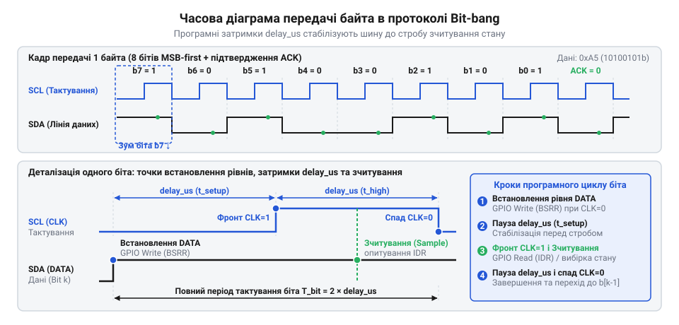

# Програмний інтерфейс драйвера Bit-bang (Software API)

## Початкові концепції та фізичні принципи

Апаратних модулів зв'язку в мікроконтролері часто менше, ніж периферійних пристроїв на платі, або ж конструкція плати змушує підключати сенсор до виводів, які не підтримують потрібного інтерфейсу. У такій ситуації протокол інформаційного обміну доводиться програмно емулювати — керувати рівнями напруги на виводах загального призначення (GPIO) за допомогою процесора. Цей підхід називають програмною реалізацією протоколу, або ж @@en|bit-bang@@ (від bit — біт і bang — бити). Замість того, щоб апаратний контролер сам формував сигнали та витримував часові інтервали, процесор має послідовно виставляти логічний нуль або одиницю, чекати визначений час і переходити до наступного біта.

Якщо розкидати ці операції встановлення виводів та затримок по всьому коду програми, він стане нечитабельним, важким у налагодженні та непереносним на інші мікроконтролери. Пряме керування ніжками всередині прикладної логіки жорстко прив'язує алгоритм до конкретної розводки плати. Тому логіку керування лініями ховають за абстракцією — програмним інтерфейсом драйвера (API). Драйвер бере на себе рутину точного формування імпульсів, а прикладній програмі надає зручні функції для ініціалізації шини та передачі чи приймання цілих байтів або буферів.

Фізична природа @@en|bit-bang@@ диктує дві головні вимоги до драйвера: точність керування часом та швидкість доступу до виводів. Апаратні інтерфейси тактуються від системного генератора і працюють незалежно від процесора. Програмне ж формування сигналів змушене покладатися на затримки процесора або [апаратний таймер у режимі](root:sf-devices/hardware-timer-one-pulse-mode) одного імпульсу для точного відліку інтервалів. Будь-яке апаратне переривання, що виникає під час передачі, витісняє поточний код і забирає процесорний час. У цей момент зміна логічного рівня на ніжці затримується, спричиняючи тремтіння імпульсів (@@en|jitter@@, від jitter — тремтіти). Якщо тривалість імпульсу вийде за межі часового допуску приймача, передача буде спотворена. Тому швидкість програмної шини завжди нижча за апаратну, а драйвер повинен вміти адаптуватися до частоти тактування процесора, щоб правильно розраховувати затримки між зміною станів виводів.

Для правильної роботи драйвер мусить знати, які саме фізичні ніжки мікроконтролера задіяні. Оскільки на етапі написання драйвера ці виводи невідомі, програмний інтерфейс будують навколо конфігураційних структур. Така структура містить інформацію про порти, номери виводів, їхні електричні режими (наприклад, відкритий колектор для двоспрямованих ліній або двотактний вихід) та необхідні часові затримки. Передаючи цю структуру у функції драйвера, програма прив'язує абстрактний протокол до конкретного «заліза».

Без такого відокремлення апаратні виводи довелося б жорстко фіксувати макросами препроцесора. Тоді драйвер @@en|bit-bang@@ не зміг би керувати двома однаковими шинами на різних ніжках, а будь-яка зміна розведення плати вимагала б переписування бібліотеки. У прикладному коді розробник створює екземпляр структури та вказує конкретні параметри: адреси портів, номери ліній даних і тактування, режим роботи та півперіод затримки для цільової частоти шини. Після заповнення полів адреса структури або екземпляр об'єкта передається у функцію ініціалізації:

:::tabs
:::code api-bitbang-gpio-software-interface/c/generic/snippet-1.c
:::code api-bitbang-gpio-software-interface/cpp/generic/snippet-2.cpp
:::

У конфігураційній структурі тривалість затримки не можна задавати рівною теоретичному напівперіоду шини. Цільова частота передачі `f_bus` визначає повний період тактового сигналу `T_bus = 1 ÷ f_bus`. Кожен такт синхронної шини складається з двох послідовних станів — високого та низького рівня напруги. Тому тривалість ідеального напівперіоду `t_half` дорівнює половині повного періоду:

```
t_half = T_bus ÷ 2
       = 1 ÷ (2 × f_bus)            [підстановка періоду через частоту]
```

Проте перемикання стану виводу мікроконтролера не відбувається миттєво. Процесор витрачає певну кількість машинних тактів ядра `N_overhead` на читання структури конфігурації, обчислення бітової маски, запис у регістр керування ніжкою та підтримку лічильника циклу. При тактовій частоті ядра `f_cpu` виконання цих інструкцій займає реальний час `t_overhead = N_overhead ÷ f_cpu`. Якщо програмний цикл чекатиме повний час `t_half`, реальна фаза сигналу розтягнеться на величину `t_half + t_overhead`, через що частота передачі суттєво просяде.

Щоб сформувати точний часовий інтервал, тривалість програмної паузи `t_delay` повинна компенсувати накладні витрати на виконання процесорних інструкцій:

```
t_delay = t_half - t_overhead
        = (1 ÷ (2 × f_bus)) - (N_overhead ÷ f_cpu)   [компенсація накладних тактів ядра]
```

Якщо затримка реалізується не таймером, а циклом очікування процесора, обчислюють необхідну кількість тактів паузи `N_delay`:

```
N_delay = t_delay × f_cpu
        = (f_cpu ÷ (2 × f_bus)) - N_overhead        [перехід від секунд до кількості тактів]
```

Ця формула показує залежність: чим вища цільова частота шини або чим повільніше працює ядро процесора, тим менше тактів лишається на власне програмну затримку.

**Умова:** Розрахунок тривалості програмної паузи `t_delay` та кількості тактів очікування `N_delay` для програмної шини із цільовою частотою `f_bus = 100 кГц` на мікроконтролері з тактовою частотою ядра `f_cpu = 16 МГц`, де перемикання виводів та інструкції циклу забирають `N_overhead = 12` тактів процесора.

```
t_half     = 1 ÷ (2 × f_bus)
           = 1 ÷ (2 × 100 000)                 [підстановка цільової частоти шини]
           = 0.000005 с                        [ідеальний напівперіод 5 мкс]

t_overhead = N_overhead ÷ f_cpu
           = 12 ÷ 16 000 000                   [підстановка накладних тактів ядра]
           = 0.00000075 с                      [тривалість інструкцій перемикання 0.75 мкс]

t_delay    = t_half - t_overhead
           = 0.000005 - 0.00000075             [віднімання витрат процесора]
           = 0.00000425 с                      [необхідна програмна затримка 4.25 мкс]

N_delay    = (f_cpu ÷ (2 × f_bus)) - N_overhead
           = (16 000 000 ÷ 200 000) - 12       [обчислення відношення частот ядра і шини]
           = 80 - 12                           [віднімання накладних циклів перемикання]
           = 68 тактів                         [число тактів циклу затримки]
```

Без корекції накладних витрат напівперіод сигналу тривав би `5.75 мкс`, сповільнюючи реальну швидкість шини зі `100 кГц` до `87 кГц`.

З виразу для `N_delay` випливає фізична межа застосування методу: коли тривалість виконання інструкцій перемикання вирівнюється з тривалістю напівперіоду або перевищує її (`N_overhead ≥ f_cpu ÷ (2 × f_bus)`), величина `N_delay` падає до нуля чи стає від'ємною. Процесор фізично не здатний вчасно перемикати рівні напруги. Це визначає максимальну теоретичну частоту передачі `f_bus_max` для конкретного мікроконтролера:

```
f_bus_max = f_cpu ÷ (2 × N_overhead)           [межа нульової додаткової затримки N_delay = 0]
```

Для ядра із частотою `16 МГц` за накладних витрат у `12` тактів гранична частота шини становить `666.7 кГц`. Будь-яка спроба передавати дані швидше зруйнує часову сітку протоколу.

Така гнучкість конфігураційних структур має ціну: непрямий доступ через вказівники на порти зі структури в пам'яті вимагає додаткових машинних інструкцій завантаження порівняно з прямим записом у фіксовані апаратні адреси. У громіздких бібліотеках абстракцій це відчутно збільшує `N_overhead`, знижуючи досяжну межу швидкості шини. Крім того, система стає вразливою до помилок конфігурації: хибний номер виводу компілятор не виявить, проте лінія не відповідатиме. Увімкнення ж хибного режиму виводу — наприклад, двотактного виходу замість відкритого колектора на спільній лінії — призводить до апаратного конфлікту та короткого замикання в моменти, коли пристрій і контролер одночасно виставляють протилежні логічні рівні.

## Внутрішня будова та алгоритми роботи

Програмний інтерфейс драйвера bit-bang базується на передачі контексту — структури, яка описує стан конкретної програмної шини. Це дозволяє створити кілька незалежних шин, використовуючи один і той самий код драйвера.

На рівні даних внутрішня будова починається з визначення дескриптора або структури конфігурації. У мові C це структура, що містить вказівники на регістри портів або платформозалежні ідентифікатори виводів, а також параметри часу. У C++ цю роль часто виконує клас, де параметри зберігаються як члени класу, а функції доступу реалізовані як методи.

Драйвер зазвичай надає три групи функцій: ініціалізація, базові транзакції (старт, стоп, передача біта/байта) та високорівневі операції (читання чи запис масиву). Алгоритм передачі одного байта є ядром модуля. Процесор у циклі зсуває дані біт за бітом, встановлює відповідний рівень на лінії даних, витримує половину періоду, змінює стан лінії тактування, витримує другу половину періоду і повертає лінію тактування в початковий стан. Усі ці кроки суворо регламентовані в часі.


*Часова діаграма передачі байта демонструє взаємодію сигналів тактування SCL і даних SDA, показуючи точки виставлення бітів і стробування лінії та підтверджуючи необхідність затримок delay_us для стабілізації шини на кожному кроці алгоритму.*

Ось як може виглядати структура конфігурації та сигнатури функцій:

:::tabs
:::code api-bitbang-gpio-software-interface/c/generic/snippet-3.c
:::code api-bitbang-gpio-software-interface/cpp/generic/bitbangdriver.cpp
:::

Важлива складова внутрішньої логіки — обробка помилок. На відміну від простого блимання світлодіодом, протоколи обміну передбачають контроль колізій та підтвердження прийому. Якщо драйвер встановлює на лінії високий рівень (відпускає лінію з відкритим колектором), а при зчитуванні бачить низький, це означає, що лінію притискає інший пристрій. Сталася колізія, і алгоритм має негайно перервати передачу, повернувши відповідний код помилки. 

Схожий механізм працює з таймаутами очікування. Деякі пристрої можуть утримувати лінію тактування в низькому стані, повідомляючи, що вони ще не готові — цей прийом називають розтягуванням тактового сигналу, або ж @@en|clock stretching@@ (від clock — такт і stretch — розтягувати). Драйвер мусить чекати, поки лінія підніметься у високий рівень завдяки підтягувальному резистору. Але щоб програма не зависла назавжди через апаратний збій, коротке замикання чи відірваний провід, драйвер обмежує очікування таймаутом і самостійно рахує час. Технічно цей відлік ведуть програмним лічильником ітерацій: перед циклом опитування локальній змінній задають граничну кількість спроб, а на кожному кроці драйвер зчитує стан виводу та декрементує лічильник. Якщо лінія перейшла у високий рівень до обнулення лічильника, очікування завершується успішно. Якщо ж лічильник досяг нуля, а лінія лишається притиснутою, драйвер негайно перериває операцію, відпускає шину та повертає від'ємний код помилки таймауту (наприклад, `-ETIMEDOUT` на противагу коду шинної колізії `-EBUSY`). Такий програмний лічильник не потребує апаратної периферії, проте процесор марнує час на активне очікування, а тривалість таймауту пливе від оптимізації компілятора, тактової частоти ядра та вклинювання переривань. Надійнішою альтернативою є читання апаратного таймера або лічильника тактів із розрахунком різниці часу, проте це прив'язує драйвер до конкретної периферії та вимагає беззнакової арифметики для коректної обробки переповнення лічильника. Фізичну природу затримки тактової лінії та причини неготовності периферійних вузлів детально описує [механізм розтягування тактового сигналу (Clock stretching)](root:com-devices/i2c-clock-stretching-hardware).

Виклики драйвера bit-bang майже завжди синхронні, тобто блокують виконання викликаючого потоку до завершення передачі. Оскільки процесор має самостійно витримувати мікросекундні паузи, передати цю задачу у фоновий режим без використання апаратних таймерів та переривань неможливо, а використання переривань для кожного біта створює надмірне навантаження на систему. Тому розробник має враховувати, що під час роботи функцій читання чи запису буфера процесор буде повністю зайнятий обслуговуванням виводів.

## Апаратна реалізація та низькорівневий C/C++ код

Щоб драйвер працював стабільно, програмний інтерфейс має мінімізувати накладні витрати на перемикання станів виводів. Оскільки протоколи Bit-bang керують лініями безпосередньо з коду, кожна мікросекунда затримки впливає на форму сигналу. Тому реалізація функцій драйвера спирається на прямий доступ до регістрів апаратних портів, уникаючи повільних бібліотечних обгорток там, де потрібна швидкість. 

Для роботи драйвера визначаються базові операції: встановлення лінії у високий рівень, притягнення до землі та зчитування поточного стану. У мікроконтролерах ці дії виконуються через маніпуляції з регістрами. Щоб драйвер залишався універсальним, ці низькорівневі операції ховають за вказівниками на функції або макросами в конфігураційній структурі, яку прикладний код передає під час ініціалізації.

Нижче наведено приклад реалізації побітової передачі байта. Драйвер послідовно виставляє кожен біт на лінію даних і формує тактовий імпульс.

:::tabs
:::code api-bitbang-gpio-software-interface/c/stm32/bitbang-transmit-byte.c
```cpp|arduino
void BitBangDriver::transmitByte(uint8_t data) {
    for (int i = 0; i < 8; i++) {
        // Виставляємо біт даних
        bool bit = (data & (1 << (7 - i))) != 0;
        digitalWrite(_sdaPin, bit ? HIGH : LOW);
        
        // Формуємо тактовий імпульс
        delayMicroseconds(_delayHalfPeriod);
        digitalWrite(_sclPin, HIGH);
        delayMicroseconds(_delayHalfPeriod);
        digitalWrite(_sclPin, LOW);
    }
}
```
:::

У середовищах, де прямий запис у регістри неможливий або прихований абстракціями (як в Arduino), використання стандартних функцій на зразок `digitalWrite` призводить до значних затримок. Це обмежує максимальну частоту роботи шини. Тому оптимізовані реалізації замінюють їх на прямі маніпуляції портами, зберігаючи при цьому загальну логіку побітової передачі.

Під час прийому драйвер спочатку формує тактовий імпульс, а потім зчитує стан лінії даних. Усі операції введення-виведення супроводжуються точно розрахованими затримками, які формують тривалість біта згідно з вимогами протоколу. Важливою деталлю є те, що затримки реалізуються циклами очікування, які повністю блокують процесор. Це плата за програмну генерацію сигналів: поки драйвер обмінюється даними, інші задачі призупиняються.

## Практичне застосування та відлагодження

На практиці ідеальних умов не буває, тому програмний інтерфейс повинен містити механізми діагностики та обробки позаштатних ситуацій. Основні проблеми при використанні Bit-bang — це колізії, коли інший пристрій утримує лінію, та відсутність відповідей, що призводить до нескінченного очікування.

Щоб запобігти зависанню прошивки, кожна операція читання або очікування події (наприклад, сигналу підтвердження) обмежується таймаутом. Драйвер рахує ітерації циклу або використовує системний таймер. Якщо лінія не переходить у потрібний стан за визначений час, функція перериває виконання та повертає код помилки, сповіщаючи прикладний код про втрату зв'язку.

Виявлення колізій працює завдяки механізму зворотного читання. Якщо драйвер встановлює на лінії високий рівень, але при зчитуванні бачить логічний нуль, це означає, що шину утримує інший пристрій. Такий стан часто трапляється в шинах з відкритим колектором. Інтерфейс драйвера фіксує цю розбіжність і негайно зупиняє передачу, звільняючи лінію, щоб уникнути електричних конфліктів.

Для відлагодження Bit-bang драйвера на етапі розробки найефективніше використовувати логічний аналізатор. Програмні проблеми часто проявляються у вигляді неправильної тривалості імпульсів або тремтіння (@@en|jitter@@) сигналів через втручання переривань. Щоб гарантувати стабільність часових інтервалів, критичні ділянки коду — наприклад, передачу одного байта — іноді обгортають у блок заборони переривань. Проте це слід робити обережно, адже тривала заборона переривань порушує роботу інших підсистем мікроконтролера. 

Коректна обробка кодів повернення у прикладному коді дозволяє системі швидко реагувати на збої: повторити спробу обміну, скинути підлеглий пристрій або повідомити користувача про апаратну помилку.