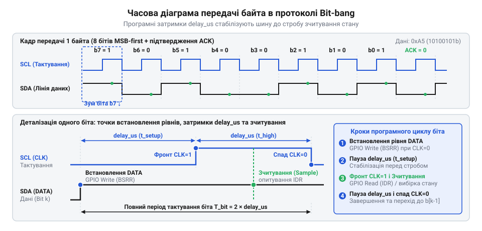
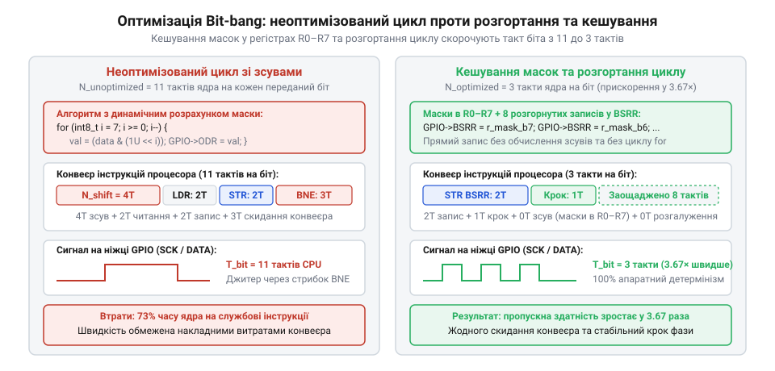
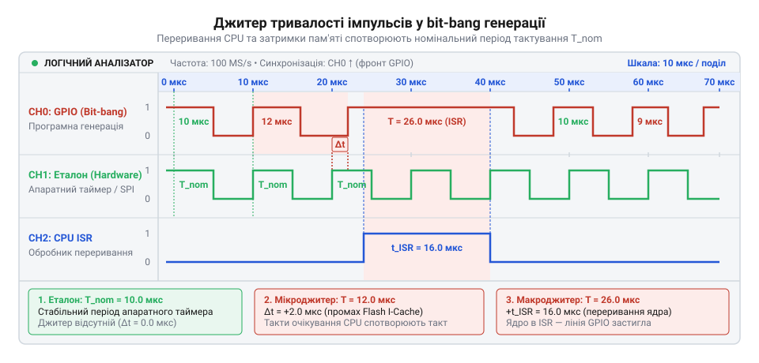

# Специфікація залізного інтерфейсу та часових діаграм Bit-bang (Hardware API)

## Початкові концепції та фізичні принципи

Мікроконтролери взаємодіють із зовнішніми цифровими пристроями переважно через вбудовані апаратні периферійні блоки. Проте вони виявляються безсилими, коли всі канали кремнію зайняті, трасування друкованої плати вимагає довільних виводів або датчик використовує нестандартний часовий протокол. У таких випадках фізичний інтерфейс емулюють програмно — методом @@en|bit-bang@@ (англ. @@en|bit-bang@@, від *bit* — двійковий розряд та *bang* — бити, стукати): процесорне ядро безпосередньо керує логічними рівнями портів загального призначення (англ. @@en|GPIO@@, від *General-Purpose Input/Output*), змінюючи напругу на виводі інструкціями через точно розраховані часові інтервали.

У синхронному протоколі передавач формує два узгоджені сигнали: тактовий строб на лінії тактування та інформаційні перепади на лінії даних. Приймач фіксує електричний стан лінії лише в момент активного перепаду тактового сигналу — на наростаючому або спадному фронті. Відхилення реального моменту перемикання виводу від розрахункового графіка називають джитером (англ. @@en|jitter@@, від *jitter* — тремтіти, сіпатися). Якщо накопичений @@en|jitter@@ зміщує імпульс за межі очікуваного вікна стробування приймача, виникає збій синхронізації та спотворення прийнятого байта.

Провідники друкованої плати та внутрішні кола виводів мікросхем мають паразитний електричний опір `R` та паразитну ємність `C` відносно шини заземлення. Через це при відкритті транзисторів вихідного каскаду @@en|GPIO@@ напруга не зростає стрибком до напруги живлення `V_DD`, а формує перехідний процес заряджання ємності через RC-ланцюг (англ. @@en|RC circuit@@, від *resistor* — резистор та *capacitor* — конденсатор). Інтервал переходу напруги від 10 % до 90 % від `V_DD` визначає час наростання фронту (англ. @@en|rise time@@, від *rise* — підніматися та *time* — час), а розряджання через вихідний транзистор формує час спаду (англ. @@en|fall time@@, від *fall* — падати та *time* — час).

Час наростання фронту `t_rise` знаходять із рівняння перехідного процесу заряджання ємності через опір, де напруга досягає спочатку 10 %, а згодом 90 % від напруги живлення `V_DD`:

```
t_rise = t_0.9 - t_0.1
       = -R · C · ln(1 - 0.9) - (-R · C · ln(1 - 0.1))   [підстановка граничних напруг]
       = R · C · ln(0.9 / 0.1)                             [властивість різниці логарифмів]
       = R · C · ln(9)                                     [спрощення частки]
       ≈ 2.2 · R · C                                       [наближення натурального логарифма]
```

Отриманий вираз показує, що тривалість наростання сигналу прямо пропорційна добутку вихідного опору джерела `R` на паразитну ємність лінії `C`.

**Розрахунок часу наростання сигналу для шини з опором 2.2 kΩ та ємністю 100 pF:**

```
t_rise = 2.2 · 2200 Ω · 100 · 10⁻¹² F  [підстановка опору та ємності]
       = 484 · 10⁻⁹ s                  [обчислення добутку]
       = 484 ns                        [переведення у наносекунди]
```

Отримане значення 484 ns показує, що перезаряджання паразитної ємності лінії забирає майже пів мікросекунди, накладаючи жорстке фізичне обмеження на граничну швидкість передачі бітів у системі.

Щоб вхідний тригер приймача стабільно зафіксував переданий біт, напруга на лінії даних повинна досягти логічного рівня до приходу активного перепаду тактового сигналу — цей інтервал називають часом встановлення (англ. @@en|setup time@@, від *set up* — налаштовувати, готувати). Після тактового стробу рівень напруги має зберігатися незмінним протягом визначеного часу утримання (англ. @@en|hold time@@, від *hold* — утримувати). Якщо завалений фронт через ємність лінії не встигає піднятися до порогу розпізнавання логічної одиниці, інтервал @@en|setup time@@ вичерпується, вхідний тригер потрапляє в стан метастабільності та зчитує хибний біт. Занадто швидке перемикання лінії даних після тактового імпульсу руйнує інтервал @@en|hold time@@ до надійної фіксації біта приймачем.


*Часова діаграма передачі байта: стабільність логічного рівня даних забезпечується дотриманням часових меж встановлення та утримання відносно тактового перепаду.*

Часові параметри залізного інтерфейсу нормуються у специфікації протоколу граничними допусками, які зобов'язаний витримувати програмний генератор:

| Параметр сигналу | Позначення | Мінімальне значення | Типове значення | Максимальне значення | Фізичний зміст та обмеження |
| :--- | :--- | :--- | :--- | :--- | :--- |
| Тривалість високого стану такту | `t_high` | 500 ns | 1000 ns | — | Час заряду та стабілізації лінії тактування |
| Тривалість низького стану такту | `t_low` | 500 ns | 1000 ns | — | Час розряду лінії тактування між імпульсами |
| Час встановлення даних | `t_setup` | 150 ns | 300 ns | — | Випередження перемикання даних до фронту такту |
| Час утримання даних | `t_hold` | 150 ns | 200 ns | — | Збереження рівня даних після перепаду такту |
| Час наростання фронту | `t_rise` | — | 30 ns | 120 ns | Тривалість переходу 10 % → 90 % напруги живлення |
| Час спаду фронту | `t_fall` | — | 15 ns | 60 ns | Тривалість переходу 90 % → 10 % напруги живлення |
| Загальний період біта | `t_bit` | 1.0 μs | 2.0 μs | — | Мінімальна тривалість передачі одного двійкового розряду |

Коли мікроконтролер взаємодіє з низьковольтною периферією через [узгодження логічних рівнів напруги](root:sf-devices/level-shifting-1v5-mcu), затримка транзисторів розширює тривалість фронтів і зміщує перепади на шині, що зменшує запас @@en|setup time@@ та вимагає збільшення програмних пауз.

## Внутрішня будова та алгоритми роботи

У програмній генерації сигналів @@en|bit-bang@@ немає апаратного автомата передачі, тому єдиним джерелом точного фізичного часу для утримання стану виводу виступає тактовий генератор процесорного ядра. Кожен його такт відлічує фіксовану частку секунди.

Кількість тактів ядра `N`, необхідну для формування паузи тривалістю `t` (у секундах) за відомої тактової частоти процесора `f` (у герцах), обчислюють як прямий добуток цих величин:

```
N = t · f
```

Добуток визначає число тактів, які програма має витратити між послідовними змінами сигналу на ніжці.

**Розрахунок кількості тактів для імпульсу тривалістю 0.5 μs на частоті ядра 48 MHz:**

```
N = 0.5 · 10⁻⁶ s × 48 · 10⁶ Hz  [підстановка тривалості та частоти]
  = 24                           [обчислення добутку]
```

Для створення паузи у 0.5 μs процесор із тактовою частотою 48 MHz повинен витратити рівно 24 такти виконання.

Звичайний порожній цикл мови високого рівня для такої затримки не підходить: компілятор видаляє цикли без корисних дій, а без оптимізації команди перевірки лічильника спричиняють зайві звернення до пам'яті. Для точного відліку використовують холосту інструкцію (англ. @@en|NOP@@, від *no operation* — без дії), яка не змінює вмісту регістрів і прапорців, але витрачає рівно один такт процесорного ядра.

Короткі паузи тривалістю до кількох тактів формують послідовним розташуванням інструкцій @@en|NOP@@ в асемблерній вставці з модифікатором `volatile`, який забороняє компілятору викидати або переставляти команди. Коли затримка перевищує десяток тактів, пряме дублювання інструкцій роздуває двійковий код. Тоді застосовують асемблерний лічильний цикл. В архітектурі ARM Cortex-M одна ітерація зворотного відліку складається з команди віднімання `SUBS` (1 такт) та команди умовного переходу `BNE` (2 такти у разі здійснення переходу через перезавантаження конвеєра), що разом дає 3 такти на кожне коло. Кількість ітерацій знаходять діленням `N` на 3, а залишок від ділення компенсують поодинокими інструкціями @@en|NOP@@ після виходу з циклу.

:::tabs
:::code api-bitbang-signal-timing-hardware-spec/c/stm32/delay-exact-cycles.c
:::code api-bitbang-signal-timing-hardware-spec/cpp/cortex-m/exactdelay.cpp
:::

Математичний розрахунок циклів спрацьовує надійно лише за умови незмінного часу виконання кожної окремої команди. У сучасних мікроконтролерах цьому перешкоджають три апаратні чинники: енергонезалежна флеш-пам'ять (англ. @@en|Flash@@, від *flash* — спалах), конвеєр команд (англ. @@en|pipeline@@, від *pipe* — труба) та кеш-пам'ять (англ. @@en|cache@@, від франц. *cacher* — ховати). Власна швидкодія масиву @@en|Flash@@ обмежена: на тактових частотах понад 24–30 MHz пам'ять не встигає видавати 32-розрядне слово інструкції за один такт процесора, змушуючи контролер пам'яті додавати стани очікування (англ. @@en|wait states@@, від *wait* — чекати та *state* — стан). Якщо для читання потрібно два стани очікування, вибірка команди триває 3 такти замість 1. Буфер випереджальної вибірки та кеш інструкцій згладжують цю затримку під час лінійного виконання, але умовні переходи скидають конвеєр, спричиняючи раптовий промах кешу. Через це перша ітерація циклу або вхід у підпрограму тривають довше за наступні, що породжує значний @@en|jitter@@.

Для досягнення апаратної детермінованості (англ. @@en|determinism@@, від лат. *determinare* — визначати, обмежувати) критичні підпрограми генерації сигналів @@en|bit-bang@@ та функції затримки розміщують у внутрішній статичній пам'яті (англ. @@en|SRAM@@, від *Static Random Access Memory*). Внутрішня пам'ять @@en|SRAM@@ підключена безпосередньо до системної шини ядра через матрицю комутації і працює на повній частоті мікроконтролера з нульовими @@en|wait states@@, гарантуючи фіксований час вибірки кожної інструкції.

Вплив станів очікування та затримок конвеєра на відхилення часу можна кількісно оцінити через різницю між реальним часом виконання та ідеальним розрахунком:

```
Δt = t_real - t_ideal
   = (N_real - N_ideal) / f      [вираження часу через кількість тактів]
```

Якщо під час виконання 24-тактової затримки на частоті 48 MHz виникає затримка вибірки через два @@en|wait states@@ пам'яті @@en|Flash@@ та перезавантаження конвеєра на 2 такти, реальна кількість тактів зростає з 24 до 28. Похибка становить `Δt = (28 - 24) / (48 · 10⁶) ≈ 83.3 ns`. За допуску @@en|setup time@@ у 150 ns таке відхилення з'їдає понад половину допустимого вікна передавача.

Ще більшу загрозу для часових інтервалів становить апаратне переривання (англ. @@en|interrupt@@, від лат. *interrumpere* — розривати, ламати). Коли зовнішній сигнал чи таймер ініціює переривання, ядро процесора припиняє виконання поточної програми, автоматично зберігає базові регістри в стек і передає керування на обробник переривання (англ. @@en|ISR@@, від *Interrupt Service Routine*). Якщо це трапляється під час формування імпульсу @@en|bit-bang@@, вивід застигає в поточному стані на весь час роботи @@en|ISR@@. Замість розрахованих 500 ns імпульс може розтягнутися до десятків чи сотень мікросекунд, що неминуче спричиняє тайм-аут або апаратну помилку кадру на боці приймача. Тому перед початком формування часового пакета програма відкриває критичну секцію (англ. @@en|critical section@@, від грец. *kritikos* — здатний розрізняти та лат. *sectio* — розріз), глобально забороняючи переривання на рівні ядра.

Повна заборона переривань ліквідує @@en|jitter@@, але робить процесор нечутливим до апаратних подій. За тривалої затримки черги периферійних блоків втрачають дані, а планувальник (англ. @@en|scheduler@@, від *schedule* — розклад, графік) операційної системи реального часу (англ. @@en|RTOS@@, від *Real-Time Operating System*) не може вчасно перемкнути контекст на пріоритетну задачу. Тому потік даних розбивають на окремі байти: критичну секцію утримують лише під час передачі восьми бітів (близько 8–10 μs), після чого переривання короткочасно дозволяють. Це створює безпечне вікно для обслуговування накопичених черг @@en|ISR@@ та роботи @@en|RTOS@@ без спотворення протоколу.

Коли протокол вимагає тривалих пауз між імпульсами, а блокувати переривання неприпустимо, точний часовий інтервал без навантаження ядра формує [апаратний таймер одиничного імпульсу](root:sf-devices/hardware-timer-one-pulse-mode).

## Апаратна реалізація та низькорівневий C/C++ код

Стандартні бібліотечні обгортки та функції абстракції платформ приховують апаратні адреси за уніфікованим інтерфейсом. Коли така функція перевіряє номер виводу, шукає адресу порту через масиви в пам'яті та валідує аргументи, процесорне ядро витрачає від 30 до 80 тактів на кожну зміну логічного рівня. На тактовій частоті ядра 48 MHz накладні витрати виклику забирають від 0.6 μs до 1.6 μs, що перевищує повний період передачі високошвидкісних протоколів. Для збереження детермінованого часу низькорівневий драйвер керує виводами через прямий доступ до апаратної пам'яті.

Апаратний регістр (англ. @@en|register@@, від лат. *registrum* — список, перелік) — це внутрішній тригерний осередковий вузол мікроконтролера, розряди якого безпосередньо з'єднані з вихідними транзисторами та вхідними буферами порту @@en|GPIO@@. У сучасних процесорах периферійні вузли відображені у спільний адресний простір пам'яті (англ. @@en|MMIO@@, від *Memory-Mapped Input/Output*). Кожен порт @@en|GPIO@@ займає фіксований діапазон адрес на системній шині, а безпосереднє керування лініями зосереджене у трьох 32-розрядних регістрах: вихідні дані відображені в `ODR`, атомарне перемикання виконує `BSRR`, а поточний стан ліній зчитує `IDR`.


*Апаратна архітектура керування виводами: прямий доступ ядра до регістрів BSRR та IDR через периферійну шину усуває накладні витрати бібліотечних викликів і забезпечує атомарне перемикання станів.*

Оптимізатор компілятора розглядає пам'ять як статичне сховище: він може видалити послідовні записи без проміжних зчитувань або замінити багаторазове зчитування кешуванням значення у регістрі процесора. Для апаратних регістрів це неприпустимо, оскільки кожен запис формує фізичний перепад напруги на ніжці, а вхідний стан змінюється зовнішнім пристроєм асинхронно до коду програми. Щоб гарантувати фізичну видачу кожної команди на шину, вказівники на адреси регістрів оголошують із кваліфікатором `volatile`. Це змушує компілятор генерувати безпосередні процесорні інструкції зчитування та запису для кожного звернення у джерельному тексті.

Зміна стану виводу через спільний регістр вихідних даних `ODR` за допомогою бітових операцій «АБО» та «ТА-НІ» створює апаратну вразливість. Вона вимагає виконання циклу читання-модифікації-запису (англ. @@en|RMW@@, від *Read-Modify-Write*).

Кількість машинних операцій `N_rmw`, необхідну для зміни стану виводу через регістр `ODR`, знаходять додаванням кроків зчитування, логічної модифікації та зворотного запису:

```
N_rmw = N_read + N_modify + N_write
      = 1 + 1 + 1                    [інструкції LDR, ORR/BIC, STR]
      = 3                            [сумарна кількість машинних команд]
```

Якщо в інтервалі між зчитуванням і зворотним записом стан сусіднього виводу змінюється перериванням або іншою ниткою, фінальний запис затре чужі зміни старим значенням.

Для безпечного керування використовують виділений регістр атомарного встановлення та скидання бітів (англ. @@en|BSRR@@, від *Bit Set/Reset Register*). Регістр `BSRR` має подвійну розрядність відносно порту: запис одиниці в молодші 16 розрядів перемикає вивід у логічну одиницю, а в старші 16 розрядів — у логічний нуль; запис нуля залишає стан незмінним. Це дозволяє встановити або скинути стан лінії однією інструкцією запису без попереднього читання, усуваючи стан гонитви.

Фізичне формування сигналу залежить від схемотехніки вихідного каскаду: для односпрямованої лінії тактування застосовують двотактний вихід (англ. @@en|push-pull@@, від *push* — штовхати та *pull* — тягнути) із симетричними швидкими фронтами, а для двоспрямованої лінії даних — відкритий стік (англ. @@en|open-drain@@, від *open* — відкритий та *drain* — стік) із підтягувальним резистором, що усуває короткі замикання на спільній шині.

При двосторонньому обміні бітами зчитування відповіді здійснюється через регістр `IDR`. Програма після витримки необхідного часового запасу читає слово з регістра `IDR`, виділяє цільовий розряд бітовою маскою та зсуває його у змінну-накопичувач.

Специфікація апаратного інтерфейсу (Hardware API) закріплює правила взаємодії між програмою та лініями зв'язку.

Стани шини підпорядковані двом обов'язковим інваріантам:
- Стан спокою (англ. @@en|idle state@@, від *idle* — бездіяльний та *state* — стан): тактова лінія утримується на базовому рівні полярності, лінія даних відпущена у високий рівень підтягувальним резистором, вихідні драйвери перебувають у безпечному стані. - Активна передача кадру (англ. @@en|active frame@@, від *active* — діяльний та *frame* — кадр): стан на лінії даних змінюється виключно при неактивному рівні такту після витримки інтервалу @@en|setup time@@, а стробування вхідного біта виконується на середині активного тактового імпульсу.

Інтерфейс модуля описується типами статусів і структурою налаштування:

:::code api-bitbang-signal-timing-hardware-spec/c/snippet-3.c

Нормативні характеристики функцій апаратного інтерфейсу:

| Функція | Призначення | Вхідні параметри | Повертуване значення | Перед- та післяумови |
| :--- | :--- | :--- | :--- | :--- |
| `bitbang_init` | Початкова ініціалізація ліній порту | `config` — покажчик на конфігурацію | `bitbang_status_t` | Перевіряє коректність адрес і встановлює лінії у стан спокою |
| `bitbang_transfer_byte` | Передача та одночасне зчитування байта | `config` — конфігурація, `tx_byte` — байт передачі, `rx_byte` — буфер прийому | `bitbang_status_t` | Виконується атомарно; шина гарантовано повертається у стан спокою після 8-го біта |

Реалізація протоколу на мовах C та C++ демонструє низькорівневе керування регістрами з урахуванням розрахованих часових параметрів.

:::tabs
:::code api-bitbang-signal-timing-hardware-spec/c/stm32/delay-cycles.c
:::code api-bitbang-signal-timing-hardware-spec/cpp/cortex-m/bitbangdriver.cpp
:::

## Практичне застосування та відлагодження

Спроба перевірити роботу програмного інтерфейсу класичним внутрішньосхемним відлагоджувачем (англ. @@en|debugger@@, від *debug* — усувати вади) руйнує сам процес передачі. На точці зупину (англ. @@en|breakpoint@@, від *break* — розривати та *point* — точка) процесорне ядро заморожує лічильник команд, а виводи портів @@en|GPIO@@ застигають у статичному стані. Зовнішня мікросхема очікує завершення тактового імпульсу в межах кількох мікросекунд. Не зафіксувавши очікуваного перепаду, периферійний пристрій скидає внутрішній автомат або фіксує помилку інтерфейсу. Виникає нестійкий дефект спостереження (англ. @@en|heisenbug@@, від імені фізика *Heisenberg* та *bug* — дефект), який зникає при покроковому аналізі. Тому налагодження часових інтерфейсів вимагає виключно неінвазивних вимірювальних приладів.

Основним інструментом контролю є цифровий логічний аналізатор (англ. @@en|logic analyzer@@, від *logic* — логіка та *analyzer* — аналізатор). Він підключається паралельно до фізичних провідників плати, дискретизує електричні перепади з наносекундною роздільною здатністю та накопичує послідовність станів у буферній пам'яті без впливу на програму. Якщо необхідно оцінити форму електричних сигналів і крутизну фронтів, застосовують цифровий осцилограф (англ. @@en|oscilloscope@@, від лат. *oscillo* — гойдатися та грец. *skopeo* — дивитися).


*Захоплення сигналу логічним аналізатором: вимірювання показує розкид тривалості імпульсів (джитер) та дозволяє перевірити відповідність інтервалів встановлення й утримання вимогам специфікації.*

Аналіз виміряних сигналів показує, що реальна тривалість імпульсу перевищує розраховане значення через апаратні накладні витрати шинних мостів процесора.

Фізичну тривалість імпульсу на ніжці `t_real` знаходять додаванням розрахункового часу затримки `t_delay` та сумарних апаратних накладних витрат процесорного ядра `t_overhead`:

```
t_real = t_delay + t_overhead
       = (N_cycles / f) + (N_bus + N_pipe) / f   [декомпозиція затримок ядра та шини]
```

Вираз показує подовження сигналу на час проходження транзакції запису через міст периферійної шини `N_bus` та затримку перезавантаження конвеєра `N_pipe` при виході з функції.

**Калібрування затримки на частоті ядра 48 MHz:**
Якщо розрахунковий цикл на 24 такти мав забезпечити імпульс 500 ns, а аналізатор фіксує тривалість 583.3 ns, різницю у 83.3 ns спричиняють накладні витрати шини.

```
N_corr = (t_real - t_target) · f
       = (583.3 · 10⁻⁹ s - 500.0 · 10⁻⁹ s) × 48 · 10⁶ Hz  [підстановка виміряної різниці]
       = 83.3 · 10⁻⁹ s × 48 · 10⁶ s⁻¹                    [перетворення розмірностей]
       ≈ 4                                                [коригувальна кількість тактів]
```

Поправку у 4 такти віднімають від програмного параметра затримки, повертаючи тривалість сигналу до нормативних 500 ns.

Особливу небезпеку при практичній експлуатації становить конфлікт на шині (англ. @@en|bus contention@@, від *bus* — шина та *contention* — змагання, боротьба). Якщо два пристрої одночасно керують лінією у режимі @@en|push-pull@@ у протилежних логічних рівнях, пряме коротке замикання між лінією живлення та землею створює надструм понад допустимі 25–40 mA, викликаючи електричне вигорання вихідних каскадів мікроконтролера.

Для запобігання пошкодженню лінію організовують у режимі @@en|open-drain@@. Одночасне перемикання формує монтажне «І», де струм обмежується зовнішнім резистором підтяжки, унеможливлюючи апаратне вигорання. Проте наростання напруги через пасивний резистор триває відчутно довше за активний спад через транзистор; якщо паразитні ємності спотворюють крутизну фронту, тривалість пасивного інтервалу компенсують збільшенням програмної паузи `t_high`.

Якщо сигнал надходить від механічних контактів стенду, для нейтралізації паразитних імпульсів застосовують [усунення брязкоту контактів](root:sf-devices/switch-debounce). Для захисту від шумів та наведених завад вхідні кола портів @@en|GPIO@@ містять тригери Шмітта з гістерезисом напруги, а програмний алгоритм виконує зчитування посередині тактового стробу з дотриманням часових меж @@en|setup time@@ і @@en|hold time@@.

У двосторонніх протоколах підлеглий пристрій може затримувати відповідь, утримуючи лінію (англ. @@en|clock stretching@@, від *clock* — такт та *stretching* — розтягування). Застосування нескінченних порожніх циклів опитування неприпустиме: у разі збою датчика мікроконтролер назавжди зупиниться. Для захисту від зависання кожен цикл очікування обмежують лічильником граничного часу — тайм-аутом (англ. @@en|timeout@@, від *time* — час та *out* — поза межі).

Кількість ітерацій циклу очікування `K_timeout`, необхідну для формування захисного інтервалу `t_timeout`, знаходять діленням сумарної кількості тактів на тривалість однієї перевірочної ітерації `C_iter`:

```
K_timeout = (t_timeout · f) / C_iter
```

Цей вираз забезпечує детермінований ліміт очікування: якщо лінія не перейшла у цільовий стан до обнулення лічильника, цикл завершується з поверненням коду помилки, запобігаючи зупинці прошивки.

Якщо через тайм-аут підлеглий пристрій блокує лінію даних у нулі, шину повертають у робочий стан процедурою аварійного відновлення (англ. @@en|bus recovery@@, від *bus* — шина та *recovery* — відновлення):

1. Генерація серії з 9 тактових імпульсів на виводі тактування, що дозволяє зсувному регістру підлеглого вузла завершити прийом байта та відпустити лінію даних. 2. Перевірка стану лінії даних через регістр `IDR`: якщо лінія повернулася у високий рівень, генерується стан завершення транзакції. 3. Якщо після 9 тактів лінія залишається заблокованою у нулі, фіксується апаратна несправність каналу зв'язку.

Класифікація статусних кодів помилок та реакцій модуля:

| Код помилки | Числове значення | Причина виникнення | Реакція модуля та відновлення |
| :--- | :--- | :--- | :--- |
| `BITBANG_OK` | 0 | Передача та прийом байта завершені успішно | Збереження ліній у стані спокою |
| `BITBANG_ERR_TIMEOUT` | 1 | Зовнішній вузол не звільнив лінію за час `t_timeout` | Запуск 9 тактів скидання шини |
| `BITBANG_ERR_BUS_BUSY` | 2 | Лінія заблокована до початку кадру | Перевірка ліній, спроба скидання |
| `BITBANG_ERR_COLLISION` | 3 | Стан лінії не збігається з переданим бітом | Негайне відпускання шини |
| `BITBANG_ERR_INVALID_ARG` | 4 | Некоректна конфігурація або нульовий покажчик | Завершення без впливу на виводи |

Детерміновані лічильники тайм-ауту та процедура аварійного тактування гарантують стійкість програмного драйвера за будь-яких збоїв зовнішніх пристроїв або пошкоджень ліній зв'язку.