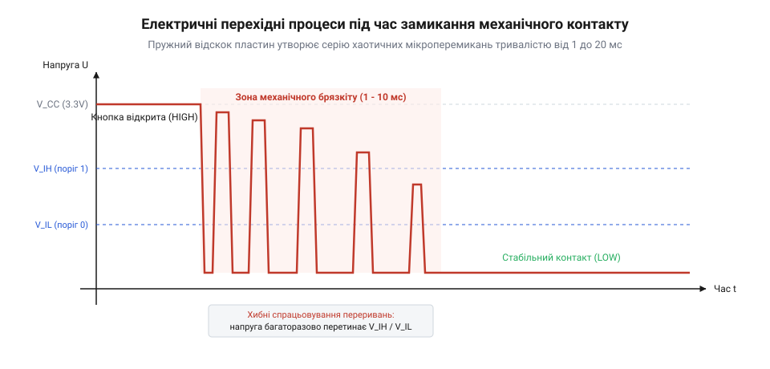

# Брязкіт механічних контактів

## Початкові концепції та фізичні принципи

Механічна кнопка чи кінцевий вимикач у промисловій системі керування під час натискання мають формувати один чіткий логічний перехід. Проте лічильник імпульсів у пам'яті мікроконтролера за кілька мілісекунд фіксує десятки перепадів, а конечний автомат здійснює хаотичні переходи між станами. Причина збою полягає у фізичній пружності контакту та мікроскопічній шорсткості металу — явищі брязкіту механічних контактів (англ. @@en|debounce@@, де @@en|de-@@ — усунення, @@en|bounce@@ — відскок).

Механічна кнопка, тумблер, геркон чи контакт електромагнітного реле здаються людині пристроями миттєвої дискретної дії: при натисканні два металеві провідники зближуються і замикають електричне коло. Однак на мікроскопічному рівні поверхні контактів не є ідеально пласкими. Вони мають шорсткості, мікроскопічні виступи та плівки оксидів. Крім того, самі металеві пластини й пружинні елементи мають механічну пружність. Коли рухомий контакт під дією зовнішньої сили або внутрішньої пружини вдаряється об нерухомий контактний майданчик, його кінетична енергія не гаситься миттєво, а перетворюється в серію пружних мікровідскоків. 

Під час первинного удару відбувається локальна пластична та пружна деформація металу. Контакт на кілька мікросекунд замикає коло, після чого пружна сила відштовхує рухому пластину назад. Відбувається серія швидких повторних ударів та відривів, що супроводжуються мікроіскрінням, пробоєм поверхневих оксидних шарків та локальним нагріванням точок дотику. Лише після згасання механічних коливань у пружині метал щільно притискається, і електричний опір між контактами стабілізується на мінімальному рівні.

Процес розмикання контактів також супроводжується аналогічними перехідними явищами. Під час відведення штовхача пружина контакту входить у стан згасаючих механічних коливань. Доки відстань між металевими поверхнями залишається порівнянною з мікронами, електрична дуга або мікроскопічні містки з розплавленого металу можуть неодноразово замикати та розривати електричне коло, утворюючи хаотичні сплески струму.

Часові параметри цього перехідного процесу залежать від фізичних характеристик комутаційного вузла: маси контактних груп, жорсткості та довжини пружини, матеріалу покриття (срібло, золото, вольфрам, паладій) та величини прикладеного зусилля. Для компактних тактових кнопок на друкованих платах тривалість брязкіту зазвичай становить від 50 мікросекунд до 2 мілісекунд. У потужних промислових кнопках, кінцевих вимикачах чи електромагнітних реле серія відскоків розтягується до 10–20 мілісекунд.

З точки зору цифрової периферії мікроконтролера перехідний процес брязкіту виглядає як серія високочастотних хаотичних прямокутних імпульсів змінної тривалості. Замість ідеального логічного фронту з низьким часом наростання на виводі утворюється пачка спалахів напруги.


*Електрична часова діаграма напруги на вхідній лінії GPIO, що ілюструє хаотичні логічні переходи під час брязкіту та перехід до стабільного стану.*

Під час брязкіту напруга на виводі мікроконтролера багаторазово перетинає порогові значення вхідного буфера. Якщо лінію конфігуровано як джерело асинхронних переривань по фронту, процесор отримує не один виклик обробника (англ. @@en|ISR@@, @@en|Interrupt Service Routine@@), а серію з 10–50 переривань поспіль протягом кількох мілісекунд. Оскільки час виконання базового обробника переривання становить лише кілька десятків тактів процесора (одиниці мікросекунд), процесор витрачає увесь свій обчислювальний ресурс на повторне входження та вихід із @@en|ISR@@. Це викликає переповнення стеку, затримку виконання інших задач реального часу та розсинхронізацію внутрішніх таймерів.

Небезпека брязкіту підсилюється при прямому зчитуванні рівнів, коли прошивка виконує циклічне опитування через [вхідні регістри GPIO](root:sf-devices/gpio-registers). Якщо цикл опитування потрапляє на фазу нестабільності, прошивка зчитує випадкові значення (то логічний нуль, то логічну одиницю). Це руйнує роботу лічильників імпульсів та викликає хибні спрацьовування в системах зчитування сигналів. 

Для правильного вибору методу фільтрації важливо чітко розрізняти брязкіт контактів та інші види завад на вхідних лініях мікроконтролера:
* **Брязкіт контактів** — низькочастотне механічне явище з тривалістю імпульсів від десятків мікросекунд до десятків мілісекунд, що виникає виключно в момент комутації. * **Імпульсні завади (глічі)** — високочастотні електричні наведення від силового обладнання чи переключення сусідніх ліній з тривалістю від одиниць до сотень наносекунд. Для їхнього усунення застосовують спеціалізоване [запобігання імпульсним завадам](root:sf-devices/gpio-glitch-prevention). * **Хвильові відбиття** — паразитичні осциляції, викликані неузгодженістю ліній передачі та високою швидкістю наростання фронту. Вони виникають на наносекундних інтервалах і описані в матеріалі [дзвін у довгих лініях](root:sf-devices/transmission-reflections).

Крім того, на первинне формування вхідного сигналу впливають внутрішні електричні параметри кристала. Конфігурація підтягувальних резисторів (англ. @@en|pull-up@@ / @@en|pull-down@@), керування крутизною фронту (англ. @@en|slew rate@@) та активація вхідних буферів реалізуються через [електричні налаштування виводів](root:sf-devices/pad-control). Однак самі по собі ці налаштування не здатні усунути механічний брязкіт, оскільки його часові інтервали на кілька порядків перевищують постійні часу внутрішніх паразитичних ємностей кристала.

Розуміння фізичних причин брязкіту дозволяє сформулювати головну вимогу до модуля введення: забезпечити детерміноване розпізнавання істинного стану контакту та повністю відсікти перехідні мікровідскоки до того, як вони потраплять у високорівневу логіку програми.

## Внутрішня будова та алгоритми роботи

Нейтралізація брязкіту контактів може здійснюватися на двох рівноправних рівнях архітектури вбудованої системи: апаратному (до надходження сигналу в цифрове ядро мікроконтролера) та програмному (за допомогою алгоритмів обробки в прошивці). Кожен із підходів визначає внутрішню будову модуля введення та накладає специфічні обмеження на часові затримки, витрати пам'яті та апаратний склад плати.

Апаратна фільтрація базується на інтегруванні електричного сигналу за допомогою пасивних @@en|RC-ланцюгів@@ та наступному формуванні крутих логічних фронтів за допомогою гістерезису (від грецьк. @@el|hysteresis@@ — запізнення, відставання). Найпростіший апаратний дебаунсер складається з підтягувального резистора, обмежувального резистора та керамічного конденсатора. Коли контакт відкритий, конденсатор заряджається до напруги живлення `U_CC` через підтягувальний резистор `R_pullup`. При замиканні контакту конденсатор розряджається через обмежувальний резистор `R_series`.

Параметри @@en|RC-ланцюга@@ розраховуються на основі постійної часу `τ` (від грецької літери @@el|tau@@ — τ), яка визначає швидкість зміни напруги на конденсаторі:

```
τ = R · C
```

Під час розряджання або заряджання конденсатора напруга `U(t)` змінюється за експоненційним законом:

```
U(t) = U_CC × (1 - e⁻ᵗ⁽ᴿ⁻ᶜ⁾)
= U_CC × (1 - e⁻¹)          [t = τ = R · C]
≈ 0.632 × U_CC              [обчислення експоненти]
```

Для надійного придушення брязкіту тривалістю 10 мілісекунд постійну часу `τ` вибирають у межах від 5 до 15 мілісекунд. Наприклад, при використанні підтягувального резистора `R = 10` кОм та конденсатора `C = 1` мкФ постійна часу становить:

```
τ = 10000 Ом × 0.000001 Ф
= 0.01 с
= 10 мс
```

Однак подача плавно зміниваного аналогового сигналу безпосередньо на стандартний @@en|CMOS@@-вхід мікроконтролера створює нову проблему. Під час повільного проходження напруги через проміжну зону між логічним нулем та одиницею входять у провідний стан обидва транзистори вхідного каскаду. Це викликає наскрізний струм короткого замикання (англ. @@en|shoot-through current@@), підвищене тепловиділення та високочастотні осциляції цифрового буфера.

Для усунення цього ефекту після @@en|RC-ланцюга@@ обов'язково застосовують тригер Шмітта (названий на честь винахідника Отто Шмітта, англ. @@en|Schmitt trigger@@). Тригер Шмітта має два окремих пороги спрацьовування: верхній `U_VT+` та нижній `U_VT-`. Різниця між ними становить напругу гістерезису `ΔU = U_VT+ - U_VT-`.

Коли напруга на конденсаторі спадає під час розряджання, вихід тригера Шмітта переключається в стан логічного нуля лише тоді, коли напруга опускається нижче `U_VT-`. Якщо під час цього виникають дрібні сплески напруги, викликані брязкітом, вони не призводять до зворотного перемикання, оскільки їхня амплітуда не перевищує верхній поріг `U_VT+`. 

Більшість сучасних мікроконтролерів вже мають вбудовані тригери Шмітта на кожному виводі @@en|GPIO@@. Їхні параметри та налаштування підтягувальних резисторів визначаються через [електричні налаштування виводів](root:sf-devices/pad-control). Крім того, деякі спеціалізовані мікроконтролери містять внутрішні апаратні блоки фільтрації, такі як [цифрову фільтрацію сигналів](root:sf-devices/hardware-digital-signal-filtering), де вхідний сигнал тактується внутрішнім дільником частоти й підтверджується лише після збереження стабільного рівня протягом заданої кількості тактів. У задачах зчитування кута повороту через оптичні чи механічні енкодери фільтрація брязкіту виноситься безпосередньо в [апаратний режим квадратурного декодера](root:sf-devices/encoder-hardware-timer-mode).

Внутрішня будова програмного модуля дебаунсингу базується на концепції періодичного опитування (англ. @@en|periodic sampling@@) стану лінії за допомогою апаратного таймера. Замість використання асинхронних переривань, прошивка налаштовує регулярний таймер із періодом `T_sample` (зазвичай від 1 до 10 мілісекунд).

Внутрішня структура програмного модуля складається з трьох ключових компонентів:
1. **Низькорівневого драйвера зчитування**, який безпосередньо звертається через [вхідні регістри GPIO](root:sf-devices/gpio-registers) до фізичного виводу. 2. **Алгоритму фільтрації та стабілізації**, який накопичує історії зчитувань (за допомогою зсувного регістра чи накопичувального лічильника). 3. **Генератора подій**, який сповіщає високорівневу логіку про підтверджений перехід стану.

При реалізації програмного дебаунсингу на основі зсувного регістра прошивка зберігає останні `N` зчитувань у вигляді бітової маски. На кожному такті опитування поточний рівень лінії вписується в молодший біт регістра, а попередні значення зсуваються вліво. Стан вважається стабільним логічним нулем лише тоді, коли всі біти регістра дорівнюють нулю (маска `0x00`). Відповідно, стан вважається стабільною логічною одиницею, коли всі біти дорівнюють одиниці (маска `0xFF`). Будь-які інші значення регістра свідчать про те, що перехідний процес брязкіту ще триває, тому стан модуля не змінюється.

Нижче наведено практичну реалізацію програмного фільтра брязкіту на основі зсувного регістра для мов C та C++. Драйвер підтримує конфігурування маски стабільності та забезпечує детермінований розрахунок нового стану без використання блокуючих затримок.

:::tabs
@tab C (ESP-IDF)
:::code root\eng\sf-devices\contact-bounce/contact-bounce-d/c/esp-idf/button-debounce-init.c c
@tab C++ (Arduino)
:::code root\eng\sf-devices\contact-bounce/contact-bounce-d/cpp/arduino/buttondebouncer.cpp cpp
:::

Вибір між апаратним та програмним дебаунсингом визначається вимогами до архітектури проєкту:

| Критерій порівняння | Апаратний фільтр (RC + Тригер Шмітта) | Програмний фільтр (Опитування таймером) |
| :--- | :--- | :--- |
| **Витрати на друкованій платі** | Додаткові резистори та конденсатори на кожен канал | Нуль додаткових компонентів |
| **Навантаження на процесор** | Абсолютно нульове | Регулярні переривання таймера чи кванти часу |
| **Реакція на перший фронт** | Визначена постійною часу `τ` (затримка 5–10 мс) | Визначена періодом опитування та розміром маски |
| **Гнучкість налаштування** | Вимагає фізичної заміни пасивних компонентів | Змінюється динамічно в коді (маска, період) |
| **Стійкість до зношення** | Фіксована | Поріг фільтрації можна збільшувати програмно |

Розуміння внутрішніх механізмів брязкіту та математики перехідних процесів дозволяє інженеру свідомо вибирати оптимальну комбінацію апаратних та програмних фільтрів під конкретні вимоги детермінізму та енергоефективності.

## Апаратна реалізація та низькорівневий C/C++ код

Створення високонадійних вбудованих систем вимагає переходу від високорівневих бібліотечних абстракцій до прямої взаємодії з апаратним забезпеченням мікроконтролера. Коли розробник використовує стандартні функції фреймворків для зчитування стану виводів, кожен виклик супроводжується перевіркою меж масивів, визначенням адрес виводів за таблицями та непрямою адресацією пам'яті. У задачах зчитування великих масивів механічних кнопок чи клавіатурних матриць ці обчислювальні накладні витрати виснажують процесорний час та створюють непередбачувані часові затримки. Для забезпечення детермінованого часу відгуку прошивка має звертатися безпосередньо через [вхідні регістри GPIO](root:sf-devices/gpio-registers).

Пряме читання портів дозволяє отримати фізичний стан одразу 32 або 64 вхідних ліній за одну процесорну інструкцію `LDR`. Отримане значення являє собою 32-бітне слово, де кожен біт відповідає реальному електричному рівню на відповідному фізичному виводі кристала. Поєднання такого читання з атомарними логічними операціями створює основу для високошвидкісної обробки сигналів. Для забезпечення правильної топології та маршрутизації вхідних ліній всередині мікроконтролера застосовується [трасування сигналів через матрицю GPIO](root:sf-devices/esp-idf-gpio-matrix-iomux-routing), а архітектура системи фіксує [конфігурування виводів як єдиного джерела правди](root:sf-devices/konfihuratsiia-piniv-iak-iedyne-dzherelo-pravdy).

Традиційні програмні алгоритми дебаунсингу обробляють кожен вивід окремо через цикли та умовні оператори `if-else`. Однак у сучасних розширених мікропроцесорних архітектурах із конвеєрним виконанням інструкцій часті розгалуження призводять до хибних передбачень розгалужень (від англ. @@en|branch misprediction@@). Кожен збій конвеєра змушує процесор скидати вже завантажені інструкції, що витрачає від 10 до 20 тактів ядра на кожній кнопці.

Щоб повністю усунути розгалуження, застосовують алгоритм паралельної побітової фільтрації на основі вертикальних лічильників (англ. @@en|vertical counter@@). Замість зберігання окремої змінної історії для кожного виводу, прошивка оперує двома 32-бітними регістрами `deb0` та `deb1`, які разом утворюють 2-бітний накопичувальний лічильник для кожного з 32 виводів одночасно.

Математична модель алгоритму базується на виявленні відмінностей між поточним зчитаним портом `raw` та підтвердженим станом `state`. Позначимо обчислювану маску відмінностей як `delta`:

```
delta = raw ^ state
```

Кожен такт опитування таймера алгоритм оновлює стан 2-бітного лічильника для тих бітів, де `delta` дорівнює одиниці. Якщо рівень на виводі змінюється, відповідний лічильник скидається або інкрементується. Коли лічильник досягає максимального значення (наприклад, 4 стабільних відліки поспіль), оновлюється підтверджений стан `state`.

Обчислення нового стану вертикального лічильника здійснюється за допомогою побітової логіки без жодного умовного переходу:

```
deb0_new = deb0 ^ delta
deb1_new = deb1 ^ (delta & ~deb0)
changes = delta & ~deb0 & ~deb1
state_new = state ^ changes
```

Кожен символ у цьому виразі відображає побітову операцію над 32-бітним словом: `^` відповідає операції «виключне АБО» (англ. @@en|XOR@@), `&` — логічному «І» (англ. @@en|AND@@), а `~` — логічному запереченню «НЕ» (англ. @@en|NOT@@). Вираз `changes` формує бітову маску (від англ. @@en|bitmask@@), у якій одиницями позначені виключно ті виводи, чий стан залишався стабільним протягом усіх чотирьох опитувань поспіль.


*Схема потоку даних від зчитання вхідного регістру GPIO до оновлення бітових масок історії та надсилання подій у чергу RTOS.*

Отриманий стан необхідно передати у високорівневу логіку програми. У складних вбудованих системах обробка кнопок виконується в контексті таймерного переривання обробника (англ. @@en|ISR@@, @@en|Interrupt Service Routine@@), а бізнес-логіка керування працює в окремих задачах операційної системи реального часу RTOS (від англ. @@en|Real-Time Operating System@@, наприклад @@en|FreeRTOS@@). Виконання важких обчислень чи затримок всередині @@en|ISR@@ суворо заборонено, оскільки це блокує обробку інших апаратних подій.

Драйвер кнопки формує неблокуюче повідомлення і надсилає його в чергу (англ. @@en|queue@@) або здійснює сповіщення задач (англ. @@en|task notification@@). Це дозволяє зберегти детермінованість переривання та дотримуватися концепції, яку описує [архітектурна модель модуля](root:sf-devices/module-model). У випадках, коли для обробки високочастотних сигналів апаратних ресурсів ядра недостатньо, у мікроконтролерах можна задіяти [апаратний режим квадратурного декодера](root:sf-devices/encoder-hardware-timer-mode).

Нижче наведено практичну реалізацію низькорівневого паралельного дебаунсера на мові C для середовища ESP-IDF та об'єктно-орієнтованого фільтра на мові C++ для вбудованих систем.

:::tabs
@tab C (ESP-IDF)
:::code root\eng\sf-devices\contact-bounce/contact-bounce-d/c/esp-idf/parallel-debouncer-init.c c
@tab C++ (Modern C++ / STM32)
:::code root\eng\sf-devices\contact-bounce/contact-bounce-d/cpp/bare-metal/buttonevent.cpp cpp
:::

Часові параметри алгоритму дебаунсингу розраховуються на основі постійного періоду опитування та глибини фільтрації. Повний час затримки підтвердження події `t_delay` визначається добутком кількості послідовних стабільних відліків `N` на період опитування таймера `T_sample`.

Позначимо параметри:
`t_delay` — повна часова затримка підтвердження стану (у мілісекундах),
`N` — кількість послідовних однакових відліків для фіксації стану,
`T_sample` — період опитування таймерного переривання (у мілісекундах).

Обчислення затримки реакції прошивки на натискання кнопки здійснюється за формулою:

```
t_delay = N × T_sample
= 8 × 2 мс              [підстановка N = 8 та T_sample = 2 мс]
= 16 мс                 [перемноження параметрів]
```

З отриманого розрахунку видно, що при періоді опитування 2 мілісекунди та глибині зсувного регістра у 8 бітів підтвердження натискання відбудеться точно через 16 мілісекунд після завершення останнього фізичного відскоку контакту. Людина відчуває затримку в інтерфейсі користувача лише тоді, коли вона перевищує 50 мілісекунд, тому затримка в 16 мілісекунд є ідеальним компромісом між швидкістю відгуку та надійністю фільтрації.

## Практичне застосування та відлагодження

Налагодження алгоритмів дебаунсингу у реальних пристроях вимагає поєднання фізичного інструментального контролю та програмного моніторингу внутрішніх станів прошивки. Спроби діагностувати брязкіт виключно за допомогою виводу текстових повідомлень у послідовний порт (англ. @@en|UART console@@) призводять до викривлення часових діаграм, оскільки операції введення-виведення створюють власні блокуючі затримки в десятки мілісекунд.

Основним інструментом розробника для вимірювання часових параметрів брязкіту є осцилограф (від грецьк. @@el|oscillograph@@ — коливання та запис) або логічний аналізатор (англ. @@en|logic analyzer@@). Один канал приладу підключається безпосередньо до фізичного виводу кнопки, а другий — до спеціального відлагоджувального виводу мікроконтролера (англ. @@en|GPIO toggle debug pin@@).

Прошивка конфігурує відлагоджувальний вивід на вихід та інвертує його рівень у двох точках:
1. У момент виникнення першого асинхронного переривання по спадаючому фронту кнопки (фізичний початок контакту). 2. У момент, коли програмний фільтр остаточно підтверджує стабільність стану та надсилає подію в систему.


*Діаграма часового запізнення між першим фізичним мікроконтактом кнопки та відфільтрованим програмним сигналом на тестовому виводі GPIO.*

Порівнюючи два канали на екрані осцилографа, інженер точно вимірює реальну тривалість серії відскоків конкретної механічної конструкції та підтверджує детермінованість програмної затримки. Якщо на вхідній лінії присутні високочастотні імпульсні наведення з тривалістю менше 1 мікросекунди, перед програмним опитуванням доцільно активувати [вбудовану цифрову фільтрацію](root:sf-devices/hardware-digital-signal-filtering) периферії microcontoller, яка відсікає короткі спалахи на апаратному рівні.

У практичній експлуатації розробники зустрічаються з трьома критичними граничними випадками (англ. @@en|edge cases@@), які можуть порушити роботу навіть відтестованого фільтра:

1. **Заклинювання та постійне брязкотіння контакту** (англ. @@en|stuck key / chatter@@). При механічному зносі, попаданні вологи або окисленні контактних майданчиків кнопка може увійти в стан безперервного генератора хаотичних імпульсів. Якщо прошивка покладається на асинхронні переривання, це призводить до повного зависання процесора (англ. @@en|ISR starvation@@). Для захисту в прошивку вбудовують конечний автомат станів (англ. @@en|state machine@@), який підраховує кількість змінення станів за одиницю часу. Якщо кількість переходів перевищує 50 за 500 мілісекунд, лінія маркується як несправна, переривання для неї тимчасово вимикаються, а системі надсилається сповіщення про апаратну аварію.

2. **Довгі кабелі та хвильові явища**. Коли механічний датчик або кнопка винесені за межі друкованої плати на декілька метрів, брязкіт контактів накладається на [дзвін та відбиття в лініях](root:sf-devices/transmission-reflections). Напруга на вході може просідати нижче нуля або перевищувати напругу живлення `U_CC`, що викликає повторне спрацьовування вхідного буфера. У таких умовах обов'язковим є [запобігання імпульсним завадам](root:sf-devices/gpio-glitch-prevention) через комбінацію зовнішнього RC-фільтра, тригера Шмітта та програмного зсувного регістра.

3. **Режими глибокого енергозбереження** (англ. @@en|deep sleep mode@@). У портативних та IoT-пристроях мікроконтролер більшу частину часу перебуває в стані сну зі зупиненими основними тактовими генераторами й таймерами. Для пробудження системи задіюється асинхронний контролер переривань та [мультиплексування виводів мікроконтролера](root:sf-devices/pin-multiplexing). Процес обробки поділяється на два етапи:

```
[Асинхронний фронт на GPIO] 
→ [Пробудження ядра мікроконтролера] 
→ [Запуск таймера дебаунсингу (2 мс)] 
→ [Підтвердження стабільності рівнів] 
→ [Виконання робочого сценарію або повернення в сон]
```

Під час пробудження прошивка першим кроком налаштовує [електричні налаштування виводів](root:sf-devices/pad-control), включаючи внутрішні підтягувальні резистори та тригери Шмітта, і лише після цього запускає таймер дебаунсингу. Якщо пробудження було викликане короткою імпульсною завадою, програмний фільтр за 8–16 мілісекунд визначає відсутність стабільного рівня і повертає мікроконтролер у режим сну без активації основних системних задач.

Для систематичної діагностики та верифікації модуля введення нижче наведено діагностичний чек-лист розробника:

| Проблема / Симптом | Фізична причина | Спосіб усунення в прошивці та апаратурі |
| :--- | :--- | :--- |
| Подвійне спрацьовування при короткому натисканні | Тривалість брязкіту перевищує глибину фільтра (`t_bounce > t_delay`) | Збільшити період опитування `T_sample` або кількість відліків `N` у зсувному регістрі. |
| Пропуск швидких повторних натискань | Час фільтрації занадто великий (`t_delay > 50` мс) | Оптимізувати глибину фильтра до 10–15 мс; вимикати повторну фільтрацію на час утримання. |
| Помилкові пробудження зі стану `deep sleep` | Високочастотні наведення на довгій лінії кнопок | Додати зовнішній керамічний конденсатор 10 нФ та активувати вбудований тригер Шмітта. |
| Високе споживання CPU під час натискання | Використання асинхронних переривань ISR без програмного таймера | Перевести дебаунсер на періодичне опитування таймером замість прямих переривань кнопок. |

Нарешті, верифікація програмних модулів дебаунсингу в рамках автоматизованого тестування (англ. @@en|unit testing@@) здійснюється без використання реальної кнопки. Розробник створює тестовий масив бітових значений, який імітує часову діаграму реального брязкіту з мікровідскоками, та подає його на вхід функції оновлення фільтра. Модульний тест вважається пройденим успішно тільки тоді, коли прапорець зміни стану виставиться рівно один раз у строго розрахований такт часу.