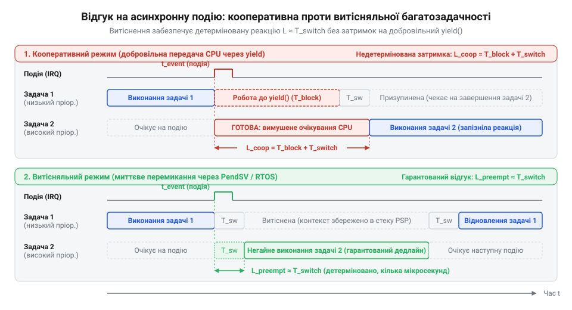
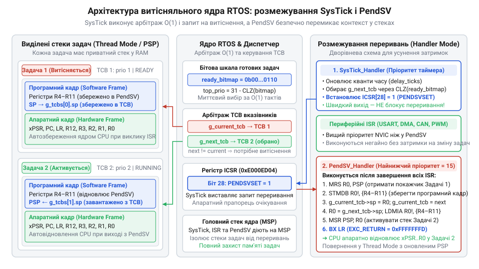
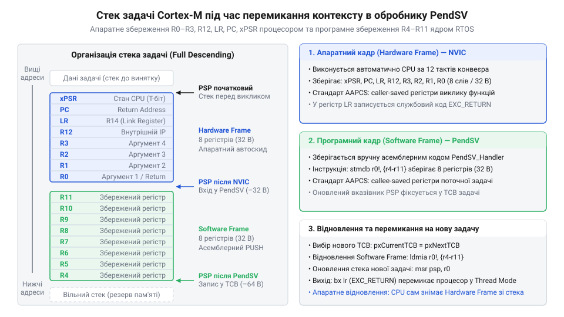
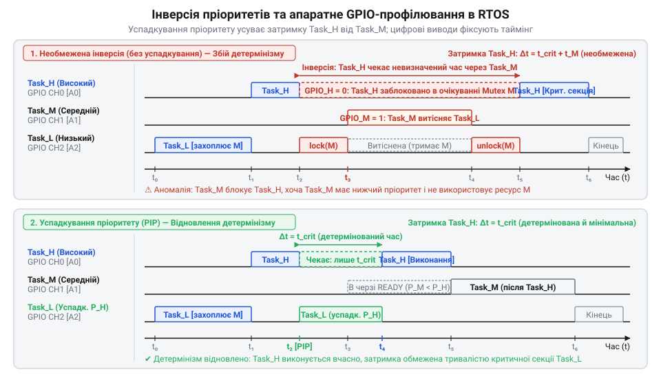

# Кооперативна та витісняльна багатозадачність у вбудованих системах

## Початкові концепції та фізичні принципи

Розробка сучасної прошивки для мікроконтролера розгортається в умовах суворого фізичного обмеження: центральний процесор @@en|CPU@@ (від англійського *Central Processing Unit* — центральний процесорний пристрій) володіє лише одним послідовним конвеєром виконання інструкцій. Водночас апаратне оточення пристрою висуває вимоги одночасної обробки десятків незалежних асинхронних подій. Мікроконтролер змушений паралельно опитувати датчики по шині @@en|I2C@@ (від англійського *Inter-Integrated Circuit* — послідовна шина зв'язку мікросхем), розбирати потік байтів від модуля @@en|UART@@ (від англійського *Universal Asynchronous Receiver-Transmitter* — універсальний асинхронний трансивер), регулювати струм обмоток двигуна через @@en|PWM@@ (від англійського *Pulse-Width Modulation* — широтно-імпульсна модуляція) та відрисовувати елементи графічного інтерфейсу на дисплеї.

У найпростішій архітектурі розробники застосовують [подієво-орієнтовану архітектуру прошивок](root:sf-devices/event-driven-firmware) або класичний супер-цикл @@en|Super-loop@@ (від англійського *Super-loop* — нескінченний головний цикл програми). Проте при зростанні складності обчислювальних алгоритмів ця модель виявляє фундаментальний недолік: час відгуку системи на зовнішню подію стає повністю детермінованим сумарною тривалістю виконання усіх інших функцій, викликаних у циклі. Якщо одна з процедур виконує тривалий математичний розрахунок або блокуюче очікування готовності прапорця периферійного модуля протягом 10 мілісекунд, усі інші задачі позбавляються процесорного часу на цей самий період. Сплеск часового відхилення, або @@en|часовий джитер@@ (від англійського *timing jitter* — часове тремтіння, відхилення періоду виконання), у супер-циклі дорівнює тривалості найдовшої ітерації:

        J_superloop = T_max_iteration

Для подолання цієї проблеми у прошивках впроваджують концепцію абстракції задачі. @@en|Задача@@ (від англійського *task* — автономна одиниця виконання) являє собою послідовну програму, яка володіє власним ізольованим контекстом виконання: значеннями регістрів загального призначення, лічильником інструкцій @@en|Program Counter@@ (скорочено @@en|PC@@, від англійського *Program Counter* — лічильник команд процесора), регістром стану @@en|Status Register@@ та власною ділянкою оперативної пам'яті @@en|RAM@@ (від англійського *Random Access Memory* — оперативна пам'ять) під @@en|стек задачі@@ (від англійського *task stack* — ділянка пам'яті для збереження локальних змінних та адрес повернення).

Багатозадачність створює ілюзію паралельного виконання декількох програм на єдиному фізичному ядрі шляхом швидкого послідовного переключення контексту процесора між задачами. Залежно від апаратного та програмного механізму передачі управління процесором багатозадачність поділяють на два фундаментальні класи: кооперативну та витісняльну.

@@en|Кооперативна багатозадачність@@ (від англійського *cooperative multitasking* — спільнотна багатозадачність, де задачі добровільно передають процесорний час) базується на принципі добровільної передачі контролю. У цій архітектурі поточна задача виконується безперервно до тих пір, поки сама свідомо не викличе функцію передачі управління @@en|yield@@ (від англійського *yield* — поступитися процесором) або не заблокується в очікуванні ресурсу.

Фізичний механізм передачі контролю в кооперативному планувальнику є надзвичайно простим і ефективним. Коли задача досягає точки передачі управління, вона зберігає свій поточний стан — наприклад, номер кроку в [автоматі станів задачі](root:sf-devices/task-states) — і повертає управління в головний цикл планувальника. Планувальник послідовно викликає наступну задачу, яка відновлює виконання зі свого останнього збереженого стану.

Визначальною перевагою кооперативної моделі є мінімальні вимоги до оперативної пам'яті та відсутність потреби у складних механізмах синхронізації між задачами. Оскільки передача управління відбувається виключно у визначених розробником точках, будь-яка ділянка коду між двома викликами @@en|yield@@ є природно атомарною відносно інших задач. Розробнику не потрібно застосовувати [критичні секції в RTOS](root:sf-devices/critical-sections-in-rtos) або м'ютекси для захисту спільних структур даних від зіпсування іншими задачами, хоча апаратні переривання периферії @@en|ISR@@ (від англійського *Interrupt Service Routine* — обробник переривань) все ще можуть виникати у довільний момент.

Більш того, у багатьох кооперативних системах усі задачі можуть виконуватися на єдиному спільному системному стеку, що радикально заощаджує оперативну пам'яті @@en|RAM@@. Для цього часто використовують [безстекові протопотоки](root:sf-devices/protothreads-stackless-coroutines) або реалізують [чергу робіт для відкладеного виконання](root:sf-devices/work-queue).

Проте кооперативна багатозадачність має критичну вразливість: вона не здатна гарантувати жорсткий детермінований час відгуку. Якщо одна з задач через помилку розробника потрапить у нескінченний цикл або затримається на тривалу обробку даних без виклику @@en|yield@@, вся система повністю зупиняється. Обчислимо максимальну затримку реакції кооперативної системи L_coop на високопріоритетну подію:

        L_coop_max = max(T_exec_chunk_j) + T_switch
        = T_longest_non_yielding_block + T_switch      [підстановка найдовшого нерозривного блоку коду серед усіх задач]

З наведеного співвідношення видно: навіть якщо виникає критична подія, система не може приступити до її обробки, доки поточна задача не добіжить до найближчого виклику @@en|yield@@.

@@en|Витісняльна багатозадачність@@ (від англійського *preemptive multitasking* — випереджальна багатозадачність з примусовим відбором процесорного часу) усуває залежність від доброї волі задач. Передача управління процесором виконується примусово на рівні апаратних переривань.

Серцем витісняльної системи є апаратний @@en|системний таймер@@ (від англійського *SysTick* — таймер системного квантування часу). Таймер налаштовується на генерування періодичних переривань із частотою, наприклад, 1000 Гц (інтервал у 1 мілісекунду). Щоразу, коли спрацьовує переривання @@en|SysTick@@, апаратний вектор переривань призупиняє виконання поточної задачі незалежно від того, яку інструкцію вона виконувала в цей момент.

Під час виникнення витіснення апаратура мікроконтролера та операційна система реального часу @@en|RTOS@@ (від англійського *Real-Time Operating System* — операційна система реального часу) виконують збереження повного [контексту задачі](root:sf-devices/task-control-block-structure) у її приватному стеку. Після цього планувальник оцінює пріоритети задач у черзі готовності: якщо існує задача з вищим пріоритетом або поточній задачі вичерпано її @@en|квант часу@@ (від англійського *time slice* — проміжок часу, виділений задачі для виконання), здійснюється @@en|перемикання контексту@@ (від англійського *context switch* — збереження та відновлення стану процесора).

Математична модель часу відгуку у витісняльній системі з фіксованими пріоритетами @@en|FPPS@@ (від англійського *Fixed-Priority Preemptive Scheduling* — витісняльне планування з фіксованими пріоритетами) описується рівнянням рекурентної затримки:

        R_i = T_exec_i + T_switch + ∑ ( ⌈ R_i / P_j ⌉ × T_exec_j )      [сума переривань від усіх задач із вищим пріоритетом hp(i)]

Де:
- R_i — повний час реакції задачі i;
- T_exec_i — власний час виконання задачі i;
- T_switch — тривалість апаратного та програмного накладного витрачання часу на перемикання контексту;
- P_j — період повторення задачі j з вищим пріоритетом;
- T_exec_j — час виконання задачі j з вищим пріоритетом.

Найважливіший архітектурний висновок із цієї формули: час реакції високопріоритетної задачі абсолютно не залежить від тривалості виконання чи наявності блокуючих циклів у низькопріоритетних задачах. Високопріоритетна задача витісняє низькопріоритетну миттєво за час T_switch.

Порівняємо обидва підходи за ключовими інженерними критеріями:
1. Споживання оперативної пам'яті @@en|RAM@@: Кооперативна система потребує один спільний стек (або мінімальні блоки стану у кілька десятків байтів). Витісняльна система вимагає виділення окремого ізольованого стека для кожної задачі (зазвичай від 512 байтів до 4 кілобайтів на задачу), що суттєво підвищує вимоги до пам'яті мікроконтролера. 2. Витрати процесорного часу @@en|CPU Overhead@@: У кооперативній системі передача управління становить лише 5–15 тактів процесора (збереження лише декількох регістрів). У витісняльній системі перемикання контексту включає апаратне та програмне збереження 16–32 регістрів ядра, оновлення покажчиків стека та роботу алгоритму вибору задачі у планувальнику, що займає від 80 до 300 тактів. 3. Складність синхронізації: У кооперативній системі дані між задачами захищені природно між викликами передачі управління. У витісняльній системі будь-який доступ до спільних змінних вимагає використання м'ютексів, семафорів або заборони переривань для запобігання стану гонки @@en|race condition@@ (від англійського *race condition* — стан гонки при паралельному доступі).

*Порівняльна часова діаграма відгуку системи на реальну подію у кооперативному та витісняльному режимах.*

## Внутрішня будова та алгоритми роботи

Для реалізації витісняльного ядра вбудованої операційної системи визначають основну структуру даних — [структуру контрольного блоку задачі (TCB)](root:sf-devices/task-control-block-structure). Вона містить усю інформацію, необхідну для відновлення виконання задачі з будь-якого моменту:

1. Покажчик стека `sp` (від англійського *Stack Pointer*, SP — регістр вершини стека): зберігає поточну адресу вершини стека задачі, куди складено збережені регістри. 2. Стан задачі `state`: значення з [автомата станів задачі](root:sf-devices/task-states) (ГОТОВА / READY, ВИКОНУЄТЬСЯ / RUNNING, БЛОКОВАНА / BLOCKED, ПРИЗУПИНЕНА / SUSPENDED). 3. Пріоритет `priority`: числовий рівень пріоритету для арбітражу планувальника. 4. Лічильник затримки `delay_ticks`: кількість системних квантів часу, які задача має проспати. 5. Межі стека `stack_base` та `stack_limit`: адреси для забезпечення контролю [виявлення переповнення стека](root:sf-devices/task-stack-overflow-detection).

Розглянемо низькорівневий механізм перемикання контексту на прикладі поширених архітектур @@en|ARM Cortex-M@@ чи @@en|RISC-V@@.

Коли виникає апаратне переривання, процесор автоматично зберігає у стек поточної задачі первинну групу регістрів @@en|hardware context@@ (від англійського *hardware context frame* — апаратний кадр контексту): регістри `R0-R3`, `R12`, `LR` (Link Register), `PC` (Program Counter) та `xPSR` (Program Status Register).

Проте для повного збереження стану потрібно також зберегти додаткові регістри `R4-R11` @@en|software context@@ (від англійського *software context frame* — програмний кадр контексту).

Чому витісняльне ядро не виконує перемикання контексту безпосередньо всередині переривання системного таймера @@en|SysTick@@?

Якщо таймер @@en|SysTick@@ спрацює під час виконання високонапрямленого апаратного переривання периферії (наприклад, переривання @@en|DMA@@ шини @@en|SPI@@), виконання перемикання контексту всередині @@en|SysTick@@ призвело б до порушення вкладеності переривань і блокування критичних апаратних обробників.

Для вирішення цієї проблеми в архітектурі ARM застосовують [апаратне витіснення PendSV](root:sf-devices/rtos-context-switch-mechanics) (від англійського *Pended Service Call* — відкладений системний виклик). Пріоритет переривання @@en|PendSV@@ налаштовується на найнижчий можливий рівень у векторному контролері переривань @@en|NVIC@@ (від англійського *Nested Vectored Interrupt Controller* — вкладений векторний контролер переривань).

Алгоритм перемикання контексту працює таким чином:
1. Переривання @@en|SysTick@@ зменшує лічильники затримок задач у [сервісній черзі таймерів RTOS](root:sf-devices/rtos-timer-service-queue). 2. Якщо таймер виявляє, що готова задача з вищим пріоритетом, він не перемикає стек сам, а лише встановлює прапор відкладеного переривання @@en|PendSV@@ через регістр `ICSR` (Interrupt Control and State Register). 3. Процесор завершує обробку @@en|SysTick@@ та усіх активних периферійних переривань. 4. Лише коли всі периферійні переривання завершені, процесор входить у переривання @@en|PendSV@@, де безпечно здійснюється [низькорівнева механіка перемикання контексту](root:sf-devices/rtos-context-switch-mechanics): збереження `R4-R11`, зміна покажчика стека `sp` на новий TCB, та відновлення `R4-R11` нової задачі.

Для досягнення детермінованого часу вибору готової задачі за O(1) планувальник використовує бітові маски та апаратні інструкції розрахунку провідних нулів @@en|CLZ@@ (від англійського *Count Leading Zeros* — підрахунок провідних нульових бітів):

        ready_priority = 31 - __CLZ(ready_bitmap)

Це дозволяє знайти найвищий пріоритет серед усіх готових задач за 1 такт процесора без ітеративних циклів. Захист даних планувальника від конфліктів доступу забезпечується через [критичні секції в RTOS](root:sf-devices/critical-sections-in-rtos).

Наведемо повну практичну реалізацію двох типів планувальників — кооперативного та витісняльного — мовами C та C++.

:::tabs
:::code root\eng\sf-devices\cooperative-vs-preemptive-multitasking/cooperative-vs-preemptive-multitasking-d/c/baremetal/tcb.c c
:::code root\eng\sf-devices\cooperative-vs-preemptive-multitasking/cooperative-vs-preemptive-multitasking-d/cpp/baremetal/taskstate.cpp cpp
:::

*Архітектура перемикання контексту у витісняльному ядрі з використанням дворівневої системи переривань SysTick та PendSV.*

## Апаратна реалізація та низькорівневий C/C++ код

Коли всі задачі та обробники переривань використовують єдиний спільний покажчик стека, будь-яке неконтрольоване заповнення буфера локальними змінними або глибока рекурсія призводять до перезапису адрес повернення функцій ядра. У результаті виникає тихе пошкодження пам'яті @@en|RAM@@ та невідновний збій мікроконтролера. Для усунення цієї вразливості апаратна архітектура сучасних процесорних ядер надає фізичний механізм розмежування контекстів: модель подвійного покажчика стека.

Ядро процесора оперує двома фізичними регістрами покажчика стека: головним покажчиком @@en|MSP@@ (від англійського *Main Stack Pointer* — головний покажчик стека ядра та обробників винятків) та покажчиком стека процесів @@en|PSP@@ (від англійського *Process Stack Pointer* — покажчик стека процесів для користувацьких задач). Під час подачі живлення та ініціалізації апаратури процесор перебуває в режимі обробника @@en|Handler Mode@@ та виконує інструкції виключно з використанням @@en|MSP@@. Коли операційна система реального часу @@en|RTOS@@ запускає планувальник, вона перемикає процесор у потоковий режим @@en|Thread Mode@@ та активує біт `SPSEL` у регістрі керування @@en|CONTROL@@ (від англійського *Control Register* — регістр керування режимами роботи та вибором активного стека процесора). Після цієї команди всі користувацькі задачі виконуються на власному ізольованому стеку через покажчик @@en|PSP@@.

Щойно виникає будь-яке апаратне переривання або системний виняток, апаратура процесора автоматично спрямовує всі операції збереження контексту обробника на головний стек @@en|MSP@@. Навіть якщо задача повністю вичерпала виділений їй простір у @@en|PSP@@, контекст виконання ядра та апаратних драйверів залишається непошкодженим, що дозволяє системі діагностувати помилку, а не зазнавати фатального падіння.

Фізична передача управління процесором під час переривання починається з апаратного збереження регістрів ядра. Апаратура не очікує програмних команд, а примусово виштовхує у поточний активний стек вісім базових регістрів: `R0`, `R1`, `R2`, `R3`, `R12`, `LR`, `PC` та `xPSR`. Цей набір утворює @@en|апаратний кадр@@ (від англійського *hardware frame* — апаратно збережена частина контексту). Вибір саме цих регістрів зумовлений стандартом @@en|AAPCS@@ (від англійського *ARM Architecture Procedure Call Standard* — стандарт виклику процедур архітектури ARM): регістри `R0-R3` та `R12` є регістрами швидкого псування @@en|caller-saved@@, тому будь-яка викликана функція або обробник переривання мовою C може змінювати їх без попереднього збереження.

Одночасно з вивантаженням апаратного кадру процесор записує в регістр зв'язку `LR` спеціальне значення @@en|EXC_RETURN@@ (від англійського *Exception Return* — апаратний код повернення з переривання, що завантажується в регістр зв'язку). Цей 32-бітний маркер кодує інформацію про те, який покажчик стека був активним до виникнення переривання (@@en|MSP@@ чи @@en|PSP@@), у який режим має повернутися ядро (@@en|Thread Mode@@ чи @@en|Handler Mode@@), та чи використовувався блок апаратної обробки чисел із плаваючою комою @@en|FPU@@ (від англійського *Floating-Point Unit* — блок апаратної обробки чисел із плаваючою комою). Значення маркера `0xFFFFFFFD` вказує на повернення у потоковий режим із відновленням базового кадру з @@en|PSP@@.

Якщо мікроконтролер містить апаратний блок @@en|FPU@@, примусове збереження додаткових тридцяти двох 32-бітних регістрів `s0-s31` та регістра стану `FPSCR` на кожне перемикання контексту подвоїло б затримку реакції системи. Для запобігання цим втратам апаратура застосовує @@en|ліниве збереження стека@@ (від англійського *lazy stacking* — відкладене апаратне виділення та збереження регістрів плаваючої коми). Під час входу у виняток процесор лише декрементує покажчик стека на розмір розширеного кадру, резервуючи пам'ять, але не записує фізичні дані регістрів плаваючої коми в пам'ять. Фізичний запис значень у стек відбувається лише тоді, коли обробник переривання виконує першу апаратну команду плаваючої коми. Якщо переривання оперує виключно цілочисельними даними, жоден додатковий такт ядра не витрачається на збереження регістрів @@en|FPU@@.

Решту регістрів загального призначення процесора `R4-R11`, які стандарт викликів відносить до регістрів збереження викликаною стороною @@en|callee-saved@@, апаратура автоматично не зберігає. Їх збереження та відновлення покладається на програмний код операційної системи. Цю функцію виконує асемблерний обробник відкладеного переривання @@en|PendSV@@. Обробник читає поточне значення покажчика @@en|PSP@@, зберігає регістри `R4-R11` однією інструкцією пакетного запису, оновлює збережену адресу вершини стека в [структурі контрольного блоку задачі](root:sf-devices/task-control-block-structure) поточної задачі, обирає нову готову задачу, зчитує її збережений покажчик стека, відновлює регістри `R4-R11`, оновлює @@en|PSP@@ та виконує інструкцію повернення з винятку `bx lr`.

Для первинного запуску задачі, яка ще жодного разу не виконувалася процесором, операційна система завчасно синтезує штучний стековий кадр під час виклику функції створення задачі. Програмний модуль розміщує в пам'яті стека структуру, яка повністю імітує стан перерваної задачі. У позицію регістра `xPSR` обов'язково записується константа `0x01000000`, де двадцять четвертий біт встановлює режим команд Thumb. Якщо цей біт виявиться нульовим, перша ж інструкція задачі призведе до виникнення фатального апаратного винятку @@en|HardFault@@. У позицію `PC` записується адреса початкової функції задачі, у позицію `R0` — покажчик на аргумент задачі, а в позицію `LR` — адреса спеціальної функції-пастки на випадок некоректного виходу з тіла задачі. Регістри програмного кадру `R4-R11` ініціалізуються нулями або діагностичними сигнатурами. Коли планувальник уперше обирає цю задачу, стандартні [механізми перемикання контексту](root:sf-devices/rtos-context-switch-mechanics) відновлюють синтезовані значення без будь-яких спеціальних розгалужень у коді ядра.

У кооперативній системі передача управління реалізується значно простіше, оскільки задача самостійно викликає функцію @@en|yield@@. Згідно з угодою @@en|AAPCS@@ викликана функція має право змінювати регістри `R0-R3` та `R12`, тому компілятор вже зберіг усі потрібні змінні у локальному кадрі до моменту здійснення виклику. Відповідно, кооперативному перемикачу контексту достатньо зберегти у стек лише вісім регістрів `R4-R11` разом із адресою повернення `LR`, перемкнути покажчик стека на наступну задачу та відновити її регістри. Таке перемикання виконується прямим викликом підпрограми за 12–16 тактів ядра без переходу в режим винятків та без апаратного навантаження.

У витісняльних системах критичним фактором детермінізму є тривалість блокування переривань. Якщо для захисту внутрішніх черг планувальника застосовувати глобальну заборону переривань інструкцією `cpsid i`, процесор припиняє обробку всіх апаратних подій. У результаті високошвидкісні периферійні інтерфейси, такі як [кільцевий буфер RX](root:sf-devices/uart-rx-ring-buffer-mcu) для асинхронного зв'язку або контури регулювання широтно-імпульсної модуляції, зазнають неприпустимих затримок і втрачають дані.

Для вирішення цієї проблеми операційні системи використовують регістр маскування @@en|BASEPRI@@ (від англійського *Base Priority Mask Register* — регістр маскування переривань за порогом пріоритету). Ядро налаштовує поріг маскування, наприклад, на числовий рівень 5. Коли виконуються [критичні секції в RTOS](root:sf-devices/critical-sections-in-rtos), у регістр @@en|BASEPRI@@ записується це порогове значення, що блокує лише переривання з числовими пріоритетами від 5 до 15. Переривання з пріоритетами від 0 до 4 залишаються активними й обробляються апаратурою миттєво. Такі переривання мають назву @@en|переривання нульової затримки@@ (від англійського *zero-latency interrupts* — апаратні переривання високого пріоритету, що не маскуються операційною системою). Вони не можуть викликати функції планувальника, проте безпечно обмінюються даними із задачами через [алгоритми для SPSC буферів](root:sf-devices/lock-free-ring-buffer-spsc), що не блокують ядро, або активують [механізми обробки Bottom Half](root:sf-devices/interrupt-bottom-half-mechanisms) для безпечного переходу.

Визначимо сумарне завантаження процесорного ядра `U_overhead` від виконання системних перемикань та періодичних обробників таймера, виходячи з кількості перемикань контексту за секунду `N_sw`, тривалості одного перемикання в тактах `C_switch`, частоти системного таймера `f_tick`, тривалості обробника тику в тактах `C_tick` та тактової частоти процесора `F_cpu`:

        U_overhead = (N_sw × C_switch + f_tick × C_tick) / F_cpu
        = (1000 × 240 + 1000 × 120) / 72 000 000      [підстановка параметрів мікроконтролера на 72 МГц]
        = (240 000 + 120 000) / 72 000 000            [розрахунок сумарних тактів ядра за секунду]
        = 360 000 / 72 000 000                        [додавання витрат перемикача та таймера]
        = 0.005                                       [ділення та знаходження частки навантаження]

Отримане значення `0.005` свідчить, що на тактовій частоті 72 МГц робота планувальника та системного таймера споживає лише 0.5% загальної обчислювальної потужності ядра. Проте якщо знизити тактову частоту до 8 МГц з метою мінімізації струму споживання, частка накладних витрат ядра зросте до 4.5%, а при зростанні інтенсивності перемикань до 5000 на секунду перевищить 22%, що вимагає переходу на кооперативну схему або зниження частоти квантування.

*Структура пам'яті стека задачі: поділ на апаратно збережені регістри hardware frame та програмно збережені регістри software frame під час виклику переривання PendSV.*

Нижче наведено практичну реалізацію низькорівневих механізмів ініціалізації стека, асемблерного перемикача контексту @@en|PendSV@@ та критичних секцій на мовах C та C++.

:::tabs
:::code root\eng\sf-devices\cooperative-vs-preemptive-multitasking/cooperative-vs-preemptive-multitasking-d/c/baremetal/task-exit-trap.c c
:::code root\eng\sf-devices\cooperative-vs-preemptive-multitasking/cooperative-vs-preemptive-multitasking-d/cpp/baremetal/alignas.cpp cpp
:::

## Практичне застосування та відлагодження

У складних багатозадачних прошивках збої рідко проявляються як прості помилки алгоритму. Вони набувають форми спорадичних переповнень пам'яті, зависань у непередбачуваних точках або раптових сплесків затримок при пікових навантаженнях периферії. Діагностика таких дефектів вимагає від інженера глибокого розуміння граничних режимів пам'яті, протоколів блокування та залучення вбудованого апаратного інструментарію мікроконтролера.

Найпоширенішою катастрофічною відмовою у витісняльних системах є переповнення стека задачі. Оскільки стек у процесорах зростає вниз — від більших адрес оперативної пам'яті @@en|RAM@@ до менших, — інтенсивне використання локальних масивів або глибока вкладеність функцій виштовхують покажчик стека за нижню межу виділеного масиву. У результаті стек затирає сусідні змінні, пошкоджує поля сусіднього блоку @@en|TCB@@ або руйнує системні дескриптори. При цьому мікроконтролер може продовжувати виконання ще мільйони тактів, а аварійне завершення станеться у випадковій процедурі під час зчитування зіпсованої пам'яті.

Для вирішення проблеми впроваджують [виявлення переповнення стека](root:sf-devices/task-stack-overflow-detection) двома основними методами: програмним та апаратним.

Програмний метод базується на аналізі заповнення стека. Під час створення задачі вся виділена пам'ять заповнюється спеціальним магічним шаблоном, наприклад числом `0xA5A5A5A5`. Під час роботи задачі дані стека перезаписують цей візерунок. Діагностичний модуль ядра або фонова нескінченна задача періодично сканує масив стека, починаючи від нижньої граничної адреси вгору, та підраховує кількість слів, які зберегли вихідний магічний шаблон. Мінімальний зафіксований запас невикористаної пам'яті визначає @@en|водяний знак стека@@ (від англійського *stack high-water mark* — відмітка пікового рівня заповнення виділеної області стека). Якщо водяний знак падає нижче безпечного порогу (наприклад, менше ніж 64 байти), система завчасно повідомляє про необхідність збільшення буфера.

Проте програмний метод не здатний затримати запис у момент скоєння помилки: якщо функція виділить великий локальний буфер, покажчик стека перестрибне безпечну зону та пошкодить дані до чергової перевірки. Абсолютний захист забезпечує [блок захисту пам'яті MPU](root:sf-devices/task-stack-overflow-detection), який конфігурує апаратні бар'єри (скорочено @@en|MPU@@, від англійського *Memory Protection Unit* — апаратний вузол захисту областей оперативної пам'яті). Інженер виділяє в самому низу стека кожної задачі діапазон розміром 32 або 64 байти, який конфігурується як @@en|сторожова сторінка@@ (від англійського *guard page* — захисний діапазон адрес пам'яті для апаратного виявлення виходу за межі буфера) з повною забороною читання та запису. Щойно покажчик стека торкається сторожової зони, контролер пам'яті миттєво генерує апаратний виняток помилки управління пам'яттю @@en|MemManage Fault@@. Процесор зупиняє виконання на тій самій інструкції, яка спричинила переповнення, зберігаючи цілісність даних усієї іншої пам'яті мікроконтролера.

Другою системною пасткою витісняльного планування є блокування пріоритетів через спільні ресурси. У системі з трьома задачами — низькопріоритетною Task Low, середньою Task Medium та високопріоритетною Task High — виникає класична @@en|інверсія пріоритету@@ (від англійського *priority inversion* — блокування високопріоритетної задачі низькопріоритетною через спільний ресурс). Задача Task Low захоплює м'ютекс захисту периферійного пристрою. У цей момент готова до виконання критична задача Task High, якій також потрібен цей м'ютекс; не отримавши ресурс, вона переходить у стан очікування. Проте до того, як Task Low звільнить м'ютекс, активується задача Task Medium, якій спільний ресурс взагалі не потрібен, але її пріоритет вищий за Task Low. Планувальник витісняє Task Low і запускає Task Medium. У результаті найважливіша задача Task High залишається заблокованою задачею Task Medium, яка володіє нижчим пріоритетом.

Для ліквідації цієї аномалії застосовують [механізми успадкування пріоритету](root:sf-devices/priority-inversion-and-inheritance), які динамічно усувають блокування. Протокол @@en|успадкування пріоритету@@ (від англійського *priority inheritance* — динамічне підвищення пріоритету задачі, яка утримує необхідний блокуючий ресурс) тимчасово підвищує пріоритет задачі Task Low до рівня Task High на весь час володіння м'ютексом. Завдяки цьому середня задача Task Medium більше не здатна витіснити Task Low; низька задача швидко звільняє ресурс, її пріоритет повертається до початкового рівня, і найвищий потік Task High негайно продовжує роботу.

Окрему загрозу у витісняльних системах становить виклик стандартних бібліотечних функцій. Підпрограма називається @@en|реєнтерабельна@@ (від французького та англійського *reentrant* — той, що знову входить), якщо її виконання може бути призупинене в будь-який момент іншою задачею, яка викличе ту саму підпрограму, і обидва виклики завершаться коректно. Базові функції мови C, такі як `malloc`, `free`, `sprintf`, `strtok` або розрахунки чисел з плаваючою комою через програмну бібліотеку, містять статичні внутрішні змінні або використовують глобальну змінну `errno`. Якщо задача переривається всередині функції виділення динамічної пам'яті, а нова задача також викликає `malloc`, внутрішні покажчики вільного пулу руйнуються. Для безпечної роботи у витісняльному середовищі використовують рееєнтабельні версії функцій із передачею контексту, або призначають [окремі потоки-виконавці в RTOS](root:sf-devices/dedicated-worker-threads-rtos), які централізовано виконують операції введення-виведення.

У кооперативних системах ситуація кардинально протилежна: реєнтерабельність функцій гарантується природно, оскільки жодна задача не може вклинитися всередину іншої без явного виклику @@en|yield@@. Проте кооперативна модель має власну критичну вразливість — монополізацію процесора «жадібними» задачами. Якщо одна з задач виконує тривалий розрахунок контрольної суми пам'яті або очікує завершення апаратної передачі байта в циклі опитування прапорця передавача, вся система завмирає.

Щоб запобігти зупинці системи, розробники розбивають тривалі алгоритми на короткі незалежні кроки, використовуючи [автомат станів задачі](root:sf-devices/task-states) для збереження проміжних результатів. Задача виконує один крок обчислень, зберігає стан і викликає передачу управління, повертаючи контроль планувальнику. Крім того, категорично забороняється активне блокуюче очікування периферії: взаємодія організовується через буферизовані модулі, такі як [кільцевий буфер UART](root:sf-devices/uart-ring-buffer-architecture) з підтримкою переривань.

Найбільш надійною та ресурсоефективною інженерною практикою сучасної розробки є поєднання переваг обох підходів у гібридну архітектуру. Витісняльне ядро виділяє лише 2–3 високопріоритетні задачі для критичних контурів управління реального часу із жорстким детермінізмом. Для всіх другорядних операцій — виведення інформації на екран, опитування клавіш, ведення журналів та взаємодії з хмарою — створюється єдина витісняльна задача фонового рівня. Всередині цієї задачі розгортається [спільна черга робіт](root:sf-devices/work-queue) або кооперативна [подієво-орієнтована архітектура прошивок](root:sf-devices/event-driven-firmware), що виключає стан гонки. Такий підхід забезпечує миттєву апаратну реакцію на події жорсткого реального часу, зберігаючи кілобайти оперативної пам'яті на єдиному стеку фонових функцій та виключаючи ризик виникнення дедлоків між ними. Для надійної ізоляції повільних операцій запису флеш-пам'яті від потоків даних застосовується [архітектура двобуферних черг RTOS](root:sf-devices/embedded-rtos-ring-buffer-dma-storage-decoupling), яка узгоджує роботу DMA та накопичувача.

Для точного налагодження та вимірювання часових характеристик системи застосовують апаратне трасування. Найпростішим та найнадійнішим методом є використання сигнальних виводів @@en|GPIO@@ мікроконтролера. Прошивка встановлює вивід у високий логічний рівень на вході в задачу або в обробник @@en|PendSV@@, та скидає в низький рівень при виході. Підключення цифрового логічного аналізатора або осцилографа дозволяє безпосередньо спостерігати тривалість перемикання контексту, реальну тривалість виконання кожної задачі та величину часового джитера з роздільною здатністю до частоти семплювання аналізатора.

Для вимірювання затримок безпосередньо у коді прошивки використовують апаратний лічильник тактів, який надає [модуль трасування DWT](root:sf-devices/dwt-cycle-counter), що підраховує кожен цикл (скорочено @@en|DWT@@, від англійського *Data Watchpoint and Trace* — апаратний модуль ядра для спостереження за даними та трасування). Регістр `DWT->CYCCNT` рахує такти процесорного ядра з точністю до одного циклу. Зчитування значення регістра на початку та наприкінці критичної ділянки дозволяє розробнику обчислити тривалість операції з наносекундною точністю без спотворення реального таймінгу системи.

*Розвиток явища інверсії пріоритету між трьома задачами, відновлення детермінізму через успадкування пріоритету та апаратне профілювання затримок сигнальними лініями GPIO.*

Нижче наведено практичну реалізацію діагностики водяного знака стека, апаратного профілювальника тактів на базі @@en|DWT@@ та гібридного диспетчера задач мовами C та C++.

:::tabs
:::code root\eng\sf-devices\cooperative-vs-preemptive-multitasking/cooperative-vs-preemptive-multitasking-d/c/baremetal/stack-watermark-paint.c c
:::code root\eng\sf-devices\cooperative-vs-preemptive-multitasking/cooperative-vs-preemptive-multitasking-d/cpp/baremetal/stackmonitor.cpp cpp
:::