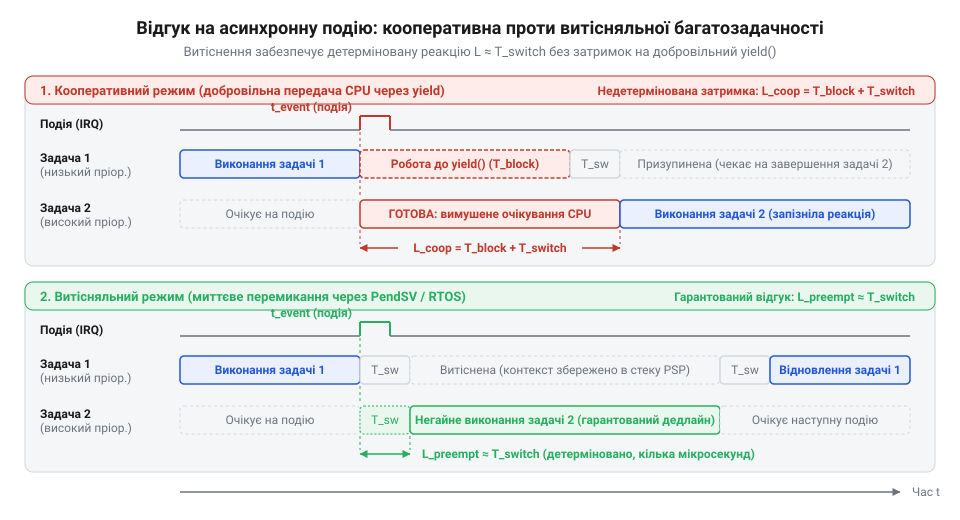
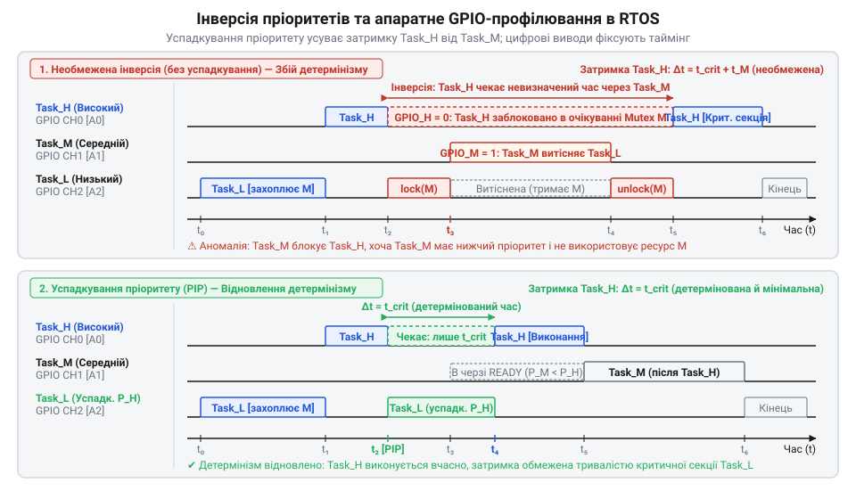

# Кооперативна та витісняльна багатозадачність у вбудованих системах

<preknowlist>
- [Подієво-орієнтована архітектура прошивок](root:sf-devices/event-driven-firmware) — організація асинхронного циклу обробки подій та причини виникнення часового тремтіння при виконанні важких операцій
- [Структура та організація контрольного блоку задачі (TCB)](root:sf-devices/task-control-block-structure) — призначення та склад дескриптора @@en|TCB@@ для збереження покажчика стека й регістрового контексту задачі
- [Критичні секції в RTOS](root:sf-devices/critical-sections-in-rtos) — принципи взаємного виключення та маскування переривань для захисту спільних даних від стану гонитви
</preknowlist>

## Межі супер-циклу та концепція задачі

Прошивка простого пристрою починається з нескінченного супер-циклу (@@en|super-loop@@), де підпрограми викликаються по черзі. Доки операції тривають мікросекунди, система реагує швидко. Проте ускладнення алгоритмів додає важкі обчислення або блокуючі очікування периферії: наприклад, байта від сенсора. Затримка в одній функції заморожує цикл, позбавляючи інші вузли керування.

Період обходу циклу починає хаотично коливатися. Виникає часове тремтіння, або джитер (@@en|jitter@@, від англ. @@en|jitter@@ — тремтіти) — різниця між максимальним часом ітерації `T_max` та мінімальним `T_min`:

    J = T_max - T_min

Отримане значення `J` показує часову невизначеність: коли опитування датчиків чи формування сигналів зміщується на цю величину, контури керування втрачають стабільність. Навіть [подієво-орієнтована архітектура прошивок](root:sf-devices/event-driven-firmware) не захищає від затримок під час тривалого обчислення.

Взаємне блокування усуває абстракція задач (@@en|task@@). Задача — самостійна програма з власним стеком викликів та регістровим контекстом (@@en|context@@, від лат. @@la|contextus@@ — з'єднання), збереженим у [контрольному блоці задачі](root:sf-devices/task-control-block-structure) (@@en|TCB@@). Почергове збереження й завантаження регістрів створює ілюзію паралельного виконання на єдиному ядрі.

## Кооперативна передача та апаратне витіснення

Розподіляти час процесора між задачами можна двома шляхами. У кооперативній моделі (від лат. @@la|cooperatio@@ — співпраця) задача володіє ядром, доки сама не викличе системну функцію @@en|yield@@ (від англ. @@en|yield@@ — поступатися). Оскільки перемикання стається лише у визначених точках, спільні дані не руйнуються, забезпечуючи природну атомарність і спільний стек. Проте зависання однієї задачі зупиняє всю систему.

Витісняльна модель (преємптивна, від лат. @@la|praeemere@@ — перехоплювати заздалегідь) передає керування планувальнику: операційна система реального часу (@@en|RTOS@@) примусово забирає ядро за сигналом таймера @@en|SysTick@@, що відраховує кванти часу.

Щоб планувальник не блокував критичні переривання периферії, застосовують дворівневий механізм: таймер @@en|SysTick@@ виставляє запит на відкладений виклик @@en|PendSV@@ із найнижчим пріоритетом. Алгоритм, що здійснює [перемикання контексту в мікроконтролерах](root:sf-devices/rtos-context-switch-mechanics), запускається лише після завершення апаратних обробників. Витіснення гарантує детермінований відгук, вимагаючи захисту спільних даних через [критичні секції](root:sf-devices/critical-sections-in-rtos) в @@en|RTOS@@.

*Часова діаграма відгуку на подію: у кооперативній моделі затримка триває до виклику yield, а витіснення перемикає задачу негайно.*

## Системні пастки та компроміси витіснення

Детермінізм витіснення вимагає виділення власного стека в оперативній пам'яті (@@en|RAM@@) під кожну задачу, тому їхні розміри сумуються. Помилка розрахунку спричиняє переповнення й пошкодження пам'яті. Використання стека діагностують заповненням пам'яті патерном для контролю водяного знака (@@en|high-water mark@@) або апаратним блоком захисту (@@en|MPU@@). Надійне [виявлення переповнення стека](root:sf-devices/task-stack-overflow-detection) запобігає аварійним збоям.

Інша загроза — інверсія пріоритетів (від лат. @@la|inversio@@ — перевертання): низькопріоритетна задача захоплює ресурс, після чого її витісняє середній потік, якому цей ресурс не потрібен. Високопріоритетна задача блокується середньою. Проблему вирішує [успадкування пріоритету](root:sf-devices/priority-inversion-and-inheritance): низькопріоритетній задачі тимчасово піднімають пріоритет, прискорюючи звільнення ресурсу.

Витіснення також небезпечне для нереєнтерабельних функцій (від лат. @@la|re-@@ — знову та фр. @@fr|entrer@@ — входити). Якщо бібліотечний код використовує спільний статичний буфер, паралельні виклики псують дані. Їх захищають м'ютексами або виносять у [виділені потоки-виконавці](root:sf-devices/dedicated-worker-threads-rtos).

## Гібридна архітектура та апаратне профілювання

Надійні системи поєднують обидві моделі: пріоритетні витісняльні задачі залишають для швидких контурів жорсткого реального часу. Фоновою телеметрією та інтерфейсом керує фонова [черга робіт](root:sf-devices/work-queue), де другорядні задачі виконуються кооперативно на спільному стеку.

Щоб фонові операції не блокували одна одну, довгі обчислення розбивають на кроки через [автомат станів задачі](root:sf-devices/task-states), а потоки даних розв'язують через [кільцевий буфер UART](root:sf-devices/uart-ring-buffer-architecture).

Затримки й часовий джитер перевіряють апаратно: вивід порту загального призначення (@@en|GPIO@@) встановлюють в одиницю на час перемикання контексту або роботи задачі та скидають у нуль після завершення. Осцилограф на цій лінії фіксує точну тривалість виконання без програмних спотворень. Кількість тактів ядра безпосередньо підраховує лічильник модуля трасування (@@en|DWT@@).

*Усунення інверсії пріоритетів протоколом успадкування та схема апаратного вимірювання затримок перемикання контексту через лінію GPIO.*