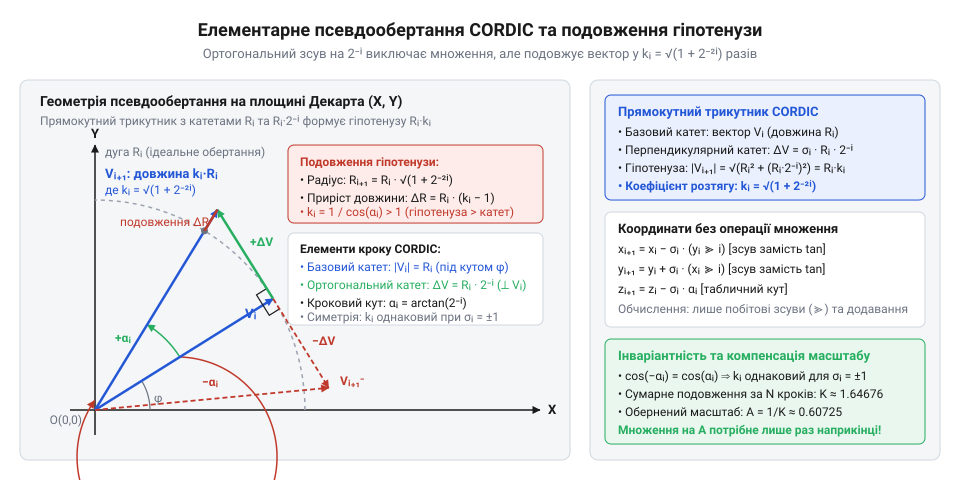
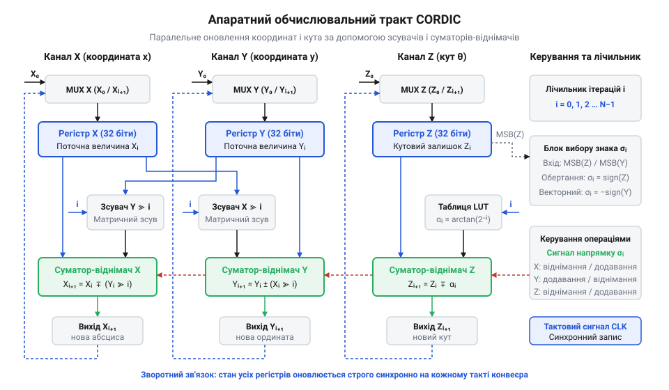
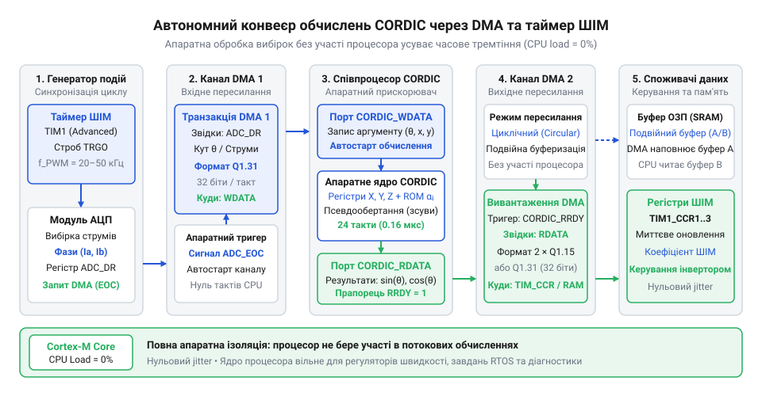
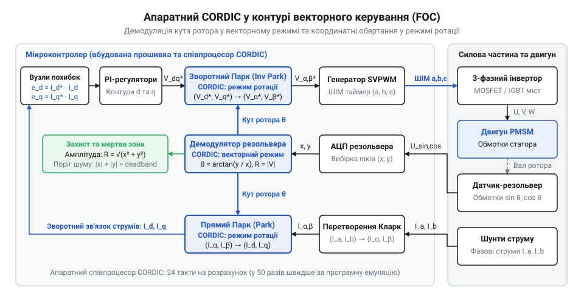

# Алгоритм CORDIC для тригонометричних обчислень у мікроконтролерах

## Початкові концепції та фізичні принципи

У контурах цифрового керування силовими перетворювачами напруги та електродвигунами у прошивці мікроконтролера обчислення повинні виконуватися із жорстким часовим детермінізмом. Наприклад, у системі векторного керування магнітним полем @@en|FOC@@ (від англ. @@en|field-oriented control@@ — векторне керування полем) синхронного двигуна з постійними магнітами обчислювальний цикл прив'язаний до частоти перемикання силових транзисторів інвертора. За типової частоти широтно-імпульсної модуляції @@en|PWM@@ (від англ. @@en|pulse-width modulation@@ — широтно-імпульсна модуляція) у 20–50 кГц період одного такту керування становить лише 20–50 мікросекунд. Упродовж цього вузького часового вікна процесор повинен зчитати покази аналого-цифрового перетворювача, компенсувати зміщення струмів і виконати зворотне перетворення Парка @@en|Park transform@@ (від англ. @@en|Park transform@@ — перетворення Парка) та Кларк @@en|Clarke transform@@ (від англ. @@en|Clarke transform@@ — перетворення Кларк). Ці перетворення базуються на тригонометричних функціях — синусі та косинусі кута положення ротора.

Якщо розробник викликає стандартні бібліотечні функції `sinf()` чи `cosf()` на ядрі, де відсутній апаратний блок обчислень із рухомою комою @@en|FPU@@ (від англ. @@en|floating-point unit@@ — блок чисел із рухомою комою), прошивка перемикається на програмну емуляцію чисел із рухомою комою. Програмна емуляція тригонометрії триває від 600 до 1500 машинних тактів, споживаючи левову частку процесорного бюджету. Навіть якщо кристал містить [апаратного блоку FPU](root:hw-arch/fpu), розрахунок трансцендентних функцій через поліноміальні наближення або сумування [степеневих рядів Тейлора](root:math-numeric/taylor-series-microcontrollers) виконується за змінну кількість тактів через умовні переходи й нормалізацію експоненти. Виникає небезпечне часове тремтіння — @@en|jitter@@ (від англ. @@en|jitter@@ — тремтіння, розкид затримки). Коли тривалість обчислень у перериванні коливається від мікросекунди до мікросекунди, розрахунок кута відстає від реального положення ротора, що спотворює форму вихідного струму, викликає паразитний акустичний писк обмоток і створює ризик зриву синхронізації в операційній системі реального часу @@en|RTOS@@ (від англ. @@en|real-time operating system@@ — операційна система реального часу).

Спроба замінити обчислення таблицею пошуку @@en|LUT@@ (від англ. @@en|look-up table@@ — таблиця пошуку) стикається з фізичними обмеженнями кремнієвої пам'яті. Для досягнення кутової точності 16 біт (65536 дискретних значень кута) таблиця значень синуса у форматі двох байтів на точку потребує 128 кілобайтів пам'яті. У більшості мікроконтролерів загальний обсяг енергонезалежної Flash-пам'яті програм становить лише 64–256 кілобайтів, тож виділення такого обсягу під одну функцію є неприпустимим марнотратством. Зменшення таблиці, наприклад, до 1024 точок вимагає додавання лінійної інтерполяції між сусідніми вузлами. Проте інтерполяція знову змушує виконувати операції цілочисельного множення та ділення, а кожне випадкове читання з повільної Flash-пам'яті на високих тактових частотах викликає такти очікування шини (@@en|wait states@@).

Виходом із цього глухого кута є алгоритм @@en|CORDIC@@ (від англ. @@en|Coordinate Rotation Digital Computer@@ — цифровий обчислювач обертання координат). Створений інженером Джеком Волдером для навігаційних комп'ютерів стратегічної авіації, цей алгоритм дозволяє обчислювати синус, косинус, арктангенс, векторний модуль та інші нелінійні залежності без жодної операції множення чи ділення. Обчислювальний конвеєр спирається виключно на [масштабування з фіксованою комою](root:sf-devices/integer-scaling-fixed-point), додавання, віднімання та звичайні побітові зсуви праворуч. У результаті час виконання стає абсолютно детермінованим, витрата Flash-пам'яті обмежується кількома десятками слів таблиці констант, а споживання енергії ядром процесора падає в рази.

Фізична сутність @@en|CORDIC@@ спирається на геометрію обертання двовимірного вектора на площині, де застосовуються декартові координати @@en|Cartesian coordinates@@ (від лат. @@la|Cartesius@@ — Декарт). Нехай початковий вектор має горизонтальну координату `x` та вертикальну координату `y`. Ми бажаємо повернути цей вектор навколо початку координат на цільовий кут `θ` проти руху годинникової стрілки, отримавши нові координати `x'` та `y'`.

Знайдемо нову горизонтальну координату `x'` через компоненти початкового вектора та функції цільового кута:

```
x'
= x · cos(θ) - y · sin(θ)                 [матриця повороту вектора]
= cos(θ) · (x - y · tan(θ))               [винесення cos(θ) за дужки]
```

Вираз показує, що точне положення точки вздовж осі абсцис визначається різницею координат, зваженою на тангенс кута, та масштабується загальним множником косинуса.

Аналогічно визначимо нову вертикальну координату `y'` вектора після повороту:

```
y'
= y · cos(θ) + x · sin(θ)                 [матриця повороту вектора]
= cos(θ) · (y + x · tan(θ))               [винесення cos(θ) за дужки]
```

Отриманий вираз зводить обертання до операцій додавання та множення на тангенс кута з подальшим масштабуванням результату косинусом.

У прямому вигляді цей розрахунок не усуває множення, оскільки вимагає множити координату на тангенс довільного кута `θ` та обчислювати `cos(θ)`. Ідея полягає в тому, щоб розкласти цільовий кут `θ` на суму дискретних елементарних кутів повороту `αᵢ` (альфа з індексом кроку `i`), для кожного з яких значення тангенса дорівнює від'ємному цілому степеню двійки. Обирають послідовність крокових кутів за правилом `tan(αᵢ) = 2⁻ⁱ`.

Вибір від'ємного степеня двійки перетворює множення на тривіальну апаратну операцію. Множення довільного двійкового цілого числа на коефіцієнт `2⁻ⁱ` еквівалентне арифметичному побітовому зсуву праворуч @@en|bit shift@@ (від англ. @@en|bit shift@@ — бітовий зсув) на `i` позицій. Коли в арифметико-логічному пристрої @@en|ALU@@ (від англ. @@en|arithmetic logic unit@@ — арифметико-логічний пристрій) процесора є матричний зсувач @@en|barrel shifter@@ (від англ. @@en|barrel shifter@@ — матричний зсувач), будь-який зсув на фіксовану чи довільну кількість бітів виконується за один-єдиний машинний такт без використання апаратного помножувача.

Набір базових кутів `αᵢ = arctan(2⁻ⁱ)` обчислюється один раз під час компіляції та зашивається в таблицю постійної пам'яті. Для перших кроків ітерації ці кути набувають таких значень:
- для `i = 0`: `tan(α₀) = 1.0`, звідки `α₀ = arctan(1.0) = π / 4 = 45.0°` (приблизно `0.785398` радіана);
- для `i = 1`: `tan(α₁) = 0.5`, звідки `α₁ = arctan(0.5) ≈ 26.565°` (приблизно `0.463648` радіана);
- для `i = 2`: `tan(α₂) = 0.25`, звідки `α₂ = arctan(0.25) ≈ 14.036°` (приблизно `0.244979` радіана);
- для `i = 3`: `tan(α₃) = 0.125`, звідки `α₃ = arctan(0.125) ≈ 7.125°` (приблизно `0.124355` радіана);
- для `i = 4`: `tan(α₄) = 0.0625`, звідки `α₄ = arctan(0.0625) ≈ 3.576°` (приблизно `0.062419` радіана);
- для `i = 5`: `tan(α₅) = 0.03125`, звідки `α₅ = arctan(0.03125) ≈ 1.790°` (приблизно `0.031240` радіана).

З кожним наступним кроком елементарний кут зменшується приблизно вдвічі, що відповідає бітовій точності двійкової позиційної системи числення.

Якщо на кожній ітерації `i` відкинути спільний множник `cos(αᵢ)` і виконати поворот лише всередині дужок, ми отримаємо операцію, відому як псевдообертання @@en|pseudo-rotation@@ (від грец. @@el|pseudos@@ — несправжній). Введемо напрямок повороту `σᵢ` (сигма на кроці `i`), який набуває значення `+1` при обертанні проти годинникової стрілки та `-1` при обертанні за годинниковою стрілкою.

Запишемо формулу обчислення проміжної координати `xᵢ₊₁` на наступному кроці ітерації:

```
xᵢ₊₁
= xᵢ - σᵢ · yᵢ · 2⁻ⁱ                     [підстановка tan(αᵢ) = 2⁻ⁱ]
```

Вираз визначає нову координату через віднімання або додавання протилежної координати, зсунутої праворуч на цілу кількість розрядів `i`.

Відповідно визначимо проміжну вертикальну координату `yᵢ₊₁` на наступному кроці ітерації:

```
yᵢ₊₁
= yᵢ + σᵢ · xᵢ · 2⁻ⁱ                     [підстановка tan(αᵢ) = 2⁻ⁱ]
```

Обидві формули містять виключно зсуви та додавання, що робить їх ідеальними для конвеєризації в логіці мікроконтролера.

Однак під час такого спрощеного кроку вектор не лише змінює свій напрямок на кут `σᵢ · αᵢ`, але й подовжується. Коефіцієнт розтягування вектора на кожному кроці дорівнює гіпотенузі прямокутного трикутника з катетами `1` та `tan(αᵢ)`: `kᵢ = √(1 + tan²(αᵢ)) = √(1 + 2⁻²ⁱ) = 1 / cos(αᵢ)`. Оскільки функція косинуса є парною, тобто `cos(-αᵢ) = cos(αᵢ)`, коефіцієнт подовження взагалі не залежить від знака `σᵢ`! Чи повертаємо ми вектор ліворуч, чи праворуч, коефіцієнт розтягнення залишається строго однаковим.


*Геометрична схема демонструє елементарне псевдообертання вектора на кут αᵢ з подовженням гіпотенузи трикутника на множник √(1 + 2⁻²ⁱ), що підтверджує незмінність коефіцієнта розтягування незалежно від обраного напрямку повороту.*

Визначимо загальний накопичений коефіцієнт подовження `K_N` після виконання `N` ітерацій алгоритму:

```
K_N
= ∏ᵢ₌₀ᴺ⁻¹ √(1 + 2⁻²ⁱ)                     [добуток подовжень на кожному кроці]
≈ 1.646760258121                          [граничне значення при N → ∞]
```

Значення показує, що за будь-якого набору напрямків обертання вектор гарантовано збільшується у фіксовану кількість разів — приблизно в 1.6468 раза.

Обчислимо обернений масштабний коефіцієнт `A_N`, необхідний для нормалізації вихідного вектора:

```
A_N
= 1 / K_N                                 [обернене значення масштабного коефіцієнта]
≈ 0.607252935008                          [масштаб для компенсації подовження]
```

Обернений коефіцієнт є системною константою, на яку можна або заздалегідь змасштабувати початковий вектор `(x₀, y₀)`, або домножити кінцевий результат лише один раз на виході алгоритму.

Щоб алгоритм міг досягти будь-якого наперед заданого кута `θ`, послідовність кутів повинна забезпечувати збіжність. У дихотомічному процесі збіжність гарантована тоді, коли кожен поточний кут не перевищує суми всіх наступних елементарних кутів плюс граничну роздільну здатність: `αᵢ ≤ ∑_{j=i+1}^{N-1} αⱼ + α_{N-1}`. Для функції арктангенса степенів двійки ця нерівність завжди виконується, оскільки кожен наступний кут приблизно вдвічі менший за попередній (`αᵢ < 2 · αᵢ₊₁`).

Проте сума всіх елементарних кутів від нуля до нескінченності має скінченну верхню межу. Знайдемо максимальний діапазон кутів `θ_max`: сума ряду `∑_{i=0}^{∞} arctan(2⁻ⁱ) ≈ 1.7432866` радіана, що відповідає куту приблизно `99.88°`. Це означає, що базове ядро @@en|CORDIC@@ може збігатися лише в межах кутів першого та четвертого квадрантів, тобто від `-99.88°` до `+99.88°`.

Щоб охопити повне коло кутів від `-π` до `+π`, розробники вбудовують попередню редукцію аргументу. Якщо вхідний кут потрапляє у другий або третій квадрант, вектор повертають на `±π / 2` або інвертують знак координат `(x, y)` зі зміщенням цільового кута на `±π`. Ця операція є тривіальною зміною знака цілого числа і виконується до запуску ітерацій @@en|CORDIC@@.

Під час реалізації @@en|CORDIC@@ у мікроконтролерах виникають три джерела фізичних похибок: похибка дискретизації, похибка округлення та зростання розрядності. По-перше, кожна ітерація додає рівно один двійковий розряд точності. Якщо потрібно забезпечити точність 16 біт, потрібно виконати рівно 16 ітерацій; для 32 біт — 32 ітерації. По-друге, побітовий зсув цілих чисел праворуч відкидає молодші біти, викликаючи похибку відсікання @@en|truncation error@@ (від англ. @@en|truncation error@@ — похибка відсікання) та похибку округлення @@en|round-off error@@ (від англ. @@en|round-off error@@ — похибка округлення). За `N` кроків накопичена похибка зсувів може спотворити молодші `log₂(N)` розрядів результату. По-третє, через подовження вектора на коефіцієнт `K ≈ 1.6468` проміжні значення координат `x` та `y` зростають і можуть перевищити діапазон нормалізованого представлення. Якщо координати представлені в стандартному цілочисельному форматі, де одиниці відповідає максимально можливе число, виникає арифметичне переповнення. Щоб цьому запобігти, регістрам необхідні захисні розряди @@en|guard bits@@ (від англ. @@en|guard bits@@ — захисні розряди), які резервують старші біти під зростання амплітуди.

## Внутрішня будова та алгоритми роботи

Внутрішня архітектура обчислювального модуля @@en|CORDIC@@ організована навколо трьох 32-розрядних або 16-розрядних регістрів, які утворюють апаратний тракт обробки даних @@en|datapath@@ (від англ. @@en|datapath@@ — тракт обробки даних):
- Регістр `X` зберігає горизонтальну проекцію поточного вектора на декартову вісь абсцис;
- Регістр `Y` зберігає вертикальну проекцію поточного вектора на декартову вісь ординат;
- Регістр `Z` виступає акумулятором кута, відстежуючи залишок кутового зсуву.

Тракт даних містить два паралельні матричні зсувачі @@en|barrel shifter@@, які формують величини `Y ≫ i` та `X ≫ i`, блок керування напрямком обертання, три суматори-віднімачі та постійну таблицю кутових констант `αᵢ`. На кожному такті конвеєра стан усіх трьох регістрів оновлюється строго синхронно.


*Функціональна схема апаратного тракту CORDIC відображає взаємодію регістрів X, Y, Z, матричних зсувачів і суматорів-віднімачів, що забезпечують паралельне оновлення координат і кута на кожному такті конвеєра.*

Алгоритм підтримує два фундаментальні режими функціонування: режим обертання та векторний режим.

Режим обертання @@en|rotation mode@@ (від англ. @@en|rotation mode@@ — режим обертання) призначений для повернення вхідного вектора `(x₀, y₀)` на цільовий кут `θ`. Початковий стан регістрів задається значеннями `X = x₀`, `Y = y₀`, `Z = θ`. Завдання алгоритму — звести значення кутового акумулятора `Z` до нуля (`Z → 0`). На кожному кроці напрямок повороту `σᵢ` обирається за знаком поточного значення `Z`:
- якщо `Z ≥ 0`, вектор ще не докручений до цілі, тому обирається `σᵢ = +1` (обертання проти годинникової стрілки);
- якщо `Z < 0`, кут перевищено, тому обирається `σᵢ = -1` (обертання за годинниковою стрілкою).

Після виконання `N` ітерацій значення в регістрах набувають такого вигляду:
`x_N = K_N · (x₀ · cos(θ) - y₀ · sin(θ))`
`y_N = K_N · (y₀ · cos(θ) + x₀ · sin(θ))`
`z_N ≈ 0`.

Якщо перед запуском ініціалізувати координати значеннями `x₀ = A_N ≈ 0.607253` та `y₀ = 0`, то множник `K_N` повністю компенсується константою `A_N`. У результаті на виході отримуємо:
`x_N = cos(θ)`
`y_N = sin(θ)`. Таким чином, обидві основні тригонометричні функції обчислюються абсолютно одночасно за один єдиний прохід циклу!

Векторний режим @@en|vectoring mode@@ (від англ. @@en|vectoring mode@@ — векторний режим) розв'язує зворотне завдання: він обертає довільний вектор `(x₀, y₀)` навколо початку координат доти, доки той повністю не ляже на горизонтальну вісь `OX`. Тобто алгоритм зводить координату `Y` до нуля (`Y → 0`). Початковий стан регістрів: `X = x₀`, `Y = y₀`, а кутовий акумулятор обнуляється: `Z = 0`. Напрямок повороту `σᵢ` на кожному кроці контролюється знаком координати `Y`:
- якщо `Y ≥ 0`, вектор знаходиться у верхній півплощині, тому його слід повертати за годинниковою стрілкою: `σᵢ = -1`;
- якщо `Y < 0`, вектор знаходиться в нижній півплощині, тому його повертають проти годинникової стрілки: `σᵢ = +1`.

У кутовому акумуляторі `Z` сумуються всі виконані елементарні повороти. Коли координата `Y` стає близькою до нуля, вихідний стан регістрів містить такі результати:
`x_N = K_N · √(x₀² + y₀²)`
`y_N ≈ 0`
`z_N = arctan(y₀ / x₀)`.

Векторний режим дозволяє знаходити полярні координати @@en|polar coordinates@@ (від грец. @@el|polos@@ — вісь) — фазовий кут і модуль вектора — без використання операції ділення та без вилучення квадратного кореня. Достатньо лише помножити значення `x_N` на масштабний множник `A_N`, щоб дістати точну евклідову норму вектора.

Для реалізації @@en|CORDIC@@ у цілочисельних регістрах процесора числа переводять у [формат чисел Qm.n](root:sf-devices/integer-scaling-fixed-point). Наприклад, у 32-розрядних мікроконтролерах координати `X` та `Y` зберігають у форматі `Q2.30` (два біти на знак та цілу частину, 30 бітів на дробову частину). Наявність двох бітів на цілу частину забезпечує діапазон значень від `-2.0` до `+1.999999998`, що повністю захищає регістри від арифметичного переповнення при множенні на коефіцієнт розширення `K ≈ 1.6468`.

Для представлення кута в регістрі `Z` застосовують двійкове кутове вимірювання @@en|BAM@@ (від англ. @@en|binary angular measurement@@ — двійкове кутове вимірювання). У форматі BAM весь діапазон обертання від `-π` до `+π` (або від `-180°` до `+180°`) нормується на діапазон цілого 32-бітного знакового числа `int32_t` від `-2147483648` (`0x80000000`) до `+2147483647` (`0x7FFFFFFF`):
- `0x00000000` відповідає куту `0` радіан (`0°`);
- `0x20000000` (536870912) відповідає `+π / 4` радіана (`+45°`);
- `0x40000000` (1073741824) відповідає `+π / 2` радіана (`+90°`);
- `0x80000000` (-2147483648) відповідає куту `±π` радіан (`±180°`);
- `0xC0000000` (-1073741824) відповідає `-π / 2` радіана (`-90°`).

Головна апаратна перевага формату BAM полягає в тому, що природне переповнення цілочисельного регістра під час додавання чи віднімання автоматично реалізує періодичність тригонометричного кола за модулем `2π`. Прошивці не потрібно перевіряти вихід за межі діапазону чи виконувати операцію взяття остачі від ділення.

Запишемо правило оновлення горизонтальної координати в регістрі `X` на довільному кроці `i`:

```
xᵢ₊₁
= xᵢ - σᵢ · (yᵢ ≫ i)                     [оновлення координати X через зсув Y]
```

Формула демонструє корекцію положення точки вздовж осі абсцис за рахунок зсуву значення ординати.

Запишемо правило оновлення вертикальної координати в регістрі `Y` на довільному кроці `i`:

```
yᵢ₊₁
= yᵢ + σᵢ · (xᵢ ≫ i)                     [оновлення координати Y через зсув X]
```

Значення ординати коригується додаванням або відніманням горизонтальної координати, зсунутої на `i` бітів.

Запишемо формулу модифікації значення в кутовому акумуляторі `Z` на кроці `i`:

```
zᵢ₊₁
= zᵢ - σᵢ · αᵢ                            [віднімання елементарного кута]
```

Різниця зменшує похибку відхилення від цільового кута, де величина `αᵢ` вибирається з таблиці констант.

Розглянемо числовий приклад обчислення `sin(30°)` та `cos(30°)` у режимі обертання. Цільовий кут `θ = 30° = π / 6` радіана (приблизно `0.523599` радіана). Ініціалізація змінних: `x₀ = A_N ≈ 0.607253`, `y₀ = 0.0`, `z₀ = 0.523599`.

- **Крок 0** (`i = 0`, `α₀ = 0.785398`):
  Оскільки `z₀ = 0.523599 ≥ 0`, вибираємо `σ₀ = +1`. `x₁ = x₀ - (y₀ ≫ 0) = 0.607253 - 0 = 0.607253`;
  `y₁ = y₀ + (x₀ ≫ 0) = 0 + 0.607253 = 0.607253`;
  `z₁ = z₀ - α₀ = 0.523599 - 0.785398 = -0.261799` (кутовий залишок `-15.00°`).

- **Крок 1** (`i = 1`, `α₁ = 0.463648`):
  Оскільки `z₁ = -0.261799 < 0`, вибираємо `σ₁ = -1`. `x₂ = x₁ + (y₁ ≫ 1) = 0.607253 + 0.303626 = 0.910879`;
  `y₂ = y₁ - (x₁ ≫ 1) = 0.607253 - 0.303626 = 0.303626`;
  `z₂ = z₁ + α₁ = -0.261799 + 0.463648 = +0.201848` (кутовий залишок `+11.57°`).

- **Крок 2** (`i = 2`, `α₂ = 0.244979`):
  Оскільки `z₂ = +0.201848 ≥ 0`, вибираємо `σ₂ = +1`. `x₃ = x₂ - (y₂ ≫ 2) = 0.910879 - 0.075907 = 0.834973`;
  `y₃ = y₂ + (x₂ ≫ 2) = 0.303626 + 0.227720 = 0.531346`;
  `z₃ = z₂ - α₂ = 0.201848 - 0.244979 = -0.043130` (кутовий залишок `-2.47°`).

- **Крок 3** (`i = 3`, `α₃ = 0.124355`):
  Оскільки `z₃ = -0.043130 < 0`, вибираємо `σ₃ = -1`. `x₄ = x₃ + (y₃ ≫ 3) = 0.834973 + 0.066418 = 0.901391`;
  `y₄ = y₃ - (x₃ ≫ 3) = 0.531346 - 0.104372 = 0.426975`;
  `z₄ = z₃ + α₃ = -0.043130 + 0.124355 = +0.081225` (кутовий залишок `+4.65°`).

- **Крок 4** (`i = 4`, `α₄ = 0.062419`):
  Оскільки `z₄ ≥ 0`, вибираємо `σ₄ = +1`. `x₅ = x₄ - (y₄ ≫ 4) = 0.901391 - 0.026686 = 0.874705`;
  `y₅ = y₄ + (x₄ ≫ 4) = 0.426975 + 0.056337 = 0.483312`;
  `z₅ = z₄ - α₄ = 0.081225 - 0.062419 = +0.018806` (кутовий залишок `+1.08°`).

- **Крок 5** (`i = 5`, `α₅ = 0.031240`):
  Оскільки `z₅ ≥ 0`, вибираємо `σ₅ = +1`. `x₆ = x₅ - (y₅ ≫ 5) = 0.874705 - 0.015103 = 0.859602`;
  `y₆ = y₅ + (x₅ ≫ 5) = 0.483312 + 0.027335 = 0.510646`;
  `z₆ = z₅ - α₅ = 0.018806 - 0.031240 = -0.012434` (кутовий залишок `-0.71°`).

Уже на шостому кроці обчислень координата `x₆ ≈ 0.859602` стрімко наближається до теоретичного значення `cos(30°) = √3 / 2 ≈ 0.866025`, а координата `y₆ ≈ 0.510646` — до значення `sin(30°) = 0.500000`. З кожним наступним кроком похибка зменшується вдвічі.

Під час реалізації алгоритму на рівні прошивки програмний цикл `for (int i = 0; i < N; i++)` створює накладні витрати: кожна ітерація вимагає декременту лічильника, перевірки умови виходу та умовного переходу. Крім того, інструкція зсуву на змінне число позицій у ядрі без апаратного однотактового зсувача може займати кілька тактів. Застосування техніки розгортання циклу @@en|loop unrolling@@ (від англ. @@en|loop unrolling@@ — розгортання циклу) усуває витрати на розгалуження. Компілятор транслює кожну ітерацію в послідовність інструкцій арифметичного зсуву `ASR` з безпосереднім константним зміщенням (наприклад, `ASR R1, R2, #3`), які виконуються ядром ARM за мінімальну кількість тактів. Повністю розгорнутий 16-ітераційний цикл завершується всього за 40–50 машинних тактів, гарантуючи нульовий @@en|jitter@@.

У сучасних мікроконтролерах, розрахованих на керування двигунами та силову електроніку (наприклад, сімейство STM32G4 чи STM32U5), виробники інтегрують [апаратні обчислювачі CORDIC](root:sf-devices/fixed-point-arithmetic-and-cordic-implementation) безпосередньо у кристал як периферійний співпроцесор. Апаратний співпроцесор містить:
- Регістр керування та стану `CORDIC_CSR`, де вибирається функція (синус, косинус, фаза, модуль, арктангенс, гіперболічні функції), точність (від 4 до 24 ітерацій) та формат аргументів (Q1.15 чи Q1.31);
- Регістр запису даних `CORDIC_WDATA`, куди прошивка записує вхідні аргументи;
- Регістр зчитування результатів `CORDIC_RDATA`, звідки забираються готові значення.

Апаратний блок працює як багатостадійний конвеєр. Запис у `CORDIC_WDATA` запускає обчислення автоматично, і результат з'являється в `CORDIC_RDATA` вже через 4–8 тактів тактової частоти шини. Більше того, цей блок може обмінюватися даними через прямий доступ до пам'яті @@en|DMA@@ (від англ. @@en|direct memory access@@ — прямий доступ до пам'яті), виконуючи потокові перетворення векторів для цифрових фільтрів у реальному часі без залучення процесорного ядра. Такі ланцюжки застосовують в [обчисленнях цифрового аудіо](root:sf-devices/fixed-point-audio-math) для синтезу звуку та у модемах зв'язку.

Нижче наведено практичну реалізацію цілочисельного ядра @@en|CORDIC@@ для мікроконтролерів (зокрема STM32 та сумісних архітектур ARM Cortex-M) мовами C та C++. Реалізація використовує формат кутів @@en|BAM@@ та формат чисел `Q2.30` для збереження високої точності без ризику переповнення.

:::tabs
:::code root\eng\sf-devices\cordic-algorithm/cordic-algorithm-d/c/stm32/cordic-calc-sin-cos.c c
:::code root\eng\sf-devices\cordic-algorithm/cordic-algorithm-d/cpp/stm32/cordicprocessor.cpp cpp
:::

## Апаратна реалізація та низькорівневий C/C++ код

У контурах цифрового керування силовими перетворювачами та електроприводами час реакції обмежується жорсткими мікросекундними рамками. Коли в системі векторного керування @@en|FOC@@ період широтно-імпульсної модуляції @@en|PWM@@ становить двадцять мікросекунд, процесорне ядро з тактовою частотою 150 МГц має у своєму розпорядженні лише три тисячі машинних тактів на весь обчислювальний цикл. Упродовж цього короткого інтервалу необхідно зчитати покази аналого-цифрового перетворювача, компенсувати апаратні зміщення, виконати цифрову фільтрацію струмів, розрахувати пропорційно-інтегральні регулятори та провести координатні трансформації. Навіть якщо програмна функція @@en|CORDIC@@ оптимізована через [розгортання циклу](root:sf-devices/fixed-point-arithmetic-and-cordic-implementation), вона потребує від вісімдесяти до ста двадцяти тактів процесора для обчислення однієї тригонометричної пари. Якщо ж алгоритм вимагає виконання прямого й зворотного перетворень координат разом із розрахунком амплітуди вектора, програмний розрахунок споживає до чотирьохсот тактів ядра. Це забирає понад тринадцять відсотків загального часового бюджету переривання, створюючи небажану затримку переривання @@en|interrupt latency@@ (від лат. @@la|latens@@ — прихований) та скорочуючи час для завдань діагностики в операційній системі реального часу @@en|RTOS@@.

Щоб повністю усунути обчислювальний тягар із процесорного ядра, у кремнієву структуру сучасних мікроконтролерів інтегрують апаратний співпроцесор @@en|coprocessor@@ (від лат. @@la|co-@@ — разом та @@en|processor@@ — обробник). Апаратний блок @@en|CORDIC@@ виконує ітерації псевдообертання на рівні спеціалізованих логічних вентилів паралельно з роботою центрального процесора. Залежно від балансу між площею кристала та вимогами до пропускної здатності, виробники кремнію застосовують дві базові архітектури обчислювального вузла: ітераційну та конвеєрну.

В ітераційній архітектурі апаратний тракт даних @@en|datapath@@ містить одну фізичну пару суматорів-віднімачів для координат `x` та `y`, один суматор для кутового регістра `z`, пару матричних зсувачів @@en|barrel shifter@@ та компактний кінцевий автомат керування. Обчислювальний конвеєр повертає координати на кожному кроці через один і той самий набір регістрів. На кожному такті апаратний кінцевий автомат змінює величину зсуву на `i` розрядів праворуч, зчитує константу з вбудованої таблиці кутів у постійній пам'яті та комутує операції додавання чи віднімання відповідно до знака поточного значення. Така структура потребує мінімальної кількості логічних вентилів, що знижує собівартість мікроконтролера, а повний розрахунок триває від чотирьох до двадцяти чотирьох тактів тактової сітки периферійної шини.

У конвеєрній архітектурі, де реалізована повна апаратна конвеєризація @@en|pipelining@@ (від англ. @@en|pipelining@@ — конвеєрна обробка), тракт розгортається у фізичний ланцюг із послідовних каскадів обробки. Кожен каскад відповідає окремій ітерації і містить власні апаратні суматори, де зсув розрядів праворуч на `i` позицій реалізований апаратною фіксованою розводкою провідників безпосередньо на кремнії. Завдяки відсутності динамічних матричних зсувачів критичний шлях поширення сигналу в кожному ступені є мінімальним, що дозволяє тактувати модуль на граничній частоті ядра. Початковий результат з'являється на виході через фіксовану кількість тактів затримки, яка дорівнює глибині конвеєра, проте після його заповнення апаратна пропускна здатність @@en|throughput@@ (від англ. @@en|throughput@@ — пропускна здатність) сягає одного завершеного результату на кожен машинний такт. Це забезпечує екстремальну швидкість обчислень, критично важливу для неперервної обробки потоку вибірок у [цифровій обробці аудіосигналів](root:sf-devices/fixed-point-audio-math) або в цифрових демодуляторах радіолокаційних станцій.

Програмний доступ до апаратного співпроцесора організовано через простір периферійних регістрів мікроконтролера за допомогою механізму відображення пам'яті. Блок містить регістр керування та стану @@en|CSR@@ (від англ. @@en|control and status register@@ — регістр керування та стану), порт запису вхідних аргументів @@en|WDATA@@ та порт зчитування готових результатів @@en|RDATA@@. Регістр керування дозволяє обрати математичну функцію: розрахунок пари синуса й косинуса в режимі обертання @@en|rotation mode@@, обчислення модуля й кута вектора у векторному режимі @@en|vectoring mode@@, або розрахунок гіперболічних функцій. У цьому ж регістрі програміст задає роздільну здатність обчислення, обираючи кількість ітерацій від чотирьох до двадцяти чотирьох із кроком у чотири цикли. Зменшення кількості ітерацій скорочує час виконання втричі, якщо для швидкого внутрішнього контуру стабілізації струму достатньо дванадцяти бітів точності.

Для мінімізації накладних витрат на пересилання даних вхідні та вихідні регістри підтримують упаковані формати. Коли розрахунки проводяться з [масштабуванням з фіксованою комою](root:sf-devices/integer-scaling-fixed-point) у форматі Q1.15, дві координати розміром шістнадцять бітів упаковуються в єдине тридцятидвобітне слово системної шини. За одну інструкцію запису молодші шістнадцять бітів передають горизонтальну координату `x`, а старші шістнадцять бітів — вертикальну координату `y`. Так само зчитування регістру результату повертає пару обчислених проекцій за одне звернення до пам'яті. Для роботи з високою точністю використовується формат Q1.31, у якому аргументи `x`, `y` або цільовий кут у двійковому кутовому вимірі @@en|BAM@@ записуються двома послідовними тридцятидвобітними словами.

Апаратна інтеграція з внутрішньою шиною мікроконтролера забезпечує детерміноване синхронне виконання інструкцій. Якщо центральний процесор виконує інструкцію зчитування результату безпосередньо після інструкції запису аргументу, контролер шини формує апаратні такти очікування шини (@@en|wait states@@). Процесорне ядро автоматично призупиняється на апаратному рівні на кілька тактів, доки обчислювач завершує псевдообертання, після чого дані негайно потрапляють у цільовий регістр процесора. Завдяки цьому прошивка не містить циклів опитування прапорця готовності `RRDY`, що усуває накладні витрати на розгалуження коду й гарантує фіксований час виконання функції.

Щоб оптимізувати операції пакування та розпакування шістнадцятибітних величин без втрати тактів на зміщення та логічні маски, застосовуються вбудовані функції компілятора @@en|compiler intrinsics@@ (від лат. @@la|intrinsecus@@ — внутрішній). Спеціалізовані інструкції пакування половинних слів об'єднують два реєстрові операнди в одне тридцятидвобітне слово за один машиний такт, що зводить підготовку аргументів CORDIC до мінімальних транзакцій.

Найвищий рівень автономності досягається за повної ізоляції центрального процесора від обчислень за допомогою [контролера прямого доступу](root:hw-arch/dma-controller) до пам'яті @@en|DMA@@. У такій конфігурації таймер керування періодично формує апаратний строб запуску аналого-цифрового перетворювача, який виконує синхронну вибірку напруг і струмів двигуна. Подія завершення оцифрування автоматично викликає запит першого каналу @@en|DMA@@, який без втручання процесора переносить результати вимірювань із буфера АЦП безпосередньо у вхідний порт @@en|WDATA@@ прискорювача @@en|CORDIC@@.

Факт запису у вхідний порт автоматично ініціює апаратні ітерації псевдообертання. Щойно обчислення завершуються, блок виставляє внутрішній сигнал готовності `RRDY`, який виступає апаратним тригером для другого каналу @@en|DMA@@. Цей канал зчитує вихідний регістр @@en|RDATA@@ і переносить обчислені проекції вектора у круговий буфер @@en|circular buffer@@ (від англ. @@en|circular buffer@@ — кільцевий буфер) оперативної пам'яті або відразу в регістри порівняння таймера керування транзисторами інвертора. Щоб унеможливити конфлікти доступу до пам'яті під час неперервного потоку вибірок, використовується подвійна буферизація @@en|double buffering@@ (від англ. @@en|double buffering@@ — подвійне буферизування): поки периферійний конвеєр заповнює першу половину буфера пам'яті, процесорне ядро обробляє завершений масив даних із другої половини. Завдяки цій схемі апаратне часове тремтіння @@en|jitter@@ зводиться до нуля, а завантаження процесорного ядра операціями координатної трансформації становить рівно нуль відсотків.


*Структурна схема демонструє автономний обчислювальний конвеєр, у якому таймер ШІМ і канали DMA здійснюють обмін вибірками з апаратним співпроцесором CORDIC у режимі подвійної буферизації без завантаження ядра процесора.*

Нижче наведено практичну реалізацію низькорівневого драйвера апаратного прискорювача @@en|CORDIC@@ двома мовами: прямою роботою з регістрами на мові C та обгорткою з нуль-вартісною абстракцією @@en|zero-cost abstraction@@ (від англ. @@en|zero-cost abstraction@@ — абстракція нульової вартості) на мові C++.

:::tabs
:::code root\eng\sf-devices\cordic-algorithm/cordic-algorithm-d/c/generic/cordic-init-synchronous.c c
:::code root\eng\sf-devices\cordic-algorithm/cordic-algorithm-d/cpp/stm32/cordicdriver.cpp cpp
:::

## Практичне застосування та відлагодження

Головною сферою застосування обчислювача @@en|CORDIC@@ у прошивці мікроконтролерів є векторне керування магнітним полем @@en|FOC@@ трифазних синхронних та асинхронних машин. Фізична мета алгоритму полягає в перетворенні змінних синусоїдальних струмів трифазної обмотки статора на еквівалентні постійні проекції в системі координат, яка обертається синхронно з магнітним полем ротора. Завдяки цьому складна задача керування змінним струмом зводиться до двох незалежних лінійних контурів регулювання постійного струму: поздовжнього струму створення магнітного потоку та поперечного струму формування електромеханічного моменту.

Процес керування починається з вимірювання миттєвих струмів фаз статора `I_a` та `I_b` за допомогою вимірювальних шунтів та АЦП. За умови симетричного трифазного навантаження без нульового проводу сума струмів усіх трьох фаз дорівнює нулю (`I_a + I_b + I_c = 0`), тому струм третьої фази відновлюється співвідношенням `I_c = -I_a - I_b`. Перетворення Кларк @@en|Clarke transform@@ переводить трифазну систему величин у нерухому двофазну декартову систему координат `(I_α, I_β)`.

Знайдемо дійсну складову струму `I_α` та уявну складову `I_β` у нерухомій системі координат через виміряні фазні струми `I_a` та `I_b`:

```
I_α
= I_a                                         [збіг осі альфа з віссю фази A]

I_β
= (I_a + 2 · I_b) / √3                        [ортогональна проекція за умови нульової суми фазних струмів]
```

Отримані координати утворюють вектор сумарного струму статора, який обертається в нерухомому просторі двигуна з електричною кутовою швидкістю обертання поля.

Для переходу в обертову систему координат ротора застосовується пряме перетворення Парка @@en|Park transform@@. Вектор `(I_α, I_β)` повертають на поточний електричний кут положення ротора `θ` у зворотному напрямку, поєднуючи горизонтальну вісь координат із віссю магнітного потоку ротора.

Визначимо поздовжню складову струму `I_d` та поперечну складову струму `I_q` через проекції нерухомих струмів на осі ротора:

```
I_d
= I_α · cos(θ) + I_β · sin(θ)                 [пряма проекція на поздовжню вісь ротора]

I_q
= -I_α · sin(θ) + I_β · cos(θ)                [ортогональна проекція на поперечну вісь ротора]
```

Ці вирази повністю повторюють математику обертання вектора на площині. Замість окремого програмного розрахунку функцій синуса й косинуса та чотирьох операцій множення з відніманням, апаратний блок @@en|CORDIC@@ у режимі обертання виконує це перетворення за один прохід: на координатні входи подаються компоненти `(I_α, I_β)`, а на кутовий вхід — від'ємне значення кута `-θ`.

Після стабілізації струмів пропорційно-інтегральними регуляторами формуються задані керуючі напруги `(V_d, V_q)`. Їх необхідно перетворити назад у нерухому систему для модулювання напруги інвертора. Для цього використовується зворотне перетворення Парка, яке полягає в прямому повороті вектора напруг на кут `+θ`.

Знайдемо керуючі напруги `V_α` та `V_β` у нерухомій системі координат через зворотне обертання вектора напруги ротора:

```
V_α
= V_d · cos(θ) - V_q · sin(θ)                 [зворотне обертання координати альфа]

V_β
= V_d · sin(θ) + V_q · cos(θ)                 [зворотне обертання координати бета]
```

Отримані напруги `(V_α, V_β)` передаються до блоку [просторово-векторної широтно-імпульсної модуляції](root:hw-motion/svpwm), який вираховує час відкритого стану кожного силового ключа інвертора для поточного кругового сектора.

Оцінимо перевагу апаратного прискорення тригонометрії на реальному часовому інтервалі обробника переривань.

**Числовий розрахунок навантаження процесорного ядра в циклі ШІМ:**

```
T_software
= 1200 / 150000000                            [програмна емуляція синусів та косинусів за 1200 тактів на частоті 150 МГц]
= 8.0 × 10⁻⁶ с                                [вісім мікросекунд чистого часу виконання]
= 8.0 мкс                                     [сорок відсотків від загального періоду ШІМ тривалістю двадцять мікросекунд]

T_hardware
= 24 / 150000000                              [апаратний розрахунок у співпроцесорі CORDIC за 24 такти шини]
= 0.16 × 10⁻⁶ с                               [шістнадцять сотих мікросекунди]
= 0.16 мкс                                    [менше одного відсотка від періоду двадцять мікросекунд]
```

Апаратне виконання скорочує тривалість тригонометричних розрахунків у п'ятдесят разів, вивільняючи понад тридцять дев'ять відсотків процесорного часу для спостерігачів магнітного потоку, безсенсорного оцінювання швидкості та захисних блокувань.

Іншою критично важливою сферою є застосування векторного режиму для демодуляції квадратурних сигналів та зчитування сенсорів кутового положення. Зокрема, у контурах [демодуляції сигналів резольвера](root:hw-sensing/resolver-to-digital-converter) вторинні обмотки датчика кута формують високочастотні амплітудно-модульовані сигнали синуса та косинуса. Якщо збуджувальний сигнал має вигляд опорного коливання `U_ref = U_0 · sin(ω · t)`, напруги на двох вторинних обмотках описуються формулами `U_sin = K_r · U_0 · sin(θ) · sin(ω · t)` та `U_cos = K_r · U_0 · cos(θ) · sin(ω · t)`, де `θ` — шуканий механічний кут ротора, а `K_r` — коефіцієнт трансформації датчика. Оцифрувавши ці сигнали в момент амплітудного піка тримальної частоти, мікроконтролер виділяє ортогональні амплітуди `x` та `y`. За один робочий цикл векторний режим @@en|CORDIC@@ обчислює точний кут положення ротора `θ = arctan(y / x)` та миттєву амплітуду огинаючої `R = √(x² + y²)`. Якщо розрахована амплітуда відхиляється від номінального значення на задану величину, система миттєво діагностує обрив кабельної лінії або міжвиткове замикання датчика.


*Функціональна схема контуру векторного керування FOC ілюструє повний цикл перетворень Кларк і Парка за допомогою CORDIC та демодуляцію сигналів резольвера для визначення кута положення ротора.*

Під час розробки прошивки інженер стикається з трьома критичними пастками числової стабільності: проміжним арифметичним переповненням, сингулярністю нульового вектора та асиметричним зміщенням зсувів.

Найнебезпечнішою системною аварією є знакове переповнення через подовження вектора на коефіцієнт псевдообертання `K ≈ 1.64676`. Якщо вхідні координати нормалізовані до повної шкали розрядного формату (наприклад, максимальне додатне число `0x7FFFFFFF` у форматі Q1.31), у процесі ітерацій проміжні значення координат зростають у 1.6468 раза. Без виділення захисних розрядів старший знаковий розряд переповнюється, викликаючи циклічну інверсію знака числа. У результаті позитивна напруга регулятора миттєво перетворюється на максимальну негативну, що викликає катастрофічний стрибок струму в інверторі та аварійне руйнування транзисторів.

Визначимо максимальне допустиме значення вхідного сигналу для гарантованого запобігання переповненню:

```
x_max
= 1.0 / K                                     [обмеження одиничного динамічного діапазону]
= 1.0 / 1.646760258                           [ділення на граничний коефіцієнт подовження CORDIC]
≈ 0.607252935                                 [максимальна амплітуда аргументу у форматі Q1.31]
```

Отриманий вираз показує, що амплітуда вхідного вектора не повинна перевищувати шістдесяти відсотків від повної розрядної сітки обраного цілочисельного формату.

Переведемо розраховану граничну амплітуду в цілочисельну сітку формату Q1.31 для встановлення апаратного порога:

```
X_limit_Q31
= 0.607252935 · 2³¹                           [переведення в цілочисельну сітку Q1.31]
≈ 1304032742                                  [шістнадцяткове значення 0x4DBA76E6]
```

Якщо вхідні дані перевищують поріг `0x4DBA76E6`, їх необхідно завчасно змасштабувати побітовим зсувом праворуч або обмежити, задіявши [арифметику з насиченням](root:sf-devices/saturation-arithmetic-in-dsp) (@@en|saturation arithmetic@@, від лат. @@la|saturatio@@ — насичення). Арифметика з насиченням примусово утримує число на граничному рівні діапазону при виникненні переповнення, виключаючи зміну знака числа на протилежний.

Друга пастка виникає у векторному режимі, коли на вхід подається нульовий вектор із координатами `(x, y) = (0, 0)`. Математично операція `arctan(0 / 0)` є невизначеною. Через шум квантування @@en|quantization noise@@ (від лат. @@la|quantitas@@ — кількість) молодших розрядів вхідного АЦП алгоритм починає здійснювати хаотичні псевдообертання, формуючи на виході фазове тремтіння з розмахом у повні триста шістдесят градусів. Щоб усунути нестабільність, перед запуском обчислювача вводиться програмна мертва зона @@en|deadband@@ (від англ. @@en|deadband@@ — зона нечутливості): якщо сума модулів координат `|x| + |y|` менша за поріг фонового шуму перетворювача, вихідний радіус примусово обнуляється, а кут фіксується на останньому достовірному значенні.

Третя числова особливість полягає в накопиченні постійного зміщення через відкидання розрядів. Оскільки операція арифметичного зсуву знакових цілих чисел праворуч відкидає дробові біти у напрямку мінус нескінченності, за двадцять чотири ітерації виникає стійке від'ємне постійне зміщення @@en|DC bias@@ (від англ. @@en|direct current bias@@ — постійне зміщення). Для його повної компенсації в початкові значення координат завчасно додають поправку округлення величиною в половину молодшого розряду в найменший значущий розряд @@en|LSB@@ (від англ. @@en|least significant bit@@ — найменший значущий біт).

Окрему увагу слід приділити методам налагодження прошивки в реальному часі. Використання класичних точок зупину @@en|breakpoints@@ (від англ. @@en|breakpoints@@ — точки зупинки) у контурі керування інвертором є категорично неприпустимим. Коли ядро процесора зупиняється на точці зупину, периферійний таймер може залишити силові транзистори у відкритому стані, тоді як ротор продовжує обертатися за інерцією. Постійний струм короткого замикання миттєво перегріває силовий модуль, викликаючи термічний пробій ключів або руйнування ізоляції обмоток двигуна.

Безпечне налагодження здійснюється виключно неінвазивними методами, які не переривають виконання коду ядра:
- Апаратне трасування @@en|hardware tracing@@ (від англ. @@en|hardware tracing@@ — апаратне трасування) через високошвидкісні однопровідні шини SWO або паралельні інтерфейси трасування ETM, які транслюють координати кута та струмів на зовнішній комп'ютер на повній швидкості роботи процесора;
- Використання резервного цифро-аналогового перетворювача (ЦАП) мікроконтролера, коли розрахований електричний кут та вихідні напруги безпосередньо виводяться на тестові піни плати, що дозволяє спостерігати векторні траєкторії на екрані аналогового осцилографа синхронно з фізичними струмами двигуна;
- Кільцеві буфери аварійної телеметрії у швидкій пам'яті SRAM, які безперервно записують останні шістдесят чотири точки розрахунків і блокуються для зчитування лише після безаварійного зняття керуючих імпульсів ШІМ;
- Автономна верифікація математичного контуру за допомогою еталонної моделі (золота еталонна модель @@en|golden reference model@@, від англ. @@en|golden reference model@@ — золота еталонна модель). На комп'ютері розробника створюється програмний симулятор із бітовою точністю, який порівнює поведінку апаратного блоку з еталонними розрахунками чисел із подвійною точністю для всіх можливих вхідних комбінацій.

Нижче наведено практичну реалізацію повного обчислювального кроку FOC з використанням апаратного блоку CORDIC та захистом від переповнення мовами C та C++.

:::tabs
:::code root\eng\sf-devices\cordic-algorithm/cordic-algorithm-d/c/generic/saturate-input-q31.c c
:::code root\eng\sf-devices\cordic-algorithm/cordic-algorithm-d/cpp/stm32/stationaryframe.cpp cpp
:::