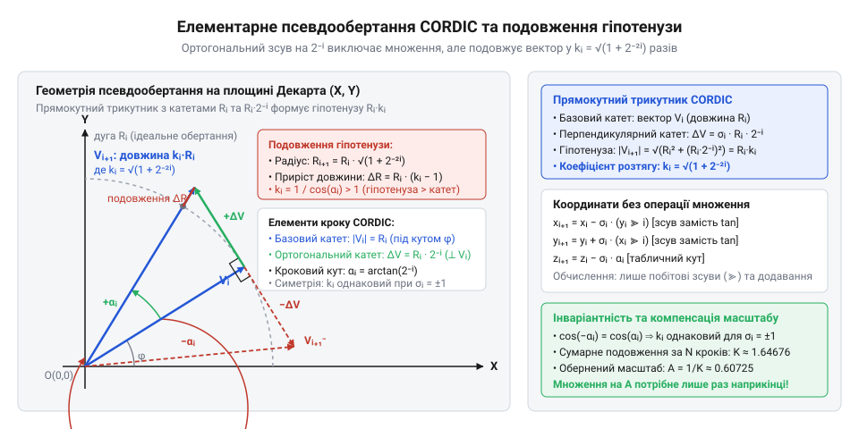
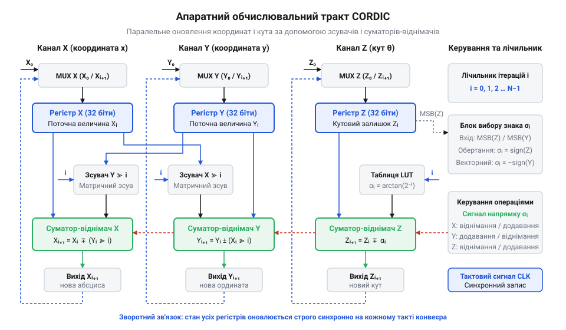

# Алгоритм CORDIC для тригонометричних обчислень у мікроконтролерах

<preknowlist>
- [Цілочисельне масштабування та обчислення з фіксованою комою в МК](root:sf-devices/integer-scaling-fixed-point) — представлення дробових величин у форматі Qm.n, математичні правила цілочисельного масштабування та використання побітових арифметичних зсувів для ділення на степені двійки
</preknowlist>

## Пастка тригонометричних обчислень у мікроконтролерах

У контурах керування електродвигунами чи силовими перетворювачами прошивка оновлює координати за лічені мікросекунди між тактами широтно-імпульсної модуляції. Якщо мікроконтролер не має апаратного блока чисел із рухомою комою, стандартні функції синуса й косинуса виконуються програмною емуляцією. Вона триває сотні машинних тактів, а обчислення поліномів через умовні переходи породжує часове тремтіння — @@en|jitter@@ (від англ. @@en|jitter@@ — тремтіння затримки). Коли тривалість розрахунку коливається від вибірки до вибірки, виникає відставання сигналу, що дестабілізує систему керування.

Таблиці пошуку @@en|LUT@@ (від англ. @@en|look-up table@@ — таблиця пошуку) високої точності вичерпують кристалічну пам'ять, вимагаючи десятків кілобайтів Flash. Зменшення розміру таблиці змушує застосовувати лінійну інтерполяцію. Вона повертає повільні операції множення та ділення, а зчитування з Flash-пам'яті гальмує шину тактами очікування. Виходом є алгоритм @@en|CORDIC@@ (від англ. @@en|Coordinate Rotation Digital Computer@@ — цифровий обчислювач обертання координат), який детерміновано обчислює синус і косинус у цілих числах без множення та ділення.

## Ітеративне псевдообертання вектора бітовими зсувами

Алгоритм наближає цільовий кут послідовними поворотами двовимірного вектора навколо початку координат. Повний кут розкладають на суму елементарних кутів, чиї тангенси дорівнюють від'ємним степеням двійки. Це замінює тригонометричне множення на арифметичний побітовий зсув @@en|bit shift@@ (від англ. @@en|bit shift@@ — бітовий зсув) праворуч, який матричний зсувач виконує за один такт.

Щоб уникнути множення на косинуси кутів кроку, виконують псевдообертання @@en|pseudo-rotation@@ (від грец. @@el|pseudos@@ — несправжній). На кожній ітерації вектор розтягується на гіпотенузу елементарного кроку.


*Елементарне псевдообертання розтягує вектор на сталий коефіцієнт незалежно від обраного напрямку повороту.*

Парність косинуса робить розтягування незмінним за будь-якого напрямку обертання. Після `N` кроків з індексом `i` сумарний коефіцієнт подовження `K_N` становить:

```
K_N
= ∏ᵢ₌₀ᴺ⁻¹ √(1 + 2⁻²ⁱ)                     [добуток подовжень на кожному кроці]
≈ 1.6468                                 [граничне значення при N → ∞]
```

Вектор гарантовано подовжується у фіксовану кількість разів. Це подовження компенсують через [масштабування з фіксованою комою](root:sf-devices/integer-scaling-fixed-point): початкові координати заздалегідь нормують множенням на `1 / K_N ≈ 0.6073` або масштабують результат разовим множенням на виході.

## Режими координатного обертання та векторизації

Тракт алгоритму містить регістри координат `X` і `Y`, кутовий акумулятор `Z`, зсувачі та суматори-віднімачі.


*Апаратний тракт одночасно оновлює просторові координати та кутовий акумулятор за допомогою зсувів і додавань.*

Залежно від керованої координати обчислювач має два режими роботи.

У режимі обертання залишковий кут в акумуляторі `Z` послідовно зводять до нуля. Якщо записати в `X` масштабний коефіцієнт, у `Y` — нуль, а в `Z` — цільовий кут, то за один прохід у регістрі `X` утворюється косинус, а в `Y` — синус кута.

У векторному режимі до нуля зводять вертикальну координату `Y`, повертаючи вектор до осі абсцис. Для довільних вхідних координат обчислювач знаходить модуль вектора в регістрі `X` та фазовий кут арктангенса в акумуляторі `Z` без операцій ділення чи вилучення квадратного кореня.

Кути в мікроконтролерах задають через двійкове вимірювання кута @@en|BAM@@ (від англ. @@en|binary angle measurement@@ — двійкове вимірювання кута). Повний оберт `2π` займає всю розрядну сітку цілого числа. Природне апаратне переповнення регістра автоматично забезпечує періодичність кола без додаткових умовних команд.

## Програмна оптимізація та апаратне прискорення

У прошивці циклічна перевірка лічильника витрачає зайві такти. Повне розгортання циклу @@en|loop unrolling@@ (від англ. @@en|loop unrolling@@ — розгортання циклу) замінює змінні зсуви на зашиті константи. Це усуває гілкування та робить час виконання строго детермінованим.

Апаратний периферійний співпроцесор @@en|CORDIC@@ мікроконтролера підтримує прямий доступ до пам'яті @@en|DMA@@ (від англ. @@en|direct memory access@@ — прямий доступ до пам'яті). Співпроцесор автономно зчитує вибірки з пам'яті, обчислює тригонометричні функції за кілька тактів і оновлює регістри широтного модулятора без залучення ядра.

Через системне подовження вектора в `1.6468` раза виникає ризик знакового переповнення координат. При [апаратній реалізації CORDIC](root:sf-devices/fixed-point-arithmetic-and-cordic-implementation) амплітуду вхідного сигналу обмежують межею приблизно шістдесят відсотків від повної розрядної сітки числа.