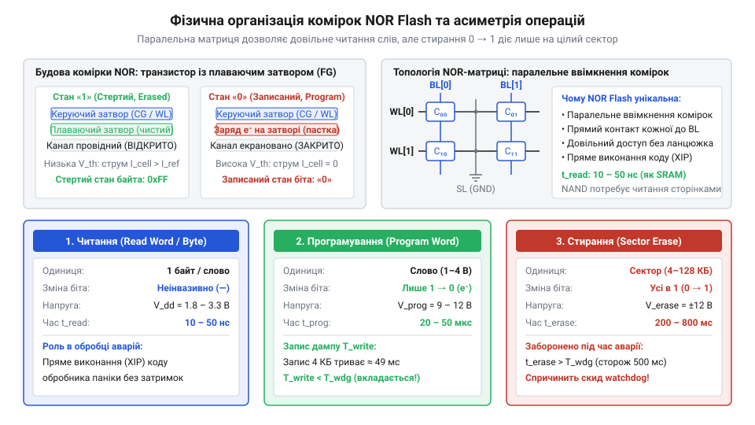
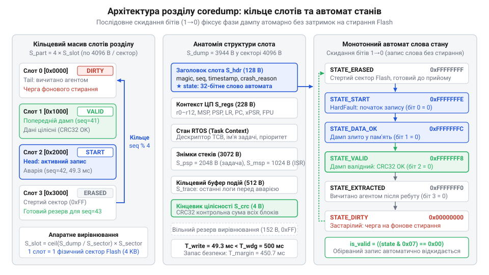
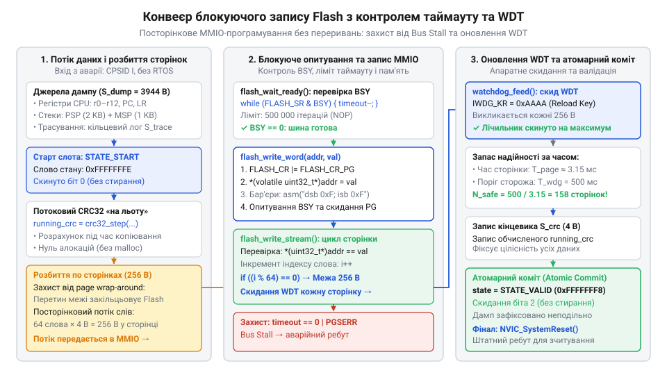
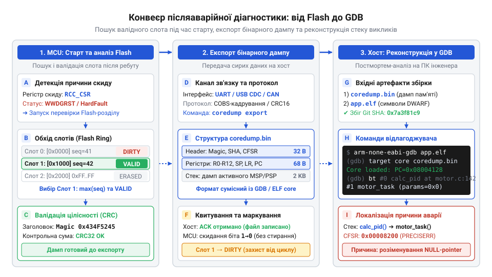

# Розбиття Flash-пам'яті під аварійні дампи

## Початкові концепції та фізичні принципи

Коли автономний вбудований прилад — бортовий контролер дрона, медичний інфузомат або блок керування промисловим приводом — зазнає фатального збою далеко від виробничого стенда, процесорне ядро потрапляє в контекст [апаратного винятку HardFault](root:sf-devices/hardfault) або аварійної паніки. У цей момент підключити апаратний зневаджувач @@en|JTAG@@ чи @@en|SWD@@ фізично неможливо: пристрій запаяний у корпус, встановлений на щоглі або перебуває в русі. Якщо прошивка не збереже стан пам'яті перед перезавантаженням, апаратний скид обнулить оперативну пам'ять @@en|SRAM@@, очистить процесорні регістри й знищить першопричину збою. Виникає блукаюча помилка, коли система перезавантажується без жодного діагностичного сліду.

Єдиним джерелом істини для віддаленого аналізу є збереження аварійного зліпка пам'яті та регістрів — аварійний дамп пам'яті (англ. @@en|coredump@@, від англ. @@en|core@@ — осердя, феритові кільця пам'яті перших ЕОМ, та @@en|dump@@ — скидання вмісту). Проте спроба зберегти аварійний звіт звичайною бібліотекою логування у файлову систему (наприклад, @@en|FATFS@@ або @@en|LittleFS@@) призводить до вторинного збою та повного зависання мікроконтролера.

Цей збій зумовлений чотирма конфліктами між аварійним станом ядра та архітектурою операційних систем:

1. Заблоковані переривання та параліч планувальника. Обробник фатальної помилки виконується на найвищому пріоритеті винятків із вимкненими перериваннями. Будь-яка файлова система спирається на примітиви @@en|операційної системи реального часу@@ (англ. @@en|RTOS@@, від англ. @@en|Real-Time Operating System@@): м'ютекси, семафори та таймери. Спроба захопити блокування викликає негайний взаємний тупик, оскільки планувальник більше не перемикає задачі. 2. Небезпека динамічного виділення пам'яті. Файлові драйвери виділяють проміжні буфери у купі через виклики `malloc()`. Оскільки аварія часто виникає через пошкодження купи або переповнення стека, звернення до аллокатора пам'яті провокує повторний фатальний збій ядра. 3. Асинхронні драйвери шин. Стеки обміну даними (@@en|SPI@@, @@en|QSPI@@, @@en|SDMMC@@) спираються на прямий доступ до пам'яті @@en|DMA@@ або переривання завершення передачі. Коли переривання вимкнено, драйвер нескінченно очікує на апаратний прапорець передачі, який ніколи не з'явиться. 4. Жорсткий ліміт сторожового таймера. Поки процесор заблокований очікуванням мертвого семафора, незалежний апаратний сторожовий таймер (англ. @@en|watchdog timer@@, від англ. @@en|watchdog@@ — вартовий собака) продовжує зворотний відлік. Щойно його лічильник обнулиться, мікроконтролер зазнає апаратного перезапуску, не зберігши жодного байта даних.

Тому збереження @@en|coredump@@ мусить відбуватися автономно від операційної системи, без переривань, без динамічної пам'яті та виключно в енергонезалежний носій. Єдиним компонентом на платі, здатним прийняти дані за таких умов, є твердотіла флеш-пам'ять (англ. @@en|flash memory@@, від англ. @@en|flash@@ — спалах, через здатність стирати блоки комірок одномоментним імпульсом напруги). Щоб усунути вплив файлових систем, прошивка виділяє у фізичному адресному просторі фіксовану зону — реалізується поділ пам'яті на розділи (англ. @@en|partitioning@@, від лат. @@en|partitio@@ — поділ, розчленування), де один ізольований розділ передається під пряме низькорівневе керування драйвера аварійного дампу.

Фізична будова комірок Flash-пам'яті диктує правила збереження даних. Основою комірки є польовий транзистор із плаваючим затвором (англ. @@en|floating gate@@) або пасткою заряду (англ. @@en|charge trap@@) із нітриду кремнію, розміщеною між керуючим затвором і каналом провідності. Плаваючий затвор ізольований діоксидом кремнію, що утримує накопичений електричний заряд роками без зовнішнього живлення.

Фізичний стан комірки визначається наявністю зв'язаних електронів на затворі:
- Стертий стан: Плаваючий затвор не містить надлишкових електронів. Порогова напруга відкриття транзистора низька. Робоча напруга відкриває канал, струм протікає через транзистор, що інтерпретується компараторами як логічна одиниця `1`. - Запрограмований стан: На плаваючий затвор інжектуються електрони за допомогою тунелювання Фаулера-Нордгейма (англ. @@en|Fowler-Nordheim tunneling@@) або гарячої інжекції електронів (англ. @@en|channel hot-electron injection@@). Накопичений негативний заряд екранує поле керуючого затвора, підвищуючи порогову напругу. Канал залишається закритим, струм не тече, що відповідає логічному нулю `0`.

Ця будова зумовлює фундаментальну фізичну асиметрію флеш-пам'яті:

1. Програмування комірки — це виключно переведення біта зі стану `1` у стан `0` шляхом накопичення заряду. Цю дію можна виконувати локально для окремого машинного слова або сторінки програмування (англ. @@en|program page@@, від лат. @@en|pagina@@ — сторінка, смуга) розміром від 32 бітів у внутрішній пам'яті до 256 байтів у зовнішніх мікросхемах. 2. Стирання комірки — це видалення електронів із затвора та повернення біта зі стану `0` у стан `1`. Оскільки індивідуальні лінії відведення заряду для кожної комірки відсутні заради щільності кристала, висока напруга подається одночасно на підкладку всієї матриці комірок. Тому стирання фізично здійснюється лише великими блоками, які утворюють сектор стирання (від лат. @@en|sector@@ — той, що відтинає, ділянка; англ. @@en|erase sector@@).

У мікроконтролерах використовується пам'ять типу @@en|NOR@@ (від англ. логічного виразу @@en|NOT-OR@@ — «або-не»), яка на відміну від пам'яті типу @@en|NAND@@ (від англ. логічного виразу @@en|NOT-AND@@ — «і-не») підтримує побайтове адресування шиною та пряме виконання за місцем (англ. @@en|XIP@@, від англ. @@en|eXecute In Place@@).


*Фізична організація комірок NOR Flash: асиметрія між довільним побайтовим зчитуванням, програмуванням слів зміною бітів з одиниці в нуль та повільним високовольтним стиранням усього сектора в стан логічних одиниць.*

Асиметрія проявляється і в часових затримках. Зчитування слова з внутрішньої @@en|NOR flash@@ триває наносекунди, програмування слова займає 20–50 мікросекунд, а стирання сектора триває від 20 до 400 мілісекунд (для секторів 128 кілобайт — понад 1 секунду).

Крім того, діелектрик зношується від напруги, що визначає знос комірок (англ. @@en|flash endurance@@, від лат. @@en|indurare@@ — загартовувати, витримувати). Допустима кількість циклів перезапису (англ. @@en|P/E cycles@@, @@en|Program/Erase cycles@@) становить 10 000–100 000 разів. У звичайних накопичувачах ресурс балансує трансляційний рівень флеш-пам'яті (англ. @@en|FTL@@, від англ. @@en|Flash Translation Layer@@) через вирівнювання зносу (англ. @@en|wear leveling@@, від англ. @@en|wear@@ — знос). Проте в аварійному розділі без транслятора надійність забезпечується структурою виділених слотів.

Для успішного [розмотування викликів стека](root:sf-devices/stack-walking) аварійний зліпок повинен містити детермінований набір структур даних: заголовок метаданих `S_hdr`, регістри процесора `S_regs` (регістри ядра `r0`-`r12`, `sp`, `lr`, `pc`, `xPSR`, системні регістри винятків ARM Cortex-M та `FPU`), знімок стека активної задачі `S_psp` (покажчик стека процесу @@en|PSP@@), знімок стека винятків `S_msp` (головний покажчик стека @@en|MSP@@), буфер подій `S_trace` та чотирибайтну контрольну суму `S_crc` (циклічний надлишковий код @@en|CRC32@@, від англ. @@en|Cyclic Redundancy Check@@).

Сумарний об'єм корисного навантаження дампу `S_dump` обчислюється формулою:

```
S_dump = S_hdr + S_regs + S_psp + S_msp + S_trace + S_crc
```

Для ARM Cortex-M4 задамо параметри: `S_hdr = 128` байтів, `S_regs = 228` байтів, `S_psp = 2048` байтів, `S_msp = 1024` байти, `S_trace = 512` байтів, `S_crc = 4` байти.

Підставимо ці значення у формулу:

```
S_dump = 128 + 228 + 2048 + 1024 + 512 + 4
       = 3944 байти                       [сума розмірів блоків]
```

Оскільки флеш-пам'ять оперує фізичними секторами стирання розміром `S_sector`, кожен слот мусить мати розмір `S_slot`, для якого реалізовано строге апаратне вирівнювання (англ. @@en|alignment@@, від старофранцузького @@en|aligner@@ — вишиковувати в лінію) за межами цілої кількості секторів:

```
S_slot = ceil(S_dump / S_sector) × S_sector
```

При розмірі фізичного сектора `S_sector = 4096` байтів обчислення дає:

```
S_slot = ceil(3944 / 4096) × 4096
       = 1 × 4096                         [округлення до цілого сектора]
       = 4096 байтів                      [розмір слота]
```

Для збереження історії з `N_slots` аварій загальний розмір розділу `S_part` становить:

```
S_part = N_slots × S_slot
```

Для `N_slots = 4` слотів загальний об'єм розділу дорівнює `S_part = 4 × 4096 = 16384` байти (16 кілобайтів).

Якщо швидкість послідовного програмування флеш-пам'яті у режимі опитування становить `V_prog` байтів на секунду, чистий час запису дампу `T_write` розраховується як:

```
T_write = S_dump / V_prog
```

При швидкості `V_prog = 80000` байтів на секунду час запису масиву `3944` байти становить:

```
T_write = 3944 / 80000
        = 0.0493 с                        [час запису 49.3 мілісекунди]
```

Якщо апаратний ліміт сторожового таймера становить `T_wdg = 0.500` секунди (500 мілісекунд), запас безпеки за часом `T_margin` дорівнює:

```
T_margin = T_wdg - T_write
         = 0.500 - 0.0493                 [віднімання часу запису від ліміту]
         = 0.4507 с                       [запас становить 450.7 мілісекунди]
```

Програмування 4 кілобайт даних займає менше 50 мілісекунд і впевнено вкладається у вікно сторожового таймера. Однак якби алгоритм спробував під час аварії виконати стирання сектора флеш-пам'яті (від 200 до 800 мілісекунд), сумарний час перевищив би поріг `T_wdg`, викликавши апаратний скид мікроконтролера посеред запису. Тому будь-яке стирання секторів флеш-пам'яті мусить виконуватися заздалегідь.

---

## Внутрішня будова та алгоритми роботи

Для детермінованого збереження діагностичних даних прошивка організує простір накопичувача через [статичну таблицю розділів](root:sf-devices/embedded-partition-table). У ній фізична пам'ять суворо розмежована: завантажувач, активна прошивка, слот оновлення, сховище налаштувань та окремий ізольований розділ аварійних дампів. Розділ coredump розміщується поза зоною дії звичайних файлових систем, що унеможливлює пошкодження системного коду під час збоїв.

Розділ складається з фіксованого масиву `N_slots` суміжних слотів, організованих у кільцевий масив (англ. @@en|circular buffer@@, від лат. @@en|circulus@@ — коло). Кожен слот має однаковий розмір `S_slot`, вирівняний за фізичними межами секторів стирання.

Кожен окремий слот має регламентовану структуру:
1. Заголовок слота: сигнатура формату, слово монотонного стану, лічильник покоління, позначка часу, причина збою та таблиця дескрипторів збережених областей пам'яті. 2. Блок процесорного контексту: повний набір регістрів ядра на момент аварії, системні регістри винятків та регістри співпроцесора. 3. Блок стану операційної системи: адреса дескриптора активної задачі, її ім'я, пріоритет та параметри стека. 4. Сегменти оперативної пам'яті: послідовні знімки пам'яті стека процесу та стека переривань. 5. Діагностичний кільцевий буфер: останні записи системного логу перед панікою. 6. Кінцевик цілісності: поле циклічного надлишкового коду @@en|CRC32@@, обчисленого за всіма даними слота.


*Організація виділеного розділу Flash-пам'яті під аварійні дампи у вигляді кільцевого масиву слотів із заголовком, де переходи станів фіксуються послідовним скиданням бітів без стирання сектору.*

Ключовим архітектурним рішенням модуля є монотонний автомат станів комірок Flash-пам'яті. Оскільки фізика напівпровідникових комірок @@en|NOR flash@@ дозволяє переводити окремі біти зі стану `1` у стан `0` без попереднього стирання сектора, життєвий цикл слота фіксується послідовним скиданням бітів у 32-бітному службовому слові заголовка.

Службове слово стану проходить наступні послідовні переходи:
- Стан «Очищено» (`STATE_ERASED = 0xFFFFFFFF`): Усі 32 біти встановлені в одиницю. Слот попередньо стертий і готовий до прийому даних. - Стан «Запис розпочато» (`STATE_START = 0xFFFFFFFE`): Нульовий біт скинуто в нуль. Обробник позначив слот як зайнятий і розпочав запис. - Стан «Дані записано» (`STATE_DATA_OK = 0xFFFFFFFC`): Перший біт скинуто в нуль. Усі блоки корисного навантаження успішно запрограмовано. - Стан «Підтверджено» (`STATE_VALID = 0xFFFFFFF8`): Другий біт скинуто в нуль. Контрольну суму @@en|CRC32@@ обчислено і збережено в кінцевику. Дамп є цілісним. - Стан «Вичитано» (`STATE_EXTRACTED = 0xFFFFFFF0`): Третій біт скинуто в нуль. Діагностичний агент зчитав дамп після перезапуску для відправки. - Стан «Застарілий» (`STATE_DIRTY = 0x00000000`): Усі біти скинуто в нуль. Слот стоїть у черзі на фонове попереднє стирання.

Цей автомат гарантує повну атомарну надійність (англ. @@en|atomic commit@@, від грец. @@en|atomos@@ — неподільний). Якщо посеред запису станеться знеструмлення або скид сторожового таймера, слово стану залишиться у проміжному значенні (`0xFFFFFFFE` або `0xFFFFFFFC`). Під час старту верифікатор перевіряє умову цілісності:

```
is_valid = ((state & 0x07) == 0x00)
```

Оскільки біт підтвердження залишився одиничним, система ідентифікує обірваний дамп, позначає його як `STATE_DIRTY` і відкидає. Перехід станів здійснюється записом одного 32-бітного слова без стирання сектора.

Фундаментальним правилом детермінізму є стратегія фонового попереднього стирання (англ. @@en|pre-erase@@). Оскільки стирання фізичного сектора триває сотні мілісекунд, виконувати його під час аварії заборонено. Фонове очищення реалізується наступним алгоритмом:

1. Під час ініціалізації системи або у фоновій задачі @@en|RTOS@@ модуль опитує заголовки слотів. 2. Якщо черговий слот перебуває у стані `STATE_EXTRACTED` або `STATE_DIRTY`, фонова задача запускає фізичне стирання сектора. 3. Очищення виконується в штатному режимі: переривання увімкнені, планувальник працює, @@en|watchdog timer@@ регулярно оновлюється. 4. Після завершення стирання комірки сектора повертаються у фізичний стан `0xFFFFFFFF` (`STATE_ERASED`). 5. Під час аварії обробник паніки записує дані у вже підготовлений чистий слот без затримок на стирання.

Кільцеве чергування слотів керується монотонним 32-бітним лічильником `seq_num` у заголовку кожного дампу. Під час аварії драйвер зчитує заголовки всіх слотів, знаходить слот зі станом `STATE_ERASED` і присвоює `seq_num = max(seq_num) + 1`. Якщо всі слоти зайняті, обирається слот із найменшим номером покоління.

Для роботи в умовах аварії застосовується опитувальний драйвер без переривань. Замість черг та модулів @@en|DMA@@ драйвер виконує опитування регістрів без переривань (англ. @@en|polling@@, від англ. @@en|poll@@ — підрахунок голосів, почергове опитування). Він записує дані у регістри периферійного контролера флеш-пам'яті та очікує готовності шини у компактному циклі очікування. Драйвер не використовує динамічну пам'ять і скидає сторожовий таймер прямим записом у його командний регістр після кожної запрограмованої сторінки.

Повна процедура збереження аварійного дампу інтегрується з [архітектурою обробника паніки](root:sf-devices/panic-handler-arch) за детермінованим конвеєром:
1. Вхід у виняток: Ядро процесора фіксує [апаратний виняток HardFault](root:sf-devices/hardfault) або помилка перевірки викликає аварійну паніку. 2. Ізоляція середовища: Прошивка блокує масковані переривання процесора через інструкцію `CPSID I` або встановлення регістра `FAULTMASK`. 3. Підміна стека: Обробник перевіряє головний покажчик стека `MSP`. Якщо збій викликаний переповненням стека, покажчик негайно перемикається на статично виділений аварійний масив у секції `.data`. 4. Збереження регістрів: Драйвер вичитує кадр винятку зі стека (`r0`-`r3`, `r12`, `lr`, `pc`, `xPSR`), копіює регістри ядра `r4`-`r11` та системні регістри винятків. 5. Фіксація слота: Драйвер знаходить стертий слот і записує статус `STATE_START`. 6. Запис даних та CRC: Драйвер посторінково програмує у флеш-пам'ять заголовок, контекст регістрів, пам'ять стека процесу та стека винятків, накопичуючи значення @@en|CRC32@@. 7. Завершення запису: Драйвер записує контрольну суму у фінальне поле слота та скидає біти слова стану до `STATE_VALID`. 8. Перезапуск: Обробник викликає системне перезавантаження через регістр ядра `NVIC_SystemReset()`.

Структура даних заголовка слота та дескрипторів пам'яті описується мовою C:

:::code root\eng\sf-devices\coredump-flash-partitioning/coredump-flash-partitioning-d/c/snippet-1.c c

Вирівнювання структур даних за межею 4 байтів (`aligned(4)`) є обов'язковим, оскільки контролери Flash-пам'яті здійснюють фізичне програмування виключно кратними машинними словами. Завдяки монотонному автомату та прямому опитуванню розділ аварійних дампів функціонує з абсолютним детермінізмом, перетворюючи кожну аварію на придатний для розслідування інженерний звіт.

## Апаратна реалізація та низькорівневий C/C++ код

Коли спрацьовує [архітектура обробника паніки](root:sf-devices/panic-handler-arch), ядро мікроконтролера переходить у замкнений аварійний режим. У цей момент виконання звичайних задач операційної системи повністю зупинено, а масковані переривання заблоковано апаратним встановленням регістра `FAULTMASK` або виконанням інструкції `CPSID I`. Стандартні драйвери периферії виявляються паралізованими: вони більше не можуть спиратися на прямий доступ до пам'яті @@en|DMA@@ чи очікувати на апаратні переривання завершення транзакції. Будь-яка спроба передати керування коду, що очікує на прапорець від планувальника @@en|RTOS@@, призводить до мертвого зависання системи. Єдиним фізично життєздатним механізмом керування апаратурою стає пряме опитування регістрів введення-виведення, відображених на адресний простір пам'яті (англ. @@en|memory-mapped I/O@@, @@en|MMIO@@, від англ. @@en|memory@@ — пам'ять, @@en|mapped@@ — відображений, та @@en|I/O@@, @@en|input/output@@ — введення-виведення).

Залежно від апаратної платформи збереження аварійного зліпка пам'яті (англ. @@en|coredump@@) виконується або у внутрішню напівпровідникову пам'ять мікроконтролера, або в зовнішню мікросхему твердотілої пам'яті (англ. @@en|NOR flash@@). Вбудована пам'ять мікроконтролера обслуговується інтегрованим [периферійним контролером Flash](root:hw-arch/flash-memory-controller-hardware). Фізичний запис у таку пам'ять вимагає суворої апаратної послідовності:

1. Зняття апаратного захисту контролера шляхом запису авторизаційної послідовності ключів у спеціальний командний регістр (наприклад, запис значень `0x45670123` та `0xCDEF89AB` у регістр `KEYR`). 2. Перевірка статусного регістра (англ. @@en|Status Register@@, @@en|SR@@) на відсутність незавершених апаратних транзакцій за прапорцем зайнятості матриці (біт `BSY`). 3. Скидання бітів попередніх помилок запису або захисту від запису (прапорці `PGSERR`, `WRPERR`). 4. Активація режиму програмування виставленням біта дозволу запису (біт `PG`). 5. Прямий запис машинного слова за цільовою адресою пам'яті з обов'язковим дотриманням фізичної розрядності шини контролера (32-бітне слово або 64-бітне подвійне слово).

Зовнішня енергонезалежна пам'ять, підключена через інтерфейси @@en|SPI@@, @@en|QSPI@@ або @@en|Octal-SPI@@, вимагає командного протоколу взаємодії. Драйвер генерує команду дозволу запису (код `0x06`, Write Enable), перевіряє встановлення біта дозволу в регістрі статусу мікросхеми, після чого формує пакет команди посторінкового програмування (код `0x02` для стандартної шини або код `0x32` для чотирибітної шини Quad Page Program) разом із 24-бітною чи 32-бітною адресою та масивом байтів корисного навантаження. Після завершення передачі порції даних лінія вибору кристала @@en|CS@@ переводиться у високий стан, що ініціює внутрішній апаратний цикл запису в кремнієву матрицю.

Синхронізація роботи з пам'яттю реалізується через блокуюче опитування статусних прапорців (англ. @@en|busy-wait polling@@, від англ. @@en|busy@@ — зайнятий, @@en|wait@@ — очікувати, та @@en|polling@@ — почергове опитування). Проте простий нескінченний цикл очікування готовності є критичною вразливістю. Якщо аварійний стан викликаний апаратним пошкодженням шини, збоєм тактового генератора чи просіданням живлення, процесор потрапляє в контекст [апаратного винятку HardFault](root:sf-devices/hardfault) або зазнає апаратного блокування внутрішньої шини (англ. @@en|bus stall@@, від англ. @@en|stall@@ — застрягання, зупинка). У такій ситуації статусний прапорець готовності ніколи не встановиться, а виконання зависне всередині порожнього циклу `while (FLASH->SR & FLASH_SR_BSY)`.

Для запобігання вічному блокуванню кожен цикл опитування обов'язково охоплюється захисним лічильником граничного часу — таймаутом опитування (англ. @@en|polling loop timeout@@, від англ. @@en|timeout@@ — вичерпання часу очікування). Лічильник декрементується на кожній ітерації опитування регістрів. Якщо контролер не очищує прапорець зайнятості протягом регламентованої кількості тактів ядра, драйвер примусово перериває операцію, фіксує апаратний збій шини у спеціальному захищеному регістрі та викликає негайне системне перезавантаження через функцію ядра `NVIC_SystemReset()`.

Фізичні властивості напівпровідникових комірок Flash-пам'яті забороняють довільний побайтовий запис: дані мають надсилатися дискретними порціями, що не перевищують розмір фізичної сторінки програмування (англ. @@en|program page@@, зазвичай 256 байтів для зовнішньої @@en|NOR flash@@ чи 32/64 байти для внутрішньої Flash мікроконтролера). Якщо пакет передачі перетинає фізичну межу сторінки, у контролері мікросхеми виникає апаратне закільцювання адреси (англ. @@en|page boundary wrap-around@@, від англ. @@en|wrap-around@@ — закільцювання, повернення на початок): старші розряди адреси залишаються незмінними, а молодші скидаються в нуль. У результаті дані, які мали потрапити на наступну сторінку, перезаписують початок поточної, безповоротно руйнуючи заголовок або контекст аварії. Тому низькорівневий драйвер розбиває вхідний масив пам'яті на сегменти, розраховуючи відстань від поточної адреси до найближчої фізичної межі сторінки.

Під час послідовного збереження сегментів оперативної пам'яті @@en|SRAM@@ апаратний сторожовий таймер (англ. @@en|watchdog timer@@) продовжує зворотний відлік. Якщо збереження дампа обсягом кілька кілобайтів виконується без оновлення лічильника таймера, система зазнає раптового апаратного скидання, не встигнувши зафіксувати аварійний стан. Щоб усунути цей ризик, драйвер скидає сторожовий таймер безпосередньо в циклі посторінкового програмування, надсилаючи команду перезапуску лічильника після кожної успішно завершеної транзакції сторінки.

Розрахуємо мінімальну безпечну кількість сторінок, які можна записати без ризику скидання процесора.

Нехай період спрацьовування сторожового таймера позначається як `T_wdg_period`, максимальний апаратний час програмування однієї сторінки флеш-пам'яті за паспортом кристала — `T_page_max`, а час передачі байтів сторінки через шину даних — `T_transfer`. Безпечна кількість сторінок `N_safe`, яку гарантовано встигає обслужити система між перезапусками таймера, обчислюється формулою:

```
N_safe = floor(T_wdg_period / (T_page_max + T_transfer))
```

Для апаратного сторожового таймера з лімітом спрацьовування `T_wdg_period = 0.500` секунди (500 мілісекунд), зовнішньої мікросхеми @@en|QSPI@@ з максимальною паспортизованою тривалістю програмування сторінки `T_page_max = 0.003` секунди (3 мілісекунди) та часом передачі 256 байтів на тактовій частоті шини 20 МГц `T_transfer = 0.00015` секунди (0.15 мілісекунди), розрахунок дає:

```
N_safe = floor(0.500 / (0.003 + 0.00015))
       = floor(0.500 / 0.00315)          [сума тривалості запису й передачі]
       = floor(158.73)                  [ділення періоду таймера на час сторінки]
       = 158                            [округлення до найближчого меншого цілого]
```

Отриманий результат показує, що оновлення сторожового таймера після кожної сторінки (кожні 3.15 мілісекунди) забезпечує 158-кратний запас надійності за часом, що повністю унеможливлює випадкове спрацьовування апаратного перезапуску під час запису цілісного дампа.

Нерідко аварійний стан супроводжується нестабільністю живлення приладу. Якщо напруга шини падає нижче критичного порогу, апаратний супервізор мікроконтролера ініціює скидання від просідання живлення (англ. @@en|brownout reset@@, від англ. @@en|brownout@@ — просідання напруги живлення, та @@en|reset@@ — скидання). Запис комірок пам'яті переривається на довільному байті, перетворюючи дамп на частково заповнене сміття.

Щоб гарантувати детерміноване розпізнавання цілісних записів, драйвер використовує потокове обчислення циклічного надлишкового коду @@en|CRC32@@. Контрольна сума накопичується «на льоту» під час відправки кожного слова без необхідності повторного сканування оперативної пам'яті. Фіксація аварійного слота реалізується як неподільна атомарна дія (англ. @@en|atomic commit@@):

1. Драйвер програмує всі збережені блоки даних (заголовок, регістри ядра, стек процесу та стек винятків), оновлюючи поточне значення @@en|CRC32@@. 2. Обчислена фінальна сума @@en|CRC32@@ записується в кінцевик слота за фіксованим зміщенням. 3. Лише після успішного підтвердження фізичного запису контрольної суми драйвер виконує фінальну модифікацію 32-бітного службового слова в заголовку слота, переводячи його зі стану `COREDUMP_STATE_DATA_OK` (`0xFFFFFFFC`) у стан `COREDUMP_STATE_VALID` (`0xFFFFFFF8`).

Оскільки фізичний перехід комірки Flash зі стану `1` у стан `0` не вимагає стирання сектора, цей крок займає лічені мікросекунди. Якщо просідання напруги перерве запис на будь-якому попередньому етапі, біт підтвердження залишиться одиничним, і під час наступного завантаження система проігнорує пошкоджений запис.


*Послідовність апаратного програмування сторінок Flash-пам'яті в режимі блокуючого опитування: контроль статусних регістрів, покрокове обчислення CRC32 та оновлення сторожового таймера на кожній ітерації без залучення переривань.*

Нижче наведено повну реалізацію низькорівневого модуля аварійного збереження дампа, що функціонує в режимі опитування без переривань, динамічної пам'яті та сервісів операційної системи.

:::tabs
:::code root\eng\sf-devices\coredump-flash-partitioning/coredump-flash-partitioning-d/c/watchdog-feed.c c
:::code root\eng\sf-devices\coredump-flash-partitioning/coredump-flash-partitioning-d/cpp/state.cpp cpp
:::

---

## Практичне застосування та відлагодження

Після апаратного перезавантаження мікроконтролера вбудована система опиняється перед необхідністю з'ясувати: старт відбувся штатно після подачі живлення чи внаслідок фатальної помилки. Для цього завантажувач (англ. @@en|bootloader@@) або процедура ранньої ініціалізації прошивки зчитує системні регістри джерел скидання процесора (наприклад, регістр `RCC_CSR` в архітектурі ARM Cortex-M). Наявність активних прапорців спрацьовування сторожового таймера чи програмного скиду є прямим сигналом для перевірки розділу аварійних дампів.

Обробка накопичених записів підпорядковується процедурі діагностичного відбору (франц. @@en|triage@@, від @@en|trier@@ — сортувати, відбирати за пріоритетом):

1. Сканування слотів розділу. Завантажувач зчитує масив заголовків усіх `N_slots` фізичних блоків Flash-пам'яті. 2. Фільтрація за сигнатурою та монотонним словом стану. Слоти з невідповідним магічним числом `magic` або станом `COREDUMP_STATE_ERASED` відкидаються. Записи у станах `COREDUMP_STATE_START` або `COREDUMP_STATE_DATA_OK` ідентифікуються як обірвані внаслідок раптового знеструмлення і позначаються для очищення. 3. Верифікація цілісності. Для кожного кандидата зі статусом `COREDUMP_STATE_VALID` завантажувач послідовно вичитує всі збережені регіони пам'яті та розраховує контрольне значення @@en|CRC32@@. Отриманий результат порівнюється з кінцівкою слота. Якщо суми не збігаються (наприклад, через знос або деградацію комірок Flash), слот вважається пошкодженим і переводиться в стан `COREDUMP_STATE_DIRTY`. 4. Визначення актуального інциденту. Серед усіх підтверджених слотів система обирає запис із найбільшим значенням лічильника `seq_num`. Це гарантує, що інженерний персонал отримає знімок саме останньої катастрофи, навіть якщо пам'ять містить старіші архівні дампи.

Після ідентифікації валідного слота постає завдання вилучення аварійного звіту на робочу станцію розробника. Спосіб експорту визначається класом пристрою:

- Локальні інтерфейси налагодження. На виробничому чи лабораторному стенді вивантаження здійснюється через послідовний порт @@en|UART@@ у вигляді текстового масиву @@en|Base64@@ або двійковим потоком за протоколом @@en|XMODEM@@. За наявності апаратного зневаджувача @@en|SWD@@ вичитування здійснюється за технологією передачі в реальному часі (англ. @@en|RTT@@, від англ. @@en|Real-Time Transfer@@) або прямим зчитуванням фізичного діапазону Flash через команду зневаджувача без зупинки процесора. - Бездротова телеметрія віддалених пристроїв. В автономних датчиках та бортових контролерах знімок пам'яті передається через канали стільникового зв'язку або Wi-Fi після відновлення з'єднання з хмарним сервером моніторингу. Після отримання підтвердження доставки (ACK) прошивка переводить стан слота в `COREDUMP_STATE_EXTRACTED`. У найближчий період простою фоновий процес виконає безпечне стирання сектора (стратегія pre-erase).

Отриманий двійковий масив стає основою для післяаварійного аналізу (лат. @@en|post-mortem@@ — після смерті, посмертний аналіз). За допомогою [аналізу аварійних дампів](root:sf-devices/gdb-core-dump-analysis) сирий знімок конвертується в стандартний формат двійкових виконуваних файлів ядра (англ. @@en|ELF@@, від англ. @@en|Executable and Linkable Format@@, від @@en|executable@@ — виконуваний, та @@en|linkable@@ — компонований). 

Утиліта конвертації формує заголовок ELF із типом файлу `ET_CORE` та розміщує в ньому два типи сегментів:

1. Сегмент службових записів `PT_NOTE`: містить упаковану структуру регістрів ядра ARM Cortex-M (`r0`-`r12`, покажчик стека `sp`, регістр зв'язку `lr`, лічильник команд `pc`, регістр стану `xPSR`). 2. Сегменти завантаження `PT_LOAD`: містять точні бінарні копії стека процесу та стека винятків, прив'язані до їхніх справжніх віртуальних адрес у пам'яті @@en|SRAM@@.

Сформований файл передається стандартному зневаджувачу проєкту GNU (англ. @@en|GDB@@, від англ. @@en|GNU Debugger@@ — зневаджувач проєкту GNU):

```bash
arm-none-eabi-gdb app_firmware.elf -c coredump.elf
```

Завдяки збігу адрес та наявності символьної таблиці DWARF у файлі прошивки інженер отримує повну картину стану системи на момент аварії:

- Команда `bt` (backtrace) миттєво реконструює послідовність викликів функцій за допомогою алгоритму [розмотування викликів стека](root:sf-devices/stack-walking). - Команда `info registers` демонструє точні значення змінних у регістрах ядра безпосередньо перед збоєм. - Команда `print *device_state` відображає внутрішні змінні та структури драйверів, адреси яких потрапили у збережені сегменти пам'яті стека. - Аналіз системних регістрів діагностики винятків ARM Cortex-M розкриває апаратну причину катастрофи:
  - Настроюваний регістр статусу помилок (англ. @@en|CFSR@@, від англ. @@en|Configurable Fault Status Register@@): прапорець `BFARVALID` свідчить про помилку шини даних, а регістр адреси збою шини (англ. @@en|BFAR@@, від англ. @@en|Bus Fault Address Register@@) містить точну пам'ятну адресу, звернення до якої викликало крах. - Регістр адреси збою керування пам'яттю (англ. @@en|MMFAR@@, від англ. @@en|MemManage Fault Address Register@@) фіксує несанкціонований доступ у захищену зону блоку захисту пам'яті (англ. @@en|MPU@@, від англ. @@en|Memory Protection Unit@@). - Прапорець `UNDEFINSTR` у регістрі `CFSR` сигналізує про спробу виконання неіснуючої інструкції через руйнування покажчика на функцію.


*Конвеєр післяаварійної діагностики: завантажувач сканує слоти, верифікує CRC32, експортує бінарний образ аварії та передає його в GDB для повної реконструкції стека викликів.*

Надійність збереження та аналізу дампів визначається тим, як модуль обробляє нештатні граничні випадки та апаратні пастки:

1. Подвійний збій та рекурсивний виняток (англ. @@en|double fault@@, від англ. @@en|double@@ — подвійний, та @@en|fault@@ — дефект, збій). Якщо обробник аварії під час опитування пам'яті здійснює доступ до пошкодженого покажчика або звертається до неініціалізованої шини Flash, виникає вторинний [апаратний виняток HardFault](root:sf-devices/hardfault). Система ризикує потрапити в нескінченну петлю викликів обробника. Для захисту використовується одноразовий сторожовий прапорець входження (англ. @@en|reentrancy guard@@, від франц. @@en|rentrer@@ — повторно входити, та англ. @@en|guard@@ — сторож, захисник). Прапорець зберігається в енергонезалежних регістрах бекапу RTC або в спеціальній секції пам'яті `.noinit` (ділянка оперативної пам'яті, що не ініціалізується нулями під час перезапуску). Якщо під час збереження трапляється вторинна помилка, обробник виявляє вже піднятий прапорець, негайно припиняє роботу з Flash і примусово скидає мікроконтролер. 2. Руйнування та переповнення стека процесу. Коли паніка спричинена вичерпанням виділеного простору стека поточної задачі (покажчик @@en|PSP@@), виклик будь-якої локальної підпрограми збереження дампу призведе до негайного запису поверх сусідніх даних у пам'яті. Тому обробник катастрофи в перші ж такти апаратно або програмно перемикає активний стек на головний покажчик стека (англ. @@en|MSP@@), що вказує на виділений аварійний буфер розміром 1-2 кілобайти у секції статичних змінних. 3. Фізичне зношування секторів Flash. Після вичерпання ресурсу циклів програмування комірка втрачає здатність утримувати електрони. Запис слова може завершитися без встановлення прапорця апаратної помилки, проте окремі біти залишаться одиничними. Для діагностики деградації драйвер виконує зворотне зчитування та звірку (англ. @@en|read-back verify@@, від англ. @@en|read-back@@ — зворотне зчитування, та @@en|verify@@ — перевірка). Якщо лічені дані відрізняються від записаного буфера, слот маркується як пошкоджений, а система перенаправляє дамп у наступний резервний сектор. 4. Контроль меж адресації розділу. У критичному стані через руйнування глобальних покажчиків адреса запису може вийти за межі виділеної зони. Низькорівневий драйвер містить жорсткі перевірки діапазону адрес (bounds checking), відхиляючи будь-яку транзакцію, що намагається модифікувати сектори за межами виділеного розділу аварійних дампів.

Нижче наведено практичну реалізацію модуля сортування та верифікації дампів під час завантаження системи.

:::tabs
:::code root\eng\sf-devices\coredump-flash-partitioning/coredump-flash-partitioning-d/c/compute-crc32.c c
:::code root\eng\sf-devices\coredump-flash-partitioning/coredump-flash-partitioning-d/cpp/state-2.cpp cpp
:::

Практична інтеграція низькорівневого запису з механізмами первинного сортування дає інженерній команді цілковиту впевненість у діагностиці. Кожен збережений аварійний дамп перетворюється на вичерпний математичний зліпок системи, що дозволяє локалізувати першопричину апаратного чи програмного краху безпосередньо за вихідним кодом прошивки.