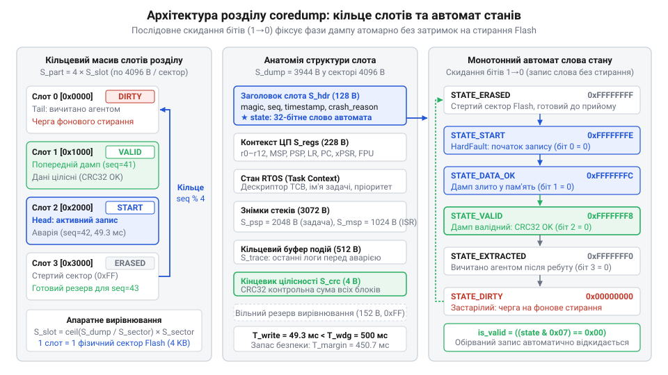

# Розбиття Flash-пам'яті під аварійні дампи

<preknowlist>
- [Розбір HardFault](root:sf-devices/hardfault) — Збереження апаратного кадру регістрів ядра та причина виникнення винятку.
- [Архітектура обробника паніки](root:sf-devices/panic-handler-arch) — Перехід системи в аварійний стан та вимкнення планувальника RTOS.
</preknowlist>

## Пастка збереження аварійного дампу пам'яті

Коли мікроконтролер зазнає краху внаслідок [апаратного винятку HardFault](root:sf-devices/hardfault) або критичної помилки ядра, штатне виконання коду зупиняється. Керування переходить до аварійного коду, узгодженого з [архітектурою обробника паніки](root:sf-devices/panic-handler-arch). Головна мета на цьому етапі — зафіксувати стан процесора та пам'яті, сформувавши аварійний дамп пам'яті (англ. @@en|coredump@@, від *core* — магнітне осердя та *dump* — скидання). Проте спроба зберегти ці дані у файл через звичайну файлову систему неминуче завершується зависанням.

Такий збій зумовлений трьома критичними обмеженнями. По-перше, драйвери файлових систем спираються на сервіси операційної системи реального часу (англ. @@en|RTOS@@, від *Real-Time Operating System*) та апаратні переривання. В аварійному контексті переривання заблоковані, а планувальник зупинено, тому очікування семафора чи м'ютекса створює взаємне блокування. По-друге, файлові системи використовують динамічне виділення пам'яті, тоді як купа може бути зіпсована первинним збоєм. По-третє, апаратний сторожовий таймер (англ. @@en|watchdog timer@@, від *watchdog* — вартовий пес) має жорсткий ліміт часу, якого не вистачає на оновлення складних файлових метаданих.

Тому збереження @@en|coredump@@ вимагає прямого запису в енергонезалежну пам'ять автономним драйвером без переривань, через опитування регістрів введення-виведення (англ. @@en|MMIO@@, від *Memory-Mapped I/O* — пам'ять із відображенням введення-виведення) та виділення під зліпки ізольованого апаратного розділу.

## Асиметрія комірок та розбиття слотів

Енергонезалежні мікросхеми флеш-пам'яті (англ. @@en|NOR Flash@@) мають фізичну асиметрію між записом і стиранням. Фізика комірки дозволяє записувати дані лише перемиканням бітів з одиниці в нуль, тоді як зворотне відновлення одиниць можливе виключно через високовольтне стирання цілого блоку.

Пам'ять поділена на два несумірні рівні. Запис виконується малими блоками — сторінками програмування (англ. @@en|program page@@, від *program* — записувати) типовим розміром 256 байтів, що триває частки мілісекунди. Стирання ж відбувається великими блоками — секторами стирання (англ. @@en|erase sector@@, від *erase* — стирати) розміром від 4 КБ до 64 КБ і триває сотні мілісекунд через повільне перезаряджання плаваючих затворів. Якщо під час паніки запустити стирання, процесор гарантовано буде скинутий через спрацьовування @@en|watchdog timer@@.

*Виділений розділ Flash-пам'яті у вигляді кільцевого масиву слотів із послідовним скиданням бітів стану без стирання сектору.*

Тому аварійний розділ організовують як кільцевий масив слотів, кожен з яких суворо вирівняний за фізичними межами @@en|erase sector@@. Це захищає сусідні записи від пошкодження при очищенні. Розмір слота обчислюють детерміновано: він вміщує заголовок метаданих, регістри ядра, знімки стеків задач для подальшого [розмотування викликів стека](root:sf-devices/stack-walking), кільцевий буфер логів та контрольну суму цілісності.

## Монотонний автомат станів та фіксація

Оскільки комірки @@en|NOR Flash@@ допускають монотонне перемикання бітів `1 → 0` без стирання сектора, стан кожного слота фіксують через службове слово в його заголовку. Стертий сектор заповнений значеннями `0xFF`. Перехід між фазами життєвого циклу відбувається скиданням окремих бітів у нуль:

1. **Вільний стан** позначається значенням `0xFFFFFFFF`. Драйвер обирає перший такий слот у розділі. 2. **Початок запису**: драйвер скидає нульовий біт, записуючи `0xFFFFFFFE`. Далі виконується посторінковий запис дампу за допомогою опитування (англ. @@en|polling@@, від *poll* — опитувати) прапорців стану апаратного контролера в @@en|MMIO@@ без залучення переривань. На кожній записаній @@en|program page@@ драйвер оновлює лічильник @@en|watchdog timer@@. 3. **Атомарна фіксація**: після запису даних і контрольної суми драйвер скидає другий біт, встановлюючи значення `0xFFFFFFFC`. Це забезпечує атомарне підтвердження (англ. @@en|atomic commit@@, від *atomic* — неподільний та *commit* — фіксувати). Якщо живлення зникне достроково, статус залишиться `0xFFFFFFFE`, і прошивка визнає слот пошкодженим.

Після перезапуску системи прошивка вичитує валідний @@en|coredump@@ і позначає слот як прочитаний (`0xFFFFFFF8`). Щоб уникнути довгих затримок під час майбутніх катастроф, очищення старих слотів до стану `0xFFFFFFFF` переносять у штатний фоновий режим як попереднє стирання (англ. @@en|pre-erase@@, від префікса *pre-* — заздалегідь).