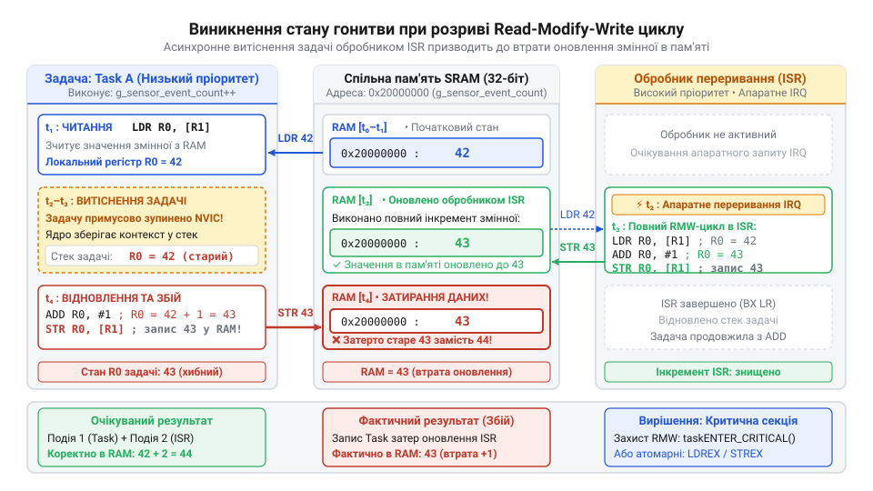
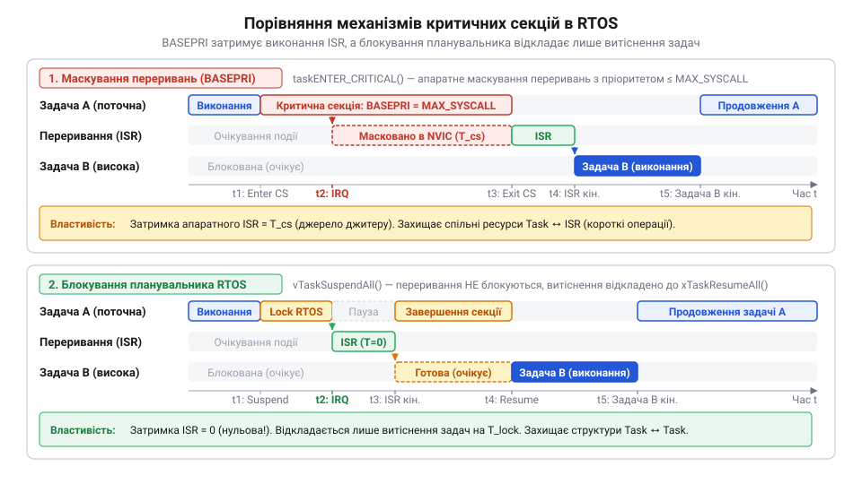
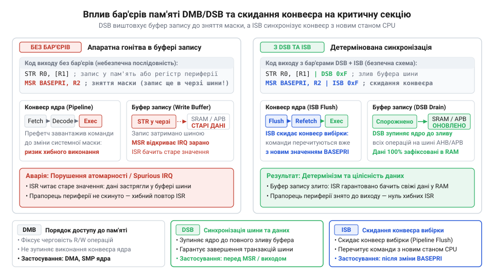
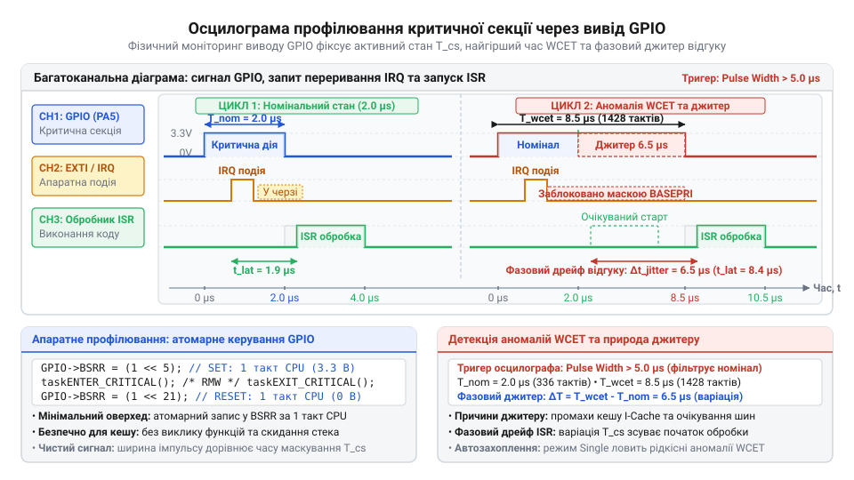

# Критичні секції в RTOS

## Початкові концепції та фізичні принципи

У багатозадачній прошивці реального часу операція інкременту глобального лічильника системного стану мовою C видається елементарною та безпечною:

```c
g_sensor_event_count++;
```

Однак на фізичному рівні процесорного ядра ця вища абстракція не існує як єдина неподільна команда. Сучасні архітектури мікроконтролерів (зокрема ARM Cortex-M та RISC-V) належать до роду @@en|load-store@@ архітектур. Це означає, що арифметико-логічний пристрій (від англ. @@en|Arithmetic Logic Unit@@, ALU) позбавлений можливості виконувати обчислення безпосередньо у комірках оперативної пам'яті (RAM). Для модифікації змінної процесор змушений розбити її на три послідовні апаратні інструкції на мові ассемблера:

1. **Читання**: завантаження значення змінної з адреси в RAM у внутрішній регістр загального призначення процесора (наприклад, інструкція `LDR R0, [R1]`). 2. **Модифікація**: виконання арифметичної або логічної операції всередині ALU (наприклад, інструкція `ADD R0, R0, #1`). 3. **Запис**: збереження модифікованого значення з процесорного регістра назад у комірку оперативної пам'яті (наприклад, інструкція `STR R0, [R1]`).

Ця послідовність утворює цикл читання-модифікації-запису (від англ. @@en|Read-Modify-Write@@, RMW). Фундаментальна небезпека криється у тому, що між будь-якими двома з цих апаратних інструкцій фізичне ядро процесора може бути перериване зовнішнім сигналом.

Коли в мікроконтролері активовано апаратний запит на переривання (від англ. @@en|interrupt request@@, IRQ) від периферії або спрацьовує системний таймер, коли діє [витісняльна багатозадачність у вбудованих](root:sf-devices/cooperative-vs-preemptive-multitasking) системах, контролер переривань негайно призупиняє конвеєр виконання поточної задачі. Ядро зберігає поточний контекст процесора на стек і передає управління обробнику.

Розглянемо критичний сценарій. Задача низького пріоритету виконує інструкцію `LDR`, зчитуючи значення лічильника `g_sensor_event_count` (наприклад, число 42) у регістр `R0`. В цей момент надходить апаратне переривання від таймера. Контролер переривань зупиняє задачу до виконання інструкції `ADD`. Обробник переривання (від англ. @@en|interrupt service routine@@, ISR) також працює з цим же лічильником: він зчитує з пам'яті значення 42, збільшує його до 43 і негайно записує назад у RAM інструкцією `STR`. Після завершення ISR процес повертається до призупиненої задачі. Задача відновиться з тієї інструкції, на якій її зупинили, — з інструкції `ADD`. Вона додає одиницю до свого регістра `R0` (де досі зберігається зчитане до переривання значення 42) і отримує 43. Потім вона виконує `STR` і записує 43 у пам'ять.

Результат катастрофічний: хоча подія відбулася двічі (один раз у задачі й один раз у перериванні), значення лічильника дорівнює 43 замість 44. Одне з оновлень безповоротно втрачене. Ця аномалія називається станом гонитви (від англ. @@en|race condition@@). Результат виконання починає залежати від випадкового фізичного моменту приходу електричного сигналу на ніжку мікроконтролера або квантування часу.


*Схема асинхронного переривання процедури читання-модифікації-запису в процесорних регістрах із втратою даних.*

Ще більш підступним наслідком відсутності атомарності є ефект розриву зчитування (від англ. @@en|torn read@@) або розриву запису (від англ. @@en|torn write@@). Розглянемо 64-бітну змінну системного часу `uint64_t g_system_ticks` на 32-бітному мікроконтролері. 

Оскільки розрядність системної шини становить 32 біти, зчитування або запис 64-бітного числа вимагає виконання двох послідовних інструкцій `LDR` (або `LDRD` на ARM). Якщо значення часу дорівнює `0x00000000FFFFFFFF` (4 294 967 295 тактів), і точнісінько між зчитуванням молодшого `0xFFFFFFFF` та старшого `0x00000000` слів спрацьовує переривання таймера, яке збільшує системний час на 1, значення в пам'яті змінюється на `0x0000000100000000`.

Задача повертається до виконання і зчитує вже оновлене старше слово `0x00000001`. З'єднавши його зі зчитаним раніше старим молодшим словом `0xFFFFFFFF`, задача отримує підсумкове значення `0x00000001FFFFFFFF` (8 589 934 591 тактів!). Час для алгоритму керування миттєво «стрибнув» у майбутнє на 138 років вперед за один такт. У системі з жорсткими часовими обмеженнями це спричинить миттєве хибне спрацювання таймаутів або аварійний зупин.

Стан гонитви виникає у трьох основних конфігураціях доступу у вбудованих системах:

* **Потік проти Переривання**: Задача фонової обробки та обробник апаратного переривання звертаються до спільної структури даних, периферійного регістра або кільцевого буфера. * **Переривання проти Переривання**: У системах, де включено [вкладені переривання](root:sf-devices/nested-interrupts-architecture), високопріоритетний обробник перериває виконання інструкцій усередині нижчого ISR під час оновлення спільних прапорців стану. * **Потік проти Потоку**: Дві незалежні задачі операційної системи реального часу модифікують спільні ресурси, а операційна система виконує автоматичну передачу управління, коли діє [механіка перемикання контексту](root:sf-devices/rtos-context-switch-mechanics), зберігаючи стан регістрів у [структурі контрольного блоку задачі](root:sf-devices/task-control-block-structure).

На апаратному рівні шина оперативної пам'яті мікроконтролера виконує транзакції читання та запису як окремі, декомплексовані часові такти. Внутрішня шинна матриця (наприклад, AHB-Lite або AXI) не знає про логічний зв'язок між інструкціями `LDR` та `STR`. Процесорне ядро здатне приймати переривання на межі будь-якої машинного інструкції.

Розробники початкового рівня часто припускають, що проблема вирішується додаванням специфікатора `volatile` до оголошення змінної. Це небезпечна оману. Специфікатор `volatile` лише вказує компілятору `gcc` чи `clang` не кешувати значення змінної у процесорних регістрах і не виключати звернення до пам'яті при оптимізації. Він запобігає оптимізаційному перевпорядкуванню інструкцій (від англ. @@en|instruction reordering@@), але він **не робить операції атомарними** і не захищає від апаратних переривань ядра!

Ділянка коду, яка виконує доступ до спільного ресурсу і вимагає послідовного, неподільного виконання для збереження цілісності даних, називається критичною секцією (від англ. @@en|critical section@@, від грец. @@el|κρίσις@@ — вирішальний момент).

Фундаментальною властивістю критичної секції є атомарність (від англ. @@en|atomicity@@, від грец. @@el|ἄτομος@@ — неподільний). Операція є атомарною з точки зору решти системи, якщо вона здійснюється як єдиний неподільний крок: будь-який інший спостерігач або потік бачить ресурс або у стані до початку операції, або у стані після її повного завершення, але ніколи не в проміжному, зламаному стані.

Однак створення атомарності у вбудованих системах створює жорстку системну напругу. Найнаївніший спосіб гарантувати атомарність — повністю заборонити мікроконтролеру сприймати будь-які апаратні переривання на час виконання критичної секції. Але це створює бічну проблему — затримку реакції на переривання (від англ. @@en|interrupt latency@@).

Затримка переривання — це часовий інтервал між фізичним виникненням події на виводі периферійного модуля та моментом, коли процесор починає виконувати першу інструкцію відповідного обробника ISR. Якщо критична секція триває надто довго, мікроконтролер виявляється «сліпим» до зовнішнього світу.

Загальний час затримки реакції розраховується за формулою:

```
T_latency_max = T_cs_max + T_isr_entry
= 8.5 + 0.3              [підстановка максимальної тривалості критичної секції та часу входу в ISR]
= 8.8 μs                 [сумарний час очікування обробки апаратного сигналу]
```

де `T_cs_max` — максимальна безперервна тривалість блокування переривань у найдовшій критичній секції прошивки, а `T_isr_entry` — апаратний час збереження контексту ядра у стек (для ARM Cortex-M це зазвичай 12 тактів).

Якщо у системі керування електродвигуном або силовим перетворювачем затримка `T_latency_max` перевищить безпечний часовий поріг, мікроконтролер не встигне зреагувати на сигнал струмового перевантаження, що призведе до фізичного виходу з ладу силових транзисторів. Крім того, мінливість часу перебування у критичних секціях створює фазовий джитер (від англ. @@en|jitter@@) — випадкове коливання часу відгуку, що руйнує детермінізм системи реального часу.

Таким чином, головний інженерний виклик під час проективання критичних секцій в RTOS полягає у дотриманні балансу: забезпечення абсолютної цілісності даних при мінімально можливому часі блокування апаратних переривань.

## Внутрішня будова та алгоритми роботи

Для реалізації детермінованих критичних секцій в операційних системах реального часу використовуються чотири основних архітектурних механізми, кожен з яких володіє власною ціною з точки зору продуктивності та затримок:

1. **Глобальне та селективне маскування переривань (Interrupt Masking)**. 2. **Блокування планувальника RTOS (Scheduler Locking)**. 3. **М'які синхронізаційні примітиви з успадкуванням пріоритетів (Mutexes)**. 4. **Апаратні атомарні інструкції з ексклюзивним монітором (Lock-free Primitives)**.

Розглянемо внутрішню будову та алгоритми функціонування кожного з цих механізмів.

### Глобальне та селективне маскування переривань

Найбільш радикальним рівнем ізоляції є апаратне маскування переривань ядра. В архітектурі ARM Cortex-M для цього передбачено спеціальні системні регістри: `PRIMASK` та `BASEPRI` (докладніше див. [маскування переривань через регістр BASEPRI](root:sf-devices/arm-cortex-m-basepri-register)).

Запис одиниці в регістр `PRIMASK` (за допомогою ассемблерної інструкції `cpsid i`) піднімає поточний рівень маскування переривань до 0. Це повністю вимикає всі апаратні переривання з настроюваними пріоритетами, залишаючи активними лише немасковане переривання (від англ. @@en|Non-Maskable Interrupt@@, NMI) та апаратне скидання (HardFault/Reset).

Однак глобальне блокування через `PRIMASK` порушує вимоги систем жорсткого реального часу. З цієї причини сучасні RTOS (такі як FreeRTOS або Zephyr) на архітектурах Cortex-M3/M4/M7/M33 використовують селективне маскування через регістр `BASEPRI`.

Регістр `BASEPRI` визначає пороговий пріоритет переривань. Якщо у `BASEPRI` записано значення, наприклад, `0x50`, процесорне ядро апаратно ігноруватиме абсолютно всі переривання, чий пріоритет чисельно дорівнює або є нижчим за `0x50` (нагадаємо, що в ARM Cortex-M чисельно більший номер означає нижчий логічний пріоритет). Переривання з пріоритетами від `0x00` до `0x4F` продовжують оброблятися миттєво з нульовою додатковою затримкою.

У конфігурації RTOS цей поріг задається макросом `configMAX_SYSCALL_INTERRUPT_PRIORITY`. Переривання, пріоритет яких вищий за цей макрос, називаються перериваннями з нульовою затримкою (від англ. @@en|zero-latency interrupts@@). Вони ніколи не блокуються операційною системою, але їм суворо заборонено викликати будь-які API-функції RTOS.


*Порівняння часових діаграм виконання при маскуванні переривань та при блокуванні витіснення задач.*

Для підтримки реінтерабельності (від англ. @@en|reentrancy@@, повторної входжуваності) та безпечного вкладення критичних секцій одна в одну, RTOS зберігає попередній стан маски переривань. Якщо функція, що містить критичну секцію, викликається з іншої критичної секції, просте увімкнення переривань на виході передчасно відкриє доступ конкуруючим потокам.

Для вирішення цієї проблеми реалізуються два підходи:

* **Вміст регістра у стеку (контекст ISR)**: Збереження поточного значення `BASEPRI` або `PRIMASK` у локальну змінну перед модифікацією та його відновлення при виході. * **Лічильник вкладеності (контекст задач)**: У [структурі контрольного блоку задачі](root:sf-devices/task-control-block-structure) зберігається лічильник вкладеності `uxCriticalNesting`. При вході в критичну секцію лічильник інкрементується, а переривання маскуються лише при переході від 0 до 1. При виході лічильник декрементується, і маска знімається тільки тоді, коли лічильник знову досягає 0.

### Апаратні атомарні інструкції з ексклюзивним монітором

В сучасних мікроконтролерах захист коротких секцій даних можна здійснювати взагалі без маскування переривань. Для цього служать апаратні інструкції ексклюзивного доступу: `LDREX` (Load-Exclusive) та `STREX` (Store-Exclusive) на ARM, або `LR.W` та `SC.W` на RISC-V.

Фізичний принцип базується на тому, що всередині процесорного ядра працює апаратний модуль — ексклюзивний монітор (від англ. @@en|exclusive monitor@@). 

Інструкція `LDREX` зчитує значення з пам'яті та встановлює мітку у моніторі для даної фізичної адреси. Якщо між `LDREX` та `STREX` відбулося апаратне переривання або інша задача витіснила поточну і змінила цю ж комірку пам'яті, ексклюзивний монітор автоматично скидає мітку.

Інструкція `STREX` перевіряє стан монітора. Якщо мітку збережено, `STREX` здійснює запис у пам'ять і повертає `0` (успіх). Якщо мітку було скинуто, `STREX` скасовує запис і повертає `1` (невдача). Програма здійснює повтор операції у циклі:

```
[Початок атомарного циклу]
1. R0 = LDREX(address)        [зчитування значення та встановлення ексклюзивної мітки]
2. R0 = R0 + 1                [модифікація значення у регістрі]
3. R1 = STREX(address, R0)    [спроба збереження: R1 = 0 при успіху, 1 при невдачі]
4. IF (R1 != 0) GOTO 1        [якщо виникло переривання, повторити спробу]
[Кінець атомарного циклу]
```

Це дозволяє створювати високоефективні [атомарні операції кільцевого буфера](root:sf-devices/lock-free-ring-buffer-spsc) без жодного впливу на затримку переривань.

### Блокування планувальника RTOS

Якщо критична секція вимагає тривалої обробки даних (наприклад, копіювання масиву пам'яті або оновлення складного графа задач), блокувати апаратні переривання не можна, оскільки це спричинить втрату даних з периферійних систем. 

У таких випадках застосовують блокування витіснення задач за допомогою функцій `vTaskSuspendAll()` та `xTaskResumeAll()`.

При виклику `vTaskSuspendAll()` операційна система інкрементує системний прапорець `uxSchedulerLocked`. З цього моменту апаратні переривання продовжують обслуговуватися у звичайному режимі: периферія отримує доступ до ISR, а дані зчитуються у буфери. Однак, якщо в середині ISR викликається функція розблокування задачі з вищим пріоритетом, RTOS не здійснює негайну передачу управління.

Замість цього розблокована задача вміщується у спеціальний список відкладених готових задач (`xPendingReadyList`). Коли поточна задача завершує роботу зі спільним ресурсом і викликає `xTaskResumeAll()`, RTOS декрементує `uxSchedulerLocked`, після чого аналізує `xPendingReadyList` і виконує єдине витіснення, якщо у списку є задачі з вищим пріоритетом, ніж поточна.

Цей підхід повністю усуває затримку реакції апаратних переривань, але збільшує затримку квантування часу між задачами.

### Порівняльний аналіз методів захисту

Залежно від характеру спільного ресурсу розробник вибирає оптимальний примітив синхронізації.

| Механізм захисту | Блокує ISR? | Блокує Задачі? | Затримка ISR | Затримка Задачі | Оптимальне застосування |
| :--- | :--- | :--- | :--- | :--- | :--- |
| **Селективне маскування (`BASEPRI`)** | Так (до `MAX_SYSCALL`) | Так | Мінімальна (`T_cs`) | Нульова | Короткі RMW операції, прапорці, лічильники (1–20 інструкцій). |
| **Блокування планувальника** | Ні | Так | Нульова | Середня | Обхід зв'язаних списків, розбір великих буферів між задачами. |
| **М'ютекс (`Mutex`)** | Ні | Конкретні задачі | Нульова | Висока (з очікуванням) | Довготривалий доступ до периферії (SPI, Flash, I2C, дисплей). |
| **Lock-free (`LDREX`/`STREX`)** | Ні | Ні | Нульова | Нульова | [Атомарні операції кільцевого буфера](root:sf-devices/lock-free-ring-buffer-spsc) single-producer single-consumer. |

При використанні м'ютексів необхідно враховувати можливість виникнення структурних блокувань. Якщо задача низького пріоритету захоплює м'ютекс, а задача високого пріоритету намагається його отримати, виникає небезпека витіснення середьопріоритетними задачами. Для захисту від цього RTOS реалізує [інверсію пріоритетів та успадкування](root:sf-devices/priority-inversion-and-inheritance).

### Практична реалізація критичних секцій

Нижче наведено практичний приклад захисту спільного кільцевого буфера у середовищі RTOS з підтримкою викликів як із контексту задач, так і з контексту апаратних переривань ISR.

:::tabs
@c
:::code root\eng\sf-devices\critical-sections-in-rtos/critical-sections-in-rtos-d/c/stm32/safe-buffer-push-from-task.c c

@cpp
:::code root\eng\sf-devices\critical-sections-in-rtos/critical-sections-in-rtos-d/cpp/stm32/saferingbuffer.cpp cpp
:::

У наведеному коді чітко розмежовано два типи маскування. Макрос `taskENTER_CRITICAL()` призначений виключно для потоків задач і керує внутрішнім лічильником вкладеності `uxCriticalNesting`. У той же час макрос `taskENTER_CRITICAL_FROM_ISR()` повертає попереднє значення регістра `BASEPRI` або `PRIMASK`, яке зберігається на стеку переривання та явно передається в `taskEXIT_CRITICAL_FROM_ISR()`. Це гарантує, що при поверненні з вкладеного переривання не виникне передчасного зняття захисного маскування.

Якщо ж обсяг обробки даних у критичній секції ISR зростає, рекомендовано застосовувати [відкладену обробку переривань](root:sf-devices/interrupt-bottom-half-mechanisms) або переносити обчислення у [сервісну чергу таймерів RTOS](root:sf-devices/rtos-timer-service-queue), вивільняючи апаратні переривання для підтримки мінімальної затримки системи.

## Апаратна реалізація та низькорівневий C/C++ код

Коли інженер розробляє низькорівневий драйвер, виникає природна інтуїція: процесор виконує інструкції строго послідовно, і результат запису в системний регістр або комірку пам'яті набуває чинності негайно в наступному такті. Проте в сучасних 32-бітних процесорних ядрах мікроконтролерів (зокрема ARM Cortex-M та RISC-V) діє апаратний буфер запису (від англ. @@en|write buffer@@, від старофр. @@fro|buffe@@ — удар). 

Щоб не зупиняти роботу конвеєра обчислень під час повільного звернення до шин периферії або зовнішньої пам'яті, процесор поміщає транзакцію запису в апаратну чергу буфера шини і негайно переходить до виконання наступних інструкцій програми. Фізичне збереження даних у пам'яті SRAM або регістрах периферійного модуля завершується лише через кілька тактів шинної матриці.

Ця оптимізація створює фундаментальну апаратну небезпеку для критичних секцій. Розглянемо випадок, коли задача оновлює спільну змінну і завершує критичну секцію, дозволяючи обробку апаратних переривань:

```c
g_shared_sensor_data = new_value; /* Запис у спільну пам'ять */
taskEXIT_CRITICAL();               /* Відновлення маски переривань */
```

Якщо мікроконтролер працює на високій тактовій частоті, операція запису `g_shared_sensor_data` може затриматися всередині буфера шини. Процесор уже виконав інструкцію розмаскування переривань, контролер переривань негайно зупиняє задачу та активує високопріоритетний обробник переривання, коли діє [витісняльна багатозадачність у вбудованих](root:sf-devices/cooperative-vs-preemptive-multitasking) системах. Цей обробник зчитує ту саму змінну через шинну матрицю, але дані ще не дійшли з буфера до комірки SRAM! Обробник отримує застаріле, спотворене значення, що призводить до прихованого збою синхронізації.

Ще гостріше ця проблема виникає всередині самого обробника апаратного переривання (ISR). Для зняття запиту переривання обробник зобов'язаний очистити відповідний прапорець у статусному регістрі периферійного модуля (наприклад, у регістрі таймера чи інтерфейсу зв'язку). Запис у периферійний регістр передається через міст периферійної шини (наприклад, APB або AHB). Якщо обробник виконує інструкцію виходу з переривання до того, як транзакція запису фізично скине тригер на периферійному блоці, контролер переривань знову зафіксує високий рівень сигналу запиту і хибно запустить той самий обробник переривання вдруге поспіль.

Для усунення цих аномалій процесорні архітектури мають [апаратні бар'єри пам'яті](root:sf-devices/cortex-m-memory-barriers) (від англ. @@en|memory barrier@@, від давньофр. @@fro|barriere@@ — перепона, загородження). Бар'єри примусово відновлюють детермінований порядок виконання операцій:

* **Бар'єр упорядкування даних (DMB)**: Інструкція `DMB` (від англ. @@en|Data Memory Barrier@@) гарантує, що всі операції звернення до пам'яті, розташовані в тексті програми до бар'єра, фізично завершать доступ до шин раніше, ніж почнеться будь-яка операція звернення до пам'яті після бар'єра. * **Бар'єр синхронізації даних (DSB)**: Інструкція `DSB` (від англ. @@en|Data Synchronization Barrier@@) повністю зупиняє виконання будь-яких наступних інструкцій процесорного ядра доти, доки всі попередні операції з пам'яттю, включаючи повне спустошення буферів запису шин, не будуть повністю завершені. * **Бар'єр синхронізації інструкцій (ISB)**: Інструкція `ISB` (від англ. @@en|Instruction Synchronization Barrier@@) викликає повне скидання конвеєра (від англ. @@en|pipeline flush@@) процесора. Всі попередньо завантажені на конвеєр команди скидаються, і вибірка інструкцій починається заново з урахуванням зміненого стану системних регістрів керування.

Поряд з апаратними бар'єрами обов'язково застосовується бар'єр компілятора (від англ. @@en|compiler barrier@@). Сучасні оптимізаційні компілятори C/C++ виконують перевпорядкування інструкцій (від англ. @@en|instruction reordering@@), переставляючи незалежні операції місцями для ефективнішого заповнення регістрів та інструкційного конвеєра. Якщо межі критичної секції не містять бар'єра компілятора, оптимізатор може винести модифікацію глобальної змінної за межі блоку вимкнених переривань. 

Вбудована інструкція `asm volatile("" ::: "memory")` або макрос `std::atomic_signal_fence` наказує компілятору примусово скинути всі проміжні значення з регістрів у пам'ять і забороняє переносити читання чи запис будь-яких змінних через точку бар'єра.


*Вплив бар'єрів пам'яті та синхронізації шинних транзакцій на запобігання гонитві сигналів у конвеєрі.*

Наступний фундаментальний аспект — вибір механізму збереження стану маски переривань. У складних прошивках функції викликаються з різних місць: з основної задачі, із вкладеної підпрограми або з обробника переривання. Просте глобальне ввімкнення переривань при виході з функції є грубою помилкою: якщо функція була викликана з іншої критичної секції, вона передчасно відкриє доступ конкуруючим подіям.

Для вирішення цієї задачі застосовують два підходи:

1. **Лічильник вкладеності задач**: У середовищі задач операційна система веде лічильник у поточному контексті. Переривання маскуються лише при вході у першу секцію, а розмаскуються при повному обнуленні лічильника, коли діє [механіка перемикання контексту](root:sf-devices/rtos-context-switch-mechanics). 2. **Локальне збереження маски на стеку (State Variable Pattern)**: Функція зчитує поточний стан регістра маскування (`BASEPRI` або `PRIMASK`) у локальну змінну на стеку задачі або в процесорний регістр, після чого встановлює захисну маску. При виході з критичної секції функція відновлює саме те значення, яке зберегла. Цей метод є повністю реінтерабельним, не вимагає глобальних змінних і безпечно працює як у задачах, так і в обробниках апаратних переривань ISR.

Найважливішим показником якості архітектури вбудованої системи є мінімізація часу перебування у критичній секції. Будь-яке блокування переривань погіршує детермінізм системи. Якщо задачі необхідно обробити значний масив інформації (наприклад, перевірити контрольну суму кадру або оновити складні списки), блокувати переривання на весь час розрахунку неприпустимо.

Для цього використовують техніку моментального знімка (від англ. @@en|snapshot@@, від @@en|snap@@ — швидкий рух та @@en|shot@@ — постріл). Критична секція відкривається лише на кілька процесорних тактів, необхідних для швидкого копіювання сирих даних із захищеного спільного буфера у локальний стек задачі та оновлення вказівників, де організована [архітектура кільцевого буфера](root:sf-devices/uart-ring-buffer-architecture) або надійні [алгоритми для буферів](root:sf-devices/lock-free-ring-buffer-spsc) типу single-producer single-consumer. Одразу після цього критична секція закривається, переривання відновлюються, а вся важка математична обробка виконується над локальною копією.

Тривалість блокування переривань при створенні знімка розраховується за формулою:

```
T_snapshot = N_cycles / F_cpu
= 18 / 168000000             [кількість тактів ядра на копіювання даних та тактова частота 168 МГц]
= 0.107 μs                   [тривалість блокування переривань при знятті локального знімка]
```

де `N_cycles` — кількість апаратних тактів процесора на виконання інструкцій входу, копіювання та виходу, а `F_cpu` — тактова частота процесорного ядра. Час 0.107 мікросекунди є цілком безпечним для більшості систем керування, тоді як пряма обробка масиву в критичній секції тривала б понад 50 мікросекунд, викликаючи фатальні втрати байтів, коли налаштовується прийом через [кільцевий буфер RX](root:sf-devices/uart-rx-ring-buffer-mcu) або здійснюється [ізоляція затримок накопичувачів](root:sf-devices/embedded-rtos-ring-buffer-dma-storage-decoupling) у системних накопичувачах. При цьому локальні змінні на стеку контролює апаратне або програмне [виявлення переповнення стека](root:sf-devices/task-stack-overflow-detection).

У мові C традиційне використання парних викликів функцій входу та виходу з критичної секції містить людський фактор: якщо всередині складного алгоритму розробник виконує ранній вихід за допомогою `return`, `break` чи `goto`, виклик розмаскування пропускається, що назавжди блокує переривання в системі.

У мові C++ ця проблема елегантно вирішується через парадигму захоплення ресурсу є ініціалізація (від англ. @@en|Resource Acquisition Is Initialization@@, @@en|RAII@@). Критична секція інкапсулюється у стековий об'єкт-вартовий: конструктор об'єкта зберігає поточну маску та блокує переривання, а деструктор автоматично відновлює попередній стан при виході потоку виконання з блоку видимості за будь-яких умов.

Сучасні оптимізуючі компілятори повністю розгортають виклики методів таких класів, реалізуючи нульові накладні витрати (від англ. @@en|zero overhead abstraction@@): об'єкт взагалі не створюється в оперативній пам'яті, а результуючий машинний код містить лише інструкції маскування та відновлення регістра, ідентичні ручному асемблерному коду.

Нижче наведено практичну реалізацію низькорівневих критичних секцій з використанням апаратних бар'єрів пам'яті та техніки знімка стану.

:::tabs
@c
:::code root\eng\sf-devices\critical-sections-in-rtos/critical-sections-in-rtos-d/c/cortex-m/critical-section-enter.c c

@cpp
:::code root\eng\sf-devices\critical-sections-in-rtos/critical-sections-in-rtos-d/cpp/cortex-m/basepripolicy.cpp cpp
:::

## Практичне застосування та відлагодження

Робота з критичними секціями ускладнюється тим, що помилки синхронізації рідко проявляються у детермінованих лабораторних тестах. Вони виникають спорадично під піковими навантаженнями периферії або при рідкісних збігах фаз тактових генераторів. Щоб побудувати надійний пристрій, інженер має чітко розпізнавати анатомію типових критичних збоїв і володіти апаратними інструментами їх виявлення.

Найбільш небезпечним збоєм у багатозадачному середовищі є стан взаємного блокування (від англ. @@en|deadlock@@, від @@en|dead@@ — мертвий, нерухомий та @@en|lock@@ — замок, фіксація). У контексті критичних секцій дедлок найчастіше виникає тоді, коли розробник викликає блокуючі функції операційної системи (наприклад, `vTaskDelay`, `xQueueReceive` або очікування семафора з ненульовим таймаутом) усередині ділянки коду з вимкненими перериваннями або заблокованим планувальником:

```c
taskENTER_CRITICAL();
/* ПОМИЛКА: спроба блокуючого читання черги всередині критичної секції */
xQueueReceive(xSensorQueue, &item, portMAX_DELAY); 
taskEXIT_CRITICAL();
```

Механізм цієї катастрофи полягає в тому, що блокуючий виклик намагається перевести поточну задачу в стан очікування події, порушуючи [автомат станів задачі](root:sf-devices/task-states), і передати керування іншій готовій задачі через програмне переривання PendSV. Проте оскільки переривання замасковані, PendSV не може виконатися! Одночасно замасковано і системний таймер SysTick. Як наслідок, операційна система не здатна відрахувати час таймауту, планувальник паралізований, а процесорне ядро застрягає у вічному глухому куті. Детальні стратегії запобігання таким блокуванням розглядає окремий аналіз: [запобігання взаємним блокуванням](root:sf-devices/rtos-deadlock-prevention).

Другою поширеною пасткою є витік маски переривань (від англ. @@en|interrupt mask leakage@@). Якщо функція містить розгалужену логіку і виходить через інструкцію `return` або `break` до виклику `taskEXIT_CRITICAL()`, маскування переривань залишається активним назавжди. При цьому система не падає негайно: поточна задача продовжує виконуватися, але периферійні переривання (UART, CAN, таймери) повністю блокуються, викликаючи лавиноподібне переповнення апаратних черг.

Третьою критичною проблемою є голодування системного таймера (від англ. @@en|tick starvation@@). Період квантування планувальника реального часу (SysTick) становить зазвичай 1 мілісекунду. Якщо загальна тривалість критичної секції або сума кількох секцій, що виконуються поспіль, перевищує 1 мілісекунду, процесор пропускає апаратне переривання таймера. Це призводить до розсинхронізації системного годинника RTOS, дрейфу вимірювальних інтервалів, і порушує роботу функцій, на які спирається [сервісна черга таймерів RTOS](root:sf-devices/rtos-timer-service-queue).

Окремою помилкою є виклик звичайних функцій API RTOS замість спеціалізованих функцій з суфіксом `FromISR` зсередини обробника переривань. Звичайні функції очікують, що виклик здійснюється з режиму задачі (Thread Mode), і маніпулюють структурами, безпосередньо змінюючи [структуру контрольного блоку задачі](root:sf-devices/task-control-block-structure) поточного потоку. Виклик їх з обробника переривань руйнує системні списки готовності задач або викликає миттєвий апаратний виняток HardFault ядра.

Крім того, тривале утримання критичної секції низкопріоритетною задачею блокує виконання термінових задач вищого пріоритету, через що виникає небезпечна [інверсія пріоритетів у системі](root:sf-devices/priority-inversion-and-inheritance).

Для виявлення та усунення цих проблем застосовують апаратне профілювання (від англ. @@en|hardware profiling@@, від італ. @@it|profilo@@ — контур, обрис).

Найбільш точним методом визначення тривалості критичної секції є використання лічильника тактів модуля DWT (Data Watchpoint and Trace), доступного у мікроконтролерах ARM Cortex-M3/M4/M7/M33. Модуль DWT має 32-бітний регістр `CYCCNT`, який інкрементується на кожному такті системної шини. Це дозволяє вимірювати тривалість виконання ділянки коду з абсолютною апаратною точністю без використання переривань чи програмних таймерів. Детально архітектура лічильника розглядається у темі [профілювання лічильником DWT](root:sf-devices/dwt-cycle-counter).

Тривалість виконання розраховується за формулою:

```
T_cs = (N_exit - N_entry) / F_cpu
= (336 - 0) / 168000000       [різниця показників лічильника тактів DWT за тактової частоти 168 МГц]
= 2.0 μs                      [чистий виміряний час перебування процесора у критичній секції]
```

де `N_entry` та `N_exit` — значення лічильника `DWT->CYCCNT` у точках входу та виходу з критичної секції, а `F_cpu` — тактова частота процесора.

Для фізичного спостереження затримок у реальному часі застосовують метод апаратного виводу GPIO та логічний аналізатор (від англ. @@en|logic analyzer@@). Один вільний вивід мікроконтролера виділяється під лінію діагностики. У момент входу в критичну секцію вивід переводиться у стан логічної одиниці через регістр атомарного встановлення бітів (наприклад, `BSRR` у STM32 за 1 такт), а при виході скидається в логічний нуль.


*Осцилограма тривалості активного стану критичної секції на виводі GPIO та виявлення фазового джитеру.*

Підключений до цього виводу логічний аналізатор або цифровий осцилограф у режимі тригера за тривалістю імпульсу (Pulse Width Trigger) дозволяє легко зафіксувати найгірший час виконання (від англ. @@en|worst-case execution time@@, @@en|WCET@@) та виявити аномальні викиди часу утримання блокування.

Якщо критична секція триває надто довго, її слід декомпозувати, передаючи важкі операції в [чергу робіт на спільному](root:sf-devices/work-queue) системному потоці, використовуючи класичні [механізми відкладеної обробки переривань](root:sf-devices/interrupt-bottom-half-mechanisms) для звільнення критичних інтервалів, або делегуючи тривалі процедури в [окремі потоки-виконавці для ізольованих](root:sf-devices/dedicated-worker-threads-rtos) задач. Це дозволяє масштабувати систему та підтримувати [подієво-орієнтовану архітектуру прошивок](root:sf-devices/event-driven-firmware) без деградації часу реакції на зовнішні події. Додатковий захист від повного зависання системи забезпечує апаратний сторожовий таймер (від англ. @@en|watchdog timer@@).

Нижче наведено практичну реалізацію діагностичного монітора тривалості критичних секцій з використанням модуля DWT та апаратного виводу GPIO.

:::tabs
@c
:::code root\eng\sf-devices\critical-sections-in-rtos/critical-sections-in-rtos-d/c/cortex-m/critical-diagnostics-init.c c

@cpp
:::code root\eng\sf-devices\critical-sections-in-rtos/critical-sections-in-rtos-d/cpp/cortex-m/dwtprofiler.cpp cpp
:::