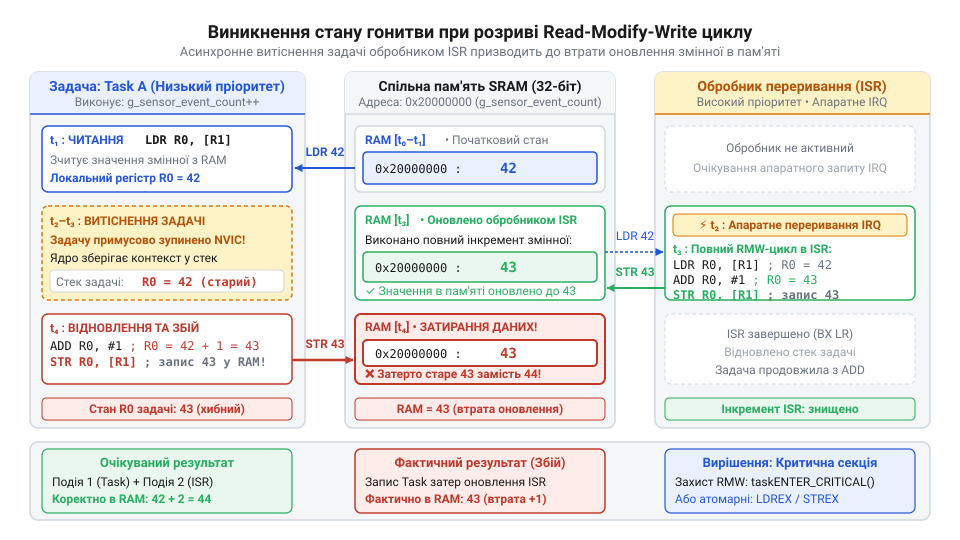
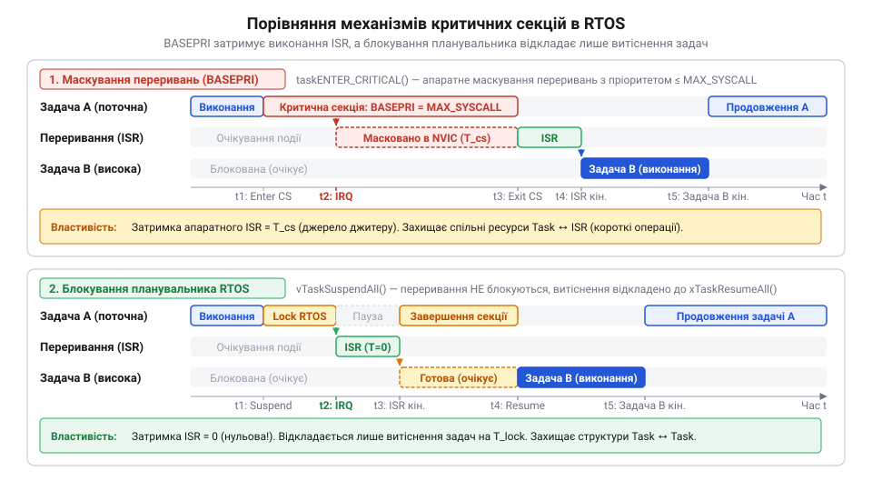

# Критичні секції в RTOS

<preknowlist>
- [Кооперативна та витісняльна багатозадачність у вбудованих системах](root:sf-devices/cooperative-vs-preemptive-multitasking) — концепція витіснення потоків за апаратним таймером та небезпека переривання коду задачі
- [Структура та організація контрольного блоку задачі (TCB)](root:sf-devices/task-control-block-structure) — збереження регістрового контексту задачі та лічильників вкладеності
</preknowlist>

## Стан гонитви та атомарність операцій

У багатозадачних прошивках під керуванням операційних систем реального часу задачі та обробники переривань постійно обмінюються даними через спільні змінні у пам'яті. З погляду мови програмування C рядок `counter++` видається неподільною дією. Проте сучасні процесори з архітектурою завантаження-збереження @@en|Load-Store@@ (від англ. *load* — завантажити та *store* — зберегти; архітектура, де операції виконуються виключно в регістрах) не здатні модифікувати комірку пам'яті безпосередньо. Для цього ядро процесора виконує апаратний цикл читання-модифікації-запису, який складається з трьох машинних інструкцій:

```c
LDR  R0, [R1]      // 1. Завантажити поточне значення змінної з RAM у регістр процесора
ADD  R0, R0, #1    // 2. Інкрементувати число всередині апаратного суматора ядра
STR  R0, [R1]      // 3. Зберегти оновлений результат назад у фізичну пам'ять RAM
```

Якщо в проміжку між першою та третьою інструкціями спрацьовує апаратне переривання або [кооперативна та витісняльна багатозадачність](root:sf-devices/cooperative-vs-preemptive-multitasking) перемикає виконання на іншу задачу, виникає стан гонитви @@en|race condition@@ (від англ. *race* — перегони та *condition* — умова; колізія паралельного доступу, коли результат залежить від порядку виконання). Новий потік також зчитує початкове значення змінної, збільшує його та записує назад. Коли керування повертається до першої задачі, вона завершує свою інструкцію `STR` і перезаписує комірку застарілими даними з власного регістра, безповоротно втрачаючи один інкремент.

Ще небезпечнішим є розрив зчитування багатобайтних величин на 32-бітному ядрі, наприклад 64-бітного системного лічильника часу або покажчика разом із розміром буфера. Процесор читає дані двома окремими машинними словами. Якщо посеред читання спрацює переривання й модифікує обидві частини, приймальна задача отримає спотворене значення — старшу частину від нового значення, а молодшу від старого. Застосування кваліфікатора `volatile` не розв'язує цю проблему: він лише забороняє компілятору оптимізувати доступ через регістри, проте жодним чином не гарантує неподільності машинних команд.


*Розрив операції інкременту лічильника перериванням: втрата оновлення через проміжний стан регістра.*

## Механізми захисту та затримка переривань

Ділянку програми, яка працює зі спільним ресурсом і вимагає неподільного виконання, називають критичною секцією @@en|critical section@@ (від лат. *criticus* — вирішальний та *sectio* — розріз; неподільний блок коду). Для захисту критичних секцій у прошивках застосовують три базові механізми захисту:

1. **Апаратне маскування переривань**: виклик спеціальних інструкцій ядра (наприклад, `CPSID i` або запис у регістр `BASEPRI` в архітектурі ARM Cortex-M) блокує прийняття запитів переривань. Це унеможливлює як зміну контексту планувальником, так і втручання будь-яких обробників переривань. 2. **Блокування планувальника**: системні виклики на кшталт `vTaskSuspendAll()` забороняють перемикати контекст між задачами, проте залишають апаратні переривання активними. Цей метод підходить для спільних ресурсів, до яких не звертаються обробники апаратних ліній. 3. **Атомарні інструкції ядра**: використання спеціальних процесорних пар `LDREX`/`STREX` дозволяє здійснювати безблокувальні оновлення окремих змінних без вимкнення переривань, на чому базуються [lock-free буфери SPSC](root:sf-devices/lock-free-ring-buffer-spsc).

Головним інженерним обмеженням під час маскування переривань є затримка реакції системи на зовнішні події @@en|interrupt latency@@ (від англ. *interrupt* — переривання та лат. *latens* — прихований; час від появи сигналу до виконання першої інструкції обробника). Поки ядро виконує критичну секцію, критичні апаратні сигнали (наприклад, аварійна зупинка приводу чи прийом чергового байта шини) очікують у черзі. Якщо критична секція затягується, буфери периферії переповнюються, а детермінізм системи реального часу руйнується.

Тому фундаментальне правило вбудованих систем вимагає зводити тривалість критичної секції до мінімуму — лише кілька машинних тактів для копіювання чи модифікації покажчиків. Усередині критичних секцій категорично заборонено виконувати тривалі математичні обчислення, цикли очікування прапорців та виклики блокуючих функцій. Для ресурсомісткої роботи застосовують [відкладену обробку переривань](root:sf-devices/interrupt-bottom-half-mechanisms) або [окремі потоки-виконавці](root:sf-devices/dedicated-worker-threads-rtos), зберігаючи відгук системи детермінованим.


*Вплив маскування переривань та блокування планувальника на часовий детермінізм системи реального часу.*