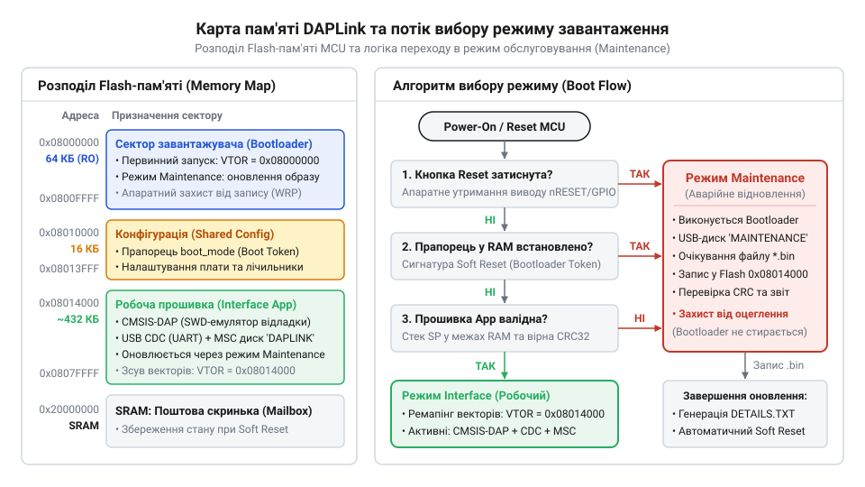
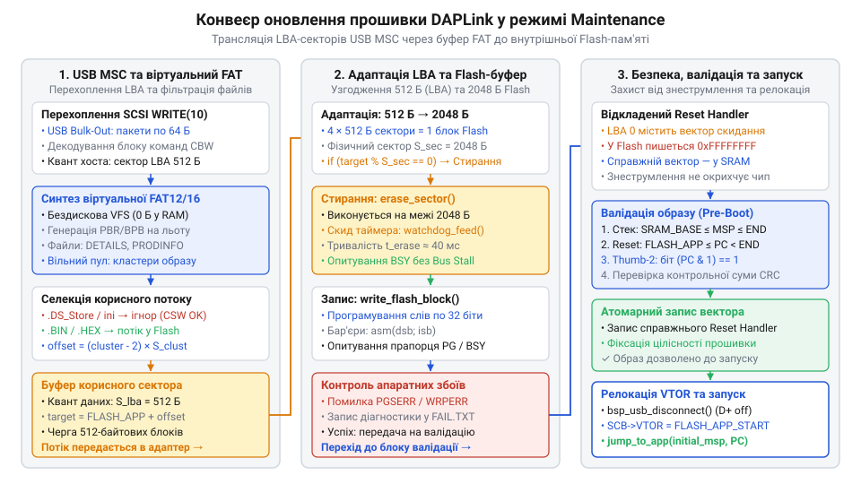
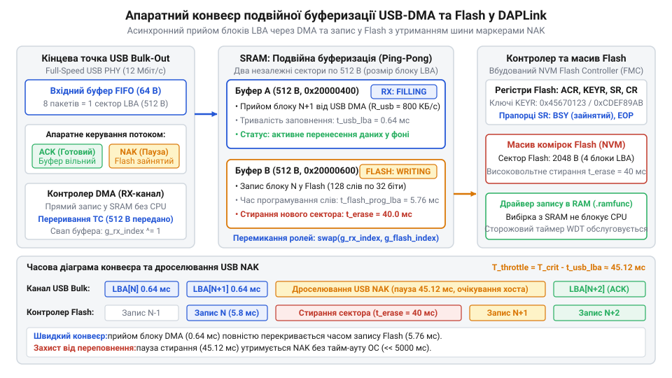
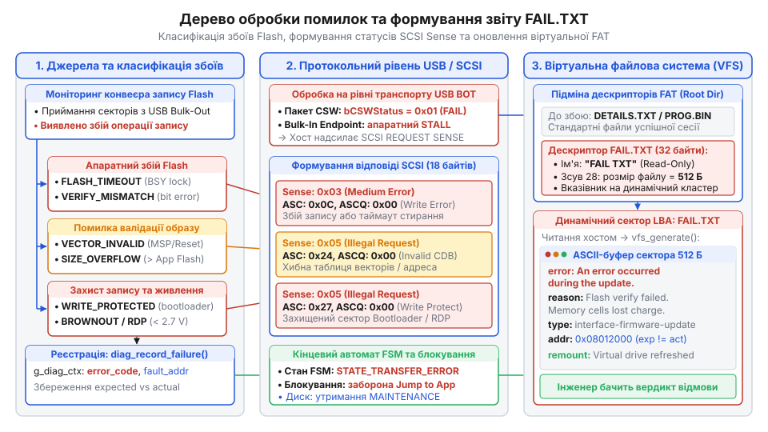

# Режим Maintenance та оновлення завантажника DAPLink

## Початкові концепції та фізичні принципи

Під час розробки вбудованих систем інженери повсякденно застосовують налагоджувальні плати, на яких поруч із цільовим процесором розташовано допоміжний мікроконтролер апаратного інтерфейсу. Цей чип підключається до комп'ютера через шину USB та транслює команди високого рівня у низькорівневі сигнали інтерфейсів SWD або JTAG, передає дані віртуального послідовного порту UART і надає накопичувач для програмування цільового кристала. Проте програмне забезпечення самого інтерфейсного мікроконтролера не є статичним: розширення переліку підтримуваних мікросхем, виправлення помилок у реалізації протоколів, оптимізація швидкості передачі або усунення вразливостей вимагають оновлення його власного коду безпосередньо у польових умовах. Якщо процес запису нової прошивки в пам'ять інтерфейсного чипа буде раптово перервано через випадкове від'єднання USB-кабелю, просідання напруги живлення або передачу пошкодженого бінарного файлу, пристрій втрачає працездатність. Монолітна архітектура, де єдина програма стирає власні сектори під час виконання, за будь-якого збою перетворює плату на непридатний для використання електронний брухт, оскільки пошкоджений процесор не здатний повторно запустити драйвер шини USB.

Для запобігання фатальним збоям архітектура DAPLink розділяє простір пам'яті інтерфейсного процесора на дві ізольовані сутності: незмінний @@en|завантажувач@@ (від англ. *bootloader*, скорочення від *bootstrap loader*, з давньофр. *bote* — чобіт, та давньоангл. *hladan* — вантажити) та змінну @@en|прошивка інтерфейсу@@ (від англ. *interface firmware*, з лат. *inter* — між, *facies* — обличчя, вигляд, та *firmus* — міцний, стійкий). Коли виникає потреба оновити базовий код або відновити працездатність після пошкодження робочого образу, @@en|завантажувач@@ перемикає чип у спеціальний захищений стан — @@en|режим обслуговування@@ (від англ. *maintenance mode*, з лат. *manu tenere* — тримати в руці, та *modus* — міра, спосіб). У цьому стані інтерфейсний мікроконтролер повністю відключає вторинну функціональність налагоджувача й емулює для операційної системи хоста спрощене, надійне @@en|масове сховище USB@@ (від англ. *USB Mass Storage*, з лат. *massa* — брила, злиток, та *instaurare* — відновлювати, запасати), що надає безпечне віртуальне середовище для запису нового програмного коду у внутрішню пам'ять мікроконтролера.

Фізична реалізація вузла вибору режиму завантаження базується на схемотехніці виводу апаратного скидання та виявленні перехідних процесів під час подачі живлення. На друкованій платі лінія скидання з'єднує вивід nRESET мікроконтролера з тактовою кнопкою, підключеною до шини загального проводу GND. За відсутності натискання потенціал на лінії утримується на рівні напруги живлення цифрових кіл завдяки тому, що до лінії підключено дискретний або вбудований у кристал @@en|підтягувальний резистор@@ (від англ. *pull-up resistor*, з давньоангл. *pullian* — тягти, та лат. *resistere* — чинити опір) номіналом від 10 до 47 кОм. Під час підключення кабелю до гнізда USB напруга шини VBUS (5 В) надходить на вхід стабілізатора, формуючи системну напругу живлення 3.3 В. Внутрішня апаратна схема контролю живлення ядра Power-On Reset (POR) утримує цифрове ядро мікроконтролера у стані апаратного скидання до моменту, доки напруга на шині живлення не перетне мінімальний поріг гарантованої працездатності кремнієвої структури.

Щойно внутрішня лінія скидання деактивується, процесорне ядро здійснює перший апаратний вибірковий цикл за фіксованою нульовою адресою Flash-пам'яті, звідки зчитує початкове значення головного вказівника стека MSP та адресу точки входу завантажувача. Першою дією @@en|завантажувач@@ опитує логічний рівень на лінії виводу скидання та кнопки. Якщо користувач утримує кнопку натиснутою під час фізичного з'єднання роз'єму USB, на виводі фіксується стійкий низький логічний рівень напруги. Для виключення помилкових спрацьовувань через механічний брязкіт контактів кнопки та високочастотні наводки від заряджання конденсаторів схеми живлення алгоритм завантажувача виконує багаторазове цифрове фільтрування сигналу протягом часового вікна тривалістю 10–20 мс. Щоб вхідний сигнал не спричинив явище, відоме як @@en|метастабільність@@ (від грец. *meta* — після, за, та лат. *stabilis* — стійкий), вхідний рівень фіксується через послідовний ланцюжок із двох D-тригерів синхронізації з тактовим генератором ядра мікроконтролера.

Окрім прямого апаратного замикання кнопки на землю, перехід у @@en|режим обслуговування@@ реалізується за допомогою програмних сигнатур або внаслідок виявлення порушення цілісності коду. Якщо робоча @@en|прошивка інтерфейсу@@ отримує спеціальну команду через інтерфейс USB або виявляє необхідність власного сервісного обслуговування, вона записує унікальний 32-бітний магічний маркер (наприклад, константу `0x544E4941`, що відповідає символам ASCII "AINT") у спеціальну комірку оперативної пам'яті, яка не скидається під час перезавантаження ядра, або у виділений регістр блоку резервного живлення RTC. Після запису маркера викликається програмне @@en|скидання мікроконтролера@@ (від англ. *microcontroller reset*, з лат. *re-* — назад, знову, та давньоангл. *settan* — встановлювати). Під час наступного старту @@en|завантажувач@@ перевіряє вміст цієї комірки: виявивши магічну сигнатуру, він негайно затирає її нульовим значенням для уникнення зациклення та активує @@en|режим обслуговування@@.

Третім критерієм активації режиму обслуговування є стан внутрішньої валідації робочого застосунку. Якщо кнопка скидання відпущена і магічний маркер у пам'яті відсутній, @@en|завантажувач@@ перевіряє початкові вектори застосунку та розраховує, чи збігається @@en|контрольна сума@@ (від англ. *checksum*, з перс. *šāh* — цар, та лат. *summa* — підсумок) цільового образу із записаним еталонним значенням. Якщо базова адреса стека вказує за межі допустимого діапазону оперативної пам'яті SRAM, точка входу вказує на стертий сектор Flash-пам'яті (значення `0xFFFFFFFF`), або @@en|контрольна сума@@ пошкоджена внаслідок незавершеного оновлення, @@en|завантажувач@@ відмовляється передавати керування аварійному коду й примусово переходить у @@en|режим обслуговування@@.

Організація енергонезалежної Flash-пам'яті мікроконтролера передбачає суворе фізичне зонування. У мікроконтролерах архітектури ARM Cortex-M перші сектори пам'яті, починаючи з базової адреси `0x00000000`, резервуються під код завантажувача (зазвичай від 16 до 32 КБ). Цей сектор блокується від операцій стирання за допомогою апаратних бітів захисту Flash-контролера (Option Bytes або Flash Protection Registers). Робоча @@en|прошивка інтерфейсу@@ розташовується зі зміщенням у старших секторах (наприклад, починаючи з адреси `0x00008000`). Оскільки апаратний вектор скидання процесора жорстко прив'язаний до нульової адреси, керування після перезапуску завжди дістає @@en|завантажувач@@. Коли ж @@en|завантажувач@@ ухвалює рішення про запуск перевіреної прошивки інтерфейсу, у системному блоці керування ядром System Control Block переконфігурується @@en|таблиця векторів переривань@@ (від англ. *interrupt vector table*, з лат. *interruptus* — перерваний, та *vector* — носій) шляхом запису базової адреси застосунку в системний регістр `SCB->VTOR`.

*Карта пам'яті інтерфейсного мікроконтролера з розподілом секторів Flash та логіка вибору між робочим режимом і режимом обслуговування.*

На відміну від мережевих пристроїв, де застосовують [класичне бездротове оновлення](root:sf-devices/ota-update) із залученням віддалених серверів, або систем, де реалізовано [розподіл образів на слоти](root:sf-devices/ota-slots) у великому масиві зовнішньої пам'яті, інтерфейсний чип DAPLink володіє вкрай обмеженим обсягом внутрішньої Flash-пам'яті. Це унеможливлює одночасне зберігання двох повних робочих прошивок. Захистом від повної відмови тут виступає сам @@en|завантажувач@@: якщо оновлення переривається, спрацьовує [механізм автоматичного відкату](root:sf-devices/ota-rollback) не до попередньої прошивки, а до постійного сервісного стану.

Після активації режиму обслуговування @@en|завантажувач@@ здійснює електричну ініціалізацію блоку USB, підключаючи внутрішній резистор підтяжки номіналом 1.5 кОм до сигнальної лінії D+. Це сигналізує хосту про підключення пристрою стандарту USB Full-Speed зі швидкістю передачі 12 Мбіт/с. На відміну від нормального режиму, де мікроконтролер конфігурується як складений пристрій (Composite Device) з одночасним виділенням кінцевих точок для передавання команд налагодження, віртуального COM-порту та емулятора диска, у режимі обслуговування @@en|завантажувач@@ реєструє виключно одну функцію — @@en|масове сховище USB@@ із назвою розділу `MAINTENANCE`. Це мінімізує обсяг використовуваної оперативної пам'яті та усуває ймовірність конфліктів черг переривань.

Для оцінки фізичних часових параметрів процедури оновлення прошивки розроблено математичну модель, яка декомпонує загальний час операції на послідовні апаратні фази. Повний час запису складається з тривалості приймання блоків даних шиною USB, тривалості стирання потрібної кількості секторів Flash-пам'яті, часу апаратного програмування слів у комірки пам'яті та тривалості фінальної верифікації контрольної суми.

У математичній моделі використовуються такі фізичні параметри: символ `S_app` позначає загальний обсяг оновлюваного образу у байтах; `S_sec` — фізичний розмір одного сектора стирання Flash-пам'яті мікроконтролера у байтах; `N_sec = ⌈S_app ÷ S_sec⌉` — кількість секторів пам'яті, що підлягають попередньому стиранню; `t_erase` — максимальний час стирання одного сектора; `t_prog_word` — час апаратного запису одного 32-бітного слова (4 байти); `R_usb` — ефективна швидкість передавання корисного навантаження шиною USB у режимі Bulk-Only Transport у байтах за секунду; `R_crc` — швидкість обчислення контрольної суми алгоритмом CRC32 за повної частоти ядра процесора у байтах за секунду. Підсумковий час `T_total` визначається виразом:

    T_total
    = T_usb + T_flash_erase + T_flash_prog + T_verify      [декомпозиція фаз оновлення]
    = (S_app ÷ R_usb) + (N_sec × t_erase) + ((S_app ÷ 4) × t_prog_word) + (S_app ÷ R_crc) [підстановка часових складових]

У наведеному виразі перший доданок визначає затримку фізичного транспортування бінарного образу через шину, другий — кумулятивну тривалість високовольтного стирання секторів у кристалі, третій — час тунелювання заряду під час запису слів у матрицю комірок Flash, а четвертий — час валідації записаного масиву ядром CPU.

**Розрахунок тривалості оновлення образу обсягом 64 КБ у мікроконтролері:**
Для типового інтерфейсного процесора із тактовою частотою ядра 48 МГц діють такі апаратні характеристики: обсяг образу `S_app = 65536` байтів (64 КБ); розмір сектора Flash `S_sec = 2048` байтів (2 КБ), звідки кількість секторів `N_sec = 32`; час стирання сектора `t_erase = 0.040` с (40 мс); час програмування 32-бітного слова `t_prog_word = 0.000045` с (45 мкс); швидкість USB Bulk `R_usb = 800000` байт/с (800 КБ/с); швидкість підрахунку CRC32 `R_crc = 3200000` байт/с (3.2 МБ/с при витраті 15 тактів ядра на один байт).

    T_usb = 65536 ÷ 800000 = 0.082 с
    T_flash_erase = 32 × 0.040 = 1.280 с
    T_flash_prog = (65536 ÷ 4) × 0.000045 = 16384 × 0.000045 = 0.737 с
    T_verify = 65536 ÷ 3200000 = 0.020 с
    T_total = 0.082 + 1.280 + 0.737 + 0.020 = 2.119 с ≈ 2.12 с

Отриманий результат демонструє апаратну закономірність: фаза стирання секторів Flash-пам'яті займає понад 60% загального часу процедури (`1.280` с із `2.119` с), помітно перевищуючи тривалість передавання даних шиною USB (`0.082` с). Якщо мікроконтролер під час стирання Flash заблокує ядро процесора й перестане відповідати на пакети шини USB, хост зафіксує апаратний тайм-аут передачі SCSI-команди Bulk-Out і примусово розірве з'єднання. Тому програмна структура завантажувача проектується так, щоб стирання секторів здійснювалося виключно порційно, суворо за фактом перетину фізичної межі сектора, паралельно підтримуючи активність USB-стека.

## Внутрішня будова та алгоритми роботи

Внутрішня архітектура DAPLink у режимі обслуговування побудована за модульним принципом, де кожен програмний шар ізолює специфіку апаратного інтерфейсу. До складу ядра завантажувача входять такі компоненти: низькорівневий драйвер апаратного контролера Flash-пам'яті In-System Programming (ISP); драйвер периферійного модуля USB Device із підтримкою кінцевих точок Endpoint 0 (Control) та пари Bulk-In/Bulk-Out; обробник блокових команд SCSI (Bulk-Only Transport); диспетчер емуляції файлової системи; парсер і валідатор бінарних образів; а також центральний керуючий @@en|кінцевий автомат@@ (від англ. *finite state machine*, з лат. *finitus* — визначений, обмежений, та грец. *automatos* — самодіючий).

Життєвий цикл модуля визначається станами кінцевого автомата завантажувача. Після апаратного старту система переходить у стан `BOOT_STATE_INIT`, де налаштовуються внутрішні джерела тактування ядра й вимикаються невикористовувані блоки периферії. У стані `BOOT_STATE_EVALUATE` виконується аналіз фізичного виводу скидання, перевірка сигнатури в пам'яті та валідація векторів робочої програми. Якщо виявлено запит на сервісний режим або робоча прошивка відсутня, @@en|кінцевий автомат@@ переходить у `BOOT_STATE_MAINTENANCE_IDLE`. У цьому стані запускається USB-стек, реєструється віртуальний диск та очікуються транзакції хоста.

Коли операційна система починає передавати байти файлу прошивки, @@en|кінцевий автомат@@ активує стан `BOOT_STATE_RECEIVING`, перехоплюючи пакети даних із буфера кінцевої точки USB Bulk-Out. При накопиченні повного сектора керування передається у стан `BOOT_STATE_FLASHING`, де виконується вибіркове стирання та запис блоків у пам'ять. Після завершення запису останнього байта активується стан `BOOT_STATE_VALIDATING`, у якому обчислюється @@en|контрольна сума@@ та інспектується таблиця векторів. За успішного результату @@en|кінцевий автомат@@ переходить у `BOOT_STATE_REBOOT`, ініціюючи відключення від шини USB та перезапуск кристала. Якщо ж виявлено помилку, система формує діагностичний звіт і повертається в `BOOT_STATE_MAINTENANCE_IDLE`.

Головною інженерною проблемою реалізації режиму обслуговування на мікроконтролерах із малим обсягом оперативної пам'яті (16–32 КБ) є неможливість розміщення у RAM стандартного образу диска файлової системи FAT12 або FAT16. Розв'язанням цієї проблеми є динамічна @@en|віртуальна файлова система@@ (від англ. *virtual file system*, з лат. *virtualis* — потенційний, дієвий, від *virtus* — сила, та грец. *systema* — сполучення). Завантажувач DAPLink не зберігає структури файлової системи у статичній пам'яті, а синтезує логічні блоки даних Logical Block Address (LBA) алгоритмічно прямо в момент надходження відповідного запиту читання SCSI `READ (10)`.

Коли операційна система звертається до нульового сектора LBA 0, диспетчер формує на льоту сектор завантаження Partition Boot Record (PBR). У цей сектор записується стандартний блок параметрів BIOS Parameter Block (BPB): геометрія віртуального носія, мітка тому `MAINTENANCE`, розмір кластера (зазвичай 1 сектор або 512 байтів) та кількість резервних секторів. Завдяки цьому хост сприймає плату як стандартний знімний дисковий накопичувач.

Під час зчитування секторів, що відповідають таблицям FAT, драйвер віртуальної файлової системи повертає динамічно згенерований потік значень. Оскільки в системі є лише кілька фіксованих інформаційних файлів, @@en|таблиця розміщення файлів@@ (від англ. *File Allocation Table*, FAT, з лат. *allocare* — призначати, та *tabula* — дошка, запис) синтезує ланцюжки кластерів безпосередньо з константних описів файлів:
- `DETAILS.TXT`: текстовий звіт, що містить версію завантажувача, унікальний апаратний ідентифікатор мікроконтролера UUID та конфігурацію цільової плати. - `PRODINFO.HTM`: гіпертекстовий документ із перенаправленням на портал технічної документації. - `FAIL.TXT`: сервісний файл, який з'являється у разі виникнення помилки під час запису прошивки, розкриваючи причину відмови.

Усі інші кластери в секторі FAT позначаються нульовими значеннями як вільний дисковий простір. Коли користувач здійснює @@en|перетягування файлу@@ (від англ. *drag-and-drop*) нової прошивки у вікно віртуального диска, операційна система виділяє вільні кластери й формує запити SCSI `WRITE (10)`. Диспетчер перехоплює ці пакети ще на рівні буфера USB.

*Конвеєр обробки даних у режимі Maintenance: від перехоплення пакетів SCSI до перевірки векторів та запису Flash.*

Під час приймання даних драйвер зіставляє номер кластера з лінійною адресою цільової пам'яті. Якщо хост записує системні службові файли операційної системи (наприклад, метадані `.DS_Store` або `desktop.ini`), диспетчер повертає успішний статус підтвердження CSW, проте ігнорує корисне навантаження й не витрачає ресурс Flash-пам'яті. Якщо ж розширення файлу відповідає бінарному образу (`.BIN`) або формату Intel HEX (`.HEX`), потік байтів спрямовується безпосередньо у конвеєр запису внутрішньої Flash. Завдяки цьому [емуляція віртуального FAT-диска](root:sf-devices/usb-msc-virtual-fat) функціонує без виділення проміжного дискового простору в оперативній пам'яті.

Конвеєр програмування розв'язує задачу неузгодженості квантів даних: хост передає дані секторами по 512 байтів, тоді як апаратний сектор стирання Flash-пам'яті становить 2048 байтів (або 1024 байти залежно від виробника кристала), а апаратне програмування вимагає запису 32-бітними словами. Драйвер підтримує лічильник поточної фізичної адреси запису. Щойно адреса вхідного 512-байтового блоку збігається з початком апаратного сектора Flash (`address % SECTOR_SIZE == 0`), контролер виконує команду стирання саме цього сектора. Наступні три 512-байтові блоки, що належать до вже очищеного сектора, записуються безпосередньо у матрицю комірок пам'яті без повторного стирання.

Для захисту від раптового знеструмлення застосовується техніка відкладеної активації вектора скидання. Якщо під час запису першого сектора (який містить нульовий вектор стека та вектор скидання) живлення вимкнеться, мікроконтролер може залишитися з частково записаною таблицею, що призведе до зависання під час старту. Щоб унеможливити такий стан, @@en|завантажувач@@ утримує перші байти таблиці векторів у внутрішньому буфері або записує за адресою вектора скидання значення `0xFFFFFFFF`. Справжній апаратний вектор записується у Flash-пам'ять найостаннішим, лише після того, як увесь бінарний файл буде прийнято й верифіковано.

Під час виконання тривалих операцій стирання Flash-пам'яті апаратний @@en|сторожовий таймер@@ (від англ. *watchdog timer*, з давньоангл. *wæccan* — пильнувати, та давньоангл. *tīma* — час) періодично скидається перед кожним зверненням до регістрів Flash-контролера та після виходу зі стану очікування прапорця зайнятості BUSY. Це гарантує, що @@en|сторожовий таймер@@ не перезавантажить кристал у процесі легітимного запису даних.

Фінальна верифікація образу перед передачею керування полягає у послідовній перевірці цілісності:
1. Валідація головного вказівника стека: значення першого 32-бітного слова за адресою початку застосунку має лежати у фізичних межах адрес оперативної пам'яті мікроконтролера: `SRAM_BASE <= MSP <= (SRAM_BASE + SRAM_SIZE)`. 2. Валідація точки входу: значення другого 32-бітного слова (вектор Reset Handler) має належати адресному простору розділу робочої прошивки, а його наймолодший біт (біт 0) обов'язково повинен дорівнювати одиниці, що регламентує виконання інструкцій Thumb-2 ядра ARM Cortex-M. 3. Розрахунок контрольної суми CRC32 всього записаного масиву байтів та порівняння з контрольним дескриптором образу. У системах із підвищеними вимогами до безпеки цей етап доповнює [криптографічне підписування образу](root:sf-devices/ota-image-signing).

Якщо верифікація пройшла успішно, @@en|завантажувач@@ програмно розриває з'єднання USB шляхом відключення підтягувального резистора на лінії D+ (імітуючи фізичне від'єднання кабелю від хоста), забороняє переривання інструкцією `__disable_irq()`, скидає таймер SysTick у нуль та здійснює [апаратне перемикання VTOR](root:hw-arch/vector-table) на базову адресу застосунку. Після цього ініціалізується регістр стека та виконується безумовний перехід на вектор скидання робочої програми. Запущений робочий код перебирає контроль над апаратурою та передає транзакції через [протокол налагодження CMSIS-DAP](root:sys-ide/cmsis-dap-debugger-firmware).

Нижче наведено практичні реалізації ядра керування режимом обслуговування DAPLink мовами C та C++.

:::tabs
@tab C (Bare-Metal)
:::code root\eng\sf-devices\daplink-maintenance-mode/daplink-maintenance-mode-d/c/baremetal/boot-validate-application.c c
@tab C++
:::code root\eng\sf-devices\daplink-maintenance-mode/daplink-maintenance-mode-d/cpp/bootstate.cpp cpp
:::

Представлений модульний дизайн гарантує повну відмовостійкість інтерфейсного мікроконтролера. Навіть у разі критичного збою живлення під час оновлення прошивки, система детерміновано повертається в @@en|режим обслуговування@@, дозволяючи користувачеві повторити процедуру запису без застосування зовнішнього апаратного програматора.

## Апаратна реалізація та низькорівневий C/C++ код

Під час оновлення прошивки через інтерфейс USB мікроконтролер стикається з жорстким фізичним протиріччям між вимогами комунікаційного інтерфейсу та фізикою кремнієвої пам'яті. З боку шини USB хост передає пакети корисного навантаження зі швидкістю 12 Мбіт/с і вимагає безперервного підтвердження транзакцій апаратними прапорцями ACK або NAK кожні кілька мікросекунд. З іншого боку, внутрішній @@en|контролер Flash-пам'яті@@ (від англ. *flash memory controller*, з англ. *flash* — спалах, лат. *memoria* — пам'ять, та середньовічного лат. *contrarotulus* — перевірочний список) вимагає десятків мілісекунд для виконання високовольтного зарядового стирання кремнієвих комірок. Якщо процесорне ядро під час стирання сектора перейде в циклічне очікування апаратного прапорця зайнятості, шинна матриця кристала заблокує вибірку інструкцій із того самого банку пам'яті. Це спричинить апаратне зависання конвеєра CPU, переповнення вхідного буфера USB FIFO та аварійний розрив з'єднання з боку хостової операційної системи.

Фізична взаємодія ядра з масивом комірок базується на керуванні регістрами периферійного модуля Flash: регістром контролю доступу (Flash Access Control Register, ACR), регістром авторизації ключів (Flash Key Register, KEYR), регістром поточного стану (Flash Status Register, SR) та регістром керування операціями (Flash Control Register, CR). При підвищенні системної тактової частоти ядра час зчитування інформаційних зарядів із затворів польових транзисторів Flash-пам'яті перевищує тривалість одного тактового періоду системної шини HCLK. Для запобігання зчитуванню спотворених двійкових даних модуль ACR вводить у кожен цикл звернення до пам'яті апаратний @@en|стан очікування@@ (від англ. *wait state*, з герм. *wahten* — пильнувати, чатувати, та лат. *status* — стан, положення). Кількість цих тактів жорстко прив'язується до напруги живлення кристала та частоти тактування ядра: за частоти 48 МГц вмикається один додатковий такт очікування, а за частоти 72 МГц або вище — два або три такти.

Для компенсації падіння швидкодії від циклів очікування процесори архітектури ARM Cortex-M використовують чергу попередньої вибірки інструкцій Prefetch Buffer та локальні кеші інструкцій і даних. Проте під час модифікації коду безпосередньо у внутрішній пам'яті виникає ефект розсинхронізації: комірки пам'яті вже перезаписані новими машинними інструкціями, тоді як кеш містить старі копії рядків. Щоб унеможливити виконання некоректного коду після перезапуску, @@en|завантажувач@@ виконує примусове @@en|скидання кешу@@ (від англ. *cache flush*, з фр. *cacher* — ховати, та давньоангл. *flōwan* — текти, змивати). Для цього біти активації кешу в регістрі ACR скидаються, відповідні біти скидання стирають адресні теги конвеєра, після чого кеш знову вмикається для нормальної роботи процесора.

Безпека вмісту пам'яті від випадкового пошкодження блукаючими вказівниками або просіданням живлення забезпечується дворівневим апаратним замком. Після кожного апаратного скидання регістр CR заблоковано для запису бітом захисту LOCK. Для дозволу операцій запису або стирання @@en|завантажувач@@ записує в регістр KEYR строго визначену послідовність двох магічних 32-бітних констант: спершу ключ `0x45670123`, а слідом за ним ключ `0xCDEF89AB`. Запис будь-якого стороннього значення або порушення порядку запису миттєво блокує інтерфейс до наступного апаратного перезавантаження мікроконтролера.

Під час виконання операцій регістр CR визначає режим роботи блоку Flash. Встановлення біта `PG` (Programming) активує високовольтний генератор накачування для запису слів, а встановлення біта `SER` (Sector Erase) у поєднанні з номером сектора у полі `SNB` (Sector Number) готує стирання обраної зони. Запуск фізичного процесу ініціюється бітом `STRT` (Start). Протягом усього часу стирання та запису регістр SR утримує встановленим біт зайнятості `BSY`. Якщо під час операції стається помилка послідовності або спроба запису у захищений сектор, @@en|контролер Flash-пам'яті@@ фіксує апаратні прапорці `PGSERR` та `WRPERR`, блокуючи подальші дії до їхнього програмного скидання.

Щоб процесор міг періодично скидати апаратний @@en|сторожовий таймер@@ під час тривалого стирання Flash, критичні підпрограми драйвера запису часто розміщують безпосередньо в оперативній пам'яті за допомогою атрибута лінкера `__attribute__((section(".ramfunc")))`. Коли код виконується з RAM, вибірка інструкцій ядра не блокується шинною матрицею Flash, дозволяючи CPU обслуговувати системні таймери без виникнення апаратного зависання.

Для усунення простоїв і запобігання втраті пакетів USB @@en|завантажувач@@ організовує асинхронний конвеєр обробки. У системі розгортається @@en|подвійна буферизація@@ (від англ. *double buffering*, з лат. *duplus* — подвійний, та давньофр. *buffe* — удар), яку підтримує периферійний модуль @@en|прямий доступ до пам'яті@@ (від англ. *Direct Memory Access*, DMA, з лат. *directus* — прямий, та *memoria* — пам'ять). У внутрішній оперативній пам'яті виділяються два ізольовані масиви розміром по 512 байтів (розмір стандартного сектора LBA віртуального диска). Поки перший буфер приймає черговий 512-байтовий блок даних від кінцевої точки USB Bulk-Out, другий буфер паралельно записується у Flash-пам'ять низькорівневим драйвером.

*Апаратна організація конвеєра запису Flash з подвійною буферизацією USB DMA та перекриттям часових затримок передавання й програмування.*

Коли перенесення даних у перший буфер завершується, індекси буферів міняються місцями. Якщо запис у Flash затримується через тривале стирання сектора, апаратний блок кінцевої точки USB автоматично повертає хосту маркери NAK. Згідно зі специфікацією USB, відповідь NAK не є помилкою: вона сигналізує про тимчасову зайнятість приймача, змушуючи контролер хоста повторювати запит через регулярні інтервали часу без розриву логічного з'єднання.

Для визначення граничних часових рамок роботи конвеєра розраховується часова затримка перекриття операцій при перетині фізичної межі сектора Flash-пам'яті. Символ `S_lba` позначає розмір логічного блоку даних у байтах; `R_usb` — ефективну пропускну здатність каналу USB Bulk у байтах за секунду; `t_prog_word` — час запису одного 32-бітного слова Flash-пам'яті; `t_erase` — тривалість високовольтного стирання одного апаратного сектора; `t_usb_lba` — час транспортування блоку LBA шиною; `t_flash_prog_lba` — час програмування слів одного блоку LBA; `T_crit` — сумарний час обслуговування блоку при одночасному стиранні сектора; `T_throttle` — тривалість утримання шини USB сигналом NAK. Затримка визначається виразом:

    T_throttle
    = T_crit - t_usb_lba                                       [різниця часу обробки та передавання]
    = (t_erase + t_flash_prog_lba) - (S_lba ÷ R_usb)           [декомпозиція апаратних затримок]
    = (t_erase + ((S_lba ÷ 4) × t_prog_word)) - (S_lba ÷ R_usb) [підстановка параметрів запису слів]

Отриманий вираз показує часовий інтервал, протягом якого апаратура USB мікроконтролера повинна безперервно генерувати маркери NAK для запобігання втраті даних.

**Розрахунок затримки конвеєра при переході між секторами Flash-пам'яті:**
Для інтерфейсного контролера із тактовою частотою ядра 48 МГц діють такі апаратні характеристики: обсяг блоку LBA `S_lba = 512` байтів; швидкість передачі `R_usb = 800000` байт/с; тривалість стирання сектора `t_erase = 0.040` с (40 мс); час запису одного 32-бітного слова `t_prog_word = 0.000045` с (45 мкс).

    t_usb_lba = 512 ÷ 800000 = 0.00064 с
    t_flash_prog_lba = (512 ÷ 4) × 0.000045 = 128 × 0.000045 = 0.00576 с
    T_crit = 0.040 + 0.00576 = 0.04576 с
    T_throttle = 0.04576 - 0.00064 = 0.04512 с ≈ 45.12 мс

Розрахунок підтверджує, що конвеєру потрібна пауза тривалістю близько 45.12 мс для безпечного завершення стирання і збереження перших 128 слів. Оскільки стандартний ліміт очікування хоста для дискових операцій становить не менше 5000 мс, затримка у 45.12 мс укладається в допустимі часові рамки, запобігаючи скиданню пристрою операційною системою.

На відміну від архітектур, де використовується [завантажувач у RAM](root:sf-devices/esptool-stub-flasher) для запису зовнішньої мікросхеми Flash через повільний послідовний порт, модуль, що забезпечує @@en|режим обслуговування@@ DAPLink, виконує код безпосередньо з постійної пам'яті інтерфейсного чипа. Якщо під час передавання оновлень застосовують [механізм дельта-оновлення](root:sf-devices/delta-ota) для точкової заміни окремих байтів, то вбудований [контролер Flash-пам'яті](root:hw-arch/flash-memory-controller-hardware) DAPLink оптимізовано під суцільний блоковий запис образу із гарантованим збереженням цілісності всієї структури секторів.

Нижче наведено практичні реалізації низькорівневого модуля керування пам'яттю та чергою подвійної буферизації мовами C та C++.

:::tabs
@tab C (Bare-Metal)
:::code root\eng\sf-devices\daplink-maintenance-mode/daplink-maintenance-mode-d/c/baremetal/flash-unlock.c c
@tab C++
:::code root\eng\sf-devices\daplink-maintenance-mode/daplink-maintenance-mode-d/cpp/bufferstate.cpp cpp
:::

Застосування схеми @@en|подвійна буферизація@@ та апаратного керування лініями запитів виключає ризик втрати даних. Мікроконтролер синхронізує швидкість надходження інформації з шини з фізичними можливостями напівпровідникової структури Flash-пам'яті, гарантуючи детерміноване виконання без переповнення пам'яті.

## Практичне застосування та відлагодження

При перенесенні завантажувача з лабораторного стенда у реальне експлуатаційне середовище розробник стикається з несподіваною поведінкою хостових операційних систем. Інженер здійснює @@en|перетягування файлу@@ прошивки у вікно віртуального диска, графічний інтерфейс показує стовідсоткове завершення копіювання, проте після виймання плати мікроконтролер не запускає оновлений код або взагалі не подає ознак життя. Причина криється у тому, що сучасні операційні системи Windows, macOS та Linux спроєктовані для роботи з фізичними магнітними або твердотілими накопичувачами, а не з динамічною програмною емуляцією.

Головною системною відмінністю є політика буферизації запису дискових накопичувачів. Для оптимізації продуктивності операційна система реалізує @@en|відкладений запис@@ (від англ. *write-back cache*, з давньоангл. *wrītan* — різати, писати, та фр. *cacher* — ховати): дані файлу записуються в оперативну пам'ять хоста, а скидання фізичних секторів на пристрій відкладається на кілька секунд або до моменту вибору користувачем пункту «Безпечне вилучення пристрою». Якщо користувач від'єднує USB-кабель відразу після зникнення діалогового вікна, передавання обривається на середині файлу.

Друга суттєва відмінність полягає в автоматичному створенні службових метаданих. Наприклад, операційна система macOS під час підключення будь-якого диска генерує приховані системні папки та файли (`.Trashes`, `.fseventsd`, `.Spotlight-V100`, а також файли ресурсів `._*`). Операційна система Windows створює каталоги `System Volume Information` і файли `desktop.ini`. Якщо віртуальний накопичувач прийматиме всі сектори поспіль, метадані операційної системи потраплять безпосередньо у внутрішню Flash-пам'ять мікроконтролера, знищивши корисну прошивку.

Для нейтралізації цих проблем @@en|завантажувач@@ DAPLink аналізує імена та атрибути створюваних файлів безпосередньо в кореневому каталозі віртуального диска. Диспетчер файлової системи парсить структуру 32-байтових записів дескрипторів FAT і перевіряє розширення кожного нового запису: виключно файли з розширеннями `.BIN` або `.HEX` направляються в конвеєр програмування Flash. Запити на запис службових системних файлів імітують успішне виконання: @@en|завантажувач@@ повертає хосту статус підтвердження успіху, але ігнорує корисне навантаження і не витрачає ресурс секторів. Крім того, @@en|завантажувач@@ перевіряє поле розміру файлу на зсуві 28 у дескрипторі каталогу. Якщо вказаний розмір перевищує виділений обсяг розділу застосунку, операція негайно блокується з виставленням помилки виходу за межі пам'яті. Щоб уникнути пошкоджень від операцій, де задіяно @@en|відкладений запис@@, оновлення векторів і передача керування новому коду відкладаються до повного завершення передачі всіх кластерів згідно з полем розміру файлу.

У разі виникнення критичних помилок під час запису слів Flash або при порушенні структури файлу @@en|завантажувач@@ сигналізує операційній системі через протокол передавання даних. Задіяний [транспортний протокол Bulk-Only Transport](root:com-devices/usb-bulk-only-transport) передбачає, що після фази даних пристрій передає пакет підтвердження — @@en|обгортка статусу команди@@ (від англ. *Command Status Wrapper*, CSW, з лат. *commandare* — доручати, *status* — стан, та середньоангл. *wrappen* — огортати, сповивати). Якщо запис завершився аварійно, @@en|завантажувач@@ виставляє в полі `bCSWStatus` код `0x01` (Command Failed) і переводить кінцеву точку USB Bulk-In у стан апаратного блокування STALL.

Отримавши статус помилки команди, операційна система негайно надсилає запит SCSI `REQUEST SENSE` для з'ясування причин аварії. У відповідь мікроконтролер передає стандартний 18-байтовий блок діагностичних даних, де ключову роль відіграє @@en|код додаткового відчуття@@ (від англ. *Additional Sense Code*, ASC, з лат. *addere* — додавати, та *sensus* — сприйняття, відчуття) разом із кодом уточнення кваліфікатора (ASCQ). Залежно від типу збою формуються такі кодові пари:
- `Sense Key: 0x03` (Medium Error), `ASC: 0x0C`, `ASCQ: 0x00` (Write Error) — апаратний збій матриці Flash або таймаут стирання;
- `Sense Key: 0x05` (Illegal Request), `ASC: 0x27`, `ASCQ: 0x00` (Write Protected) — спроба модифікації захищеного сектора завантажувача або спроба виходу за межі дозволеного розділу Flash;
- `Sense Key: 0x05` (Illegal Request), `ASC: 0x24`, `ASCQ: 0x00` (Invalid Field in CDB) — некоректна адресація кластера або неприпустимий розмір блоку.

Оскільки типові графічні оболонки операційних систем транслюють помилки SCSI у неінформативні системні повідомлення на кшталт «Диск захищено від запису», DAPLink синтезує текстовий звіт про відмову безпосередньо через блок @@en|віртуальна файлова система@@. Щойно @@en|кінцевий автомат@@ фіксує помилку валідації або апаратний збій, він змінює структуру віртуального кореневого каталогу: замість інформаційного файлу успішного завершення з'являється сервісний файл `FAIL.TXT`.

*Дерево обробки помилок та формування діагностичного звіту FAIL.TXT з динамічним оновленням дескрипторів, які надає @@en|віртуальна файлова система@@.*

Зміст файлу `FAIL.TXT` формується динамічно під час читання хостом відповідного кластера LBA. Звіт містить точний вердикт діагностики:
1. `The transfer timed out.` — апаратний контролер пам'яті не зняв прапорець зайнятості за виділений інтервал часу;
2. `The flash verify failed.` — зчитане значення з адреси не збіглося із записаним словом програми внаслідок зносу комірок;
3. `The vector table is invalid.` — вказівник стека або адреса точки входу вказують за межі дозволеного діапазону пам'яті;
4. `The interface firmware is not compatible with this board.` — спроба завантажити бінарний образ, скомпільований для іншої апаратної ревізії чипа;
5. `Security bits enabled.` — цільовий кристал заблоковано апаратним захистом читання Readout Protection (RDP), що блокує доступ до Flash через інтерфейс SWD.

Окремою апаратною небезпекою є падіння живильної напруги під час стирання Flash. Високовольтні схеми накачування заряду споживають значний імпульсний струм (до десятків міліампер). Якщо плата підключена через довгий кабель або неякісний перехідник USB, напруга на системній шині 3.3 В може просісти нижче порогу гарантованої працездатності логіки програмування. Для запобігання пошкодженню сусідніх комірок задіюється апаратне @@en|виявлення просідання напруги@@ (від англ. *brownout detection*, з давньоангл. *brūn* — тьмяний, темний, та лат. *detegere* — виявляти, розкривати). Налаштований апаратний [детектор просідання живлення](root:hw-arch/brownout) генерує високопріоритетне переривання у разі падіння напруги нижче 2.7 В. Обробник переривання миттєво відключає помпу заряду, блокує контролер Flash і переводить процесор у безпечний стан, унеможливлюючи появу дефектних комірок.

Не менш важливим є сценарій обробки сигналу апаратного скидання шини USB Bus Reset (перебування ліній D+ і D- у нульовому стані понад 10 мс). Якщо хост перезавантажує шину посеред запису прошивки, @@en|завантажувач@@ зобов'язаний скинути стан ендпоінтів та протокольні змінні SCSI, але зберегти @@en|режим обслуговування@@ активним. Заборонено робити автоматичний перехід на пошкоджений застосунок: мікроконтролер продовжує утримувати віртуальний диск `MAINTENANCE` і очікує повторного надсилання цілісного файлу.

Для діагностики та налагодження поведінки завантажувача неприпустимо використовувати класичні апаратні точки зупину через інтерфейс SWD. Зупинка тактування ядра заморожує відповіді апаратного контролера USB, що призводить до втрати маркерів SOF та аварійного відключення пристрою операційною системою. Інженери використовують апаратні аналізатори протоколу USB (наприклад, апаратні захвати типу Beagle або програмний пакет Wireshark із модулем USBPcap) для відстеження транзакцій на рівнях CBW/CSW, а також кільцеві буфери у пам'яті за технологією Segger RTT, які транслюють лог-повідомлення без сповільнення роботи процесора.

Нижче наведено практичні реалізації модуля формування статусів помилок SCSI та динамічної генерації звіту `FAIL.TXT` мовами C та C++.

:::tabs
@tab C (Bare-Metal)
:::code root\eng\sf-devices\daplink-maintenance-mode/daplink-maintenance-mode-d/c/baremetal/diag-record-failure.c c
@tab C++
:::code root\eng\sf-devices\daplink-maintenance-mode/daplink-maintenance-mode-d/cpp/sensekey.cpp cpp
:::

Чітка селекція типів файлів, коректна трансляція кодів протоколу SCSI та синтез наочних текстових звітів, які генерує @@en|віртуальна файлова система@@, роблять поведінку завантажувача прозорою для інженера й гарантують стійкість до будь-яких специфічних реалізацій дискового підсистеми хоста.