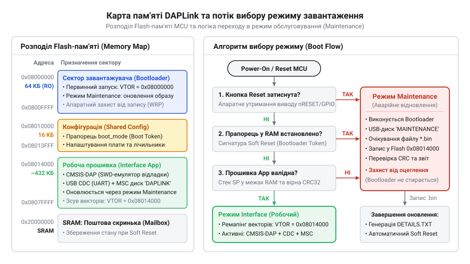
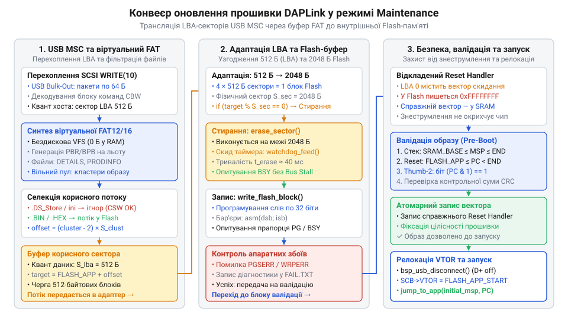

# Режим Maintenance та оновлення завантажника DAPLink

<preknowlist>
- [Відкат OTA-прошивки](root:sf-devices/ota-rollback) — механізм повернення до працездатної конфігурації у разі збою запису
- [Підписування OTA-образу](root:sf-devices/ota-image-signing) — валідація цілісності та автентичності бінарного файлу перед виконанням
</preknowlist>

## Апаратний розподіл пам'яті та захист завантажувача

У розробницьких платах і промислових програматорах апаратний мікроконтролер інтерфейсу DAPLink виконує роль моста між комп'ютером і цільовим процесором. Під час оновлення власної прошивки такого чипа будь-який обрив зв'язку або збій живлення загрожує перетворенням пристрою на непридатний стан — «цеглину». Щоб унеможливити таку аварію, фізичну енергонезалежну пам'ять Flash мікроконтролера суворо розділяють на дві ізольовані області: початковий захищений сектор завантажувача @@en|bootloader@@ (від англ. *bootstrap loader* — завантажувач початкового запуску) та область робочого застосунку.

Сектори завантажувача апаратно захищають від стирання та запису за допомогою конфігураційних бітів чипа @@en|Option Bytes@@ (від англ. *option bytes* — байти апаратних налаштувань захисту кристала). Навіть якщо робоча прошивка зависне, зазнає переповнення буфера або живлення зникне під час стирання Flash, сам завантажувач фізично неможливо пошкодити.

Під час подачі живлення завантажувач стартує першим і перевіряє тригери запуску режиму обслуговування @@en|Maintenance Mode@@ (від англ. *maintenance* — технічне обслуговування):
1. **Апаратний стан виводу скидання**: якщо користувач утримує кнопку `Reset` на платі під час підключення USB-кабелю, завантажувач фіксує низький рівень на GPIO і примусово переходить у режим відновлення. 2. **Програмна сигнатура в оперативній пам'яті**: робоча прошивка може записати магічне 32-бітне число в незанулювану область RAM перед програмним перезапуском, сигналізуючи про запит оновлення. 3. **Цілісність робочого образу**: завантажувач перевіряє початкову таблицю векторів застосунку — покажчик вершини стека мусить потрапляти в діапазон оперативної пам'яті RAM, а адреса вектора скидання має вказувати на валідну адресу Flash. Якщо образ пошкоджено, завантажувач автоматично активує режим обслуговування, подібно до правил, які використовує [відкат OTA-прошивки](root:sf-devices/ota-rollback).

*Фізичне розбиття секторів Flash на захищений завантажувач і робочу область із перевіркою тригерів запуску.*

## Емуляція віртуального диска та конвеєр оновлення

Увійшовши в режим Maintenance, мікроконтролер ініціалізує периферійний блок USB і реєструється в операційній системі комп'ютера як накопичувач класу @@en|USB MSC@@ (від англ. *Mass Storage Class* — клас пристроїв збереження даних). На відміну від звичайних флешок, DAPLink не має зовнішньої пам'яті чи великого обсягу RAM: образ диска генерується «на льоту» у відповідь на стандартні команди протоколу @@en|SCSI@@ (від англ. *Small Computer System Interface* — інтерфейс малих комп'ютерних систем).

Коли операційна система комп'ютера надсилає команду `READ(10)` для читання початкових секторів диска, завантажувач синтезує структури таблиці розділів, завантажувальний сектор файлової системи @@en|FAT16@@, таблицю кластерів та кореневий каталог безпосередньо з константних шаблонів у пам'яті Flash. У вікні провідника комп'ютера з'являється віртуальний диск із назвою `MAINTENANCE`, на якому відображається службовий текстовий файл із поточною версією завантажувача.

Процес оновлення активується, коли користувач перетягує бінарний файл нової прошивки на віртуальний диск:
1. Завантажувач перехоплює пакети `WRITE(10)` і аналізує потік секторів. 2. Алгоритм декодера автоматично відфільтровує приховані системні файли операційної системи хоста (такі як індекси пошуку `.fseventsd`, `.DS_Store` або `Thumbs.db`), ігноруючи їх запис. 3. Корисні дані бінарного файлу одразу спрямовуються в конвеєр програмування Flash: сектори робочої області розблоковуються, стираються та посторінково перезаписуються без проміжного збереження в RAM, що нагадує [програмний завантажувач esptool stub loader](root:sf-devices/esptool-stub-flasher). 4. Після завершення передачі завантажувач валідує контрольні суми, виконує [підписування OTA-образу](root:sf-devices/ota-image-signing) чи перевірку цілісності векторів переривань і перезавантажує мікроконтролер у штатному робочому режимі.

*Безбуферна трансляція секторів USB Mass Storage у команди стирання та запису внутрішньої Flash.*