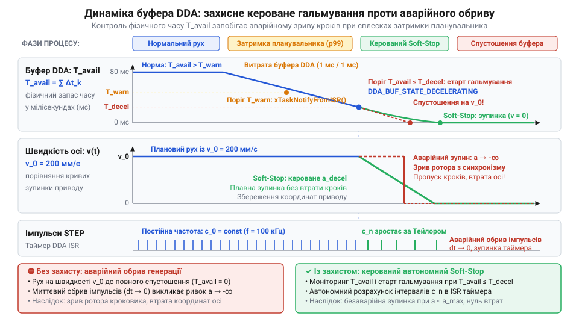
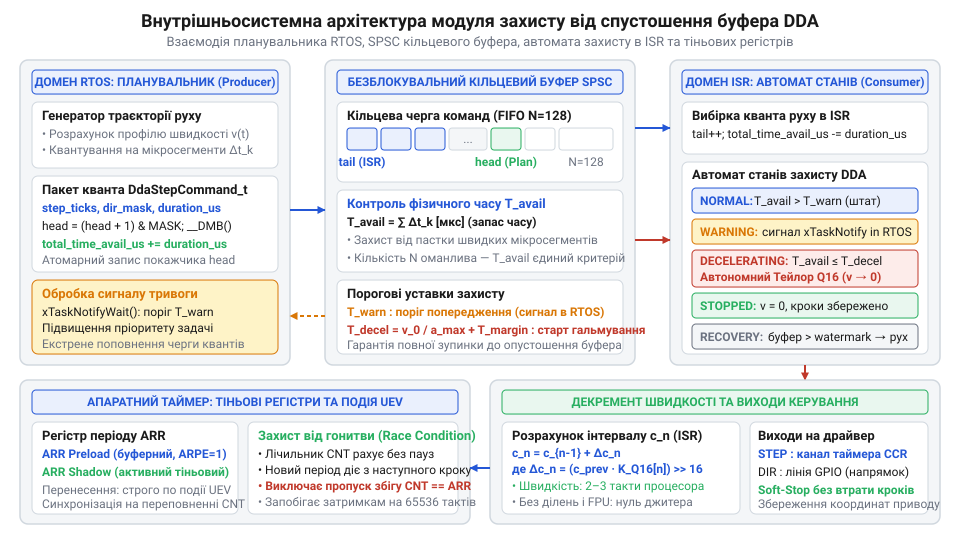
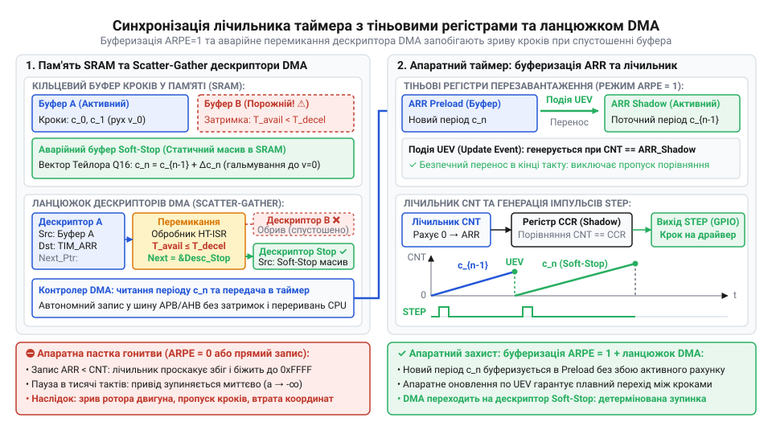
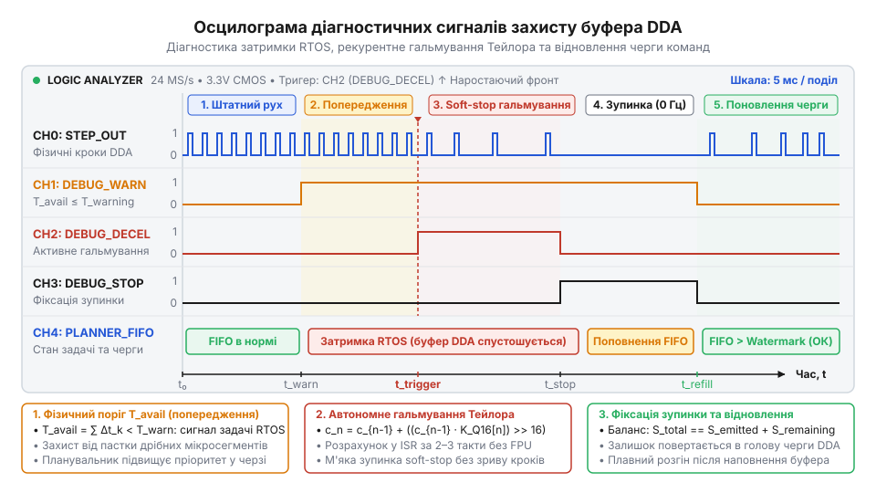

# Захист від спустошення буфера DDA

## Початкові концепції та фізичні принципи

У сучасних системах цифрового керування рухом — таких як металообробні верстати з числовим програмним керуванням (ЧПУ), 3D-принтери та роботизовані маніпулятори — функціонування прошивки підпорядковане суворим законам класичної механіки. Робочий орган пристрою володіє фізичною масою, а його приводні механізми (крокові двигуни або сервоприводи) обмежені максимальним крутним моментом та максимально допустимою швидкістю зміни прискорення — @@en|ривком@@ (від англійського *jerk* — ривок, третя похідна координати по часу).

Архітектура прошивки таких пристроїв традиційно розділена на два автономні часові домени. Перший домен — це високорівневий [планувальник траєкторій](root:sf-devices/planner-trapezoidal-s-curve-profile), який приймає з зовнішнього джерела (наприклад, з SD-карти чи мережевого інтерфейсу) команди геометричного руху, розраховує [трапецеїдальний профіль швидкості](root:sf-devices/trapezoidal-velocity-profile) та розбиває складну криву на послідовність дискретних мікросегментів переміщення. Другий домен — це низькорівневий [генератор кроків DDA у прошивці](root:sf-devices/dda-step-generation) (від англійського *Digital Differential Analyzer* — цифровий диференціальний аналізатор). Вже на рівні периферії [архітектура апаратних таймерів та лічильників](root:sf-devices/microcontroller-hardware-timers-architecture) генерує високочастотні імпульси на виходах керування @@en|STEP/DIR@@ (від англійського *Step/Direction* — інтерфейс імпульс/напрямок) з мікросекундним детермінізмом.

Зв'язковою ланкою між цими двома доменами виступає оперативний @@en|ring buffer@@ (від англійського *ring buffer* — кільцевий буфер, послідовна FIFO-структура в пам'яті мікроконтролера). Планувальник виступає в ролі виробника (Producer), який розраховує нові кванти кінематики та складає їх у буфер. Обробник переривань таймера @@en|ISR@@ (від англійського *Interrupt Service Routine* — апаратний обробник переривань) або модуль @@en|DMA@@ (від англійського *Direct Memory Access* — прямий доступ до пам'яті) виступає в ролі споживача (Consumer), вибираючи елементи з буфера та перезавантажуючи [апаратний модуль порівняння таймера](root:sf-devices/hardware-output-compare).

Проте реальне виконання програмного коду у вбудованих системах піддається часовим деформаціям. Задача планувальника виконується в контексті операційної системи реального часу @@en|RTOS@@ (від англійського *Real-Time Operating System* — операційна система реального часу) або в супер-циклі. Вона може витіснятися високопріоритетними мережевими задачами, затримуватися через довготривалі операції читання флеш-пам'яті чи піддаватися сплескам [оптимізація граничних затримок p99](root:sf-devices/esp-tail-latency-optimization). Якщо виникає ситуація, коли генератор DDA споживає кванти руху швидше, ніж планувальник встигає їх розраховувати, настає катастрофічний апаратний стан — @@en|buffer underrun@@ (від англійського *buffer underrun* або *buffer starvation* — стан спустошення буфера, коли споживач звертається до порожнього буфера під час активного виконання задачі).

Розглянемо фізику того, що відбувається при неконтрольованому опустошенні буфера. Нехай привод осі виконує рух зі швидкістю v_0 = 200 мм/с (що відповідає частоті генерації імпульсів 100 кГц). Якщо в момент чергового переривання таймера обробник виявляє порожній буфер і не має заздалегідь підготовленого алгоритму захисту, можливі два варіанти поведінки прошивки, і обидва є руйнівними:

1. Араптивна зупинка генерації імпульсів: Таймер вимикається, частота мгновенно падає до 0 Гц за один такт таймера (dt -> 0). Фізичне прискорення прямує до нескінченності:

        a = (0 - v_0) / dt -> -∞

   Оскільки механічна система володіє інерцією, ротор крокового двигуна не здатний миттєво зупинитися. Відбувається випадання з синхронізму (пропуск кроків), серйозний механічний удар, поломка ріжучого інструменту та незворотна втрата координат позиціонування верстата.

2. Повторення останньої інструкції: Обробник продовжує повторно генерувати кроки з часовим інтервалом останнього взятого елемента. Привід продовжує безконтрольний рух із постійною швидкістю v_0 всупереч траєкторії, проскочує цільову точку та врізається в механічні упори пристрою.

Щоб запобігти руйнуванню механіки, прошивка повинна чітко розрізняти двоє фундаментальних понять: аварійний зупин @@en|emergency stop@@ (від англійського *emergency stop* — негайне знеструмлення приводів з виходом системи з ладу та втратою координат) та кероване м'яке гальмування @@en|soft-stop@@ (від англійського *controlled soft-stop* — кероване зниження швидкості за розрахованим профілем до повної зупинки з повним збереженням позиціонування).

Сформулюємо математичну модель для визначення моменту, коли система повинна активувати захист від спустошення. Нехай у кільцевому буфері в даний момент перебуває N елементів. Кожен k-й елемент описує мікросегмент руху тривалістю Δt_k. Загальний часовий запас автономного руху T_avail, що міститься в буфері, обчислюється як сума тривалогостей усіх наявних елементів:

        T_avail = ∑ Δt_k      [сума інтервалів часу від k=1 до N]

Для безпечного зупину з поточної швидкості v_current до 0 із максимально допустимим сповільненням осі a_decel потрібен мінімальний часовий інтервал T_decel_min:

        T_decel_min = v_current / a_decel

Критична умова виникнення незворотного опустошення буфера без можливості зупинити механіку без пропуску кроків описується нерівністю:

        T_avail < T_decel_min + T_p99_latency

Де T_p99_latency — максимальна затримка виконання планувальника на p99-квантилі.

Головний архітектурний висновок із цієї моделі полягає у наступному: модуль захисту від опустошення буфера DDA не має права орієнтуватися лише на кількість елементів N у буфері. Кількість елементів є обманливою величиною. Буфер із N = 20 елементів під час швидкісного переміщення (де кожен елемент триває Δt = 50 мкс) вичерпається всього за 1 мілісекунду. Той самий буфер із N = 20 елементів під час повільного підходу (де Δt = 10 мс) забезпечує часовий запас у 200 мілісекунд. Отже, високоефективний захист повинен здійснювати безперервний динамічний розрахунок саме фізичного часу T_avail та порівнювати його з розрахованим гальмівним шляхом.

*Порівняльна часова діаграма динаміки заповнення буфера DDA, виникнення затримки планувальника та захисного керованого гальмування.*

## Внутрішня будова та алгоритми роботи

Для реалізації безперебійного та детермінованого захисту від спустошення буфера розробляють спеціалізований [безблокувальний кільцевий буфер SPSC](root:sf-devices/lock-free-ring-buffer-spsc) (від англійського *Single-Producer Single-Consumer lock-free ring buffer* — кільцевий буфер з одним виробником та одним споживачем без використання блокуючих примітивів).

Використання класичних м'ютексів або семафорів у даній архітектурі заборонено: спроба захоплення м'ютекса всередині обробника переривання таймера @@en|ISR@@ призведе до невизначеної поведінки ядра, а глобальне вимкнення переривань у задачі планувальника підвищує джитер виконання та руйнує детермінізм системи, що вимагає [компенсація апаратного джитера переривань](root:sf-devices/interrupt-jitter-mitigation).

У безблокувальному буфері покажчик запису `head` модифікується виключно задачею Планувальника, а покажчик зчитування `tail` модифікується виключно обробником переривання DDA. Для запобігання пошкодженню даних через оптимізації компілятора та позачергове виконання інструкцій процесорним ядром застосовують @@en|atomic@@ (від англійського *atomic operation* — атомарна операція над змінними) та явні бар'єри пам'яті @@en|memory barrier@@ (інструкції виду `__DMB()` або `std::memory_order_release` / `std::memory_order_acquire`).

Управління захистом покладається на внутрішній п'ятистадійний автомат станів (Protection State Machine), який працює безпосередньо у високочастотному перериванні DDA:

1. `DDA_BUF_STATE_NORMAL`: Фізичний часовий запас буфера перевищує попереджувальний поріг:

        T_avail > T_warning

   Генератор DDA вибирає чергові елементи з буфера та відпрацьовує плановий траєкторіальний профіль.

2. `DDA_BUF_STATE_WARNING`: Часовий запас зменшився нижче порогу попередження:

        T_avail <= T_warning

   Обробник переривання не змінює частоту імпульсів, але негайно відправляє неблокуючий апаратний або програмний сигнал задачі Планувальника (наприклад, через виклик `xTaskNotifyFromISR()` у FreeRTOS). Задача Планувальника тимчасово підвищує свій пріоритет виконання та інтенсивно заповнює буфер новими розрахованими квантами.

3. `DDA_BUF_STATE_DECELERATING`: Планувальник не встиг поповнити буфер, і часовий запас досяг критичної межі гальмування:

        T_avail <= T_decel_min + T_safety_margin

   В цей момент модуль захисту переходить у режим автономної регенерації. Обробник переривань припиняє чекати нові елементи від планувальника і перемикається на [автономне регенерирування профілю гальмування в ISR](root:sf-devices/autonomous-isr-deceleration-profile).

4. `DDA_BUF_STATE_UNDERRUN_STOPPED`: Автономне гальмування успішно завершено. Частота генерації знижена до 0 Гц, вісь повністю зупинена. Поточні координати в [кінематичні розрахунки у форматі з фіксованою крапкою](root:sf-devices/fixed-point-kinematics) збережені з абсолютною точністю без втрати кроків. Система фіксує подрібний прапорець опитування опустошення буфера.

5. `DDA_BUF_STATE_RECOVERY`: Планувальник відновив свою роботу та заповнив кільцевий буфер елементами вище порогової позначки @@en|watermark@@ (від англійського *watermark* — пороговий рівень заповнення буфера). Модуль захисту виконує плавний розгін з поточної нульової швидкості до повернення на планову траєкторію.

Ключовим механізмом стадії `DDA_BUF_STATE_DECELERATING` є математичний розрахунок нового періоду таймера c_n безпосередньо у перериванні. Оскільки обчислення квадратного кореня віднімає забагато тактів процесора @@en|CPU@@ (від англійського *Central Processing Unit* — центральний процесорний пристрій), в обробнику застосовують рекурентну формулу Тейлора для розрахунку інтервалів кроків при постійному уповільненні:

        c_n = c_{n-1} - (2 * c_{n-1}) / (4 * n + 1)      [рекурентне обчислення інтервалу кроку c_n при гальмуванні]

Де c_{n-1} — попередній інтервал таймера в тиках, а n — порядковий номер кроку гальмування.

Застосовуючи цю формулу, мікроконтролер обчислює новий інтервал перезавантаження таймера всього за 3–5 тактів процесора, що робить гальмування абсолютно детермінованим навіть на частотах генерації понад 150 кГц.

Для апаратного прискорення в багатьох архітектурах застосовують [генерацію кроків DDA за допомогою DMA та таймерів](root:sf-devices/dda-dma-generation) або [генерація імпульсів STEP/DIR засобами DMA та таймерів](root:sf-devices/dma-step-generation-hardware-acceleration). У випадку використання DMA кільцевий буфер розміщується в оперативній пам'яті, а модуль DMA зчитує періоди таймера кольорово по двох напівбуферах (Double Buffering). Переривання DMA Half-Transfer та Transfer-Complete контролюють стан заповнення. При небезпеці опустошення DMA переключається на резервний закільцьований вектор гальмування.

Діагностика та аналіз часу виконання таких алгоритмів проводиться через [трасування та візуальний аналіз задач через SEGGER SystemView](root:sf-devices/esp-systemview-tracing-analysis) та [статистики використання процесорного часу FreeRTOS](root:sf-devices/freertos-task-runtime-stats).

Нижче наведено повну практичну реалізацію модуля захисту від опустошення буфера DDA з безблокувальним кольоровим буфером SPSC, обчисленням часового запасу в мікросекундах та п'ятистадійним автоматом станів.

:::tabs
:::code root\eng\sf-devices\dda-buffer-underrun-protection/dda-buffer-underrun-protection-d/c/baremetal/dda-ring-buf-init.c c

:::code root\eng\sf-devices\dda-buffer-underrun-protection/dda-buffer-underrun-protection-d/cpp/baremetal/stepcommand.cpp cpp
:::

*Внутрішньосистемна архітектура та потік даних модуля захисту від спустошення буфера DDA.*

## Апаратна реалізація та низькорівневий C/C++ код

При формуванні імпульсів керування рухом на частотах від 100 кГц до 250 кГц часовий квант між послідовними кроками скорочується до 4–10 мікросекунд. У цьому діапазоні кожна процесорна інструкція всередині апаратного обробника переривань @@en|ISR@@ безпосередньо зменшує доступний запас часу. Якщо обробник виконує роботу понад дві-три мікросекунди, завантаження центрального процесора @@en|CPU@@ наближається до критичної межі, що загострює [оптимізація граничних затримок p99](root:sf-devices/esp-tail-latency-optimization). Коли трапляється непередбачена затримка планувальника, часу на звернення до операційної системи @@en|RTOS@@ чи очікування перемикання контексту задач немає. Захисний механізм зобов'язаний реагувати на рівні апаратних регістрів мікроконтролера строго детерміновано за одиничні такти.

У мікроконтролерах генерація імпульсів кроку спирається на лічильний регістр `CNT`, регістр автоматичного перезавантаження `ARR` (Auto-Reload Register), що визначає тривалість періоду, та регістр захоплення/порівняння `CCR` (Capture/Compare Register), який задає тривалість активного стану лінії @@en|STEP/DIR@@. Разом вони утворюють [апаратний модуль порівняння таймера](root:sf-devices/hardware-output-compare). Коли система виявляє небезпечне спустошення черги команд, прошивка повинна негайно збільшити період таймера на наступному кроці, реалізуючи автономне кероване гальмування @@en|soft-stop@@. Проте прямий запис нового значення періоду в активний регістр `ARR` під час рахунку лічильника містить небезпечну пастку: апаратний стан гонитви @@en|race condition@@ (від англійського *race condition* — стан гонитви, помилка неоднозначності результату через несинхронізований порядок звернення до спільних ресурсів).

Розглянемо фізичний механізм цієї пастки. Нехай лічильник `CNT` рахує вгору і в момент обробки переривання вже встиг досягти значення 450 тактів. Якщо алгоритм аварійного уповільнення записує в `ARR` нове цільове значення 400 тактів, апаратна схема порівняння таймера втрачає можливість зафіксувати збіг `CNT == ARR` у поточному циклі. Оскільки поточний стан лічильника вже перевищив нову межу, таймер продовжує безперервно рахувати вгору аж до досягнення максимальної апаратної місткості `0xFFFF` (для 16-бітного лічильника) або `0xFFFFFFFF` (для 32-бітного лічильника). Лише після повного переповнення та обнулення лічильник знову доходить до позначки 400. У результаті замість плавного збільшення крокового інтервалу на кілька мікросекунд виникає раптова пауза тривалістю в мільйони процесорних тактів. Привід миттєво втрачає магнітне утримання ротора, кроковий двигун зривається з синхронізму з різким механічним ударом, а система безповоротно втрачає дійсні координати.

Для виключення таких збоїв [архітектура апаратних таймерів](root:sf-devices/microcontroller-hardware-timers-architecture) використовує @@en|shadow register@@ (від англійського *shadow register* — тіньовий регістр, буферизований регістр попереднього завантаження, значення з якого переноситься в активний регістр лічильника лише в момент апаратного оновлення) у поєднанні з прапорцем попереднього завантаження `ARPE` (Auto-reload Preload Enable). Коли режим `ARPE` активовано, операція запису з боку процесора або каналу @@en|DMA@@ змінює вміст виключно буферного регістра попереднього завантаження. Робоче ядро лічильника продовжує функціонувати з незмінним значенням активного тіньового регістра. Перенесення нового значення періоду з буфера в тіньовий регістр відбувається апаратно та строго синхронно по події оновлення `UEV` (Update Event), яка генерується в мить скидання або переповнення `CNT`. Завдяки цьому нова тривалість періоду набуває чинності рівно на початку наступного кроку, повністю захищаючи лічильник від пропуску порівняння. Апаратні особливості подвійного буферизування та схеми оновлення лічильників без пропуску подій порівняння детально пояснено у матеріалі про [тіньові регістри та буферизацію перезавантаження таймерів](root:hw-arch/hardware-timer-shadow-registers).

Діапазон зміни швидкості руху в сучасних верстатах досягає кількох порядків: від робочої подачі на високій частоті до повзучої швидкості перед повною зупинкою. Щоб запобігти переповненню 16-бітного регістра періоду на великих інтервалах часу, таймер оснащують блоком @@en|prescaler@@ (від англійського *prescaler* — попередній подільник частоти, що ділить опорну частоту шини тактування таймера). Зміна коефіцієнта подільника частоти на льоту без синхронізації також призводить до збоїв лічильника, тому подільник обов'язково забезпечується власним тіньовим буфером, що оновлюється виключно по події `UEV`.

Розрахунок інтервалу гальмування всередині високочастотного переривання вимагає строгої часової оптимізації. Застосування рекурентної формули Тейлора потребує обчислення поправки для кожного послідовного кроку сповільнення:

        c_n = c_{n-1} + (2 · c_{n-1}) / (4 · n + 1)

Де `c_n` позначає період таймера для поточного кроку гальмування в тактах, `c_{n-1}` — період попереднього кроку, а `n` — порядковий номер кроку уповільнення, починаючи з одиниці. У цій формулі присутня операція цілочисельного ділення на змінний дільник `(4 · n + 1)`. На мікроконтролерах без вбудованого апаратного дільника (зокрема ядрах ARM Cortex-M0/M3 або недорогих процесорах з архітектурою RISC-V) цілочисельне ділення реалізується через програмні підпрограми бібліотеки компілятора. Програмний цикл ділення виконується за 20–80 процесорних тактів, причому тривалість обчислення залежить від бітових комбінацій операндів. Така варіативність порушує часовий детермінізм генератора кроків і викликає фазовий джитер імпульсів, для боротьби з яким застосовується [компенсація апаратного джитера](root:sf-devices/interrupt-jitter-mitigation).

Використання обчислень із рухомою крапкою всередині @@en|ISR@@ також є неприпустимим. Навіть за наявності апаратного математичного співпроцесора FPU виклик інструкцій із рухомою крапкою в обробнику переривань активує механізм збереження розширеного контексту регістрів FPU (Lazy Stacking). Це спричиняє додатковий простій конвеєра @@en|pipeline stall@@ (від англійського *pipeline stall* — затримка або зупинка процесорного конвеєра інструкцій при очікуванні готовності ресурсів) та збільшує вхідну латентність переривання на 15–30 тактів.

Для усунення ділення та операцій із рухомою крапкою рекурентний дріб переводять у цілочисельний формат із фіксованою крапкою Q16, який описують [кінематичні розрахунки у форматі](root:sf-devices/fixed-point-kinematics). Дробовий множник Тейлора `2 / (4 · n + 1)` масштабують константою `2¹⁶ = 65536`. Оскільки повне гальмування до безпечної зупинки зазвичай завершується за 32–64 кроки, значення коефіцієнтів розраховують попередньо на етапі компіляції та розміщують у статичній таблиці констант `K_Q16[n] = round((2 / (4 · n + 1)) · 65536)`, що займає лише 64 байти постійної пам'яті.

Послідовність перетворення формули поправки періоду кроку набуває вигляду:

        Δc_n
        = (c_{n-1} · 2) / (4 · n + 1)                 [рекурентна формула приросту періоду за Тейлором]
        = (c_{n-1} · K_Q16[n]) / 65536               [масштабування коефіцієнта у форматі Q16]
        = (c_{n-1} · K_Q16[n]) >> 16                 [заміна ділення апаратним побітовим зсувом]

Повний період наступного кроку таймера обчислюється додаванням отриманої поправки до попереднього значення:

        c_n
        = c_{n-1} + Δc_n                             [додавання приросту для подовження періоду гальмування]
        = c_{n-1} + ((c_{n-1} · K_Q16[n]) >> 16)     [підстановка розрахованого зміщення]

Завдяки цьому перетворенню операція зводиться до одного 32-бітного апаратного множення та одного побітового зсуву вправо на 16 розрядів. На процесорних ядрах ARM Cortex-M або Xtensa обидві інструкції сумарно виконуються всього за 2–3 машинні такти з абсолютно фіксованим часом виконання.

Розглянемо числовий приклад розрахунку першого кроку сповільнення при виникненні загрози спустошення черги. Нехай початковий період становить `c_0 = 1000` тактів (що відповідає частоті 20 кГц при тактовій частоті таймера 20 МГц). Для першого кроку гальмування `n = 1` табличне значення коефіцієнта дорівнює:

        K_Q16[1] = round(0.4 · 65536) = 26214

Покрокове обчислення періоду першого гальмівного кроку дає результат:

        c_1
        = c_0 + ((c_0 · K_Q16[1]) >> 16)             [підстановка початкового значення c_0 = 1000]
        = 1000 + ((1000 · 26214) >> 16)              [множення таймерних тактів на табличний коефіцієнт]
        = 1000 + (26214000 >> 16)                    [обчислення 32-бітного цілочисельного добутку]
        = 1000 + 400                                 [апаратний зсув праворуч на 16 розрядів]
        = 1400                                       [результуючий період таймера для першого кроку]

Тривалість крокового інтервалу плавно збільшилася з 1000 до 1400 тактів, що відповідає зниженню частоти з 20 кГц до 14.28 кГц без жодних часових збурень і без виклику важких математичних бібліотек.

У системах підвищеної продуктивності генерація імпульсів переноситься на апаратний рівень, де застосовується [генерація кроків через DMA](root:sf-devices/dda-dma-generation) та [генерація імпульсів STEP/DIR](root:sf-devices/dma-step-generation-hardware-acceleration). Контролер @@en|DMA@@ послідовно читає підготовлені значення періодів з оперативної пам'яті та передає їх безпосередньо в регістр `ARR` таймера. Проте при затримці планувальника модуль DMA ризикує вичерпати доступні блоки даних у кільцевому буфері @@en|ring buffer@@.

Для надійного захисту в такій схемі реалізують режим @@en|scatter-gather@@ (від англійського *scatter-gather* — режим збирання-розподілу, в якому контролер DMA послідовно обробляє ланцюжок зв'язаних дескрипторів). У пам'яті налаштовується подвійна буферизація з чергуванням дескрипторів і заздалегідь підготовленим аварійним масивом кроків плавного уповільнення. Коли в перериванні завершення половини передачі (Half-Transfer Interrupt) прошивка фіксує небезпечне падіння рівня заповнення черги, обробник атомарно перезаписує покажчик переходу на наступний блок пам'яті в активному дескрипторі DMA, спрямовуючи потік даних на аварійний вектор гальмування. Модуль DMA автономно переходить до подовження імпульсних інтервалів без найменшої паузи в генерації.

*Схема синхронізації лічильника таймера з тіньовими регістрами та перемикання ланцюжка DMA при загрозі спустошення буфера.*

Нижче наведено практичну низькорівневу реалізацію захисного таймерного модуля мовами C та C++, яка демонструє роботу з регістрами таймера, швидкий розрахунок інтервалів гальмування за таблицею коефіцієнтів Q16 та атомарний вибір команд із безблокувального буфера.

:::tabs
:::code root\eng\sf-devices\dda-buffer-underrun-protection/dda-buffer-underrun-protection-d/c/baremetal/dda-hardware-init.c c
:::code root\eng\sf-devices\dda-buffer-underrun-protection/dda-buffer-underrun-protection-d/cpp/baremetal/steppacket.cpp cpp
:::

## Практичне застосування та відлагодження

У лабораторних випробуваннях на довгих безперервних переміщеннях кільцевий буфер @@en|ring buffer@@ генератора стабільно заповнений, і загроза збою здається малоймовірною. Проте промислова експлуатація верстатів ЧПУ та 3D-принтерів висуває жорсткі вимоги: виготовлення складних прес-форм, матриць та дрібних рельєфів породжує нестандартні граничні режими. Тисячі мікросегментів на міліметр траєкторії, раптові реверси осей та заплановані технологічні витримки здатні спровокувати аварійну зупинку, якщо алгоритм захисту спирається на спрощені припущення.

Найнебезпечнішим граничним режимом виступає пастка мікросегментів. Під час чистової обробки складних поверхонь CAD/CAM системи апроксимують криволінійний контур величезною кількістю дрібних лінійних відрізків довжиною від 0.02 до 0.05 мм. На типовій робочій швидкості 150 мм/с час виконання одного мікросегмента стає вкрай малим.

Розрахуємо тривалість виконання одного мікросегмента довжиною `L_seg = 0.05` мм при швидкості `v = 150` мм/с:

        t_seg
        = L_seg / v                                  [визначення часу руху на постійній швидкості]
        = 0.05 / 150                                 [підстановка довжини 0.05 мм та швидкості 150 мм/с]
        = 0.000333 с = 333.3 мкс                    [тривалість мікросегмента у мікросекундах]

Тепер обчислимо повний автономний запас часу `T_lifespan`, який забезпечує вщерть заповнений кільцевий буфер на `N_buf = 32` елементи:

        T_lifespan
        = N_buf · t_seg                              [добуток місткості буфера на тривалість сегмента]
        = 32 · 333.3 мкс                             [підстановка місткості 32 елементи]
        = 10666.7 мкс ≈ 10.67 мс                     [повний часовий запас автономного руху]

Отриманий результат розкриває головну вразливість: повністю заповнений буфер із 32 блоків буде вичерпано всього за 10.67 мілісекунди! Якщо в цей час задача планувальника у системі @@en|RTOS@@ заблокується на 15 мілісекунд через запис координат у флеш-пам'ять або перевірку мережевого сокета, буфер неминуче спорожніє. Якщо система захисту контролює лише кількість елементів, вона не встигне попередити планувальник. Надійний захист вимагає контролю саме фізичного часу `T_avail` та підтримки попереднього об'єднання мікросегментів у [планувальник траєкторій](root:sf-devices/planner-trapezoidal-s-curve-profile) через механізм @@en|lookahead@@ (від англійського *lookahead* — випереджальний аналіз геометрії траєкторії для узгодження швидкостей на стиках блоків), що будує неперервний [трапецеїдальний профіль швидкості](root:sf-devices/trapezoidal-velocity-profile).

Іншою розповсюдженою проблемою є хибні спрацьовування захисту під час запланованих технологічних зупинок. Керуючі програми містять інструкції очікування, такі як `G4 P500` (технологічна пауза @@en|dwell@@ (від англійського *dwell* — технологічна витримка або пауза руху без переміщення осей для заспокоєння вібрацій інструменту)) або команду завершення програми `M30`. Перед такою паузою планувальник розраховує плавне зниження швидкості до нуля (`v_exit = 0`).

Коли генератор @@en|DDA@@ відпрацьовує останній крок цього сегмента, черга природно виявляється порожньою. Якщо автомат захисту наївно перевіряє лише відсутність нових елементів, він сприймає нормальний стан очікування як аварійний збій @@en|buffer underrun@@, фіксує помилку та ініціює процедуру аварійного відновлення. Щоб запобігти цьому, кожен пакет руху позначають прапорцем термінального блоку `is_terminal`. Якщо буфер стає порожнім після завершення блока з нульовою кінцевою швидкістю та піднятим прапорцем `is_terminal`, автомат переходить у штатний стан спокою `DDA_PROT_IDLE`. Лише за умови спустошення буфера при ненульовій швидкості або за відсутності термінального прапорця система переходить у стан аварійного уповільнення.

Особливої уваги вимагають точки реверсу осей. Механічні передачі володіють зазором спряження деталей — @@en|backlash@@ (від англійського *backlash* — люфт у механічній передачі, зазор між зубцями шестерень або витками ходового гвинта при зміні напрямку обертання). Якщо спустошення буфера виникає безпосередньо перед зміною знаку швидкості, логіка переривання зобов'язана утримувати незмінним рівень сигналу напрямку `DIR` аж до повної зупинки ротора. Зміна напрямку до моменту згасання кутової швидкості призводить до удару в зону люфту та зриву кроків.

Коли автономне гальмування завершується, робочий орган зупиняється всередині перерваного відрізка. Для безпомилкового поновлення роботи прошивка веде облік координат у цілочисельному форматі, що забезпечують [кінематичні розрахунки у форматі](root:sf-devices/fixed-point-kinematics). Обробник переривання фіксує кількість фактично виданих імпульсів `S_emitted`. Планувальник обчислює невиконаний залишок за балансовим співвідношенням:

        S_total = S_emitted + S_remaining

Де `S_total` позначає загальну кількість кроків у перерваному сегменті, `S_emitted` — фізично згенеровані імпульси, а `S_remaining` — невиконаний залишок. Збережений залишок повертається в голову черги планувальника, який розраховує новий розгін з поточної нульової швидкості строго вздовж вихідної геометричної траєкторії.

Діагностика процесів у реальному часі на мікросекундних масштабах не може спиратися на текстове виведення `printf`, оскільки блокуюче пересилання байтів руйнує детермінізм системи. Для надійного контролю на платі мікроконтролера виділяють чотири тестові виводи GPIO, підключені до @@en|logic analyzer@@ (від англійського *logic analyzer* — логічний аналізатор цифрових сигналів, прилад для синхронного захоплення та аналізу часових діаграм цифрових шин):
1. Лінія `STEP_OUT`: фізичні імпульси генератора кроків. 2. Лінія `DEBUG_WARN`: високий логічний рівень при переході в стан попередження `DDA_PROT_WARNING`. 3. Лінія `DEBUG_DECEL`: активний рівень під час виконання рекурентного гальмування `DDA_PROT_DECELERATING`. 4. Лінія `DEBUG_STOP`: імпульсний строб при досягненні повної зупинки.

Налаштувавши запуск логічного аналізатора по наростаючому фронту лінії `DEBUG_DECEL`, інженер отримує точну часову розгортку збою: момент спустошення черги, плавне подовження імпульсних інтервалів та підтвердження безпечної зупинки приводу без пропуску кроків. Додатково застосовують [трасування та візуальний аналіз](root:sf-devices/esp-systemview-tracing-analysis) та [профілювання системними таймерами](root:sf-devices/esp-timer-profiling) для співвіднесення дій апаратних переривань із перемиканням задач.

*Часова діаграма логічних ліній діагностики, що ілюструє перехід у стан уповільнення, фіксацію зупинки та відновлення черги команд.*

Для комплексного аудиту стійкості прошивки досліджують [статистика використання процесорного часу](root:sf-devices/freertos-task-runtime-stats), налаштовуючи таймери через [періодичні події](root:sf-devices/periodic-scheduling) та [неблокуючий час](root:sf-devices/nonblocking-time). Збір гістограм розподілу часу виконання задачі планувальника дає змогу виміряти граничні квантилі затримок p95, p99 та p99.9. Встановлення порогів спрацьовування захисту вище максимальної затримки p99.9 гарантує повну відсутність помилкових спрацьовувань під час штатних пікових навантажень.

Перед випуском прошивки у виробництво надійність захисту перевіряють за допомогою методології @@en|fault injection@@ (від англійського *fault injection* — метод штучного внесення збоїв, при якому в роботу системи навмисно додаються затримки або штучні відмови для верифікації захисних механізмів). Спеціалізований тестовий модуль штучно призупиняє роботу планувальника на випадкові інтервали від 5 до 50 мілісекунд під час виконання тестових траєкторій. Практичні підходи до програмної емуляції апаратних збоїв та оцінки стійкості планувальника докладно описано у статті про [методи штучного внесення збоїв у системах керування рухом](root:sf-release/motion-control-fault-injection).

У процесі тестування перевіряється непорушність балансу збереження кроків: після кожної зупинки сума згенерованих імпульсів і повернутого залишку сегмента повинна строго дорівнювати цільовій координаті:

        S_total == S_emitted + S_remaining

Якщо після 10 000 циклів штучного блокування планувальника на різних швидкостях не зафіксовано жодного розриву балансу чи зриву кроків, захист визнається валідним і готовим до промислового застосування.