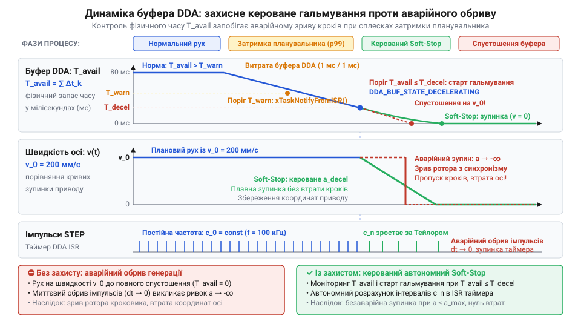
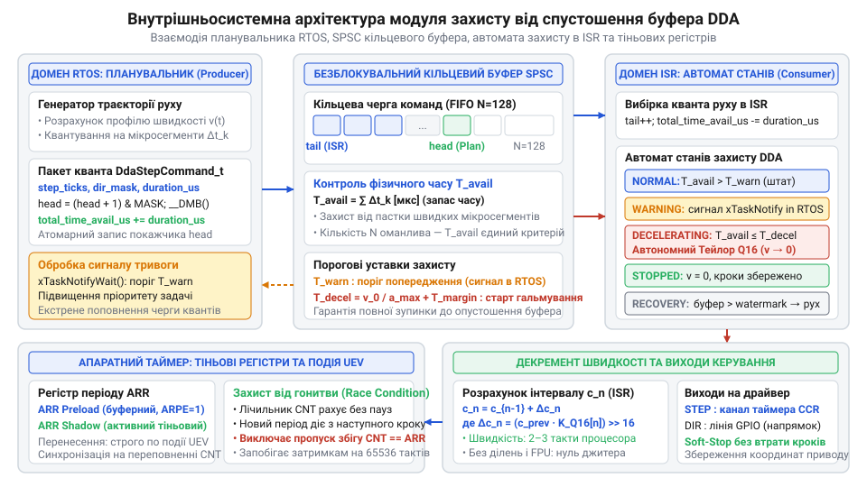

# Захист від спустошення буфера DDA

<preknowlist>
- [Генератор кроків DDA у прошивці: таймерне квантування, дробовий акумулятор і багатоосьовий розгін](root:sf-devices/dda-step-generation) — принципи генерації імпульсів кроку через переривання таймера та заповнення буфера
- [Апаратний модуль порівняння таймера](root:sf-devices/hardware-output-compare) — механізм генерації часових інтервалів через регістри CNT та ARR
</preknowlist>

## Небезпека спустошення черги команд руху

У системах числового керування контур руху розділений на два рівні: фоновий [планувальник траєкторій](root:sf-devices/planner-trapezoidal-s-curve-profile) формує профілі швидкості, а низькорівневий [генератор кроків DDA](root:sf-devices/dda-step-generation) (від англ. *digital differential analyzer* — цифровий диференційний аналізатор; @@en|DDA@@) транслює їх в імпульси таймера через кільцеву чергу.

Коли обчислення чи блокування ядра затримують планувальник, переривання споживає сегменти швидше за їх надходження. Виникає стан спустошення буфера — @@en|buffer underrun@@ (від англ. *buffer* — проміжний накопичувач, *under* — під, нижче норми та *run* — бігти, вичерпуватися).

Раптове припинення імпульсів на робочій швидкості еквівалентне нескінченному уповільненню. Через інерцію ротора виникає зрив синхронізму крокового приводу — @@en|motor stall@@ (від англ. *stall* — глухнути, раптово зупинятися через перевантаження). Ротор проскакує полюси зі втратою координат і ризиком механічного зламу.


*Підпис: Раптовий обрив імпульсів спричиняє зрив ротора через інерцію, тоді як захисне гальмування плавно розтягує крокові інтервали.*

Знеструмлення обмоток неефективне, бо привід рухається за інерцією. Надійний захист завчасно вмикає кероване гальмування за безпечним профілем, зберігаючи точність позиціювання.

## Динамічний контроль часового запасу буфера

Оцінювати буфер простою кількістю сегментів `N` оманливо: під час повільного руху сегмент триває секунди, а на високій швидкості зникає за частки мілісекунди. Фіксована черга вичерпається швидше за квант обчислень планувальника.

Надійний захист контролює реальний часовий запас автономного руху — @@en|time headroom@@ (від англ. *headroom* — запас простору). Час `T_avail` зіставляють із тривалістю гальмування `t_decel` поточної швидкості `v_curr` із граничним прискоренням `a_max`, формуючи [трапецеїдальний профіль швидкості](root:sf-devices/trapezoidal-velocity-profile):

```
T_avail = ∑ Δtᵢ                           [сума тривалостей наявних мікросегментів]
t_decel = v_curr ÷ a_max                  [необхідний час гальмування до зупинки]
```

Для передачі сегментів слугує безблокувальна черга @@en|SPSC@@ (від англ. *single-producer single-consumer* — один виробник, один споживач).

Система контролює два пороги: попереджувальний `T_warn = t_decel + t_tail`, де `t_tail` — гранична затримка планувальника (від англ. *tail* — хвіст та лат. *latens* — прихований; @@en|tail latency@@), та гальмівний `T_brake = t_decel`. Падіння нижче `T_warn` вимагає негайного поповнення черги, а досягнення `T_brake` примусово запускає гальмування для уникнення @@en|buffer underrun@@.


*Підпис: Безблокувальний буфер безперервно зіставляє часовий резерв сегментів із гальмівним шляхом для вчасного перемикання станів генератора.*

## Автономне рекурентне гальмування в перериванні

При досягненні порогу `T_brake` обробник переривання автономно уповільнює привід, монотонно подовжуючи період між імпульсами кроку без очікування сегментів планувальника.

Обчислення коренів чи ділення у перериванні неприпустиме. Генератор застосовує рекурентний розклад у ряд Тейлора — @@en|Taylor series expansion@@ (від імені математика Brook Taylor):

```
cᵢ = c_{i-1} · (1 + 1 ÷ (4 · i))          [наближення Тейлора для інтервалу]
   = c_{i-1} + (c_{i-1} ÷ (4 · i))        [рекурентний приріст періоду]
```

Тут `cᵢ` — період кроку в тактах, а `i` — номер кроку сповільнення. Щоб уникнути ділення, обчислення ведуть у [форматі з фіксованою крапкою](root:sf-devices/fixed-point-kinematics) — @@en|fixed-point arithmetic@@ (від англ. *fixed* — фіксований та *point* — крапка), де дробовий множник зберігають у форматі Q16 і замінюють ділення зсувом.

Прямий запис періоду в лічильник під час рахунку загрожує станом гонитви: якщо лічильник уже перевищив нове значення, таймер дораховує до `0xFFFF`, викликаючи зрив кроку.

Тому [апаратний модуль порівняння](root:sf-devices/hardware-output-compare) використовує буферизований тіньовий регістр — @@en|shadow register@@ (від англ. *shadow* — тінь та лат. *registrum* — список). Програма оновлює буфер, а фізичний запис у регістр таймера відбувається апаратно по події оновлення, гарантуючи безаварійний зупин.