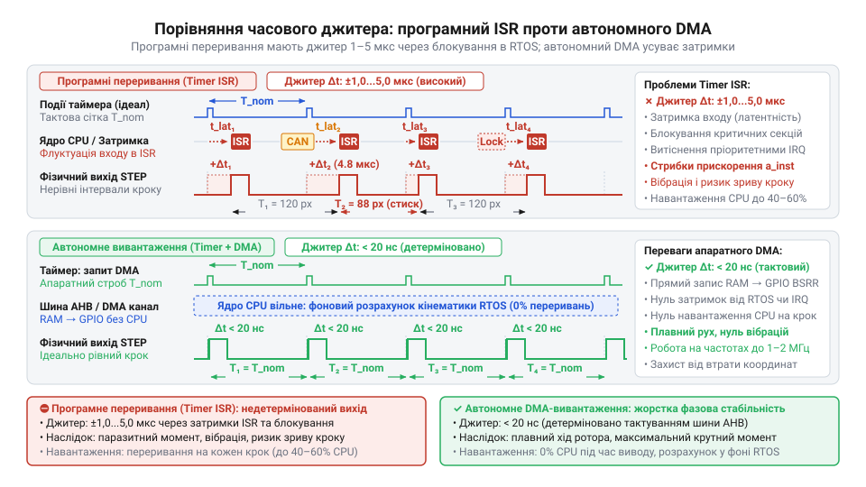
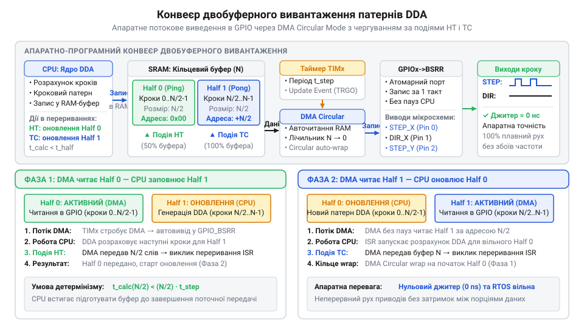
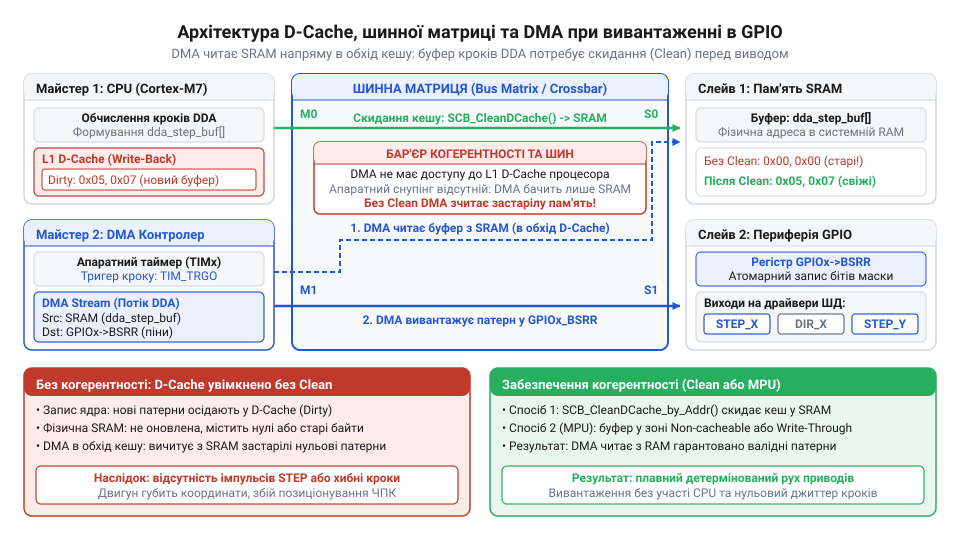
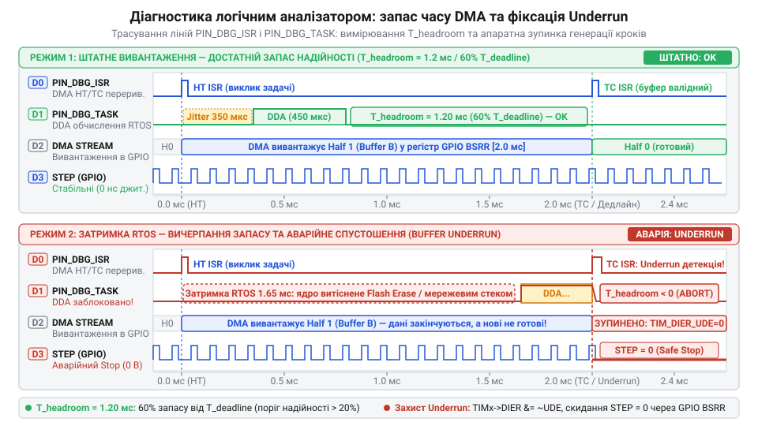

# Генерація кроків DDA за допомогою DMA та таймерів

## Початкові концепції та фізичні принципи

У високоточних системах керування рухом — таких як багатоосьові ЧПУ-верстати, промислові робототехнічні маніпулятори або 3D-принтери — механічне переміщення формується послідовністю дискретних електричних імпульсів. Драйвер крокового двигуна або сервоприводу сприймає тактові сигнали @@en|STEP/DIR@@: кожен імпульс на лінії `STEP` змушує ротор зміститися на один дискретний крок (або мікрокрок), а логічний рівень на лінії `DIR` задає напрямок обертання. Щоб забезпечити плавність розгону та точність дотримання траєкторії, прошивка мікроконтролера повинна обчислювати та видавати ці імпульси в чітко розраховані моменти часу.

Традиційним алгоритмічним фундаментом для розрахунку міжімпульсних інтервалів є цифровий диференційний аналізатор (від англ. @@en|Digital Differential Analyzer@@, @@en|DDA@@ — алгоритм дискретної лінійної та кругової інтерполяції). В класичній програмній реалізації [генератора кроків DDA](root:sf-devices/dda-step-generation) розрахунок здійснюється всередині підпрограми обробки переривань (від англ. @@en|Interrupt Service Routine@@, @@en|ISR@@) апаратного таймера. Таймер налаштовується на регулярне генерування переривань з частотою квантування, і на кожному тіку процесор виконує дискретне додавання дробового акумулятора координати. Якщо акумулятор переповнюється, процесор програмно встановлює логічну одиницю на відповідному виводі @@en|GPIO@@, формуючи імпульс.

Однак при спробі масштабувати цю схему до високих швидкостей переміщення та багатоосьової конфігурації програмна обробка впирається в жорсткі фізичні й обчислювальні обмеження. Припустимо, що система повинна видавати імпульси з частотою `100 кГц` на кожну з чотирьох незалежних осей. Період виклику переривання для частоти `100 кГц` становить `10 мкс`. Якщо на вхід у переривання, збереження контексту регістрів процесора, виконання арифметики DDA для чотирьох осей та вихід з ISR витрачається `2.5 мкс`, навантаження на процесор обчислюється наступним чином:

```
U_cpu = f_step * N_axes * t_isr
      = 100000 * 4 * 0.0000025    [множення частоти на кількість осей та тривалість ISR]
      = 1.0                       [100% завантаження обчислювального ядра]
```

Процесор виявляється повністю заблокованим обробкою переривань і не має ресурсу для виконання задач вищого рівня: обчислення траєкторій, розбору команд зв'язку або обробки датчиків.

Ще критичнішою проблемою є часовий джитер (від англ. @@en|jitter@@ — тремтіння, розкид моментів спрацьовування). В реальних обчислювальних системах під керуванням операційної системи реального часу моменти входу в переривання не є строго детермінованими. Виклики вищих за пріоритетом переривань, тимчасове блокування переривань у критичних секціях ядра та атомарних операціях створюють флуктуацію затримки виклику ISR (англ. @@en|interrupt latency@@).

Фізично джитер у декілька мікросекунд означає, що імпульси `STEP` виходять через нерівні проміжки часу. Оскільки миттєва кутова швидкість ротора пропорційна частоті слідування імпульсів, нестабільність періоду `Δt` викликає миттєві стрибки прискорення:

```
a_inst = Δv / Δt
       = (k / t_pulse) / Δt       [похідна швидкості за частотою імпульсів]
```

Ці мікрострибки прискорення генерують паразитивний механічний момент, що призводить до високочастотної вібрації, виникнення акустичного шуму, підвищеного нагріву обмоток двигуна і, найнебезпечніше, до втрати кроків через подолання критичного моменту утримування ротора. Для усунення [апаратного джитера переривань](root:sf-devices/interrupt-jitter-mitigation) розкид фази виведення імпульсів має бути меншим за 50–100 наносекунд, що неможливо забезпечити програмним викликом ISR.


*Порівняння часового джитера генерації імпульсів: програмне переривання викликає випадкові затримки виведення STEP через системне навантаження, тоді як таймерний DMA-запит забезпечує жорстку фазову стабільність.*

Розв'язком цієї проблеми є повне відчуження операції виведення сигналів від обчислювального ядра процесора шляхом об'єднання [апаратного модуля порівняння](root:sf-devices/hardware-output-compare) таймера та прямого доступу до пам'яті (від англ. @@en|Direct Memory Access@@, @@en|DMA@@).

Фізична ідея апаратного прискорення полягає в переведенні обчислення DDA з режиму реального часу в режим попереднього потокового розрахунку. Замість того щоб обчислювати стан виводів у момент генерації імпульсу, процесор заздалегідь розраховує серію станів на майбутній часовий інтервал і формує у пам'яті масив бітових масок (патернів) для регістрів порту @@en|GPIO@@. 

Апаратний таймер мікроконтролера налаштовується на постійну або регульовану частоту стробування. Кожна подія оновлення таймера генерує апаратний запит DMA (англ. @@en|DMA request@@). Отримавши запит, DMA-контролер автономно, по внутрішній системній шині (наприклад, @@en|AHB bus@@), копіює 32-бітне слово з буфера пам'яті безпосередньо у відповідний регістр встановлення/скидання портів (наприклад, регістр `BSRR` в STM32 або `GPIO_OUT_W1TS`/`W1TC` в ESP32). 

Завдяки цьому процесор звільняється від рутинної роботи: виконання [генерації імпульсів STEP/DIR](root:sf-devices/dma-step-generation-hardware-acceleration) відбувається з апаратною точністю тактового генератора мікроконтролера, а часовий джитер знижується до декількох наносекунд (визначених лише фазовим шумом тактування шини).

---

## Внутрішня будова та алгоритми роботи

Архітектура модуля апаратно-прискореного DDA будується на трирівневій конвеєрній структурі, яка розділяє часові домени обчислення траєкторії та апаратного виведення сигналів.

Перший рівень — програмно-алгоритмічний. У ньому задача операційної системи реального часу, яку запускає [планувальником траєкторій](root:sf-devices/planner-trapezoidal-s-curve-profile), розраховує кінематичні профілі руху (наприклад, [трапецеїдальний профіль швидкості](root:sf-devices/trapezoidal-velocity-profile) або S-подібне прискорення). Обчислення виконуються з використанням [обчислень у фіксованій крапці](root:sf-devices/fixed-point-kinematics) для запобігання накладним витратам на плаваючу комутацію. На цьому рівні алгоритм DDA розбиває безперервний рух на дискретні часові кванти `T_dma` і будує серію 32-бітних слів `Pattern_Word`. Кожен біт у цьому слові жорстко прив'язаний до фізичного виводу мікроконтролера:

```
Bit 0..N   : Імпульси STEP для осей X, Y, Z, E
Bit 16..24 : Сигнали напрямку DIR для відповідних осей
```

Другий рівень — буферний проміжок. Для забезпечення безперервності потоку використовується подвоєна двобуферна схема (від англ. @@en|ping-pong buffer@@). Буфер у пам'яті RAM розбивається на дві рівні секції: `Buffer_A` та `Buffer_B`.


*Конвеєр потокового вивантаження кроків DDA: DMA читає з однієї половини буфера, поки CPU заповнює другу половину у фоновій задачі RTOS.*

Третій рівень — апаратний вихідний конвеєр. Контролер DMA налаштовується у кільцевому режимі (англ. @@en|circular mode@@). Він послідовно зчитує елементи з `Buffer_A` і записує їх у регістр `BSRR` (Bit Set/Reset Register) порту GPIO. Зміна стану регістра `BSRR` відбувається за один такт шини, що дозволяє одночасно і синхронно оновити стани ліній `STEP` та `DIR` для всіх осей без проміжних невалідних станів.

На практиці застосовують два основні режими потокової генерації кроків через DMA та таймери:

1. **Режим фіксованого кванту часу (Fixed Time Quantum Streaming)**. Апаратний таймер генерує DMA-запити через однакові проміжки часу `T_q` (наприклад, кожні `2 мкс`, що відповідає сітці `500 кГц`). Якщо для осі потрібен імпульс, у першому кванті встановлюється біт `STEP = 1`, а в наступному кванті — `STEP = 0`. Тривалість імпульсу `t_high` формується кількістю квантів. Розрахунок кількості квантів `N_q` між кроками здійснюється за формулою:

```
N_q = f_timer / f_target
    = 500000 / 25000             [ділення частоти квантування на цільову частоту кроків]
    = 20                         [кількість квантів між сусідніми імпульсами]
```

2. **Режим змінного періоду (Variable Timer Reload DMA Streaming)**. У цьому режимі DMA використовується для оновлення регістра автоматичного перезавантаження таймера (англ. @@en|Auto-Reload Register@@, `ARR`) або регістра порівняння (англ. @@en|Capture/Compare Register@@, `CCR`). Буфер DMA містить не маски GPIO, а послідовність часових інтервалів між кроками у тактах таймера. Кожен крок генерується апаратно через канал порівняння таймера, а DMA після кожного кроку завантажує наступне значення інтервалу. Цей режим дає найвищу точність генерації частоти, але вимагає окремого каналу таймера для кожної осі. Апаратні механізми зв'язування кількох таймерів та каналів DMA для одночасного керування 6–8 осями без часового розфазування розглянуто у матеріалі про [синхронізацію багатоосьового виведення кроків через DMA та міжтаймерні тригери](root:sf-devices/dda-dma-multiaxis-synchronization).

Для режиму фіксованого кванту об'єм пам'яті під подвійний буфер `S_buf` розраховується на основі максимального часу затримки реакції задач RTOS `t_max_latency`:

```
S_buf = 2 * (t_max_latency / T_q) * sizeof(uint32_t)
      = 2 * (0.002 / 0.000002) * 4   [розрахунок для затримки 2 мс та кванту 2 мкс]
      = 2 * 1000 * 4
      = 8000 байт                    [8 КБ оперативної пам'яті]
```

Окремим критичним аспектом є захист від спустошення буфера (від англ. @@en|underrun protection@@). Якщо з певних причин задача процесора переривається більш пріоритетним процесом і не встигає заповнити другу половину буфера до того, як DMA завершить зчитування першої, виникає ситуація [захисту від спустошення](root:sf-devices/dda-buffer-underrun-protection) буфера. За відсутності захисту DMA почне повторно виводити старі патерни, що призведе до неконтрольованого зміщення осей.

Для запобігання цьому в прошивці реалізується апаратний прапорець валідності буфера та обробник переривання DMA Half-Transfer (HT) і Transfer-Complete (TC). Якщо при настанні переривання HT прапорець готовності другої половини не встановлено, DMA негайно зупиняється апаратним вимкненням тактування каналу, а лінії GPIO автоматично переводяться в безпечний стан.

Нижче наведено практичну реалізацію модуля апаратно-прискореної генерації DDA кроків з використанням периферії [апаратних таймерів мікроконтролерів](root:sf-devices/microcontroller-hardware-timers-architecture) та DMA для платформи STM32 (з використанням бібліотеки HAL/LL):

:::tabs
:::code root\eng\sf-devices\dda-dma-generation/dda-dma-generation-d/c/stm32/dda-dma-engine-init.c c
:::code root\eng\sf-devices\dda-dma-generation/dda-dma-generation-d/cpp/stm32/ddadmacontroller.cpp cpp
:::

Дана архітектура дозволяє мінімізувати вплив [граничних затримок p99](root:sf-devices/esp-tail-latency-optimization) операційної системи реального часу, забезпечуючи високу детермінованість генерації імпульсів керування рухом незалежно від поточного системного навантаження процесора.

## Апаратна реалізація та низькорівневий C/C++ код

При перенесенні теоретичної моделі подвійного буфера в реальний мікроконтролер розробник неминуче стикається з фізичною топологією кремнію. Обчислювальне ядро процесора та контролер прямого доступу до пам'яті (від англ. @@en|Direct Memory Access@@, @@en|DMA@@) звертаються до оперативної пам'яті абсолютно різними маршрутами. У високопродуктивних мікроконтролерах з архітектурою @@en|ARM Cortex-M@@ або двоядерних системах @@en|ESP32@@ пам'ять не є однорідним масивом, а розділена на окремі функціональні домени навколо шинної матриці (англ. @@en|bus matrix@@).

Типовою фатальною помилкою є оголошення масиву буфера кроків звичайною локальною або глобальною змінною без урахування її фізичної адреси. У ядрах @@en|ARM Cortex-M7@@ надшвидка пам'ять з нульовим часом очікування такту — так звана щільно зв'язана пам'ять (від англ. @@en|Tightly-Coupled Memory@@, @@en|ITCM@@ для інструкцій та @@en|DTCM@@ для даних) — жорстко підключена безпосередньо до внутрішньої шини процесорного ядра. Контролер @@en|DMA@@ виступає самостійним майстром на загальній системній шині (наприклад, @@en|AHB@@ або @@en|AXI@@) і фізично не має комутаційного шляху до сегмента @@en|DTCM@@. Якщо лінкер розмістить буфер у цій зоні, апаратний запит @@en|DMA@@ спробує вичитати дані з фізично недосяжної шини, що призведе або до зчитування суцільних нулів, або до виникнення апаратної помилки шини (англ. @@en|bus fault@@). Буфери патернів генератора необхідно примусово розміщувати в сегментах загальної статичної пам'яті (таких як `AXI SRAM`, `SRAM1` або `SRAM2`) за допомогою директив компілятора та лінкерних скриптів.

Навіть після правильного вибору сегмента пам'яті виникає бар'єр, пов'язаний із наявністю кешу даних процесора (від фр. @@fr|cacher@@ — ховати, приховувати, англ. @@en|D-Cache@@). Коли процесорне ядро обчислює траєкторію через [кінематичні розрахунки у фіксованій крапці](root:sf-devices/fixed-point-kinematics) та записує розраховані бітові маски в буфер, ці зміни осідають у кеш-рядках процесора через механізм відкладеного запису (англ. @@en|write-back@@). У фізичних комірках пам'яті `SRAM` у цей момент ще зберігаються старі або невизначені значення. Контролер @@en|DMA@@ вичитує пам'ять безпосередньо з `SRAM` в обхід кешу процесора, внаслідок чого на виводи мікроконтролера передається випадкове сміття.

Відбувається порушення узгодженості або когерентності пам'яті (від лат. @@la|cohaerere@@ — бути зчепленим, англ. @@en|cache coherency@@). Ситуація посилюється, якщо розмір і початкова адреса буфера не кратні довжині рядка кешу (англ. @@en|cache line@@, яка в архітектурі @@en|ARM Cortex-M7@@ зазвичай дорівнює 32 байтам). При витісненні сусідніх даних процесор може автоматично скинути частково заповнений кеш-рядок назад у пам'ять, пошкодивши свіжі розрахунки генератора кроків через явище хибного розділення даних (англ. @@en|false sharing@@).

Для подолання проблеми порушення узгодженості пам'яті застосовують два взаємодоповнюючі підходи. Перший полягає в ручному програмному очищенні ліній кешу (англ. @@en|clean D-cache@@). Одразу після формування чергової секції буфера процесор виконує інструкцію скидання кешу за адресою через виклик бібліотеки @@en|CMSIS@@ `SCB_CleanDCache_by_Addr()`, що примусово вивантажує брудні рядки з кешу в фізичну пам'ять до початку роботи @@en|DMA@@.

Другий, найбільш надійний та рекомендований для промислових рішень метод базується на конфігурації модуля захисту пам'яті (від англ. @@en|Memory Protection Unit@@, @@en|MPU@@). За допомогою регістрів @@en|MPU@@ для адресної зони розташування буферів задаються атрибути некешованої пам'яті (англ. @@en|non-cacheable@@) або пам'яті з наскрізним записом (англ. @@en|write-through@@). У такому режимі кожен запис процесорного ядра негайно потрапляє у фізичні комірки пам'яті `SRAM`, повністю усуваючи затримки на керування кешем та унеможливлюючи появу застарілих даних.


*Взаємодія шинної матриці AXI/AHB, кешу даних D-Cache та контролера DMA: виділення некешованої області пам'яті SRAM запобігає читанню застарілих даних з оперативної пам'яті при вивантаженні патернів у регістр BSRR.*

Вивантаження сформованих слів у фізичні виводи порту введення-виведення (від англ. @@en|General-Purpose Input/Output@@, @@en|GPIO@@) вимагає суворої атомарності. Спроба спрямувати потік @@en|DMA@@ у звичайний регістр вихідних даних порту (англ. @@en|Output Data Register@@, @@en|ODR@@) призводить до колізій із паралельними процесами прошивки. Якщо під час передачі будь-яка інша задача або переривання спробує змінити стан сусіднього контакту того самого порту (наприклад, увімкнути світлодіод стану або виставити сигнал вибору мікросхеми датчика) через типову операцію «читання-модифікація-запис», виникне стан перегонів (англ. @@en|race condition@@). Результатом стане миттєве спотворення або скидання сигналів керування кроковими двигунами.

Щоб запобігти цьому, потік @@en|DMA@@ конфігурують на прямий запис у спеціалізовані регістри атомарного встановлення та скидання — регістр @@en|BSRR@@ (англ. @@en|Bit Set/Reset Register@@) в мікроконтролерах @@en|STM32@@ або еквівалентні регістри `GPIO_OUT_W1TS` та `GPIO_OUT_W1TC` в мікроконтролерах @@en|ESP32@@. Запис 32-бітного слова в регістр @@en|BSRR@@ виконується за один такт шини: встановлення бітів у молодшій половині слова переводить відповідні виводи порту в логічну одиницю, а біти у старшій половині слова переводять виводи в логічний нуль. При цьому виводи, яким відповідають нульові біти маски, не зазнають жодного впливу.

Однак безпосереднє транслювання бітових масок у виводи мікроконтролера наражається на апаратні часові обмеження вхідних каскадів драйверів крокових двигунів. Будь-який силовий драйвер вимагає гарантованого часу встановлення (англ. @@en|setup time@@, `t_dir_setup`) сигналу напрямку `DIR` перед наростаючим фронтом тактового імпульсу `STEP`, а також часу утримання (англ. @@en|hold time@@, `t_dir_hold`) цього сигналу після завершення імпульсу. Якщо планувальник змінює напрямок руху на тому самому кванті часу, де генерується перший імпульс кроку, одночасне виставлення бітів `DIR` та `STEP` у слові @@en|BSRR@@ призведе до того, що внутрішня логіка драйвера не встигне зафіксувати новий стан напрямку. Двигун зробить крок у протилежний бік, що викличе накопичення позиційної похибки або аварійний зрив позиціонування.

Для виключення цієї помилки алгоритм наповнення буфера реалізує захисний інтервал (англ. @@en|dead time@@): при виявленні зміни знака швидкості оновлений стан лінії `DIR` виставляється в масці щонайменше на один квант часу раніше, ніж з'явиться перший наростаючий фронт сигналу `STEP`.

Для проектування надійного вузла необхідно розрахувати вимоги до пропускної здатності шини мікроконтролера та критичні часові межі задач. Спочатку обчислимо пропускну здатність шини `BW_dma`, яку споживає безперервне вивантаження патернів кроків контролером @@en|DMA@@. Ця величина визначається частотою квантування `f_quantum` та розрядністю регістра порту в байтах `W_word`:

```
BW_dma = f_quantum * W_word
       = 500000 * 4              [множення частоти квантування на ширину 32-бітного слова]
       = 2000000 байт/с          [2.0 МБ/с пропускної здатності шини]
```

Отримане значення 2.0 МБ/с складає менше 0.5% від сукупної пропускної здатності системної шини @@en|AHB@@/@@en|AXI@@ сучасного мікроконтролера (яка перевищує 400–800 МБ/с). Це свідчить про те, що апаратне вивантаження практично не створює шинного навантаження, залишаючи ресурс для роботи процесора та іншої периферії.

Тепер розрахуємо граничний інтервал часу `T_deadline`, протягом якого задача операційної системи реального часу повинна повністю обчислити та заповнити наступну половину подвійного буфера розміром `N_half` слів при заданій частоті квантування `f_quantum`:

```
T_deadline = N_half / f_quantum
           = 1000 / 500000       [ділення кількості слів на частоту тактування DMA]
           = 0.002 с             [2.0 мілісекунди допустимого вікна виконання]
```

Отриманий дедлайн 2.0 мс задає жорстку часову межу для задачі [неблокуючого планування подій](root:sf-devices/periodic-scheduling): якщо сумарний час розрахунку DDA та системні затримки планувальника перевищать 2.0 мс, буфер спорожніє і передача зірветься.

Для детермінованої передачі керування між апаратною частиною та процесором використовують синхронізацію підпрограми обробки переривань (англ. @@en|Interrupt Service Routine@@, @@en|ISR@@) контролера @@en|DMA@@ із задачею операційної системи реального часу (англ. @@en|Real-Time Operating System@@, @@en|RTOS@@). Застосування традиційних черг повідомлень або м'ютексів у таких вузлах неприпустиме через значний часовий оверхед на перемикання контексту.

Найбільш енергоефективним та швидким рішенням у середовищі @@en|FreeRTOS@@ є прямі сповіщення задач (від англ. @@en|Direct to Task Notifications@@). У момент завершення вивантаження першої половини буфера (подія Half Transfer) або всього буфера (подія Transfer Complete) обробник @@en|ISR@@ викликає функцію `vTaskNotifyGiveFromISR()`. Це переводить заблоковану задачу генератора в стан готовності за декілька десятків тактів ядра. Щоб гарантувати завершення запису даних у пам'ять до зміни прапорців стану, обов'язково застосовують апаратний бар'єр пам'яті (від фр. @@fr|barrière@@ — перепона, загородження, англ. @@en|memory barrier@@) через інструкцію `__DMB()`, що виключає асинхронне перевпорядкування операцій на конвеєрі процесора.

Нижче наведено повнофункціональну промислову реалізацію драйвера потокової генерації імпульсів з урахуванням конфігурації вирівнювання пам'яті, скидання кешу, синхронізації з @@en|FreeRTOS@@ та контролю затримок лінії `DIR` для мікроконтролерів сімейства @@en|STM32@@:

:::tabs
:::code root\eng\sf-devices\dda-dma-generation/dda-dma-generation-d/c/stm32/dda-configure-mpu-region.c c
:::code root\eng\sf-devices\dda-dma-generation/dda-dma-generation-d/cpp/stm32/hardwareddaengine.cpp cpp
:::

Представлена низькорівнева реалізація усуває непередбачувані затримки виконання за рахунок апаратної передачі шиною та гарантує синхронізацію між ядром і периферією в межах вимог детермінізму реального часу.

---

## Практичне застосування та відлагодження

Перехід від програмного розрахунку кроків у перериваннях до автономного вивантаження патернів через @@en|DMA@@ кардинально змінює поведінку системи при виникненні апаратних та програмних збоїв. Якщо в традиційному алгоритмі перевантаження процесора призводить до плавного сповільнення генерації (ротор двигуна просто тимчасово знижує оберти), то в автономній системі апаратний таймер продовжує безперервно відлічувати кванти часу незалежно від стану обчислювального ядра. Будь-який пропуск даних викликає катастрофічні наслідки для механіки.

Найбільш небезпечним граничним станом системи є спустошення буфера (від англ. @@en|buffer underrun@@). Якщо задача планувальника траєкторій затримується через тривале виконання критичної секції ядра, операцію стирання сектора флеш-пам'яті або високе навантаження мережевого стеку, контролер @@en|DMA@@ вичитує останній квант поточної половини буфера раніше, ніж процесор встигає підготувати наступну.

У стандартному кільцевому режимі роботи (англ. @@en|circular mode@@) периферійний модуль не має засобів перевірки свіжості даних. Дійшовши кінця буфера, контролер @@en|DMA@@ знову повертається на початок і починає циклічно вивантажувати старі патерни. Для крокового двигуна це означає миттєвий неконтрольований стрибок частоти імпульсів або несподівану зміну напрямку руху. Механічний вузол зазнає сильного динамічного удару, виникає миттєвий зрив синхронізації ротора (пропуск кроків), а рухома каретка може зіткнутися з механічними упорами верстата.

Для ліквідації цієї загрози створюють багаторівневий [захист від спустошення буфера](root:sf-devices/dda-buffer-underrun-protection). Обробники переривань передачі Half Transfer та Transfer Complete виступають апаратним бар'єром валідності. У момент виклику обробник перевіряє стан атомарного прапорця готовності чергової секції. Якщо прапорець не встановлено, обробник негайно блокує стробування @@en|DMA@@, скидаючи біт генерації запитів у регістрі таймера `TIMx->DIER &= ~TIM_DIER_UDE`. Одночасно з цим у регістр @@en|BSRR@@ записується маска примусового скидання всіх ліній `STEP` у нуль, що виключає появу завислих імпульсів. Система фіксує аварійний стан та ініціює програмне гальмування кінематики.

Другим критичним фактором є [колізії шинної матриці](root:hw-arch/dma-arbitration) та арбітраж шини (від лат. @@la|arbiter@@ — свідок, третейський суддя, англ. @@en|bus arbitration@@). У реальній системі одночасно функціонують декілька високошвидкісних майстрів шини: контролер @@en|DMA@@ мережевого інтерфейсу `Ethernet`, контролер графічного дисплея `LTDC`, контролер `USB` та обчислювальне ядро.

Якщо контролер дисплея здійснює пакетне зчитування кадрового буфера з внутрішньої пам'яті `SRAM`, він монополізує матрицю шин на десятки або сотні тактів. Якщо в цей проміжок часу виникає подія переповнення таймера генератора кроків, запит @@en|DMA@@ стає в чергу очікування. Виникає латентність передачі (англ. @@en|DMA latency@@). Якщо величина затримки перевищить період квантування таймера `T_quantum`, контролер @@en|DMA@@ втратить синхронізацію, передача кванта відбудеться із запізненням, і в системі виникне фазовий джитер, що нівелює переваги [компенсації апаратного джитера переривань](root:sf-devices/interrupt-jitter-mitigation).

Для запобігання шинним колізіям застосовують жорстку пріоритетизацію потоків: каналу @@en|DMA@@ генератора кроків призначають найвищий апаратний пріоритет `DMA_PRIORITY_VERY_HIGH`. Додатково активують апаратний буфер @@en|FIFO@@ потоку @@en|DMA@@ та фізично розділяють адресні простори, розташовуючи буфер патернів у блоці `SRAM1`, а мережеві та графічні дескриптори — у блоці `SRAM2`.

Третя поширена апаратна пастка криється в електричних характеристиках оптронів (від грец. @@grc|optikos@@ — зоровий, англ. @@en|optocoupler@@), які встановлюються у вхідних каскадах промислових драйверів для забезпечення гальванічної розв'язки. Дешеві або загальнопромислові оптрони (наприклад, `PC817` чи `4N35`) мають значну власну паразитну ємність, через що їхній час наростання (англ. @@en|rise time@@, `t_rise`) та час спаду (англ. @@en|fall time@@, `t_fall`) сягають від 1.5 до 3 мікросекунд.

Якщо квант часу @@en|DMA@@ налаштовано на високу частоту (наприклад, 500 кГц з тривалістю кванта 2 мкс), активний імпульс тривалістю в один квант буде майже повністю згладжений паразитною ємністю фототранзистора оптрона. Сигнал просто не досягне порогу спрацьовування вхідного тригера драйвера, що спричинить систематичну втрату кроків на робочих швидкостях.

Розрахуємо мінімально допустиму тривалість імпульсу кроку `t_pulse_min`, яка гарантує стабільне спрацьовування вхідного оптичного каскаду драйвера. Вона складається з часу наростання вихідного каскаду оптрона `t_rise`, затримки поширення сигналу в ізоляторі `t_prop_delay` та мінімальної ширини імпульсу, яку здатна розпізнати цифрова логіка драйвера `t_driver_min`:

```
t_pulse_min = t_rise + t_prop_delay + t_driver_min
            = 0.0000015 + 0.0000008 + 0.0000005  [додавання затримок фронту, поширення та детекції драйвером]
            = 0.0000028 с                        [2.8 мікросекунди мінімального імпульсу]
```

Отриманий розрахунок свідчить, що при роботі з оптронними розв'язками тривалість імпульсу `STEP` повинна становити щонайменше 2.8 мкс. Це вимагає від алгоритму формування патернів утримувати активний логічний стан лінії `STEP` протягом не менше ніж двох послідовних квантів часу по 2 мкс, або заміни оптронів на високошвидкісні цифрові ізолятори (наприклад, мікросхеми серії `Si86xx` або оптрони зі тригером Шмітта `6N137`).

Для надійного виявлення збоїв синхронізації та вимірювання динамічних запасів часу в реальних умовах використовують методику апаратного інструментування прошивки за допомогою логічного аналізатора (англ. @@en|logic analyzer@@).

Для цього виділяють два вільні діагностичні виводи @@en|GPIO@@:
1. `PIN_DBG_ISR` — встановлюється в логічну одиницю на вході в обробник переривання @@en|DMA@@ Half Transfer або Transfer Complete і скидається в логічний нуль при виході з нього;
2. `PIN_DBG_TASK` — встановлюється в одиницю в момент, коли задача планувальника починає обчислення чергової секції буфера, і скидається в нуль одразу після завершення запису слів та скидання кешу.


*Часова діаграма апаратного трасування через діагностичні виводи: моніторинг запасу часу між завершенням обчислення задачі та перемиканням буфера DMA фіксує передумови до виникнення аварійного спустошення.*

Ключовим параметром надійності на екрані логічного аналізатора є час випередження або запас надійності (від англ. @@en|headroom@@) — проміжок часу `T_headroom` між моментом завершення розрахунку задачею (спадний фронт `PIN_DBG_TASK`) та моментом, коли контролер @@en|DMA@@ завершить відтворення поточної секції та перейде до наступної (наростаючий фронт `PIN_DBG_ISR`).

Обчислимо величину запасу часу `T_headroom` як різницю між часом вивантаження половини буфера `T_deadline`, тривалістю роботи алгоритму DDA `t_calc` та системним джитером планувальника операційної системи `t_sched_jitter`:

```
T_headroom = T_deadline - (t_calc + t_sched_jitter)
           = 0.002 - (0.00045 + 0.00035)  [віднімання часу розрахунку та системного джитера від дедлайну]
           = 0.0012 с                     [1.2 мілісекунди запасу надійності]
```

Розрахований запас 1.2 мс становить 60% від повного часового бюджету кванта напівбуфера, що свідчить про високу стабільність системи. Якщо під час стресових випробувань запас `T_headroom` скорочується до величин, менших за 15–20% від `T_deadline`, прошивка перебуває в зоні ризику виникнення аварійного спустошення буфера.

Для глибинного аналізу факторів, що скорочують запас часу, застосовують [візуальне трасування задач через SEGGER SystemView](root:sf-devices/esp-systemview-tracing-analysis). Використання швидкісного інтерфейсу передачі даних реального часу (від англ. @@en|Real-Time Transfer@@, @@en|RTT@@) дозволяє реєструвати кожне перемикання контексту задач, роботу планувальника та виклики переривань із субмікросекундною дискретністю без зупинки процесора. Додатково задіюють [статистику використання процесорного часу FreeRTOS](root:sf-devices/freertos-task-runtime-stats), що виявляє фонові процеси, які спричиняють витіснення генератора кроків.

Якщо потрібно виміряти точну тривалість виконання внутрішнього циклу генерації масок усередині самої задачі без підключення зовнішніх аналізаторів, використовують апаратний 32-бітний лічильник циклів ядра модуля спостереження за даними та трасування (від англ. @@en|Data Watchpoint and Trace@@, @@en|DWT@@, регістр `DWT->CYCCNT`). Зчитування цього регістра до та після обчислювального блоку забирає рівно 1 такт процесора і забезпечує наносекундну точність без внесення похибки вимірювання.

Фінальним підтвердженням якості та детермінованості сформованих імпульсів є інструментальне вимірювання розкиду фронтів за допомогою цифрового осцилографа (від лат. @@la|oscillare@@ — гойдатися та грец. @@grc|grapho@@ — писати, англ. @@en|oscilloscope@@).

Щуп осцилографа підключають до лінії кроку `STEP`, встановлюють тригер за наростаючим фронтом першого імпульсу пачки, а часову розгортку зміщують управо так, щоб на екрані спостерігався наступний імпульс послідовності. Після цього активують режим накопичення осцилограм або нескінченного післясвітіння (англ. @@en|infinite persistence@@), і привод запускають у рух за повним швидкісним профілем.

При використанні традиційної програмної генерації через переривання фронт наступного імпульсу на екрані розмивається в широку смугу завширшки від 2 до 15 мікросекунд через неминучий джитер входу в підпрограму переривання. При автономному вивантаженні патернів через таймер та @@en|DMA@@ другий імпульс залишається монолітною, надзвичайно чіткою лінією. Виміряна ширина розмиття фронту не перевищує 5–10 наносекунд, що обумовлено виключно фазовим шумом кварцового генератора мікроконтролера. Це гарантує повну відсутність паразитних вібрацій та акустичного шуму приводу.

Для підготовки серійних виробів на базі апаратного генератора кроків застосовують обов'язковий комплексний чекліст захисного програмування:
1. Статична валідація розміщення пам'яті: використання директив лінкера та перевірок `static_assert` для гарантування знаходження буферів у доступній для @@en|DMA@@ некешованій пам'яті з обов'язковим вирівнюванням за розміром рядка кешу. 2. Контроль часових затримок керування: включення в алгоритм генерації обов'язкового захисного інтервалу `t_dead_time` для запобігання крокам у хибному напрямку при реверсі осей. 3. Апаратний самоконтроль за принципом петлі зворотного зв'язку (англ. @@en|hardware loopback@@): заведення сигналів `STEP` на вхідний канал захоплення резервного таймера під час самотестування для апаратної перевірки кількості згенерованих імпульсів. 4. Стрес-тестування інжекцією несправностей (англ. @@en|fault injection@@): штучне внесення випадкових затримок у задачу генератора патернів на етапі тестування для верифікації надійності аварійного вимкнення виходів при виникненні спустошення буфера.