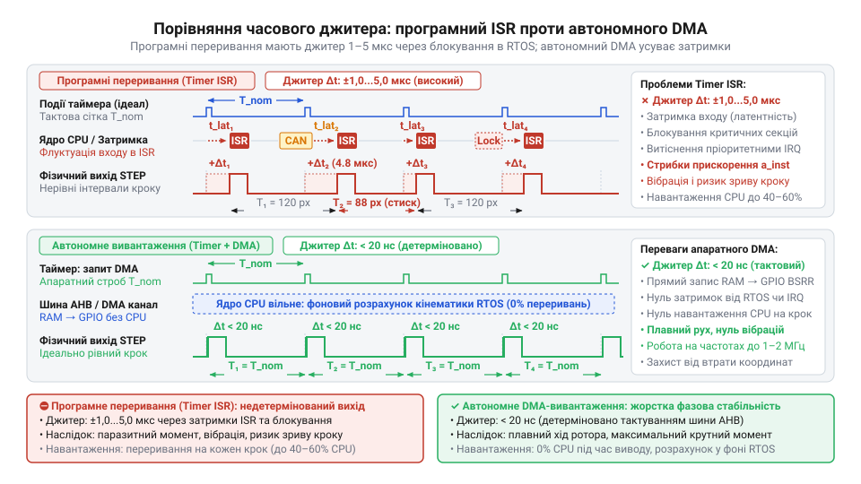
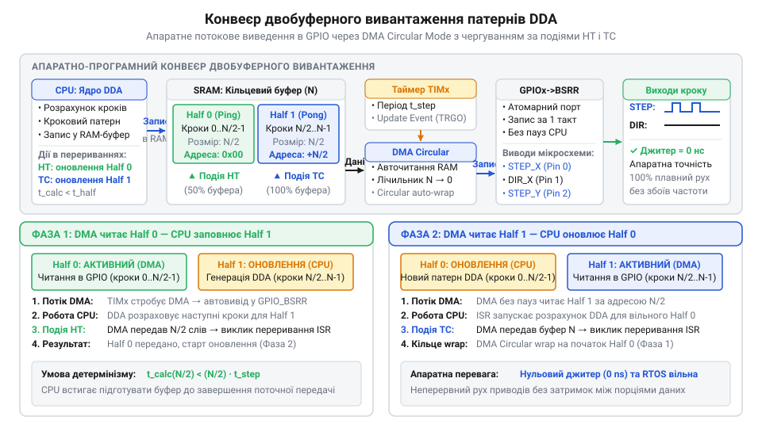

# Генерація кроків DDA за допомогою DMA та таймерів

<preknowlist>
- [Генератор кроків DDA у прошивці](root:sf-devices/dda-step-generation) — алгоритм розрахунку кроків DDA та формування імпульсів таймером
- [Апаратний модуль порівняння таймера](root:sf-devices/hardware-output-compare) — робота таймерних подій і формування апаратних запитів периферії
- [Захист від спустошення буфера DDA](root:sf-devices/dda-buffer-underrun-protection) — причини вичерпання черги команд та наслідки зриву кроків
</preknowlist>

## Джитер переривань і межа програмного DDA

У системах керування рухом координатні переміщення формуються послідовністю імпульсів @@en|STEP/DIR@@. Класичний програмний [генератор кроків DDA](root:sf-devices/dda-step-generation) (від англ. *digital differential analyzer* — цифровий диференційний аналізатор; @@en|DDA@@) розраховує інтервали всередині підпрограми обробки переривань — @@en|ISR@@ (від англ. *interrupt service routine* — підпрограма обробки переривань) апаратного таймера. Проте при високих швидкостях та багатоосьовому русі частота викликів сягає сотень кілогерців. Час входу в переривання, збереження контексту регістрів і розрахунок акумулятора координати повністю вичерпують обчислювальний ресурс процесора.

Ще небезпечнішим є фазовий джитер — @@en|jitter@@ (від англ. *jitter* — тремтіння, розкид затримок). В операційних системах реального часу виклики переривань блокуються критичними секціями ядра або витісняються пріоритетнішими системними задачами. Нестабільність моментів видачі крокових імпульсів у кілька мікросекунд спричиняє стрибки миттєвого прискорення. Виникають акустичний шум, вібрації механіки та аварійний зрив синхронізму крокового приводу. Програмна корекція не здатна усунути цю нестабільність, тому для подолання [апаратного джитера переривань](root:sf-devices/interrupt-jitter-mitigation) процес виведення імпульсів апаратно відокремлюють від процесорного ядра.

*Підпис: Програмне переривання викликає випадковий джитер через системні затримки, тоді як таймерний DMA-запит забезпечує жорстку фазову стабільність імпульсів.*

## Апаратний конвеєр таймера та DMA

Розв'язком проблеми є передача функцій виведення імпульсів автономній периферії. Використовуючи [апаратний модуль порівняння](root:sf-devices/hardware-output-compare) таймера разом із прямим доступом до пам'яті — @@en|DMA@@ (від англ. *direct memory access* — прямий доступ до пам'яті), прошивка переводить генерацію кроків у режим апаратного вивантаження підготовлених бітових масок.

Фоновий [планувальник траєкторій](root:sf-devices/planner-trapezoidal-s-curve-profile) дискретизує рух на фіксовані кванти часу та формує в оперативній пам'яті серію слів, де окремі біти безпосередньо керують станами ліній `STEP` та `DIR`. Апаратний таймер генерує регулярні запити DMA, за якими контролер автономно пересилає дані з пам'яті в регістри порту введення-виведення без переривання процесора. Для неперервного руху застосовують подвійний буфер — @@en|ping-pong buffer@@ (від звуконаслідувальної назви настільного тенісу *ping-pong* — почергова дія сторін).

*Підпис: Контролер DMA автономно транслює одну половину буфера, поки процесор у фоновому режимі розраховує наступну партію кроків.*

Поки контролер DMA транслює активну половину буфера, ядро у фоновій задачі заповнює наступну. Апаратні події завершення половини передачі (Half-Transfer) та повного блоку (Transfer-Complete) сповіщають ядро про готовність чергової секції, забезпечуючи безперервний потік із наносекундною фазовою стабільністю.

## Когерентність пам'яті та захист буфера

Автономне вивантаження патернів вимагає узгодження архітектури підсистем пам'яті мікроконтролера. Обчислювальне ядро та контролер DMA звертаються до оперативної пам'яті через шинну матрицю незалежними маршрутами. Якщо ядро оновлює буфер через кеш даних процесора, виникає порушення узгодженості пам'яті — @@en|cache coherency@@ (від фр. *cacher* — ховати, приховувати та лат. *cohaerere* — бути зчепленим). Контролер DMA зчитує фізичну пам'ять в обхід кешу ядра і транслює на виводи застарілі значення.

Для усунення цієї розбіжності використовують апаратний модуль захисту пам'яті — @@en|MPU@@ (від англ. *memory protection unit* — блок захисту пам'яті), конфігуруючи адресний простір буферів як некешовану область, або примусово скидають лінії кешу перед запуском каналу DMA. Кінематичні розрахунки ведуть через [кінематичні розрахунки у фіксованій крапці](root:sf-devices/fixed-point-kinematics), що скорочує час обчислень і гарантує вчасне наповнення черги.

Критичною загрозою залишається спустошення буфера, коли обчислювальна задача затримується і не встигає підготувати блок даних до закінчення поточної передачі DMA. Щоб запобігти неконтрольованому зміщенню осей, у системі впроваджують багаторівневий [захист від спустошення буфера](root:sf-devices/dda-buffer-underrun-protection): обробник переривання DMA перевіряє статус готовності секції і при виявленні затримки негайно зупиняє таймер та обнуляє вихідні лінії, зберігаючи точність верстата.