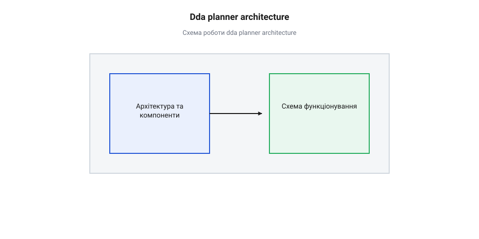
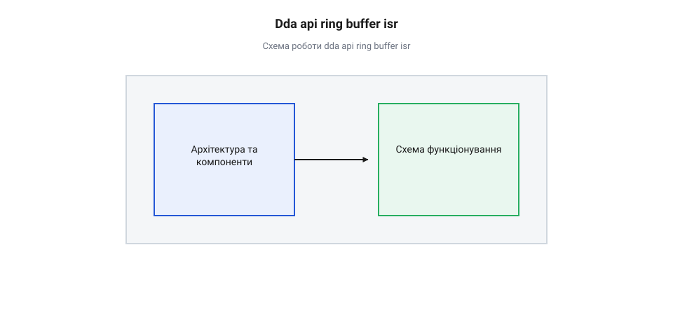
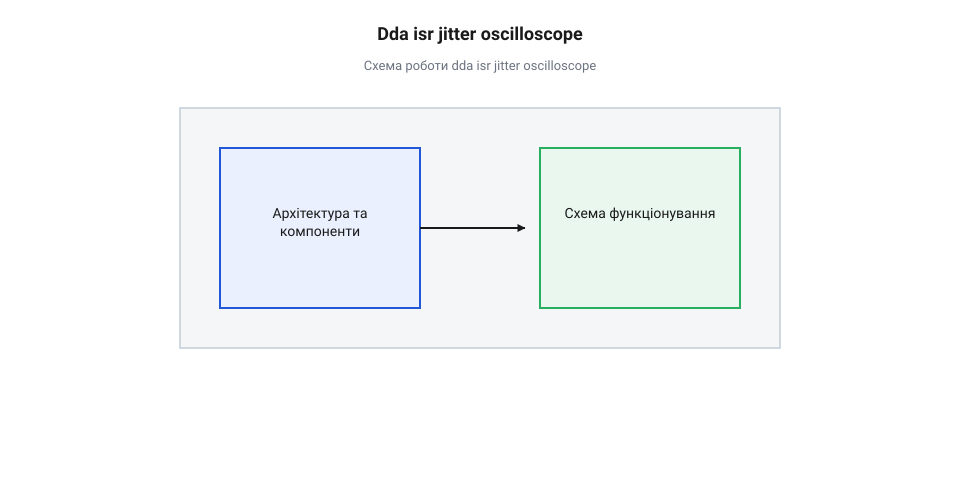

# Програмний інтерфейс DDA-генератора та планувальника траєкторії

## Початкові концепції та базові принципи

У сучасних цифрових системах числового програмного керування (з англ. @@en|computer numerical control@@) та робототехнічних маніпуляторах завдання керування рухом вимагає одночасного узгодження просторової траєкторії та часового профілю швидкості для кількох незалежних осей. Коли триосьовий фрезерний верстат або 3D-принтер переміщує робочий орган із однієї просторової точки в іншу, кожна фізична вісь має виконати чітко визначену кількість дискретних кроків крокового двигуна або імпульсів енкодера серводвигуна. Похибка траєкторії навіть на один крок призводить до геометричного викривлення деталі або виклику механічного резонансу через різкі стрибки прискорення.

Центральна проблема полягає в принциповому конфлікті двох обчислювальних середовищ мікроконтролера: фонового планування руху та високочастотної генерації фізичних керуючих імпульсів. Фоновий процес — планувальник руху (з англ. @@en|motion planner@@ від @@en|motion@@ — рух та @@en|planner@@ — планувальник) — працює у сфері безперервної математики. Він оперує кінематичними величинами у фізичних одиницях: міліметрами, секундами, швидкостями `v` (мм/с), прискореннями `a` (мм/с²) та ривками `j` (мм/с³). Щоб забезпечити плавність розгону та гальмування, планувальник будує трапецеїдальні або S-подібні профілі швидкості. Для цього потрібні математичні обчислення з плаваючою крапкою (з англ. @@en|floating-point arithmetic@@), розрахунок квадратних коренів та тригонометричних функцій.

З іншого боку, безпосередній вивід керуючих сигналів шаг/напрямок (з англ. @@en|step/direction@@) має виконуватися в обробнику переривань (з англ. @@en|interrupt service routine@@ від @@en|interrupt@@ — переривання, @@en|service@@ — обслуговування та @@en|routine@@ — процедура) апаратного таймера з суворими часовими детермінованими межами. Частота виконання обробника переривань для високошвидкісних осей досягає 20–100 кГц. Спроба виконувати обчислення з плаваючою крапкою або ділення чисел безпосередньо всередині переривання викликає неприпустимі затримки (з англ. @@en|latency@@). На мікроконтролерах без апаратного модуля FPU (з англ. @@en|floating-point unit@@) це призводить до тривалого блокування процесора, а на процесорах із FPU — до величезних накладних витрат на збереження та відновлення регістрів контексту плаваючої крапки при кожному вході в переривання. Крім того, під час [обробки періодичних подій](root:sf-devices/periodic-scheduling) будь-яка часова нестабільність (з англ. @@en|jitter@@) у високочастотному перериванні викликає нерівномірність часового інтервалу між імпульсами, що проявляється як акустичний шум, вібрація та втрата крутного моменту двигуна.

Для розв'язання цього конфлікту застосовують чітке розділення архітектури на дві фази та використання цифрового диференційного аналізатора (з англ. @@en|digital differential analyzer@@ від @@en|digital@@ — цифровий, @@en|differential@@ — диференційний та @@en|analyzer@@ — аналізатор). Ідея полягає в тому, що складна аналітична задача дискретизується планувальником заздалегідь, а перериванню передаються лише готові цілочисельні коефіцієнти та інкременти.

Алгоритм @@en|digital differential analyzer@@ переводить задачу лінійної або кругової інтерполяції у прості додавання та віднімання цілих чисел. Розглянемо лінійне переміщення у двовимірному просторі від початкової точки до кінцевої. Серед усіх осей виділяють провідну або домінантну вісь (з англ. @@en|dominant axis@@), яка має виконати найбільшу кількість кроків `N_major`, та ведені осі (з англ. @@en|minor axis@@) із кількістю кроків `N_minor`.

На кожному кроці провідної осі акумулятор веденої осі збільшується на величину `N_minor`. Як тільки значення акумулятора перевищує або дорівнює `N_major`, генерується імпульс кроку для веденої осі, а з акумулятора віднімається значення `N_major`:

```
accumulator_minor
= accumulator_minor + N_minor         [інкремент акумулятора на кожному кроці провідної осі]
= accumulator_minor - N_major         [корекція акумулятора після виходу імпульсу веденої осі]
```

Перед початком обчислень акумулятор ініціалізується величиною `N_major / 2` для мінімізації похибки округлення та забезпечення симетричного розподілу кроків веденої осі вздовж траєкторії. 

Ключова перевага такого підходу полягає у відсутності будь-якого ділення під час руху. Всі коефіцієнти `N_major` та `N_minor` розраховуються планувальником у фоновому режимі, а обробник переривань виконує лише додавання, порівняння та віднімання цілих чисел. Це дозволяє зменшити час виконання процедури обробника переривань до кількох десятків наносекунд.

Однак стаціонарного @@en|digital differential analyzer@@ недостатньо, коли швидкість руху вздовж провідної осі змінюється з прискоренням. Для врахування динаміки розгону та гальмування додають другий рівень інкрементного накопичення — інтервальний цілочисельний акумулятор швидкості. Замість того, щоб обчислювати затримку між кроками `Δt` через розрахунок зворотного значення швидкості `1 / v`, планувальник перераховує прискорення у фіксований інкремент зміни періоду таймера `ΔT_ticks` у форматі з фіксованою крапкою (з англ. @@en|fixed-point arithmetic@@).

Таким чином, уся кінематика сегмента траєкторії зводиться до набору цілочисельних параметрів, які описують геометричні кроки та розклад зміни таймерних інтервалів. Завдяки цьому [вимірювання проміжків часу](root:sf-devices/millis-micros) між кроками виконується суворо за лічильником апаратного таймера без жодних викликів системних функцій чи операцій з плаваючою крапкою.

Математичний зв'язок між фізичним прискоренням і цілочисельним інкрементом спирається на перетворення зміни швидкості в одиницях часу таймера. Нехай `a` позначує фізичне прискорення осі в міліметрах за секунду в квадраті (мм/с²), `S_step` — дискретність одного кроку у фізичних одиницях (мм/крок), `f_timer` — частоту тактування апаратного таймера в герцах (Гц), а `n` — кількість біт дробової частини у форматі з фіксованою крапкою. Спочатку планувальник визначає прискорення у кроках за секунду в квадраті `a / S_step`, після чого перераховує його у зміну кількості тактів між сусідніми імпульсами. Для збереження точності дробової частини величина цілочисельного інкременту `ΔT_ticks` обчислюється за формулою:

```
ΔT_ticks
= (a / S_step) × (1 / f_timer²) × 2ⁿ [переведення прискорення у зміну тактів за секунду]
= (a × 2ⁿ) / (S_step × f_timer²)     [остаточне цілочисельне співвідношення з коефіцієнтом масштабування]
```

Отриманий інкремент `ΔT_ticks` розраховується планивальником один раз при підготовці сегмента руху. Під час [періодичних подій](root:sf-devices/periodic-scheduling) генерації імпульсів обробнику переривань залишається лише додавати `ΔT_ticks` до акумулятора періоду та виконувати побітовий зсув праворуч на `n` біт для виділення цілої частини таймерного інтервалу.

## Внутрішня будова та алгоритми роботи

Для реалізації стійкого та неблокуючого зв'язку між фоновим потоком планування та обробником переривань генератора кроків застосовується архітектурний шаблон «виробник-споживач» (з англ. @@en|producer-consumer pattern@@). Роль виробника виконує планувальник руху, який розбиває траєкторію на елементарні лінійні сегменти, розраховує кінематичні коефіцієнти та записує їх у спеціальну структуру даних. Споживачем є таймерний обробник переривань, який послідовно зчитує описувачі сегментів та генерує серії керуючих імпульсів.

Зв'язком між цими двома компонентами слугує кільцевий буфер (з англ. @@en|ring buffer@@ від @@en|ring@@ — кільце та @@en|buffer@@ — проміжний накопичувач) фіксованого розміру. Кільцевий буфер зберігає масив структур описувачів сегментів `dda_segment_t`. Для забезпечення атомарності без використання важких мутексів чи блокувань переривань у фоновому потоці використовуються два вказівники або індекси: індекс запису `head` та індекс зчитування `tail`. Індекс `head` модифікується виключно фоновим потоком планувальника, тоді як індекс `tail` змінюється лише в обробнику переривань після повного завершення відпрацювання поточного сегмента. Обидва індекси оголошуються із модифікатором `volatile` або як атомарні типи, що запобігає небажаній оптимізації компілятором через кешування у регістрах.

Структура даних описувача сегмента `dda_segment_t` розробляється так, щоб повністю виключити обчислювальне навантаження з обробника переривань. Вона містить такі ключові поля:

1. `dir_mask` — бітова маска напрямку руху для кожної осі (встановлює рівні на GPIO-пінах `DIR`). 2. `steps_major` — загальна кількість кроків провідної осі на цьому сегменті. 3. `steps_x`, `steps_y`, `steps_z` — кількість кроків по кожній із осей. 4. `initial_period_ticks` — початковий період апаратного таймера для першого кроку сегмента (в тіках таймера). 5. `period_change_ticks` — цілочисельний інкремент (з урахуванням знака) зміни періоду таймера на кожному кроці для реалізації прискорення чи гальмування у форматі з фіксованою крапкою. 6. `phase_steps` — лічильник кроків для поточної фази руху (розгін, постійна швидкість, гальмування).

Розглянемо схему передачі даних між компонентами системи:


*Передача сегментів траєкторії через атомарний кільцевий буфер до таймерного ISR DDA-генератора кроків.*

Алгоритм функціонування обробника переривань генератора кроків відрізняється суворим детермінізмом і складається з наступних кроків:

1. **Перевірка стану поточного сегмента**: Якщо лічильник виконаних кроків поточного сегмента досяг `steps_major`, поточний сегмент вважається завершеним. ISR перевіряє стан кільцевого буфера (`head != tail`). Якщо буфер містить нові сегменти, ISR витягує наступний сегмент, оновлює індекс `tail`, встановлює GPIO-піни напрямку `DIR` згідно з `dir_mask` та ініціалізує внутрішні акумулятори @@en|digital differential analyzer@@. Якщо буфер порожній, генерується стан недоповнення буфера (з англ. @@en|buffer underflow@@ від @@en|buffer@@ — буфер та @@en|underflow@@ — недоповнення), таймер зупиняється або переходить у режим очікування, а система фіксує подійний прапор. 2. **Формування крокових імпульсів**: ISR встановлює у високий логічний рівень бітову маску осей, для яких у поточному такті спрацював алгоритм @@en|digital differential analyzer@@ (включаючи обов'язковий крок провідної осі). 3. **Оновлення акумуляторів DDA**: Для кожної веденої осі виконується додавання `acc_i += steps_i`. Якщо `acc_i >= steps_major`, виставляється прапор кроку на наступний такт і виконується віднімання `acc_i -= steps_major`. 4. **Розрахунок наступного періоду таймера**: Період таймера оновлюється шляхом додавання інкременту прискорення `current_period_ticks += period_change_ticks`. Нове значення завантажується в регістр порівняння (з англ. @@en|compare register@@) апаратного таймера для налаштування часу наступного переривання. 5. **Скидання імпульсу**: Через фіксований короткий інтервал (за допомогою другого каналу порівняння таймера або короткої паузи) піни `STEP` повертаються у низький стан для формування чіткого прямокутного імпульсу.

Нижче наведено практичну реалізацію програмного інтерфейсу та обробника переривань на мовах C та C++. Для [профілювання продуктивності таймерів](root:sf-devices/esp-timer-profiling) код оптимізовано під використання в реальних вбудованих системах.

:::tabs
:::code root\eng\sf-devices\dda-step-generation/api-dda-motion-planner-interface/c/esp-idf/dda-planner-push-segment.c c
:::code root\eng\sf-devices\dda-step-generation/api-dda-motion-planner-interface/cpp/stm32/ddamotioncontroller.cpp cpp
:::

Проєктування даного інтерфейсу гарантує відсутність взаємних блокувань (з англ. @@en|deadlock@@), мінімальний накладний час в ISR та повний контроль кінематичних параметрів багатоосьових двигунів.

## Апаратна реалізація та низкорівневий C/C++ код

Спроба розраховувати кінематичні рівняння траєкторії безпосередньо всередині @@en|обробник переривань@@ (від англ. @@en|Interrupt Service Routine@@, @@en|ISR@@) високої частоти (наприклад, від 50 кГц до 200 кГц) швидко призводить до катастрофічного дефіциту процесорного часу. Обчислення з плаваючою крапкою на мікроконтролерах вимагають збереження розширеного контексту регістрів FPU або використання повільної програмної емуляції. Якщо обробник переривання виконується довше за період повторення апаратного таймера, система пропускає кроки, двигун втрачає синхронізм, а прошивка блокується.

Для вирішення цієї проблеми розрахунок траєкторії розділяють на два незалежні рівні: фоновий @@en|планувальник руху@@ (від англ. @@en|motion planner@@) обчислює цілочисельні параметри DDA (від англ. @@en|Digital Differential Analyzer@@ — @@en|цифровий диференціальний аналізатор@@), а низкорівневий @@en|DDA-генератор@@ у перериванні виконує лише інкрементні операції додавання та порівняння.

Передача геометрії та кінематики з фонового потоку в переривання відбувається через об'єкт @@en|структура API@@ сегмента руху. Ця структура містить підготовлені цілі числа, які обробник переривань застосовує без жодного ділення чи перетворення типів.

Кожен сегмент руху описується фіксованим набором полів:
- `total_steps`: загальна кількість кроків уздовж провідної осі (від англ. @@en|leading axis@@);
- `dir_mask`: бітова маска напрямку руху для всіх осей (0 — назад, 1 — уперед);
- `axis_delta`: масив приростів кроків для ведених осей (від англ. @@en|driven axis@@);
- `initial_period_ticks`: початковий період апаратного таймера у тактах;
- `timer_acc_inc`: цілочисельний приріст періоду таймера на кожному кроці для реалізації розгону або гальмування.

Алгоритм генерації кроків спирається на @@en|інкрементний DDA-акумулятор@@ (від лат. @@la|accumulatur@@ — той, що накопичує). Для кожної веденої осі підтримується власний @@en|акумулятор@@ `acc`, початкове значення якого дорівнює половині `total_steps` для симетричного округлення. На кожному кроці провідної осі до акумулятора додається `axis_delta`. Коли значення акумулятора перевищує або дорівнює `total_steps`, ведена вісь робить крок, а від акумулятора віднімається `total_steps`.

Для зміни швидкості без арифметики з плаваючою крапкою використовується @@en|фіксована крапка@@ (від англ. @@en|fixed-point arithmetic@@). Фоновий планер перераховує фізичне прискорення `a` у цілочисельний приріст періоду таймера `timer_acc_inc`. Усередині ISR період апаратного таймера оновлюється за допомогою звичайного додавання:

```
T_next = T_current + timer_acc_inc      [оновлення періоду таймера на кожному кроці]
```

Отриманий період записується безпосередньо у регістр перезавантаження апаратного таймера. Для детального аналізу часу виконання та вимірювання затримок обробника корисно застосовувати [профілювання продуктивності](root:sf-devices/esp-timer-profiling) за допомогою системних лічильників.


*Архітектура передачі даних руху з фонового потоку в переривання генератора кроків.*

Передача сегментів між фоновим планувальником та перериванням вимагає безблокувальної синхронізації. Для цього застосовується @@en|кільцевий буфер@@ (від англ. @@en|ring buffer@@) за схемою SPSC (від англ. @@en|Single-Producer Single-Consumer@@). Планувальник пише нові сегменти за індексом `head`, а ISR читає поточний сегмент за індексом `tail`. Для захисту від @@en|стан гонитви@@ (від англ. @@en|race condition@@) індекси оголошуються атомарними, а між операціями читання та запису вставляються @@en|бар'єр пам'яті@@ (від англ. @@en|memory barrier@@).

Нижче наведено практичну реалізацію низкорівневого інтерфейсу та обробника переривань мовами C та C++.

:::tabs
@tab C (ESP-IDF)
:::code root\eng\sf-devices\dda-step-generation/api-dda-motion-planner-interface/c/esp-idf/dda-queue-push.c c
@tab C++ (Arduino)
:::code root\eng\sf-devices\dda-step-generation/api-dda-motion-planner-interface/cpp/arduino/ddasegment.cpp cpp
:::

Використання прямих операцій із виводами мікроконтролера та цілочисельної арифметики гарантує детермінований час обробки переривання незалежно від складності кінематичної моделі верстата.

## Практичне застосування та відлагодження

Навіть при математично бездоганній реалізації алгоритму DDA під час реальної експлуатації системи руху виникають складні системні збої. Найчастіше розробники стикаються з трьома фундаментальними проблемами: часовим джиттером, спустошенням кільцевого буфера та обмеженнями розрядності цілих чисел.

Часовий @@en|джиттер@@ (від англ. @@en|jitter@@ — @@en|тремтіння фази@@) виникає через те, що мікроконтролер обробляє інші вищопріоритетні @@en|переривання@@ (наприклад, виклики від радіомодулів WiFi або Bluetooth, обслуговування шини USB або обробники мережевих стеків). Якщо високоефективний обробник DDA затримується навіть на кілька мікросекунд, фізичний інтервал між імпульсами кроку спотворюється. Це спричиняє різкі сплески прискорення, що викликає акустичний шум, вібрацію механіки та призводить до зриву крокового двигуна.


*Аналіз часових затримок та джиттеру виконання обробника переривань генератора кроків.*

Для діагностики джиттеру використовують цифровий @@en|осцилограф@@ або @@en|логічний аналізатор@@. У код ISR вставляють тумблер відлагоджувального виводу GPIO (від англ. @@en|General Purpose Input/Output@@): вивід встановлюється в HIGH на початку переривання і в LOW перед виходом. Ширина імпульсу відповідає часу виконання ISR, а варіація інтервалу між імпульсами показує джиттер.

Друга поширена пастка — @@en|спустошення буфера@@ (від англ. @@en|buffer underrun@@). Якщо фоновий поток розрахунку траєкторії не встигає заповнювати кільцевий буфер через важкі кінематичні обчислення або затримки операційної системи, ISR моментально вичерпує сегменти. Без спеціальної обробки генератор кроків миттєво зупиняється на повній швидкості, що еквівалентно нескінченному гальмуванню і гарантовано зриває механіку.

Для запобігання цій аварії розробляється спеціальний [захист від спустошення буфера DDA](root:sf-devices/dda-buffer-underrun-protection) та реалізується моніторинг рівня буфера (від англ. @@en|watermark monitoring@@). Коли кількість готових сегментів у буфері падає нижче критичного порога, фоновий планер автоматично перераховує профіль швидкості і примусово вставляє сегменти плавної зупинки. Інформацію про стан буфера в основному циклі отримують через [неблокуючий час](root:sf-devices/nonblocking-time), що запобігає затримкам фонових задач.

Третя проблема — цілочисельне @@en|переповнення@@ (від англ. @@en|integer overflow@@) при обчисленні акумуляторів та періодів таймера. При високій дискретності мікрокроку (наприклад, 1/256) значення `total_steps` або `timer_acc_inc` можуть виходити за межі 32-розрядних цілих чисел.

Вибір розрядності змішаних типів визначається з формули діапазону накопичення:

```
Max_Acc = total_steps × 2³²      [межа переповнення 64-бітного накопичувача]
```

При перевищенні значення `Max_Acc` розрядність акумулятора необхідно примусово розширювати до `uint64_t`.

Для вимірювання затримок сегментів у реальному часі корисно застосовувати [обчислення точного часу](root:sf-devices/millis-micros) у мікросекундах.

Ще одним важливим аспектом є обробка мікросегментів (від англ. @@en|micro-segments@@). Коли інтерполятор криволінійної траєкторії генерує сотні дрібних сегментів довжиною в 1-2 кроки кожен, частота викликів ініціалізації усередині ISR перевищує обчислювальну спроможність ядра. Для усунення цього ефекту фоновий планер повинен об'єднувати (від англ. @@en|segment merging@@) колінеарні мікросегменти перед відправкою в кільцевий буфер.

Нижче наведено приклад модуля діагностики та обробки екстрених ситуацій мовами C та C++.

:::tabs
@tab C (ESP-IDF)
:::code root\eng\sf-devices\dda-step-generation/api-dda-motion-planner-interface/c/esp-idf/dda-diagnostics-init.c c
@tab C++ (Arduino)
:::code root\eng\sf-devices\dda-step-generation/api-dda-motion-planner-interface/cpp/arduino/ddadiagnostics.cpp cpp
:::

Системний підхід до моніторингу затримок, захисту кільцевого буфера та профілювання переривань гарантує високу надійність та точність позиціонування багатоосьових машин ЧПУ у будь-яких режимах роботи.