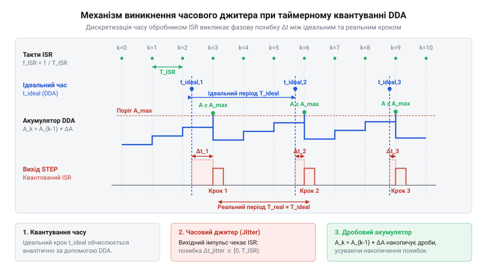
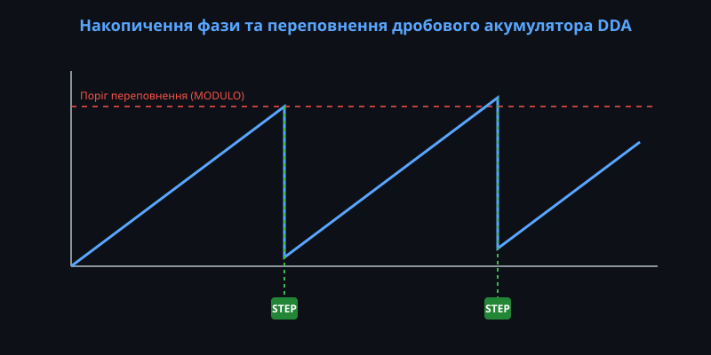
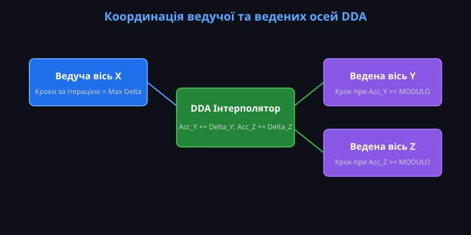
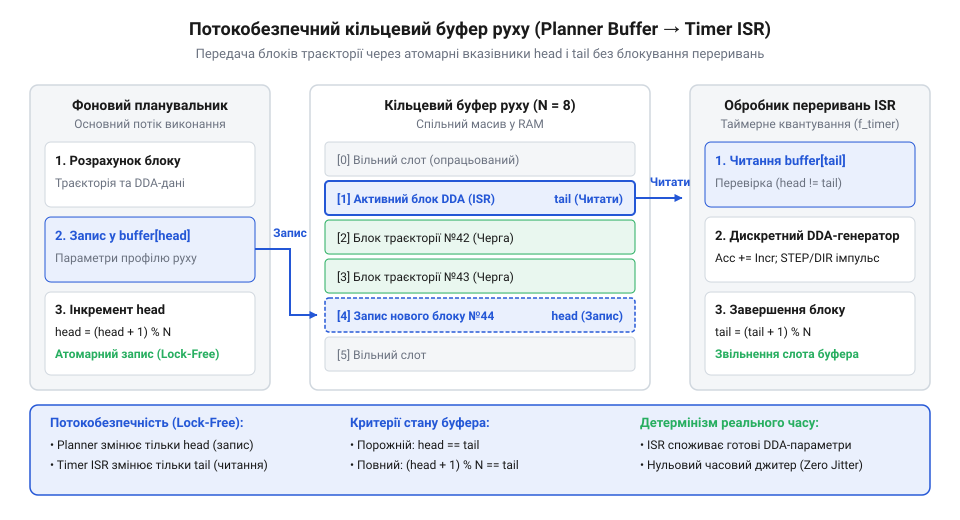
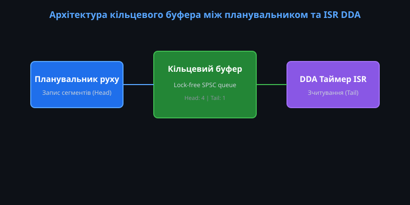

# Генератор кроків DDA у прошивці: таймерне квантування, дробовий акумулятор і багатоосьовий розгін

<preknowlist>
- [Точний час](root:sf-devices/millis-micros) — принципи апаратного тактування та вимірювання мікросекундних інтервалів таймерами
- [Періодичні події](root:sf-devices/periodic-scheduling) — механізми виклику переривань із фіксованим періодом та обробки тактових подій
</preknowlist>

## Проблема генерації кроків реального часу

Керування сучасними виконавчими механізмами — від верстатів із числовим програмним керуванням (ЧПК) до 3D-принтерів та промислових маніпуляторів — вимагає від прошивки мікроконтролера формування точних часових послідовностей цифрових імпульсів. Щоб перемістити робочий орган інструмента вздовж геометричної траєкторії зі заданою швидкістю, електродвигун повинен здійснювати дискретні мікрокроки через суворо визначені часові інтервали. Наприклад, якщо привід із роздільною здатністю 80 імпульсів на міліметр рухається зі швидкістю 100 мм/с, обчислювальна система зобов'язана генерувати 8000 імпульсів щосекунди. Це означає, що період між сусідніми кроками становить рівно 125 мікросекунд. Найменше відхилення цього інтервалу викликає нерівномірність обертального моменту двигуна, виникнення акустичного шуму, механічний резонанс конструкції та незворотну втрату точності позиціонування.

Розробники початкового рівня нерідко намагаються реалізувати формування часових інтервалів через програмні затримки або виклики активного очікування (@@en|busy-wait@@; від англ. *busy* — зайнятий та *wait* — чекати) безпосередньо в головному циклі програми `main()`. Такий наївний підхід є критично хибним. Під час активної затримки процесорний модуль повністю блокується, втрачаючи можливість обробляти вхідні дані датчиків, зчитувати команди з послідовного порту або здійснювати розрахунок кінематики. Якщо ж спробувати позбутися блокування за допомогою механізмів [неблокуючої обробки часу](root:sf-devices/nonblocking-time), розраховуючи моменти спрацьовування через постійне опитування системного лічильника (@@en|polling@@), виникає інша фундаментальна проблема — часовий дрейф. Час виконання самого циклу `main()` залежить від кількості умовних розгалужень, розбору чергового блоку @@en|G-code@@ та наявності інших переривань, тому інтервал між зчитуваннями часу постійно флуктує.

Від аналогових інтеграторів ЧПУ до мікроконтролерних DDA-генераторів

Історично еволюція методів цифрової інтерполяції руху розпочалася ще в 1960-х роках із застосуванням апаратних схем дискретних цифрових диференціальних аналізаторів (@@en|DDA@@, @@en|Digital Differential Analyzer@@; від англ. *digit* — число, *differentia* — різниця та *analyze* — досліджувати) на базі дискретної логіки та спеціалізованих великих інтегральних схем (БІС). В електронно-обчислювальних машинах перших поколінь обчислення з плаваючою комою в реальному часі були апаратно недоступними або надто повільними. Це змусило інженерів розробити алгоритми цілочисельного накопичення похибки, які додавали дробові прирости координати на кожному такті базового генератора імпульсів. З появою універсальних мікроконтролерів апаратні DDA-блоки зникли як окремі мікросхеми, перемістившись у прошивки вбудованих систем у вигляді програмних обробників переривань. Попри зміну апаратної платформи, збереження єдиного фізичного стандарту ліній керування @@en|STEP/DIR@@ забезпечило повну архітектурну наступність між класичними промисловими системами керування рухом та сучасними мікроконтролерними прошивками.

Єдиним способом забезпечення строго детермінованої генерації імпульсів у реальному часі є використання апаратних таймерів мікроконтролера. Апаратний таймер працює незалежно від обчислювального ядра процесора і генерує періодичний сигнал переривання з фіксованою частотою квантування F_ISR (наприклад, 100 кГц з періодом T_ISR = 10 мкс). Обробник переривання таймера (@@en|timer ISR@@, @@en|Interrupt Service Routine@@; від англ. *interrupt* — переривати, *service* — обслуговування та *routine* — програма) перериває виконання основного циклу `main()`, виконує коротку послідовність атомарних інструкцій формування кроку та негайно повертає керування. Організація системного часу на основі [періодичних викликів переривань](root:sf-devices/periodic-scheduling) дає змогу відокремити обчислення траєкторії від часового тактування. Для високоточного вимірювання затримок виконання самого обробника застосовують інструменти [профілювання системних таймерів](root:sf-devices/esp-timer-profiling).

Проте дискретизація часу за допомогою переривань таймера вносить власне спотворення — квантування часу (@@en|timer quantization@@). Оскільки обробник @@en|timer ISR@@ викликається лише у дискретні моменти часу, кратні періоду квантування `T_ISR = 1 / F_ISR`, будь-який розрахований ідеальний момент виходу імпульсу `t_ideal`, який не збігається точно з тактом таймера, змушений округлюватися до найближчого дискретного такту. Внаслідок цього максимальна абсолютна похибка генерації імпульсу `Δt_max` обмежена величиною періоду таймера `T_ISR`. Якщо привід вимагає генерації імпульсів із частотою `f_step` та ідеальним періодом `T_step = 1 / f_step`, відносна часова похибка квантування `ε` визначається співвідношенням частот:

```
ε = Δt_max / T_step
  = (1 / F_ISR) / (1 / f_step)     [перехід від періодів до частот]
  = f_step / F_ISR                 [спрощення відношення частот]
```

Щоб оцінити масштаб цього впливу на стабільність швидкості, розглянемо порівняльний розрахунок похибки для цільової частоти кроків `f_step = 8` кГц (період `T_step = 125` мкс) за різних частот таймерного переривання `F_ISR`.

При низькій частоті таймера `F_ISR = 10` кГц (`T_ISR = 100` мкс) відносна похибка становить:

```
ε = 8000 / 10000
  = 0.8                            [обчислення відносної похибки]
```

У цьому режимі абсолютне часове відхилення сягає 100 мкс, через що реальний міжкроковий інтервал флуктує між 100 мкс та 200 мкс, спричиняючи колосальний 80% фазовий джитер і жорстку вібрацію двигуна.

При збільшенні частоти до `F_ISR = 100` кГц (`T_ISR = 10` мкс) похибка суттєво зменшується:

```
ε = 8000 / 100000
  = 0.08                           [обчислення відносної похибки]
```

Максимальний зсув фази знижується до 10 мкс, а пульсація міжкрокового інтервалу падає до 8%, що забезпечує прийнятну плавність ходу для більшості стандартних приводів.

При використанні високочастотного таймера `F_ISR = 1` МГц (`T_ISR = 1` мкс) досягається прецизійна детермінованість:

```
ε = 8000 / 1000000
  = 0.008                          [обчислення відносної похибки]
```

Абсолютна похибка не перевищує 1 мкс, а рівень джитера падає нижче 0.8%, що повністю усуває акустичний резонанс та забезпечує ідеально рівномірну обертальну швидкість приводу.


*Часова діаграма квантування прямокутного сигналу STEP у фіксованій сітці переривань ISR, що демонструє виникнення часового фазового джитера.*

Різниця між ідеальним моментом генерації кроку та фактичним тактом виклику ISR створює фазовий джитер кроків (@@en|step jitter@@; від англ. *jitter* — тремтіння). Джитер призводить до того, що мікрокроки випромінюються з невеликими часовими зсувами, створюючи високочастотні пульсації швидкості. Детальний аналіз математичного спектра та методів оптимізації дискретизації викладено в [аналізі таймерного квантування та джитера](root:sf-devices/dda-step-generation/math-timer-quantization-jitter.md).

Драйвер крокового двигуна та сервоприводу з інтерфейсом STEP/DIR

Фізичне переміщення механічної осі здійснюється через апаратний цифровий драйвер, який сприймає керуючі сигнали від мікроконтролера через два головні провідники: @@en|STEP@@ (крок) та @@en|DIR@@ (напрямок). Кожен імпульс на лінії @@en|STEP@@ змушує драйвер повернути ротор двигуна або перемістити сервопривід на один мікрокрок (@@en|microstepping@@), а логічний рівень на лінії @@en|DIR@@ задає напрямок обертання. Драйвери мають суворі вимоги до часових параметрів сигналів: мінімальну тривалість активного імпульсу t_STEP_MIN (зазвичай від 1 до 2.5 мікросекунд), час встановлення напрямку (@@en|setup time@@) t_SETUP та час утримання (@@en|hold time@@) t_HOLD. Якщо прошивка мікроконтролера змінить сигнал @@en|DIR@@ безпосередньо під час формування імпульсу @@en|STEP@@ або сформує занадто короткий строб, внутрішній мікрокроковий дільник драйвера не встигне зафіксувати перехід, що призведе до пропуску кроку та зсуву всієї системи координат.

Нижче наведено порівняльний приклад реалізації: наївний блокуючий підхід проти детермінованого тактування через таймерне переривання.

:::tabs
:::code root\eng\sf-devices\dda-step-generation/dda-step-generation-d/c/esp-idf/naive-step-generation.c c
:::code root\eng\sf-devices\dda-step-generation/dda-step-generation-d/cpp/arduino/stepgeneratorisr.cpp cpp
:::

## Цілочисельний DDA-акумулятор із фіксованою комою

Прості цілочисельні дільники частоти (на кшталт відліку фіксованої кількості тактів ISR) працюють виключно тоді, коли необхідний період кроку є точним цілим кратним періоду таймера T_ISR. Однак при реальному русі обчислена швидкість постійно змінюється, утворюючи дробові відношення періодів (наприклад, 12.43 такту на один крок). Використання арифметики з плаваючою комою (@@en|floating-point arithmetic@@) всередині високочастотного обробника переривань є неприпустимим з трьох причин: вона виконується надто повільно на мікроконтролерах без апаратного модуля FPU, вимагає збереження додаткового контексту регістрів FPU при вході в переривання і накопичує похибку округлення мантиси при тривалих обчисленнях.

Розв'язанням цієї проблеми є алгоритм DDA на основі арифметики з фіксованою комою (@@en|fixed-point arithmetic@@; від лат. *fixus* — нерухомий, прикріплений). Алгоритм моделює цілочисельний дробовий акумулятор (@@en|fractional accumulator@@), який виконує роль точного фазового інтегратора позиції. 

У 32-бітній регістровій архітектурі змінна `accumulator` типу `uint32_t` представляє дробову частину координати, де повна розрядна сітка 2³² відповідає точно одному цілому кроку двигуна. На кожному такті переривання таймера (з частотою F_ISR) до акумулятора додається приріст фази ΔA (@@en|step phase increment@@), значення якого визначається поточною цільовою швидкістю. Коли привід розганяється або гальмує під час виконання [трапецеїдальних і S-подібних профілів](root:sf-devices/planner-trapezoidal-s-curve-profile), значення ΔA динамічно змінюється прямо на льоту між сусідніми тактами обробника переривань. Головна перевага цілочисельного акумулятора полягає у збереженні фазової безперервності: при зміні ΔA поточний вміст змінної `accumulator` не скидається і не перезаписується. Накопичений дробовий залишок зберігається від попереднього такту, завдяки чому акумулятор точно інтегрує змінну швидкість у координату без втрати мікрокроків та без фазових стрибків. Для безпечної зміни ΔA на льоту оновлення регістру приросту має здійснюватися атомарно, аби обробник переривань не зчитав частково змінене значення у момент перезапису з боку фонового планувальника.

формула розрахунку приросту акумулятора:
ΔA = round((f_step ÷ F_ISR) × 2³²)

Коли сума в акумуляторі перевищує значення 2³² - 1, виникає арифметичне переповнення. Це означає, що накопичені дробові частини сформували один повний фізичний крок, і обробник переривання генерує імпульс на лінії @@en|STEP@@.

Ключовою математичною особливістю DDA-акумулятора є те, що під час переповнення акумулятор **не скидається в нуль**. У мовах C та C++ додавання до змінної типу `uint32_t` при досягненні 2³² природним чином загортається за модулем 2³². Це означає, що в акумуляторі автоматично залишається дробовий залишок від попереднього кроку (`accumulator - 2³²`). Завдяки збереженню залишку похибка квантування не накопичується, а переноситься на наступні інтервали, забезпечуючи нульовий дрейф позиції на дистанціях у мільйони кроків.

Розглянемо покроковий приклад обчислення для заданих параметрів:
Частота переривань таймера F_ISR = 100 000 Гц (період T_ISR = 10 мкс). Цільова частота імпульсів кроків f_step = 12 500 Гц. Коефіцієнт відношення k = 12 500 ÷ 100 000 = 0.125.

Приріст фази для 32-бітного акумулятора розраховується так:

ΔA = 0.125 × 4.294.967.296
   = 536.870.912                      [обчислення приросту фази]

Покрокове накопичення в обробнику ISR:
- Такт 1 (t = 10 мкс): acc = 0 + 536.870.912 = 536.870.912 (< 2³², крок відсутній)
- Такт 2 (t = 20 мкс): acc = 1.073.741.824 (< 2³²)
- Такт 3 (t = 30 мкс): acc = 1.610.612.736 (< 2³²)
- Такт 4 (t = 40 мкс): acc = 2.147.483.648 (< 2³²)
- Такт 5 (t = 50 мкс): acc = 2.684.354.560 (< 2³²)
- Такт 6 (t = 60 мкс): acc = 3.221.225.472 (< 2³²)
- Такт 7 (t = 70 мкс): acc = 3.758.096.384 (< 2³²)
- Такт 8 (t = 80 мкс): acc = 4.294.967.296 (≥ 2³²) -> Переповнення! Генерація імпульсу STEP! - Залишок після переповнення: acc - 4.294.967.296 = 0.

Фактичний період між кроками склав 8 × 10 мкс = 80 мкс, що точно відповідає ідеальному періоду 1 ÷ 12 500 Гц = 80 мкс. 

Якщо ж цільова частота не ділить період таймера націло (наприклад, f_step = 13 000 Гц, ΔA = 558.345.748), дробовий залишок регулюватиме чергування 7 та 8 тактів таймера, забезпечуючи точну середню частоту без втрати кроків. Детальні теореми та аналіз точності викладено в [математичному апараті DDA-акумулятора](root:sf-devices/dda-step-generation/math-dda-fixed-point-accumulator.md).


*Динаміка зміщення дробового залишку в регістрі DDA-акумулятора та генерація імпульсу STEP під час переповнення порогового значення.*

Апаратний інтерфейс ліній керування STEP/DIR та портів вводу-виводу

Для досягнення максимальної швидкодії у перериванні керування вихідними пінами (@@en|GPIO@@, @@en|General-Purpose Input/Output@@) здійснюється через прямий запис у атомарні регістри портів (наприклад, `BSRR` в ARM Cortex-M або `GPIO_OUT_W1TS` / `W1TC` у мікроконтролерах ESP32), що запобігає гонитві сигналів. У складніших архітектурах формування імпульсів передають апаратним блокам таймерного порівняння (@@en|output compare@@) або модулям прямого доступу до пам'яті (@@en|DMA@@); докладніше див. [генерація імпульсів STEP/DIR засобами DMA](root:sf-devices/dma-step-generation-hardware-acceleration). При використанні оптопар для гальванічної розв'язки необхідно враховувати затримки ввімкнення та вимкнення оптрона (t_d_on, t_d_off), які можуть спотворювати симетричність імпульсу. Окрім основних ліній @@en|STEP@@ та @@en|DIR@@, обробник керує додатковими сигналами: лінією дозволу роботи (@@en|ENABLE@@) для зняття струму з обмоток під час паузи та вхідною лінією тривоги (@@en|FAULT@@) для миттєвого блокування генерації при аварії драйвера.

Нижче наведено повну реалізацію 32-бітного DDA-акумулятора та обробника переривань таймера.

:::tabs
:::code root\eng\sf-devices\dda-step-generation/dda-step-generation-d/c/esp-idf/dda-calculate-increment.c c
:::code root\eng\sf-devices\dda-step-generation/dda-step-generation-d/cpp/arduino/ddastepgenerator.cpp cpp
:::

## Таймерне квантування та фазовий джитер

Формування точно дозованих часових інтервалів для керування приводами руху у прошивках мікроконтролерів найчастіше покладають на апаратні таймери. Коли двигун має виконати крок, цифровий вихід змінює свій стан з низького на високий. Проте фізичний час між сусідніми кроками є неперервною величиною, яка залежить від поточної швидкості траєкторії. Якщо переривання таймера (@@en|timer ISR@@, від англ. *timer Interrupt Service Routine*, від лат. *interruptus* — перерваний та *servitium* — служба) дискретизує часову шкалу з фіксованим періодом `T_ISR`, генератор не здатний видати імпульс у довільний дробовий момент часу. Система змушена очікувати наступного такту переривання. Така розбіжність між ідеальним математичним моментом генерації кроку та реальним моментом його фізичного виходу викликає таймерне квантування (@@en|timer quantization@@, від лат. *quantus* — скільки) та спричиняє так званий часовий фазовий джитер (@@en|step jitter@@, від англ. *jitter* — тремтіння, коливання).

Для розуміння джерела фазової похибки розглянемо математичну модель акумулятора DDA під час тактування фіксованою частотою `f_ISR`. У кожному такті обробника переривань до поточного стану акумулятора додається цілочисельний приріст фази. Коли відбувається переповнення накопичувача, прошивка генерує сигнал на лінії @@en|STEP/DIR@@. Якщо ідеальний розрахований період між кроками `T_step_ideal` не є кратним цілому числу періодів таймера `T_ISR`, справжній вихідний імпульс формується із запізненням.

```
t_real = k · T_ISR                    [реальний момент спрацьовування ISR]
t_ideal = t_prev + T_step_ideal       [ідеальний часовий момент наступного кроку]
δt = t_real - t_ideal                 [величина часового фазового джитера]
-T_ISR < δt ≤ 0                       [математична межа похибки квантування]
```

Отриманий вираз показує, що максимальна абсолютна величина часового джитера не перевищує одного тривалого періоду квантування `T_ISR`. Однак відносна величина цієї похибки відносно періоду кроку `T_step_ideal` істотно зростає з підвищенням частоти обертання приводу. Коли частота генерації кроків `f_step` наближається до частоти переривань `f_ISR`, часовий джитер викликає нерівномірну часову відстань між сусідніми імпульсами. Наприклад, якщо періоди відрізняються на частку мікросекунди, один крок може сформуватися через 2 такти таймера, а наступний — через 3 такти. Це призводить до виникнення механічних вібрацій, підвищеного акустичного шуму та втрати крутного моменту крокового двигуна на високих швидкостях.

Крім дискретизації часу базовою частотою тактування, існує додаткове джерело часового зсуву — затримка реакції на переривання (@@en|interrupt latency@@, від англ. *latency* — прихованість). На реальному мікроконтролері обробка переривання таймера може затримуватися через виконання критичних секцій коду з блокуванням переривань, роботу інших високопріоритетних периферійних модулів або затримки шини пам'яті.

```
t_actual = k · T_ISR + τ_lat          [реальний момент із урахуванням апаратної затримки]
```

Тут `τ_lat` — динамічна зміна часу входу в ISR, яка додається до математичного джитера квантування. Якщо тривалість `τ_lat` порівняна з часом встановлення (@@en|setup time@@) або утримання (@@en|hold time@@) сигналів драйвера, привід може пропустити крок або некоректно зчитати напрямок руху @@en|STEP/DIR@@. Використовуючи [періодичні тактові переривання](root:sf-devices/periodic-scheduling) з високою частотою, розробник зменшує `T_ISR`, але збільшує навантаження на обчислювальне ядро. Щоб точно оцінити тривалість критичних ділянок коду та затримок, здійснюють аналіз затримок [системними таймерами контролера](root:sf-devices/esp-timer-profiling), а точне [вимірювання мікросекундних інтервалів](root:sf-devices/millis-micros) дозволяє контролювати реальний розподіл часових квантів.

Для зменшення негативного впливу фазового джитера у прошивках застосовують кілька підходів:
1. Збільшення частоти тактування `f_ISR` до значень, при яких `T_ISR` стає значно меншим за мінімальний період кроку `T_step_min`. 2. Динамічне переналаштування періоду таймера (@@en|prescaler@@ та регістрів порівняння), коли ISR викликається не через фіксовані часові інтервали, а точно в момент наступного кроку. 3. Використання апаратних модулів порівняння (@@en|output compare@@) або прямого доступу до пам'яті (@@en|DMA@@). Застосування розрахунків для [апаратного прискорення таймерами](root:sf-devices/dma-step-generation-hardware-acceleration) дає змогу повністю усунути програмний джитер `τ_lat`, оскільки імпульси на лініях @@en|GPIO@@ формуються периферійним блоком без участі процесора.

Для глибокого математичного аналізу [відхилень часових інтервалів](root:sf-devices/dda-step-generation/math-timer-quantization-jitter.md) під час тактування переривачами розраховують спектральний склад фазового шуму та гармонічні складові вібрації приводу.

## Багатоосьова координація та ведуча вісь

Під час керування багатоосьовими системами — такими як 3D-принтери, верстати з ЧПУ або маніпулятори — робочий орган повинен переміщатися уздовж чітко визначеної просторової траєкторії. Якщо прямолінійний відрізок вимагає одночасного зсуву по осі X на 800 кроків, а по осі Y на 300 кроків за один і той самий проміжок часу `T_move`, обидва приводи зобов'язані завершити рух синхронно. Якщо осі генеруватимуть імпульси незалежно одна від одної, інструмент відхилиться від заданої прямої лінії, що призведе до порушення геометричної точності виробу.

Для забезпечення суворого просторового зв'язку в прошивці виділяють провідну вісь (@@en|leading axis@@, від англ. *lead* — вести). Провідною обирається вісь, яка має найбільшу кількість кроків у даному блоці руху:

```
ΔS_max = max(|ΔS_X|, |ΔS_Y|, |ΔS_Z|)   [визначення переміщення провідної осі]
```

Всі інші осі траєкторії стають веденими осями (@@en|follower axis@@, від англ. *follow* — слідувати). Сама провідна вісь визначає тактування базового DDA-циклу: кожні `ΔS_max` тактів генерують один крок провідної осі. Ведені осі синхронізують свої прирости акумулятора пропорційно до співвідношення їхніх переміщень до переміщення провідної осі.


*Підпис:* Геометричне узгодження кроків веденої осі Y з тактами провідної осі X та накопичення дискретної похибки.

Математично приріст дробового акумулятора (@@en|fractional accumulator@@, від лат. *accumulare* — накопичувати) для веденої осі обчислюється на базі арифметики з фіксованою комою (@@en|fixed-point arithmetic@@):

```
N_overflow = 2³²
ΔN_follower = ( |ΔS_follower| / |ΔS_leading| ) × N_overflow     [обчислення приросту фази веденої осі]
Acc_new = Acc_old + ΔN_follower                                 [накопичення похибки в кожному такті]
```

У кожному такті провідної осі ведена вісь додає значення `ΔN_follower` до свого акумулятора. Коли відбуваються переповнення регістра (досягнення `N_overflow`), генерується імпульс кроку веденої осі. Завдяки цьому алгоритму Брезенгема (@@en|Bresenham algorithm@@) просторове відхилення траєкторії не перевищує половини одного мікрокроку протягом усього шляху.

Під час виконання розгону та гальмування швидкість руху інструмента змінюється за певним кінематичним профілем — наприклад, трапецеїдальним (@@en|trapezoidal profile@@, від англ. *trapezoid* — трапеція) або S-подібним (@@en|S-curve profile@@, від англ. *S-curve* — S-подібна крива). Найважливішою властивістю алгоритму DDA є те, що при зміні швидкості змінюється лише частота тактування провідної осі `f_dda`, тоді як прирости акумуляторів ведених осей `ΔN_follower` залишаються абсолютно незмінними.

Оскільки геометричні коефіцієнти залежать виключно від просторового вектора переміщення, вектор напрямку руху не спотворюється під час прискорення або уповільнення. Під час [розрахунку трапецеїдальних профілів](root:sf-devices/planner-trapezoidal-s-curve-profile) прискорення фоновий планувальник обчислює нові значення часових інтервалів для провідної осі, забезпечуючи плавність ходу. Щоб детально розібратися у збереженні просторової пропорційності, вивчіть [багатоосьовий кінематичний розрахунок](root:sf-devices/dda-step-generation/math-multiaxis-kinematic-dda.md).

Обчислення параметрів блоків руху (розрахунок вектором `ΔS`, кутових швидкостей та моментів гальмування) потребує значних обчислювальних ресурсів і виконується у фоновому потоці або головному циклі програми. Натомість генерація імпульсів повинна відбуватися строго в реальному часі у високопріоритетному обробнику переривань (@@en|timer ISR@@).

Для безперебійного зв'язку між фоновим планувальником траєкторій та перериванням таймера використовують буфер планувальника (@@en|planner buffer@@), організований як потокобезпечний кільцевий буфер (@@en|ring buffer@@, від англ. *ring* — коло).


*Підпис:* Потокобезпечна передача блоків траєкторії з фонового потоку в переривання таймера.

Фоновий процес додає розраховані блоки траєкторії за вказівником `head`, а обробник переривань зчитує поточний блок за вказівником `tail`. Зміна індексів здійснюється через атомарні операції (@@en|atomic operation@@, від грец. *atomos* — неподільний), що виключає стан гонитви (@@en|race condition@@) без застосування важких операційних блокувань (м'ютексів). Для вивчення архітектури передачі даних можна звернутися до опису того, як влаштований [інтерфейс зв'язку планувальника](root:sf-devices/dda-step-generation/api-dda-motion-planner-interface.md) у коді прошивки. Також корисно знати, що [математика цілочисельного DDA-акумулятора](root:sf-devices/dda-step-generation/math-dda-fixed-point-accumulator.md) лежить в основі оновлення регістрів кожного блоку.

Нижче наведено практичну реалізацію багатоосьового DDA-генератора кроків усередині обробника переривань таймера з використанням кільцевого буфера блоків руху.

:::tabs
:::code root\eng\sf-devices\dda-step-generation/dda-step-generation-d/c/esp-idf/dda-timer-isr-handler.c c

:::code root\eng\sf-devices\dda-step-generation/dda-step-generation-d/cpp/arduino/ddablock.cpp cpp
:::

Повна практична [реалізація генератора кроків](root:sf-devices/dda-step-generation/proj-dda-step-generator-isr.md) у коді переривання показує розгортання цих структур на мікроконтролері з оптимізацією викликів регістра.

## Динамічний розгін і кільцевий буфер

Механічна система керування рухом не здатна миттєво змінити швидкість переміщення від нульового значення до цільової робочої подачі через наявність інерції ротора двигуна та рухомих мас верстата. Спроба подати імпульси керування @@en|STEP/DIR@@ (англ. *step/direction*, від *step* — крок, та *direction* — напрямок) із максимальною робочою частотою призводить до механічного заклинювання, пропуску кроків та виходу приводу з синхронізму. Для забезпечення плавності ходу швидкість інструмента повинна змінюватися за розрахованим траєкторним профілем: трапецеїдальним @@en|trapezoidal profile@@ (англ. *trapezoidal profile*, від грецького *trapezion* — чотирикутник, та латинського *profilum* — обрис) з постійним прискоренням або S-подібним @@en|S-curve profile@@ (англ. *S-curve profile*, від *S-curve* — крива у формі літери S) з обмеженням швидкості наростання прискорення. У дискретному цифровому диференціальному аналізаторі @@en|DDA@@ (англ. *Digital Differential Analyzer*, від *digital* — цифровий, *differential* — різницевий, та *analyzer* — аналізатор) зміна швидкості означає, що приріст фази акумулятора @@en|step phase increment@@ має неперервно оновлюватися на льоту без зупинки генерації імпульсів.

Виконання складних математичних розрахунків профілів швидкості, які вимагають обчислення квадратних коренів або поліномів третього ступеня, безпосередньо всередині високочастотного обробника переривань таймера @@en|timer ISR@@ спричиняє неприпустиме зростання затримки переривань @@en|interrupt latency@@ та фазового джитера імпульсів @@en|step jitter@@. Щоб уникнути часового десинхронізму, архітектуру прошивки розділяють на два незалежних рівні: фоновий планувальник руху @@en|planner buffer@@ (англ. *planner buffer*, від англійського *plan* — задум/план, та латинського *buffer* — проміжне сховище) та реальний генератор імпульсів таймера. Коли [розраховуються профілі швидкості](root:sf-devices/planner-trapezoidal-s-curve-profile) у фоновому планувальнику, траєкторія розбивається на послідовність коротких кінематичних сегментів. Спеціалізований [інтерфейс планувальника руху](root:sf-devices/dda-step-generation/api-dda-motion-planner-interface.md) визначає уніфіковану структуру блоку руху, який описує кінематичний стан приводів на кожному інтервалі.

Кожен блок руху містить підсумкову кількість кроків домінуючої осі @@en|leading axis@@, початковий приріст фази акумулятора, прискорення приросту фази на один такт переривання, маску напрямків портів вводу-виводу та співвідношення ведених осей @@en|follower axis@@. Динамічна зміна приросту фази на кожному такті обробника переривань `k` описується дискретним рівнянням:

```
ΔN_k = ΔN_0 + α × k      [лінійна зміна приросту фази DDA]
= ΔN_k-1 + α             [дискретний приріст на кожному такті ISR]
```

Отриманий приріст `ΔN_k` додається до 32-бітного акумулятора з фіксованою комою @@en|fixed-point arithmetic@@:

```
N_accum = N_accum + ΔN_k      [накопичення фази ведучої осі]
```

При переповненні цілочисельного акумулятора генерується імпульс кроку ведучої осі, після чого ведені осі синхронізують власні акумулятори відповідно до заданого коефіцієнта. Детальна [багатоосьова кінематична модель](root:sf-devices/dda-step-generation/math-multiaxis-kinematic-dda.md) розглядає узгоджене масштабування векторів для збереження прямолінійності траєкторії під час розгону.


*Потокобезпечна передача кінематичних блоків руху з фонового планувальника в переривання таймера через кільцевий буфер.*

Передача підготовлених блоків руху з основного циклу в @@en|timer ISR@@ здійснюється через кільцевий буфер @@en|ring buffer@@ (англ. *ring buffer*, від давньоанглійського *hring* — коло, та латинського *buffer* — проміжне сховище). Паралельний доступ двох потоків виконання до спільних даних створює загрозу виникнення стану гонитви @@en|race condition@@ (англ. *race condition*, від давньоскандинавського *ras* — гонитва, та латинського *condicio* — стан). Використання традиційних м'ютексів або блокування переривань усередині @@en|timer ISR@@ є неприпустимим, оскільки це порушує детермінованість тактування. Для вирішення цієї проблеми застосовують структуру даних без блокувань @@en|lock-free@@ (англ. *lock-free*, від давньоанглійського *loc* — запір, та *freo* — вільний) формату SPSC (англ. *single-producer single-consumer* — один виробник, один споживач).

У такій черзі фоновий планувальник модифікує лише вказівник запису `tail`, а обробник переривань таймера оновлює лише вказівник зчитування `head`. Вживанням атомарних операцій @@en|atomic operation@@ (англ. *atomic operation*, від грецького *atomos* — неділимий, та латинського *operatio* — дія) з відповідними бар'єрами пам'яті досягається потокобезпечна передача блоків без затримок таймера. Коли стандартні [періодичні тактові події](root:sf-devices/periodic-scheduling) викликають переривання, обробник зчитує черговий блок із буфера й здійснює розгін без переривання ходу.

Коли поточний блок відпрацьовує задану кількість кроків `step_count`, індекс зчитування `head` інкрементується. Для запобігання фазовому розриву накопичений залишок дробової частини акумулятора не скидається в нуль, а зберігається для наступного блоку траєкторії. Це забезпечує математичну неперервність позиціонування та відсутність накопичувальної похибки на стиках між ділянками розгону, сталого руху та гальмування.

:::tabs
:::code root\eng\sf-devices\dda-step-generation/dda-step-generation-d/c/planner-push-block.c c
:::code root\eng\sf-devices\dda-step-generation/dda-step-generation-d/cpp/ddamotioncontroller.cpp cpp
:::

У поданій реалізації атомарне оновлення індексів `head` і `tail` запобігає виникненню некоректного стану при паралельній роботі фонового обробника та переривання. Практична [реалізація у перериванні таймера](root:sf-devices/dda-step-generation/proj-dda-step-generator-isr.md) деталізує керування конкретними реєстрами GPIO та модулями output compare. Для досягнення максимальних частот керування [генерація імпульсів таймерами](root:sf-devices/dma-step-generation-hardware-acceleration) може виконуватися через DMA та апаратне порівняння без постійного втручання процесора.