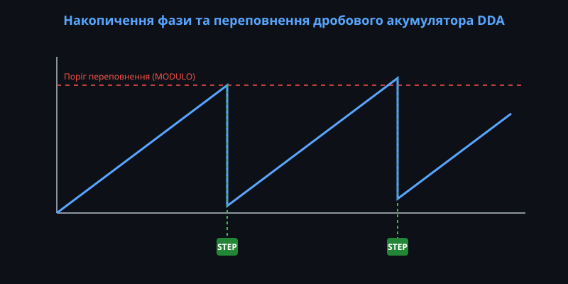
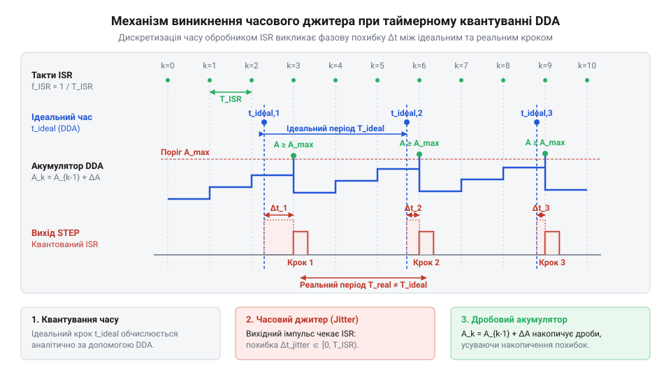
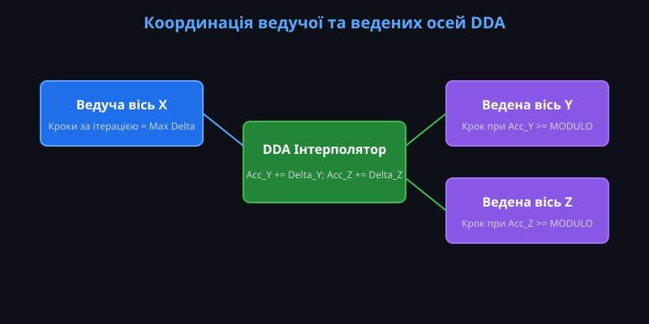
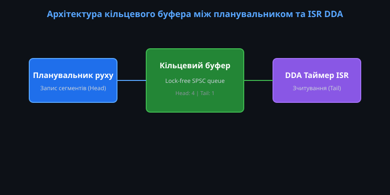

# Генератор кроків DDA у прошивці: таймерне квантування, дробовий акумулятор і багатоосьовий розгін

<preknowlist>
- [Точний час](root:sf-devices/millis-micros) — принципи апаратного тактування та вимірювання мікросекундних інтервалів таймерами
- [Періодичні події](root:sf-devices/periodic-scheduling) — механізми виклику переривань із фіксованим періодом та обробки тактових подій
</preknowlist>

## Необхідність апаратних таймерів для кроків

Керування кроковими двигунами потребує суворої часової рівномірності імпульсів. Якщо затримки між кроками формуються звичайним програмним циклом, будь-яке стороннє навантаження — опитування датчиків, вивід на екран або обробка мережевих пакетів — вносить непередбачувані флуктуації в час виконання. З погляду двигуна, ці мінливі затримки виглядають як різкі ривки ротора. Наслідком стають відчутні вібрації, втрата крутного моменту, а при високих швидкостях — неминучий пропуск кроків і збій позиціонування.

Єдиним надійним способом забезпечити жорсткий ритм імпульсів є винесення генерації кроків у періодичне переривання апаратного таймера. Таймер працює незалежно від головного циклу прошивки і гарантує, що обробник переривання викликатиметься з високою точністю, незалежно від поточних завдань процесора. Це перетворює нестабільну програмну затримку на детерміновану апаратну подію, яка забезпечує плавний і рівномірний рух механіки.

## Механізм цілочисельного дробового акумулятора DDA

Коли швидкість руху задається дробовим числом кроків за цикл переривання, використання математики з плаваючою комою всередині швидкого переривання стає занадто повільним. Для розв'язання цієї проблеми застосовують алгоритм цілочисельного дробового акумулятора (@@en|Digital Differential Analyzer@@). Цей підхід дозволяє моделювати точний фазовий інтегратор виключно за допомогою швидких операцій додавання цілих чисел.

При кожному виклику переривання до спеціального регістру акумулятора додається фіксований цілочисельний приріст швидкості. Як тільки значення в регістрі перевищує його максимальну місткість, відбувається переповнення: прошивка генерує імпульс кроку і віднімає від акумулятора значення порогу. Головна перевага методу полягає в тому, що після переповнення в регістрі залишається математичний залишок. Цей залишок переноситься на наступний цикл, що повністю усуває втрату мікрокроків на довгих дистанціях руху, зберігаючи абсолютну точність без округлень.

## Таймерне квантування та фазовий джитер

Оскільки апаратний таймер викликає переривання з фіксованою періодичністю, момент видачі імпульсу завжди прив'язаний до цієї дискретної сітки часу. Це означає, що імпульс неможливо згенерувати в ідеальний розрахований момент між перериваннями; він завжди відбудеться трохи раніше або пізніше, під час найближчого такту. Ця математична розбіжність між ідеальним і реальним часом кроку створює високочастотне тремтіння фази — @@en|джитер@@.

На низьких обертах вплив джитера непомітний, але на високих швидкостях, коли зазори між кроками стають порівнянними з періодом самого таймера, нерівномірність кроків призводить до акустичного шуму та вібрацій. Щоб зменшити відносну похибку і підвищити плавність ходу, підвищують базову частоту тактування таймера. Чим дрібніший квант часу, тим меншим стає зміщення реального кроку відносно ідеального.

## Багатоосьова координація та провідна вісь

У верстатах або 3D-принтерах рух інструмента часто вимагає одночасного переміщення по кількох осях. Для збереження точності заданої траєкторії приводи повинні бути жорстко узгоджені в просторі. Алгоритм DDA ідеально масштабується для цієї задачі шляхом виділення однієї провідної осі, яка проходить найдовшу дистанцію в поточному сегменті руху.

Провідна вісь задає базовий ритм акумулятора, і з кожним її тактом ведені осі додають до своїх власних акумуляторів пропорційно менші прирости фази. Це гарантує, що всі двигуни синхронно розпочнуть і завершать рух, незалежно від різниці в дистанціях. Завдяки такому жорсткому зв'язку, алгоритм зберігає геометрично правильний напрямок переміщення навіть тоді, коли загальна швидкість на траєкторії динамічно змінюється під час розгону чи гальмування.

## Динамічний розгін і кільцевий буфер

Для реалізації складних профілів розгону необхідно обчислювати кінематичні рівняння руху. Ці обчислення є математично важкими і не можуть виконуватися безпосередньо в обробнику переривання. Тому прошивка розділяє архітектуру на дві частини: фоновий планувальник готує блоки з готовими параметрами DDA, а швидке переривання лише споживає ці дані, генеруючи імпульси.

Передача розрахованих блоків руху відбувається через потокобезпечний кільцевий буфер. Планувальник записує нові блоки у вільні комірки буфера, тоді як переривання таймера послідовно зчитує їх. Перехід від одного блоку до іншого в межах переривання відбувається шляхом атомарної заміни параметрів швидкості та приросту. Це дозволяє безперервно, без зупинок чи блокувань, змінювати профіль швидкості в реальному часі, гарантуючи відсутність втрачених тактів і ривків механіки.