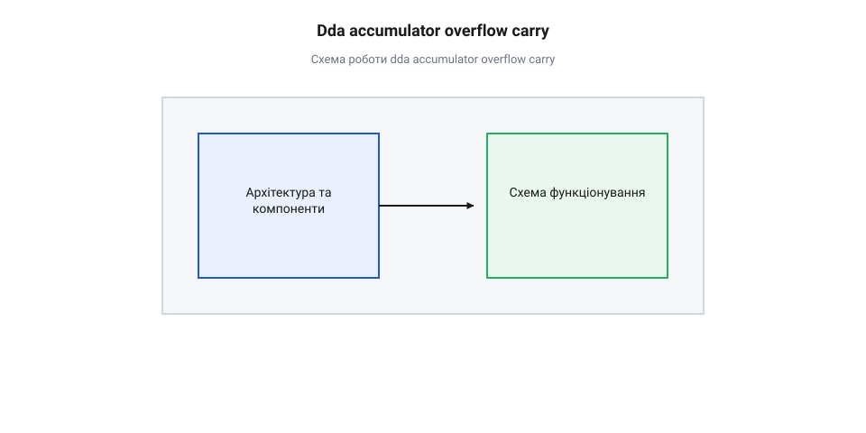

# Математика цілочисельного DDA-акумулятора та фіксованої коми

<preknowlist>
- [Періодичні події](root:sf-devices/periodic-scheduling) — принцип тактування таймерних переривань із фіксованим інтервалом ISR
</preknowlist>

## Накопичення похибки при плаваючій частоті

У задачах прецизійного управління рухом у мікроконтролерних системах — від позиціонування головок 3D-принтерів і верстатів з ЧПК до робототехнічних маніпуляторів — прошивка пристрою має генерувати послідовності крокових імпульсів для силових драйверів двигунів. Кожен імпульс на лінії STEP відповідає повороту ротора на один дискретний крок або мікрокрок. Швидкість переміщення робочого органу прямо пропорційна частоті доходження цих імпульсів.

Найпростішим і найрозповсюдженішим способом формування часових інтервалів є використання системного апаратного таймера. Такий таймер налаштовують на роботу у режимі регулярних викликів, обробку яких здійснюють [регулярні таймерні переривання](root:sf-devices/periodic-scheduling) `@@en|interrupt service routine@@` (ISR). Таймер працює з постійною частотою тактування `f_ISR` (наприклад, `100 000` Hz, що відповідає строго фіксованому інтервалу між сусідніми викликами переривання `T_ISR = 10 μs`).

Наївна реалізація алгоритму зміни швидкості приводу полягає в тому, що обробник переривань лічить кількість тактових інтервалів `N`, яку необхідно зачекати між двома послідовними кроковими імпульсами. Якщо цільова частота обертання вимагає генерації імпульсів із частотою `f_step`, то математична кількість тактів переривань між кроками обчислюється як співвідношення частоти тактування ISR до бажаної частоти кроків:

```
N = f_ISR ÷ f_step
```

Оскільки обчислення в прошивці мікроконтролера виконуються за допомогою цілочисельної арифметики, результат ділення змушено округлюється відкиданням дробової частини. Це операція цілочисельного ділення `@@en|integer division@@`.

Розглянемо конкретний приклад. Нехай системний таймер генерує переривання із частотою `f_ISR = 100 000` Hz, а поточна розрахована швидкість профілю вимагає генерації кроків із частотою `f_step = 3 500` Hz. Математичний розрахунок дає дробову кількість тактів:

```
N_ideal = 100 000 ÷ 3 500
= 28.571428...            [ідеальне математичне значення]
```

Оскільки апаратний лічильник переривань ISR може оперувати лише цілими числами тактів, розробник змушений обрати ціле значення `N = 28` (при відкиданні дробової частини) або `N = 29` (при округленні до найближчого цілого).

Якщо обрати значення `N = 28`, фактичний інтервал між кроками становитиме `28 × 10 μs = 280 μs`. Фактична частота генерації імпульсів при цьому дорівнюватиме:

```
f_actual = 100 000 ÷ 28
≈ 3571.428 Hz             [фактична частота кроків]
```

Різниця між цільовою частотою `3500` Hz та фактичною частотою `3571.428` Hz складає `71.428` Hz. На кожному згенерованому кроці виникає похибка округлення (від латинського *truncare* — урізати) `@@en|truncation error@@`: кроковий імпульс формується раніше на `0.571428` такту таймера (тобто на `5.714 μs`).

Якщо ж обрати `N = 29`, фактичний інтервал між імпульсами збільшиться до `290 μs`, а реальна частота впаде до `3448.275` Hz. У цьому випадку імпульси запізнюватимуться на `0.42857` такту ISR (на `4.285 μs`).

Головна небезпека наївного підходу полягає в тому, що ця маленька дробова похибка не компенсується на наступних кроках. При виконанні позиціонування на велику відстань — наприклад, при здійсненні `1 000 000` кроків — систематична похибка кожного кроку додається, утворюючи фазовий зсув (від грецького *phasis* — поява, стан) `@@en|phase shift@@` катастрофічних масштабів:

```
ΔT_total = 1 000 000 × 5.71428 μs
= 5 714 280 μs
= 5.71428 s               [сумарне часове відхилення]
```

Накопичений фазовий зсув тривалістю понад 5.7 секунд означає абсолютну втрату часової точності траєкторії. У багатоосьових системах (наприклад, при одночасному русі осей X та Y) таке накопичення похибки призводить до викривлення геометрії деталі, адже кожна вісь викривлятиме свій часовий масштаб залежно від коефіцієнтів округлення.

Спроба розв'язати проблему шляхом використання обчислень із плаваючою комою `@@en|floating-point arithmetic@@` всередині обробника переривань створює дві серйозні перешкоди:

1. **Високе обчислювальне навантаження.** Операції з типом `float` або `double` на мікроконтролерах без апаратного сопроцесора FPU виконуються програмно і займають сотні тактів процесора. Навіть за наявності FPU збереження та відновлення регістрів плаваючої коми під час входження у переривання істотно збільшує латентність ISR. 2. **Незмінність дискретної природи часу.** Навіть якщо обчислювати момент наступного кроку з високою точністю у форматі `float`, фізичний вихід мікроконтролера можна переключити лише в дискретний момент спрацювання таймерного переривання. Дискретизація (від латинського *discretus* — переривчастий) `@@en|discretization@@` часу все одно зберігається.

Таким чином, для прецизійного синтезу частот у реальному часі необхідний математичний апарат, який працює виключно за допомогою швидких цілочисельних операцій, але при цьому забезпечує безперервне накопичення та збереження дробового залишку фази.

## Принцип роботи цілочисельного DDA акумулятора

Ефективним та математично довершеним розв'язанням проблеми дискретизації є цифровий диференціальний аналізатор `@@en|digital differential analyzer@@` (DDA), побудований на фазовому акумуляторі (від латинського *accumulare* — накопичувати, збирати) `@@en|phase accumulator@@`.

В основі роботи DDA акумулятора лежить арифметика з фіксованою комою `@@en|fixed-point arithmetic@@`. У цій концепції звичайне ціле беззнакове число опрацьовується як дробова величина фази у діапазоні від `0.0` до `1.0`.

У прошивці фазовий акумулятор `P` оголошується як 32-бітне ціле беззнакове число (`uint32_t`). Його розрядність становить `32` біти, що відповідає ємності розрядної сітки:

```
M = 2³² = 4 294 967 296
```

Значення акумулятора `P` кодує поточний фазовий стан генератора кроків. Значення `P = 0` відповідає початковій фазі `0.0`, а досягнення значення `P = 2³²` відповідає виконанню одного повного математичного циклу генерації кроку (фаза `1.0`).

На кожному виклику обробника переривань ISR (який тактується з постійною частотою `f_ISR`) до поточного значення акумулятора `P` додається представлена у форматі фіксованої коми цілочисельна константа — приріст фази `@@en|phase increment@@` `ΔP`. Математичний процес описується формулою модульної арифметики (від латинського *modulus* — міра) `@@en|modulo arithmetic@@`:

```
P_new = (P_old + ΔP) mod 2³²
```

Оскільки акумулятор `P` має фізичну розрядність у 32 біти, додавання значення `ΔP` на мові C чи C++ виконується звичайною операцією додавання для `uint32_t`. Коли сума `P_old + ΔP` перевищує максимально можливе значення `2³² - 1` (`4 294 967 295`), відбувається природне цілочисельне переповнення `@@en|integer overflow@@`. На рівні процесорного ядра це супроводжується виставленням прапорця перенесення (від англійського *carry* — перенесення) `@@en|carry bit@@`.

Момент виникнення переповнення акумулятора свідчить про те, що фаза оновлення перетнула межу повного оберту `1.0`. Саме цієї миті прошивка генерує фізичний кроковий імпульс STEP на виході мікроконтролера.


*Накопичення приросту фази ΔP у 32-бітному акумуляторі P: при досягненні та перевищенні межі 2³² генерується кроковий імпульс, а залишок зберігається для наступного такту ISR.*

Ключова математична перевага цілочисельного DDA полягає в тому, що після виникнення переповнення значення акумулятора `P` не обнуляється і не скидається до початкового стану. Завдяки стандартній поведінці беззнакової 32-бітної арифметики в акумуляторі автоматично зберігається точний дробовий залишок:

```
P_remainder = P_old + ΔP - 2³²
```

Щоб чітко усвідомити цей механізм, простежимо числові значення акумулятора `P` на простому модельному прикладі з меншою розрядністю. Нехай ємність акумулятора становить `M = 100`, а приріст фази на кожен такт переривання дорівнює `ΔP = 38`.

Простежимо стан акумулятора по тактів ISR:

| Такт ISR | Стан `P_old` | Обчислення `P_old + ΔP` | Переповнення (Крок) | Залишок `P_new` |
|---|---|---|---|---|
| 1 | 0 | 0 + 38 = 38 | Ні | 38 |
| 2 | 38 | 38 + 38 = 76 | Ні | 76 |
| 3 | 76 | 76 + 38 = 114 | **ТАК** (114 ≥ 100) | **14** (114 - 100) |
| 4 | 14 | 14 + 38 = 52 | Ні | 52 |
| 5 | 52 | 52 + 38 = 90 | Ні | 90 |
| 6 | 90 | 90 + 38 = 128 | **ТАК** (128 ≥ 100) | **28** (128 - 100) |

З таблиці чітко видно: на третьому такті сума досягла 114, що спричинило переповнення (спрацював крок), а у 32-бітному індексі залишилося число 14. Це значення 14 є тим самим дробовим залишком фази, який «проскочив» межу 100 під час третього такту. Він автоматично додається до приросту на четвертому такті, забезпечуючи безупинний безперервний синтез фази.

Жоден фрагмент фазового поступу не втрачається при цілочисельних обчисленнях.

## Математичний розрахунок коефіцієнтів приросту фази

Для того щоб DDA генератор формував послідовність крокових імпульсів із необхідною фізичною частотою `f_step`, необхідно встановити строгу математичну залежність між частотою тактування переривань `f_ISR`, ємністю фазового акумулятора `M = 2³²` та величиною цілочисельного приросту фази `ΔP`.

Розглянемо неперервний часовий інтервал тривалістю в 1 секунду.

За одну секунду системний таймер генерує рівно `f_ISR` переривань. У кожному перериванні обробник додає до фазового акумулятора константу `ΔP`. Отже, загальна величина фази `P_total`, накопичена акумулятором за одну секунду, обчислюється як добуток:

```
P_total = f_ISR × ΔP
```

Один кроковий імпульс генерується кожного разу, коли накопичена фаза перетинає ємність акумулятора `M = 2³²`. Тому кількість згенерованих крокових імпульсів за одну секунду (тобто фактична вихідна частота кроків `f_step`) дорівнює відношенню загальної накопиченої фази до ємності акумулятора:

```
f_step = (f_ISR × ΔP) ÷ 2³²
```

З виведеної базової формули частотного синтезу виведемо вираз для знаходження необхідного значення приросту фази `ΔP` для будь-якої заданої цільової частоти `f_step`:

```
f_step = (f_ISR × ΔP) ÷ 2³²
f_step × 2³² = f_ISR × ΔP      [помножили обидві частини рівняння на 2³²]
ΔP = (f_step × 2³²) ÷ f_ISR    [поділили обидві частини рівняння на f_ISR]
```

Отримана підсумкова формула є фундаментальним рівнянням розрахунку DDA генератора:

```
ΔP = (f_step × 2³²) ÷ f_ISR
```

Оскільки обчислення коефіцієнта `ΔP` виконуються перед початком руху або при зміні швидкості у профілі розгону, значення `ΔP` округлюється до найближчого цілого 32-бітного беззнакового числа.

Проведемо покроковий розрахунок коефіцієнта приросту фази для конкретного практичного прикладу.

**Вихідні дані:**
- Частота тактування таймерних переривань: `f_ISR = 100 000` Hz (`100 kHz`). - Цільова частота генерації крокових імпульсів: `f_step = 3 500` Hz. - Ємність 32-бітного акумулятора: `M = 2³² = 4 294 967 296`.

**Крок 1.** Обчислюємо чисельник формули — добуток цільової частоти та ємності розрядної сітки:

```
P_numerator = 3 500 × 4 294 967 296
= 15 032 385 536 000      [накопичена фаза за секунду]
```

**Крок 2.** Ділимо отриманий добуток на частоту переривань `f_ISR`:

```
ΔP_exact = 15 032 385 536 000 ÷ 100 000
= 150 323 855.36          [точне математичне значення]
```

**Крок 3.** Округлюємо результат до найближчого цілого 32-бітного числа `uint32_t`:

```
ΔP_int = 150 323 855      [цілочисельний коефіцієнт приросту]
```

**Крок 4.** Оцінимо фактичну частоту `f_actual`, яку генеруватиме DDA акумулятор із цим цілочисельним коефіцієнтом:

```
f_actual = (150 323 855 × 100 000) ÷ 4 294 967 296
= 15 032 385 500 000 ÷ 4 294 967 296
≈ 3499.9999916 Hz         [фактична вихідна частота]
```

Абсолютна похибка відтворення частоти становить:

```
Δf = |3 500 - 3 499.9999916|
= 0.0000084 Hz            [8.4 мікрогерца]
```

Відносна похибка встановлення частоти складає всього `0.00000024%`. Для обчислення та аналізу точності таймерних інтервалів у реальному мікроконтролері можна також скористатися інструментами [профілювання продуктивності за допомогою системних таймерів ESP-IDF](root:sf-devices/esp-timer-profiling).

Розрядність 32 біти забезпечує дискретність квантування частоти `Δf_min`, що дорівнює:

```
Δf_min = f_ISR ÷ 2³²
= 100 000 ÷ 4 294 967 296
≈ 0.00002328 Hz           [мінімальний крок зміни частоти]
```

Це означає, що розробник може регулювати вихідну частоту з дискретністю у тисячні частки мілігерца, оперуючи виключно 32-бітними цілими числами.

## Точність квантування та збереження залишку

Розглянемо математичні гарантії точності позиціонування, які надає механізм цілочисельного DDA з безперервним збереженням залишку.

Для того щоб виконавчий механізм перемістився на задану відстань у `K` кроків, фазовий акумулятор повинен накопичити сумарну фазу, еквівалентну `K` повним переповненням розрядної сітки:

```
P_target = K × 2³²
```

Нехай процес генерації кроків триває протягом `N_ticks` тактів таймерних переривань ISR. За цей час до акумулятора було додано значення `ΔP` рівно `N_ticks` разів. Загальна сума доданої фази становить:

```
P_accumulated = N_ticks × ΔP
```

Кількість згенерованих крокових імпульсів `K_actual` у момент часу `N_ticks` дорівнює цілій частині від ділення загальної накопиченої фази на ємність розрядної сітки `2³²`:

```
K_actual = floor((N_ticks × ΔP) ÷ 2³²)
```

Значення, яке залишається в 32-бітному акумуляторі `P` у будь-який момент часу, математично тотожне залишкам від ділення:

```
P_current = (N_ticks × ΔP) mod 2³²
```

Оскільки значення `P_current` за визначенням беззнакового 32-бітного числа строго лежить у межах від `0` до `2³² - 1`, відхилення кількості фактично виданих імпульсів `K_actual` від ідеальної теоретичної кількості фазових кроків у будь-яку секунду роботу задовольняє нерівність:

```
|K_ideal - K_actual| < 1 крок
```

Це фундаментальний результат: **абсолютна похибка позиціонування DDA генератора строго обмежена величиною менше 1 кроку на усій траєкторії руху.**

Незалежно від того, скільки часу триває переміщення — 1 секунду чи 10 годин, і скільки кроків було зроблено — 1 000 чи 1 000 000 000 — накопичена похибка координати не зростає і дорівнює нулю. Залишок фази не втрачається, а постійно зберігається в нижніх бітах акумулятора.

Проте дискретизація часу вносить тимчасові мікроскопічні відхилення моменту генерації окремих імпульсів. Це явище має назву фазовий джитер (від англійського *jitter* — тремтіння, коливання) `@@en|phase jitter@@`.

Оскільки кроковий імпульс може бути сформований лише в момент виконання переривання ISR, реальний часовий інтервал між двома сусідніми кроками варіюється між двома цілими значеннями тактів: `floor(N)` та `ceil(N)`.

Максимальне відхилення моменту появі фізичного імпульсу від ідеального математичного моменту часу називається похибкою квантування (від латинського *quantus* — скільки) `@@en|quantization@@` часу `Δt_jitter`. Вона строго обмежена періодом таймерного переривання `T_ISR`:

```
Δt_jitter ≤ T_ISR = 1 ÷ f_ISR
```

При частоті переривань `f_ISR = 100 000` Hz період `T_ISR` становить `10 μs`. Це означає, що кожен окремий імпульс може з'явитися з відхиленням не більше `±10 μs` від ідеального часового графіка.

Оскільки це відхилення є високочастотним коливанням в межах одного такту ISR і не має тенденції до накопичення, ротор двигуна та механічні елементи приводу завдяки своїй механічній інерції виконують роль фільтра низьких частот. Механічний привід фізично розгладжує мікроскопічний джитер, забезпечуючи ідеально плавний рух механізмів.

Таким чином, математична модель цілочисельного DDA-акумулятора з фіксованою комою поєднує абсолютну точність позиціонування на нескінченних інтервалах із високою обчислювальною ефективністю для реалізації у прошивках будь-яких мікроконтролерів.