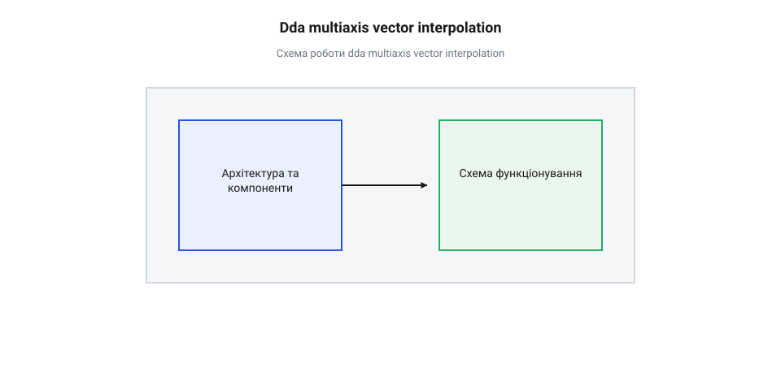
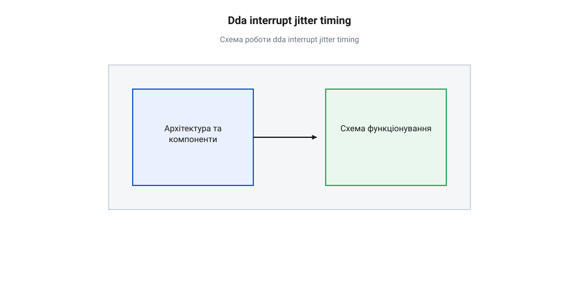

# Математика багатоосьової інтерполяції та розгону у DDA-генераторі

## Початкові концепції та базові принципи

Уявімо трикоординатний фрезерний верстат з ЧПУ або 3D-принтер, де робочому органу потрібно переміститися з точки `(0, 0, 0)` у точку з координатами `(1000, 400, 200)` крокових імпульсів. Якщо кожен виконавчий двигун подаватиме кроки незалежно зі власною довільною частотою, інструмент рухатиметься не по прямій лінії, а по ламаній траєкторії з різкими зламами. Для виготовлення точної деталі потрібна сувора лінійна @@lat|інтерполяція@@ (від лат. *interpolatio* — поновлення, переробка), при якій пропорції переміщень між усіма осями зберігаються на кожному мікрокроці.

Кожен крок двигуна є дискретною подією у фізичному просторі. Щоб сформувати плавний @@en|вектор переміщення@@, система повинна узгодити роботу всіх осей відносно єдиного часового ритму. Для реалізації такого координаційного механізму застосовується цифровий диференціальний аналізатор (англ. *digital differential analyzer*, від *digital* — цифровий, *differential* — різницевий, *analyzer* — аналізатор), або @@en|DDA@@. Його суть полягає у зведенні багатовимірної просторової геометричної задачі до простих цілочисельних ітерацій.

### Принцип вибору ведучої осі

У багатоосьовій кінематиці загальна тривалість виконання траєкторії визначається віссю, яка має виконати найбільшу кількість крокових імпульсів. Для тривимірного @@en|вектора переміщення@@ з координатами `ΔX`, `ΔY` та `ΔZ` визначається максимальне за модулем значення:

    S_max = max(|ΔX|, |ΔY|, |ΔZ|)

Вісь, для якої модуль переміщення дорівнює `S_max`, отримує статус @@en|ведуча вісь@@ (англ. *leading axis*, від *lead* — вести, *axis* — вісь). Усі інші осі у векторі називаються @@en|ведені осі@@ (англ. *follower axis*, від *follow* — слідувати, *axis* — вісь).

Роль @@en|ведучої осі@@ є фундаментальною: вона задає тактову сітку генерації імпульсів. На кожному ітераційному тику @@en|ведуча вісь@@ робить рівно один фізичний крок. У цей же момент кожна @@en|ведена вісь@@ на основі власного накопичувача приймає рішення: згенерувати крок чи залишитися в поточному стані.

### Математичний апарат цілочисельного акумулятора DDA

Розглянемо плоский випадок, де @@en|ведуча вісь@@ `X` має переміщення `ΔX`, а @@en|ведена вісь@@ `Y` має переміщення `ΔY`, причому `0 ≤ ΔY ≤ ΔX`. Ідеальний кутовий коефіцієнт прямої лінії задається відношенням `k = ΔY / ΔX`. Для будь-якого кроку `k_step` @@en|ведучої осі@@ точна теоретична координата @@en|веденої осі@@ повинна дорівнювати:

    Y_ideal = (ΔY / ΔX) · k_step

Використання чисел із плаваючою крапкою для обчислення `Y_ideal` у реальному часі спричиняє обчислювальне перевантаження мікроконтролера та призводить до накопичення похибок округлення. Замість цього @@en|DDA@@ застосовує цілочисельний @@en|акумулятор помилки@@ `E`.

Нехай `E_k` — значення @@en|акумулятора помилки@@ на кроці `k`, `ΔY` — цілочисельне переміщення @@en|веденої осі@@, а `ΔX` — цілочисельне переміщення @@en|ведучої осі@@. На кожному тику @@en|ведучої осі@@ до @@en|акумулятора помилки@@ додається значення `ΔY`. Якщо @@en|акумулятор помилки@@ досягає або перевищує поріг `ΔX`, ґенерується крок @@en|веденої осі@@, а з @@en|акумулятора помилки@@ віднімається значення `ΔX`.

Формула рекурентного оновлення @@en|акумулятора помилки@@ `E_(k+1)` на кроці `k+1` має вигляд:

    E_(k+1)
    = E_k + ΔY                    [додавання цілочисельного приросту веденої осі]
    = E_k + ΔY - ΔX               [корекція акумулятора при генерації кроку веденої осі]

Перед початком руху @@en|акумулятор помилки@@ ініціалізується значенням `E_0 = ΔX / 2` (або за допомогою зсуву `ΔX >> 1`). Це симетричне зміщення зміщує @@en|квантування@@ (англ. *quantization*, від *quantum* — кількість) таким чином, що максимальне просторове відхилення від ідеальної лінії не перевищує `±0.5` кроку.

### Покроковий приклад двоосьової інтерполяції

**Приклад розрахунку двоосьової DDA-інтерполяції для вектора (8, 3)**

Розглянемо випадок, коли @@en|ведуча вісь@@ `X` виконує `ΔX = 8` кроків, а @@en|ведена вісь@@ `Y` виконує `ΔY = 3` кроки. Початкове значення @@en|акумулятора помилки@@ дорівнює `E_0 = 8 / 2 = 4`. Обчислення на кожному тику відбуваються за такою послідовністю:

    [Крок 1] E_1 = 4 + 3 = 7 (< 8)  -> Крок X: так,  Крок Y: ні, E_1 = 7
    [Крок 2] E_2 = 7 + 3 = 10 (≥ 8) -> Крок X: так,  Крок Y: так, E_2 = 10 - 8 = 2
    [Крок 3] E_3 = 2 + 3 = 5 (< 8)  -> Крок X: так,  Крок Y: ні, E_3 = 5
    [Крок 4] E_4 = 5 + 3 = 8 (≥ 8)  -> Крок X: так,  Крок Y: так, E_4 = 8 - 8 = 0
    [Крок 5] E_5 = 0 + 3 = 3 (< 8)  -> Крок X: так,  Крок Y: ні, E_5 = 3
    [Крок 6] E_6 = 3 + 3 = 6 (< 8)  -> Крок X: так,  Крок Y: ні, E_6 = 6
    [Крок 7] E_7 = 6 + 3 = 9 (≥ 8)  -> Крок X: так,  Крок Y: так, E_7 = 9 - 8 = 1
    [Крок 8] E_8 = 1 + 3 = 4 (< 8)  -> Крок X: так,  Крок Y: ні, E_8 = 4

У результаті @@en|ведуча вісь@@ `X` зробила рівно 8 кроків, а @@en|ведена вісь@@ `Y` зробила рівно 3 кроки. Кінцевий стан @@en|акумулятора помилки@@ `E_8 = 4` збігається з початковим значенням `E_0`, що підтверджує абсолютну циклічну замкненість алгоритму.

### Верифікація цілочисельної кінематики

Математична @@en|цілочисельна кінематика@@ на основі @@en|DDA@@ гарантує абсолютну відсутність накопичувальної похибки позиціонування. Протягом виконання повного відрізка з `ΔX` тиків до @@en|акумулятора помилки@@ додається сумарне значення:

    E_sum = ΔX · ΔY

Оскільки фіксований віднімальний поріг корекції дорівнює `ΔX`, точна кількість згенерованих кроків @@en|веденої осі@@ дорівнює цілій частці від ділення `(ΔX · ΔY) / ΔX = ΔY`.

Це означає, що незалежно від довжини траєкторії, виконаної маніпулятором, кількість імпульсів на кожній осі точно відповідатиме розрахованому @@en|вектору переміщення@@. Мікроконтролер може безпечно виконувати [обробку неблокуючого часу](root:sf-devices/nonblocking-time) та [використовувати системні таймери](root:sf-devices/esp-timer-profiling) для керування перериваннями без ризику втрати координатної точності.

## Внутрішня будова та алгоритми роботи

Архітектурно багатоосьовий @@en|генератор кроків@@ на базі @@en|DDA@@ складається з двох рівнів: просторового планувальника та часового таймерного рушія. Просторовий рівень відповідає за збереження геометричної пропорції @@en|вектора переміщення@@, тоді як часовий рівень керує швидкістю проходження тактів.

*Взаємодія ведучої осі та цілочисельних акумуляторів ведених осей під час крокової інтерполяції вектора.*

### Векторний розгін та синхронізація швидкості

Для плавного руху механізмів без пропуску кроків двигунами необхідний розгін та гальмування. Ключовою перевагою @@en|DDA@@ є те, що математичний розрахунок закону швидкості (наприклад, [трапецеїдального профілю швидкості](root:sf-devices/trapezoidal-velocity-profile)) виконується виключно для векторної траєкторії або @@en|ведучої осі@@.

Коли таймер апаратного переривання змінює період між тиками `T_tick`, змінюється частота кроків @@en|ведучої осі@@. Оскільки @@en|ведені осі@@ прив'язані до тиків @@en|ведучої осі@@ через свої цілочисельні @@en|акумулятори помилки@@, їхня частота імпульсів автоматично масштабується пропорційно часовому інтервалу. Завдяки цьому досягається суворе збереження геометричного @@en|вектора переміщення@@ у просторі при довільних профілях прискорення. Для узгодження періодів таймера прошивка застосовує [планування періодичних подій](root:sf-devices/periodic-scheduling).

### Програмна реалізація DDA-генератора

Нижче наведено практичну реалізацію триосьового @@en|генератора кроків@@ для мікроконтролерів. Приклад показує ініціалізацію @@en|вектора переміщення@@ та крок @@lat|інтерполяції@@ у високопродуктивному перериванні.

:::tabs
:::code root\eng\sf-devices\dda-step-generation/math-multiaxis-kinematic-dda/c/esp-idf/dda-init.c c
:::code root\eng\sf-devices\dda-step-generation/math-multiaxis-kinematic-dda/cpp/arduino/ddagenerator.cpp cpp
:::

### Запобігання крайнім випадкам та колізіям

При реалізації @@en|генератора кроків@@ у реальних пристроях необхідно враховувати фізичні часові обмеження драйверів крокових двигунів:

1. **Час установки напрямку (Direction Setup Time)**: Сигнали напрямку руху `DIR` повинні встановлюватися до подачі першого крокового імпульсу `STEP` на проміжок часу не менше `1..5 мкс`. 2. **Нульове переміщення**: Якщо `S_max == 0`, @@en|генератор кроків@@ повинен негайно завершувати обробку вектора без входу у цикл переривань. 3. **Одночасна генерація імпульсів**: Усі активні магістралі `STEP` повинні переключатися одночасно на початку тику для запобігання фазовим зсувам між осями.

Для діагностики та телеметрії тривалості імпульсів розробник може [вимірювати точний час](root:sf-devices/millis-micros) виконання алгоритму та виконувати [синхронізацію системного часу](root:sf-devices/uptime-clock-sync) у реальному часі.

## Апаратна реалізація та низкорівневий C/C++ код

У високошвидкісних системах керування рухом класичний підхід з викликом стандартизованих функцій введення-виведення для кожного кроку призводить до катастрофічного падіння продуктивності мікроконтролера. Обробка переривання таймера на частоті 100 кГц дає мікроконтролеру з тактовою частотою 160 МГц лише 1600 тактів на один тик. Якщо функція запису у виводи @@en|GPIO@@ (англ. *general-purpose input/output*, від *general-purpose* — загального призначення, *input/output* — вхід/вихід) витрачає 50–100 тактів лише на перевірку номерів виводів та маскування регістрів, системи із кількома осями швидко вичерпують весь процесорний час на накладні витрати переривань. Для збереження плавності потрібні прямолінійні цілочисельні алгоритми та пряма маніпуляція апаратурою.

### Пряме керування портами та атомарність в ISR

Замість послідовного опитування кожної осі в циклі, прошивка готує бітові маски для крокових сигналів `STEP` та сигналів напрямку `DIR`. Усі імпульси `STEP` активних осей повинні виставлятися в один і той самий такт процесора. Це усуває часовий перекіс між фронтами сигналів осей.

Для цього використовується @@en|пряме керування портами@@ (англ. *direct port manipulation*, від *direct* — прямий, *port* — порт, *manipulation* — маніпуляція). У мікроконтролерах ESP32 або STM32 спеціальні регістри встановлення та скидання виводів дозволяють атомарно змінити стани довільної комбінації виводів за одну процесорну інструкцію без ризику пошкодження станів інших периферійних виводів.

### Обчислювальна оптимізація акумулятора DDA

Під час виконання обчислень всередині переривання кожна арифметична операція повинна бути мінімізована. Цілочисельне ділення при ініціалізації початкового стану @@en|акумулятора помилки@@ замінюється бітовим зсувом вправо:

    E_0 = S_max >> 1

Це виконує цілочисельне ділення на 2 за один такт процесора.

Оновлення стану веденої осі виконується додаванням її цілочисельного переміщення `ΔY`. Умова генерації кроку `E >= S_max` оптимізується таким чином, щоб зменшити кількість розгалужень у прогнозувальних переходах конвеєра інструкцій процесора. Арифметика виконується виключно із 32-бітовими знаковими цілими числами `int32_t`, що повністю запобігає стану @@en|переповнення акумулятора@@ (англ. *accumulator overflow*, від *accumulator* — накопичувач, *overflow* — переповнення) при тривалій генерації мільйонів кроків.

### Буферизація відрізків та апаратне розвантаження

При високих частотах генерації імпульсів виклики обробника переривань створюють значне навантаження на процесор. Щоб вивільнити обчислювальні ресурси для розрахунку наступних геометричних траєкторій, прошивка розділяється на два рівні:

1. **Фоновий рівень**: Розбирає геометричні блоки G-коду, розраховує @@en|вектор переміщення@@, визначає @@en|ведучу вісь@@, обчислює початкові стани акумуляторів і записує їх у @@en|ринговий буфер@@ (англ. *ring buffer*, від *ring* — кільце, *buffer* — буфер). 2. **Низькорівневий рівень ISR**: Отримує готові блоки з буфера у режимі реального часу та виконує швидку генерацію кроків за тактами таймера.

У просунутих архітектурах застосовується @@en|апаратне розвантаження@@ (англ. *hardware offloading*, від *hardware* — апаратне забезпечення, *offloading* — розвантаження) через периферійні модулі. Наприклад, спеціалізований модуль генерації сигналів @@en|RMT@@ в ESP32 або апаратні таймери з каналом @@en|DMA@@ (англ. *direct memory access*, від *direct* — прямий, *memory* — пам'ять, *access* — доступ) дозволяють формувати пачки крокових імпульсів безпосередньо у пам'яті та передавати їх у порти без виклику переривань процесора на кожному кроці.

### Практична реалізація прошивки C/C++

Нижче наведено низкорівневий модуль генерації кроків @@en|DDA@@ із використанням прямого запису в регістри портів `GPIO` та кольцового буфера.

:::tabs
:::code root\eng\sf-devices\dda-step-generation/math-multiaxis-kinematic-dda/c/esp-idf/dda-timer-isr-handler.c c
:::code root\eng\sf-devices\dda-step-generation/math-multiaxis-kinematic-dda/cpp/arduino/ddasegment.cpp cpp
:::

Для гарантування надійної роботи та перевірки стабільності прошивки розробники можуть застосовувати [профілювання за допомогою системних таймерів](root:sf-devices/esp-timer-profiling) і налаштовувати [планування періодичних подій](root:sf-devices/periodic-scheduling) у робочих задачах.

## Практичне застосування та відлагодження

Навіть математично досконалий алгоритм @@en|DDA@@ у реальних фізичних пристроях стикається з апаратними обмеженнями, детермінованими граничними випадками та часовими дефектами сигналів. Для забезпечення надійності верстатів або маніпуляторів розробник повинен вміти виявляти потенційні пастки кінематики та налагоджувати систему на фізичному рівні.

### Аналіз та обробка граничних випадків

Під час функціонування @@en|генератора кроків@@ виникає низка критичних геометрій, які потребують суворого дотримання часових та арифметичних умов:

1. **Паралельний рух вздовж однієї осі (`ΔY = 0`, `ΔZ = 0`)**:
   У цьому випадку @@en|ведуча вісь@@ робить `S_max = ΔX` кроків. Для ведених осей значення приросту `ΔY = 0`. Формула оновлення @@en|акумулятора помилки@@ набуває вигляду:

       E_(k+1)
       = E_k + 0                [відсутність приросту веденої осі]
       = E_k                    [акумулятор не змінює значення]

   Оскільки початкове значення `E_0 = ΔX / 2` є меншим за `ΔX`, @@en|ведена вісь@@ не згенерує жодного імпульсу протягом усього відрізка. Алгоритм природно обробляє цей випадок без додаткових розгалужень.

2. **Діагональний рух під кутом 45° (`ΔX = ΔY`)**:
   Коли переміщення двох осей однакові, обидві осі є рівноправними кандидатами на статус ведучої. У разі вибору осі `X` як ведучої (`S_max = ΔX`), акумулятор веденої осі `Y` на кожному тику додає `ΔY = ΔX`:

       E_(k+1)
       = E_k + ΔX               [додавання приросту веденої осі]
       = E_k + ΔX - ΔX          [корекція акумулятора та генерація кроку]
       = E_k                    [значення акумулятора відновлюється]

   Отже, на кожному тику синхронно ґенеруються кроки для обох осей `X` та `Y`, забезпечуючи суворо діагональний @@en|вектор переміщення@@.

3. **Нульові та вироджені відрізки (`S_max = 0`)**:
   Якщо лінійний сегмент має довжину у 0 кроків (`S_max = 0`), спроба обчислення початкового акумулятора `E_0 = 0 / 2` або порівняння `E >= 0` призводить до нескінченного циклу генерації хибних імпульсів. Прошивка повинна перевіряти умову `S_max == 0` на рівні планувальника та миттєво завершувати обробку відрізка без виклику переривань.

4. **Затримки встановлення напрямку**:
   Фізичні драйвери крокових двигунів вимагають мінімального часового інтервалу між зміною рівня на лінії `DIR` та наростаючим фронтом імпульсу на лінії `STEP`. Якщо змінити напрямок руху і одразу згенерувати крок в одному й тому ж тику переривання, драйвер може зробити крок у протилежний бік. Прошивка повинна витримувати часову затримку (від 1 до 5 мкс) або встановлювати маску `DIR` на один тактовий інсульт раніше старту генерації `STEP`.

### Діагностика апаратного джитера переривань

Найбільш небезпечним дефектом прошивки генерації кроків є @@en|джитер переривань@@ (англ. *interrupt jitter*, від *interrupt* — переривання, *jitter* — тремтіння). Джитер виникає тоді, коли інші високопріоритетні переривання (наприклад, обробка мережевих протоколів або системні таймери) тимчасово затримують виконання переривання таймера DDA.

*Викривлення часових інтервалів між кроками при нерівномірній затримці входу в переривання таймера.*

Нерівномірні часові інтервали між імпульсами призводять до виникнення ударних механічних навантажень, акустичного шуму та пропуску кроків двигуном. Для діагностики джитера використовується апаратний @@en|строб-імпульс@@ (англ. *strobe pulse*, від *strobe* — спалах, *pulse* — імпульс): при вході в переривання відлагоджувальний вивід встановлюється у високий рівень, а при виході — у низький.

Підключаючи @@en|логічний аналізатор@@ (англ. *logic analyzer*, від *logic* — логічний, *analyzer* — аналізатор) до відлагоджувального виводу та ліній `STEP`, розробник може візуально виміряти точний час затримки входу в переривання та ширину імпульсу.

### Практична методологія налагодження

При налагодженні багатоосьового DDA-генератора прошивки рекомендується виконувати таку послідовність дій:

1. **Контроль відсутності накопичувальної похибки**: Виконання серії з 10 000 зворотних переміщень по складних векторах із наступною перевіркою повернення в початкову точку. 2. **Аналіз часу виконання переривань**: За допомогою інструментів для [вимірювання точного часу](root:sf-devices/millis-micros) переконатися, що обробка одного тику займає не більше 10–15% від найкоротшого періоду таймера. 3. **Фонова буферизація**: Організація [неблокуючого вимірювання часу](root:sf-devices/nonblocking-time) в основному циклі для запобігання затримкам наповнення буфера кінематики. 4. **Часова синхронізація**: Забезпечити [синхронізацію системного часу](root:sf-devices/uptime-clock-sync) з апаратними таймерами для точного контролю тривалості виконання всієї траєкторії.