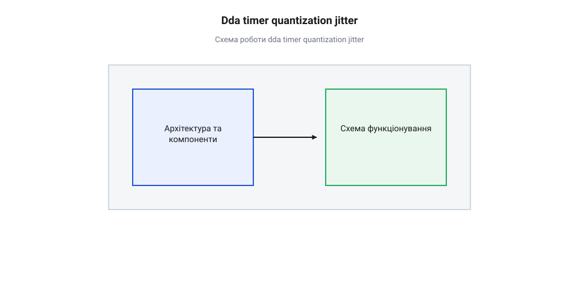
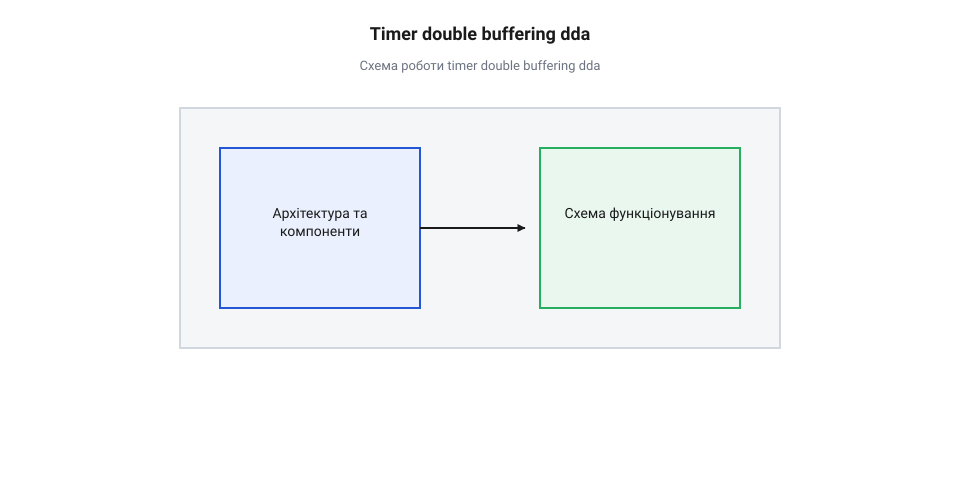

# Математичний аналіз таймерного квантування та часового джитера DDA

## Початкові концепції та базові принципи

У прецизійних системах керування рухом — таких як верстати з числовим програмним керуванням, трьохвимірні принтери, робототехнічні маніпулятори та медичні дозатори — плавність переміщення робочого органу напряму залежить від часової точності генерації імпульсів керування. Для узгодженої інтерполяції координатної траєкторії декількох осей у реальному часі традиційно застосовують алгоритм @@en|DDA@@ (від англ. *Digital Differential Analyzer* — цифровий диференційний аналізатор). У математичній моделі траєкторії вважається, що часовий інтервал між послідовними кроковими імпульсами змінюється абсолютно неперервно та гладко відповідно до розрахованого профілю швидкості. Проте під час практичного виконання алгоритму @@en|DDA@@ усередині фізичного мікроконтролера виникає фундаментальна суперечність між неперервною математикою та дискретною природою обчислювального ядра.

Час у мікроконтролерах вимірюється неперервно лише умовно. Фізичною основою для відліку часових проміжків слугує апаратний @@en|таймер@@ (від англ. *timer* — вимірювач часу), який отримує тактові імпульси від системного генератора через попередній дільник частоти — @@en|прескалер@@ (від англ. *prescaler* — дільник тактової частоти). Внаслідок цього апаратний лічильник здатний вимірювати час лише дискретними порціями, фіксуючи моменти подій з мінімальним неподільним квантом часу:

`T_tick = 1 / f_timer`

де `f_timer` — робоча частота лічильного регістра апаратного таймера після ділення системного тактування.

Коли алгоритм @@en|DDA@@ розраховує теоретичний момент видачі наступного крокового імпульсу, мікроконтролер змушений округлити цей час до найближчого цілого числа тактів таймера. Утворення різниці між математично ідеальним моментом генерації кроку та фактичним моментом спрацьовування апаратного лічильника називається @@lat|квантування@@ (від латинського *quantitas* — кількість) часу. Оскільки кожен послідовний інтервал між кроками округлюється окремо, реальна тривалість періодів постійно коливається навколо ідеального значення. Це миттєве випадкове або періодичне відхилення фази генерації імпульсів називають часовим @@en|джитер@@ (від англ. *jitter* — тремтіння) або фазовим @@en|джитер@@.

Для кращого розуміння природи проблеми розглянемо фізичний вплив такого фазового відхилення на механіку приводу. Кроковий двигун або серводвигун перетворює вхідну послідовність електричних імпульсів у дискретні кутові переміщення ротора. Якщо інтервали між імпульсами є однаковими, електромагнітне поле статора обертається з постійною кутовою швидкістю, забезпечуючи рівномірний обертальний момент. Проте коли в послідовності виникає часовий @@en|джитер@@, окремі імпульси надходять із запізненням або випередженням на кілька мікросекунд.

Реакція механічної системи на часовий @@en|джитер@@ проявляється у вигляді трьох небажаних ефектів:
1. Виникнення мікроскопічних пульсацій моменту та миттєвої швидкості ротора, що спричиняє високочастотну вібрацію механічних вузлів. 2. Генерація акустичного шуму в спектрі частот, що відповідає частоті квантування та варіації періодів імпульсів. 3. Ризик виникнення механічного резонансу та втрати кроків при збігу частоти @@en|джитер@@ з власною резонансною частотою ротора приводу.

Використання програмних затримок або звичайного опитування прапорців таймера в головному циклі програми не здатне забезпечити стабільний час генерації. Для побудови часово-детермінованих систем розробники використовують спеціалізовані [інструменти точного часу](root:sf-devices/millis-micros) та застосовують підходи, які описує [організація періодичних подій](root:sf-devices/periodic-scheduling). Проте навіть при використанні апаратних переривань таймера дискретність частоти `f_timer` залишається непереборним фізичним обмеженням, яке потребує математичного аналізу та спеціальних архітектурних рішень.

Коли розрахований математичний період між кроками `T_ideal` не є кратним кванту таймера `T_tick`, ділення `T_ideal / T_tick` дає дробове число тактів `M = N + r`, де `N` — ціла частина, а `r` — дробовий залишок. Оскільки апаратний лічильник може відрахувати лише цілу кількість тактів, безпосереднє відкидання залишку `r` призвело б до постійного накопичення похибки позиціонування координати. Для збереження точності траєкторії алгоритм @@en|DDA@@ виконує @@lat|акумуляція@@ (від латинського *accumulatio* — нагромадження) дробової частини в цифровому регістрі помилки: на кожному кроці до накопичувача додається `r`, і щойно сума перевищує одиницю, поточний період таймера збільшується з `N` до `N + 1` тактів, а з накопичувача віднімається `1`. Через таке регулярне чергування тривалостей інтервалів послідовність крокових імпульсів набуває періодичної модуляції, де тривалість сусідніх періодів скаче між двома дискретними значеннями. Цей дискретний патерн створює низькочастотні @@en|субгармоніки@@ (від англ. *subharmonics* — додаткові частотні коливання на частотах, нижчих за основну частоту повторення) в спектрі @@en|джитер@@, частота яких визначається періодом повторення дробової послідовності `f_step / K`. Субгармонійний @@en|джитер@@ потрапляє у звуковий діапазон і збігається з резонансними частотами механічного приводу, викликаючи стійке биття та паразитні вібрації ротора навіть за ідеально стабільної середньої швидкості.

## Внутрішня будова та алгоритми роботи

Аналіз часового @@en|джитер@@ у генераторах кроків @@en|DDA@@ вимагає розділення загальної часової похибки на дві незалежні складові: математичну похибку дискретизації апаратного таймера та програмно-апаратну затримку обробки переривань.

Перша складова виникає безпосередньо у цифровому лічильнику. Нехай привід повинен переміщатися зі швидкістю `v` одиниць відстані за секунду при роздільній здатності механіки `S` кроків на одиницю відстані. Ідеальний неперервний інтервал часу між двома послідовними кроками визначається як:

`Δt_ideal = 1 / (v · S)`

Для налаштування апаратного таймера значення регістра порівняння або перезавантаження `N` обчислюється шляхом округлення до найближчого цілого числа тактів:

`N = round(f_timer · Δt_ideal) = round(f_timer / (v · S))`

Внаслідок цього округлення фактичний період між сусідніми імпульсами на виході таймера становить:

`Δt_quantized = N / f_timer`

Абсолютна квантувальна похибка окремого періоду `ε_q` обмежена півінтервалом одного такту таймера `-T_tick / 2 ≤ ε_q ≤ T_tick / 2`.

Нижче наведено покроковий математичний розрахунок часового інтервалу та абсолютного відхилення при округленні періоду:

**Розрахунок квантування часового періоду таймера:**
        Δt_ideal = 1 / (v · S)
        N = round(f_timer · Δt_ideal)               [округлення до найближчого цілого такту лічильника]
        Δt_quantized = N / f_timer                  [відтворення тривалості періоду апаратним таймером]
        ε_q = Δt_quantized - Δt_ideal               [абсолютна похибка квантування одиночного періоду]

З наведеного виведення видно, що відносна похибка квантування періоду зростає із збільшенням частоти генерації кроків (тобто при підвищенні швидкості `v`). Відносний піковий @@en|джитер@@ квантування періоду дорівнює:

`δ_q = T_tick / Δt_ideal = (v · S) / f_timer`

Друга складова виникає під час передачі сигналу від апаратного таймера до виводу мікроконтролера через процедуру обробки переривання — @@en|ISR@@ (від англ. *Interrupt Service Routine* — процедура обробки переривання). Коли апаратний лічильник досягає значення `N`, він генерує запит на переривання. Проте фактичний момент зміни стану виводу `t_actual` відхиляється від моменту спрацьовування таймера `t_timer` на затримку обробки `τ_lat`:

`t_actual = t_timer + τ_lat`

Час затримки переривання `τ_lat` є динамічною величиною і складається з трьох компонентів:

`τ_lat = τ_entry + τ_crit + τ_prio`

де `τ_entry` — апаратний час входження у переривання (збереження регістрів та скидання конвеєра команд), `τ_crit` — час очікування через заблоковані переривання в критичних секціях інших потоків, а `τ_prio` — час витіснення поточним більш пріоритетним перериванням.

Оскільки затримка `τ_lat` змінюється в межах від `τ_min` до `τ_max`, процедура @@en|ISR@@ додає фазовий @@en|джитер@@ `J_ISR = τ_max - τ_min`. Загальний розмах фазового @@en|джитер@@ генерації кроків `J_total` визначається сумою похибки квантування таймера та варіації затримки переривання:

`J_total = T_tick + J_ISR = (1 / f_timer) + (τ_max - τ_min)`

Для вимірювання максимальної тривалості критичних секцій у реальних прошивках розробники застосовують [системне профілювання таймерів](root:sf-devices/esp-timer-profiling), що дозволяє точно визначити верхню межу `τ_max`.


*Часова діаграма порівняння ідеальних моментів кроків, дискретних засічок таймера та реального виходу GPIO з урахуванням варіації затримки переривань ISR.*

Масштабування часового @@en|джитер@@ у просторову похибку позиціонування приводу визначається через робочу швидкість переміщення. Максимальне просторове відхилення положення `Δx_jitter` становить:

`Δx_jitter = v · J_total = v · ( (1 / f_timer) + (τ_max - τ_min) )`

Якщо величина `Δx_jitter` перевищує частку кутового розміру мікрокроку двигуна, рух втрачає плавність і переходить у режим високочастотних автоколивань.

Для повністю радикального усунення компоненти `J_ISR` у сучасних мікроконтролерах відмовляються від програмного перемикання виводів усередині @@en|ISR@@. Замість цього застосовують апаратне перемикання через [апаратний модуль порівняння](root:sf-devices/hardware-output-compare) з подвійним буферуванням. При такій архітектурі обчислювальне ядро або алгоритм @@en|DDA@@ записує тривалість наступного періоду `N_{k+1}` у буферний регістр (`preload register`). В момент збігу лічильника апаратна логіка таймера самостійно змінює стан фізичного виводу GPIO і перезавантажує регістр порівняння за 0 тактів процесора. Це знижує `J_ISR` до абсолютного нуля, залишаючи лише фундаментальний квант `T_tick`.

Нижче наведено порівняльний приклад програмного керування виводом через переривання та апаратного перемикання через регістр порівняння з подвійним буферуванням:

:::tabs
@c|esp-idf
:::code root\eng\sf-devices\dda-step-generation/math-timer-quantization-jitter/c/dda-timer-isr-handler.c c
<!-- slide -->
@cpp|arduino
:::code root\eng\sf-devices\dda-step-generation/math-timer-quantization-jitter/cpp/setupdirecttimercompare.cpp cpp
:::

Для побудови надійної системи керування без блокування виконання основної програми підсистема поєднує розглянуті таймери з підходом, який описує [неблокуючий часовий алгоритм](root:sf-devices/nonblocking-time).

## Апаратна реалізація та низкорівневий C/C++ код

Пряма обробка математики @@en|DDA@@ (від англ. @@en|Digital Differential Analyzer@@ — цифровий диференціальний аналізатор) усередині обробника переривань @@en|ISR@@ (від англ. @@en|Interrupt Service Routine@@ — процедура обслуговування переривань) наштовхується на жорстокі фізичні обмеження мікроконтролера. Коли обчислення наступного кроку виконуються в момент спалахування переривання @@en|таймера@@ (від англ. @@en|timer@@ — вимірювач часу), час виконання коду додається до апаратної затримки входження в @@en|ISR@@. Якщо @@en|таймер@@ перезавантажується вручну шляхом запису нового значення в регістр порівняння без урахування поточного лічильника, виникає гонка станів: лічильник може проскочити записане значення, що спричинить пропуск події та затримку на повний цикл переповнення @@en|таймера@@.

Для запобігання цьому в сучасних мікроконтролерах використовують апаратний @@en|теневий регістр@@ (від англ. @@en|shadow register@@ — дублюючий буферний регістр). Розглянемо механіку перезавантаження періоду @@en|таймера@@:

```
N_ticks = T_step × f_timer
= (Δx / v_target) × (f_sys / N_presc)      [підстановка періоду кроку та частоти таймера]
= N_ideal + ε_quant                        [виділення цілої кількості тактів та дробової похибки]
```

Значення `N_ideal` округлюється до цілого числа тактів, а накопичена дробова похибка `ε_quant` переноситься в акумулятор @@en|DDA@@ для наступного кроку. Щоб зміна значення `N_ticks` відбувалася синхронно з генерацією імпульсу без фазового @@en|джитера@@ (від англ. @@en|jitter@@ — дрижання), нове значення записується у буферний регістр порівняння, а апаратний апдейт (перенесення в активний регістр) відбувається автоматично за подією переповнення @@en|таймера@@. Це повністю виключає залежність моменту формування кроку від часових варіацій обробки коду в @@en|ISR@@.

Однак при високих частотах генерації кроків важлива оптимізація обчислень. Для реалізації періодичного оновлення періодів кроку доцільно спиратися на [періодичне планування подій](root:sf-devices/periodic-scheduling), яке гарантує детермінований розподіл обчислювального навантаження між перериваннями та основним циклом. Виміряти точний час виконання @@en|ISR@@ та оцінити затримку входження в переривання можна через [профілювання системними таймерами](root:sf-devices/esp-timer-profiling), що дозволяє підтвердити відсутність накладних витрат у критичних секціях.

Наведемо геометричну та часову схему подвійного буферування регістру порівняння @@en|таймера@@:


*Схема синхронного перенесення значення періоду з теневого регістру в активний за подією UEV.*

Нижче наведено практичну низкорівневу реалізацію генератора кроків @@en|DDA@@ з апаратним буферуванням періодів та фіксованою крапкою для двох платформ.

:::tabs
:::code root\eng\sf-devices\dda-step-generation/math-timer-quantization-jitter/c/esp-idf/dda-timer-isr-callback.c c
:::code root\eng\sf-devices\dda-step-generation/math-timer-quantization-jitter/cpp/arduino/ddastepgenerator.cpp cpp
:::

Завдяки використанню апаратних буферних регістрів нове значення періоду набирає чинності лише на початку наступного часового кванту. Це усуває накопичення часового @@en|джитера@@, викликаного варіюванням часу виконання коду в @@en|ISR@@.

## Практичне застосування та відлагодження

У реальних приводах прецизійних верстатів та робототехнічних систем навіть незначний фазовий @@en|джитер@@ імпульсів у декілька мікросекунд перетворюється на акустичний шум, вібрацію механіки та видимі дефекти обробки поверхні. Найдрібніші відхилення часового інтервалу спричиняють миттєві стрибки кутової швидкості ротора крокового двигуна, викликаючи пульсації електромагнітного моменту.

Для діагностики часового @@en|джитера@@ застосовують цифровий @@el|осцилограф@@ (від грец. @@el|осцилограф@@ — вимірювач коливань) або логічний @@el|аналізатор@@ у режимі статистичного вимірювання інтервалів між фронтами.

Максимальне теоретичне та фактичне значення фазового @@en|джитера@@ оцінюється за формулою:

```
J_total = τ_quant + τ_jitter
= (1 / f_timer) + (τ_max_entry - τ_min_entry)    [підстановка кванту часу та розмаху затримки ISR]
= J_p-p                                          [піковий розмах фазового джитера]
```

Коли частота генерації кроків наближається до граничної частоти виклику @@en|ISR@@, виникає ефект насичення ланцюжка переривань. Якщо тривалість виконання коду @@en|ISR@@ `τ_exec` перевищує період кроку `T_step`, мікроконтролер повністю втрачає можливість виконувати фонові задачі основного циклу, що призводить до зависання процесора.

Для виявлення та запобігання подібним граничним випадкам корисно відстежувати часові інтервали за допомогою [функцій точного часу](root:sf-devices/millis-micros), що дозволяє контролювати реальну частоту генерації кроків та виявляти затримки. Одночасно, розрахунок траєкторії та оновлення параметрів @@en|DDA@@ мають здійснюватися через [неблокуючу обробку часу](root:sf-devices/nonblocking-time) в основному циклі, щоб обчислення високого рівня не блокували таймерні переривання.

Основні практичні методи мінімізації та усунення @@en|джитера@@ під час відлагодження системи підсумовано у наступному списку:

* **Підвищення частоти тактування таймера (`f_timer`):** Зменшує квант часу `τ_quant = 1 / f_timer`, звужуючи дискретність вибору періодів. * **Апаратна генерація імпульсів через DMA або Toggle-режим:** Перенесення перемикання лінії @@en|GPIO@@ (від англ. @@en|General Purpose Input/Output@@ — вхід/вихід загального призначення) на апаратний модуль порівняння або @@en|DMA@@ (від англ. @@en|Direct Memory Access@@ — прямий доступ до пам'яті) повністю виключає затримку `τ_jitter` обробника @@en|ISR@@. * **Оптимізація пріоритетів переривань:** Переривання @@en|таймера@@ @@en|DDA@@ повинно мати найвищий апаратний пріоритет у системі, щоб виключити витіснення іншими периферійними модулями.

Діагностична таблиця граничних випадків та методів їх усунення:

| Граничний випадок / Симптом | Фізична причина | Метод усунення |
| :--- | :--- | :--- |
| Резонансний гул двигуна при низькій швидкості | Дискретне квантування періоду `τ_quant` створює низькочастотні гармоніки | Підвищити частоту таймера `f_timer`, використати 32-бітні таймери |
| Пропуск кроків при розгоні приводу | Тривалість @@en|ISR@@ `τ_exec` більша за мінімальний період `T_step` | Перенести обчислення @@en|DDA@@ в основний цикл, використати подвійне буферування |
| Періодичний «смик» ротора двигуна | Витіснення @@en|ISR@@ таймера вищостійким перериванням (наприклад, @@en|UART@@ / @@en|USB@@) | Підвищити пріоритет переривання таймера, вимкнути довгі критичні секції |

Завдяки поєднанню апаратного буферування періодів, оптимального налаштування пріоритетів переривань та точно розрахованої математики @@en|DDA@@ досягається висока рівномірність ходу приводу та мінімізується фазовий @@en|джитер@@ у широкому діапазоні швидкостей.