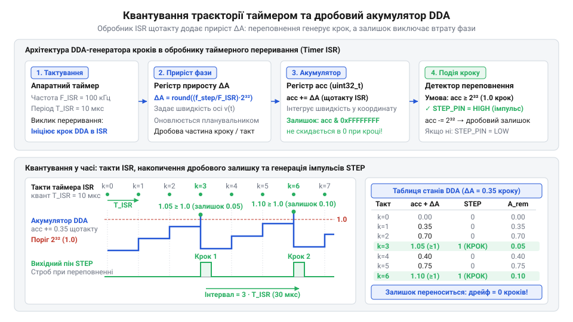
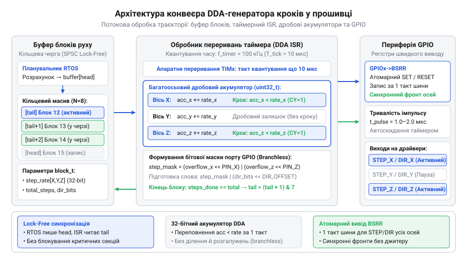
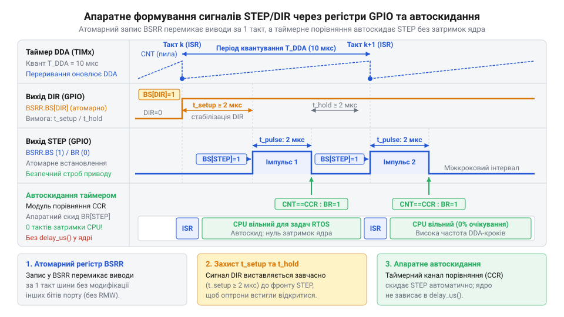
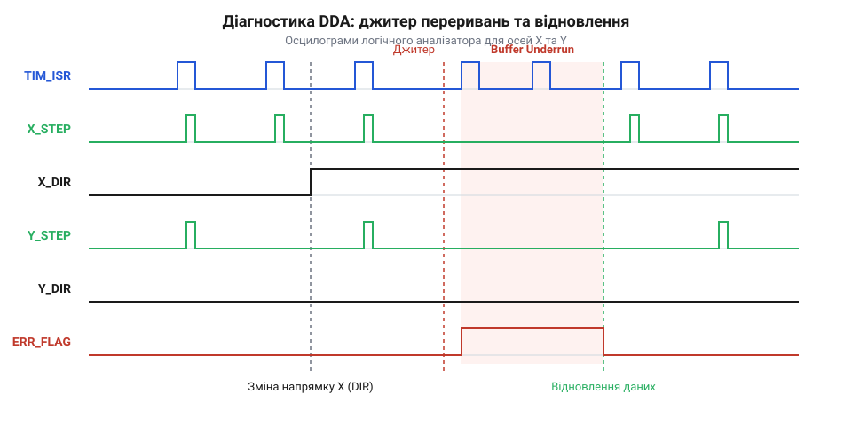

# Генератор кроків DDA у прошивці: таймерне квантування, дробовий акумулятор і багатоосьовий розгін

## Початкові концепції та фізичні принципи

У цифровому керуванні рухом переміщення робочого органа формується комбінацією обертання незалежних приводів. Кожен привід керується через цифровий інтерфейс @@en|STEP/DIR@@ (від англ. *Step/Direction* — інтерфейс імпульс/напрямок): імпульс на лінії `STEP` повертає ротор на крок або мікрокрок, а потенціал на `DIR` задає напрямок. При русі вздовж похилої лінії переміщення осей є нерівномірним: якщо осі `X` потрібно зробити 1000 кроків, а `Y` — 300, їхній рух має тривати абсолютно однаковий час. Видача імпульсів осі `Y` пачкою або на початку відрізка викривить траєкторію та деформує деталь.

Прямолінійність відрізка вимагає жорсткої координації: миттєві швидкості осей мусять перебувати у сталому відношенні, рівному відношенню переміщень. Програмні затримки у прошивці для цього непридатні: очікування в циклах блокує ядро процесора та інші задачі. Розрахунок інтервалів між кроками у числах із плаваючою комою у реальному часі також неприйнятний: ділення на мікроконтролерах без FPU забирає десятки тактів і накопичує похибки округлення, спричиняючи просторовий дрейф.

Для розв'язання цієї проблеми застосовують цифровий диференційний аналізатор @@en|DDA@@ (від англ. *Digital Differential Analyzer* — цифровий диференційний аналізатор) або алгоритм Брезенгема @@en|Bresenham's algorithm@@ (за прізвищем автора Jack Elton Bresenham). Метод дискретизує рівняння руху без ділення та множення. Для провідної осі з найбільшою кількістю кроків імпульси видаються з базовою частотою, а ведені осі крокують лише тоді, коли їхнє накопичене просторове відставання перевищує дискретний квант одного кроку.

У вбудованих системах відлік простору підпорядкований фізичному часу через часове квантування @@en|quantization@@ (від лат. *quantum* — скільки; дискретизація неперервного часу на рівні інтервали). Замість розрахунку унікальних інтервалів налаштовують регулярне таймерне переривання @@en|ISR@@ (від англ. *Interrupt Service Routine* — підпрограма обробки апаратного переривання). Базовий період `dt` формує [архітектура апаратних таймерів](root:sf-devices/microcontroller-hardware-timers-architecture) через дільник частоти @@en|prescaler@@ (від лат. *prae* — попереду та англ. *scale* — шкала; подільник вхідної тактової частоти). На кожному такті переривання генератор аналізує стан осей і вирішує, чи видавати імпульс.

Нехай лінійна швидкість осі становить `v_axis`, механічна роздільна здатність приводу — `S_axis`, а переміщення `Δs_axis` за інтервал `Δt` відповідає кількості імпульсів `N_steps`. Тоді миттєву частоту кроків `f_step` визначає вираз:

```
f_step = v_axis · S_axis
       = (Δs_axis / Δt) · S_axis    [визначення лінійної швидкості через приріст координати]
       = N_steps / Δt               [перехід від лінійного переміщення до кількості дискретних імпульсів]
```

Вираз показує, що рух зі швидкістю `v_axis` вимагає генерації рівно `N_steps` імпульсів за інтервал `Δt`. Через квантування часу на періоди `T_tick = 1 / f_timer` частота кроків завжди є дробовою часткою від опорної частоти таймера `f_timer`.

Щоб зберегти дробову частку частоти, @@en|DDA@@ використовує дробовий акумулятор @@en|accumulator@@ (від лат. *accumulare* — накопичувати; цілочисельний регістр накопичення залишку). Працюючи у форматі @@en|fixed-point@@ (від англ. *fixed* — фіксований та *point* — крапка; формат представлення дробових чисел у цілочисельних регістрах), @@en|accumulator@@ накопичує просторову похибку дискретизації. Щоразу в перериванні до регістра додається приріст, пропорційний швидкості. При переповненні прошивка видає імпульс на вивід порту @@en|GPIO@@ (від англ. *General Purpose Input/Output* — порти введення-виведення загального призначення) і віднімає величину порогу. Збереження залишку переносить похибку на наступні кванти часу, забезпечуючи нульовий сумарний просторовий дрейф.

Механічний вузол та ротор двигуна мають масу й інерцію. Миттєва зміна швидкості подачі @@en|feedrate@@ (від англ. *feed* — подача та *rate* — швидкість; лінійна швидкість переміщення робочого органа) вимагає нескінченного прискорення `a = dv / dt → ∞`. Обмежений крутний момент спричиняє зрив ротора та пропуск кроків. Тому [планувальник траєкторій](root:sf-devices/planner-trapezoidal-s-curve-profile) формує фази розгону, сталого руху та гальмування, реалізуючи [трапецеїдальний профіль швидкості](root:sf-devices/trapezoidal-velocity-profile) на основі [арифметики з фіксованою крапкою](root:sf-devices/fixed-point-kinematics).

Під час багатоосьового розгону співвідношення швидкостей осей має залишатися сталим щомиті. Якщо швидкість провідної осі зростає як `v_lead(t) = a_lead · t`, то швидкість веденої осі мусить строго повторювати її з масштабним коефіцієнтом `k_axis = Δs_axis / Δs_lead`, інакше відрізок скривиться у дугу. Водночас затримки виклику переривання породжують тремтіння періоду @@en|jitter@@ (від англ. *jitter* — тремтіння; часова нестабільність періоду між імпульсами), що спотворює швидкість і вимагає [компенсації апаратного джитера](root:sf-devices/interrupt-jitter-mitigation).


*Квантування неперервної швидкості на дискретні періоди таймера та генерування імпульсів STEP за переповненням акумулятора.*

## Внутрішня будова та алгоритми роботи

Архітектура генератора кроків @@en|DDA@@ будується як дволанковий асинхронний конвеєр обробки даних, що розділяє обчислення траєкторії та низькорівневу генерацію сигналів на два часові домени. Перший домен працює у фоновому контексті операційної системи @@en|RTOS@@ (від англ. *Real-Time Operating System* — операційна система реального часу). Задача планувальника розраховує кінематичні параметри, формує компактні блоки @@en|DDA@@ і завантажує їх у кільцевий буфер черги команд @@en|ring buffer@@ (від англ. *ring buffer* — кільцевий буфер). Взаємодія між планувальником та перериванням є неблокуючою @@en|lock-free@@ (від англ. *lock-free* — без блокувань), що виключає очікування на м'ютексах і гарантує детермінований доступ.

Другий домен виконується всередині високопріоритетного обробника апаратного переривання таймера @@en|ISR@@. Він виступає споживачем блоків: вилучає черговий елемент із буфера, оновлює акумулятори осей і безпосередньо керує регістрами виводів. Щоб генератор кроків не зупинявся під час руху через затримки планувальника, прошивка здійснює [захист від спустошення буфера](root:sf-devices/dda-buffer-underrun-protection).

Кожен блок руху містить мінімальний набір параметрів для швидкої обробки в перериванні: кількість тактів квантування для фаз прискорення, сталого руху та гальмування, бітову маску напрямку осей і початкові крокові прирости акумуляторів. Такий поділ дозволяє обробнику модифікувати параметри швидкості лише на межах фаз без повторних алгебраїчних розрахунків на кожному такті.

При фіксованій частоті таймера `f_timer` цілочисельний приріст акумулятора `ΔA_axis` за один квант часу визначається частотою кроків `f_step`, швидкістю осі `v_axis`, роздільною здатністю приводу `S_axis` та модулем переповнення 32-бітного регістра `2³²`:

```
ΔA_axis = (f_step / f_timer) · 2³²
        = (v_axis · S_axis · 2³²) / f_timer    [підстановка частоти кроків через швидкість осі]
        = K_scale · v_axis                     [групування сталих коефіцієнтів у масштабний множник]
```

Виведений вираз визначає кількість одиниць, що додається до регістра накопичувача на кожному такті. Оскільки додавання здійснюється за модулем `2³²`, переповнення акумулятора відбувається з точною середньою частотою `f_step`, а залишок автоматично зберігається для наступних циклів без втрати точності.

На 32-бітних процесорах операція `accumulator += step_increment` у типі `uint32_t` виконує переповнення за модулем `2³²` автоматично за один машинний такт без ділення. Подію генерації кроку фіксують умовою `accumulator < step_increment`, яка є істинною в момент циклічного переповнення беззнакового числа.

Коли умова переповнення виконується, обробник формує вихідні імпульси. Прошивка записує бітову маску безпосередньо в регістри портів @@en|GPIO@@, забезпечуючи синхронне перемикання ліній `STEP` для всіх осей за один такт системної шини. Для розвантаження ядра на граничних частотах може використовуватися [генерація кроків через DMA](root:sf-devices/dda-dma-generation).

Формування імпульсу кроку вимагає дотримання часових обмежень драйверів двигунів (зазвичай від 1 до 2 мкс). Щоб не затримувати процесор очікуванням завершення імпульсу всередині переривання, скидання виводу здійснює [модуль порівняння таймера](root:sf-devices/hardware-output-compare) або наступний такт квантування.

Практичну реалізацію алгоритму таймерного DDA-генератора кроків подано мовою C та обгорткою драйвера на C++:

:::tabs
@tab C
:::code root/eng/sf-devices/dda-step-generation/proj-dda-step-generator-isr/c/main.c c
@tab C++
:::code root/eng/sf-devices/dda-step-generation/proj-dda-step-generator-isr/cpp/main.cpp cpp
:::

Реалізація мовою C мінімізує накладні витрати в критичній секції завдяки прямим бітовим операціям над масивами осей. Клас на C++ інкапсулює стан @@en|DDA@@, налаштовує апаратні таймери та забезпечує взаємодію з планувальником руху.


*Потокова обробка траєкторії від планувальника до апаратних виводів через кільцевий буфер та обробник таймерних переривань.*

## Апаратна реалізація та низькорівневий C/C++ код

На робочих частотах 50–150 кГц період квантування становить 7–20 мкс, тож кожен машинний такт в обробнику переривань @@en|ISR@@ вичерпує жорсткий часовий бюджет. Затягування виконання наближає навантаження процесора @@en|CPU@@ до 100%, блокуючи планування та порушуючи [оптимізація граничних затримок p99](root:sf-devices/esp-tail-latency-optimization). Обробник виключає виклики підпрограм, динамічну пам'ять і розгалуження: генерація спирається на [архітектура апаратних таймерів](root:sf-devices/microcontroller-hardware-timers-architecture) і потребує детермінованого виконання за мінімум інструкцій.

Виклики `digitalWrite()` витрачають 40–80 тактів на вісь через пошук портів і цикл зчитування-модифікації-запису, створюючи зсув між лініями. Щоб синхронізувати фронти без накладних витрат, прошивка записує бітову маску безпосередньо в регістри швидкого встановлення та скидання ліній @@en|BSRR@@ (від англ. *Bit Set/Reset Register* — 32-бітний регістр атомарного встановлення та скидання виводів порту). Запис маски в молодшу половину регістра одночасно перемикає виводи @@en|STEP/DIR@@ усіх осей у високий стан за один такт шини без модифікації сусідніх бітів порту @@en|GPIO@@. Повернення ліній кроку в нуль здійснює [апаратний модуль порівняння таймера](root:sf-devices/hardware-output-compare) або скидання маски на наступному такті.

Нехай `N_inst` — кількість тактів ядра на одне виконання `ISR`, `f_cpu` — тактова частота процесора, а `f_timer` — частота таймерного квантування @@en|DDA@@. Частку процесорного часу `U_cpu`, яку генератор споживає в перериванні, визначає формула:

```
U_cpu = (N_inst / f_cpu) · f_timer     [підстановка тривалості одного виклику обробника]
      = (N_inst · f_timer) / f_cpu     [зведення до спільного дробу]
```

Вираз показує, що навантаження ядра зростає прямо пропорційно до кількості тактів обробника та частоти викликів.

**Розрахунок завантаження ядра процесора при високочастотній генерації кроків:**
Для частоти ядра `f_cpu = 160` МГц (160 000 000 Гц), базової частоти квантування `f_timer = 100` кГц (100 000 Гц) та циклу обробника трьох осей на `N_inst = 96` тактів:

```
U_cpu = (96 · 100000) / 160000000        [підстановка тактової частоти та кількості інструкцій]
      = 9600000 / 160000000               [кількість тактів переривань за секунду]
      = 0.06 = 6.0 %                      [частка завантаження центрального процесора]
```

Висновок: оптимізований обробник споживає 6% потужності ядра, залишаючи 94% для планування. Якщо через неоптимальний код навантаження зросте до 640 тактів, споживання сягне 40%, спричиняючи зрив планувальника.

Для прискорення критичного циклу усувають розгалуження, помилки передбачення яких в апаратному блоці @@en|branch prediction@@ (від англ. *branch prediction* — апаратне передбачення розгалужень у конвеєрі процесора) зупиняють конвеєр. Щоб уникнути штрафних тактів, вихідну бітову маску формують безперехідними порозрядними операціями над переповненням акумулятора через [розрахунки з фіксованою крапкою](root:sf-devices/fixed-point-kinematics). На граничних частотах генерацію імпульсів переводять на [генерація кроків через DMA](root:sf-devices/dda-dma-generation).


*Формування імпульсу кроку та перемикання напрямку за допомогою атомарних регістрів портів введення-виведення.*

Практичну реалізацію таймерного DDA-генератора кроків подано мовою C та обгорткою драйвера на C++:

:::tabs
@tab C
:::code root/eng/sf-devices/dda-step-generation/proj-dda-step-generator-isr/c/main.c c
@tab C++
:::code root/eng/sf-devices/dda-step-generation/proj-dda-step-generator-isr/cpp/main.cpp cpp
:::

Реалізація на C структурує дані у статичні масиви та дескриптори блоків. Кільцевий буфер зі степенем двійки замінює ділення за модулем швидким побітовим маскуванням індексів.

Обгортка на C++ інкапсулює апаратні вузли за ідіомою @@en|RAII@@ (від англ. *Resource Acquisition Is Initialization* — отримання ресурсу є ініціалізацією). Конструктор ініціалізує таймер і виводи та прив'язує переривання, а деструктор гарантує зупинення імпульсів. Зв'язок із планувальником у @@en|RTOS@@ забезпечує черга @@en|lock-free@@, де короткі критичні секції @@en|critical section@@ (від англ. *critical section* — критична секція, ділянка коду з тимчасово заблокованими перериваннями) потрібні лише для атомарного зміщення голови буфера.

## Практичне застосування та відлагодження

Під час експлуатації верстата генератор стикається з інерцією роторів, дискретністю сигналів та обмеженнями драйверів, недотримання яких зриває синхронізацію приводів і деформує траєкторію.

Критичним граничним випадком є реверс осей. Драйвери на основі опторозв'язок вимагають суворого дотримання мінімального інтервалу між встановленням сигналу напрямку та тактовим фронтом — часу попереднього встановлення @@en|setup time@@ (від англ. *setup time* — час попереднього встановлення логічного рівня сигналу до тактового фронту), що для промислових оптопар становить 1–5 мкс. Якщо генератор @@en|DDA@@ змінює сигнал DIR одночасно з імпульсом STEP, оптопара не встигає відкритися, і привід робить перший крок у хибному напрямку. Після імпульсу сигнал напрямку слід фіксувати на час утримання @@en|hold time@@ (від англ. *hold time* — час утримання логічного рівня сигналу після завершення тактового фронту). Також реверс прошивка узгоджує з плавним вибором зазору передачі @@en|backlash@@ (від англ. *backlash* — люфт або зазор між спряженими механічними деталями передачі при реверсі).

Другим критичним фактором є апаратний джитер періоду переривань. Затримки входу в обробник через виклики пріоритетніших задач породжують часову нестабільність @@en|jitter@@, що спотворює миттєву швидкість руху.

Нехай T_nominal — номінальний часовий інтервал між кроками, _step — миттєва частота кроків, а Δt_jitter — затримка входу в обробник через джитер. Відносне відхилення швидкості δ_v визначає формула:

```
δ_v = |T_jittered - T_nominal| / T_nominal
    = Δt_jitter / T_nominal               [визначення відносного відхилення періоду]
    = Δt_jitter · f_step                  [підстановка частоти кроків замість періоду]
```

Вираз підтверджує, що чутливість швидкості до джитера зростає прямо пропорційно до робочої частоти.

**Розрахунок миттєвого відхилення швидкості через часовий джитер переривань:**
Для частоти кроків _step = 50 кГц (період T_nominal = 20 мкс) та затримки входу в обробник Δt_jitter = 4 мкс:

```
δ_v = 4 · 10⁻⁶ · 50000                    [підстановка величини джитера та номінальної частоти кроків]
    = 0.20 = 20 %                         [обчислення миттєвого сплеску швидкості]
```

Висновок: відхилення періоду на 4 мкс зумовлює сплеск швидкості на 20%. Стрибок різко модулює крутний момент, спричиняє резонанс і загрозу зриву ротора із синхронізму, що вимагає [компенсація апаратного джитера](root:sf-devices/interrupt-jitter-mitigation).

Під час обробки мікросегментів на високій швидкості подачі @@en|feedrate@@ кільцевий буфер @@en|ring buffer@@ швидко спорожнюється через затримки планувальника. Раптова зупинка без попереднього гальмування шкодить верстату, тому застосовують [захист від спустошення буфера](root:sf-devices/dda-buffer-underrun-protection), що контролює запас фізичного часу та сповільнює рух.


*Діагностичні сигнали логічного аналізатора для верифікації частоти кроків, джитера переривань та реверсу осей.*

Діагностика генератора кроків у реальному часі виключає блокуючий printf. Для контролю сигналів виділяють діагностичні виводи порту @@en|GPIO@@, до яких підключають логічний аналізатор @@en|logic analyzer@@ (від англ. *logic analyzer* — цифровий логічний аналізатор сигналів шин і виводів). Він вимірює фактичну тривалість імпульсу STEP, інтервал setup time для DIR та амплітуду джитера.

Програмну взаємодію обробника переривань із задачами аналізують через [трасування задач через SystemView](root:sf-devices/esp-systemview-tracing-analysis) та [профілювання системними таймерами](root:sf-devices/esp-timer-profiling). Стійкість алгоритмів верифікують штучним внесенням збоїв @@en|fault injection@@ (від англ. *fault injection* — метод штучного внесення збоїв для перевірки стійкості системи), а повноту перевірки гілок коду підтверджує [аналіз покриття коду gcov](root:sf-devices/esp-gcov-code-coverage-profiling).