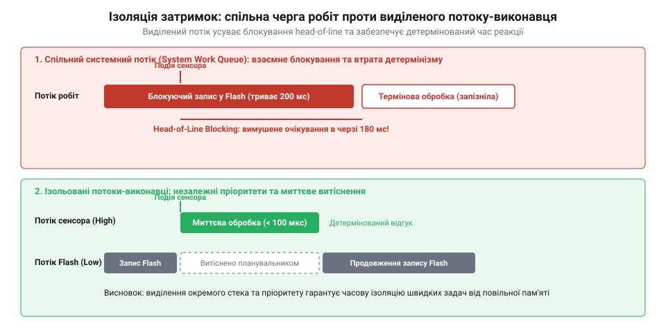
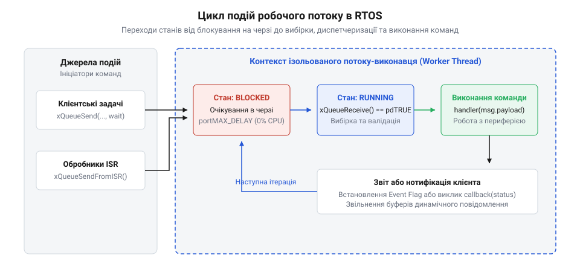
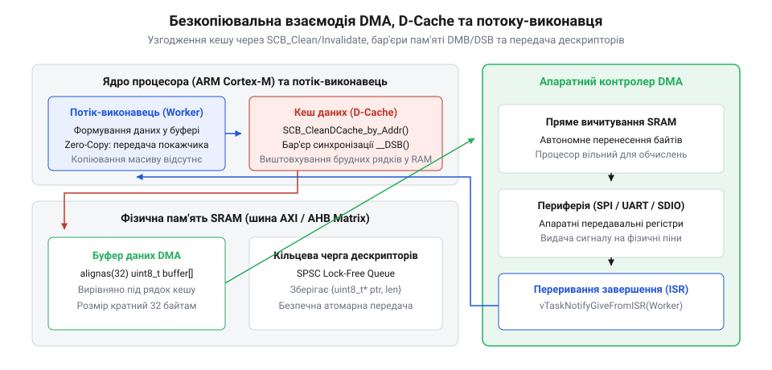
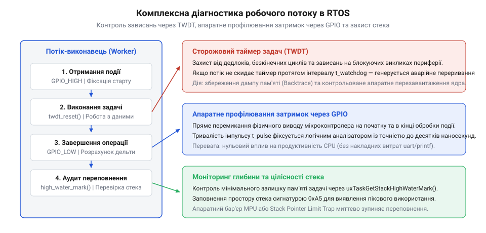

# Окремі потоки-виконавці для ізольованих задач в RTOS

## Початкові концепції та фізичні принципи

Розробка програмного забезпечення для мікроконтролерів оперує суворими обмеженнями фізичного світу. Будь-який електронний пристрій взаємодіє з навколишнім середовищем через апаратні периферійні модулі: приймачі @@en|UART@@, контролери шин @@en|SPI@@ чи @@en|I2C@@, аналого-цифрові перетворювачі (@@en|ADC@@) та накопичувачі на основі @@en|Flash@@ пам'яті. Кожен із цих модулів генерує апаратні події, які сигналізуються процесору через апаратні переривання (@@en|hardware interrupts@@ від лат. @@la|interruptus@@ — перерваний).

Коли апаратне переривання виникає на рівні кремнію, процесор зупиняє виконання поточного коду, зберігає контекст регістрів у стек і передає керування у відповідний обробник переривань (@@en|Interrupt Service Routine@@, ISR). Головне правило систем реального часу полягає у мінімізації часу перебування процесора в контексті переривань. Тривала обробка даних у всередині ISR заблокує реакцію мікроконтролера на інші переривання, спричинить втрату вхідних байтів у буферах периферії та викличе нестабільність часу відгуку (@@en|latency jitter@@ від лат. @@la|scintillare@@ — дрижання).

Щоб зберегти детермінізм (@@en|determinism@@ від лат. @@la|determinare@@ — визначати), розробники застосовують двоетапну обробку: ISR здійснює лише найнеобхідніші атомарні дії (зчитування регістру даних, скидання прапорця переривання) і виконує [відкладену обробку переривань](root:sf-devices/interrupt-bottom-half-mechanisms) у контексті задач операційної системи реального часу (@@en|Real-Time Operating System@@, RTOS від англ. @@en|real-time@@ — реальний час).

На початкових етапах проектирування прошивок найпростішим шляхом реалізації відкладеної обробки здається використання [спільного потоку обробки](root:sf-devices/work-queue) (@@en|shared system work queue@@). У такій архітектурі RTOS надає єдиний системний потік-виконавець, у загальну чергу якого інші модулі системи скидають завдання у вигляді покажчиків на функції-зворотного виклику (@@en|callback functions@@). 

Однак при збільшенні складності пристрою концепція спільного потоку демонструє системну крихкість. Якщо одна з оброблюваних у спільній черзі задач ініціює тривалу або блокуючу операцію — наприклад, стирання сектора Flash-накопичувача, розрахунок криптографічного підпису чи очікування відповіді від мережевого стека, — єдиний потік обробки повністю заморожується.

У цей момент усі інші підсистеми пристрою, що покладаються на той самий спільний потік, втрачають здатність обробляти свої події. Наприклад, якщо з [кільцевого буфера RX](root:sf-devices/uart-rx-ring-buffer-mcu) надійшов новий пакет команд, відповідна функція обробки застрягне у спільній черзі позаду тривалого запису у Flash-пам'ять. Виникає ефект каскадного запізнення, коли абсолютно незалежні функціональні блоки пристрою блокують один одного.

Проаналізуємо математичну модель затримок у спільному потоці робіт. Позначимо через `T_wait` повний час очікування початку виконання термінової задачі з моменту її виникнення. Позначимо через `N` кількість завдань, що вже перебувають у черзі перед нашою задачею. Позначимо через `T_exec(i)` час виконання `i`-го завдання у черзі, а через `T_switch` — стандартний час, який витрачає операційна система на [перемикання контексту](root:sf-devices/rtos-context-switch-mechanics).

Час очікування у спільній черзі визначається як сума тривалостей усіх попередніх робіт:

```
T_wait = ∑ᵢ₌₁ⁿ T_exec(i) + (N + 1) · T_switch
```

З наведеного виразу видно, що верхня межа часу очікування `T_wait` не є детермінованою. Вона прямо залежить від найгіршого часу виконання `T_exec(i)` будь-якої сторонньої функції, яку інший розробник міг помістити у спільну чергу. Якщо хоча б одна функція виконує блокуюче очікування тривалістю в сотні мілісекунд, час `T_wait` перевищить допустимий часовий квант реакції пристрою, що неприпустимо для критичних задач.

Для усунення цієї проблеми в архітектурі прошивок застосовують окремий потік-виконавець (@@en|dedicated worker thread@@). Це ізольована задача RTOS, створена спеціально для обслуговування одного конкретного модуля чи класу однорідних задач. Потік-виконавець володіє власним виділеним стеком пам'яті, власною чергою повідомлень та індивідуально налаштованим пріоритетом у планувальнику.

Розглянемо час очікування обробки події `T_wait_dedicated` у випадку, коли для обслуговування відповідального модуля виділено окремий потік-виконавець із пріоритетом `P_high`, що перевищує пріоритет фонових задач. Якщо подія генерується периферійним перериванням, на час реакції додатково впливає латентність апаратного контролера переривань (@@en|Nested Vectored Interrupt Controller@@, NVIC), яка для процесорних ядер Cortex-M становить базові 12–16 тактів за відсутності вищих переривань, проте зазнає апаратного джитеру через ланцюжкове виконання (@@en|tail-chaining@@) або витіснення пізнішим вектором (@@en|late-arriving@@). Позначимо через `T_nvic_jitter` граничну варіацію затримки апаратного контролера переривань, а через `T_queue_push` — час атомарного розміщення повідомлення у приватну чергу задачі:

```
T_wait_dedicated = T_switch + T_queue_push    [ізоляція від задач нижчого пріоритету]
```

Оскільки пріоритет потоку-виконавця високий, планувальник RTOS здійснює [витісняльну багатозадачність](root:sf-devices/cooperative-vs-preemptive-multitasking) негайно після виходу з ISR або після відправки повідомлення. Виконання сторонніх тривалих задач у фонових потоках більше жодним чином не впливає на параметр `T_wait_dedicated`.


*Порівняння обробки подій у спільній черзі та в окремому потоці-виконавці: блокуюча задача зупиняє спільну чергу, але не впливає на ізольований потік.*

Фізична та програмна ізоляція окремого потоку-виконавця базується на трьох стовпах:

1. **Просторова ізоляція пам'яті.** Кожен потік відміряє для себе власну ділянку оперативної пам'яті (@@en|RAM@@ від англ. @@en|Random Access Memory@@) під стек. Помилки руйнування стек-фрейму чи локальних змінних в одному потоці не передаються безпосередньо у стек іншої задачі, а при наявності модуля захисту пам'яті (@@en|Memory Protection Unit@@, MPU) локалізуються апаратно. 2. **Часова ізоляція та детермінізм.** Потік отримує кванти процесорного часу відповідно до свого пріоритету. Якщо задачу потрібно наділити гарантованою реакцією на події реального часу, її пріоритет піднімають вище пріоритету системних фонових задач. 3. **Ізоляція стану через черги повідомлень.** Взаємодія з потоком-виконавцем здійснюється без прямої модифікації загальних глобальних змінних. Замість цього застосовують [lock-free буфери](root:sf-devices/lock-free-ring-buffer-spsc) або захищені черги RTOS, що позбавляє від необхідності постійно входити у [критичні секції](root:sf-devices/critical-sections-in-rtos) на рівні всієї системи.

Кожен окремий потік-виконавець реєструється в операційній системі через власний [контрольний блок задачі](root:sf-devices/task-control-block-structure) (@@en|Task Control Block@@, TCB). У TCB зберігаються покажчик на верхівку стека (@@en|Stack Pointer@@, SP), поточний стан задачі, її пріоритет та лінії зв'язку з об'єктами синхронізації.

Проте створення окремих потоків-виконавців вимагає інженерного компромісу. Головним платою за ізоляцію є накладні витрати на оперативну пам'яті. Якщо спільна черга робіт потребує лише одного стека для десятка різних дрібних задач, то виділення десяти окремих потоків-виконавців вимагатиме десяти незалежних стеків. При неправильному розрахунку обсягів пам'яті виникає ризик [переповнення стека](root:sf-devices/task-stack-overflow-detection), що призведе до катастрофічного збою прошивки. Тому розробник повинен точно проектувати внутрішню будову кожного потоку та розраховувати його ресурси.

## Внутрішня будова та алгоритми роботи

Внутрішня архітектура окремого потоку-виконавця базується на фундаментальному патерні [асинхронну подієву модель](root:sf-devices/event-driven-firmware) (@@en|event-driven architecture@@). Застосування цього патерну перетворює задачу на пасивний споживач подій, який активується лише за наявності реальної роботи і не витрачає процесорні такти під час очікування.

Серцем потоку-виконавця є цикл обробки подій (@@en|event loop@@ від англ. @@en|event@@ — подія та @@en|loop@@ — петля, цикл). Відповідно до схеми функціонування, яку визначає [автомат станів задачі](root:sf-devices/task-states), потік більшу частину часу перебуває у заблокованому стані (@@en|Blocked state@@).

Звернення до приватної черги повідомлень (@@en|message queue@@) із безкінечним таймаутом очікування примушує планувальник RTOS вилучити потік із черги готових до виконання задач (@@en|Ready list@@). У цьому стані потік споживає 0% ресурсів центрального процесора. Як тільки ISR або інша задача публікує елемент у чергу потоку-виконавця, планувальник негайно розблоковує потік, переводить його в стан готовності та, якщо його пріоритет найвищий, передає йому керування. Для гарантування передбачуваного детермінізму та захисту від відмов вбудованої системи виділення пам'яті під буфер черги здійснюють статично — наприклад, за допомогою функції `xQueueCreateStatic` у FreeRTOS або макроса `K_MSGQ_DEFINE` у Zephyr, де масив елементів та службові дескриптори резервуються компілятором у секції `.bss`. Динамічне створення черги з купи (@@en|heap@@) під час старту чи реконфігурації пристрою несе загрозу фрагментації пам'яті при циклічних перезапусках модулів або раптової відмови аллокатора при вичерпанні неперервних блоків RAM, тоді як статичне виділення унеможливлює збій виділення пам'яті в рантаймі та фіксує сумарний бюджет оперативної пам'яті ще на етапі компонування прошивки.


*Алгоритм виконання циклу обробки подій: перехід зі стану заблоковано в готово, вибірка повідомлення з черги та виконання відповідної дії.*

Основним елементом передачі даних між зовнішнім світом та потоком-виконавцем є структура повідомлення (@@en|worker command message@@). Вона розробляється як фіксований за розміром блок пам'яті, що забезпечує швидке атомарне копіювання через чергу RTOS.

Типовий склад структури повідомлення містить такі поля:

```c
typedef struct {
    uint16_t command_id;         // Ідентифікатор команди для розпізнавання дії
    uint16_t status_flags;       // Прапорці контексту виконання
    union {
        uint32_t raw_value;      // Прості аргументи (числа, адреси)
        void *buffer_ptr;        // Покажчик на великий буфер даних у RAM
    } payload;
    size_t payload_length;       // Довжина даних у буфері
    void *completion_handle;     // Об'єкт сповіщення про завершення (семафор/потік)
} worker_message_t;
```

Диспетчеризація (@@en|dispatching@@ від франц. @@fr|dépêcher@@ — відправляти) усередині циклу подій здійснюється через конструкцію вибору `switch-case` або через таблицю функціональних покажчиків (@@en|function pointer table@@). Використання `switch-case` є більш переважним для мікроконтролерів, оскільки компілятор оптимізує таку конструкцію у таблицю переходів (@@en|jump table@@), виключаючи невизначеність часу виконання.

Розрізняють два основні режими взаємодії з потоком-виконавцем:

1. **Асинхронне виконання (@@en|asynchronous dispatching@@).** Клієнтський потік або ISR розміщує повідомлення у черзі й негайно продовжує свою роботу. Клієнт не чекає, коли потік-виконавець реально приступить до обробки. Це ідеальний режим для видачі команд на запис логів, відправку мережевих пакетів або індикацію. 2. **Синхронне виконання (@@en|synchronous RPC-style dispatching@@ від англ. @@en|Remote Procedure Call@@).** Клієнтському потоку необхідно отримати результат виконання операції від потоку-виконавця. Для цього клієнт створює локальний двійковий семафор або використовує пряме сповіщення задачі, передає покажчик на цей об'єкт у полі `completion_handle` повідомлення і блокується на семафорі. Потік-виконавець, завершивши обробку команди, звільняє переданий семафор, розблоковуючи клієнта.

При використанні синхронного режиму виникає критична небезпека: якщо високопріоритетний потік блокується в очікуванні відповіді від потоку-виконавця з нижчим пріоритетом, у системі може виникнути [інверсія пріоритетів](root:sf-devices/priority-inversion-and-inheritance). Щоб уникнути цього збою, RTOS повинна підтримувати механізми [успадкування пріоритету](root:sf-devices/priority-inversion-and-inheritance), або ж пріоритет потоку-виконавця має бути проектований не нижче пріоритету найважливішого з його клієнтів.

Важливим кроком проектування є точний розрахунок розміру стека потоку-виконавця. Недостатній розмір призведе до аварійного скидання процесора, а надлишковий — марно змарнує обмежену RAM мікроконтролера. 

Позначимо через `S_total` необхідний підсумковий розмір стека в байтах. Позначимо через `S_frame` максимальну глибину вкладеності стек-фреймів при виклику функцій обробки команд. Позначимо через `S_local` сумарний обсяг усіх локальних змінних, виділених на стеку всередині функцій обробки. Позначимо через `S_context` розмір машинного контексту регістрів, який апаратура та RTOS зберігають при перериванні та перемиканні задач. Позначимо через `S_margin` безпековий технологічний запас (зазвичай від 20% до 30% від суми локальних затрат):

```
S_total = S_frame + S_local + S_context + S_margin
= S_frame + S_local + S_context + S_margin    [підсумовування компонентів розрахунку]
```

Розрахунок компонента `S_local` вимагає від розробника відмови від виділення великих локальних масивів або буферів на стеку всередині потоку-виконавця. Усі великі буфери обробки мають передаватися через покажчики або виділятися статично.

Нижче наведено практичні реалізації окремого потоку-виконавця для двох поширених операційних систем реального часу: мовою C для операційної системи FreeRTOS (ESP-IDF) та мовою C++ для Zephyr RTOS.

:::tabs
@c|esp-idf
:::code root\eng\sf-devices\dedicated-worker-threads-rtos/dedicated-worker-threads-rtos-d/c/process-storage-write.c c
@cpp|zephyr
:::code root\eng\sf-devices\dedicated-worker-threads-rtos/dedicated-worker-threads-rtos-d/cpp/dedicatedworkerthread.cpp cpp
:::

Проектування прошивок на основі окремих потоків-виконавців забезпечує чітке розділення відповідальності між модулями. Завдяки ізоляції стека, детермінованому плануванню та асинхронній передачі повідомлень розробник отримує високу надійність пристрою, стійкість до пікових навантажень та передбачуваний час відгуку системи на зовнішні події реального світу.

## Апаратна реалізація та низькорівневий C/C++ код

Розробка вбудованих систем вимагає безперервного узгодження апаратної швидкодії периферії з обмеженими обчислювальними ресурсами процесорного ядра. Коли швидкісний інтерфейс — послідовна шина @@en|SPI@@, контролер @@en|UART@@ або радіочастотний трансивер — приймає безперервний потік байтів, дані накопичуються у внутрішньому апаратному буфері @@en|FIFO@@ (від англ. @@en|First-In, First-Out@@ — першим прийшов, першим пішов). Якщо мікроконтролер обслуговує кожен окремий байт через процесорні переривання, ядро витрачає значну частку тактів на збереження контексту регістрів, що руйнує детермінізм системи.

Для розвантаження центрального процесора апаратура застосовує контролер прямого доступу до пам'яті (@@en|Direct Memory Access@@, DMA від лат. @@la|directus@@ — прямий). Контролер DMA бере на себе апаратне перекачування блоків байтів із регістрів периферії безпосередньо в оперативну пам'ять (@@en|SRAM@@ від англ. @@en|Static Random Access Memory@@). Процесор залучається лише двічі: для налаштування дескриптора передачі та після завершення переміщення всього масиву, коли DMA генерує апаратне переривання.

Окремий потік-виконавець є природним адресатом для результатів роботи DMA. Обробник переривання (@@en|ISR@@) контролера DMA не виконує розбір отриманого кадру та не здійснює важких обчислень. Завдання ISR полягає у фіксації статусу транзакції та негайному делегуванні обробки через [відкладену обробку переривань](root:sf-devices/interrupt-bottom-half-mechanisms) у приватну чергу повідомлень потоку-виконавця.

Спроба скопіювати весь прийнятий масив байтів всередину структури повідомлення черги знівелювала б апаратну перевагу DMA. Тому взаємодія між периферією та потоком-виконавцем будується на принципі безкопіювальної передачі даних (@@en|zero-copy@@). Замість переміщення масивів через чергу RTOS передається компактний дескриптор, що містить лише покажчик на буфер в @@en|SRAM@@, довжину прийнятого блока та статус транзакції.

Щоб апаратний приймач не зупинявся під час аналізу даних процесором, застосовують [двобуферні кільцеві черги](root:sf-devices/embedded-rtos-ring-buffer-dma-storage-decoupling). Поки потік-виконавець безпечно зчитує перший буфер, контролер DMA автономно заповнює другий буфер. Коли обидві сторони завершують свої цикли, дескриптори міняються ролями без жодного копіювання пам'яті.

У сучасних 32-бітних мікроконтролерах із гарвардською архітектурою та кеш-пам'яттю (наприклад, ядрах @@en|ARM Cortex-M7@@ чи @@en|ESP32-S3@@) безкопіювальна передача стикається з фізичною перешкодою. Контролер DMA взаємодіє з пам'яттю @@en|SRAM@@ напряму через системну матрицю шин, оминаючи внутрішній кеш даних ядра (@@en|Data Cache@@, D-Cache). Коли DMA записує нові байти у фізичну пам'ять, копія цих адрес у D-Cache процесора залишається старою. Якщо потік-виконавець звернеться до буфера через звичайне розіменування покажчика, ядро прочитає застарілі дані (@@en|stale data@@) зі свого кешу.

Для вирішення цієї проблеми необхідна сувора [узгодженість кеш-пам'яті](root:sf-devices/mpu-cache-coherency) (@@en|cache coherency@@ від лат. @@la|cohaerere@@ — бути зв'язаним) з периферійними операціями:

1. **Вирівнювання пам'яті за лінією кешу (@@en|cache line alignment@@).** Розмір рядка кешу типово становить 32 або 64 байти. Буфери обміну мають починатися на адресі, кратній розміру лінії, і мати розмір, кратний цьому значенню. Якщо поруч із буфером на тій самій лінії кешу опиниться інша змінна, виштовхування брудних даних ядром процесора апаратно затре щойно прийняті DMA-дані у фізичній пам'яті. 2. **Інвалідація кешу перед читанням (@@en|cache invalidation@@ від лат. @@la|invalidus@@ — недійсний).** Перед тим як потік-виконавець почне читати буфер, прошивка віддає процесору команду скидання валідності рядків кешу для даного діапазону адрес. Це змушує ядро завантажити свіжі байти безпосередньо з @@en|SRAM@@. 3. **Очищення кешу перед записом (@@en|cache clean / flush@@).** Якщо потік-виконавець готує буфер для передавача DMA, він спершу записує дані в пам'ять ядра, після чого примусово виштовхує брудні рядки (@@en|dirty cache lines@@) у фізичну пам'ять і встановлює бар'єр синхронізації даних (@@en|Data Synchronization Barrier@@, DSB).

Потік-виконавець обробляє зовнішні дані, де дефект протоколу або апаратна завада можуть спровокувати вихід покажчика за межі виділеного буфера та пошкодження стек-фрейму. Для запобігання фатальним збоям застосовують апаратний модуль захисту пам'яті (@@en|Memory Protection Unit@@, MPU).

Під час процедури, якою керує [перемикання контексту в мікроконтролерах](root:sf-devices/rtos-context-switch-mechanics), планувальник RTOS переналаштовує регістри MPU під активну задачу. Безпосередньо під основою стека потоку-виконавця конфігурується охоронна зона (@@en|guard region@@) нульового доступу. Будь-яка спроба несанкціонованого запису за межі виділеного стека миттєво генерує апаратне виключення (@@en|hardware exception@@ від лат. @@la|exceptio@@ — виняток) процесора — відмову захисту пам'яті (@@en|MemManage Fault@@). Апаратура блокує подальше виконання інструкцій, захищаючи [контрольний блок задачі](root:sf-devices/task-control-block-structure) (TCB) та пам'ять сусідніх задач. Це забезпечує апаратний рівень надійності, який доповнює програмне [виявлення переповнення стека](root:sf-devices/task-stack-overflow-detection).

Пропускна здатність потоку-виконавця має балансувати пікові навантаження апаратури. Якщо вхідні події генеруються швидше, ніж потік встигає їх обробити, черга повідомлень накопичує затримку.

Позначимо через `Q_depth` мінімально необхідну кількість елементів у черзі повідомлень для гарантованого поглинання сплеску без втрати даних. Позначимо через `λ_peak` пікову інтенсивність генерації повідомлень периферією під час сплеску (кількість повідомлень за секунду). Позначимо через `t_burst` тривалість пікового навантаження в секундах. Позначимо через `T_service` найгірший час обробки одного повідомлення потоком-виконавцем у секундах. Позначимо через `μ` продуктивність потоку-виконавця в повідомленнях за секунду, де `μ = 1 / T_service`.

Мінімальна глибина черги розраховується як різниця між швидкістю надходження подій та швидкістю їхнього обслуговування, помножена на тривалість сплеску:

```
Q_depth = (λ_peak - μ) · t_burst
= (λ_peak - 1 / T_service) · t_burst    [підстановка продуктивності через час сервісу]
```

З наведеного виразу видно, що при інтенсивності `λ_peak`, меншій або рівній продуктивності `μ`, значення у дужках не перевищує нуля: черга не наповнюється, оскільки потік встигає спорожняти її швидше за надходження нових дескрипторів. Проте під час сплесків, коли `λ_peak > μ`, надлишок повідомлень акумулюється в черзі, і формульний вираз визначає ємність буфера, яка рятує систему від втрати пакетів.

**Розрахунок глибини черги для обробника пакетів периферії:**
Нехай апаратний контролер приймає сплеск пакетів із піковою інтенсивністю `λ_peak = 400` подій/с протягом інтервалу `t_burst = 0.05` с (50 мс). Потік-виконавець виконує розбір та запис кадру за час `T_service = 0.005` с (5 мс), що відповідає продуктивності `μ = 200` подій/с.

```
Q_depth = (400 - 200) · 0.05
= 200 · 0.05                             [обчислення надлишку інтенсивності надходження]
= 10                                     [множення надлишку на тривалість сплеску]
```

Отриманий розрахунок доводить, що для безаварійної обробки сплеску черга дескрипторів повинна вміщувати щонайменше 10 повідомлень.


*Взаємодія апаратного контролера DMA, кеш-пам'яті та потоку-виконавця: передача дескрипторів без копіювання пам'яті та апаратна ізоляція стека.*

Нижче наведено практичну низькорівневу реалізацію безкопіювального потоку-виконавця для систем FreeRTOS мовою C та Zephyr RTOS мовою C++.

:::tabs
@c|esp-idf
:::code root\eng\sf-devices\dedicated-worker-threads-rtos/dedicated-worker-threads-rtos-d/c/hardware-cache-invalidate.c c
@cpp|zephyr
:::code root\eng\sf-devices\dedicated-worker-threads-rtos/dedicated-worker-threads-rtos-d/cpp/dmaworkerthread.cpp cpp
:::

## Практичне застосування та відлагодження

Вбудовані системи реального часу поєднують у собі підсистеми з радикально різними часовими характеристиками. Неправильний розподіл обов'язків між задачами призводить до того, що мілісекундні блокування руйнують мікросекундну точність контурів керування. Розглянемо ключові практичні сценарії, де виділення окремого потоку-виконавця є життєво необхідним:

1. **Ізоляція повільних накопичувачів та файлових систем.**
   Запис телеметрії у мікросхеми енергонезалежної пам'яті @@en|Flash@@ (@@en|NOR@@ або @@en|NAND@@ структури) чи на карти пам'яті @@en|SD/eMMC@@ супроводжується тривалими апаратними затримками. Операція стирання сектора Flash-пам'яті перед записом нових даних триває від 20 до 400 мілісекунд залежно від технології виготовлення кристала. Протягом цього інтервалу шина накопичувача заблокована. Якщо функцію запису логів викликати безпосередньо у контексті задачі вимірювань або запустити через [спільний потік обробки](root:sf-devices/work-queue), вся система завмре на сотні мілісекунд. Використання окремого потоку-виконавця забезпечує надійну [ізоляцію затримок накопичувачів](root:sf-devices/embedded-rtos-ring-buffer-dma-storage-decoupling): клієнтські задачі атомарно скидають покажчик на буфер у чергу воркера і повертаються до детермінованого керування за кілька тактів. 2. **Ізоляція бездротових комунікаційних стеків.**
   Сучасні пристрої передають дані через стільникові модеми (@@en|LTE-M@@, @@en|NB-IoT@@), модулі @@en|Wi-Fi@@ або протокол @@en|Bluetooth Low Energy@@ (BLE). Взаємодія з модемом через AT-команди або сокети супроводжується мережевими паузами: узгодження каналу, передача пакетів та повторні спроби (@@en|retransmissions@@) можуть займати від кількох секунд до десятків секунд. Окремий потік-виконавець інкапсулює у собі [автомат станів задачі](root:sf-devices/task-states) мережевого інтерфейсу. Для безперервного прийому сирих байтів застосовується [організація кільцевого буфера](root:sf-devices/uart-rx-ring-buffer-mcu) або [кільцевого буфера UART](root:sf-devices/uart-ring-buffer-architecture), а потік-виконавець асинхронно вичитує кадри, формує пакети та реалізує логіку повторних спроб без найменшого впливу на роботу давачів. 3. **Ізоляція ресурсомістких криптографічних розрахунків.**
   При бездротовому оновленні прошивки (@@en|Over-The-Air Update@@, OTA) мікроконтролер зобов'язаний перевірити цілісність прийнятого образу: розрахувати хеш @@en|SHA-256@@ для кількох мегабайтів коду та верифікувати цифровий підпис @@en|ECDSA@@. Такі операції споживають десятки мільйонів тактів процесорного ядра. Якщо запустити криптографічну перевірку з пріоритетом вимірювальних задач, система пропустить реакцію на фізичні процеси. Потік-виконавець для фонових обчислень конфігурується з мінімальним пріоритетом. Планувальник RTOS надає йому процесорний час лише тоді, коли критичні задачі сплять.

Коли зовнішнє джерело подій генерує повідомлення швидше, ніж потік-виконавець встигає їх опрацювати, черга неминуче наповнюється до межі. У системі виникає явище зворотного тиску (@@en|backpressure@@ від англ. @@en|back@@ — назад та @@en|pressure@@ — тиск).

Розробник повинен закласти детерміновану реакцію на переповнення черги, обравши одну з чотирьох стратегій:

1. **Блокування продюсера з таймаутом (@@en|bounded producer blocking@@).** Відправник чекає звільнення місця у черзі протягом заданого ліміту часу. Якщо ліміт вичерпано, операція повертає помилку. Цей режим застосовний виключно між задачами і суворо заборонений усередині @@en|ISR@@, оскільки блокування контексту переривання призведе до колапсу системи. 2. **Відкидання нових повідомлень (@@en|tail drop@@).** Якщо черга заповнена, нове повідомлення відкидається, а раніше збережені дані залишаються недоторканими. При цьому обов'язково інкрементується лічильник втрат для діагностики дефіциту пропускної здатності. 3. **Заміщення найстаріших повідомлень (@@en|overwrite oldest / head drop@@).** Найстаріше повідомлення з голови черги вилучається, а нове записується у хвіст. Це оптимальна стратегія для телеметрії та показників фізичних давачів: свіже значення температури чи тиску важливіше для регулятора, ніж застаріле. Така модель ефективно реалізується на [lock-free буферах](root:sf-devices/lock-free-ring-buffer-spsc). 4. **Аварійний перехід у безпечний режим (@@en|fail-safe mode@@).** Якщо переповнення черги виникає у контурі керування захистом обладнання, система фіксує аварійний стан, вимикає силове навантаження та переводить пристрій у захищений стан.

Класичний апаратний сторожовий таймер (@@en|watchdog timer@@, WDT від англ. @@en|watchdog@@ — сторожовий собака) скидається у фоновій задачі і не здатний помітити зависання окремого потоку-виконавця. Якщо потік застряг у блокуючому виклику або потрапив у взаємне блокування (@@en|deadlock@@), фонова задача продовжує скидати апаратний WDT, маскуючи аварійну ситуацію.

Для виявлення часткових зависань прошивки використовують [програмні сторожові таймери](root:sf-devices/task-watchdog-timer-rtos) (@@en|Task Watchdog Timer@@, TWDT):

- Під час ініціалізації потік-виконавець реєструє свій ідентифікатор у підсистемі TWDT. - Потік скидає свій персональний таймер виключно в кінці кожної ітерації циклу подій після завершення обробки повідомлення. - Окрема системна задача контролю, пов'язана із [сервісною чергою таймерів](root:sf-devices/rtos-timer-service-queue), періодично перевіряє стан підписок усіх зареєстрованих потоків. - Якщо потік-виконавець не скинув таймер протягом заданого інтервалу `T_timeout`, підсистема TWDT фіксує відмову і перезавантажує мікроконтролер із збереженням дампу діагностики.

Математична модель розрахунку порогу TWDT базується на найгіршому часі виконання. Позначимо через `T_timeout` безпечний поріг спрацьовування сторожового таймера. Позначимо через `T_exec_max` максимальний час обробки найдовшої команди у потоці-виконавці. Позначимо через `T_preempt` сумарний час витіснення потоку-виконавця високопріоритетними задачами та перериваннями під час обробки цієї команди. Позначимо через `T_margin` захисний запас часу:

```
T_timeout = T_exec_max + T_preempt + T_margin
= T_exec_max + T_preempt + T_margin    [сума максимального часу обробки та захисного запасу]
```

З наведеного співвідношення випливає, що значення `T_timeout` не можна встановлювати меншим за `T_exec_max + T_preempt`, оскільки витіснення потоку пріоритетнішими процесами під час пікового навантаження спричинить помилкове аварійне перезавантаження приладу.

Діагностика поведінки потоку-виконавця у залізі вимагає вимірювання часових характеристик без внесення спотворень у роботу прошивки:

1. **Апаратне профілювання через виводи (@@en|GPIO toggling@@).**
   Найбільш точний метод апаратного вимірювання затримок. Потік-виконавець встановлює логічну одиницю на спеціально виділеному виводі @@en|GPIO@@ (від англ. @@en|General-Purpose Input/Output@@ — вхід/вихід загального призначення) на початку виконання команди та скидає вивід у нуль після завершення. Підключення цифрового осцилографа або логічного аналізатора показує точну тривалість обробки, періодичність активації та моменти, коли потік витісняється іншими задачами. 2. **Апаратний лічильник тактів процесора DWT.**
   У процесорних ядрах @@en|ARM Cortex-M@@ модуль діагностики @@en|Data Watchpoint and Trace@@ (DWT) містить регістр лічильника циклів ядра `DWT->CYCCNT`, який інкрементується на кожному такті процесора.

Позначимо через `T_latency` тривалість виконання операції в секундах. Позначимо через `ΔC` кількість тактів ядра, зафіксовану модулем DWT між початком і кінцем роботи. Позначимо через `F_cpu` тактову частоту процесора в герцах:

```
T_latency = ΔC / F_cpu
= ΔC · (1 / F_cpu)    [перетворення ділення на множення періоду такту]
```

Завдяки модулю DWT прошивка вимірює час реакції на кожну команду з точністю до одиниць наносекунд і накопичує статистику затримок без підключення зовнішніх вимірювальних приладів.

3. **Моніторинг високої позначки стека (Stack High Water Mark).**
   Перед запуском задачі операційна система заповнює пам'ять виділеного стека спеціальним байтовим шаблоном (@@en|magic pattern@@, наприклад `0xA5`). Під час роботи покажчик стека опускається, затираючи шаблон стек-фреймами. Функція діагностики RTOS сканує пам'ять від основи стека і визначає кількість незайманих байтів. Отримана висока позначка стека (@@en|stack high water mark@@ від англ. @@en|watermark@@ — позначка рівня води) показує найменший залишок пам'яті за весь час роботи пристрою. Якщо позначка наближається до нуля, виникає безпосередня загроза [виявлення переповнення стека](root:sf-devices/task-stack-overflow-detection), що вимагає збільшення стека або зменшення глибини викликів. 4. **Системні трасувальники реального часу.**
   Для комплексного аналізу часових співвідношень застосовують інструменти трасування (@@en|tracing@@ від франц. @@fr|tracer@@ — креслити, прокладати слід), такі як @@en|FreeRTOS Tracealyzer@@ або @@en|Segger SystemView@@. Вони записують мітки часу для кожної події планувальника. На візуальній часовій шкалі розробник бачить переходи між станами потоку, перевіряє відсутність [інверсії пріоритетів](root:sf-devices/priority-inversion-and-inheritance) та підтверджує, що [витісняльна багатозадачність](root:sf-devices/cooperative-vs-preemptive-multitasking) гарантує детерміноване виконання пріоритетних задач у [подієво-орієнтованою архітектурою](root:sf-devices/event-driven-firmware) пристрою.


*Архітектура діагностики потоку-виконавця: контроль часу відгуку через апаратні піни, захист від зависань за допомогою TWDT та перевірка залишкового стека.*