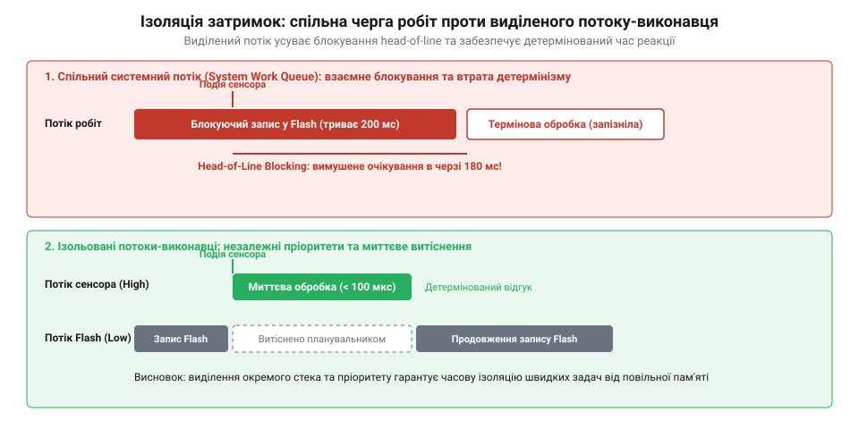

# Окремі потоки-виконавці для ізольованих задач в RTOS

## Проблема блокування та втрати детермінізму

Вбудовані системи реального часу керують фізичними процесами, де затримка реакції призводить до аварії. Апаратний обробник переривань передає тривалу роботу на рівень операційної системи реального часу @@en|RTOS@@ (від англ. *real-time operating system* — операційна система реального часу), застосовуючи [механізми відкладеної обробки переривань](root:sf-devices/interrupt-bottom-half-mechanisms).

Спрямування всіх операцій у [спільну чергу робіт](root:sf-devices/work-queue) @@en|system work queue@@ (від англ. *system* — системний, *work* — робота та *queue* — черга) створює проблему: якщо одна задача ініціює повільне стирання пам'яті @@en|Flash@@ (від англ. *flash* — спалах) чи транзакцію через @@en|UART@@ (від англ. *universal asynchronous receiver-transmitter* — універсальний асинхронний приймач-передавач), спільний потік блокується на сотні мілісекунд.

Виникає блокування початку черги — @@en|head-of-line blocking@@ (від англ. *head of line* — голова черги та *blocking* — блокування). Критичні операції застрягають позаду повільної задачі, спричиняючи небезпечний джитер @@en|jitter@@ (від англ. *jitter* — тремтіння) та втрату детермінізму @@en|determinism@@ (від лат. *determinare* — визначати).

Розв'язком є виділення тривалих операцій в окремий потік-виконавець — @@en|dedicated worker thread@@ (від англ. *dedicated* — виділений, *worker* — працівник та *thread* — нитка, потік) із власним пріоритетом і чергою повідомлень.

*Виділений потік ізолює повільні операції запису та вводу-виводу від високопріоритетних контурів керування.*

Планувальник через механізми [витісняльної багатозадачності](root:sf-devices/cooperative-vs-preemptive-multitasking) миттєво зупиняє низькопріоритетний @@en|dedicated worker thread@@ заради швидкої реакції на сенсори. Потік отримує власний [контрольний блок задачі](root:sf-devices/task-control-block-structure) і виділений стек @@en|stack@@ (від англ. *stack* — стіс), що запобігає затримкам, але потребує захисту від [переповнення стека](root:sf-devices/task-stack-overflow-detection).

## Організація та взаємодія потоку-виконавця

Основою воркера є [подієво-орієнтована архітектура](root:sf-devices/event-driven-firmware) на базі циклу подій — @@en|event loop@@ (від англ. *event* — подія та *loop* — цикл). Потік-виконавець блокується на читанні з приватної черги повідомлень @@en|message queue@@ (від англ. *message* — повідомлення та *queue* — черга). Планувальник переводить його [автомат станів задачі](root:sf-devices/task-states) у режим очікування, тому під час простою @@en|dedicated worker thread@@ не споживає процесорного часу.

Клієнти взаємодіють із воркером асинхронно: переривання чи високопріоритетна задача надсилає дескриптор у чергу й негайно повертається до роботи. Якщо потрібен результат, клієнт чекає на семафорі, уникаючи [інверсії пріоритетів](root:sf-devices/priority-inversion-and-inheritance).

Щоб не витрачати пам'ять @@en|RAM@@ (від англ. *random-access memory* — пам'ять із довільним доступом), передавання даних організовують без копіювання — @@en|zero-copy@@ (від англ. *zero* — нуль та *copy* — копіювання). Клієнт бере буфер через [двобуферні кільцеві черги](root:sf-devices/embedded-rtos-ring-buffer-dma-storage-decoupling) і передає в чергу лише покажчик.

При сплесках трафіку черга застосовує механізм зворотного тиску — @@en|backpressure@@ (від англ. *back* — назад та *pressure* — тиск). Залежно від задачі алгоритм скидає старі пакети або відхиляє надлишкові запити, зберігаючи стійкість системи.