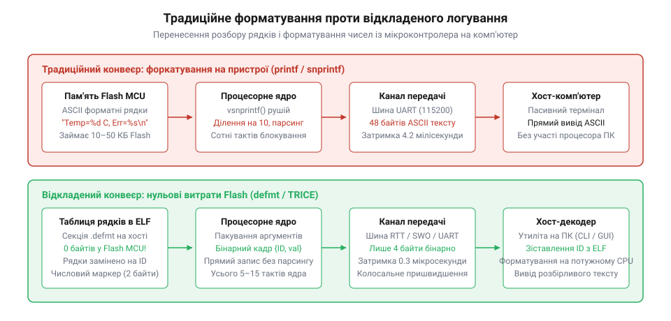
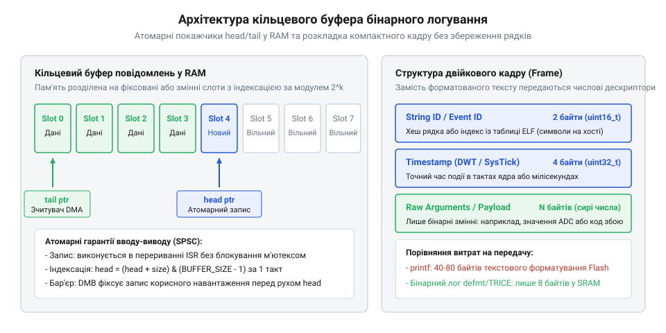
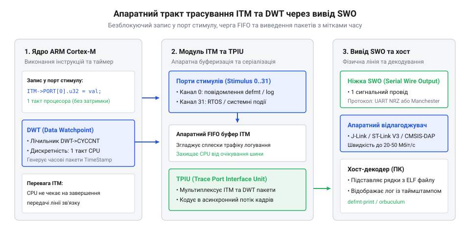
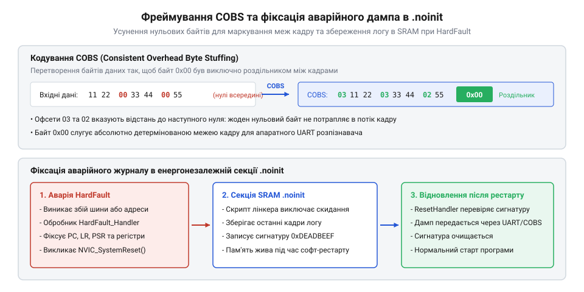

# Відкладене форматування та бінарне логування: defmt, TRICE і нульові витрати Flash

## Початкові концепції та фізичні принципи

Діагностика поведінки мікроконтролера у реальному часі стикається з фундаментальним протиріччям між спостереженням за системою та збереженням її детермінізму. У контурах швидкого зворотного зв'язку — наприклад, при цифровому керуванні імпульсними перетворювачами напруги або безколекторними електродвигунами — інтервали між викликами розрахункових функцій вимірюються мікросекундами. Спроба вивести діагностичне повідомлення про стрибок струму за допомогою звичної функції форматованого друку кардинально спотворює роботу алгоритму: система пропускає обробку критичних подій від апаратних таймерів, алгоритм виходить за межі стійкості, а сторожовий таймер аварійно перезавантажує мікроконтролер.

Це явище відоме в інженерній практиці як @@en|probe effect@@ (англ. *probe* — щуп, зонд, *effect* — наслідок, результат дії), що провокує появу невловимих дефектів класу @@en|Heisenbug@@ (від імені фізика Вернера Гейзенберга та англ. *bug* — дефект, клоп). Класичний інструмент діагностики сам змінює поведінку досліджуваного об'єкта: затримка на виконання друку маскує стан гонитви сигналів або провокує фатальне переповнення апаратних черг. Причина криється у фізичних та архітектурних обмеженнях трьох ключових ресурсів мікроконтролера: енергонезалежної пам'яті програм, обчислювальної швидкодії процесорного ядра та пропускної здатності каналів вводу-виводу.

Перше фундаментальне обмеження стосується внутрішньої будови та обсягу енергонезалежної пам'яті @@en|Flash@@ (англ. *flash* — спалах; тип енергонезалежної напівпровідникової пам'яті). Коли розробник описує повідомлення на кшталт `printf("Motor 1 error: phase=%d, temp=%d\n", phase, temp);`, компілятор розміщує текстовий форматний рядок у секції констант `.rodata`. Цей рядок є звичайним масивом символів кодування ASCII, де кожен символ займає рівно один байт, а в кінці стоїть нульовий байт завершення. Для наведеного короткого рядка потрібно 36 байтів пам'яті. У реальній промисловій прошивці присутні сотні або тисячі точок логування станів, помилок та переходів між режимами. Тисяча таких повідомлень потребує від 40 до 70 кілобайтів пам'яті @@en|Flash@@. У мікроконтролерах із загальним обсягом пам'яті програм 64 або 128 кілобайтів статичні рядки логів поглинають більшу частину простору, витісняючи корисну функціональну логіку та математичні моделі.

Друге обмеження полягає у витратах обчислювальних тактів ядра на розбір формату. Коли у прошивці викликається [традиційний вивід повідомлень](root:sf-devices/printf-na-prystroi), мікроконтролер змушений самостійно обробляти кожен символ формату під час виконання. Функція @@en|printf@@ (англ. *print formatted* — друкувати форматовано) не знає заздалегідь кількості та типів переданих аргументів. Ядро сканує рядок у циклі побайтово, аналізує префікси ширини поля, прапорці вирівнювання та специфікатори типів. Для перетворення одного двійкового числа у десятковий текстовий запис ядро багаторазово виконує операцію цілочисельного ділення на 10. Якщо на кристалі відсутній апаратний дільник, операція зводиться до десятків інструкцій програмної емуляції.

Якщо розгорнути [машинний код функцій](root:sf-devices/chytannia-dyzasemblera), стає очевидним, що виклик форматування розгортається у сотні важких інструкцій завантаження та викликів бібліотеки середовища виконання. Програмний стек вимушений виділяти локальний буфер для збереження проміжних символів, що небезпечно наближає границю стека до статичних змінних в оперативній пам'яті @@en|SRAM@@ (англ. *Static Random-Access Memory* — статична пам'ять із довільним доступом). Загальний час розбору середнього рядка з двома аргументами становить від 300 до 1500 тактів процесорного ядра, що повністю блокує виконання розрахункових задач на десятки мікросекунд.

Третє і найбільш жорстке фізичне обмеження створює апаратний інтерфейс виводу даних. Найпоширенішим каналом зв'язку мікроконтролера з зовнішнім світом залишається асинхронний передавач @@en|UART@@ (англ. *Universal Asynchronous Receiver-Transmitter* — універсальний асинхронний приймач-передавач). Фізичний рівень інтерфейсу передає інформацію послідовно по одному біту на кадр. Кадр містить обов'язковий стартовий біт, вісім інформаційних бітів даних та один або два стопові біти. Швидкість фізичної лінії зв'язку визначається параметром @@en|baud rate@@ (англ. *baud* — бод, одиниця вимірювання швидкості передачі символів, *rate* — темп, швидкість).

Час передачі текстового повідомлення `T_uart` визначається добутком кількості переданих байтів `L`, числа бітів на один байтовий фрейм `k` та оберненої символьної швидкості передачі `B`:

```
T_uart
= (L × k) ÷ B                [формула часу передачі послідовного кадру]
= (48 × 10) ÷ 115200         [підстановка параметрів повідомлення довжиною 48 байтів]
= 480 ÷ 115200               [добуток бітів кадру]
≈ 0.004167 с                 [ділення бітів на швидкість передачі]
≈ 4.17 мс                    [переведення значення у мілісекунди]
```

Отримане значення 4.17 мс показує, що передача одного рядка середньої довжини вимагає понад чотири тисячі мікросекунд безперервної роботи передавача. Якщо функція використовує блокувальний запис у регістр передавача, процесор простоює протягом усього цього проміжку часу. Підпрограма обробки переривання @@en|ISR@@ (англ. *Interrupt Service Routine* — підпрограма обробки переривання), яка виконує такий виклик, гарантовано заблокує всі інші обробники з рівним або нижчим пріоритетом. Навіть організація проміжного буфера в пам'яті @@en|SRAM@@ не рятує ситуацію: буфер швидко переповнюється під час серії подій, після чого система або втрачає дані, або знову зависає в очікуванні звільнення передавача.

Вирішенням цього конфлікту є повна зміна парадигми діагностики через концепцію @@en|deferred formatting@@ (англ. *defer* — відкладати, переносити на потім, *format* — упорядковувати, надавати форми). Суть підходу полягає у строгому розподілі обов'язків між мікроконтролером і зовнішнім комп'ютером розробника. Що є повідомленням логу з погляду фізики процесу? Це фіксація дискретного факту: певна точка алгоритму була досягнута за певного набору числових значень локальних змінних. Символи ASCII, слова, розділові знаки та пробіли не несуть корисної інформації для мікроконтролера; вони потрібні виключно людському зору.

На цьому спостереженні базується метод двійкового логування @@en|binary logging@@ (англ. *binary* — двійковий, *log* — судновий журнал, систематичний запис подій). Замість перетворення чисел у текст на боці пристрою, мікроконтролер записує у вихідний потік лише два елементи: унікальний числовий ідентифікатор події (розміром 2 байти) та сирі двійкові значення змінних без будь-якої обробки. Замість 48 байтів текстового рядка пристрій випромінює компактний двійковий пакет розміром від 4 до 8 байтів.

Тривалість фіксації двійкового кадру в оперативній пам'яті `T_log` розраховується як відношення кількості машинного часу ядра `N_cycles` на пряме копіювання байтів до тактової частоти ядра `F_cpu`:

```
T_log
= N_cycles ÷ F_cpu           [визначення тривалості виконання машинних інструкцій]
= 16 ÷ 64000000              [підстановка 16 тактів ядра при частоті 64 МГц]
= 0.00000025 с               [ділення кількості циклів на тактову частоту]
= 250 нс                     [переведення результату в наносекунди]
```

Отриманий час 250 наносекунд на чотири порядки менший за тривалість передачі через послідовний порт. Шістнадцять машинних тактів укладаються у стандартні вимоги до коду всередині обробника переривання, зберігаючи реактивність системи та усуваючи зсув часових інтервалів. Сам форматний рядок узагалі не завантажується у пам'ять @@en|Flash@@ мікроконтролера: під час збирання проєкту він зберігається виключно в налагоджувальних таблицях виконуваного файлу @@en|ELF@@ (англ. *Executable and Linkable Format* — формат виконуваних та компонованих файлів) на хості.


*Порівняння традиційного printf та відкладеного логування: форматування на пристрої з передачею ASCII проти передачі ID на хост із відкладеним декодуванням.*

Практичну реалізацію цих принципів забезпечують спеціалізовані інженерні фреймворки. Для мов C та C++ класичним еталоном є бібліотека @@en|TRICE@@ (скорочення від англ. *tiny real-time interrupt-safe C/C++ embedded logging* — крихітне безпечне для переривань вбудоване логування реального часу для C/C++), яка призначає кожному повідомленню 14-бітний числовий дескриптор. Для екосистеми мови Rust стандартом стало рішення @@en|defmt@@ (скорочення від англ. *deferred formatting* — відкладене форматування), що інтегровано безпосередньо у процес компіляції та пакування коду.

Для транспортування двійкових пакетів застосовують апаратні інтерфейси з мінімальними накладними витратами. Перший шлях — передача через апаратний контролер @@en|DMA@@ (англ. *Direct Memory Access* — прямий доступ до пам'яті), який забирає байти з кільцевого буфера без участі ядра. Другий шлях — використання виділеної апаратної лінії діагностики @@en|SWO@@ (англ. *Serial Wire Output* — послідовний вивід діагностики), що підтримується внутрішнім трасувальним модулем ядра @@en|ITM@@ (англ. *Instrumentation Trace Macrocell* — системний модуль апаратної траси). Третій і найбільш швидкісний шлях — використання технології @@en|RTT@@ (англ. *Real-Time Transfer* — передача даних у реальному часі).

При використанні @@en|RTT@@ прошивка просто складає двійкові байти у виділену структуру в пам'яті @@en|SRAM@@. Сучасний апаратний інтерфейс зневадження @@en|SWD@@ (англ. *Serial Wire Debug* — послідовний інтерфейс зневадження) має безпосередній доступ до внутрішньої шини кристала. Завдяки цьому [протокол передачі даних](root:sf-devices/segger-rtt-protocol) дозволяє апаратному зонду зчитувати байти безпосередньо з пам'яті мікроконтролера у фоновому режимі, не зупиняючи обчислювальне ядро і не відбираючи його процесорні такти. У результаті логування стає майже непомітним для таймінгів прошивки, забезпечуючи нульові витрати пам'яті @@en|Flash@@ та повний детермінізм роботи системи.

## Внутрішня будова та алгоритми роботи

Архітектура відкладеного логування охоплює три пов'язані рівні: підсистему компонування бінарного образу на робочій станції, модуль збору та буферизації двійкових пакетів у прошивці мікроконтролера та хостовий демон-декодер. Кожен із цих компонентів реалізує частину спільного протоколу, що гарантує збереження структури подій за повної відсутності текстових шаблонів на цільовому пристрої.

Фундаментом нульових витрат пам'яті є взаємодія компілятора та компонувальника бінарного файлу @@en|ELF@@. За звичайних умов будь-який рядковий літерал розміщується у стандартній секції пам'яті констант `.rodata`. Ця секція отримує атрибути завантаження у пам'ять, тому утиліта підготовки прошивки переносить її вміст у бінарний файл для запису у пам'ять @@en|Flash@@. Щоб розірвати цей зв'язок, вихідний код відкладеного логування спрямовує рядки форматування у спеціальні ізольовані секції за допомогою атрибутів секціонування компілятора.

Поведінка компонувальника визначається конфігураційним файлом: [скрипт компонування пам'яті](root:sf-devices/linker-scripts-and-memory-sections) явно позначає спеціальні секції логів прапорцем `NOLOAD` або службовим типом `INFO`. Для компілятора це означає, що секція отримує валідні віртуальні адреси та символьні позначення, що зберігаються в таблицях метаданих файлу @@en|ELF@@ на диску робочої станції. Однак під час фінальної генерації прошивального бінарного файлу формату `.bin` або `.hex` утиліта `objcopy` відкидає секції з прапорцем `NOLOAD`. Шаблонні рядки залишаються виключно в налагоджувальних секціях образу на комп'ютері, займаючи рівно нуль байтів у фізичних комірках пам'яті @@en|Flash@@ мікроконтролера.

Для зв'язку між подією в прошивці та рядком на комп'ютері використовується техніка @@en|string interning@@ (англ. *intern* — зберігати всередині, закріплювати в сховищі). Її завдання — зіставити кожному унікальному форматному рядку компактний числовий ідентифікатор розміром 14 або 16 бітів. Алгоритми присвоєння дескрипторів різняться залежно від мовного інструментарію.

У бібліотеці @@en|TRICE@@ застосовується статичний препроцесорний прохід або генерація хеш-ідентифікаторів. Препроцесор аналізує вихідний код проєкту перед компіляцією, знаходить виклики макросів логування, генерує унікальні числові ідентифікатори та фіксує їх у зовнішньому файлі бази даних формату JSON. У прошивку підставляється безпосередній числовий константний аргумент.

У системі @@en|defmt@@ використовується інший, більш автоматизований підхід на рівні компонувальника. Кожен унікальний форматний рядок розміщується у віртуальній секції `.defmt` файлу @@en|ELF@@. Оскільки секція має власний віртуальний адресний простір, зсув кожного рядка відносно базової адреси секції автоматично стає його унікальним числовим ідентифікатором. Компонувальник сам усуває дублікати рядків, оптимізуючи адресний простір і не вимагаючи проміжних файлів баз даних.

Двійковий пакет події складається з фіксованого заголовка та поля аргументів. Заголовок пакує числовий ідентифікатор рядка та службову інформацію про кількість і розмір переданих аргументів. У найпростішому варіанті заголовок займає два байти: 14 бітів відведено під числовий ідентифікатор повідомлення (дозволяючи розрізняти до 16384 унікальних точок логування), а 2 біти кодують категорію формату пакету. Поле даних містить сирі байти аргументів: 8-, 16-, 32- або 64-бітні числа без перетворення в символи.

Для систем із жорстким обмеженням пропускної здатності використовується алгоритм пакування цілих чисел @@en|LEB128@@ (англ. *Little Endian Base 128* — кодування цілих чисел зі змінною довжиною за основою 128). Алгоритм розбиває значення на групи по 7 бітів. Якщо старші біти числа дорівнюють нулю, воно пакується в один або два байти замість чотирьох, суттєво зменшуючи розмір кадру для малих значень лічильників та прапорців стану.


*Будова кільцевого буфера в оперативній пам'яті з атомарними покажчиками head і tail та структура двійкового кадру з ID і аргументами.*

Для збереження згенерованих пакетів у прошивці реалізується [неблокувальний кільцевий буфер](root:sf-devices/lock-free-ring-buffer-spsc), що працює за принципом черги @@en|FIFO@@ (англ. *First In, First Out* — першим прийшов, першим пішов). Буфер розміщується в оперативній пам'яті @@en|SRAM@@ і складається зі статичного масиву пам'яті та двох покажчиків: індексу запису `head` та індексу зчитування `tail`.

Головна архітектурна складність полягає в забезпеченні потокової безпеки без використання важких блокувальних примітивів операційної системи реального часу @@en|RTOS@@ (англ. *Real-Time Operating System* — операційна система реального часу). Виклик м'ютексів або семафорів усередині обробника переривань @@en|ISR@@ суворо заборонений, оскільки це призводить до мертвого блокування системи. Тому операція запису в кільцевий буфер виконується через короткі неблокувальні алгоритми.

Процедура запису резервує простір у буфері атомарним оновленням покажчика `head`. На процесорних ядрах архітектури ARM Cortex-M для цього використовують інструкції монопольного доступу `LDREX` та `STREX` або тимчасове відключення переривань на 5–10 машинних тактів за допомогою асемблерних інструкцій `CPSID` та `CPSIE`. Після того як діапазон байтів зарезервовано, ядро копіює дані кадру в пам'ять буфера, не заважаючи паралельним операціям зчитування.

При переповненні кільцевого буфера застосовують одну з трьох стратегій: відкидання нових записів, перезапис найстаріших записів або зупинка задачі. В обробниках переривань допустимі виключно перші дві стратегії. При відкиданні пакетів ядро інкрементує внутрішній лічильник втрат, значення якого передається хосту в наступному успішному кадрі.

Нижче наведено практичну реалізацію модуля формування двійкового кадру та його атомарного запису в кільцевий буфер для систем без динамічного виділення пам'яті.

:::tabs
:::code root\eng\sf-devices\deferred-formatting-embedded/deferred-formatting-embedded-d/c/baremetal/disable-interrupts.c c
:::code root\eng\sf-devices\deferred-formatting-embedded/deferred-formatting-embedded-d/cpp/baremetal/binarylogchannel.cpp cpp
:::code root\eng\sf-devices\deferred-formatting-embedded/deferred-formatting-embedded-d/rust/baremetal/binarylogger.rs c
:::

Наведені реалізації демонструють компактність процесу запису: код уникає динамічного виділення ресурсів і складних циклів пошуку. На рівні асемблера вся функція формування кадру транслюється в прямі інструкції збереження регістрів у пам'ять `STRB`, які виконуються за мінімальну кількість тактів.

Заключний етап життєвого циклу логу відбувається на робочій станції розробника. Зовнішній апаратний відладчик вичитує вміст кільцевого буфера безпосередньо з пам'яті пристрою. Коли застосовуються [інструменти апаратного налагодження](root:sf-devices/openocd-debugger-basics), сервер зневадження зчитує діапазон оперативної пам'яті через контролер налагоджувального порту ядра без втручання у виконання основного коду прошивки.

Отриманий двійковий потік надходить у хостову утиліту розбору. Програма виділяє заголовок кадру, зчитує числовий ідентифікатор та звертається до налагоджувальних таблиць метаданих @@en|metadata@@ (грец. *meta* — після, за межами, лат. *data* — відомості, дані) раніше збереженого файлу @@en|ELF@@. За знайденим числовим значенням утиліта дістає оригінальний текстовий рядок формату, наприклад: `"Температура фази %d перевищила ліміт: %d С"`.

Після отримання рядка хостовий декодер аналізує специфікатори типів і послідовно витягує відповідну кількість байтів із корисного навантаження кадру. Витягнуті двійкові байти передаються стандартній бібліотеці хоста, яка виконує фінальне форматування на потужному багатоядерному процесорі робочої станції.

Такий розподіл обов'язків докорінно змінює можливості інженера: [налагодження на робочій станції](root:sf-devices/nalahodzhennia-na-khosti) дозволяє виконувати розбір даних без впливу на процесор пристрою. Хостова програма може збагачувати логи точними мітками часу операційної системи, колірною розміткою рівнів важливості, фільтрувати потік за підсистемами або автоматично записувати структуровані звіти у базу даних, залишаючи прошивку мікроконтролера максимально компактною, надійною та детермінованою.

## Апаратна реалізація та низькорівневий C/C++ код

Програмні алгоритми відкладеного логування розкривають свій потенціал лише за умови прямої підтримки з боку кремнієвої периферії мікроконтролера. Якщо апаратна частина вимагає зупинки процесора або створює колізії на внутрішніх шинах, переваги двійкового представлення втрачаються. У критичних контурах керування, де частота виклику розрахункових функцій перевищує десятки кілогерців, запис навіть чотирибайтового кадру в оперативну пам'ять може спровокувати конфлікт доступу на внутрішній матриці шин між процесорним ядром, контролером пам'яті та периферією. Для усунення цих накладних витрат процесорна архітектура ARM Cortex-M містить спеціалізовані модулі апаратної діагностики: системний блок трасування @@en|ITM@@ та блок спостереження за даними @@en|DWT@@ (англ. *Data Watchpoint and Trace* — модуль точок спостереження за даними та трасування).

Фізичний механізм роботи @@en|ITM@@ базується на прямому відображенні спеціалізованих регістрів у спільний адресний простір ядра. В адресному діапазоні налагоджувальної підсистеми розміщено 32 так званих порти стимулів — регістри з базовими адресами від `0xE0000000` (`ITM->PORT[0]`) до `0xE000007C` (`ITM->PORT[31]`). Коли програмний код виконує машинний запис байта, півслова або 32-бітного слова у порт стимулу, процесор не витрачає час на серіалізацію чи формування протокольних пакетів. Регістр підключений безпосередньо до внутрішньої апаратної черги @@en|FIFO@@. Щойно дані потрапляють у регістр, апаратний автомат підсистеми захоплює значення, доповнює його числовим заголовком порту та передає в конвеєр серіалізації. Архітектуру та внутрішні регістри цих блоків розкриває матеріал про [апаратне трасування DWT та ITM у ядрах ARM Cortex-M](root:sf-devices/arm-cortex-m-trace-dwt-itm).

Керування роботою модуля здійснюється через службові регістри `ITM->TCR` (регістр керування трасуванням) та `ITM->TER` (регістр увімкнення портів стимулів). Регістр порту стимулу має подвійну функцію: під час читання він повертає стан внутрішньої черги. Якщо біт готовності дорівнює одиниці, черга має вільне місце для прийому наступного слова; якщо нуль — черга тимчасово заповнена. Якщо порт активний і вільний, операція виводу двійкового слова займає рівно один машинний такт процесора, після чого ядро миттєво повертається до виконання основного алгоритму.

Згенеровані модулем @@en|ITM@@ пакети надходять до інтерфейсного блоку порту трасування @@en|TPIU@@ (англ. *Trace Port Interface Unit* — інтерфейсний блок порту трасування). Цей апаратний вузол форматує потоки даних і виводить їх назовні кристала через фізичний вивід @@en|SWO@@ (англ. *Serial Wire Output* — послідовний вивід трасування). Вивід трасування може працювати у двох фізичних режимах: манчестерського кодування або асинхронного протоколу без повернення до нуля (NRZ, сумісного за форматом із послідовними інтерфейсами). Тактова частота лінії @@en|SWO@@ налаштовується вбудованим подільником частоти @@en|TPIU@@, забезпечуючи швидкість передачі до десятків мегабітів на секунду.


*Потік даних від запису в регістр ITM через апаратний FIFO до виводу на вивід SWO з вимірюванням тактів таймером DWT.*

Максимальна пропускна здатність каналу апаратного трасування `R_swo` визначається відношенням фізичної символьної швидкості передавача `B_swo` до добутку повного розміру двійкового пакету `S_pkt` та кількості фізичних бітів кадру на один байт даних `k_frame`:

```
R_swo
= B_swo ÷ (S_pkt × k_frame)      [формула пропускної здатності каналу трасування]
= 2000000 ÷ (5 × 10)             [підстановка швидкості 2 Мбіт/с, пакету 5 байтів і 10 бітів на байт]
= 2000000 ÷ 50                   [множення розміру пакету на бітову довжину символу]
= 40000 подій/с                  [ділення бітової швидкості на бітовий розмір кадру]
```

Розраховане значення 40 000 подій за секунду демонструє, що навіть за помірної фізичної швидкості лінії 2 Мбіт/с система здатна безперервно емітувати сорок тисяч двійкових записів щосекунди. При цьому процесорне ядро витрачає лише один такт на кожен виклик, уникаючи будь-яких накладних витрат на програмне очікування завершення бітової передачі.

У випадках, коли вивід @@en|SWO@@ фізично недоступний — наприклад, у мікроконтролерах із малою кількістю виводів або через конфлікт із виводами широтно-імпульсних модуляторів, — транспортування двійкових логів покладається на контролер прямого доступу до пам'яті @@en|DMA@@. Прошивка організовує кільцевий буфер в оперативній пам'яті @@en|SRAM@@, а контролер @@en|DMA@@ налаштовується в режим циклічної передачі даних до апаратного передавача @@en|UART@@ або інтерфейсу @@en|SPI@@ (англ. *Serial Peripheral Interface* — послідовний периферійний інтерфейс).

Апаратне вивантаження через @@en|DMA@@ вимагає суворого дотримання правил узгодженості пам'яті. У високопродуктивних ядрах архітектури Cortex-M7 присутня багаторівнева кеш-пам'ять даних L1. Коли процесор записує новий кадр у буфер логів, змінені байти можуть затриматися в рядках кешу і не потрапити у фізичні комірки оперативної пам'яті. Контролер @@en|DMA@@, зчитуючи дані безпосередньо з шини пам'яті, отримує застарілі або сміттєві байти. Для збереження властивості @@en|cache coherency@@ (англ. *cache coherency* — когерентність та узгодженість даних між кешем процесора та оперативною пам'яттю) розробник зобов'язаний або виконувати скидання ліній кешу через системний виклик `SCB_CleanDCache_by_Addr()`, або налаштувати блок захисту пам'яті @@en|MPU@@ (англ. *Memory Protection Unit* — блок захисту пам'яті), позначивши область буфера логів як некешовану спільну пам'ять.

Крім того, конвеєр виконання команд процесора вимагає застосування апаратних бар'єрів. Інструкція @@en|memory barrier@@ (англ. *memory barrier* — апаратний бар'єр упорядкування пам'яті) `DMB` (Data Memory Barrier) гарантує, що всі операції збереження даних кадру у пам'ять будуть завершені до того, як ядро оновить індексний покажчик `head`. Без бар'єра пам'яті апаратні оптимізації шини можуть змінити послідовність транзакцій, внаслідок чого індекс оновиться раніше за фактичний запис даних, і зчитувач прочитає неповний або пошкоджений двійковий пакет.

Особливої уваги вимагає організація потокової безпеки в умовах багатозадачності. У реальній системі виклики логування надходять із різнорідних контекстів: основного фонового циклу, потоків операційної системи реального часу @@en|RTOS@@ та високопріоритетних підпрограм обробки переривань @@en|ISR@@. Застосування м'ютексів або семафорів усередині обробників переривань категорично неприпустимо, оскільки очікування ресурсу блокує ядро і порушує часові обмеження системи.

Для безпечного багатопотокового доступу реалізується неблокувальний буфер із моделлю кількох виробників та одного споживача — @@en|Multi-Producer Single-Consumer@@ (англ. *multi-producer single-consumer* — модель багатьох виробників і одного споживача). Резервування області пам'яті виконується атомарним збільшенням лічильника запису за допомогою апаратної пари інструкцій ексклюзивного доступу `LDREX`/`STREX` або атомарних операцій стандарту з семантикою захоплення та звільнення пам'яті. Отримавши унікальний діапазон індексів, задача копіює корисне навантаження кадру у буфер, не блокуючи паралельні задачі та вищі за пріоритетом переривання.

Важливим компонентом двійкового кадру є високоточна часова мітка. Модуль спостереження @@en|DWT@@ містить спеціальний 32-бітний регістр лічильника циклів `DWT->CYCCNT`, який інкрементується на кожному такті процесорного ядра. При тактовій частоті 168 МГц один крок лічильника відповідає приблизно 5.95 наносекунди. Збереження повного 32-бітного значення у кожному повідомленні збільшувало б розмір кадру на 4 байти. Натомість застосовується дельта-стиснення: прошивка зберігає лише різницю тактів між поточним і попереднім викликом у вигляді 16-бітного числа `delta_time = (uint16_t)(now - prev)`. Оскільки події у системі реєструються з високою частотою, шістнадцяти бітів вистачає для точного фіксування мікросекундних інтервалів без роздування обсягу буфера.

Коли проводиться [аналіз машинного коду](root:sf-devices/chytannia-dyzasemblera), стає очевидним, що низькорівнева функція фіксації події розгортається лише у кілька машинних інструкцій завантаження та збереження в пам'ять. Відсутність формувань стекового фрейму та циклів обробки рядків зводить вплив на прошивку до абсолютного мінімуму. При використанні зовнішніх апаратних зондів [сервер зневадження OpenOCD](root:sf-devices/openocd-debugger-basics) отримує можливість зчитувати сформовані двійкові кадри через шину зневадження прямо під час роботи пристрою.

Нижче наведено практичну реалізацію низькорівневого модуля емісії двійкових логів мовами C та C++ з використанням портів @@en|ITM@@, лічильника тактів @@en|DWT@@ та неблокувального кільцевого буфера.

:::tabs
:::code root\eng\sf-devices\deferred-formatting-embedded/deferred-formatting-embedded-d/c/baremetal/trace-hardware-init.c c
:::code root\eng\sf-devices\deferred-formatting-embedded/deferred-formatting-embedded-d/cpp/baremetal/hardwaretracelogger.cpp cpp
:::

## Практичне застосування та відлагодження

У штатному режимі функціонування відкладене форматування працює непомітно для системи, забезпечуючи високу швидкість реєстрації подій. Проте справжня надійність вбудованого модуля перевіряється в непередбачуваних і критичних умовах: під час каскадних відмов сенсорів, виникнення переривальних штормів або апаратних збоїв обчислювального ядра. Неправильна обробка граничних ситуацій може перетворити засіб діагностики на джерело системного зависання або втрати критично важливих даних про першопричину аварії.

Першим типовим граничним випадком є переповнення черги повідомлень в умовах лавиноподібного сплеску подій (наприклад, коли спрацьовує аварійний захист силового ключа, генеруючи десятки викликів за мікросекунду). Якщо швидкість надходження пакетів перевищує пропускну здатність каналу виводу, кільцевий буфер неминуче вичерпує вільний простір. У такій ситуації перед розробником постає дилема вибору алгоритму деградації: відкидання нових записів чи перезапис найстаріших даних.

Стратегія відкидання нових записів (Drop-Newest) блокує додавання свіжих пакетів, зберігаючи недоторканими раніше збережені логи. Цей підхід є єдино правильним при розслідуванні аномалій: він гарантує, що в пам'яті залишиться первинний тригер аварії, а не вторинні наслідки катастрофи. Натомість перезапис старих даних (Overwrite-Oldest) корисний тоді, коли систему цікавить виключно фінальний стан безпосередньо перед аварійним перезавантаженням.

Для того щоб хостовий декодер міг зафіксувати факт втрати інформації, модуль відкладеного логування накопичує кількість пропущених подій у внутрішньому лічильнику втрат. Щойно в кільцевому буфері звільняється достатньо місця для одного кадру, система записує службовий пакет із накопиченим числом скинутих повідомлень. Хостове програмне забезпечення відображає явне попередження в консолі, дозволяючи інженеру точно оцінити масштаби перевантаження системи.

Другий критичний аспект стосується надійності передачі двійкових даних через потокові канали зв'язку. На відміну від традиційного текстового виводу, де кожен рядок закінчується зрозумілим символом переведення рядка `\n`, двійковий потік складається з суцільної послідовності довільних байтів. Якщо через електричну заваду або збій буфера в каналі зв'язку буде втрачено хоча б один байт, хостовий парсер миттєво втрачає синхронізацію: байт корисного навантаження помилково трактується як ідентифікатор події, і весь наступний потік логів перетворюється на хаотичний набір некоректних повідомлень.

Для розв'язання проблеми потокової синхронізації застосовують [алгоритм байтового заповнення COBS](root:com-protocol/cobs-framing-protocol) (англ. *Consistent Overhead Byte Stuffing* — алгоритм байтового заповнення з постійними накладними витратами). Суть алгоритму полягає в перетворенні довільного двійкового блоку таким чином, що байт зі значенням `0x00` повністю виключається з тіла пакету. Нульовий байт використовується виключно як унікальний маркер завершення кадру (делімітер). Під час кодування нульові байти замінюються на числові зміщення, які вказують на позицію наступного нуля в потоці даних.

Максимальний розмір закодованого кадру `L_cobs` обчислюється як сума довжини сирих даних `L_raw`, кількості службових байтів зміщення (по одному на кожні 254 байти корисного навантаження) та фінального нульового байта-делімітера:

```
L_cobs
= L_raw + ⌈L_raw ÷ 254⌉ + 1      [формула максимальної довжини кадру з байтовим заповненням]
= 32 + ⌈32 ÷ 254⌉ + 1            [підстановка корисного навантаження розміром 32 байти]
= 32 + 1 + 1                     [обчислення цілочисельного залишку блоку розміщення]
= 34 байти                       [додавання початкового коду зміщення та кінцевого роздільника]
```

Отриманий результат підтверджує детермінізм алгоритму: на кожні 32 байти корисних даних накладні витрати становлять рівно 2 байти. Якщо прийомний вузол на хості виявляє пошкодження або втрату байтів, він просто ігнорує потік до зустрічі наступного байта `0x00`, після чого моментально та безпомилково відновлює розбір наступного кадру.

Окрему категорію граничних станів становлять конфлікти між пріоритетами переривань у вкладеному векторному контролері переривань @@en|NVIC@@ (англ. *Nested Vectored Interrupt Controller* — вкладений векторний контролер переривань). Якщо обробник із вищим пріоритетом витісняє обробник із нижчим пріоритетом безпосередньо під час запису в буфер, неблокувальний алгоритм повинен запобігти розриву цілісності даних. У багатоядерних мікроконтролерах, де два процесорні ядра записують інформацію в єдиний буфер у спільній пам'яті @@en|SRAM@@, синхронізація доповнюється апаратними семафорами та міжпроцесорними перериваннями для сповіщення ядер.

Найважчим випробуванням для підсистеми діагностики є виникнення фатального збою процесорного ядра @@en|HardFault@@ (англ. *hard fault* — стан критичної апаратної відмови ядра). У стані аварійної відмови робота планувальника операційної системи зупиняється, стандартні переривання можуть бути заблоковані, а контролер @@en|DMA@@ вимкнений. Якщо модуль логування покладається на фонову передачу, вся інформація про причини аварії буде безповоротно втрачена.

Для фіксації критичних помилок прошивка перемикається в аварійний режим синхронного опитування. Замість збереження кадру в кільцевий буфер функція аварійної сигналізації записує двійковий ідентифікатор помилки безпосередньо у вихідний регістр передавача в короткому блокувальному циклі. Одночасно стан стекового кадру ядра (регістри `R0`–`R3`, `R12`, покажчик повернення `LR`, лічильник команд `PC` та регістр стану `xPSR`), а також діагностичні регістри відмов `CFSR` та `HFSR` копіюються у виділену область оперативної пам'яті з атрибутом секції `.noinit`.

Секція `.noinit` розміщується за фіксованою адресою і не затирається нулями під час перезавантаження мікроконтролера стандартним кодом ініціалізації середовища виконання. Збережені дані формують [аварійний дамп пам'яті](root:sf-devices/post-mortem-crash-dumps), який не затирається сторожовим таймером. Це дозволяє виконати ретроспективний аналіз @@en|post-mortem@@ (лат. *post mortem* — після аварії, ретроспективний аналіз після аварії) після відновлення працездатності пристрою.


*Структура кадру COBS із нульовим роздільником і схема фіксації буфера подій у пам'яті noinit під час аварії HardFault.*

На етапі декодування на робочій станції розробник стикається з іще однією критичною пасткою: невідповідністю версій виконуваного файлу @@en|ELF@@ та прошивки, яка фактично завантажена в пристрій. Оскільки ідентифікатори подій прив'язані до конкретних адрес віртуальних секцій або числових хешів, збирання проєкту з навіть незначними змінами змінює карту ідентифікаторів. Якщо хостовий демон використовує застарілий файл @@en|ELF@@, числовий код розпакується у форматний рядок від зовсім іншого повідомлення, перетворюючи лог на дезінформацію.

Для усунення цього ризику в процес складання інтегрується унікальний ідентифікатор збирання @@en|build ID@@ (англ. *build identifier* — унікальний ідентифікатор компіляційного збирання), який генерується компонувальником у вигляді криптографічного хешу SHA-1 або SHA-256. Під час запуску мікроконтролер надсилає цей ідентифікатор у стартовому кадрі синхронізації. Хостова утиліта зчитує секцію метаданих і звіряє контрольні суми. Якщо хеші не збігаються, декодер негайно зупиняє розбір і вимагає вказати актуальний бінарний образ.

На відміну від ситуацій, коли [послідовний вивід через printf](root:sf-devices/printf-na-prystroi) блокує процесорне ядро на мілісекунди і деформує виконання коду, відкладене форматування зберігає реальну поведінку системи. Завдяки субмікросекундній дискретності збережених часових міток інженер отримує можливість точно вимірювати фазове тремтіння періоду @@en|jitter@@ (англ. *jitter* — фазове тремтіння, випадкове відхилення періоду виконання) регулярних задач та затримку входу в обробники переривань. У поєднанні з такими інструментами, як [налагодження на робочій станції](root:sf-devices/nalahodzhennia-na-khosti) з підключенням GDB, розробник отримує повний і детермінований контроль над поведінкою вбудованого пристрою у найскладніших промислових сценаріях.

Нижче наведено практичну реалізацію модуля кодування потокових кадрів за стандартом @@en|COBS@@ та підсистеми фіксації аварійних станів процесора мовами C та C++.

:::tabs
:::code root\eng\sf-devices\deferred-formatting-embedded/deferred-formatting-embedded-d/c/baremetal/cobs-encode.c c
:::code root\eng\sf-devices\deferred-formatting-embedded/deferred-formatting-embedded-d/cpp/baremetal/cobsencoder.cpp cpp
:::