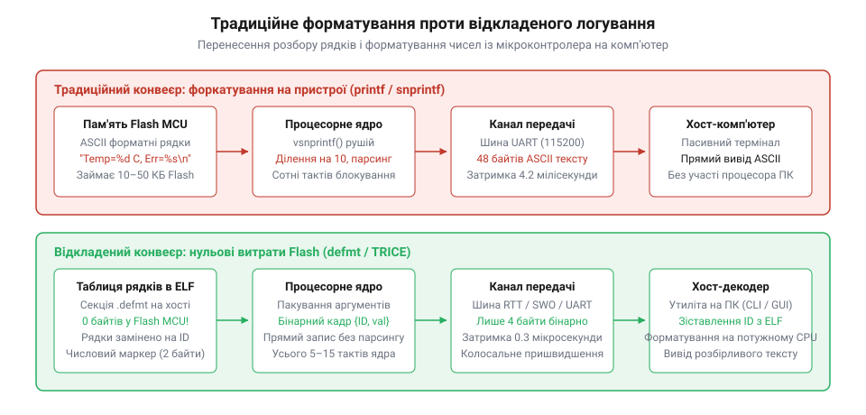

# Відкладене форматування та бінарне логування: defmt, TRICE і нульові витрати Flash

<preknowlist>
- [printf на пристрої: послідовний монітор і його ціна](root:sf-devices/printf-na-prystroi) — накладні витрати форматованого виводу рядків та блокування процесора
</preknowlist>

## Ціна класичного рядкового логування

Під час розробки прошивок для мікроконтролерів першим інструментом діагностики зазвичай стає [послідовний вивід через printf](root:sf-devices/printf-na-prystroi). Проте в системах жорсткого реального часу класичне рядкове логування руйнує роботу програми через три фізичні обмеження: вичерпання енергонезалежної пам'яті, надмірне споживання процесорних тактів і низьку швидкість послідовних ліній зв'язку.

Перше обмеження — фізичний обсяг пам'яті @@en|Flash@@ (від англ. *flash* — спалах). Кожен форматний рядок на кшталт `"Error: code=%d, val=%d\n"` компілятор зберігає в секції констант `.rodata` як нестиснений масив символів ASCII. Кілька сотень діагностичних викликів у промисловому проєкті поглинають від 30 до 70 кілобайтів пам'яті. Для кристалів із обмеженим ресурсом Flash це неприпустимо, оскільки текстові константи витісняють корисний код застосунку.

Друге обмеження — обчислювальна складність форматування. Функція `printf` виконує розбір рядка безпосередньо на мікроконтролері під час роботи: ядро побайтово сканує шаблон, аналізує специфікатори та багаторазово ділить двійкові змінні на 10 для перетворення у десятковий вигляд. За відсутності апаратного дільника такий парсинг займає сотні тактів ядра, блокуючи виконання важливих задач керування.

Третє обмеження — простоювання ядра через повільний асинхронний передавач @@en|UART@@ (від англ. *Universal Asynchronous Receiver-Transmitter* — універсальний асинхронний приймач-передавач). Передача одного текстового рядка довжиною 40 байтів на швидкості 115200 бод триває близько 3.5 мілісекунди. Якщо виклик друку розмістити всередині обробника переривань, процесор зависає в циклі очікування регістрів передавача, блокуючи всі рівні або нижчі за пріоритетом події.

Ця тривала затримка породжує небезпечний ефект спостереження @@en|probe effect@@ (від англ. *probe* — зонд та *effect* — наслідок; зміна поведінки досліджуваної системи через сам процес вимірювання). Затримки на форматування та передачу провокують появу плаваючих помилок @@en|Heisenbug@@ (від прізвища фізика Вернера Гейзенберга та англ. *bug* — дефект; несправність, що зникає під час спроби її фіксації): система пропускає жорсткі дедлайни або маскує стан гонитви сигналів, поки логування активне, і падає в аварію, коли діагностику вимикають. Тому формування тексту безпосередньо на мікроконтролері непридатне для систем реального часу.

## Архітектура відкладеного двійкового форматування

Розв'язанням проблеми є зміна парадигми діагностики — перехід до відкладеного форматування @@en|deferred formatting@@ (від англ. *defer* — відкладати та *format* — надавати форми). Ідея полягає в суворому розподілі обов'язків: мікроконтролер лише фіксує сам факт події, а формування читабельного тексту повністю переноситься на робочу станцію розробника.

Замість важкого рядка пристрій передає мінімальний двійковий пакет: числовий ідентифікатор події (зазвичай 1–2 байти) та сирі значення змінних (2–4 байти). Текстові шаблони взагалі не потрапляють у фізичну пам'ять @@en|Flash@@ мікроконтролера. Скрипт компонувальника поміщає їх у спеціальну секцію з атрибутом `NOLOAD` у файлі @@en|ELF@@ (від англ. *Executable and Linkable Format* — формат виконуваних та компонованих файлів). Шаблони залишаються виключно на комп'ютері, займаючи рівно нуль байтів у кристалі.

Практичну реалізацію цієї концепції забезпечують спеціалізовані бібліотеки: фреймворк @@en|TRICE@@ (від англ. *tiny real-time interrupt-safe C/C++ embedded logging* — компактне безпечне для переривань логування) для мов C/C++ та бібліотека @@en|defmt@@ (скорочення від англ. *deferred formatting* — відкладене форматування) для мови Rust. Формування пакета зводиться до прямого копіювання кількох байтів у пам'ять за 10–15 тактів процесора, що є безпечним навіть усередині швидкісних переривань.

Для передачі двійкових пакетів без зупинки ядра застосовують швидкісні апаратні інтерфейси: прямий доступ до пам'яті @@en|DMA@@ (від англ. *Direct Memory Access* — прямий доступ до пам'яті), фоновий вивід через макрокомірку трасування @@en|ITM@@ (від англ. *Instrumentation Trace Macrocell* — системний модуль апаратної траси) та лінію @@en|SWO@@ (від англ. *Serial Wire Output* — послідовний вивід діагностики), або пряме читання оперативної пам'яті апаратним зондом за технологією @@en|RTT@@ (від англ. *Real-Time Transfer* — передача даних у реальному часі). Щоб надійно розділяти кадри в безперервному потоці байтів і відновлювати межі повідомлень після втрат зв'язку, застосовують алгоритм пакування байтів @@en|COBS@@ (від англ. *Consistent Overhead Byte Stuffing* — пакування байтів із постійними накладними витратами).

На комп'ютері хостова утиліта-декодер перехоплює двійковий потік, відновлює межі пакетів, зіставляє числовий ідентифікатор із таблицею рядків у файлі @@en|ELF@@ і виводить повноцінний текст події на екран.

*Архітектурний розподіл обов'язків: винесення форматування тексту на комп'ютер усуває накладні витрати пам'яті Flash та блокування ядра.*