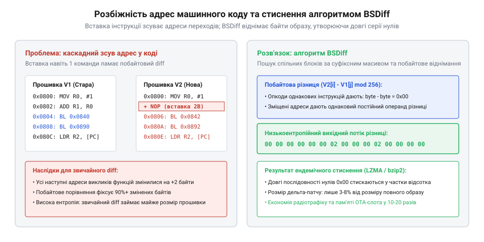
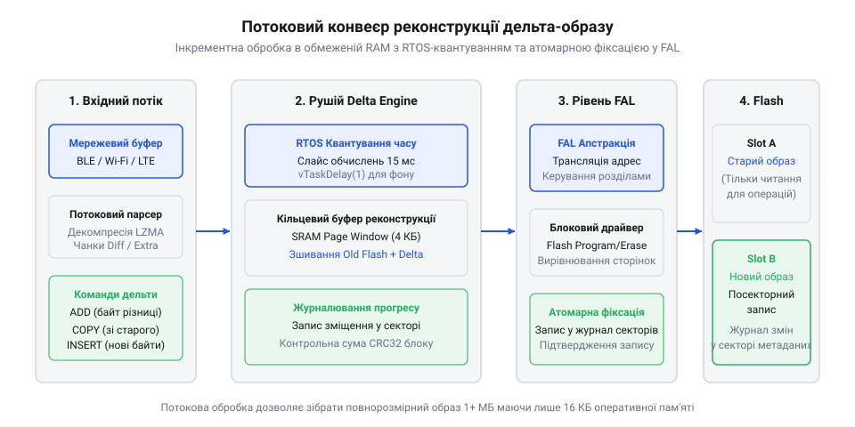
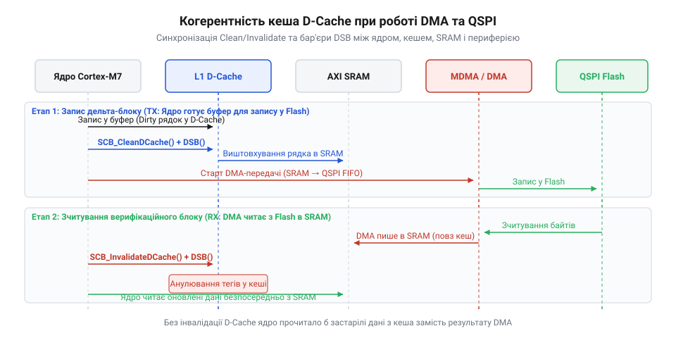
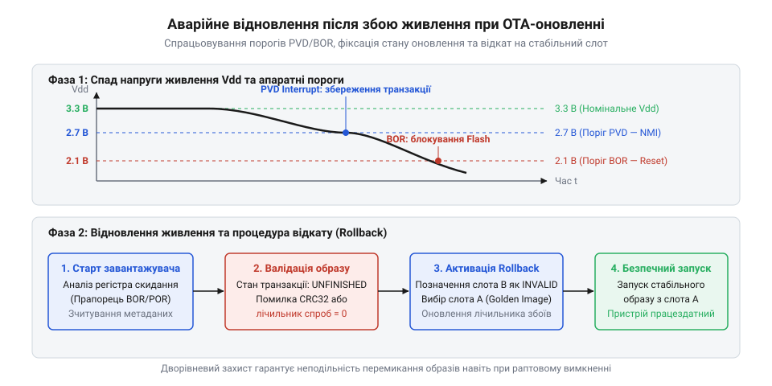

# Дельта-оновлення прошивки

## Початкові концепції та фізичні принципи

Коли автономний вимірювальний прилад, датчик вібрації промислового агрегату чи розумний лічильник газу встановлюють у підвальному приміщенні або у розподільчому колодязі, доступ до нього обмежується роками автономної експлуатації від вбудованої батареї. Будь-яка виявлена помилка у коді, вразливість мережевого стека чи необхідність оптимізації функцій вимагають оновлення вбудованого програмного забезпечення — @@en|firmware@@ (з англ. *firm* — стійкий, незмінний, *ware* — виріб, програмний мікрокод пристрою). Оновлення пристрою бездротовим каналом зв'язку — @@en|OTA@@ (з англ. *Over-The-Air* — «по повітрю», бездротовим каналом) — усуває потребу фізичного демонтажу та виїзду сервісної бригади. Проте передача повного бінарного образу розміром від одного до кількох мегабайтів через енергоефективні бездротові мережі дальнього радіусу дії @@en|LPWAN@@ (з англ. *Low-Power Wide-Area Network* — енергоефективна мережа дальнього радіусу), такі як @@en|NB-IoT@@ (з англ. *NarrowBand Internet of Things* — вузькосмуговий інтернет речей) чи @@en|LoRaWAN@@ (з англ. *Long Range Wide Area Network* — енергоефективна мережа великого радіуса дії), породжує критичні енергетичні та фінансові обмеження.

Радіочастотний трансивер бездротового модема у фазі активного випромінювання та прийому пакетів споживає значний струм у сотні міліамперів. В умовах вузької смуги пропускання швидкість завантаження становить від сотень байтів до лічених кілобайтів на секунду, внаслідок чого сесія безперервного радіозв'язку затягується на десятки хвилин. Оскільки витрачена електрична енергія прямо пропорційна часу роботи радіотракту, трансляція повного бінарного образу незворотно вичерпує заряд автономного елемента живлення. Одночасно стільникові оператори тарифікують кожен переданий мегабайт трафіку, через що організація [бездротового оновлення прошивки](root:sf-devices/ota-update) для парку з десятків тисяч польових контролерів перетворюється на фінансово неприйнятну операцію.

Позначимо через `U` робочу напругу живлення радіотрансивера, через `I` — середній струм споживання під час активного прийому даних, через `S` — повний обсяг переданого файлу в байтах, а через `R` — ефективну швидкість передачі даних у радіоканалі в байтах на секунду. Кількість електричної енергії `E`, витрачена на сеанс зв'язку, визначається законом Джоуля-Ленца:

```
E = U × I × (S ÷ R)                                           [закон збереження електричної енергії]
```

Вираз `S ÷ R` дорівнює сумарному часу безперервної роботи приймально-передавального тракту модема, а добуток `U × I` визначає його миттєву електричну потужність. Зменшення обсягу даних `S` прямо пропорційно скорочує тривалість радіовипромінювання та витрату заряду акумулятора.

**Розрахунок витрат енергії для стільникового каналу NB-IoT:**
Розглянемо передачу прошивки через стільниковий модуль при напрузі живлення `U = 3.3 В`, струмі прийому `I = 0.25 А` та середній швидкості радіоканалу `R = 2048 байтів/с` (16 кбіт/с). Порівняємо повний образ прошивки обсягом `S_full = 2 097 152 байти` (2 МБ) та стиснений різницевий пакет @@en|Delta OTA@@ (з грец. *δέλτα* — різниця, англ. *Over-The-Air* — бездротовим каналом) розміром `S_delta = 65 536 байтів` (64 КБ):

```
E_full = 3.3 × 0.25 × (2097152 ÷ 2048)                        [підстановка параметрів повного образу]
       = 0.825 × 1024                                         [розрахунок часу сесії в секундах]
       = 844.8 Дж                                             [енергія завантаження повного образу]
```

```
E_delta = 3.3 × 0.25 × (65536 ÷ 2048)                         [підстановка параметрів дельта-пакета]
        = 0.825 × 32                                          [розрахунок часу сесії в секундах]
        = 26.4 Дж                                             [енергія завантаження дельта-пакета]
```

Дельта-оновлення скорочує час активної роботи радіомодуля та витрату енергії батареї у `32` рази: замість 844.8 Дж витрачається лише 26.4 Дж, що зберігає ресурс автономного джерела живлення для багаторічної роботи вузла без втручання людини.

Фізичні обмеження енергонезалежної пам'яті мікроконтролера роблять частий повний перезапис вкрай небажаним процесом. Вбудовані системи використовують пам'ять типу @@en|NOR Flash@@ (з англ. *Not-OR* — логічне «АБО-НІ», *flash* — спалах). На відміну від статичної пам'яті з довільним доступом, комірки якої допускають миттєву зміну окремих бітів в обох напрямках, фізика напівпровідникової структури плаваючого затвора або нітридної пастки заряду в @@en|NOR Flash@@ дозволяє програмувати біти лише в один бік: переводити логічну одиницю в нуль шляхом тунелювання Фаулера-Нордгейма або інжекції гарячих електронів. Зворотне переведення нуля в одиницю можливе виключно через операцію апаратного стирання цілого фізичного сектора (розміром 4 КБ) чи блоку (32 або 64 КБ) подачею високовольтного імпульсу зворотної полярності з напругою від 12 В до 20 В, яку генерує внутрішній помповий перетворювач напруги мікросхеми.

Кожна операція стирання сектора спричиняє деградацію та накопичення залишкового заряду в діелектричному оксидному шарі комірок, що обмежує ресурс напівпровідникового кристала показником від десяти до ста тисяч циклів стирання та запису — @@en|P/E cycle@@ (з англ. *program-erase cycle* — цикл запису та стирання). Тривалість апаратного стирання одного сектора становить від 20 до 100 мілісекунд, тоді як програмування сторінки розміром 256 байтів триває від 0.5 до 2 мілісекунд. Перезапис усього адресного простору при повному оновленні багаторазово прискорює зношування матриці пам'яті та підвищує ймовірність спотворення сусідніх комірок внаслідок [фізичної архітектури комірок](root:sf-data/nor-flash-memory-architecture). Технологія дельта-оновлення звертається лише до тих фізичних секторів, де код зазнав реальних модифікацій, суттєво заощаджуючи ресурс, що підтримує алгоритм вирівнювання зношування — @@en|wear leveling@@ (з англ. *wear* — зношування, *leveling* — вирівнювання).

Додаткове обмеження виникає у мікроконтролерах із конфігурацією пам'яті з одним банком, де обчислювальне ядро виконує інструкції безпосередньо з Flash-пам'яті за принципом виконання на місці — @@en|XIP@@ (з англ. *eXecute-In-Place* — виконання програми безпосередньо з пам'яті). Коли внутрішній контролер спалах-пам'яті здійснює цикл стирання сектора або запису сторінки, зчитування нових машинних інструкцій процесором із цього самого кристала блокується апаратним арбітром шини. Якщо у цей інтервал процесор спробує витягти наступну команду, шина даних зависає або генерується апаратна помилка шини. Щоб обійти блокування шини під час запису критичних секторів Flash, розробники часто завантажують мінімальний код обслуговування в оперативну пам'ять подібно до [проміжного завантажувача у RAM](root:sf-devices/esptool-stub-flasher). Застосування дельта-патчів із компактними буферами сторінок дозволяє строго квантувати операції доступу до пам'яті та утримувати блокування шини у вузьких мікросекундних межах.

Чому для стиснення оновлень не підходить звичайний текстовий diff або побайтове виключне АБО над файлами прошивки? Причина полягає у специфіці скомпільованого машинного коду таких архітектур, як ARM Thumb-2 або RISC-V. У вихідному тексті мовами C чи C++ виправлення помилки в одній умові змінює лише десяток символів. Проте під час компіляції та лінкування додавання хоча б однієї нової 32-бітної інструкції зміщує адреси всіх наступних підпрограм, констант та глобальних змінних на 4 байти вперед.

Машинні інструкції переходів та викликів функцій кодують цілі як відносні зміщення відносно лічильника команд процесора, а звернення до глобальних структур здійснюються завантаженням адрес із пулів літералів — @@en|literal pool@@ (з лат. *littera* — літера, письмена, англ. *pool* — спільний резервуар) та таблиць переміщень @@en|relocation table@@ (з лат. *relocare* — переміщати, англ. *table* — таблиця). Через зсув адресного простору на 4 байти тисячі машинних інструкцій по всьому бінарному файлу змінюють свої бітові маски, навіть якщо їхня алгоритмічна суть не змінилася ні на йоту. Наївне побайтове порівняння фіксує масові відмінності у кожному блоці даних, утворюючи різницевий файл, розмір якого майже дорівнює первинному бінарному образу.

Для подолання проблеми адресного зсуву застосовують спеціалізовані [алгоритми бінарного диференціювання](root:sf-devices/binary-diff-algorithms-embedded), найвідомішим із яких є алгоритм @@en|BSDiff@@ (з англ. *binary stream difference* — різниця бінарних потоків). Математичний фундамент алгоритму полягає у виявленні довгих фрагментів схожості за допомогою такої структури, як суфіксний масив — @@en|suffix array@@ (з лат. *suffixus* — прикріплений, англ. *array* — масив) над старим файлом, з наступним побайтовим арифметичним відніманням відповідних сегментів за модулем 256.

Нехай `S_old[k]` — байт старої прошивки, а `S_new[k]` — відповідний байт нової прошивки, у якій машинний код зазнав рівномірного адресного зсуву на постійну величину `Δ`. Якщо адреса виклику або вказівника у старій версії дорівнювала `A`, то в новій версії вона дорівнює `A + Δ`. Для незмінених інструкцій різниця `S_new[k] - S_old[k]` дорівнює нулю. Для інструкцій, що змістилися на однакову величину, різниця становить одне й те саме фіксоване число. Замість випадкового хаосу незбіжних бітів різницевий потік перетворюється на довгі однорідні серії нулів, перемежовані рідкісними стабільними константами.


*Схема розбіжності адрес після вставки інструкції та перетворення зміщень у низькоентропійний потік нулів алгоритмом BSDiff.*

Назвемо через `p(b)` статистичну ймовірність появи конкретного байтового значення `b` у масиві даних серед усіх двохсот п'ятдесяти шести можливих значень від `0` до `255`. Інформаційна ентропія — @@en|entropy@@ (з грец. *ἐντροπία* — перетворення) — визначає середню кількість бітів інформації на один байт послідовності:

```
H = - ∑ p(b) · log₂(p(b))                                     [формула інформаційної ентропії Шеннона]
```

Сума береться за всіма значеннями `b` від нуля до двохсот п'ятдесяти п'яти. У нестисненому машинному коді байти розподілені рівномірно, тому ентропія `H` сягає 7.5–7.8 біта на байт, що перешкоджає ефективному стисненню. У різницевому потоці алгоритму @@en|BSDiff@@ переважна більшість байтів набуває нульового значення (`b = 0`), розподіл імовірностей стає гостро піковим, а інформаційна ентропія різко спадає.

**Розрахунок ентропії різницевого потоку для модифікованого блоку коду:**
Припустимо, що внаслідок побайтового віднімання за модулем 256 нульове значення `0x00` зустрічається у вісімдесяти п'яти відсотках випадків (`p(0) = 0.85`), а решта п'ятнадцять відсотків ймовірності рівномірно розподілені між іншими двомастами п'ятдесятьма п'ятьма значеннями (`p(b) = 0.15 ÷ 255 ≈ 0.000588`):

```
H = - (p(0) · log₂(p(0)) + 255 × (p(b) · log₂(p(b))))         [розбиття суми на нульовий та ненульові байти]
  = - (0.85 · log₂(0.85) + 255 × (0.000588 · log₂(0.000588)))  [підстановка статистичних частот значень]
  = - (0.85 · (-0.2345) + 255 × (0.000588 · (-10.73)))         [обчислення двійкових логарифмів]
  = - (-0.1993 - 0.1609)                                      [перемноження та додавання складових]
  = 0.36 біта на байт                                         [кінцевий розрахунок ентропії]
```

Зниження інформаційної ентропії з 7.8 до 0.36 біта на байт означає, що потік майже не несе випадкового шуму, завдяки чому ентропійні компресори @@en|LZMA@@ (з англ. *Lempel-Ziv-Markov chain algorithm*) або оптимізований для мікроконтролерів @@en|Heatshrink@@ (з англ. *heat-shrink* — термоусадка) стискають різницевий файл до 2–5% від початкового розміру прошивки.

Підготовлений дельта-патч розділяється на три незалежні логічні потоки даних:
1. Керуючий потік кортежів `(add_len, copy_len, seek_offset)`: кодує довжину блоку побайтового додавання, довжину блоку вставки абсолютно нових даних та величину зміщення покажчика у базовій прошивці. 2. Потік різниці: послідовність байтів, які додаються за модулем 256 до байтів старого образу для реконструкції змінених інструкцій. 3. Потік нових даних: сирі байти для нових підпрограм і таблиць, які не мають аналогів у старому образі.

Залежно від апаратного обсягу пам'яті мікроконтролера розгортання оновлення здійснюється за однією з двох базових топологій:
У схемі з [двома системними розділами](root:sf-devices/ota-slots) — @@en|dual-slot@@ (з англ. *dual* — подвійний, *slot* — гніздо, розділ пам'яті) — робоча прошивка міститься у розділі `slot0`, а реконструйований цільовий образ записується у розділ `slot1`. Ця топологія надає бездоганну надійність: якщо під час запису станеться збій живлення чи помилка контрольної суми, пристрій просто продовжить виконання стабільного коду із `slot0`.

Якщо ж мікроконтролер має обмежений обсяг пам'яті, де під прошивку виділено майже весь наявний простір кристала, другий повноцінний розділ створити неможливо. Тоді застосовують оновлення безпосередньо на місці — @@en|in-place delta@@ (з англ. *in-place* — на тому ж місці). Нові сектори записуються поверх секторів активного образу. У такій схемі виникає проблема графової залежності: якщо новий сектор `A` потребує даних зі старого сектора `B`, але сектор `B` вже був перезаписаний раніше, старі дані втрачаються. Порядок оновлення секторів формує орієнтований ациклічний граф — @@en|DAG@@ (з англ. *Directed Acyclic Graph* — орієнтований ациклічний граф). Якщо в графі виникають циклічні залежності (сектор `A` потребує старого `B`, а новий `B` потребує старого `A`), алгоритм усуває взаємне блокування за допомогою єдиного службового буферного сектора — @@en|scratchpad@@ (з англ. *scratchpad* — блокнот для чорнових записів, резервний буферний сектор).

## Внутрішня будова та алгоритми роботи

Програмна підсистема дельта-оновлення у прошивці мікроконтролера є детермінованим конвеєром обробки потокових даних. Архітектурно вона об'єднує п'ять функціональних вузлів: вхідний буфер потоку, парсер службового бінарного заголовка та секторних дескрипторів, рівень абстракції від фізичної спалах-пам'яті — @@en|FAL@@ (з англ. *Flash Abstraction Layer* — шар абстракції спалах-пам'яті), ядро посторінкової реконструкції та підсистему журналювання станів — @@en|journaling@@ (з фр. *journal* — щоденник обліку подій). Взаємодія між цими модулями виключає динамічне виділення пам'яті: усі буфери мають фіксований статичний розмір у оперативній пам'яті @@en|SRAM@@ (з англ. *Static Random Access Memory* — статична пам'ять із довільним доступом), кратний апаратному розміру сторінки програмування Flash-пам'яті.

Бінарний пакет оновлення починається зі стандартизованого службового заголовка фіксованої довжини. Перші чотири байти містять сигнатуру магічного числа (шістнадцяткове значення `0x44454C54` для ідентифікації протоколу "DELT"). За ними розміщуються однобайтний номер версії формату дельти, однобайтне поле прапорців типу компресії потоку (неспакований потік, @@en|Heatshrink@@ або посторінковий алгоритм @@en|LZMA@@), двобайтний розмір фізичного сектора цільової пам'яті (зазвичай 4096 байтів), а також чотирибайтні поля повної довжини цільового образу нової прошивки та розміру самого різницевого пакета.

Особливе значення мають два тридцятидвобайтові поля криптографічних гешів алгоритму @@en|SHA-256@@ (з англ. *Secure Hash Algorithm 256-bit* — безпечний алгоритм гешування): геш початкової прошивки `SHA256_Source` та очікуваний геш реконструйованого образу `SHA256_Target`. Перед початком модифікації будь-якого сектора Flash-пам'яті ядро дельта-оновлення виконує попередню валідацію: фонова задача зчитує весь наявний вміст активного розділу прошивки та розраховує його контрольний підсумок @@en|SHA-256@@. Якщо обчислений геш не збігається з полем `SHA256_Source` хоча б в одному біті, це свідчить про те, що у пристрої працює інша версія програми або пам'ять зазнала спотворення. У такому разі дельта-патч категорично відхиляється без жодного запису у пам'ять, оскільки накладення різниці на інший бінарний фундамент призведе до незворотного перетворення прошивки на непрацездатне сміття. Додатково перевіряється цифровий підпис пакета у межах процедури [криптографічного підписування образу](root:sf-devices/ota-image-signing).

Алгоритм потокової реконструкції працює вікнами фіксованого розміру через два кільцевих буфери: буфер різниці та буфер збирання сторінки Flash (наприклад, по 256 байтів, що дорівнює апаратній сторінці запису @@en|NOR Flash@@). Процес відновлення виконується за такими детермінованими кроками:
1. Читання чергового керуючого кортежу: декодер витягує значення `add_len`, `copy_len` та знакове зміщення `seek_offset`. 2. Виконання фази додавання: протягом `add_len` байтів алгоритм одночасно вичитує порцію байтів зі старої прошивки за поточним покажчиком `old_offset` та порцію байтів із декомпресованого потоку різниці. Для кожної пари байтів виконується операція додавання за модулем 256: `Target[i] = (Source[i] + Diff[i]) & 0xFF`. 3. Заповнення сторінки та запис у Flash: отримані результуючі байти записуються у буфер сторінки. Щойно буфер накопичує 256 байтів, модуль @@en|FAL@@ ініціює апаратний запис сторінки у цільовий розділ через контролер шини @@en|QSPI@@ (з англ. *Quad Serial Peripheral Interface* — чотирипровідний послідовний периферійний інтерфейс) або внутрішній периферійний модуль контролера пам'яті. Одночасно записані байти подаються на вхід апаратного або програмного модуля обчислення @@en|SHA-256@@ для безперервної верифікації цілісності образу. 4. Зсув покажчика старої прошивки: покажчик `old_offset` збільшується на величину знакового зміщення `seek_offset`. Це дозволяє алгоритму перестрибувати через зміщені або вставлені блоки функцій. 5. Виконання фази копіювання: протягом `copy_len` байтів дані вичитуються безпосередньо з потоку нових байтів дельти та записуються у цільову сторінку без участі старої пам'яті.

Під час оновлення прошивки на місці в умовах однослотової конфігурації виникає критична небезпека взаємного блокування секторів. Перед початком процедури сервер збирання прошивки формує дельта-пакет так, щоб порядок застосування патчів до секторів був топологічно впорядкований. Якщо граф залежностей містить циклічний зв'язок між двома секторами, один із них тимчасово копіюється у виділений службовий сектор @@en|scratchpad@@. Алгоритм розриву циклу виконує чотири послідовні атомарні операції:
- Крок 1: Вміст сектора `A` копіюється у сектор @@en|scratchpad@@, а в енергонезалежний журнал записується стан `STAGE_SCRATCHPAD_VALID`. - Крок 2: Сектор `B` стирається та реконструюється з використанням даних із @@en|scratchpad@@ (як джерела старого `A`) та оригінального `B`. - Крок 3: Сектор `A` стирається та реконструюється з використанням оновленого сектора `B`. - Крок 4: Запис у журналі скидається, звільняючи @@en|scratchpad@@ для наступної транзакції.

На випадок раптового знеструмлення пристрою під час стирання або запису сектора прошивка спирається на протокол [відмовостійкого журналювання у Flash](root:sf-devices/fail-safe-journaling-flash). Перед кожною операцією модифікації сектора у спеціально виділену енергонезалежну таблицю станів (розміщену в окремому секторі інформаційного блоку або регістрах з резервним батарейним живленням) записується структура транзакції: номер модифікованого сектора, поточний крок реконструкції та контрольна сума @@en|CRC-32@@ (з англ. *Cyclic Redundancy Check 32-bit* — циклічний надлишковий код). Лише після того, як сектор успішно записано та верифіковано побайтовим читанням, статус транзакції маркується як завершений. Якщо під час переривання живлення сектор виявився наполовину стертим, завантажувач під час рестарту зчитує незавершену транзакцію і або відновлює застосування патча для цього сектора з резервної копії у @@en|scratchpad@@, або здійснює безпечну процедуру [аварійного відкату прошивки](root:sf-devices/ota-rollback) до попереднього стабільного стану. Якщо ж обидва образи виявилися зруйнованими внаслідок апаратного збою живильної мережі, мікроконтролер переводиться у [режим сервісного обслуговування](root:sf-devices/daplink-maintenance-mode) для відновлення образу через захищений налагоджувальний порт.

У багатозадачному середовищі операційної системи реального часу @@en|FreeRTOS@@ або іншої @@en|RTOS@@ (з англ. *Real-Time Operating System* — операційна система реального часу) тривалі операції запису та стирання Flash-пам'яті несуть ризик порушення детермінізму критичних задач керування обладнанням. Стирання одного 4-кілобайтного сектора займає до 50 мілісекунд процесорного часу. Під час оновлення ста секторів сумарний час блокування може сягати 5 секунд, що неминуче призведе до спрацьовування апаратного сторожового таймера — @@en|WDT@@ (з англ. *Watchdog Timer* — сторожовий таймер) та аварійного перезапуску мікроконтролера. Для запобігання цьому дельта-оновлення виділяється в окрему фонову задачу з низьким пріоритетом `tskIDLE_PRIORITY + 1`. Конвеєр дельти будується за принципом квантування часу: після запису кожної 256-байтної сторінки або стирання одного сектора задача скидає апаратний лічильник сторожового таймера @@en|WDT@@ та викликає примусове передавання керування іншим потокам через системний виклик `vTaskDelay(pdMS_TO_TICKS(1))` або `taskYIELD()`. Це гарантує, що високопріоритетні задачі обробки переривань, опитування датчиків та мережевого стека отримують процесорний ресурс без затримок.


*Архітектура потокового конвеєра реконструкції дельта-образу з буферизацією сторінок, рівнем FAL та квантуванням у фоновій задачі RTOS.*

Нижче наведено повну реалізацію ядра потокової реконструкції дельта-образу мовами C та C++. Реалізація оперує фіксованим буфером сторінки, не використовує динамічну пам'ять та інтегрується з рівнем абстракції спалах-пам'яті @@en|FAL@@.

:::tabs
:::code root\eng\sf-devices\delta-ota/delta-ota-d/c/embedded/delta-crc32-step.c c
:::code root\eng\sf-devices\delta-ota/delta-ota-d/cpp/embedded/status.cpp cpp
:::

## Апаратна реалізація та низькорівневий C/C++ код

Коли алгоритм дельта-реконструкції переходить від математичної моделі різницевих потоків до безпосереднього запису відновлених блоків у фізичні напівпровідникові кристали, центральний процесор стикається з жорсткими обмеженнями пропускної здатності та затримок системних шин. Просте побайтове надсилання команд через послідовні інтерфейси у режимі зайнятого очікування змушує обчислювальні ядра витрачати мільйони тактів на холості цикли опитування регістрів прапорців. У результаті @@en|firmware@@ не встигає обслуговувати переривання реального часу, марно розряджає хімічне джерело живлення та провокує аварійне спрацьовування сторожового таймера @@en|WDT@@.

Для усунення цього вузького місця сучасні мікроконтролери використовують спеціалізовані апаратні контролери послідовної спалах-пам'яті @@en|QSPI@@ та восьмипровідні @@en|OSPI@@ (з англ. *Octal Serial Peripheral Interface* — восьмипровідний послідовний периферійний інтерфейс). Ці периферійні вузли мають два режими роботи. Перший — режим прямого відображення адрес у спільний адресний простір ядра — @@en|memory-mapped mode@@ (з англ. *memory-mapped* — відображений у пам'ять, *mode* — режим). У цьому режимі контролер шини прозоро транслює звичайні 32-бітні процесорні операції читання у швидкісні транзакції спалах-пам'яті, підтримуючи виконання коду безпосередньо з мікросхеми @@en|XIP@@. При процедурі @@en|Delta OTA@@ це дозволяє обчислювальному ядру зчитувати старий базовий образ для відновлення секторів за прямими вказівниками на пам'ять без жодних програмних команд керування шиною.

Операції стирання секторів та програмування сторінок принципово неможливо виконати через пряме читання. Для модифікації комірок контролер перемикається у непрямий командний режим — @@en|indirect mode@@ (з лат. *indirectus* — непрямий, англ. *mode* — режим), де керування сигналами шини бере на себе кінцевий автомат периферійного модуля. Апаратна послідовність запису складається з трьох послідовних фаз: передача однобайтної команди дозволу запису `WREN` (шістнадцятковий код `0x06`), виставлення команди програмування сторінки `Page Program` (код `0x02` для стандартної шини або `0x32` для чотирипровідного інтерфейсу) разом із 24- або 32-бітною цільовою адресою, та заповнення вхідного буфера черги @@en|FIFO@@ (з англ. *First-In, First-Out* — перший прийшов, перший пішов, буфер черги). Після надсилання останнього байта мікросхема @@en|NOR Flash@@ переходить у фазу внутрішнього програмування, а в її статусному регістрі виставляється біт зайнятості @@en|WIP@@ (з англ. *Write-In-Progress* — виконання операції запису). Повний опис структури пакетів та командних послідовностей наведено у матеріалі щодо [апаратних контролерів шини QSPI](root:sf-devices/qspi-flash-memory-controller).

Щоб процесор не простоював під час перекачування 256 байтів сторінки у буфер @@en|FIFO@@, передавання даних покладають на контролер прямого доступу до пам'яті — @@en|DMA@@. Керування транзакцією бере на себе дескриптор каналу — @@en|DMA descriptor@@ (з лат. *describere* — описувати, блок параметрів каналу прямого доступу), який задає початкову адресу буфера у статичній пам'яті @@en|SRAM@@, адресу регістра даних контролера @@en|QSPI@@ та кількість байтів. Передавання байтів відбувається в апаратному конвеєрі паралельно з виконанням обчислювальних інструкцій ядра.

Для запобігання конфліктам на системних шинах контролер використовує багатошаровий комутатор шин — @@en|bus matrix@@ (з лат. *matrix* — джерело, системна мережа з'єднань, англ. *bus* — системна шина). Якщо контролер @@en|DMA@@ та процесорне ядро одночасно звертаються до одного фізичного банку статичної пам'яті @@en|SRAM@@, внутрішній арбітр шини примусово вставляє цикли очікування, пригальмовуючи роботу ядра. Щоб усунути взаємні затримки, буфери сторінок дельти розміщують в окремому банку оперативної пам'яті, або виділяють під обчислення пам'ять із прямим зв'язком із ядром — @@en|TCM@@ (з англ. *Tightly-Coupled Memory* — пам'ять із тісним зв'язком з ядром), доступ до якої процесор здійснює за один такт без виходу на загальну шину.

Використання @@en|DMA@@ на продуктивних процесорних ядрах із гарвардською архітектурою та кеш-пам'яттю спричиняє апаратний конфлікт порушення узгодженості пам'яті — @@en|cache coherency@@ (з лат. *cohaerere* — бути взаємозв'язаним, англ. *coherency* — узгодженість). Процесорне ядро працює через швидкісний кеш даних — @@en|D-Cache@@ (з англ. *Data Cache* — кеш даних). Коли алгоритм декомпресії формує реконструйовану сторінку прошивки, змінені байти накопичуються у лініях кеша і ще не потрапляють у фізичні комірки @@en|SRAM@@. Якщо у цей момент запустити передачу @@en|DMA@@, периферійний контролер вичитає з оперативної пам'яті застарілі дані, що призведе до запису спотвореного блоку у спалах-пам'ять.

Для усунення цієї небезпеки застосовують програмне або апаратне керування лініями кеша. Програмне узгодження полягає у виклику операції примусового скидання кеша даних (clean або write-back), яка записує модифіковані лінії у фізичну оперативну пам'ять перед стартом передачі @@en|DMA@@. Після завершення оновлення прошивки викликається операція анулювання (invalidate) кеша команд — @@en|I-Cache@@ (з англ. *Instruction Cache* — кеш команд), щоб процесор не виконував старі кешовані інструкції з оновлених секторів. Апаратне розв'язання базується на налаштуванні модуля захисту пам'яті — @@en|MPU@@ (з англ. *Memory Protection Unit* — модуль захисту пам'яті), який оголошує діапазон буферів дельти некешованим регіоном. Перед початком таких операцій процесор виконує апаратні інструкції, які реалізують бар'єр пам'яті — @@en|memory barrier@@ (з давньофр. *barriere* — перепона, огорожа, англ. *barrier* — бар'єр упорядкування доступу). Бар'єр синхронізації даних — @@en|DSB@@ (з англ. *Data Synchronization Barrier* — бар'єр синхронізації даних) гарантує завершення всіх попередніх звернень до пам'яті до переходу до наступної інструкції, а бар'єр синхронізації інструкцій — @@en|ISB@@ (з англ. *Instruction Synchronization Barrier* — бар'єр синхронізації інструкцій) очищає конвеєр команд процесора. Детальні інструкції конфігурації ліній кешування висвітлює матеріал про механізми [узгодженості кеш-пам'яті та DMA](root:sf-devices/mpu-cache-coherency).


*Часова діаграма взаємодії ядра процесора, кешу даних, контролера DMA та периферії QSPI зі скиданням кешу та бар'єрами пам'яті.*

Аналогічне апаратне прискорення реалізується для перевірки цілісності бінарного образу. Програмне обчислення контрольного підсумку @@en|SHA-256@@ для мегабайтного файлу вимагає мільйонів циклів ядра. Сучасні мікроконтролери містять спеціалізований апаратний прискорювач — @@en|hardware crypto engine@@ (з грец. *κρυπτός* — таємний, лат. *ingenium* — винахід, знаряддя, апаратний прискорювач). Контролер @@en|DMA@@ спрямовує реконструйований потік даних паралельно у регістри контролера @@en|QSPI@@ та у вхідні регістри апаратного гешувального модуля, що зводить витрати процесорного часу на верифікацію криптографічного гешу до нуля.

Введемо формулу оцінки коефіцієнта навантаження на процесор під час операції програмування сторінки спалах-пам'яті. Позначимо через `T_prog` повний час фізичного програмування однієї сторінки внутрішнім помповим помножувачем напруги мікросхеми @@en|NOR Flash@@, а через `T_active` — сумарний час, протягом якого процесорне ядро утримує системну шину та виконує інструкції опитування або налаштування периферії під час цього циклу. Коефіцієнт навантаження ядра `L` визначається як відношення активного часу процесора до повної тривалості операції:

```
L = (T_active ÷ T_prog) × 100%                                  [визначення завантаженості процесора]
```

Вираз показує частку процесорного часу, яку забирає обслуговування периферії: при програмному опитуванні регістра прапорця @@en|WIP@@ процесор повністю заблокований протягом усього часу циклу (`T_active = T_prog`), що дає стовідсоткове навантаження. Застосування асинхронного драйвера з @@en|DMA@@ зменшує `T_active` до короткого інтервалу налаштування дескриптора `t_setup` та часу обробки переривання `t_isr`, вивільняючи решту вікна для потокової декомпресії алгоритмами @@en|LZMA@@ чи @@en|Heatshrink@@ або фонових задач @@en|FreeRTOS@@.

**Розрахунок завантаження ядра процесора при переході на DMA:**
Нехай фізичний час запису сторінки розміром 256 байтів внутрішнім помповим перетворювачем становить `T_prog = 800 мкс`. Час налаштування регістрів @@en|DMA@@ та контролера @@en|QSPI@@ займає `t_setup = 4 мкс`, а виклик обробника переривання завершення передачі триває `t_isr = 2 мкс`:

```
T_active_dma = 4 + 2                                           [сума часу налаштування дескриптора та обробки переривання]
             = 6 мкс                                           [активний процесорний час із DMA]
```

```
L_dma = (6 ÷ 800) × 100%                                       [підстановка параметрів у вираз коефіцієнта навантаження]
      = 0.0075 × 100%                                          [обчислення відношення тривалостей]
      = 0.75%                                                  [підсумковий відсоток завантаження процесора]
```

Використання @@en|DMA@@ та асинхронного опитування стану знижує навантаження на процесор з 100% до 0.75%, вивільняючи 99.25% обчислювального ресурсу ядра для обслуговування задач операційної системи реального часу @@en|RTOS@@ без небезпеки перезапуску за сторожовим таймером @@en|WDT@@.

Нижче наведено практичну реалізацію апаратного драйвера спалах-пам'яті рівня @@en|FAL@@ із підтримкою каналів @@en|DMA@@, асинхронного програмування та контролю узгодженості пам'яті мовами C та C++.

:::tabs
:::code root\eng\sf-devices\delta-ota/delta-ota-d/c/embedded/hw-barrier-dsb.c c
:::code root\eng\sf-devices\delta-ota/delta-ota-d/cpp/embedded/flashopresult.cpp cpp
:::

## Практичне застосування та відлагодження

Найбільш вразливим моментом автономного пристрою в польових умовах є не спотворення радіопакета в ефірі, а раптове падіння напруги живлення в момент, коли внутрішній помповий помножувач кристала спалах-пам'яті генерує високовольтний імпульс напругою 15–20 В для стирання сектора чи запису сторінки. Струм споживання напівпровідникового кристала у цей мікросекундний інтервал зростає в десятки разів, навантажуючи зношений хімічний елемент живлення або довгу лінію живлення. Якщо напруга живлення просідає нижче критичного порогу логіки Flash, внутрішній кінцевий автомат матриці пам'яті зависає у невизначеному стані, залишаючи комірки напівпровідника у метастабільному стані. Такий сектор втрачає здатність до коректного зчитування, викликаючи апаратні помилки шини.

Для захисту кристала спалах-пам'яті від зависання застосовують апаратний супервізор живлення — схему скидання при просіданні напруги @@en|brown-out reset@@ (з англ. *brown-out* — падіння напруги в мережі, *reset* — скидання стану), скорочено @@en|BOR@@. Типова помилка розробників вбудованих систем полягає у встановленні порогу @@en|BOR@@ за мінімальним рівнем працездатності обчислювального ядра процесора (наприклад, 1.8 В), тоді як зовнішня спалах-пам'ять @@en|NOR Flash@@ припиняє гарантоване програмування вже при напрузі 2.7 В. Надійна архітектура вимагає дворівневого захисту: переривання раннього попередження супервізора налаштовується на рівні 2.8 В, що надає прошивці часове вікно для безпечного завершення транзакції або блокування шини до того, як ядро втратить стабільність.

Введемо формулу розрахунку тривалості аварійного енергетичного вікна живлення від згладжувальних конденсаторів шини після спрацьовування детектора зниження напруги. Позначимо через `C` сумарну електричну ємність конденсаторів на шині живлення мікроконтролера та спалах-пам'яті, через `V_bor` — порогову напругу спрацьовування переривання супервізора @@en|BOR@@, через `V_min` — критичну мінімальну напругу стабільної роботи помпового перетворювача пам'яті, а через `I_act` — максимальний сумарний струм споживання плати під час запису. Доступний час аварійного порятунку `Δt` визначається формулою розряджання ємності постійним струмом:

```
Δt = C × (V_bor - V_min) ÷ I_act                                 [час розряджання ємності постійним струмом]
```

Вираз відображає часовий інтервал, протягом якого напруга спадає від порогу попередження до критичного збою логіки: чим більша ємність `C` та менший струм споживання `I_act`, тим довший запас часу має мікроконтролер для деактивації вибору кристала та збереження дескриптора незавершеної транзакції у таблиці [відмовостійкого журналювання у Flash](root:sf-devices/fail-safe-journaling-flash).

**Розрахунок аварійного часового вікна при раптовому знеструмленні:**
Нехай на платі встановлено блокувальні конденсатори сумарною ємністю `C = 47 мкФ` (0.000047 Ф). Поріг попереджувального переривання супервізора налаштовано на `V_bor = 2.8 В`, мінімальна безпечна напруга становить `V_min = 2.3 В`, а середній струм у фазі запису дорівнює `I_act = 0.035 А` (35 мА):

```
Δt = 0.000047 × (2.8 - 2.3) ÷ 0.035                             [підстановка параметрів схеми живлення]
   = 0.000047 × 0.5 ÷ 0.035                                     [множення ємності на допустимий спад напруги]
   = 0.0000235 ÷ 0.035                                          [ділення накопиченого заряду на робочий струм]
   ≈ 0.000671 с                                                 [тривалість аварійного вікна в секундах]
   = 671 мкс                                                    [переведення тривалості у мікросекунди]
```

Запас часу у `671 мкс` при тактовій частоті ядра 80 МГц дозволяє виконати понад п'ятдесят тисяч машинних інструкцій. Цього достатньо, щоб обробник переривання підняв лінію вибору кристала `CS` у високий стан, перевів мікросхему в режим глибокого сну та зберіг стан дельта-реконструкції у незалежних регістрах живлення. Детальні схемотехнічні рішення щодо моніторингу ліній живлення розглядає розділ про [супервізорів напруги живлення](root:sf-devices/brown-out-power-supervision).

Другим деградаційним фактором автономних систем є спонтанна зміна заряду комірок — @@en|bit flip@@ (з англ. *bit* — двійковий розряд, *flip* — перекидання, спонтанна інверсія заряду комірки). Під впливом витоку електронів із плаваючого затвора, фонової радіації чи температурних коливань запрограмовані нулі спонтанно переходять в одиниці. Сучасні кристали спалах-пам'яті містять вбудовані апаратні модулі виправлення помилок — @@en|ECC@@ (з англ. *Error-Correcting Code* — код виправлення помилок). Апаратний блок @@en|ECC@@ прозоро виправляє поодинокі спотворені біти на кожні 64 байти даних під час читання. Однак якщо зношування діелектрика спричиняє двобітну помилку в одному слові, апаратний коректор не може її виправити, повертаючи спотворені байти. У дельта-конвеєрі така деградація фіксується розбіжністю підсумкового контрольного гешу `SHA256_Target`.

Діагностика процесів дельта-реконструкції вимагає специфічного підходу. Звичайне налагодження із зупинкою виконання через апаратні точки зупину за допомогою інтерфейсу @@en|SWD@@ (з англ. *Serial Wire Debug* — послідовне двопровідне налагодження) чи @@en|JTAG@@ (з англ. *Joint Test Action Group* — стандартизований апаратний інтерфейс тестування та налагодження) унеможливлює тестування в реальному часі. Зупинка ядра процесора не зупиняє роботу зовнішнього радіочастотного модема: вхідні пакети переповнюють апаратні буфери, мережевий стек розриває з'єднання за таймаутом, а апаратний таймер @@en|WDT@@ ініціює примусовий рестарт вузла.

Для неінвазивного спостереження використовують неблокуючі протоколи трасування: модуль апаратного інструментального трасування — @@en|ITM@@ (з англ. *Instrumentation Trace Macrocell* — модуль апаратного інструментального трасування) або технологію швидкісної передачі даних через пам'ять у реальному часі — @@en|RTT@@ (з англ. *Real-Time Transfer* — двонаправлена передача даних у реальному часі через оперативну пам'ять). Технологія @@en|RTT@@ використовує кільцевий буфер у пам'яті @@en|SRAM@@. Процесор записує діагностичний рядок за кілька машинних тактів без очікування передачі, а апаратний зонд вичитує буфер у фоновому режимі через шину прямого доступу. Архітектуру буферів та організацію швидкісних логів описує матеріал про [неблокуюче трасування та діагностику](root:sf-devices/arm-cortex-m-trace-dwt-itm).

Для перевірки стійкості конвеєра оновлення у лабораторії застосовують методику тестування збоями — @@en|fault injection@@ (з англ. *fault* — дефект, збій, *injection* — уприскування, внесення штучних порушень). Спеціалізований стенд із цифровим керованим комутатором раптово розриває лінію живлення пристрою у випадкові мікросекундні моменти: під час стирання сектора @@en|scratchpad@@, посеред запису сторінки або під час розрахунку гешу. Алгоритм оновлення вважається надійним лише тоді, коли після сотень тисяч штучних аварійних знеструмлень пристрій успішно відновлює процес за записами журналу або повертається до працездатного стану.

Якщо під час оновлення чи першого старту нового коду стається фатальний збій ядра — @@en|HardFault@@ (з англ. *hard* — апаратний, важкий, *fault* — збій процесора), система генерує аварійний дамп краху — @@en|crash dump@@ (з англ. *crash* — аварійний крах, *dump* — збережений знімок стану). Обробник винятку аналізує апаратний стек та вичитує знімок регістрів процесора: покажчик інструкцій `PC`, регістр повернення `LR`, регістр стану `xPSR` та службові регістри винятків шини (`CFSR`, `HFSR`). Збережений у резервній пам'яті дамп дозволяє розробнику точно визначити інструкцію, яка спричинила крах при відновленні дельти.

Завершальним бар'єром надійності є процедура безпечного введення нової прошивки в дію. Після завершення посторінкової реконструкції та перевірки підпису за протоколом [підписування OTA-образу](root:sf-devices/ota-image-signing) завантажувач у схемі з [двома системними розділами](root:sf-devices/ota-slots) переводить образ у режим випробувального старту — @@en|trial boot@@ (з англ. *trial* — випробувальний, *boot* — завантаження системи). Нова версія отримує статус тестового кандидата. При першому запуску прошивка зобов'язана виконати вбудований комплекс самодіагностики: перевірку датчиків, калібрування периферії та вихід на зв'язок із сервером. Лише після підтвердження працездатності статус фіксується як постійний. Якщо під час тестового запуску виникає збій, система перезавантажується або зависає, завантажувач перехоплює керування та здійснює [відкат OTA-прошивки](root:sf-devices/ota-rollback) до попередньої робочої копії. У критичній ситуації подвійного пошкодження пам'яті вузол переводиться у [режим сервісного обслуговування](root:sf-devices/daplink-maintenance-mode) або відновлюється з резервного еталонного коду — @@en|golden image@@ (з англ. *golden* — еталонний, золотий, *image* — незмінний базовий образ), розміщеного в апаратно захищеному секторі Flash.


*Схема реакції на падіння напруги BOR, збереження дескриптора транзакції та кінцевого автомата відкату випробувального завантаження.*

Нижче наведено програмну реалізацію підсистеми збору аварійних дампів процесора, неблокуючого логування та кінцевого автомата пробного завантаження мовами C та C++.

:::tabs
:::code root\eng\sf-devices\delta-ota/delta-ota-d/c/embedded/calculate-dump-checksum.c c
:::code root\eng\sf-devices\delta-ota/delta-ota-d/cpp/embedded/bootphase.cpp cpp
:::