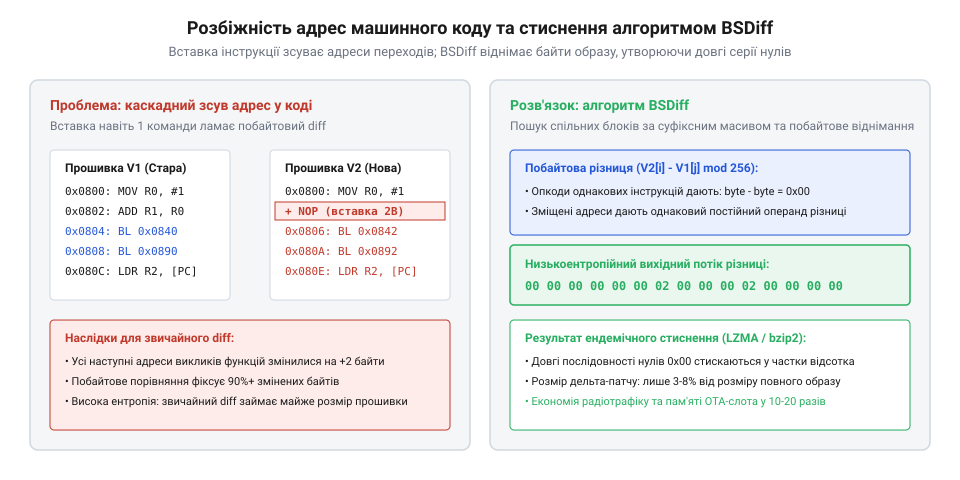

# Дельта-оновлення прошивки

## Фізична потреба та математика бінарної дельти

Автономні датчики, лічильники та контролери роками функціонують від вбудованої батареї та передають дані через енергоефективні бездротові мережі дальнього радіуса @@en|LPWAN@@ (від англ. *low-power wide-area network* — енергоефективна мережа дальнього радіуса). Виправлення помилок чи оновлення програмного мікрокоду — @@en|firmware@@ (від англ. *firm* — фіксований, незмінний та *ware* — виріб) — за допомогою технології бездротового оновлення @@en|OTA@@ (від англ. *Over-The-Air* — бездротовим каналом) усуває потребу фізичного демонтажу приладу. Проте радіомодем під час активного випромінювання споживає значний струм у сотні міліамперів. В умовах вузької смуги зв'язку завантаження повного образу обсягом у кілька мегабайтів триває десятки хвилин, незворотно виснажуючи батарею та спричиняючи неприйнятні фінансові витрати на оплату трафіку під час [бездротового оновлення пристроїв](root:sf-devices/ota-update). Енергетичний вихід полягає у передаванні дельти — компактного пакета відмінностей між старою та новою версіями.

Спроба застосувати класичне побайтове порівняння @@en|diff@@ (від англ. *difference* — різниця) для скомпільованого машинного коду зазнає невдачі через специфіку процесорних інструкцій. Додавання навіть однієї машинної команди зміщує всі наступні адреси викликів підпрограм, переходів і таблиць літералів на кілька байтів уперед. Хоча логіка коду не змінилася, бінарне кодування тисяч інструкцій по всьому файлу змінює свої біти через змінене зміщення адрес. Наївне порівняння фіксує масові розбіжності у кожному блоці, утворюючи різницевий файл розміром майже з повну прошивку.

Цю проблему розв'язує спеціалізований алгоритм бінарного диференціювання @@en|BSDiff@@ (від англ. *binary stream difference* — різниця бінарних потоків). Він виявляє спільні блоки коду за допомогою суфіксного масиву, а потім виконує арифметичне побайтове віднімання старої прошивки від нової за модулем 256. Оскільки адреси машинних інструкцій після зсуву відрізняються на однакову константу, віднімання перетворює розбіжні зміщення на сталі значення або довгі послідовності нулів для незміненого коду. Інформаційна ентропія @@en|entropy@@ (від грец. *ἐντροπία* — перетворення) такого потоку різко падає з типових 7.8 біта на байт до часток біта. Завдяки низькій @@en|entropy@@ компресори стискають дельта-пакет до 2–5% від початкового розміру прошивки, скорочуючи час роботи радіотракту в десятки разів.

*Алгоритм BSDiff виділяє спільні блоки коду та обчислює різницевий масив із низькою ентропією.*

## Потоковий конвеєр реконструкції та захист Flash

Вбудовані мікроконтролери мають жорсткий дефіцит оперативної пам'яті @@en|SRAM@@ (від англ. *static random access memory* — статична оперативна пам'ять), тому не здатні розмістити цілий образ нової прошивки у пам'яті. Реконструкція відбувається у потоковому конвеєрі невеликими буферами розміром у кілька сотень байтів без динамічного виділення купи. Відновлені сторінки одразу записуються в енергонезалежну пам'ять @@en|NOR Flash@@ (від англ. *Not-OR* — логічне «АБО-НІ» та *flash* — спалах) порціями, кратними апаратному розміру сторінки програмування.

Перед початком модифікації секторів підсистема перевіряє криптографічний геш @@en|SHA-256@@ (від англ. *Secure Hash Algorithm* — алгоритм безпечного гешування) наявної базової прошивки та виконує перевірку [підписування образу прошивки](root:sf-devices/ota-image-signing). Якщо базовий код у пристрої пошкоджено або встановлено іншу версію, процес негайно зупиняється. Це запобігає перетворенню пам'яті на непрацездатний стан, оскільки накладення різниці на невідповідний бінарний фундамент повністю руйнує виконуваний код.

У надійних системах використовують [конфігурацію з двома слотами](root:sf-devices/ota-slots), де новий образ безпечно записується у вільний розділ. Проте в мініатюрних контролерах усе доступне місце займає активна програма, через що оновлення доводиться виконувати на місці прямо поверх робочих секторів. У такій схемі виникає ризик руйнування даних, якщо для реконструкції нового сектора потрібні байти зі старого сектора, який уже був стертий і перезаписаний раніше. Граф залежностей між секторами може містити взаємні цикли. Щоб розірвати циклічне блокування, алгоритм використовує виділений буферний сектор чернетки — @@en|scratchpad@@ (від англ. *scratchpad* — блокнот для чернеток, буферний сектор). Сектор-джерело тимчасово копіюється у @@en|scratchpad@@, дозволяючи цільовому сектору безпечно відновитися зі збереженої копії.

Операції стирання та запису @@en|NOR Flash@@ тривають мілісекунди і є критично вразливими до раптового знеструмлення. Щоб прилад не перетворився на непридатний стан під час збою живлення, конвеєр веде транзакційний журнал в енергонезалежній пам'яті, фіксуючи початок і завершення кожного кроку. Після відновлення живлення завантажувач перевіряє стан журналу і безпечно завершує перервану операцію або здійснює [безпечний відкат прошивки](root:sf-devices/ota-rollback), гарантуючи цілісність пристрою.