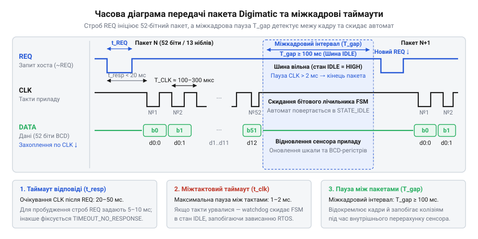

# Специфікація програмного C/C++ інтерфейсу драйвера Digimatic та SPC

## Початкові концепції та фізичні принципи

Промислове вимірювальне обладнання, як-от штангенциркулі чи мікрометри, потребує стандартизованого способу передавання точних даних на комп'ютер чи контролер. У серійному машинобудуванні та контролі якості точність виготовлення деталей перевіряється сотнями контрольних замірів за робочу зміну. Якщо кожне значення записувати вручну на папір або вводити з клавіатури, неминуче виникають помилки через людський фактор, а темп випуску виробів різко сповільнюється. Саме для розв'язання цієї проблеми корпорація @@en|Mitutoyo@@ розробила протокол @@en|Digimatic@@ та його розширення @@en|SPC@@ (від англ. @@en|Statistical Process Control@@ — статистичне керування процесами). Цей інтерфейс забезпечує автоматичне передавання цифрового результату вимірювання безпосередньо з вимірювального інструмента до комп'ютера або керуючого контролера в момент фіксації розміру, усуваючи помилки оператора та підтримуючи неперервний моніторинг виробничих допусків.

Фізичний інтерфейс @@en|Digimatic@@ є послідовним синхронним каналом зв'язку, який працює з рівнями транзисторно-транзисторної логіки (@@en|TTL@@, від англ. @@en|Transistor-Transistor Logic@@). Для з'єднання інструмента з приймачем використовується кабельна лінія зі спільним провідником заземлення `GND` та чотирма ключовими сигнальними лініями: запиту на передавання `REQ`, тактового сигналу `CLK`, лінії даних `DATA` та лінії готовності й зовнішнього запуску `READY`. Сигналом `REQ` керує виключно хост (мікроконтролер), який ініціює сеанс обміну. Лінії `CLK` та `DATA` контролюються самим вимірювальним інструментом: коли надходить запит, прилад перебирає на себе роль тактового ведучого (@@en|clock master@@), самостійно генерує синхроімпульси на лінії `CLK` і синхронно видає біти на лінію `DATA`.

Головна схемотехнічна особливість і водночас типова апаратна пастка інтерфейсу @@en|Digimatic@@ полягає в електричних характеристиках сигнальних ліній. Переважна більшість портативних ручних інструментів (штангенциркулі, глибиноміри, мікрометри) живляться від однієї внутрішньої оксидно-срібної батарейки з номінальною напругою 1.55 В (дисковий елемент типу SR44). Вбудована спеціалізована мікросхема інструмента функціонує від цього ж слабкострумового живлення, тому її внутрішня логіка працює на рівні 1.55 В. Вихідні каскади ліній приладу побудовані за схемою з відкритим стоком (@@en|open-drain@@) або відкритим колектором (@@en|open-collector@@). Інструмент ніколи не генерує високий логічний рівень активним ключем: внутрішні транзистори здатні лише замикати лінію на землю `GND` (формуючи логічний нуль), а у розімкненому стані лінія переходить у стан високого імпедансу. Тому для роботи інтерфейсу обов'язково потрібні зовнішні підтягувальні резистори (@@en|pull-up@@), номінал яких зазвичай вибирають у межах від 10 кОм до 100 кОм.

Через низьку напругу батарейного живлення 1.55 В безпосереднє з'єднання ліній інструмента зі стандартними виводами мікроконтролера з напругою 3.3 В або 5 В призводить до апаратного збою або виходу чутливого чипа з ладу. Напруги 1.55 В недостатньо для впевненої фіксації логічної одиниці входом мікроконтролера, де поріг високого рівня зазвичай перевищує 2.0 В. З іншого боку, якщо підтягнути лінії батарейного приладу резисторами безпосередньо до шини 5 В або подати 5 В на вхід `REQ`, надлишковий струм через захисні діоди спалить вхідні каскади інструмента. Безпечне підключення вимагає використання двоспрямованого перетворювача логічних рівнів (@@en|level shifter@@) або буферних польових транзисторів, які гальванічно узгоджують низьковольтний домен 1.55 В вимірювального інструмента та високовольтний домен 3.3 В або 5 В мікроконтролера. Водночас у стаціонарних промислових індикаторах і фірмових адаптерах @@en|Mitutoyo@@ роз'єм уже містить вбудовані буфери, що видають повноцінні рівні 5 В @@en|TTL@@ з відкритим колектором, до яких резистори @@en|pull-up@@ підключаються безпосередньо до шини 5 В. Усі сигнальні лінії є активними за низьким рівнем (@@en|active low@@): пасивний стан шини за рахунок підтяжки відповідає логічній одиниці, а активний імпульс — притягуванню лінії до нуля.

Сигнальна лінія `READY` виконує функцію апаратного рукостискання (@@en|handshake@@) та сповіщення про готовність виміру від оператора. На корпусі вимірювального інструмента або на кабелі зв'язку розташована тактильна кнопка «DATA». Коли оператор прикладає вимірювальні губки до деталі й натискає цю кнопку, внутрішня схема приладу притягує лінію `READY` до низького логічного рівня. Для мікроконтролера цей спадний перепад є апаратним сповіщенням: оператор зафіксував стабільне положення деталі та ініціював передавання відліку. Контролер фіксує зміну рівня на лінії `READY`, після чого негайно формує імпульс запиту на лінії `REQ` для початку сеансу передавання. В автоматизованих вимірювальних стендах без участі людини лінію `READY` можна не опитувати: хост самостійно надсилає періодичні запити через лінію `REQ`. Крім того, лінія `READY` сигналізує про ввімкнений стан інструмента: доки інструмент вимкнений або перебуває в режимі глибокого сну, лінія залишається у пасивному високому стані.

Обмін даними починається за ініціативою хоста, який утримує лінію запиту `REQ` на низькому логічному рівні щонайменше 100 мкс (типово від 100 до 500 мкс). Цей імпульс виводить тактовий генератор інструмента зі стану спокою. Після формування імпульсу хост відпускає лінію `REQ`, дозволяючи підтягувальному резистору повернути її до високого рівня. Вимірювальний прилад відповідає на запит із внутрішньою затримкою від 90 мкс до 100 мс залежно від швидкості оцифрування внутрішнього давача та частоти оновлення РК-дисплея. Завершивши підготовку, інструмент бере на себе роль тактового ведучого і генерує на лінії `CLK` серію з рівно 52 синхроімпульсів. Тактовий сигнал `CLK` має частоту від 2.5 до 4 кГц із періодом такту 250–400 мкс (типово близько 300–330 мкс) і тривалістю напівперіодів близько 120–180 мкс.

Вимірювальний прилад оновлює стан лінії даних `DATA` під час високого напівперіоду сигналу `CLK`. Лінія даних стабілізується завчасно — задовго до закінчення імпульсу, тому мікроконтролер фіксує біти суворо за спадним фронтом (@@en|falling edge@@) тактового сигналу `CLK`. Оскільки швидкістю передавання повністю керує сам інструмент, будь-яка апаратна завада на лінії тактування спричиняє фатальний розсинхрон: зсув навіть на один такт руйнує межі 4-бітних порцій і перетворює результат вимірювання на випадковий набір чисел.

Повна тривалість передавання кадру `T_frame` визначається добутком кількості бітів `N_bits` на період тактового сигналу `T_clk`:

        T_frame
        = N_bits · T_clk                         [множення кількості бітів кадру на період такту]

Кількість бітів `N_bits` у протоколі є константою і складає рівно 52 біти, а період такту `T_clk` диктується генератором інструмента. З виразу видно, що загальний час передавання пакета не залежить від швидкості мікроконтролера, а повністю визначається частотою тактування вимірювача.

**Розрахунок тривалості передавання 52-бітного пакета при періоді такту 320 мкс:**
Прилад генерує 52 тактові імпульси з періодом кожного такту 320 мкс (частота 3.125 кГц).

        T_frame
        = N_bits · T_clk                         [формула загального часу передавання кадру]
        = 52 · 320 мкс                           [підстановка кількості бітів та періоду такту]
        = 16640 мкс                              [обчислення добутку]
        = 16.64 мс                               [переведення значення у мілісекунди]

З урахуванням внутрішньої затримки відповіді на запит повна транзакція зчитування триває від 17 до 120 мс, що обмежує максимальну частоту опитування приладу в межах від 8 до 50 відліків на секунду.

Кожен пакет даних містить рівно 13 ніблів (4-бітних порцій, від англ. @@en|nibble@@ — півбайт), що в сумі складає 52 біти, і передається молодшим бітом уперед (@@en|LSB@@, від англ. @@en|Least Significant Bit@@) у кожному ніблі. Розбиття на 4-бітні сегменти зумовлене тим, що перші контролери вимірювальних інструментів будувалися на енергоефективних 4-бітних мікросхемах. Пакет має чітку покадрову будову, де кожен нібль виконує визначену функцію:

- Перші чотири ніблі (з 1 по 4, біти від 0 до 15) утворюють фіксовану преамбулу зі значенням `0xF` (`1111` у двійковому коді). Шістнадцять одиниць поспіль підтверджують початок нової транзакції та дозволяють приймачу перевірити синхронізацію лінії. Якщо хоча б один біт преамбули спотворено, пакет негайно відхиляється. - П'ятий нібль (біти від 16 до 19) визначає знак виміряного числа: значення `0x0` (`0000`) відповідає знаку плюс («+»), а значення `0x8` (`1000`) позначає мінус («-»). Будь-яке інше значення у цьому розряді сигналізує про апаратну помилку кадру. - Ніблі з 6 по 11 (біти від 20 до 43) передають числове значення у двійково-десятковому коді (@@en|BCD@@, від англ. @@en|Binary Coded Decimal@@). Кожен нібль кодує одну десяткову цифру від старшого розряду (MSD, нібль 6) до молодшого (LSD, нібль 11) у діапазоні значень від `0` (`0x0`) до `9` (`0x9`). Комбінації від `0xA` до `0xF` є забороненими. Шість цифр утворюють цілочисельну мантису від 000000 до 999999. Двійково-десятковий формат обрано тому, що внутрішній контролер інструмента виводить дані на РК-екран безпосередньо у десятковому вигляді, і перетворення у двійкове число вимагало б додаткових витрат енергії батареї. - Дванадцятий нібль (біти від 44 до 47) визначає позицію десяткової крапки у вигляді показника степеня `p` від 0 до 5. Значення показника вказує на множник 10⁻ᵖ для масштабування мантиси: значення `p = 2`, наприклад, означає два знаки після коми, тобто множник 10⁻² і дискретність вимірювання 0.01 мм. Показник `p = 3` задає дискретність 0.001 мм для мікрометрів, а показники `p = 4` та `p = 5` використовуються у високоточних вимірювальних головках або дюймових режимах. - Тринадцятий нібль (біти від 48 до 51) містить прапорець одиниць вимірювання (@@en|units flag@@), де значення `0x0` (`0000`) вказує на міліметри, а значення `0x1` (`0001`) — на дюйми.

В умовах реального виробничого цеху кабельні лінії вимірювальних інструментів зазнають впливу значних електромагнітних завад від електродвигунів та верстатів. Високий вихідний опір ліній у поєднанні з паразитною ємністю кабелю обмежує максимальну швидкість наростання фронтів сигналу: за надмірної довжини кабелю імпульси розмиваються, а наведені перешкоди створюють хибні спрацьовування на лінії тактування. Коли на верстаті одночасно працюють кілька інструментів для контролю різних просторових координат, застосовується [синхронізація систем цифрової індикації DRO](root:sf-devices/dro-multi-axis-synchronization) (від англ. @@en|Digital Readout@@ — цифровий відлік) з паралельним опитуванням каналів. Програмний інтерфейс драйвера (@@en|API@@, від англ. @@en|Application Programming Interface@@) має приховати ці низькорівневі часові діаграми, апаратні пороги напруг і завади від прикладного програміста: драйвер захоплює послідовність бітів, перевіряє цілісність пакета та перетворює сирі відліки у [значення у системі SI](root:sf-devices/draiver-chypa) для надійного C/C++ коду.

## Внутрішня будова та алгоритми роботи

Архітектура драйвера Digimatic/SPC розділена на апаратно-залежний рівень переривань та високорівневий інтерфейс користувача. Таке розділення дозволяє не втрачати короткі тактові імпульси (CLK), які можуть тривати лише кілька мікросекунд, і водночас не блокувати виконання інших задач в операційній системі реального часу (RTOS). 

Основою роботи драйвера є кінцевий автомат (@@en|state machine@@), який обробляє кожен перепад тактового сигналу. Автомат має кілька станів: очікування запиту, синхронізація, прийом даних та завершення. Коли надходить імпульс CLK, спрацьовує апаратне переривання. В обробнику переривання (@@en|ISR@@) драйвер зчитує стан лінії DATA і зсуває цей біт у внутрішній буфер. Це критична секція коду, тому вона має виконуватися максимально швидко, без жодних блокувань чи викликів функцій RTOS, які можуть викликати затримки.

Після отримання всіх 52 біт кінцевий автомат переходить у стан завершення і виставляє прапорець готовності. Високорівнева частина @@en|API@@, яка виконується в контексті звичайної задачі @@en|RTOS@@, забирає накопичений буфер для математичного розбору й звільняє переривання від затримок. Спочатку драйвер перевіряє перші чотири ніблі преамбули: кожен із них мусить містити константу `0xF`, а будь-яка розбіжність свідчить про зміщення бітів через заваду і змушує негайно відкинути пошкоджений пакет. П'ятий нібль визначає полярність виміру: значення `0x0` відповідає додатному числу, значення `0x8` позначає від'ємне число, а будь-яка інша комбінація вказує на спотворення кадру. Наступні шість ніблів передають числове значення у двійково-десятковому коді (@@en|BCD@@), де кожен 4-бітний сегмент кодує одну десяткову цифру від старшого розряду до молодшого. Для захисту від апаратних збоїв драйвер валідує кожен такий сегмент: значення понад `9` є неприпустимим у двійково-десятковій системі та призводить до скасування обробки. Перетворення цифр у цілочисельну мантису відбувається ітеративно: на кожному кроці накопичена сума множиться на 10 і збільшується на поточну цифру, що повністю виключає накопичення двійкових похибок округлення. Дванадцятий нібль містить положення коми як показник степеня `p` від 0 до 5. Замість важкої та неточнішої для мікроконтролера функції `powf()` драйвер вибирає коефіцієнт ділення `10ᵖ` зі статичної таблиці степенів десяти. Підсумкове значення типу `float` формується діленням цілої мантиси на цей табличний коефіцієнт із множенням на `-1.0f` у разі від'ємного знака. Тринадцятий нібль задає одиниці вимірювання, визначаючи стан прапорця `is_mm` для міліметрів або дюймів. Драйвер зберігає обчислені поля у вихідній структурі, перетворюючи сирий буфер у фізичне [значення у системі SI](root:sf-devices/draiver-chypa) для прикладного коду. Програмний інтерфейс повертає результат через неблокувальні функції @@en|API@@, гарантуючи детермінований час виконання без зупинки інших задач.

:::tabs
```c
struct digimatic_result {
    float value;
    bool is_mm;
    bool is_negative;
};

int digimatic_read(struct digimatic_result *result);
```
```cpp
struct DigimaticResult {
    float value;
    bool isMm;
    bool isNegative;
};

class DigimaticDriver {
public:
    int read(DigimaticResult& result);
};
```
:::

Завдяки такому алгоритму драйвер гарантує детерміновану поведінку системи та надійне отримання даних незалежно від навантаження на процесор. Функції повертають код успіху або помилки (наприклад, таймаут, якщо прилад відключили під час передавання).

## Апаратна реалізація та низькорівневий C/C++ код

Драйвер протоколу Digimatic та SPC діє на межі між непередбачуваним апаратним світом і впорядкованою логікою програми. Його головне завдання — перетворити електричні імпульси на структуровані дані без втрат, навіть коли процесор зайнятий іншими задачами. Оскільки інструмент сам визначає темп передачі, драйвер повинен встигати реагувати на кожен синхроімпульс, інакше дані будуть невідворотно пошкоджені.

Програмний інтерфейс драйвера будується навколо абстракції пристрою, яка приховує фізичні деталі підключення. У мові C це реалізується через непрозорий вказівник на структуру стану, а в C++ — через клас-обгортку. Такий підхід дозволяє підключати кілька вимірювальних інструментів до одного мікроконтролера, створюючи окремий екземпляр драйвера для кожного з них.

Щоб не пропускати біти, драйвер спирається на апаратні переривання. Коли рівень на лінії тактового сигналу змінюється, процесор негайно зупиняє поточну роботу і переходить до обробника переривання — короткої підпрограми, яка має виконатися якнайшвидше. Обробник зчитує стан лінії даних, зберігає біт у внутрішній буфер і збільшує лічильник. 

Оскільки обробник переривання виконується асинхронно щодо основної програми, спільні дані між ними повинні бути захищені. Змінні, які модифікуються в перериванні та читаються у фоновій задачі, оголошуються з ключовим словом `volatile`, що забороняє компілятору кешувати їхні значення в регістрах. Коли пакет повністю прийнятий, обробник сигналізує про це основній програмі через примітиви синхронізації операційної системи, такі як семафори або прапорці подій.

:::tabs
:::code api-digimatic-spc-driver-api/c/esp-idf/digimatic-isr-handler.c
:::code api-digimatic-spc-driver-api/cpp/arduino/digimaticdriver.cpp
:::

Важливою частиною інтерфейсу є механізм запиту даних. Коли програма хоче отримати вимір, вона виставляє низький рівень на лінії запиту. Інструмент реагує не миттєво — він повинен завершити поточні внутрішні операції. Інтерфейс драйвера реалізує цю взаємодію через блокувальний виклик із таймаутом. Якщо після надсилання запиту інструмент не починає передачу протягом очікуваного часу, виклик повертає код помилки замість того, щоб назавжди заблокувати потік.


*Часова діаграма сигналів REQ, CLK та DATA демонструє ініціалізацію обміну імпульсом запиту, захоплення 52 бітів даних за спадним фронтом тактування та фіксацію міжкадрової паузи T_gap для надійного скидання кінцевого автомата приймача.*

## Практичне застосування та відлагодження

Реальні промислові умови ставлять перед драйвером виклики, яких немає в ідеальному світі документацій. Довгі кабелі від вимірювальних інструментів працюють як антени, збираючи електромагнітні завади від верстатів. Ці завади сприймаються мікроконтролером як додаткові тактові імпульси, що призводить до зсуву бітів і руйнування структури пакета. Щоб надійно відфільтрувати хибні спрацьовування переривань від електромагнітних завад на довгих кабелях, дивіться [апаратне та програмне придушення завад на лініях даних](root:sf-devices/gpio-glitch-prevention).

Коли кінцевий автомат драйвера розсинхронізовується, він починає об'єднувати кінець одного пакета з початком іншого. Щоб запобігти цьому, впроваджується контроль часу. Стандарт визначає, що інтервал між бітами всередині пакета має фіксовану тривалість. Якщо після прийняття чергового біта лінія тактування мовчить довше за цей час, драйвер розуміє, що транзакція перервана. У цьому разі буфер і лічильник бітів примусово скидаються до нуля. Цей таймаут — найефективніший спосіб самовідновлення системи після завад.

Програмний інтерфейс має чітко інформувати прикладну програму про такі збої. Замість того, щоб повертати нульове значення або частковий пакет, функція читання повинна повернути спеціальний код статусу, наприклад `DIGIMATIC_ERR_TIMEOUT` або `DIGIMATIC_ERR_FRAME`. Це дозволяє прикладній логіці прийняти рішення: повторити запит, сповістити оператора чи проігнорувати хибний вимір.

Під час розробки та налагодження пристрою найскладніше зрозуміти, на якому етапі виникає помилка: на фізичному рівні, в логіці прийому чи під час декодування числових значень. Інтерфейс драйвера передбачає функцію отримання нерозпакованих бітів. Якщо на екрані з'являються випадкові числа, розробник може вивести ці сирі дані в шістнадцятковому форматі. Якщо сирий пакет має правильну структуру протоколу, але містить некоректні дані — проблема в інструменті або в сигналі; якщо ж структура порушена — проблема в кінцевому автоматі прийому.

Для глибокого відлагодження на рівні прошивки корисно вбудувати лічильники помилок безпосередньо в структуру стану драйвера. Вони фіксують кількість втрачених пакетів, спрацьовувань таймауту та невідповідностей формату. На етапі тестування ці метрики зчитуються через окремий діагностичний інтерфейс і дозволяють оцінити якість зв'язку ще до того, як пристрій потрапить у серійне виробництво.