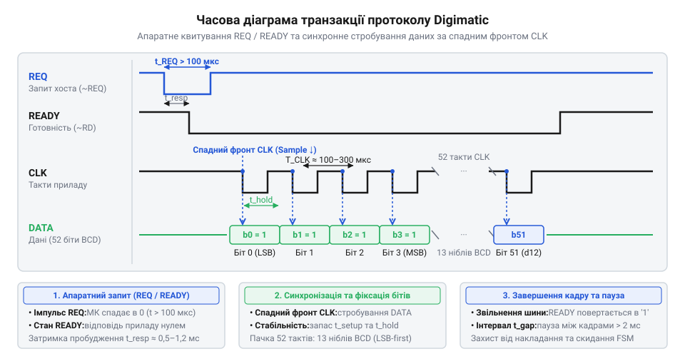

# Апаратна специфікація сигнальних ліній та часових діаграм Digimatic і 24-bit SPC

## Початкові концепції та фізичні принципи

Цифрові вимірювальні інструменти, такі як штангенциркулі чи мікрометри, повинні передавати точні дані на зовнішні пристрої для обробки та зберігання. Без надійного інтерфейсу передачі довелося б списувати значення вручну, що призводить до помилок та знижує швидкість роботи. Для вирішення цієї проблеми компанія Mitutoyo розробила протокол @@en|Digimatic@@ (або @@en|SPC@@ — Statistical Process Control). Цей протокол визначає електричні та часові параметри передачі даних від інструмента до комп'ютера чи контролера.

Фізичний рівень Digimatic базується на синхронній послідовній передачі даних. Це означає, що для передачі інформації використовується окрема лінія для даних і окрема лінія для тактового сигналу, який синхронізує приймач і передавач. Такий підхід дозволяє уникнути складного відновлення частоти на боці приймача, як це робиться в асинхронних інтерфейсах типу UART. Інструмент виступає джерелом даних, але керує процесом обміну зовнішній пристрій — хост. 

Для надійного обміну використовуються чотири основні сигнальні лінії. Лінія запиту `REQ` (Request) слугує для того, щоб хост міг ініціювати транзакцію. Коли хосту потрібні дані, він змінює стан цієї лінії. Інструмент, отримавши запит, починає генерувати тактові імпульси на лінії `CLK` (Clock) та виставляти біти даних на лінії `DATA`. Остання лінія `READY` є необов'язковою в деяких конфігураціях, але вона дозволяє інструменту сигналізувати про готовність до обміну або утримувати передачу.

Електрично ці лінії зазвичай реалізовані за схемою з відкритим колектором або відкритим стоком. Це означає, що передавач може лише притягувати лінію до землі (створювати логічний нуль), а для формування логічної одиниці використовується підтягувальний резистор на боці приймача. Така конфігурація захищає виходи від короткого замикання при одночасному перемиканні та дозволяє легко узгоджувати рівні напруги між різними пристроями, які можуть живитися як від 1.5 В (батарейка інструмента), так і від 3.3 В чи 5 В (мікроконтролер).

Сигнали в інтерфейсі Digimatic є інверсними. Логічному нулю відповідає високий рівень напруги, а логічній одиниці — низький. Це пов'язано з тим, що активний стан відкритого колектора — це притягнення лінії до землі, що енергетично вигідніше та стійкіше до завад у промислових умовах. Фізично інверсія виникає з самої схеми комутації. Для передачі одиниці вихідний транзистор інструмента відкривається і замикає лінію на землю. Напруга на лінії падає до нуля. Для передачі нуля транзистор закривається. Підтягувальний резистор на боці приймача підіймає напругу до рівня живлення. Така поведінка є природною для цієї схемотехніки. Тому додаткові апаратні інвертори між інструментом та хостом не потрібні. Мікроконтролер приймає ці перепади безпосередньо. Перехід від інверсної логіки до прямої відбувається вже всередині: налаштуванням полярності портів або програмно під час зчитування бітів.

## Внутрішня будова та алгоритми роботи

Будь-яке надточне вимірювання втрачає сенс, якщо під час передачі даних від інструмента до комп'ютера виникає похибка округлення або втрачається знак. Щоб уникнути цього, протокол Digimatic передає дані не як готове дробове число, а буквально цифра за цифрою. Кожен пакет містить значення вимірювання, знак та одиниці виміру. Цей формат даних має назву 24-bit SPC: він кодує самі цифри вимірювання 24 бітами, гарантуючи збереження оригінальної роздільної здатності мікрометра чи штангенциркуля без спотворень.

Зчитування починається з ініціативи приймача. Коли хост опускає лінію `REQ` у низький рівень, інструмент бачить запит на передачу. Якщо дані готові, інструмент формує серію синхроімпульсів на лінії `CLK`. Повний пакет — транзакція — складається з тринадцяти 4-бітних груп, або ніблів (@@en|nibble@@), що в сумі дає 52 біти. Інструмент виставляє кожен біт на лінії `DATA` по задньому фронту (спаду) сигналу `CLK`, тому мікроконтролер хоста зобов'язаний зчитувати стан по передньому фронту (зростанню). Завдяки цій фазировці електричний рівень на лінії `DATA` гарантовано стабілізується до моменту вибірки.

*Часова діаграма транзакції ілюструє часові співвідношення сигналів REQ, READY, CLK та DATA, демонструючи виставлення бітів інструментом по спадному фронту тактування та їх надійне захоплення мікроконтролером по передньому фронту.*

Стежити за лінією `CLK` програмно — це [опитування](root:sf-devices/opytuvannia-pereryvannia-chy-dma-u-draiveri) (@@en|polling@@), коли процесор у нескінченному циклі зчитує рівень піна. У багатозадачних середовищах це рішення неприйнятне: воно блокує виконання і витрачає машинний час. Тому драйвер використовує апаратні переривання. Мікроконтролер налаштовує переривання за переднім фронтом на піні `CLK`. Щоразу, коли фронт виникає, обробник переривання лише зчитує стан піна `DATA` і зсуває цей біт у єдину 64-розрядну змінну-накопичувач. 

Вимоги жорсткого реального часу забороняють обробляти пакети всередині переривання. Відповідальність обробника — виключно зібрати всі 52 біти. Щойно лічильник досягає цієї кількості, обробник надсилає повідомлення через чергу (@@en|queue@@), сигналізуючи основному потоку операційної системи, що новий пакет лежить у пам'яті. 

Коли потік прокидається, він дістає 64-розрядну змінну із сирими даними і починає розбір. Перші нібли пакета — це преамбула для підтвердження початку транзакції, але ключове ядро пакета складають шість ніблів самого вимірювання. Вони закодовані у двійково-десятковому форматі (@@en|Binary-Coded Decimal, BCD@@). У BCD кожен 4-бітний нібл містить рівно одну десяткову цифру від 0 до 9. Такий підхід дозволяє переносити розряди без операцій ділення з остачею при конвертації для індикації.

Щоб витягти конкретну цифру з 64-розрядного числа, потік виконує побітовий зсув і накладає логічну маску:

        чиста цифра
        = сирі дані >> зсув нібла      [ставимо потрібну групу бітів у молодший розряд]
        = результат зсуву & 0xF        [відсікаємо старші біти маскою, лишаючи 4 біти]

Маска `0xF` (`0b1111`) відкидає всі інші розряди. Програма проходить циклом через усі шість ніблів корисного навантаження. Кожна наступна витягнута цифра стає наступним розрядом десяткового числа — від одиниць до сотень тисяч, формуючи абсолютне ціле значення виміру. Розташування десяткової коми враховується пізніше, на рівні візуалізації.

Зібравши абсолютне число, алгоритм перевіряє службові нібли, які йдуть у кінці пакета. Один із них жорстко зафіксований за знаком вимірювання. Драйвер зсуває накопичувач до цього нібла і так само накладає маску `0xF`. Значення нуля в цьому ніблі означає додатне число, а значення вісім (`0b1000`) означає від'ємне — щуп зайшов за нульову позначку. Знайдений знак застосовується до зібраного раніше абсолютного числа, після чого воно готове до передачі на вищі рівні архітектури.

## Апаратна реалізація та низькорівневий C/C++ код

Алгоритм обробки переривань та накопичення даних потребує прямолінійного перенесення на конкретне залізо. Лінії відкритого колектора вимагають підтягувальних резисторів, які можна увімкнути внутрішніми засобами мікроконтролера під час ініціалізації виводів. Сама обробка зводиться до швидкого зчитування стану лінії даних та зсуву бітів у єдину змінну, звідки готовий пакет передається на [рівень транзакцій](root:sf-devices/riven-tranzaktsii).

У мовах C та C++ збирання 52 біт зручно виконувати у змінній типу 64-розрядного цілого числа. Під час кожного спадного фронту сигналу тактування мікроконтролер записує інвертоване значення лінії даних на відповідну позицію. Коли лічильник досягає повної довжини пакета, результат відправляється у чергу операційної системи реального часу, щоб розвантажити обробник переривання.

:::tabs
:::code api-digimatic-spc-hardware-spec/c/esp-idf/clk-isr-handler.c
:::code api-digimatic-spc-hardware-spec/cpp/arduino/clk-isr.cpp
:::

У реальній схемі мікроконтролер може опитувати відразу кілька інструментів. Тоді для кожної осі виділяється власний обробник або спільна функція з параметром-ідентифікатором, що дозволяє організувати надійну [синхронізацію багатоосьових систем](root:sf-devices/dro-multi-axis-synchronization).

## Практичне застосування та відлагодження

У промислових умовах сигнал часто спотворюється електромагнітними завадами від двигунів чи реле. Найчастіший збій — хибне спрацювання переривання, через яке мікроконтролер зчитує зайвий біт. У такому випадку пакет зміщується, і вся транзакція втрачає сенс. Щоб цього уникнути, недостатньо лише апаратних RC-фільтрів. Потрібно впровадити [таймаути та відновлення](root:sf-devices/taimauty-pomylky-i-povtorna-initsializatsiia-chypa) для скидання автомата станів драйвера.

Якщо таймер фіксує занадто довгу паузу між імпульсами тактування, драйвер розуміє, що пакет розірвано. Лічильник бітів примусово обнуляється, і система готова до прийому нової посилки. Такий захист не дає пристрою зависнути в очікуванні кінця неіснуючого пакета.

Коли пристрій зібрано, першим етапом відлагодження є перевірка отриманих даних. Розробник виводить зібране 64-розрядне число у шістнадцятковому форматі ще до того, як драйвер спробує розшифрувати його як десяткові цифри. Якщо ці дані містять хаотичні значення, проблема лежить на рівні апаратної синхронізації. Якщо ж дані стабільні, але значення не відповідає показам на екрані інструмента, помилка ховається у порядку розбору тетрад.