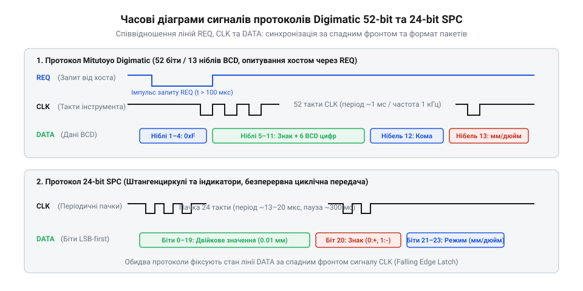
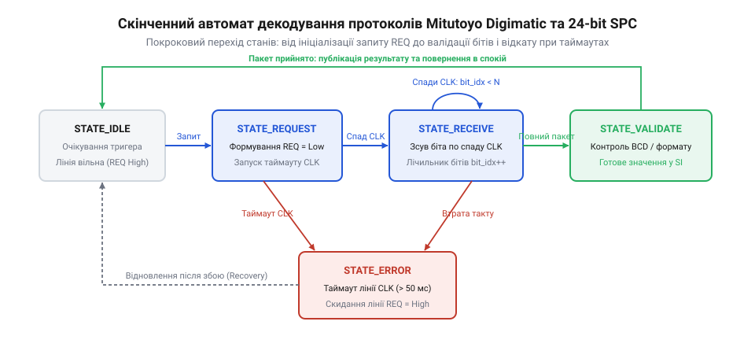
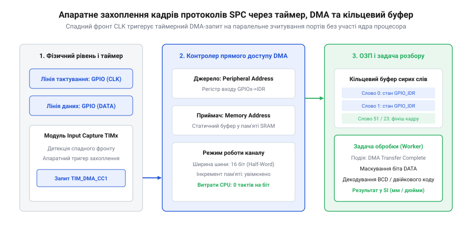
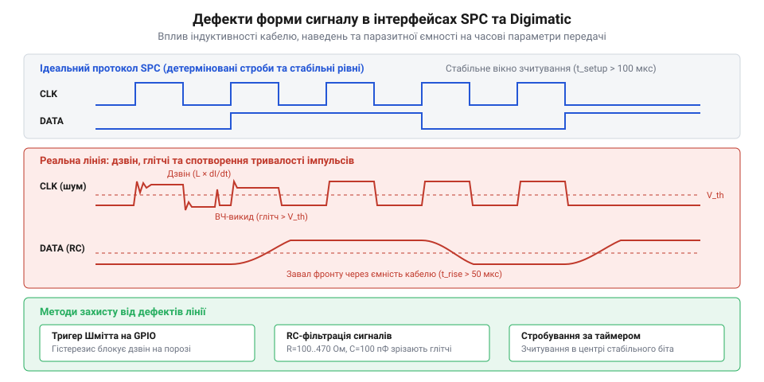

# Декодування протоколів Digimatic та 24-bit SPC

## Початкові концепції та фізичні принципи

Підключення електронних вимірювальних інструментів — таких як штангенциркулі, мікрометри чи індикатори годинникового типу — до мікроконтролерів видається простим завданням лише на перший погляд. Інженер, який вперше намагається зчитати дані з цифрового штангенциркуля компанії @@en|Mitutoyo@@ або його дешевого китайського аналога, майже неодмінно стикається з нестабільною роботою, зависаннями інструмента або повною відсутністю сигналів на виводах. Причина криється у глибокій розбіжності між фізичною природою портативного вимірювального приладу та вимогами сучасних обчислювальних систем.

Електронний штангенциркуль проектується із розрахунком на тривалу автономну роботу від одного мініатюрного елемента живлення типу SR44 або LR44 з номінальною напругою від 1.35 В до 1.55 В. Внутрішня інтегральна схема приладу має обмежений енергетичний бюджет і споживає струм у межах 10–20 мкА. Щоб мінімізувати втрати енергії, вихідні каскади передачі даних виконано за схемою з відкритим стоком (від англ. @@en|open-drain@@, @@en|drain@@ — стік) або на базі слаботочних @@en|CMOS@@-транзисторів. Напруга логічної одиниці на виходах інструмента становить лише 1.2–1.5 В відносно спільної землі, а вихідний опір ліній вимірюється кілоомами.

Якщо підключити такі лінії безпосередньо до входу @@en|GPIO@@ (від англ. @@en|General-Purpose Input/Output@@, @@en|input@@ — вхід, @@en|output@@ — вихід) мікроконтролера з напругою живлення 3.3 В або 5 В, виникає небезпечний конфлікт. Внутрішній підтягуючий резистор мікроконтролера (типово 40 кОм) починає впорскувати струм у вихідний каскад інструмента. Це спричиняє підвищення напруги на внутрішніх шинах живлення мікросхеми штангенциркуля та протікання паразитного струму через вбудовані захисні @@en|ESD@@-діоди. Як наслідок, інструмент скидає поточне значення, вимикає дисплей або взагалі виходить з ладу.

Для безпечного узгодження логічних рівнів застосовують активні або пасивні перетворювачі напруги (від англ. @@en|level shifter@@, @@en|level@@ — рівень, @@en|shift@@ — зсув). Найбільш надійним розв'язком є використання польових @@en|MOSFET@@-транзисторів (від англ. @@en|Metal-Oxide-Semiconductor Field-Effect Transistor@@) з низькою пороговою напругою затвор-витік `V_gs(th) ≤ 0.8 В`.


*Часова діаграма сигналів та структура кадрів протоколів Digimatic 52-bit та 24-bit SPC.*

При використанні N-канального транзистора затвор підключається до лінії живлення інструмента (1.5 В), витік — до лінії виходу інструмента (`CLK` або `DATA`), а сток підтягується до напруги 3.3 В мікроконтролера через резистор опором 10 кОм. Коли вихід приладу знаходиться у стані логічного нуля (0 В), різниця напруг між затвором і витоком перевищує порогову, транзистор відкривається і підтягує вихід до землі МК. Коли інструмент видає логічну одиницю (1.5 В), напруга `V_gs` стає нульовою, транзистор закривається, і лінія мікроконтролера приймає повноцінний рівень 3.3 В. Детальніше конструктивні варіанти цієї схеми описує тема [спряження 1.5V логіки](root:sf-devices/level-shifting-1v5-mcu).

Проте високий опір підтяжки створює іншу фізичну проблему — спотворення прямокутних імпульсів через паразитну ємність вимірювального кабелю. Типовий екранований кабель для зв'язку за стандартом @@en|SPC@@ (від англ. @@en|Statistical Process Control@@, @@en|control@@ — управління) має паразитну ємність близько 100 пФ на метр. Разом із резистором підтяжки 10 кОм кабель утворює інтегруючий RC-фільтр низьких частот.

Частота зрізу такого фільтра визначається співвідношенням:

```
f_c = 1 ÷ (2 · π · R_pull · C_cable)
    = 1 ÷ (2 · 3.14159 · 10000 · 100 × 10⁻¹²)      [підстановка R = 10 кОм, C = 100 пФ]
    = 159155 Гц ≈ 159.2 кГц                      [обчислення частоти зрізу RC-фільтра]
```

Оскільки тактова частота передачі може досягати 100–200 кГц, завал фронтів сигналів стає критичним: крутизна спаду зменшується, з'являється затримка фази та ризик хибних спрацьовувань тригерів Шмітта у мікроконтролері. Для усунення цього ефекту опір підтяжки зменшують до 2.2–4.7 кОм або застосовують активні компаратори напруги.

На фізичному рівні у сфері цифрових вимірювань панують два основних стандарти передачі даних: оригінальний протокол @@en|Mitutoyo@@ @@en|Digimatic@@ та китайський 24-бітовий протокол @@en|SPC@@.

Протокол @@en|Mitutoyo@@ @@en|Digimatic@@ є синхронним послідовним протоколом, який працює за принципом «запит-відповідь». Для зв'язку використовуються чотири лінії:
1. `REQ` (від англ. @@en|Request@@ — запит): керуюча лінія від мікроконтролера до інструмента. 2. `CLK` (від англ. @@en|Clock@@ — такт): тактова лінія, яку генерує інструмент. 3. `DATA` (від англ. @@en|Data@@ — дані): лінія даних від інструмента до мікроконтролера. 4. `GND`: спільний провідник заземлення.

У стані спокою лінія `REQ` утримується у високому логічному рівні. Щоб ініціювати зчитування, мікроконтролер притискає лінію `REQ` до землі на час `t_REQ` (від 100 мкс до декількох мілісекунд). Виявивши низький рівень на `REQ`, внутрішній контролер інструмента пробуджується і починає генерувати серію з 52 тактових імпульсів на лінії `CLK`. Передача даних відбувається пакетом із 13 півбайтів (від англ. @@en|nibble@@ — 4-бітна одиниця) по 4 біти у кожному, причому біти всередині кожного півбайта передаються молодшим бітом уперед (від англ. @@en|LSB first@@, @@en|Least Significant Bit@@).

Структура 52-бітного кадру @@en|Digimatic@@ має чітко визначений формат:
- Півбайти 0..3 (d0..d3): маркер заголовка. Зазвичай це чотири послідовних півбайти `0xF` (`1111 1111 1111 1111`), які слугують для синхронізації та підтвердження готовності приладу. - Півбайт 4 (d4): індикатор знака. Найстарший біт півбайта (біт 3) визначає полярність виміряного значення: `0` означає плюс (`+`), а `8` (`0b1000`) означає мінус (`-`). - Півбайти 5..10 (d5..d10): 6 півбайтів, що містять десяткові цифри виміряного значення у форматі BCD (від англ. @@en|Binary-Coded Decimal@@, @@en|decimal@@ — десятковий). Подробиці кодування викладено у темі [формат BCD](root:sf-devices/bcd-format-decoding). - Півбайт 11 (d11): кодує позицію десяткової крапки (показник степеня від 0 до 5). Значення `0` відповідає цілому числу, `1` — 0.0, `2` — 0.00, `3` — 0.000, `4` — 0.0000, `5` — 0.00000. - Півбайт 12 (d12): одиниця вимірювання. Біт 0 визначає систему: `0` відповідає міліметрам (мм), `1` — дюймам (дюйм).

Тактова частота сигналу `CLK` у протоколі @@en|Digimatic@@ становить від 5 кГц до 10 кГц (період `T_CLK = 100–200 мкс`). Зчитування стану лінії `DATA` виконується мікроконтролером по спадаючому або наростаючому фронту тактового сигналу залежно від конкретної ревізії чипа @@en|Mitutoyo@@.

На відміну від стандарту @@en|Mitutoyo@@, дешеві китайські штангенциркулі використовують спрощений 24-бітовий протокол @@en|SPC@@. У ньому відсутня лінія запиту `REQ`. Інструмент працює у режимі безперервної трансляції (від англ. @@en|streaming@@), самостійно видаючи пачки тактових імпульсів з періодичністю від 3 до 10 Гц (кожні 100–300 мс).

Кадр китайського 24-бітного протоколу складається з 24 тактових імпульсів на лінії `CLK` з частотою від 9 кГц до 90 кГц (типово близько 21 кГц). Дані передаються молодшим бітом уперед (LSB-first):
- Біти 0..19: 20-бітне двійкове ціле число, яке виражає зміщення вимірювальної головки у відносних одиницях енкодера (найчастіше із значенням дискретності 1/100 мм або 1/2000 дюйма). - Біт 20: біт знака значення (`0` — додатнє, `1` — від'ємне). - Біти 21..22: додаткові прапорці стану приладу або збереження акумулятора. - Біт 23: біт одиниць вимірювання (`0` — міліметри, `1` — дюйми).

Порівняльна характеристика двох протоколів наведена нижче:
- Запитування: @@en|Digimatic@@ використовує лінію `REQ` для детермінованого опитування; 24-bit @@en|SPC@@ транслює дані постійно без зовнішнього контролю. - Кодування даних: @@en|Digimatic@@ передає 6 BCD-цифр (52 біти); 24-bit @@en|SPC@@ передає 20-бітне двійкове ціле число (24 біти). - Частота `CLK`: @@en|Digimatic@@ працює на частоті 5–10 кГц; 24-bit @@en|SPC@@ працює на частоті 9–90 кГц. - Стійкість до завад: @@en|Digimatic@@ має вбудовану преамбулу `0xF 0xF 0xF 0xF` та перевірку меж BCD; 24-bit @@en|SPC@@ вимагає тайм-аутного аналізу паузи між кадрами.

Розуміння цих фізичних та часових відмінностей є необхідною передумовою для вибору оптимальної програмної архітектури декодера у прошивці мікроконтролера.

---

## Внутрішня будова та алгоритми роботи

Побудова надійного програмного модулю для прийому та декодування сигналів @@en|Digimatic@@ і 24-bit @@en|SPC@@ вимагає ретельного вибору методу обробки вхідних сигналів. Наївний підхід із використанням програмних циклів опитування (від англ. @@en|polling@@, @@en|poll@@ — опитувати) створює неприпустиме блокування ядра мікроконтролера на час від 5 до 10 мілісекунд під час прийому кожного кадру. У системах реального часу це призводить до пропуску подій та порушення детермінізму.

Архітектура драйвера може бути реалізована трьома основними способами:
1. Програмний зсув через переривання @@en|GPIO@@ (від англ. @@en|Interrupt Service Routine@@, @@en|ISR@@): спадаючий фронт на лінії `CLK` викликає обробник переривання, який зчитує стан `DATA` і записує біт у буфер. 2. Використання апаратного таймера у режимі захоплення (від англ. @@en|Input Capture@@): таймер фіксує точні часові мітки фронтів `CLK`, що дозволяє фільтрувати високочастотні завади. 3. Використання апаратного периферійного модуля @@en|SPI@@ (від англ. @@en|Serial Peripheral Interface@@) у режимі веденого (від англ. @@en|Slave@@).

Застосування периферійного модуля @@en|SPI@@ є найбільш елегантним та високоефективним інженерним розв'язком. Лінія `CLK` інструмента підключається до входу `SCK` модуля @@en|SPI@@, а лінія `DATA` — до входу `MOSI`. Модуль @@en|SPI@@ налаштовується на прийом 8-бітних або 16-бітних слів. У разі використання @@en|DMA@@ (від англ. @@en|Direct Memory Access@@ — прямий доступ до пам'яті) прийом усього 52-бітного або 24-бітного пакета відбувається абсолютно прозоро для центрального процесора. Як показує аналіз [опитування чи DMA](root:sf-devices/opytuvannia-pereryvannia-chy-dma-u-draiveri), перенесення навантаження на периферію звільняє обчислювальні ресурси для виконання основних задач керування.

Незалежно від обраного апаратного інтерфейсу, у центрі драйвера лежить конечний автомат (від англ. @@en|Finite State Machine@@, @@en|FSM@@).


*Діаграма станів програмного декодера для прийому та валідації вимірювальних пакетів.*

Конечний автомат обробки кадру включає п'ять ключових станів:
- `STATE_IDLE`: стан очікування. Для протоколу @@en|Digimatic@@ у цьому стані формується низький імпульс на лінії `REQ`. Для 24-bit @@en|SPC@@ автомат очікує паузи на лінії `CLK`. - `STATE_WAIT_FRAME`: очищення бітового буфера, обнулення лічильника бітів та очікування першого спадаючого фронту тактового сигналу. - `STATE_RECEIVING_BITS`: послідовний запис вхідних бітів у 64-бітний акумулюючий регістр `shift_reg`. - `STATE_PROCESS_FRAME`: зупинка прийому, перевірка цілісності преамбули або довжини пакета, декодування BCD або двійкового числа. - `STATE_ERROR`: обробка помилок таймауту або некоректних даних з наступним поверненням у `STATE_IDLE`.

Важливим елементом контролю цілісності кадру є таймер міжкадрового інтервалу (від англ. @@en|inter-frame gap timer@@). Оскільки у 24-бітному протоколі відсутній сигнал початку кадру, межа між пакетами визначається за паузою на лінії `CLK`, тривалість якої перевищує `T_gap > 2 мс`. Якщо під час прийому бітів інтервал між сусідніми тактовими імпульсами перевищує 1 мс, спрацьовує таймаут, кадр вважається пошкодженим, а автомат переходить у стан `STATE_ERROR`. Загальний принцип побудови таких захисних механізмів викладено у статті [таймаути та помилки](root:sf-devices/taimauty-pomylky-i-povtorna-initsializatsiia-chypa).

Після успішного збирання кадру починається етап математичного декодування та приведення значення до одиниць SI.

Для протоколу @@en|Mitutoyo@@ @@en|Digimatic@@ з акумульованого буфера виділяються 13 півбайтів `d0..d12`. Спочатку перевіряються півбайти заголовка: `d0 == 0xF && d1 == 0xF && d2 == 0xF && d3 == 0xF`. Якщо заголовок коректний, виконується розпаковка 6 BCD-цифр:

```
raw_value = d5 + (d6 · 10) + (d7 · 100) + (d8 · 1000) + (d9 · 10000) + (d10 · 100000)
```

Потім враховується десяткова крапка та знак. Значення дільника `scale` визначається з півбайта `d11`:

```
scale = 10ᵈ¹¹
```

Фінальне значення у міліметрах обчислюється за формулою:

```
val_mm = (raw_value ÷ scale) · sign_multiplier
```

де `sign_multiplier = -1`, якщо `(d4 & 0x8) != 0`, і `+1` в іншому випадку. Якщо прапорець одиниць `d12 & 0x1` вказує на дюйми, значення додатково множиться на коефіцієнт `25.4` для конвертації в систему SI (міліметри або метри), відповідаючи концепції [драйвер чипа](root:sf-devices/draiver-chypa).

Для китайського 24-бітного протоколу декодування виконується шляхом виділення молодших 20 бітів у цілочисельне значення `N`:

```
N = raw_24bit_data & 0x00FFFFFF
```

Якщо біт 20 встановлено (`raw_24bit_data & (1 << 20)`), значення є від'ємним, і виконується знакова інверсія. Значення у міліметрах отримують діленням на 100 (для дискретності 0.01 мм):

```
val_mm = N ÷ 100.0
```

Для відокремлення апаратного рівня драйвера від прикладної логіки програми дані передаються через об'єкти операційної системи реального часу (від англ. @@en|Real-Time Operating System@@, @@en|RTOS@@), такі як черги повідомлень (від англ. @@en|FreeRTOS@@ @@en|Queue@@). Це забезпечує побудову архітектури, де [рівень транзакцій](root:sf-devices/riven-tranzaktsii) повністю ізолює обробку шини від задач відображення чи аналізу.

Нижче наведено практичну реалізацію декодера двох протоколів на мовах C та C++:

:::tabs
:::code root\eng\sf-devices\digimatic-spc-protocol-decoding/digimatic-spc-protocol-decoding-d/c/esp-idf/spc-clk-isr-handler.c c

:::code root\eng\sf-devices\digimatic-spc-protocol-decoding/digimatic-spc-protocol-decoding-d/cpp/arduino/digimaticdecoder.cpp cpp
:::

Завдяки наведеній реалізації розробник отримує детермінований драйвер, здатний працювати в умовах високих промислових завад і забезпечувати вимірювальні системи точними даними без збоїв і втрат тактової синхронізації.

## Апаратна реалізація та низькорівневий C/C++ код

Вимога до мікроконтролера гарантовано зчитувати вимірювальні імпульси цифрових штангенциркулів без втрати точності стикається з фундаментальним обмеженням обчислювального ядра — незворотними накладними витратами на обслуговування переривань (від англ. @@en|interrupt latency@@, @@en|latency@@ — затримка, @@en|interrupt@@ — переривання). Коли цифровий штангенциркуль китайського стандарту 24-bit @@en|SPC@@ передає вимірювальний пакет на тактовій частоті 90 кГц, період між тактовими імпульсами `CLK` скорочується до 11 мікросекунд, а тривалість активного низького стану становить лише 5.5 мікросекунди. Якщо архітектуру драйвера побудовано на програмному зчитуванні бітів через обробник переривань вхідного виводу @@en|GPIO@@ (від англ. @@en|Interrupt Service Routine@@, @@en|ISR@@), кожен спад тактового сигналу змушує ядро виконувати збереження поточного регістрового контексту в стек, переходити за вектором переривання, опитувати логічний стан лінії `DATA` та відновлювати попередній контекст.

Для математичної оцінки обчислювального навантаження розрахуємо частку процесорного часу, яку ядро витрачає виключно на обслуговування переривань тактової лінії датчика. Позначимо:
`f_clk` — тактова частота імпульсів `CLK` вимірювального інструмента в герцах. `t_isr` — сумарний час виконання процедури обробки переривання мікроконтролера в секундах, включно зі збереженням та відновленням регістрового контексту. `U_cpu` — коефіцієнт завантаження процесорного ядра у відсотках.

```
U_cpu = f_clk · t_isr · 100
      = 90000 · (3.5 × 10⁻⁶) · 100      [підстановка f_clk = 90 кГц, t_isr = 3.5 мкс]
      = 31.5%                          [обчислення відсотка завантаження ядра]
```

Отриманий розрахунок свідчить, що майже третина всієї обчислювальної потужності мікроконтролера витрачається виключно на реакцію на тактові фронти одного-єдиного інструмента. Якщо в системі паралельно виконується інше високопріоритетне переривання — наприклад, генерація сигналів керування двигуном @@en|PWM@@, обробка кадрів шини @@en|CAN@@ або стека @@en|USB@@, — яке затримує процесор хоча б на 6 мікросекунд, спадний фронт сигналу `CLK` безповоротно втрачається. Це викликає зсув бітів у накопичувальному регістрі, руйнує весь вимірювальний пакет і вносить непередбачуваний джиттер (від англ. @@en|jitter@@ — тремтіння) у часові ряди вимірювань.

Для досягнення абсолютної надійності низькорівневий драйвер повністю звільняє процесорне ядро від порозрядного опитування, делегуючи збір бітів апаратним блокам периферії — таймерам у режимі захоплення входу (від англ. @@en|input capture@@, @@en|capture@@ — захоплення) або синхронному інтерфейсу @@en|SPI@@ у режимі веденого вузла @@en|Slave@@ із прямим доступом до пам'яті (від англ. @@en|Direct Memory Access@@, @@en|DMA@@). Комплексний аналіз архітектурних критеріїв та переваг такого перенесення детально розкриває дослідження [вибору переривань чи DMA](root:sf-devices/opytuvannia-pereryvannia-chy-dma-u-draiveri). Під час використання @@en|DMA@@ тактовий сигнал `CLK` подається на вхід зовнішньої синхронізації або стробування таймера: кожен спадний фронт апаратно генерує подію запиту @@en|DMA@@, яка без жодної команди центрального процесора переносить двійковий стан виводу `DATA` безпосередньо у виділений буфер оперативної пам'яті.

При застосуванні апаратного модуля @@en|SPI@@ @@en|Slave@@ виникає специфічна апаратна колізія, зумовлена форматом протоколу @@en|Mitutoyo@@ @@en|Digimatic@@. Кадр @@en|Digimatic@@ налічує рівно 52 біти, що дорівнює 6.5 байтам і не ділиться націло на стандартний 8-бітний або 16-бітний розмір слова зсувного регістра мікроконтролера. Якщо налаштувати прийом рівно 52 бітів, останній напівбайт залишається заблокованим у внутрішньому буфері приймача @@en|SPI@@, оскільки для генерації чергового запиту @@en|DMA@@ або виставлення прапорця завершення слова модулю бракує ще чотирьох тактових імпульсів від інструмента. Розв'язанням цієї апаратної проблеми є конфігурація каналу @@en|DMA@@ на циклічний прийом 7 повних байтів (56 бітів). Інструмент генерує свої 52 імпульси й зупиняється; драйвер фіксує завершення транзакції за міжкадровим таймаутом на шині та програмно відкидає 4 невикористані молодші біти під час вилучення даних із буфера.


*Структурна схема взаємодії апаратного таймера захоплення, контролера DMA та кільцевого буфера для неблокуючого прийому кадрів.*

У промислових вимірювальних установках, стендах вихідного контролю геометрії деталей та верстатах із цифровим програмним керуванням (від англ. @@en|Computer Numerical Control@@, @@en|CNC@@) часто виникає потреба опитувати одночасно 4, 8 або більше вимірювальних приладів. Виділення трьох ліній @@en|GPIO@@ та окремих апаратних каналів таймерів чи @@en|DMA@@ під кожен датчик швидко вичерпує виводи мікроконтролера та ускладнює розведення друкованої плати. Ефективним схемотехнічним виходом стає об'єднання ліній даних через паралельно-послідовні зсувні регістри: інтегрований [зсувний регістр 74HC165](root:sf-devices/74hc165-shift-register) дає змогу за єдиним спільним сигналом фіксації `LOAD` одночасно защіпнути логічні стани виходів `DATA` всіх підключених штангенциркулів, після чого вичитати їх послідовно через один стандартний апаратний інтерфейс @@en|SPI@@, гарантуючи нульовий часовий зсув між різними просторовими каналами.

Отримані потоки сирих бітів вимагають детермінованої організації пам'яті для передачі між апаратним рівнем прийому та обчислювальними алгоритмами прошивки. Найкращою структурою для цього є кільцевий буфер (від англ. @@en|ring buffer@@, @@en|ring@@ — кільце, @@en|buffer@@ — буфер). Щоб позбутися повільної цілочисельної операції взяття остачі від ділення під час кожного оновлення покажчиків голови та хвоста, місткість буфера завжди встановлюють строго рівною степеню двійки (наприклад, 16, 32 чи 64 елементи). Завдяки цій властивості круговий зсув індексу розраховується через побітову операцію «І» з константною маскою віднімання одиниці від місткості, що виконується процесором за один машинний такт без розгалужень у коді.

Ще одна критична ділянка оптимізації полягає в переведенні розпакованих двійкових значень у фізичні метричні одиниці. Застосування чисел з рухомою крапкою (від англ. @@en|floating-point@@, @@en|float@@ — плавати, @@en|point@@ — крапка) типів `float` або `double` у низькорівневих драйверах вбудованих систем несе істотні ризики. На мікроконтролерах сімейств @@en|ARM@@ @@en|Cortex-M0@@, @@en|Cortex-M0+@@ або @@en|Cortex-M3@@, які позбавлені апаратного модуля плаваючої коми (від англ. @@en|Floating-Point Unit@@, @@en|FPU@@), будь-яка арифметична дія над дійсними числами виконується через громіздкі функції програмної емуляції. Це спричиняє варіативні затримки виконання, збільшує витрату стеку та призводить до поступового накопичення похибок округлення під час інтерполяції. Професійний драйвер оперує арифметикою з фіксованою крапкою (від англ. @@en|fixed-point@@, @@en|fixed@@ — фіксований, @@en|point@@ — крапка), де всі лінійні розміри виражаються цілим 32-розрядним числом зі знаком `int32_t` у мікрометрах (1 мкм = 0.001 мм).

Визначимо точну математичну формулу прямого перетворення 6 двійково-десяткових цифр @@en|BCD@@ протоколу @@en|Digimatic@@ у ціле число мікрометрів без проміжного ділення з рухомою крапкою. Позначимо:
`d₅, d₆, d₇, d₈, d₉, d₁₀` — розпаковані десяткові цифри виміряного значення від молодшого до старшого розряду. `p` — цілочисельний показник позиції десяткової крапки з півбайта `d₁₁` (від 0 до 5). `V_raw` — розраховане абсолютне значення мантиси у вигляді цілого числа. `V_um` — результуюча фізична величина виміряної довжини в цілих мікрометрах.

```
V_raw = d₅ + (d₆ · 10) + (d₇ · 100) + (d₈ · 1000) + (d₉ · 10000) + (d₁₀ · 100000)
V_um  = (V_raw · 1000) ÷ 10ᵖ      [масштабування до мікрометрів без рухомої крапки]
```

Отриманий вираз є строго детермінованим: оскільки значення дільника `10ᵖ` набуває дискретних значень `1, 10, 100, 1000, 10000, 100000`, ділення виконується за сталий час через константний масив множників мікроконтролера. Це бездоганно переводить результат у [канонічні фізичні величини](root:sf-devices/draiver-chypa) стандарту SI без втрати жодного розряду точності вимірювальної головки.

Повний конвеєр обробки пакета завершується передачею цілочисельних мікрометрів та статусу приладу у вищі шари прошивки. Щоб захистити алгоритми розпізнавання та буферизації від затримок користувацького інтерфейсу або мережевих служб, архітектура драйвера формує [відокремлений рівень транзакцій](root:sf-devices/riven-tranzaktsii). Цей рівень ізолює взаємодію з апаратною шиною від прикладної логіки застосунку через потокобезпечні черги операційної системи реального часу @@en|FreeRTOS@@.

Практична програмна реалізація апаратного драйвера вимагає розділення на низькорівневу взаємодію з регістрами та високорівневу абстракцію. Нижче наведено завершені приклади драйвера мовами C та C++, які реалізують безблокувальний кільцевий буфер, апаратне захоплення кадрів та цілочисельне перетворення даних:

:::tabs
:::code root\eng\sf-devices\digimatic-spc-protocol-decoding/digimatic-spc-protocol-decoding-d/c/stm32-baremetal/digimatic-clk-input-isr.c c

:::code root\eng\sf-devices\digimatic-spc-protocol-decoding/digimatic-spc-protocol-decoding-d/cpp/embedded/digimaticreceiver.cpp cpp
:::

---

## Практичне застосування та відлагодження

Вимірювальний драйвер, який стабільно працює під час лабораторного тестування на столі розробника з коротким шлейфом, майже завжди зазнає критичних збоїв під час встановлення на реальне виробниче обладнання. У цехових умовах кабель штангенциркуля прокладається поруч із силовими трасами живлення шпинделів верстатів @@en|CNC@@, частотних перетворювачів електроприводів (від англ. @@en|Variable Frequency Drive@@, @@en|VFD@@), крокових приводів та релейних комутаторів. Електромагнітні завади високої інтенсивності наводять на незахищені сигнальні лінії `CLK` і `DATA` імпульсні викиди з крутими фронтами, амплітуда яких значно перевищує власний рівень напруги 1.5 В слаботочного виходу інструмента.

Головним джерелом спотворення сигналів на фізичному рівні є паразитна індуктивність довгого вимірювального дроту у поєднанні з вхідною ємністю перетворювача логічних рівнів. Цей контур утворює коливальний контур, який спричиняє високочастотний резонансний дзвін (від англ. @@en|ringing@@, @@en|ring@@ — дзвеніти) на спадних фронтах тактових імпульсів `CLK`. Коли затухаюча хвиля коливання повторно перетинає поріг логічної одиниці вхідного каскаду мікроконтролера, апаратний модуль фіксує два або навіть три хибних імпульси замість одного. Окрім дзвону, надійність зчитування підриває контактний брязкіт (від англ. @@en|contact bounce@@, @@en|bounce@@ — відскок): під час вібрації верстата пружні ламелі роз'єму інструмента або внутрішній ковзний контакт датчика зазнають мікроскопічних розривів тривалістю від 200 наносекунд до кількох мікросекунд.


*Часова діаграма дефектів форми сигналу: дзвін на фронтах, високочастотні викиди та спотворення тривалості імпульсів через ємнісне навантаження.*

Для повного очищення вхідних ліній застосовують багаторівневу фільтрацію. На апаратному рівні вхідні ланцюги мікроконтролера обов'язково оснащують тригерами Шмітта та демпфуючими резисторами опором 47–100 Ом, увімкненими послідовно з сигнальними лініями для гасіння резонансних хвиль. На рівні прошивки використовують апаратні фільтри периферійних таймерів: модуль вимагає, щоб новий логічний рівень утримувався неперервно протягом кількох тактів внутрішнього генератора, відсікаючи будь-які імпульси тривалістю менше 1–2 мікросекунд. Інженерні методики розрахунку та програмного налаштування таких ланцюгів деталізує матеріал [цифрової фільтрації шумів](root:sf-devices/hardware-digital-signal-filtering).

Граничні стани самого інструмента вимагають окремої уваги розробника. Для заощадження мізерної місткості оксидно-срібного елемента живлення мікросхема штангенциркуля @@en|Mitutoyo@@ переходить у режим глибокого сну після 15–20 хвилин нерухомості. Внутрішній кварцовий генератор приладу повністю вимикається. Якщо мікроконтролер подає стандартний короткий строб запиту `REQ` тривалістю 200–500 мікросекунд, інструмент просто не встигає запустити генератор і вийти на робочий режим, внаслідок чого шина залишається німою, а драйвер фіксує помилку таймауту. Щоб надійно розбудити прилад із режиму сну, перший строб запиту повинен мати тривалість не менше 5–10 мілісекунд. Дотримання цієї умови регламентує інструкція [послідовності апаратної ініціалізації](root:sf-devices/poslidovnist-initsializatsii-iakoi-nikhto), яка встановлює коректні часові інтервали запуску зв'язку.

Іншим небезпечним граничним випадком є перевищення швидкості переміщення вимірювальної рамки. Коли оператор зміщує повзунок швидше за 1.5–3.0 м/с, ємнісна планарна шкала втрачає фазовий синхронізм. На дисплеї приладу спалахує символ помилки «E» або попередження про падіння напруги живлення «B.E.». У протоколі @@en|Digimatic@@ прилад передає цей статус у вигляді комбінації бітів `0xF` у півбайті знака `d4` або чисел, що перевищують `9` у розрядах `d5..d10`. У китайському 24-бітному протоколі за переповнення або збій відповідають службові біти 21 і 22 або спеціальний числовий маркер `0xFFFFF`. Якщо драйвер не містить перевірки цих прапорців, прошивка прийме сміттєві дані за валідне переміщення, що в автоматизованому верстаті призведе до аварійного зіткнення інструмента з деталлю.

Якщо під час передачі пакета трапляється електричний розрив контакту `CLK`, кінцевий автомат драйвера ризикує назавжди зависнути в очікуванні відсутніх бітів. Для запобігання цьому стану низькорівневий модуль повинен контролюватися апаратним або програмним таймером: якщо від попереднього такту минуло більше за встановлений ліміт міжкадрового інтервалу (наприклад, понад 2–3 мілісекунди), драйвер викликає внутрішній сторожовий таймер (від англ. @@en|watchdog timer@@, @@en|watchdog@@ — сторожовий пес), скидає накопичувальні регістри, інкрементує діагностичний лічильник збоїв і повертає кінцевий автомат у початковий стан очікування. Повний протокол таких дій описують правила [обробки таймаутів та помилок](root:sf-devices/taimauty-pomylky-i-povtorna-initsializatsiia-chypa).

Під час аналізу протоколу обов'язковим приладом є логічний аналізатор (від англ. @@en|logic analyzer@@, @@en|logic@@ — логічний, @@en|analyzer@@ — аналізатор). Проте недосвідчений розробник нерідко потрапляє у класичну пастку вимірювального тракту, підключаючи до шини стандартний осцилографічний щуп із дільником 1X. Власний вхідний конденсатор такого щупа має місткість від 80 до 120 пФ, що створює колосальне ємнісне навантаження (від англ. @@en|capacitive loading@@) на слабкий вихідний каскад штангенциркуля з відкритим стоком та підтяжкою 10 кОм. Додаткова ємність настільки затягує фронти імпульсів, що тактовий сигнал перетворюється на пилкоподібну напругу малої амплітуди, і прилад повністю припиняє передачу. Інженер робить хибний висновок про несправність штангенциркуля, хоча сигнал було знищено самим вимірювальним приладом. Для налагодження слід використовувати виключно дільники 10X із власною ємністю не більше 10–15 пФ, активні диференційні пробники або цифрові аналізатори логічних сигналів із вхідною місткістю до 3–5 пФ і частотою дискретизації не менше 2–4 МГц.

Особливу інженерну складність становить побудова систем цифрової індикації (від англ. @@en|Digital Readout@@, @@en|DRO@@, @@en|readout@@ — зчитування) для координатно-розточувальних та фрезерних верстатів. Якщо опитувати осі X, Y і Z послідовно через програмні затримки, між зчитуванням координат різних осей виникає затримка в десятки мілісекунд. Під час швидкого руху супорта верстата зі швидкістю 100 мм/с часова затримка навіть у 50 мілісекунд створює фазовий перекіс (від англ. @@en|skew@@ — перекіс) виміряних координат величиною 5 мм. Це робить неможливою діагональну обробку та призводить до браку деталей. Щоб усунути просторове зміщення, лінії запиту `REQ` усіх вимірювальних осей підключають паралельно до одного апаратного виводу стробування, запускаючи одночасну передачу кадрів і синхронізоване зчитування згідно з принципами [багатоосьової синхронізації координат](root:sf-devices/dro-multi-axis-synchronization).

Невіддільною складовою промислової прошивки є постійний збір телеметрії якості зв'язку. Драйвер веде апаратний облік кількості успішно декодованих кадрів, зафіксованих помилок преамбули, некоректних символів @@en|BCD@@, подій спрацьовування тайм-ауту та переходів інструмента в режим розряду батареї. Накопичена статистика дає змогу оперативно виявляти зношення з'єднувальних кабелів, послаблення притиску пружних контактів або деградацію елементів живлення ще до того, як помилка призведе до зупинки технологічного процесу.

Наведемо завершений модуль діагностики, моніторингу телеметрії та самовідновлення драйвера мовами C та C++:

:::tabs
:::code root\eng\sf-devices\digimatic-spc-protocol-decoding/digimatic-spc-protocol-decoding-d/c/embedded/spc-diagnostics-init.c c

:::code root\eng\sf-devices\digimatic-spc-protocol-decoding/digimatic-spc-protocol-decoding-d/cpp/embedded/spcdiagnostics.cpp cpp
:::