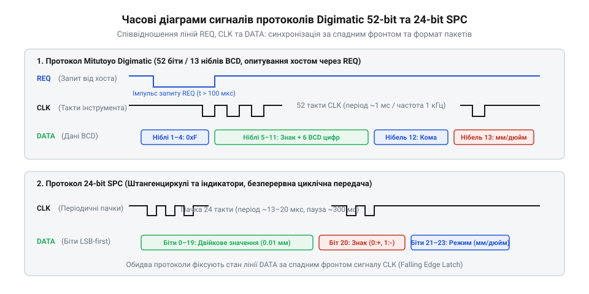

# Декодування протоколів Digimatic та 24-bit SPC

<preknowlist>
- [Драйвер чипа: від регістрової карти до значення у SI](root:sf-devices/draiver-chypa) — принципи виділення фізичних ліній зв'язку та перетворення сирих двійкових даних
</preknowlist>

## Фізичні рівні та електричне узгодження

Цифрові штангенциркулі та мікрометри живляться від дискових елементів на 1.5 В. Спроба під'єднати сигнальні лінії такого інструмента напряму до виводів мікроконтролера з логікою 3.3 В або 5 В створює подвійну проблему. По-перше, логічна одиниця з амплітудою 1.2–1.5 В не досягає порогу розпізнавання високого рівня мікроконтролера, який зазвичай вимагає щонайменше 2.0–2.3 В. По-друге, захисні діоди вбудованого контролера інструмента відкриваються, коли напруга на вході перевищує його власне живлення. Струм підтягування від мікроконтролера починає текти через ці діоди в батарейку або внутрішні кола, що призводить до паразитних витоків, швидкого розряджання елемента живлення та ризику теплового пробою вимірювальної мікросхеми.

Надійне спряження ліній вимагає активного перетворення рівнів на польових транзисторах @@en|MOSFET@@ (від англ. @@en|metal-oxide-semiconductor field-effect transistor@@ — польовий транзистор із ізольованим затвором). Затвор транзистора підключають до лінії живлення 1.5 В інструмента, витік — до сигнальної лінії датчика, а стік — до входу @@en|GPIO@@ (від англ. @@en|general-purpose input/output@@ — порти введення-виведення загального призначення) мікроконтролера. Обидві сторони підтягують резисторами @@en|pull-up@@ (від англ. @@en|pull-up@@ — підтягування) до відповідних напруг живлення. Коли вихід інструмента видає низький рівень, транзистор відкривається і притискає лінію мікроконтролера до землі. Коли вихід відпускається, транзистор закривається, і резистор 3.3 В виставляє повноцінний рівень логічної одиниці без перетікання струму у низьковольтне коло.

Швидкість наростання фронтів у такій схемі обмежує паразитна ємність кабелю зв'язку. Довгий кабель разом із високоомним резистором підтягування утворює інтегрувальний ланцюг із великою сталою часу. Завалені фронти тактового сигналу спотворюють стробування даних або викликають помилкові повторні спрацьовування цифрових входів. Щоб зберегти крутизну фронтів, опір підтягування обирають якнайменшим, але достатнім, щоб не перевищити допустимий струм навантаження вихідних каскадів штангенциркуля. Коректне електричне спряження захищає прилад і формує надійний фізичний рівень, на якому розгортається [драйвер чужого чипа](root:sf-devices/draiver-chypa) для зчитування сирих бітів.

## Структура кадрів та програмне декодування

Промисловий протокол @@en|Mitutoyo Digimatic@@ працює за моделлю «запит — відповідь». Мікроконтролер ініціює передачу, притискаючи лінію запиту @@en|REQ@@ до низького рівня. У відповідь вимірювальний прилад формує тактові імпульси на лінії @@en|CLK@@ і видає потік даних на лінії @@en|DATA@@. Кадр містить 52 біти, згруповані у 13 тетрад двійково-десяткового коду @@en|BCD@@ (від англ. @@en|binary-coded decimal@@ — двійково-десятковий код). Перші чотири тетради слугують преамбулою зі значенням `0xF`, п'ята визначає полярність вимірювання, наступні шість містять цифри виміряного значення, дванадцята задає позицію десяткової крапки, а тринадцята вказує одиниці вимірювання — міліметри чи дюйми.

На противагу йому, дешеві цифрові вимірювачі використовують китайський 24-бітний потоковий протокол @@en|SPC@@ (від англ. @@en|statistical process control@@ — статистичне керування процесами). Вони не мають входу запиту й автономно висилають пачки тактових імпульсів кілька разів на секунду. Їхній кадр складається з 24 бітів прямого двійкового коду, де перші двадцять розрядів передають цілочисельне переміщення, двадцять перший розряд кодує знак числа, а двадцять третій — перемикач одиниць вимірювання.

*Протокол Digimatic керує передачею через лінію запиту, тоді як SPC передає координати безперервними пачками з фіксованою паузою синхронізації.*

Декодування таких потоків у мікроконтролері реалізують без блокування процесорного ядра. Оскільки інтервали між пачками імпульсів значно перевищують період тактового сигналу, початок кадру фіксують за міжсимвольною паузою, відстежуючи [таймаути між кадрами](root:sf-devices/taimauty-pomylky-i-povtorna-initsializatsiia-chypa) за допомогою апаратного таймера. Самі біти зчитують за спадним або наростаючим фронтом тактової лінії, налаштувавши зовнішні [переривання для прийому](root:sf-devices/opytuvannia-pereryvannia-chy-dma-u-draiveri). Обробник переривання записує черговий біт у зсувний акумулятор, а після завершення лічильника бітів виставляє прапорець готового кадру, залишаючи ядро вільним для основної програми.