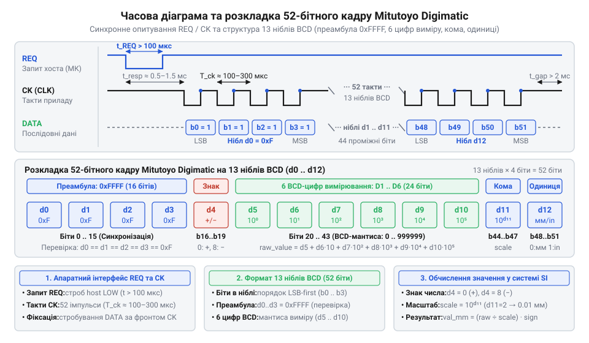

# Еволюція цифрових вимірювальних протоколів Mitutoyo та SPC

## Початкові концепції та фізичні принципи

У масовому промисловому виробництві 1970-х років точність механічної обробки деталей визначала якість партій виробів. Контролери вимірювали деталі штангенциркулями (@@en|vernier caliper@@, від прізвища французького математика П'єра Верньє, @@fr|Pierre Vernier@@, та англ. *caliper* — вимірювальний циркуль) і мікрометрами (@@en|micrometer@@, від грец. *mikros* — малий, та *metron* — міра). Суміщення поділок ноніуса викликало оптичний паралакс (@@en|parallax@@, від грец. *parallaxis* — зміщення, відхилення), а ручний запис значень у журнал вносив помилки.

У методології статистичного контролю процесів (@@en|Statistical Process Control@@, @@en|SPC@@, від англ. *statistical* — статистичний, *process* — процес, та *control* — контроль) на контрольних картах Шухарта (@@en|Shewhart control chart@@, від імені американського фізика Волтера Шухарта, @@en|Walter Shewhart@@) такі затримки спотворювали оцінку: зношування різця помічали вже після появи браку. Щоб усунути людський фактор, лінійний зсув вимагалося перетворити на електричний сигнал безпосередньо в інструменті.

Проте класичні методи не підходили для портативного корпусу. Оптичні лінійки споживали десятки міліампер, тоді як ручний інструмент мав роками живитися від одного оксидно-срібного елемента живлення (@@en|silver-oxide battery@@, тип @@en|SR44@@ напругою `1.55 В` та ємністю `150 мА·год`). До того ж цехова стружка, волога й мастило забруднювали оптичні вікна та магнітні датчики.

У 1977 році шведський винахідник Інгвар Андермо (@@sv|Ingvar Andermo@@) у Королівському технологічному інституті в Стокгольмі (@@sv|Kungliga Tekniska högskolan@@, @@sv|KTH@@) запатентував безконтактний диференціальний метод вимірювання переміщення, впроваджений швейцарською компанією Sylvac (@@fr|Sylvac@@) та розвинений японською корпорацією Mitutoyo (@@ja|Mitutoyo@@, заснованою Єханом Нуматою, @@ja|Yehan Numata@@). Конструкція спиралася на планарний [ємнісний лінійний енкодер](root:hw-sensing/capacitive-linear-encoder) (@@en|capacitive linear encoder@@, від лат. *capacitas* — місткість, та англ. *linear* — лінійний, *encoder* — давач положення). Уздовж сталевої планки розмістили статор із мідних смуг із просторовим кроком `λ = 2.54 мм`, а на повзунку — плату з групами збуджувальних електродів і приймальним електродом.


*Схема диференціального ємнісного сенсора штангенциркуля демонструє взаємне розташування періодичних мідних смуг статора та груп чотирифазних електродів збудження на повзунку, що ілюструє просторову модуляцію ємності та безконтактне перетворення зсуву у фазовий кут сигналу.*

Знайдемо електричну ємність `C` між парою планарних електродів через електричну сталу вакууму `ε₀`, відносну діелектричну проникність середовища `ε_r`, площу перекриття пластин `A(x)` як функцію зсуву `x` та товщину повітряного зазору `d`:

```
C(x) = (ε₀ · ε_r · A(x)) / d
```

Рівняння показує, що геометричне переміщення повзунка `x` лінійно змінює площу перекриття `A(x)` і модулює прохідну ємність без прямого електричного контакту.

Визначимо вихідну напругу приймального електрода `U_out` при збудженні чотирьох фаз решітки кроком `λ` напругами з циклічною частотою `ω` та фазовими кутами `φᵢ = (i - 1) · π / 2`:

```
U_out(t, x)
= ∑ U₀ · sin(ω · t + φᵢ) · (Cᵢ(x) / C_total)   [сума ємнісних струмів чотирьох фаз]
= U_m · sin(ω · t + (2 · π · x) / λ)            [просторова фазова інтерполяція]
```

Отриманий вираз показує, що переміщення `x` перетворюється на фазовий зсув `Δφ = (2 · π · x) / λ` хвилі збудження. Лічильник мікросхеми вимірює інтервал між переходами напруги через нуль, завдяки чому коливання зазору `d` і плівка мастила не спотворюють результат.

Струм споживання такого вимірювача становив лише `10–15 мкА`, що забезпечувало роботу від батарейки @@en|SR44@@ понад рік. У 1978–1983 роках @@ja|Mitutoyo@@ випустила на цій фізичній базі серію приладів Digimatic (@@en|Digimatic@@, від англ. *digital* — цифровий, та *automatic* — автоматичний). Рідкокристалічний дисплей (@@en|Liquid Crystal Display@@, @@en|LCD@@, від англ. *liquid crystal* — рідкий кристал, та *display* — дисплей) відображав результат із точністю `0.01 мм`. Проте екран не усував ручного переписування: для інтеграції в заводську мережу @@en|SPC@@ був потрібен порт цифрового виведення даних.

## Внутрішня будова та алгоритми роботи

Передача виміряних даних із портативного штангенциркуля назовні зіткнулася з жорсткими схемотехнічними обмеженнями ручного інструмента. Всередині вимірювального вузла працювала спеціалізована інтегральна мікросхема (@@en|Application-Specific Integrated Circuit@@, @@en|ASIC@@, від англ. *application-specific* — спеціалізований, та *integrated circuit* — інтегральна схема), заживлена від власної батарейки `1.55 В` і затактована енергоощадною частотою `32.768 кГц`. Застосувати стандартний послідовний порт RS-232 було неможливо через вимогу двополярного живлення `±12 В` та міліамперне споживання, а паралельна шина зв'язку вимагала б товстого багатожильного джгута, незручного для ручної праці оператора.

Водночас зовнішній реєстратор даних (@@en|data processor@@) або промисловий контролер працював на логічних рівнях `5 В`. Подання такої напруги на крихітний вбудований чип неминуче спричинило б пробій польових транзисторів вхідних каскадів.

Інженери @@ja|Mitutoyo@@ подолали цю несумісність, створивши синхронний послідовний інтерфейс зі схемотехнікою відкритого стоку (@@en|open-drain@@, від англ. *open* — відкритий, та *drain* — стік польового транзистора). Апаратний порт інструмента використовує п'ять ліній зв'язку: спільний провід `GND`, вихід послідовних даних `DATA`, вихід тактування `CK`, вхід запиту `REQ` та сигнал готовності `RD`. Лінії `DATA` та `CK` побудовані на польових транзисторах, які вміють лише притягувати лінію до `GND`. Високий логічний рівень забезпечується виключно зовнішніми підтягувальними резисторами (@@en|pull-up resistor@@, від англ. *pull up* — підтягувати вгору, та *resistor* — опір) на боці приймача, підключеними до його шини `3.3 В` або `5 В`. Це рішення повністю захистило батарейне коло приладу від високої зовнішньої напруги.

У схемі обміну реалізовано інвертований розподіл ролей шини. Контролер ініціює передачу, притягуючи лінію `REQ` до низького рівня на часовий інтервал від `0.7` до `1.2 мс`. Вбудована мікросхема @@en|ASIC@@ виходить зі стану сну, фіксує спад рівня на вході `REQ` і перебирає на себе функції ведучого тактової лінії (@@en|clock master@@, від англ. *clock* — такт/годинник, та *master* — ведучий). Інструмент самостійно генерує пачку з 52 тактових імпульсів на лінії `CK` із тривалістю періоду від `100` до `300 мкс`. Контролер зобов'язаний відпустити лінію `REQ` у високий стан до завершення 52-го такту, інакше передавач зависне в циклі повторної передачі. Такий алгоритм вимагає чіткого [відокремлення логіки шини](root:sf-devices/riven-tranzaktsii) від прикладного драйвера, щоб апаратні затримки не блокували обчислювальний потік мікроконтролера.

Пакет вимірювання передається у вигляді 13 послідовних 4-бітних тетрад — ніблів (@@en|nibble@@, від англ. *nibble* — кусень, дрібна частка), від `d₁` до `d₁₃`, де кожен біт виставляється на лінію `DATA` за спадом такту `CK` молодшим бітом уперед (@@en|LSB first@@, від англ. *least significant bit* — найменш значущий біт, та *first* — спершу). Перші чотири нібли `d₁ – d₄` містять фіксоване шістнадцяткове значення `0xF` (двійково `1111`), формуючи 16-бітний преамбульний роздільник кадру (@@en|frame delimiter@@, від англ. *frame* — кадр, та *delimiter* — роздільник) для детектування початку посилки. Наступний нібл `d₅` визначає полярність виміру: код `0x0` відповідає знаку плюс, тоді як `0x8` маркує від'ємне значення. Група ніблів `d₆ – d₁₁` передає шість десяткових розрядів мантиси від старшого до молодшого у двійково-десятковому коді (@@en|Binary-Coded Decimal@@, @@en|BCD@@, від англ. *binary* — двійковий, *coded* — кодований, та *decimal* — десятковий). Передостанній нібл `d₁₂` задає положення десяткової коми як від'ємний степінь числа 10, а фінальний нібл `d₁₃` кодує одиницю вимірювання: значення `0x0` вказує на метричні міліметри, а `0x1` — на дюйми.


*Часова діаграма обміну протоколу Mitutoyo Digimatic ілюструє взаємодію сигналів REQ, CK та DATA разом із розбивкою 52-бітної посилки на 13 ніблів, що наочно показує синхронізацію передачі за спадом такту та структуру двійково-десяткових полів вимірювання.*

Обчислимо результуючий виміряний розмір `X` за отриманим 52-бітним пакетом, у якому нібли мантиси містять значення `d₆ = 0`, `d₇ = 1`, `d₈ = 2`, `d₉ = 3`, `d₁₀ = 4`, `d₁₁ = 5`, показник масштабування `d₁₂ = 2`, код знака `d₅ = 0` (додатний), а одиниця вимірювання `d₁₃ = 0` (міліметри):

**Розрахунок лінійного розміру деталі з кадрів протоколу Mitutoyo Digimatic:**
```
M = d₆ · 10⁵ + d₇ · 10⁴ + d₈ · 10³ + d₉ · 10² + d₁₀ · 10¹ + d₁₁ · 10⁰
  = 0 · 10⁵ + 1 · 10⁴ + 2 · 10³ + 3 · 10² + 4 · 10¹ + 5 · 10⁰   [підстановка десяткових цифр мантиси]
  = 12345                                                          [цілочисельне значення мантиси]

X = (+1) · M · 10^(-d₁₂)
  = 1 · 12345 · 10⁻²                                               [масштабування за положенням коми]
  = 123.45 мм                                                      [результуючий розмір у міліметрах]
```

Отримане значення `123.45 мм` відновлює результат без обчислень із рухомою комою, дозволяючи прошивці транслювати отримані байти у [фізичні величини системи SI](root:sf-devices/draiver-chypa) без втрати точності округлення.

На стороні мікроконтролера пряме опитування ліній блокує ядро через активне очікування (@@en|busy waiting@@, від англ. *busy* — зайнятий, та *waiting* — очікування). Оскільки інструмент сам визначає темп тактування, прошивка налаштовує перехоплення за спадом такту через механізм [апаратних переривань контролера](root:sf-devices/opytuvannia-pereryvannia-chy-dma-u-draiveri) або використовує каскади [зсувних регістрів захоплення](root:sf-devices/74hc165-shift-register) для паралельного читання.

У середовищі операційної системи реального часу (@@en|Real-Time Operating System@@, @@en|RTOS@@) драйвер збирає 52 біти в буфер і передає сформовану подію в чергу повідомлень (@@en|message queue@@, від англ. *message* — повідомлення, та *queue* — черга). Для запобігання зависанню процесу при обриві кабелю обов'язково налаштовують [таймаути та аварійне скидання](root:sf-devices/taimauty-pomylky-i-povtorna-initsializatsiia-chypa), що дозволяє узгоджувати дані кількох осей у [багатоосьових вимірювальних системах](root:sf-devices/dro-multi-axis-synchronization).

## Апаратна реалізація та низькорівневий C/C++ код

Підключення вимірювального інструмента до сучасного мікроконтролера починається з узгодження електричних рівнів і захисту чутливого вхідного каскаду. Якщо вивід мікроконтролера увімкнути у двотактний вихідний режим (@@en|push-pull@@, від англ. *push* — штовхати, та *pull* — тягнути) і подати активний високий рівень `3.3 В` або `5 В` на лінію `REQ`, надлишкова напруга відкриє захисні діоди батарейного чипа `1.55 В` та виведе його з ладу. Тому сигнал `REQ` формують виключно в режимі @@en|open-drain@@ або через транзисторний перетворювач рівнів (@@en|level shifter@@, від англ. *level* — рівень, та *shifter* — перетворювач): логічний нуль притягує лінію до `GND`, ініціюючи передачу, а логічна одиниця переводить пін у високоімпедансний стан, дозволяючи слабкій внутрішній підтяжці інструмента повернути лінію до напруги батарейки. Лінії тактування `CK` та даних `DATA` на стороні мікроконтролера конфігурують як входи з зовнішніми підтягувальними резисторами @@en|pull-up resistor@@ до шини живлення приймача. Таке схемотехнічне рішення задає чітку [послідовність ініціалізації периферії](root:sf-devices/poslidovnist-initsializatsii-iakoi-nikhto) ще до запуску вимірювального контуру.

Паразитні параметри кабелю диктують сувору межу на опір резисторів підтяжки. Визначимо максимальний допустимий опір резистора `R_pull_max` через паразитну ємність кабелю зв'язку `C_cable` та граничну тривалість наростання фронту `t_rise_max`, яка не повинна перевищувати 20% від напівперіоду тактового сигналу `t_high = 60 мкс` при частоті обміну близько `8 кГц`:

```
R_pull_max
= t_rise_max ÷ (2.2 · C_cable)                  [гранична умова експоненційного заряду RC-кола]
= (12 · 10⁻⁶) ÷ (2.2 · 220 · 10⁻¹²)             [підстановка тривалості фронту та ємності кабелю]
= 24793 Ом                                      [розрахунковий опір у омах]
≈ 24.8 кОм                                      [переведення в кілооми]
```

Розрахунок доводить, що типові підтяжки номіналом `100 кОм` непридатні для цехових кабелів завдовжки понад два метри: затягнутий фронт спотворює форму тактового імпульсу ще до спрацьовування вхідного компаратора. Надійну фіксацію логічних рівнів забезпечують резистори номіналом `4.7–10 кОм`.

Після подачі низького рівня на вхід `REQ` тривалістю `1 мс` прилад прокидається і починає самостійно генерувати імпульси на лінії `CK`. Щоб процесор не витрачав ресурси на блокувальне очікування, драйвер налаштовує [обробку апаратних переривань](root:sf-devices/opytuvannia-pereryvannia-chy-dma-u-draiveri) (@@en|external interrupt@@, від англ. *external* — зовнішній, та *interrupt* — переривання) за спадним фронтом тактової лінії. Обробник переривання (@@en|interrupt service routine@@, @@en|ISR@@, від англ. *interrupt service routine* — підпрограма обробки переривання) зчитує стан лінії `DATA` на кожному спаді такту та складає послідовні біти у буферний масив із 13 ніблів. Одразу після фіксації перших тактів прошивка відпускає лінію `REQ` у високий стан, уникаючи повторної нескінченної передачі пакетів з боку чипа.

Прийняті біти не перетворюють у числа з рухомою комою, оскільки апаратні операції з ними на мікроконтролерах без математичного співпроцесора виконуються повільно й накопичують похибку двійкового представлення десяткових часток. Драйвер застосовує арифметику з фіксованою комою (@@en|fixed-point arithmetic@@, від англ. *fixed-point* — фіксована кома, та *arithmetic* — арифметика): шість розрядів @@en|BCD@@ розгортаються у ціле 32-розрядне число мікрометрів, що забезпечує швидке [переведення значення у SI](root:sf-devices/draiver-chypa) за один такт множення.

Розглянемо практичну реалізацію низькорівневого модуля збору даних і кінцевого автомата на мовах C та C++:

:::tabs
:::code hist-spc-digimatic-evolution/c/c99/digimatic-on-clock-falling-isr.c
:::code hist-spc-digimatic-evolution/cpp/cpp17/digimaticdecoder.cpp
:::

Архітектура драйвера повністю спирається на [відокремлення транзакційного рівня](root:sf-devices/riven-tranzaktsii) від прикладної бізнес-логіки. Такий підхід усуває зв'язність між апаратним перериванням та користувацьким інтерфейсом, дозволяючи потокам обробки читати готові виміри через черги подій.

## Практичне застосування та відлагодження

В умовах промислового цеху лінія передачі даних постійно зазнає впливу електромагнітних завад (@@en|electromagnetic interference@@, @@en|EMI@@, від англ. *electromagnetic* — електромагнітний, та *interference* — завада) від частотних перетворювачів приводів верстатів, пускачів та зварювальних апаратів. Довгий гнучкий кабель інструмента працює як антена, наводячи короткі високочастотні викиди на відкриту лінію тактування `CK`. Оскільки вхідний тригер мікроконтролера фіксує кожен перепад напруги, хибний імпульс збуджує позачергове переривання. У результаті виникає асинхронний зсув бітів (@@en|bit slip@@, від англ. *bit* — біт, та *slip* — проковзування/зсув), який руйнує межі ніблів усередині кадру.

Якщо прошивка сприйме такий зсунутий пакет, позиція десяткової коми та значущі розряди перемішаються, викликаючи стрибок вимірювання на десятки міліметрів. Для захисту від таких спотворень драйвер виконує комплексну перевірку цілісності. По-перше, аналізуються перші 16 бітів: якщо преамбула відрізняється від еталонного значення `0xFFFF`, фіксується помилка кадрування (@@en|framing error@@, від англ. *frame* — кадр, та *error* — помилка), а весь пакет безумовно відкидається. По-друге, перевіряється діапазон кожного символу мантиси: виявлення значення понад 9 у будь-якому з ніблів `d₆–d₁₁` однозначно вказує на зміщення бітової сітки. На апаратному рівні завади послаблюють встановленням фільтрувальних RC-ланцюжків (`100 Ом` та `1 нФ`) та застосуванням [тригерів Шмітта для фільтрації](root:hw-analog/schmitt-trigger) (@@en|Schmitt trigger@@, від імені американського біофізика Отто Шмітта, @@en|Otto Schmitt@@), що відсікають високочастотний брязкіт на фронтах.

Іншим граничним станом є випадкове від'єднання роз'єму інструмента під час руху або критичне просідання напруги вбудованого елемента живлення `1.55 В`. Якщо прилад вимикається посеред транзакції, передача тактових імпульсів припиняється, а кінцевий автомат драйвера залишається заблокованим в очікуванні решти бітів. Для запобігання зависанню процесу прошивка задіює сторожовий таймер (@@en|watchdog timer@@, від англ. *watchdog* — сторожовий пес, та *timer* — таймер). Час повного кадру з 52 бітів при частоті `8 кГц` становить близько `6.5 мс`. Якщо від моменту подачі сигналу `REQ` минає понад `20 мс`, а прапорець завершення не встановлено, драйвер примусово перериває прийом, очищує бітові лічильники та ініціює [таймаути та повторну ініціалізацію](root:sf-devices/taimauty-pomylky-i-povtorna-initsializatsiia-chypa) всього інтерфейсного модуля.

Частота опитування інструмента безпосередньо впливає на термін служби його батарейки. У стані спокою мікросхема споживає менше `15 мкА`. Під час активної видачі даних струм зростає до `1–2 мА`. Безперервне опитування з частотою понад `20 Гц` виснажує батарейку за лічені тижні замість штатних кількох років. Оптимальний режим передбачає опитування за зовнішньою подією (натискання педалі оператора) або циклічне зчитування з частотою не вище `1–2 Гц`, із паузою між запитами не менше `50 мс` для відновлення внутрішніх кіл заряду сенсора.

У багатокоординатних системах цифрової індикації (@@en|Digital Read-Out@@, @@en|DRO@@, від англ. *digital* — цифровий, та *read-out* — відлік/індикація) на верстатах одночасно підключають декілька інструментів (осі `X`, `Y`, `Z`). Оскільки кожен вимірювач має власний незалежний генератор тактування, об'єднувати їхні лінії `CK` чи `DATA` неможливо. Щоб уникнути часового розбігу координат під час руху каретки, сигнал `REQ` подають одночасно на всі інструменти паралельно. Зчитування незалежних потоків тактування здійснюють або через окремі канали переривань, або через апаратний [зсувний регістр 74HC165](root:sf-devices/74hc165-shift-register), реалізуючи детерміновану [синхронізацію багатоосьових систем DRO](root:sf-devices/dro-multi-axis-synchronization).

Для налагодження системи на фізичному рівні застосовують цифровий логічний аналізатор (@@en|logic analyzer@@, від англ. *logic* — логічний, та *analyzer* — аналізатор). Щупи підключають до ліній `REQ`, `CK`, `DATA` та діагностичного виводу мікроконтролера. Діагностичний пін перемикають у високий рівень на початку генерації `REQ` і скидають після фіксації 52-го такту. На осцилограмі перевіряють тривалість імпульсу `REQ` (у межах `0.7–1.2 мс`), переконуються, що рівень на лінії `DATA` стабілізується щонайменше за `15 мкс` до спадного фронту `CK`, та контролюють відсутність паразитних дзвінків на шині. Збір внутрішньої статистики помилок у пам'яті драйвера дає змогу виявити деградацію контактів або кабелю задовго до того, як хибні виміри зіпсують партію деталей на конвеєрі.