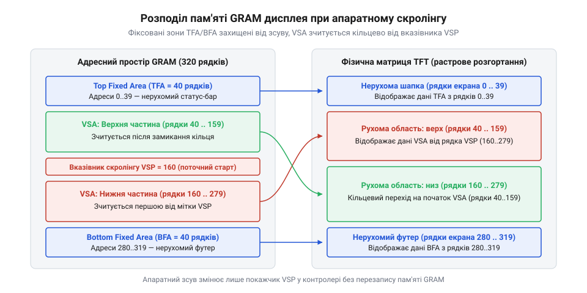
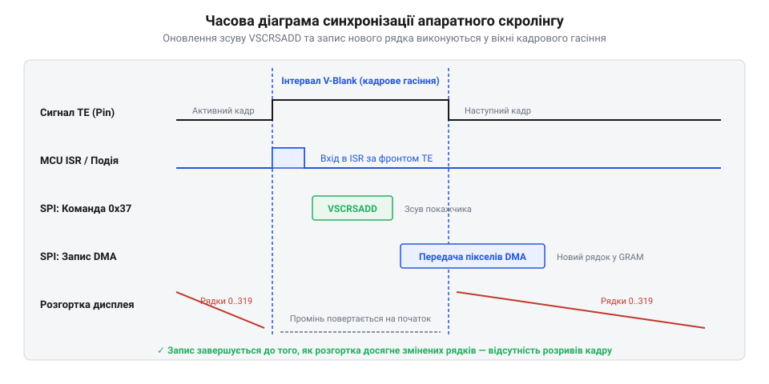
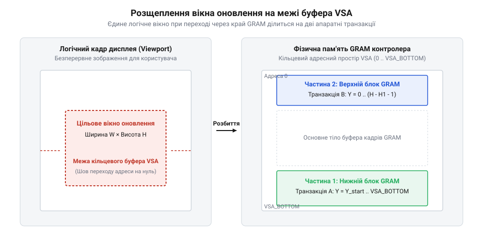

# Апаратний скролінг графічних контролерів дисплеїв

## Початкові концепції та фізичні принципи

Під час розробки сучасних вбудованих систем із графічними кольоровими дисплеями розробник неминуче стикається з потребою побудови динамічного інтерфейсу користувача. Це можуть бути плавні списки налаштувань, текстові стрічки консольних логів, чати повідомлень, меню приладової панелі або покадровий зсув осцилографічних графіків у реальному часі. Незалежно від конкретної прикладної задачі, ключовою вимогою до якісного графічного інтерфейсу є його детермінованість та висока частота оновлення кадрів без візуальних артефактів, затримок чи тремтіння. Однак спроба реалізувати плавну вертикальну або горизонтальну прокрутку екрана шляхом класичного суцільного перемальовування всіх пікселів зображення силами центрального процесора швидко наражається на жорсткі фізичні й обчислювальні обмеження мікроконтролера.

На малопотужних мікроконтролерах без спеціалізованого графічного прискорювача звичайне програмне копіювання колірних масивів у пам'яті створює критичне навантаження на обчислювальне ядро та повністю виснажує пропускну здатність системних шин. Щоб глибоко зрозуміти фізичну природу цієї проблеми та знайти оптимальне архітектурне рішення, необхідно детально розібрати внутрішню будову сучасних display-модулів та механізми їхньої взаємодії з мікроконтролером.

Типовий дисплейний модуль складається з рідкокристалічної (LCD) або органічної світлодіодної (OLED) фізичної матриці пікселів та інтегрованої мікросхеми драйвера, якою є @@en|display controller@@ (від англ. @@en|controller@@ — управитель, регулятор). У більшості сучасних модулів драйвер монтується безпосередньо на скляну підкладку за технологією COG (англ. @@en|Chip-on-Glass@@). Головним елементом внутрішньої структури такого чипа є власна автономна графічна оперативна пам'ять — @@en|display GRAM@@ (від англ. @@en|Graphic Random Access Memory@@). Пам'ять @@en|display GRAM@@ є двопортовою матрицею static RAM (SRAM), у якій кожна комірка фізично відповідає конкретному пікселю екрана і зберігає його колірний код у форматі RGB565 (16 біт на піксел), RGB666 або RGB888.

Усередині чипа контролера безперервно функціонує автономний апаратний модуль розгортки — @@en|scanout engine@@. Цей модуль із жорстко зафіксованою частотою кадрової розгортки (зазвичай від 50 до 60 Гц) зчитує колірні дані з пам'яті @@en|display GRAM@@ рядок за рядком, синхронізує їх внутрішніми таймінговими сигналами HSYNC (горизонтальна синхронізація) та VSYNC (вертикальна синхронізація) і подає відповідні керуючі напруги на фізичні аналогові драйвери стовпчиків і рядків панелі. З точки зору мікроконтролера, процес відображення на склі є повністю автономним: як тільки дані записані у виділений адресний простір @@en|display GRAM@@, @@en|scanout engine@@ буде нескінченно циклічно виводити їх на екран без будь-якої участі зовнішнього процесора.

У найпростішому підході до реалізації прокручування вмісту, який називають програмним скролінгом, розробник намагається змістити зображення шляхом модифікації самого вмісту фреймбуфера. Щоб змістити кадрове зображення вгору на N пікселів, програма повинна прочитати кожний рядок з оперативної пам'яті або з пам'яті дисплея, зсунути адреси всіх елементів масиву на N позицій вгору, сформувати новий @@en|framebuffer@@ (від англ. @@en|frame@@ — кадр, @@en|buffer@@ — проміжне сховище) та повністю перезаписати весь масив даних у чип дисплея через системний інтерфейс.

Обчислимо обчислювальне та шинне навантаження на систему при програмному перемальовуванні. Швидкість передачі даних через послідовний або паралельний інтерфейс дисплея обчислюється як добуток кількості пікселів у кадри, колірної глибини у байтах та частоти оновлення екрана. Обчислимо обсяг даних B_frame, що передаються за одну секунду для дисплея з роздільною здатністю W = 240 пікселів, H = 320 пікселів, колірною глибиною N_bytes = 2 байти на піксел (формат RGB565) та частотою оновлення F = 60 Гц:

```
B_frame
= W × H × N_bytes × F                      [формула повного пропускного потоку]
= 240 × 320 × 2 × 60                       [підстановка параметрів дисплея]
= 9216000                                  [значення у байтах за секунду]
```

Отриманий обсяг даних становить 9.216 МБ/с. Для типового мікроконтролера, з'єднаного з дисплеєм через послідовну шину SPI з граничною тактовою частотою 32 МГц, максимальна реальна @@en|bus bandwidth@@ (від англ. @@en|bandwidth@@ — ширина смуги) з урахуванням службових байтів команд, процедур вибору веденого чипа (CS) та переключення лінії Data/Command (D/C) не перевищує 3.75 МБ/с. Це означає, що передача 60 повних кадрів на секунду через таку шину є фізично неможливою. Гранична частота оновлення, якої можна досягти при повному перемальовуванні екрана, становить лише близько 24 кадрів на секунду, причому центральний процесор та контролер DMA будуть завантажені на 100%, викличуть блокування інших критичних тасків та спровокують падіння продуктивності усієї прошивки.

Для розв'язання цієї фундаментальної проблеми в архітектуру сучасних графічних контролерів було впроваджено @@en|hardware scrolling@@ (від англ. @@en|scrolling@@ — згортання, прокручування). Його фізична концепція полягає в принциповому розриві жорсткої прив'язки між фізичним індексом комірки в пам'яті @@en|display GRAM@@ та початковою адресою рядка, з якого внутрішній @@en|scanout engine@@ починає формування чергового кадру на екрані.

Замість фізичного копіювання сотень кілобайтів колірних масивів усередині пам'яті, @@en|hardware scrolling@@ змінює лише значення внутрішнього апаратного лічильника адреси початкового рядка розгортки. @@en|display controller@@ продовжує зчитувати графічну пам'ять циклічно, але починає вибірку даних не з найпершого фізичного рядка 0, а з довільного фізичного рядка S, заданого керуючим регістром зсуву. Коли лічильник зчитування @@en|scanout engine@@ доходить до останньої фізичної комірки виділеного масиву пам'яті, він апаратно закольцовується і продовжує зчитування з першого рядка цього ж масиву.

При застосуванні @@en|hardware scrolling@@ навантаження на шину передачі даних та процесор принципово змінюється. Для зсуву всього зображення на екрані прошивці мікроконтролера достатньо записати нове значення в 16-бітний регістр зсуву адреси дисплея. Обчислимо обсяг даних B_hardware, які передаються в екран за одну секунду для підтримки плавного зсуву на ті самі 60 кадрів на секунду при розмірі керуючого регістру зсуву N_reg = 2 байти:

```
B_hardware
= N_reg × F                                [формула обсягу даних для апаратного зсуву]
= 2 × 60                                   [підстановка розміру регістру та частоти]
= 120                                      [значення у байтах за секунду]
```

Порівняльний аналіз показує вражаюче колосальне зменшення трафіку шини з 9 216 000 байтів на секунду до символічних 120 байтів на секунду. Обчисливальна складність операції прокручування екрана для центрального процесора зменшується з лінійної залежності O(N), де N — загальна кількість пікселів у кадри, до строго константної складності O(1). Це повністю звільняє процесорний час мікроконтролера та пропускну здатність шини периферії для виконання реальних обчислювальних задач пристрою.

Однак зміна адреси розгортки без суворої часової синхронізації з фізичною роботою дисплея створює вкрай неприємний візуальний артефакт під назвою @@en|tearing effect@@ (від англ. @@en|tearing@@ — розрив). Цей артефакт виникає в ситуації, коли прошивка мікроконтролера змінює @@en|pointer@@ (від англ. @@en|pointer@@ — вказівник) початкового рядка в той самий момент, коли апаратний @@en|scanout engine@@ зчитує середину кадру з пам'яті @@en|display GRAM@@. У результаті верхня частина екрана малюється за старим зсувом адреси, а нижня частина — вже за новим. На межі зчитування утворюється помітна зламана горизонтальна лінія зміщення.

Для ліквідації цього артефакту в hardware-архітектурах дисплейних контролерів передбачено спеціальний вихідний сигнал — лінію апаратного переривання TE (від англ. @@en|tearing effect pin@@). Контролер дисплея генерує логічний імпульс на цій лінії суворо в момент завершення виведення кадру, коли промінь сканування знаходиться в зоні зворотного ходу — так званій зоні вертикальної гасільної паузи @@en|vertical synchronization@@. Для забезпечення ідеально гладкого зсуву без артефактів запис нового значення регістру прокрутки в @@en|display controller@@ має виконуватися суворо під час дії імпульсу TE. Детальніше фізичні механізми придушення розривів кадрів розглядає [синхронізація сигналу Tearing Effect](root:sf-devices/tearing-effect-synchronization).

## Внутрішня будова та алгоритми роботи

Внутрішня архітектурна організація @@en|display controller@@ передбачає гнучку сегментацію всього обсягу графічної пам'яті @@en|display GRAM@@ на трьохрівневу систему зон. Така сегментація дає розробнику можливість формувати складні комбіновані інтерфейси користувача, у яких певні елементи екрана залишаються нерухомими (наприклад, верхній статус-бар із піктограмами стану та годинником або нижня панель навігаційних кнопок), у той час як середня частина екрана вільно й плавно прокручується.

Контролер дисплея розподіляє вертикальний простір пам'яті на три послідовні апаратні області:
1. Верхня фіксована зона — @@en|top fixed area@@ (TFA). Рядки графічної пам'яті від 0 до TFA - 1 відображаються апаратно завжди на своїх постійних фізичних позиціях у верхній частині скляної панелі. 2. Зона вертикального скролінгу — @@en|vertical scrolling area@@ (VSA). Область пам'яті заввишки VSA рядків, у якій порядок виведення рядків підпорядковується апаратному кільцевому зсуву адреси. 3. Нижня фіксована зона — @@en|bottom fixed area@@ (BFA). Рядки заввишки BFA, які фіксуються в нижній частині фізичної матриці дисплея.

Сума висот усіх трьох сформованих зон повинна строго дорівнювати повній фізичній роздільній здатності дисплея по вертикалі H_total:

```
H_total
= TFA + VSA + BFA                          [умова повного покриття екрана]
```


*Розподіл внутрішньої пам'яті контролера дисплея на фіксовані зони та апаратний кільцевий буфер прокручування.*

Для конфігурування та управління зоною прокрутки в системі команд дисплейних контролерів (таких як популярні мікросхеми ILI9341, ST7789, ST7735 або SSD1306) задіяні дві основні апаратні команди: `VSCRDEF` (англ. @@en|vertical scroll definition@@ — визначення параметрів вертикального скролінгу) та `VSCRSADD` (англ. @@en|vertical scroll start address@@ — початкова адреса вертикального скролінгу).

Команда `VSCRDEF` (код 0x33 у специфікації MIPI DCS) приймає 6 байтів параметрів, які задають три 16-бітні величини: TFA, VSA та BFA. Команда `VSCRSADD` (код 0x37 у специфікації MIPI DCS) приймає один 16-бітний параметр S_offset — поточну фізичну адресу рядка в пам'яті @@en|display GRAM@@, з якого @@en|scanout engine@@ повинен починати відображення рухомої зони VSA.

Коли екран прокручується вгору на dy пікселів, прошивка мікроконтролера інкрементує значення S_offset. При досягненні нижнього краю зони VSA адресаційній логіці контролера необхідний циклічний математичний перехід. Обчислимо фізичну адресу рядка в графічній пам'яті Y_physical для довільної логічної координати Y_logical усередині прокручуваної зони з урахуванням поточного зсуву вказівника S_offset:

```
Y_physical
= TFA + ((Y_logical - TFA + S_offset) mod VSA)   [формула кільцевого адресного відображення]
```

Цей математичний вираз перетворює обсяг пам'яті @@en|display GRAM@@ у зоні VSA на апаратний @@en|circular buffer@@ (від англ. @@en|circular buffer@@ — кільцевий буфер). При прокручуванні зображення вгору на dy пікселів найвищий рядок зони VSA, який виходить за верхню межу видимості, фізично виходить із зони сканування і стає вільним для перезапису. Саме в цю вивільнену фізичну лінію пам'яті прошивка мікроконтролера повинна записати новий рядок колірних даних, який щойно з'являється знизу.

Завдяки такій архітектурі прошивці більше немає потреби перемальовувати весь екран. Конвеєр рендерингу — @@en|rendering pipeline@@ — спрощується до двох чітких детермінованих кроків:
1. Оновлення та передача через шину даних лише одного (або dy) нового рядка у вивільнені комірки @@en|display GRAM@@ за обчисленою циклічною адресою Y_physical. 2. Оновлення значення апаратного регістру `VSCRSADD` новим зсувом S_offset.

Замість малювання 320 рядків кадри мікроконтролер обробляє лише 1 новий рядок. Замість відправки 153 600 байтів передається лише 480 байтів колірних даних пікселів плюс 2 байти керуючого регістру. Для складних віджетів користувацького інтерфейсу прошивка може застосовувати [графічний інтерфейс на МК](root:sf-devices/hrafichnyi-interfeis), де апаратний скролінг інтегрується з базовим конвеєром рендерингу для оптимізації оновлення графічних об'єктів.

Для забезпечення максимальної частоти оновлення та мінімальної затримки передача нового рядка в пам'ять дисплея здійснюється в фоновому режимі без задіяння процесора. Замість блокуючих програмних циклів виводу прошивка активує [передавання графічних буферів](root:sf-devices/dma-spi-display-transfer) лише для одного нового рядка за допомогою периферійного контролера @@en|direct memory access@@ (DMA).

Нижче наведено практичну реалізацію драйвера апаратного скролінгу мовами C та C++ для мікроконтролера під управлінням операційної системи реального часу — @@en|real-time operating system@@ (RTOS). Драйвер забезпечує потокобезпечне конфігурування зон, кільцевий розрахунок адрес та синхронізоване з TE-перериванням оновлення регістрів.

:::tabs

@tab C

:::code root\eng\sf-devices\display-hardware-scrolling/display-hardware-scrolling-d/c/esp-idf/display-scroller-init.c c

@tab C++

:::code root\eng\sf-devices\display-hardware-scrolling/display-hardware-scrolling-d/cpp/hardwarescroller.cpp cpp

:::

Наведений C/C++ код повністю реалізує апаратний механізм вертикального зсуву. При кожному виклику функція записує новий рядок у відповідний фізичний діапазон адресації пам'яті @@en|display GRAM@@, після чого синхронно оновлює апаратний регістр `VSCRSADD`. Оскільки процедура запису нових пікселів у пам'ять екрана та зміна регістру адреси чітко рознесені в часі, використання сигнального переривання TE від дисплея в поєднанні з тасками @@en|real-time operating system@@ повністю усуває тремтіння й розриви графіки, гарантуючи стабільну частоту оновлення екрана 60 кадрів на секунду при мінімальному споживанні обчислювальних ресурсів процесора.

## Апаратна реалізація та низькорівневий C/C++ код

Коли у вбудованому пристрої постає інженерне завдання показувати динамічний потік даних — наприклад, неперервну осцилограму сенсорних вимірювань, спектрограму сигналів чи швидкодіючий термінал системних повідомлень, — просте надсилання команд зсуву адреси у довільний момент часу миттєво руйнує стабільність зображення. Якщо мікроконтролер модифікує значення початкового рядка `VSCRSADD` або передає пікселі нового рядка в пам'ять @@en|display GRAM@@ безпосередньо у блокувальному процесорному циклі, виникає масштабна деградація всієї прошивки. Процесорне ядро витрачає понад 85–90% корисних тактів на очікування завершення байтових транзакцій на відносно повільній шині @@en|SPI@@, а на самому екрані утворюється зламана горизонтальна лінія спотворення @@en|tearing effect@@. Цей дефект виникає через те, що оновлення адреси перетинається у часі з поточним просторовим проходом апаратного вузла @@en|scanout engine@@. Створення надійного графічного вузла вимагає суворого узгодження низькорівневого таймінгу шини з фазами розгортки скляної панелі та перенесення передачі масивів пікселів на автономний периферійний контролер.

Внутрішня мікросхема драйвера — @@en|display controller@@ — формує растрове зображення на фізичній матриці за жорстким періодичним розкладом. Після завершення виведення останнього активного рядка кадру апаратний блок розгортки переходить у стан гасіння зворотного ходу — @@en|vertical blanking interval@@ (VBI, від англ. @@en|blanking@@ — гасіння, @@en|interval@@ — проміжок). Саме на початку цього інтервалу контролер дисплея виставляє активний рівень напруги на вихідній лінії апаратного переривання TE. Тривалість цього імпульсу визначає єдине безпечне часове вікно, протягом якого прошивка мікроконтролера має апаратне право оновити покажчик початкового рядка `VSCRSADD` без ризику спотворення кадру на склі.

Розрахуємо тривалість гасільної паузи кадру та час, необхідний для запису команди апаратного зсуву через шину. Позначимо через `F_dotclk` внутрішню частоту піксельного генератора контролера дисплея у герцах. Позначимо через `W_total` повний період розгортки одного горизонтального рядка у тактах генератора, який включає активну ширину рядка та сумарні інтервали горизонтального гасіння. Позначимо через `T_line` тривалість розгортки одного рядка у секундах. Позначимо через `N_vblank` кількість рядків, які відводяться на вертикальну паузу гасіння зворотного ходу кадру. Позначимо через `T_vbi` повну тривалість вертикальної гасільної паузи кадру у секундах. Для типового дисплейного модуля з роздільною здатністю 240 на 320 точок при внутрішній частоті генератора `F_dotclk = 6.4` МГц, горизонтальному періоді рядка `W_total = 270` тактів та кількості рядків вертикального гасіння `N_vblank = 16` рядків маємо:

```
T_line
= W_total ÷ F_dotclk                         [тривалість розгортки одного рядка]
= 270 ÷ 6400000                              [підстановка параметрів тактування]
= 0.0000421875                               [значення в секундах, тобто 42.19 мкс]

T_vbi
= N_vblank × T_line                          [тривалість вертикальної кадрової паузи]
= 16 × 0.0000421875                          [добуток кількості рядків на крок розгортки]
= 0.000675                                   [значення в секундах, тобто 675 мкс]
```

Отриманий часовий інтервал `T_vbi` тривалістю 675 мікросекунд є максимальним запасом часу, протягом якого нова адреса скролінгу має бути зафіксована у внутрішньому регістрі контролера. Тепер обчислимо час `T_cmd`, необхідний для надсилання 1 байта команди `VSCRSADD` та 2 байтів адреси (разом `N_bytes = 3`, тобто `N_bits = 24` біти) через послідовний інтерфейс SPI на тактовій частоті шини `F_spi = 20` МГц:

```
T_cmd
= N_bits ÷ F_spi                             [час передачі байтів команди через шину]
= 24 ÷ 20000000                              [підстановка кількості бітів та частоти SPI]
= 0.0000012                                  [значення в секундах, тобто 1.2 мкс]
```

Отримане значення 1.2 мікросекунди становить менше ніж 0.2% від доступного інтервалу `T_vbi`. Це підтверджує, що своєчасна подача команди за апаратним перериванням TE гарантує надійну фіксацію нової координати задовго до початку виведення першого пікселя наступного кадру. Проте якщо шина дисплея у момент приходу переривання TE виявляється заблокованою тривалою передачею графічного масиву даних, команда зміни адреси вимушено стає у чергу, запізнюється, виходить за межі `T_vbi` і неминуче спричиняє розрив зображення на екрані.

Для усунення конфліктів на шині та розвантаження центрального процесора застосовують [передавання графічних буферів](root:sf-devices/dma-spi-display-transfer) за допомогою апаратного контролера @@en|direct memory access@@ (DMA). Щоб забезпечити безперервну генерацію кадрів без очікування завершення транзакцій, у системі налаштовують [подвійну буферизацію в контролерах](root:sf-devices/ping-pong-double-buffering) DMA за схемою @@en|double buffering@@ (від англ. @@en|double buffering@@ — подвійне буферизування) із застосуванням @@en|ping-pong buffer@@ (від англ. @@en|ping-pong buffer@@ — човниковий буфер).

У статичній оперативній пам'яті виділяються два лінійні масиви, розмір кожного з яких точно відповідає ширині дисплея, помноженій на кількість байтів на один піксел (наприклад, 240 пікселів × 2 байти = 480 байтів для 16-бітного формату RGB565). Поки контролер DMA в автономному фоновому режимі перекачує байти з першого буфера через шину в пам'ять @@en|display GRAM@@, процесор формує пікселі нового рядка у другому буфері. Коли передача завершується, контролер DMA генерує переривання, після чого буфери миттєво міняються ролями без копіювання пам'яті.

У цьому механізмі існує прихований стан перегонів — @@en|race condition@@ (від англ. @@en|race condition@@ — стан перегонів). Якщо контролер DMA здійснює запис нового рядка у ті фізичні комірки пам'яті @@en|display GRAM@@, з яких апаратний вузол @@en|scanout engine@@ саме зараз зчитує дані для відображення на склі, виникає миготіння та часткове спотворення кольорів. Для усунення цієї небезпеки часовий графік оновлення підпорядковують суворому фазовому рознесенню:


*Часова діаграма синхронізації апаратного скролінгу за сигналом переривання TE: оновлення початкової адреси розгортки під час кадрової паузи та фонова передача нових рядків через DMA.*

Як демонструє часова діаграма, алгоритм оновлення кадру розбивається на три послідовні фази:
1. За фронтом апаратного переривання TE обробник переривання негайно відправляє коротку команду `VSCRSADD` із новим значенням зсуву `current_vsp` у контролер дисплея. Ця операція триває лише 1.2 мкс і повністю вкладається у проміжок `T_vbi`. 2. Після фіксації нової базової адреси розгортки прошивка налаштовує прямокутне вікно запису дисплея на фізичний рядок, який щойно вийшов із зони видимості у верхній частині рухомої області @@en|vertical scrolling area@@ (VSA). 3. Прошивка ініціює транзакцію DMA для передачі підготовленого буфера нових пікселів у відкрите вікно. Оскільки блок @@en|scanout engine@@ починає сканування нового кадру з протилежного кінця кільцевого простору пам'яті, зчитувальний промінь та зона запису виявляються рознесені на максимальну фізичну відстань, що унеможливлює просторову колізію.

У сучасних 32-розрядних мікроконтролерах із гарвардською архітектурою та кеш-пам'яттю даних (наприклад, ARM Cortex-M7 або ESP32-S3) взаємодія DMA з графічною пам'яттю наражається на проблему узгодженості пам'яті — @@en|cache coherency@@ (від лат. @@la|cohaerere@@ — бути зв'язаним). Контролер DMA зчитує байти безпосередньо з фізичної пам'яті SRAM через системну матрицю шин, оминаючи кеш ядра. Якщо процесор сформував пікселі у буфері, свіжі дані можуть залишитися у брудних рядках кешу процесора. У результаті DMA відправить на дисплей застаріле сміття.

Для побудови надійного безкопіювального конвеєра — @@en|zero-copy@@ (від англ. @@en|zero-copy@@ — нульове копіювання), у якому графічні дані рендеряться безпосередньо у буфер передавача, впроваджують обов'язкові правила:
1. Вирівнювання лінійних графічних буферів у пам'яті за розміром рядка кешу за допомогою специфікатора `alignas(32)` або `alignas(64)`. Це запобігає ситуації, коли сусідні системні змінні потрапляють в один рядок кешу з піксельним буфером. 2. Примусове виштовхування рядків кешу у фізичну пам'ять — операція @@en|cache flush@@ (від англ. @@en|flush@@ — вимивати, скидати потоком) — безпосередньо перед кожним запуском передачі каналу DMA. 3. Застосування асинхронних примітивів операційної системи реального часу @@en|real-time operating system@@ (RTOS) — бінарних семафорів або прямих сповіщень задач, які виводять задачу рендерингу зі стану блокування лише після повного звільнення буфера передавачем DMA.

Нижче наведено практичну реалізацію драйвера асинхронного апаратного скролінгу мовами C та C++. Реалізація забезпечує обробку переривань від лінії TE, почергове використання човникових буферів DMA та розрахунок адрес пам'яті @@en|display GRAM@@.

:::tabs

@tab C

:::code root\eng\sf-devices\display-hardware-scrolling/display-hardware-scrolling-d/c/esp-idf/scroller-te-isr-handler.c c

@tab C++

:::code root\eng\sf-devices\display-hardware-scrolling/display-hardware-scrolling-d/cpp/asynchardwarescroller.cpp cpp

:::

Наведений C/C++ комплекс повністю позбавляє центральний процесор необхідності виконувати блокувальне очікування під час передачі важких графічних масивів. Чіткий поділ у часі між записом керуючого регістра `VSCRSADD` та фоновим виштовхуванням даних через DMA унеможливлює появу артефактів і гарантує детермінований час відгуку прошивки при стабільній кадровій частоті 60 кадрів на секунду.

## Практичне застосування та відлагодження

Прикладні сценарії використання апаратного скролінгу у вбудованих пристроях охоплюють широкий спектр задач, де інформація надходить у безперервному часовому потоці. Першим класичним прикладом є контрольно-вимірювальні прилади: цифрові портативні осцилографи, акустичні спектроаналізатори та тепловізори. У таких пристроях формується двовимірний тепловий графік сигналів у часі — @@en|waterfall display@@ (від англ. @@en|waterfall@@ — водоспад). Замість перемальовування всього графічного поля мікроконтролер записує результати нового швидкого перетворення Фур'є (БПФ) лише в один новий рядок пікселів у пам'яті @@en|display GRAM@@, після чого зсуває початковий покажчик на один крок. Завдяки цьому вбудований прилад реалізує [візуалізацію осцилограм та водоспадних](root:sf-devices/oscilloscope-waterfall-display-rendering) спектрограм у реальному часі зі стабільною швидкістю 60 оновлень на секунду навіть на бюджетних контролерах із базовою частотою 48 МГц.

Другим типовим сценарієм є виведення консольних журналів телеметрії та текстових стрічок подій у промисловій автоматиці. Якщо звичайний програмний вивід нового текстового повідомлення вимагає перерахунку позицій усіх символів на екрані та копіювання сотень кілобайтів шрифтових масивів, то апаратний скролінг спрощує цю задачу до малювання лише однієї свіжої текстової смуги заввишки `H_font` пікселів у звільнені комірки кільцевого буфера.

У складніших багатовіконних інтерфейсах апаратний драйвер поєднують із бібліотекою, що будує [графічний інтерфейс на МК](root:sf-devices/hrafichnyi-interfeis), де апаратний скролінг інтегрується з базовим конвеєром рендерингу. Віконний менеджер конфігурує дисплей так, що верхній рядок стану з піктограмами зв'язку та годинником фіксується у зоні @@en|top fixed area@@ (TFA), а нижня сенсорна панель кнопок закріплюється у зоні @@en|bottom fixed area@@ (BFA). Середня частина дисплея — @@en|vertical scrolling area@@ (VSA) — віддається під довгий список налаштувань користувача, який переміщується виключно за рахунок зміни апаратної адреси контролера без навантаження на системну пам'ять мікроконтролера.

Під час практичної розробки прошивки інженер стикається з трьома критичними апаратними пастками, які можуть повністю зруйнувати роботу графічного вузла.

Перша апаратна пастка полягає у розщепленні вікна оновлення при циклічному переході через фізичну межу кільцевого буфера VSA (Boundary Split). У реальних інтерфейсах крок прокручування нерідко становить кілька пікселів за один кадр (`dy > 1`), наприклад під час швидкого інерційного гортання меню або виведення цілого текстового рядка висотою 8 чи 16 пікселів. Коли блок пікселів висотою `H_block` починає записуватися з рядка `Y_start`, що розташований поблизу кінця зони VSA, координата нижнього краю блоку `Y_start + H_block` перетинає межу `TFA + VSA`.

Якщо прошивка спробує надіслати такий блок єдиною командою встановлення вікна `RASET`, контролер дисплея продовжить лінійний запис комірок за межами зони скролінгу — безпосередньо у простір нижньої фіксованої зони @@en|bottom fixed area@@ (BFA). У результаті нижня панель приладу буде миттєво спотворена і частково перезаписана графічним сміттям. Щоб запобігти цій аварії, прошивка повинна декомпозувати одну логічну передачу на два роздільні прямокутні вікна.

Позначимо через `H_1` висоту першого підблока, який повністю вміщується у залишок пам'яті до кінця зони VSA. Позначимо через `H_2` висоту другого підблока, який циклічно переноситься на початок зони VSA. Обчислимо висоти обох фрагментів для дисплея з висотою верхньої фіксованої зони `TFA = 40` рядків, висотою рухомої зони `VSA = 240` рядків та висотою нижньої зони `BFA = 40` рядків. Припустимо, що запис блоку висотою `H_block = 8` рядків починається з координати `Y_start = 276`. Оскільки верхня границя зони скролінгу становить `TFA + VSA = 40 + 240 = 280`, маємо розрахунок:

```
H_1
= (TFA + VSA) - Y_start                      [висота кінцевого фрагмента зони VSA]
= (40 + 240) - 276                           [підстановка границь зони та координати]
= 4                                          [кількість рядків у першій транзакції]

H_2
= H_block - H_1                              [висота залишкового фрагмента на початку VSA]
= 8 - 4                                      [віднімання оброблених рядків]
= 4                                          [кількість рядків у другій транзакції]
```

Отриманий результат показує, що передача блоку розбивається на дві послідовні апаратні транзакції: перше вікно `RASET` налаштовується від рядка 276 до 279 (висота 4 рядки), куди виштовхується перша половина масиву даних, а друге вікно `RASET` встановлюється на початок рухомої зони — від рядка `TFA = 40` до рядка 43 (висота 4 рядки), куди спрямовується друга половина графічних даних.


*Схема декомпозиції вікна запису на дві роздільні транзакції DMA при переході через фізичну межу кільцевого буфера GRAM.*

Друга апаратна пастка виникає тоді, коли змінюється просторова [конфігурація орієнтації екрана](root:sf-devices/display-controller-madctl-orientation) за допомогою регістра `MADCTL` (код 0x36 за специфікацією MIPI DCS). Цей керуючий регістр містить біти керування дзеркальним відображенням рядків (MY), стовпчиків (MX) та взаємним обміном осей (MV). Внутрішня апаратура скролінгу в контролерах дисплеїв є жорстко одновимірною та фізично зв'язаною з напрямком вибірки ліній аналоговими драйверами кристала.

Коли прошивка перемикає екран з книжкової орієнтації в альбомну встановленням біта `MV = 1`, логічні координати перевертаються, проте апаратний зсув залишається прив'язаним до фізичних рядків скляної підкладки. У результаті замість очікуваної вертикальної прокрутки зображення на дисплеї починає зміщуватися горизонтально, а нерухомі зони TFA та BFA опиняються з боків екрана. Для запобігання цьому дефекту прошивка має або адаптувати графічний інтерфейс під фізичний напрямок розгортки, або застосовувати програмну трансформацію координат під час рендерингу пікселів у буфери DMA.

Третя апаратна пастка полягає в ігноруванні апаратних зміщень матриць із неповною роздільною здатністю. На ринку широко розповсюджені дисплейні модулі з роздільною здатністю 240 на 240 точок, у яких встановлено контролер ST7789 з фізичною пам'яттю @@en|display GRAM@@ розміром 240 на 320 рядків. У таких модулях фізичне скло підключене до виходів драйвера зі зміщенням на 80 рядків.

Якщо інженер сконфігурує команду `VSCRDEF` виключно під видимі розміри (наприклад, TFA = 0, VSA = 240, BFA = 0), апаратний лічильник скролінгу під час прокручування вийде за межі підключених електродів скла у порожній простір кристала (рядки з 241 по 320). На дисплеї з'являться різкі ривки, чорні смуги або статичний кольоровий шум. Для коректної роботи невидимі 80 рядків пам'яті мають бути примусово включені до нерухомої зони BFA, тобто параметр BFA повинен дорівнювати 80 замість нуля.

Для повної діагностики та налагодження графічного конвеєра застосовують комплекс інструментальних методів. Основним інструментом аналізу є цифровий логічний аналізатор — @@en|logic analyzer@@ (від грец. @@el|logos@@ — слово, розум та @@el|analysis@@ — розклад, розбір). Для проведення вимірювань до аналізатора підключають сигнальну лінію TE, лінію синхронізації шини SPI та виділений діагностичний пін GPIO мікроконтролера.

Прошивка піднімає рівень напруги на діагностичному піні у високий стан під час входу в обробник переривання TE та скидає його у низький стан одразу після відправлення байтів команди `VSCRSADD`. Окремий діагностичний пін підключають для контролю активності каналу DMA. Логічний аналізатор дозволяє безпосередньо виміряти часовий проміжок між початком кадрової гасільної паузи та завершенням оновлення регістра, а також оцінити апаратне тремтіння затримок — @@en|jitter@@ (від англ. @@en|jitter@@ — тремтіння, нестійкість). Якщо під впливом інших задач операційної системи джиттер перевищує допустимий інтервал `T_vbi`, виникає явище зворотного тиску шини — @@en|backpressure@@ (від англ. @@en|backpressure@@ — зворотний тиск), коли попередня передача даних блокує своєчасний запис початкової адреси розгортки.

Для візуального виявлення прихованих помилок адресації застосовують спеціальні графічні тест-патерни. Еталонним методом діагностики є тест «цирульницького стовпа» — @@en|barber pole test@@ (від англ. @@en|barber pole@@ — цирульницький стовп). На рухому поверхню дисплея виводиться неперервна контрастна лінія товщиною в один піксел під кутом 45 градусів до осей матриці. Під час безперервного апаратного скролінгу лінія повинна плавно переміщатися як ідеально пряма монолітна хвиля. Будь-яка помилка в операції взяття залишку від ділення, пропуск рядка або помилка в один піксел при розщепленні вікна запису на межі зони VSA миттєво проявляється як видима сходинка чи розрив лінії на стику буфера. Другим корисним патерном є двоколірна смугаста «зебра» з чергуванням рядків товщиною в один піксел, яка миттєво виявляє збої парності адресації та перекоси вказівників.

Для швидкої локалізації збоїв під час налагодження вбудованих систем розроблено зведену діагностичну карту:

| Візуальний симптом збою | Фізична першопричина в системі | Інженерний спосіб усунення |
| :--- | :--- | :--- |
| Горизонтальний розрив зображення, що повільно пливе екраном | Запис команди `VSCRSADD` не узгоджений з імпульсом TE або заблокований іншими задачами шини | Перенести запис адреси в обробник переривання TE та забезпечити вивільнення шини до початку гасіння кадру |
| Мерехтіння та перезапис фіксованого верхнього або нижнього статус-бару | Сума висот зон `TFA + VSA + BFA` не дорівнює повній роздільній здатності, або вікно запису виходить за межі VSA | Перевірити баланс висот у параметрах команди `VSCRDEF` та впровадити декомпозицію вікон запису при перетині межі буфера |
| Поява широкої смуги кольорового шуму та ривки через кожні кілька обертів | Не враховано апаратне зміщення кристала матриці (наприклад, 80 рядків у чипі ST7789 для екранів 240x240) | Збільшити розмір нижньої фіксованої зони BFA на величину апаратного зміщення нерозпаяних ліній кристала |
| Зображення зміщується вбік замість вертикального напрямку | Активовано біт обміну осей MV у регістрі `MADCTL` при фізично одновимірній розгортці кристала | Узгодити просторове компонування інтерфейсу з віссю фізичного сканування або застосувати поворот буфера |
| Повне зависання оновлення екрана та зупинка потоків RTOS | Взаємне блокування семафорів DMA та TE, або виклик важких функцій затримки всередині обробника переривання | Винести весь рендеринг у робочий потік RTOS, в ISR залишити лише виклики розблокування семафорів з суфіксом `FromISR` |

Застосування викладених алгоритмів декомпозиції вікон оновлення, часової синхронізації з апаратним сигналом TE та діагностичних тест-патернів дозволяє розробнику створювати детерміновані, високонадійні графічні вузли вбудованих пристроїв із гранично плавною динамікою зображення.