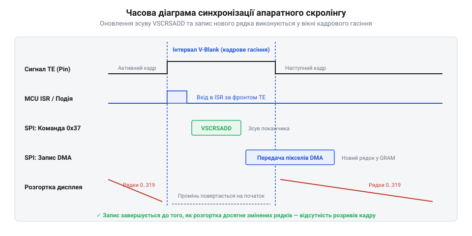

# Апаратний скролінг графічних контролерів дисплеїв

<preknowlist>
- [Передавання графічних буферів через SPI з апаратним DMA](root:sf-devices/dma-spi-display-transfer) — принципи виведення графічних кадрів та синхронізація з шиною
</preknowlist>

## Межа програмного перемальовування та концепція апаратного скролінгу

Динамічні інтерфейси у вбудованих приладах — списки параметрів, стрічки консольних логів чи графіки сигналів — вимагають плавного переміщення зображення по вертикалі. У наївному підході мікроконтролер намагається реалізувати це програмно: зчитує масив пікселів із графічної пам'яті @@en|GRAM@@ (від англ. *graphic random access memory* — графічна оперативна пам'ять), зсуває всі рядки у буфері та повністю перезаписує екранний кадр через послідовну шину @@en|SPI@@ (від англ. *serial peripheral interface* — послідовний периферійний інтерфейс).

Розрахуємо секундний потік даних `B_soft`, необхідний для суцільного перемальовування дисплея завширшки `W = 320` пікселів і заввишки `H = 240` пікселів із колірною глибиною `N = 2` байти на піксел на кадровій частоті `F = 60` Гц:

```
B_soft = W × H × N × F
= 320 × 240 × 2 × 60    [добуток роздільної здатності, розміру пікселя та частоти]
= 9216000               [байт за секунду, тобто понад 9.2 МБ/с]
```

Цей потік удвічі перевищує фізичну пропускну здатність шини @@en|SPI@@ із типовою частотою 32 МГц, де з урахуванням службових команд передається щонайбільше 3.8 МБ/с. Частота оновлення падає до смиканих ривків, а процесор повністю блокується копіюванням масивів.

Фізичний вихід дає апаратний скролінг @@en|hardware scrolling@@ (від англ. *hardware* — апаратний та *scroll* — сувій, прокручування). Внутрішній рушій розгортки контролера @@en|scanout engine@@ (від англ. *scan out* — виводити розгортку та *engine* — рушій) циклічно читає рядки з пам'яті @@en|GRAM@@ і формує сигнали для панелі. Апаратний скролінг змінює лише початкову адресу рядка, з якого рушій починає формування кадру. Для зсуву зображення мікроконтролеру достатньо надіслати два байти команди @@en|VSCRSADD@@ (від англ. *vertical scroll start address* — початкова адреса вертикального скролінгу), скоротивши трафік шини до кількох сотень байтів на секунду.

Щоб екран не прокручувався цілком, пам'ять конфігурують командою @@en|VSCRDEF@@ (від англ. *vertical scroll definition* — визначення параметрів скролінгу) на три області:
- верхню фіксовану @@en|TFA@@ (від англ. *top fixed area* — верхня фіксована область);
- рухому зону @@en|VSA@@ (від англ. *vertical scrolling area* — зона вертикального скролінгу);
- нижню фіксовану @@en|BFA@@ (від англ. *bottom fixed area* — нижня фіксована область).

Нерухомі ділянки утримують шапку чи кнопки, утворюючи зручний [графічний інтерфейс користувача](root:sf-devices/hrafichnyi-interfeis). Зона @@en|VSA@@ працює як апаратний кільцевий буфер @@en|circular buffer@@ (від лат. *circularis* — круговий та англ. *buffer* — проміжне сховище): дійшовши її нижнього краю, рушій @@en|scanout engine@@ автоматично повертається на її перший фізичний рядок.

## Синхронізація розгортки та усунення артефактів тирингу

Якщо надіслати нову адресу в довільний момент часу, виникає артефакт розриву зображення — тиринг @@en|tearing@@ (від англ. *tear* — розривати). Він з'являється, коли рушій розгортки читає рядки з пам'яті @@en|GRAM@@ посеред кадру, а мікроконтролер одночасно змінює регістр @@en|VSCRSADD@@. Верхня частина панелі формується за старою адресою, а нижня — уже за новою. На екрані утворюється помітний горизонтальний зсув растру.

Для усунення тирингу дисплеї формують вихідний сигнал синхронізації @@en|TE@@ (від англ. *tearing effect* — ефект розриву). Цей вивід активується, коли рушій завершує відображення останнього рядка панелі й переходить у режим кадрового гасіння @@en|V-Blank@@ (від англ. *vertical blanking* — вертикальне гасіння).


*Оновлення покажчика прокрутки під час сигналу TE усуває візуальні розриви зображення.*

Під час паузи @@en|V-Blank@@ активні пікселі матриці не оновлюються, тому нова адреса безпечно набуває чинності до початку наступного кадру. Прошивка прив'язує надсилання @@en|VSCRSADD@@ до переривання від лінії @@en|TE@@. Додавання нових рядків на межі кільцевого буфера @@en|VSA@@ виконують за суворим правилом: записувати нові пікселі в пам'ять @@en|GRAM@@ слід лише в ті фізичні рядки, які рушій розгортки вже показав на екрані та змістив за межі видимості. Якщо передавати новий рядок у фоні, налаштувавши [передавання графічних буферів](root:sf-devices/dma-spi-display-transfer) за допомогою апаратного @@en|DMA@@ (від англ. *direct memory access* — прямий доступ до пам'яті), система досягає плавного руху на частоті 60 Гц без витрат процесорного часу.