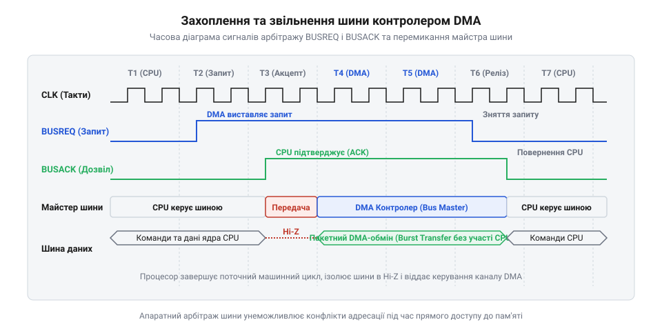
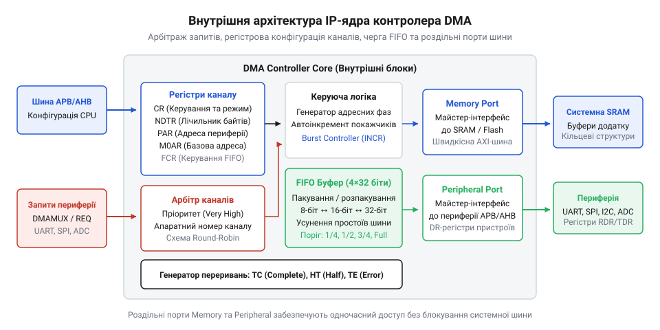
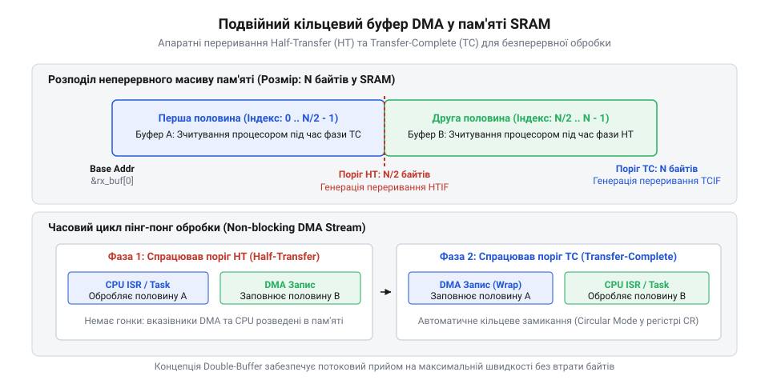
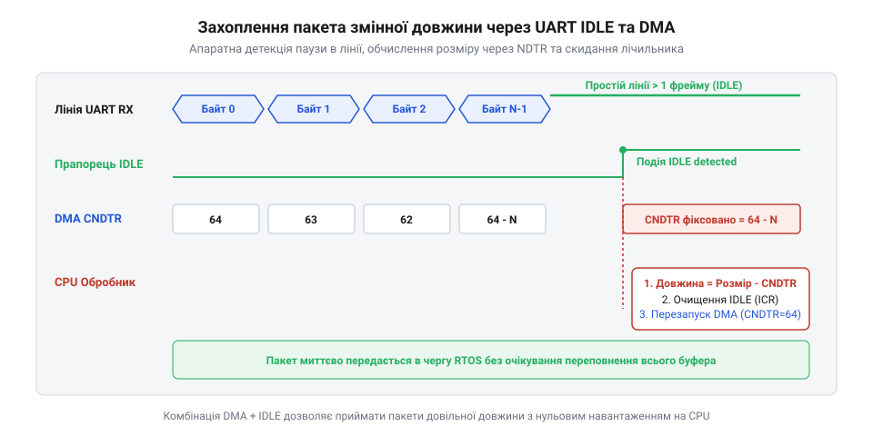

# Контролер прямого доступу до пам'яті (DMA)

## Початкові концепції та фізичні принципи

Коли високошвидкісний аналого-цифровий перетворювач оцифровує сигнал із частотою 1 мільйон відліків на секунду, а послідовний інтерфейс приймає безперервний потік даних на швидкості 20 Мбіт/с, кожен відлік має негайно потрапити в оперативну пам'ять. Якщо покласти пересилання цих даних на центральний процесор (CPU), ядро витратить весь тактовий бюджет на побайтові переривання або порожні цикли опитування, повністю втративши обчислювальний ресурс для основних задач.

Для переміщення даних між периферією (з грецької @@el|περιφέρεια@@ — коло, околиця) та оперативною пам'яттю традиційно застосовують два підходи: циклічне опитування (з англійської @@en|polling@@) та апаратні переривання (з англійської @@en|interrupt@@). При циклічному опитуванні процесор у безперервному циклі зчитує прапор готовності периферійного регістру даних. Доки байт не надійде, обчислювальне ядро виконує порожні операції, вилучаючи 100% часу процесора з корисної роботи.

Метод переривань дозволяє ЦПУ виконувати інші завдання під час очікування периферії, однак на високих швидкостях виникає критичне явище — накладні витрати на обробку переривань (з англійської @@en|interrupt latency@@). При кожному вході в процедуру обробки переривання (ISR) апаратне ядро змушене зупиняти поточний потік команд і зберігати контекст виконуваного завдання. У мікроконтролерних архітектурах ARM Cortex-M та RISC-V при настанні переривання ядро апаратно зберігає у стек базовий набір регістрів `R0`-`R3`, `R12`, `LR`, `PC` та `xPSR`. Після цього відбуваються вибірка вектора з таблиці, зчитування даних із периферійного регістру, запис за адресою в оперативну пам'ять, відновлення контексту та повернення з переривання.

Розрахуємо сумарний тактовий бюджет для обміну буфером (з німецької @@de|Puffer@@ — глушник, колійний упор для пом'якшення удару) обсягом `N = 1024` елементи при обробці через переривання:

```
T_total = N × (C_context + C_execution)
= 1024 × (32 + 18)      [сума тактів збереження контексту та виконання тіла ISR]
= 51200                 [загальна кількість тактів ЦПУ]
```

При тактовій частоті ядра 72 МГц передача одного кілобайта даних вилучає понад 50 тисяч тактів. Якщо потік є безперервним, процесор витрачає практично весь свій час на виконання порожніх операцій збереження та відновлення регістрів, не залишаючи ресурсів для обчислювальних алгоритмів та задач операційної системи.

Фундаментальним розв'язком цієї проблеми є відокремлення транзакцій (з латинської @@la|transactio@@ — угода, завершення справи) переміщення даних від обчислювального ядра. Для цього у кремній інтегрують окремий апаратний сопроцесор — контролер прямого доступу до пам'яті (з англійської @@en|Direct Memory Access@@, скорочено DMA).

Контролер DMA є автономним скінченним автоматом, здатним безпосередньо керувати системними шинами адреси, даних та контролю. У класичній архітектурі ЦПУ виступає єдиним майстром шини (з англійської @@en|bus master@@), який генерує адреси та керуючі сигнали читання чи запису. Контролер DMA стає другим майстром шини, який може тимчасово перехоплювати управління магістраллю для виконання прямих пересилань між периферійними регістрами та пам'яттю.

Фізичний принцип функціонування DMA базується на процедурі апаратного арбітражу (з латинської @@la|arbitrium@@ — рішення третейського судді) шини. Коли периферійному пристрою необхідно передати дані, він не викликає переривання процесора, а надсилає апаратний запит каналу DMA. Контролер DMA активує фізичну лінію запиту шини (з англійської @@en|bus request@@, позначувану як `HOLD` або `BUSREQ`).

Отримавши сигнал запиту, ЦПУ завершує поточний тактовий цикл читання або запису, переводить свої адресні та даневі виходи у високоімпедансний Z-стан (фізично відключаючись від провідників магістралі) і видає сигнал підтвердження (з англійської @@en|bus grant@@, позначуваний як `HLDA` або `BUSACK`). З цього моменту контролер DMA бере на себе функції майстра шини:
- Виставляє на адресу магістралі фізичну адресу регістру джерела. - Генерує керуючий сигнал читання, зчитуючи дані у свій внутрішній регістр. - Виставляє на адресу магістралі фізичну адресу комірки призначенця. - Генерує керуючий сигнал запису, фіксуючи значення у пам'яті. - Модифікує внутрішній вказівник адреси та зменшує лічильник залишкових елементів.

Після завершення передачі елемента або пакета даних контролер DMA скидає сигнал `BUSREQ`, і ЦПУ негайно повертає собі контроль над системною шиною.


*Послідовність арбітражу шини між центральним процесором та апаратним контролером DMA.*

На ранніх етапах розвитку комп'ютерних систем захоплення шини контролером DMA повністю блокувало роботу процесора, що описує [історичний шлях розвитку](root:Програма в пристрої/Контролер прямого доступу до пам'яті (DMA)/hist-dma-evolution.md) системних магістралей. У сучасних мікроконтролерах та системах на кристалі (SoC) цю проблему усунуто завдяки впровадженню багатошарових шинних матриць (з англійської @@en|bus matrix@@ або @@en|crossbar interconnect@@).

У багатошаровій матриці системні шини розділені на незалежні паралельні канали (шина інструкцій I-Code, шина даних D-Code, системна шина System Bus, шина периферії AHB/APB). Завдяки цьому ЦПУ та контролер DMA можуть функціонувати одночасно, якщо їхні звернення адресовані до різних фізичних блоків. Наприклад, поки процесор вибірає інструкції з Flash-пам'яті або виконує обчислення у своєму кеші команд, контролер DMA здійснює обмін даними між периферійним модулем SPI та оперативною пам'яттю SRAM через паралельний шинний шар, що висвітлює структуру системної магістралі.

Пропускну здатність та ефективність використання шинного часу визначає [експертну математичну модель](root:Програма в пристрої/Контролер прямого доступу до пам'яті (DMA)/math-dma-throughput-and-latency.md), де групування транзакцій у пакети (з англійської @@en|burst transfer@@) зводить накладні витрати арбітражу майже до нуля.

## Внутрішня будова та алгоритми роботи

Щоб з'ясувати апаратні механізми пересилки даних, розглянемо [компоненти IP-ядра](root:Програма в пристрої/Контролер прямого доступу до пам'яті (DMA)/comp-dma-controller-core.md) контролера DMA. Архітектурно модуль DMA складається з трьох ключових апаратних блоків: канального регістрового файлу, внутрішнього арбітра пріоритетів та шинних майстер-інтерфейсів із буферами FIFO (з англійської @@en|First In, First Out@@ — першим прийшов, першим вийшов).

Регістровий файл кожного окремого каналу DMA містить наступні базові регістри:
- `SAR` (з англійської @@en|Source Address Register@@) — регістр адреси джерела, що містить 32-бітну вказівку на комірку пам'яті або регістр периферії. - `DAR` (з англійської @@en|Destination Address Register@@) — регістр адреси призначення, куди записуються зчитані дані. - `NDTR` або `CNT` (з англійської @@en|Number of Data Register@@) — регістр лічильника транзакцій, що містить кількість елементів для передачі. - `CR` (з англійської @@en|Control Register@@) — регістр конфігурації, який задає напрямок пересилки (Memory-to-Memory, Peripheral-to-Memory, Memory-to-Peripheral), розмірність елемента (8, 16 або 32 біти), автоінкремент адрес та режим розгалуження. - `SR` (з англійської @@en|Status Register@@) — регістр стану з прапорами подій: завершення половини передачі (`HTIF`), повне завершення (`TCIF`) та помилка магістралі (`TEIF`).

Взаємодія між периферійним пристроєм та каналом DMA здійснюється через апаратні лінії квитування (з англійської @@en|handshaking@@):
- `dma_req` — сигнал запиту від периферії (наприклад, коли у прийомопередавачі UART з'являється новий байт). - `dma_ack` — сигнал підтвердження від DMA, який скидає прапор готовності периферійного модуля після вибірки даних.


*Архітектура внутрішніх блоків та шляхів проходження даних всередині IP-ядра DMA.*

Сучасні контролери містять від 8 до 16 незалежних каналів. При одночасному надходженні декількох запитів `dma_req` апаратний арбітр (з латинської @@la|arbiter@@ — свідок, суддя) визначає черговість доступу до шини.

Арбітраж поєднує два рівні керування:
- Програмний пріоритет (з англійської @@en|Fixed Priority@@): кожен канал має один із чотирьох рівнів (Дуже високий, Високий, Середній, Низький). - Апаратний циклічний арбітраж (з англійської @@en|Round-Robin@@): якщо декілька каналів мають однаковий програмний пріоритет, шина надається каналу з меншим номером, що виключає монополізацію магістралі одним джерелом.

Внутрішній буфер FIFO виконує задачу узгодження розрядності шин та вирівнювання адрес. Якщо периферійний модуль видає дані по 8 біт, а оперативна пам'ять налаштована на 32-бітне вирівнювання, FIFO накопичує 4 байти і лише після цього здійснює одну 32-бітну пакетну транзакцію по системній шині AHB/AXI, суттєво заощаджуючи шинні такти.

Алгоритм роботи контролера DMA визначається обраним програмним режимом:

- **Одиночний режим (з англійської @@en|Normal Mode@@):** Канал виконує `NDTR` пересилань. Після досягнення значення `NDTR == 0` апаратна частина вимикає канал, встановлює прапор `TCIF` у регістрі `SR` і генерує переривання ЦПУ. Цей режим застосовується для разового копіювання блоків пам'яті.

- **Циклічний режим (з англійської @@en|Circular Mode@@):** Після обнулення `NDTR` контролер DMA апаратно перезавантажує початкові значення `SAR`, `DAR` та `NDTR` із фонових shadow-регістрів і продовжує передачу спочатку. Це утворює неперервний кільцевий буфер. Для забезпечення безперервної обробки генеруються два апаратних переривання: `HTIF` сповіщає, що перша половина буфера заповнена і готова до обробки, поки DMA заповнює другу половину. При досягненні кінця буфера виставляється прапор `TCIF`, сповіщаючи про готовність другої половини.

- **Дескрипторний режим (з англійської @@en|Scatter-Gather Mode@@):** Замість фіксованих регістрів адреси в оперативній пам'яті формується зв'язаний список структур-дескрипторів (з латинської @@la|descriptor@@ — той, хто описує). Кожен дескриптор містить адресу джерела, адресу призначення, довжину блоку та вказівник на наступну структуру. Контролер DMA самостійно зчитує дескриптор з пам'яті, виконує вказану пересилку, після чого автоматично завантажує наступний дескриптор. Це дозволяє об'єднувати фрагментовані в пам'яті буфери в єдиний потік без втручання процесора.

У високопродуктивних архітектурах із кеш-пам'яттю (наприклад, ARM Cortex-M7 або RISC-V) виникає критичне явище — порушення когерентності кешу (з латинської @@la|cohaerentia@@ — зв'язок, зчіплення).

Оскільки кеш-пам'ять (з французької @@fr|cache@@ — тайник) працює прозоро для ЦПУ, а DMA звертається безпосередньо до фізичної RAM, виникають дві небезпечні ситуації:
- При напрямку Peripheral-to-Memory контролер DMA записує нові дані у RAM, але ЦПУ зчитує застарілі дані зі свого кешу L1. - При напрямку Memory-to-Peripheral ЦПУ підготував нові дані у кеші L1, але вони ще не записані у RAM. DMA зчитує з RAM застаріле значення.

Для запобігання втраті даних застосовують [проблеми когерентності кеш-пам'яті](root:hw-arch/cache-coherency-dma). Перед запуском передачі Memory-to-Peripheral ЦПУ повинен виконати очищення кешу (з англійської @@en|Cache Clean / Flush@@), примусово записавши модифіковані рядки кешу у RAM. Після закінчення передачі Peripheral-to-Memory ЦПУ повинен виконати інвалідацію кешу (з англійської @@en|Cache Invalidation@@), змушуючи ядро перечитати оновлені дані безпосередньо з оперативної пам'яті.

Події переривань DMA (`HTIF`/`TCIF`) інтегруються з операційною системою реального часу (RTOS), де ISR викликає функції сповіщення задач або вивільнення семафорів (з грецької @@el|σήμα@@ — знак, @@el|φορός@@ — той, що носить). Це формує концепцією zero-copy буферів, дозволяючи обробляти потоки даних без жодного додаткового копіювання у пам'яті.

## Апаратна реалізація та низькорівневий C/C++ код

Взаємодія мікроконтролера з контролером прямого доступу до пам'яті відбувається на фізичному рівні через відображення регістрів у спільний адресний простір (з англійської @@en|Memory-Mapped I/O@@, скорочено @@en|MMIO@@). На відміну від звичайної оперативної пам'яті, де кожна комірка є пасивним накопичувачем електричного заряду, запис за адресою регістра @@en|DMA@@ викликає безпосередню зміну стану цифрового автомата на кристалі.

Коли оптимізатор компілятора мови C або C++ обробляє код, він намагається зберегти значення змінних у внутрішніх регістрах процесорного ядра `R0`–`R12`, усуваючи повторні апаратні інструкції зчитування `LDR` та запису `STR`. Для керуючих регістрів периферії така оптимізація є фатальною: ядро буде зчитувати старе значення з процесорного регістра або повністю викине операцію запису конфігураційного слова. З цієї причини всі покажчики на апаратні регістри обов'язково декларуються з кваліфікатором `volatile`, який зобов'язує компілятор генерувати фізичну транзакцію на шині при кожному зверненні у вихідному коді.

Однак кваліфікатора `volatile` недостатньо для сучасних процесорів із конвеєром команд та позачерговим виконанням (з англійської @@en|out-of-order execution@@), таких як @@en|ARM@@ @@en|Cortex-M@@ чи @@en|RISC-V@@. Апаратний конвеєр процесора може довільно змінювати порядок звернень, а внутрішні буфери запису шини (з англійської @@en|write buffer@@) здатні затримувати оновлення кремнію на кілька тактів. Якщо процесор послідовно запише адресу буфера в регістр DMA, а наступною командою встановить біт запуску передачі, запис запуску через затримки шини може випередити конфігурацію адрес. Контролер DMA почне транзакцію зі старими покажчиками, пошкодивши оперативну пам'ять.

Для забезпечення суворої послідовності звернень у кремній вбудовано апаратний бар'єр пам'яті (з французької @@fr|barrière@@ — загородження, перепона, англійською @@en|memory barrier@@). В архітектурі ARM застосовують дві спеціалізовані інструкції:
- `DMB` (з англійської @@en|Data Memory Barrier@@) — гарантує, що всі попередні операції доступу до пам'яті фізично завершаться до того, як почнуть виконуватися наступні звернення до пам'яті. - `DSB` (з англійської @@en|Data Synchronization Barrier@@) — зупиняє просування конвеєра інструкцій до моменту, доки всі попередні транзакції пам'яті та скидання черг буферів запису шин AHB чи AXI не завершаться на апаратному рівні.

Конфігурування контролера DMA підпорядковане канонічному апаратному протоколу. Спроба модифікувати параметри адресації чи лічильника на працюючому каналі апаратно ігнорується або спричиняє розсинхронізацію внутрішніх тригерів. Процедура ініціалізації вимагає виконання суворої послідовності кроків:

1. **Деактивація каналу:** запис нуля в біт увімкнення `EN` (з англійської @@en|Enable@@) керуючого регістра `CR`. Після цього процесор зобов'язаний у циклі перевіряти стан біта `EN` або прапора зайнятості каналу, очікуючи моменту, коли поточна активна транзакція на магістралі повністю завершиться. 2. **Скидання прапорів стану:** запис логічних одиниць у відповідні біти регістра `IFCR` (з англійської @@en|Interrupt Flag Clear Register@@). Залишкові прапори від попередніх операцій повинні бути безумовно очищені, інакше вмикання переривань викличе помилковий перехід в обробник. 3. **Запис адреси периферійного джерела:** встановлення адреси регістра даних пристрою (наприклад, приймального буфера UART чи АЦП) у регістр `PAR` (з англійської @@en|Peripheral Address Register@@). 4. **Запис адреси буфера пам'яті:** завантаження початкового покажчика на виділений масив в оперативній пам'яті SRAM у регістр `MAR` (з англійської @@en|Memory Address Register@@). 5. **Встановлення лічильника транзакцій:** запис кількості елементів передачі в регістр `NDTR` (з англійської @@en|Number of Data to Transfer Register@@). 6. **Налаштування керуючого регістра `CR`:**
   - Напрямок потоку даних: встановлення біта `DIR` (з периферії в пам'ять чи з пам'яті в периферію). - Автоінкремент адреси периферії: біт `PINC` вимикається, оскільки зчитування відбувається з однієї фіксованої комірки периферійного регістра. - Автоінкремент адреси пам'яті: біт `MINC` вмикається, щоб після кожного такту вказівник у пам'яті автоматично зміщувався на розмір елемента. - Розмірність передачі: вибір розрядності `PSIZE` та `MSIZE` (8 бітів для послідовних портів, 16 бітів для оцифрованих сигналів, 32 біти для машинних слів). - Циклічність: встановлення біта `CIRC` у стан одиниці для безперервної кільцевої роботи. - Пріоритет арбітражу: визначення пріоритету каналу `PL` серед інших джерел шини. - Дозвіл переривань: активація бітів половини передачі `HTIE`, повного завершення `TCIE` та шинної помилки `TEIE`. 7. **Активація запитів з боку периферійного блоку:** виставлення біта дозволу DMA у керуючому регістрі самого пристрою (наприклад, `USART_CR3_DMAR`). 8. **Шинна синхронізація та запуск:** виконання бар'єра `DSB` та запис одиниці в біт `EN` регістра `CR`.

Точні бітові маски, зміщення полів пріоритетів та правила адресації для кожного регістрового блоку визначає [розподіл бітів керування](root:Програма в пристрої/Контролер прямого доступу до пам'яті (DMA)/api-dma-hardware-register-map.md), що регламентує поведінку кремнію на фізичному рівні.

При потоковому прийомі інформації класичний лінійний буфер призводить до зупинок конвеєра: доки процесор читає накопичені дані, канал доводиться вимикати, що створює вікно втрати байтів. Найбільш ефективним розв'язком є побудова подвійного кільцевого буфера (з англійської @@en|ring buffer@@ або @@en|ping-pong buffering@@). Суцільний масив оперативної пам'яті розміром `N` елементів розбивається на дві симетричні половини: блок A (індекси від `0` до `N/2 - 1`) та блок B (індекси від `N/2` до `N - 1`).


*Розподіл простору подвійного буфера в оперативній пам'яті та часові пороги перемикання обробників.*

Коли лічильник `NDTR` зменшується від значення `N` до `N/2`, контролер DMA завершує заповнення блоку A і генерує апаратне переривання з прапором `HTIF` (з англійської @@en|Half Transfer Interrupt Flag@@). Ядро процесора починає обробку блоку A. Тим часом контролер DMA автоматично продовжує запис у блок B. Коли лічильник `NDTR` досягає нуля, блок B стає заповненим. Контролер DMA виставляє прапор повного завершення `TCIF` (з англійської @@en|Transfer Complete Interrupt Flag@@), апаратно перезавантажує початкову адресу `MAR` та лічильник `NDTR = N`, повертаючись до блоку A. Процесор перемикається на обробку блоку B.

Така схема усуває стан перегонів (з англійської @@en|race condition@@ — змагання за доступ), оскільки обчислювальне ядро та шинний майстер DMA ніколи не працюють з однією й тією самою половиною буфера одночасно.

Щоб запобігти переповненню буфера (з англійської @@en|overrun@@ — вихід за край, переповнення), час реакції та обробки половини масиву процесором повинен суворо вкладатися у часовий дедлайн заповнення сусідньої половини. 

Розрахуємо часове вікно дедлайну `T_deadline`, за яке процесор зобов'язаний вийти з процедури обробки половини буфера, через розмір буфера `N` в байтах та швидкість вхідного потоку `B` у байтах за секунду для послідовного інтерфейсу зі швидкістю передачі 115200 бод (з англійської @@en|baud rate@@) у форматі 8N1 (що відповідає швидкості `B = 11520` байтів за секунду) та буфері на `N = 1024` байти:

```
T_deadline = (N ÷ 2) ÷ B
= (1024 ÷ 2) ÷ 11520     [підстановка розміру півбуфера та байтової швидкості UART]
= 512 ÷ 11520            [спрощення виразу]
≈ 4.44 × 10⁻²            [розрахунок допустимого часу реакції системи в секундах]
```

Граничний час становить 44.4 мілісекунди. За цей період операційна система реального часу гарантовано встигне виконати диспетчеризацію задач та обробити накопичений блок без виникнення помилки переповнення буфера.

Якщо структура даних у пам'яті фізично несуцільна (наприклад, фрагментовані пакети мережевих протоколів або звукові семпли), прямолінійного кільця недостатньо. У таких задачах використовують дескрипторний режим збирання-розсіювання (з англійської @@en|scatter-gather@@). Замість одного масиву формується зв'язаний список апаратних дескрипторів (з латинської @@la|descriptor@@ — той, хто описує). Кожен елемент списку містить адресу джерела, адресу приймача, довжину блоку, конфігураційні біти та вказівник на наступний дескриптор у пам'яті. Контролер DMA автономно зчитує дескриптор за дескриптором. Складна мультимедійна обробка та передача звуку реалізуються без пауз і втручання процесора, коли дані транслюються через [ланцюжок пов'язаних дескрипторів](root:Програма в пристрої/Контролер прямого доступу до пам'яті (DMA)/proj-dma-scatter-gather-audio.md), де аудіопотоки вичитуються з різних фрагментів пам'яті без пауз.

Для надійної інтеграції вбудованого коду низькорівневі маніпуляції відокремлюють від прикладної логіки. Уніфіковану архітектуру задає [програмний інтерфейс драйвера](root:Програма в пристрої/Контролер прямого доступу до пам'яті (DMA)/api-dma-driver-c-interface.md), який визначає контракт викликів та обробку подій. Нижче наведено повну реалізацію кільцевого драйвера мовами C та C++.

:::tabs
:::code root\eng\sf-devices\dma-controller/dma-controller-d/c/dma-ring-init.c c
:::code root\eng\sf-devices\dma-controller/dma-controller-d/cpp/channelregisters.cpp cpp
:::

## Практичне застосування та відлагодження

У практичних протоколах обміну повідомленнями (таких як командні рядки @@en|AT@@, пакети телеметрії або кадрування @@en|SLIP@@) обсяг порції даних майже ніколи не є фіксованим і рідко кратний розміру буфера `N` чи його половини `N/2`. Якщо віддалений вузол надіслав повідомлення довжиною лише 37 байтів, контролер DMA запише ці 37 байтів у пам'ять і зупиниться в очікуванні наступних даних. Оскільки лічильник транзакцій `NDTR` не досягне нуля і не дійде до половини, жодне з апаратних переривань `HTIF` чи `TCIF` не згенерується. Отримані байти опиняться заблокованими у пам'яті, роблячи реакцію пристрою недетермінованою.

Для розв'язання цієї проблеми контролер DMA поєднують з апаратним виявленням простою лінії (з англійської @@en|idle line detection@@). Периферійний модуль UART постійно відстежує рівень вхідної лінії `RX`. Якщо після завершення прийому стоп-біта лінія залишається у стані логічної одиниці впродовж тривалості одного повного кадру (від 10 до 11 бітових інтервалів), апаратний вузол UART фіксує закінчення пакетної передачі та виставляє переривання `IDLE`.


*Механізм захоплення нефіксованого кадру даних через взаємодію лічильника DMA та прапора IDLE.*

Алгоритм обробника переривання `IDLE` витягує довільну кількість прийнятих байтів без перезапуску та без деактивації каналу DMA:

1. Зчитування регістра статусу периферійного пристрою `UART_SR` з наступним читанням регістра даних `UART_DR`, що апаратно скидає прапор `IDLE`. 2. Читання залишкового значення лічильника в регістрі `channel->NDTR`. 3. Обчислення поточної позиції голови запису: `HeadPosition = BufferSize - channel->NDTR`. 4. Розрахунок кількості нових байтів від останньої зафіксованої позиції хвоста `TailPosition`:

```
BytesCount = (HeadPosition >= TailPosition)
             ? (HeadPosition - TailPosition)
             : (BufferSize - TailPosition + HeadPosition);
```

5. Передача вказівника на свіжі дані протокольному аналізатору та оновлення позиції хвоста: `TailPosition = HeadPosition`.

Цей механізм формує фундамент надійних комунікацій, що втілює [кільцевий прийом послідовного порту](root:Програма в пристрої/Контролер прямого доступу до пам'яті (DMA)/proj-dma-ring-buffer-usart.md), де не губиться жоден вхідний байт.

Наступна критична зона при роботі з DMA — апаратне вирівнювання адрес пам'яті та пакетні транзакції (з англійської @@en|burst transfer@@). Системні магістралі AHB та AXI оперують словами фіксованої ширини (32 або 64 біти). Якщо канал DMA налаштовано на передачу 32-бітних слів (`MSIZE = 32`), а початкова адреса буфера виявилася не вирівняною по 4-байтній межі (наприклад, адреса `0x20000001` замість `0x20000004`), поведінка кремнію призводить до аварії:
- Внутрішній блок FIFO змушений розбивати одну 32-бітну транзакцію на чотири поодинокі байтові цикли, що вчетверо підвищує завантаження системної шини. - Шинний комутатор матриці фіксує некоректний протокол адресації та генерує апаратний сигнал помилки шини (з англійської @@en|bus error@@), що призводить до негайного виникнення системного винятку @@en|BusFault@@ або фатального падіння ядра у стан @@en|HardFault@@.

Крім того, транзакція пакетної передачі burst ніколи не повинна перетинати межу 1 кілобайта адреси на шинах AHB або 4 кілобайтів на шинах AXI. Перетин цієї межі заборонений стандартом протоколу і спричиняє скидання шинного моста. Щоб уникнути подібних апаратних пасток, усі буфери DMA декларуються в коді з явним вирівнюванням через директиви компілятора: `alignas(4)` у C++ або `__attribute__((aligned(4)))` у C.

Окрему категорію прихованих проблем становлять колізії внутрішньої пам'яті та апаратні обмеження кремнію:

- **Конкуренція за банки пам'яті (SRAM Bank Contention):**
  Кристал мікроконтролера зазвичай містить кілька фізичних блоків оперативної пам'яті (`SRAM1`, `SRAM2`). Якщо центральний процесор виконує інтенсивні обчислення в тому самому блоці пам'яті, куди контролер DMA веде запис потоку периферії, арбітр пам'яті змушений чергувати доступи, додаючи такти очікування (з англійської @@en|wait states@@). Це викликає фазове тремтіння (з англійської @@en|jitter@@ — тремтіння) виконання критичного до часу коду переривань процесора. Більше того, у деяких ранніх версіях кристалів одночасне звернення ядра та DMA до одного банку пам'яті призводило до втрати транзакцій. Інженер завжди повинен враховувати [апаратні помилки кристала](root:embedded/errata-koly-vynen-chyp) для обраної ревізії чипа. Надійним рішенням є архітектурне рознесення: стек і змінні процесора виділяються у блоці `SRAM1`, а всі буфери обміну DMA виносяться в ізольований блок `SRAM2`.

- **Заборонені зони пам'яті ядра TCM та CCM:**
  Пам'ять зі щільним зв'язком ядра (з англійської @@en|Tightly Coupled Memory@@, скорочено @@en|TCM@@: @@en|DTCM@@ для даних та @@en|ITCM@@ для інструкцій), а також пам'ять внутрішнього ядра (з англійської @@en|Core Coupled Memory@@, скорочено @@en|CCM@@) підключені безпосередньо до конвеєра процесора через власну приватну магістраль, минаючи загальну матрицю шин AHB/AXI. Контролер DMA не є частиною ядра — він є зовнішнім шинним майстром. Фізичного комутатора між шиною DMA та пам'яттю TCM/CCM не існує. Якщо розробник розмістить буфер прийому DMA на стеку функції, розташованому в пам'яті DTCM, перша ж спроба транзакції DMA завершиться помилкою `TEIF` у регістрі статусу каналу та згенерує `BusFault`. Буфери передач DMA дозволено розміщувати виключно у загальнодоступній пам'яті оперативної магістралі.

У високопродуктивних мікроконтролерах із кешем даних першого рівня L1 (наприклад, ядра ARM Cortex-M7 або процесори архітектури RISC-V) виникає загроза порушення когерентності пам'яті через явище помилкового спільного використання (з англійської @@en|false sharing@@). Мінімальною неподільною одиницею кешу є рядок кешу (з англійської @@en|cache line@@), типовий розмір якого становить 32 байти.

Розглянемо небезпечний сценарій: буфер прийому DMA займає 24 байти, а наступні 8 байтів того самого 32-байтного рядка пам'яті займають звичайні системні змінні процесора. Коли процесор модифікує свою змінну, він змінює її у своєму кеші, позначаючи весь рядок брудним (з англійської @@en|dirty@@). Одночасно з цим контролер DMA приймає нові дані з периферії та записує їх напряму у фізичну пам'ять RAM. Якщо процесор скине модифікований рядок кешу в RAM (операція `Cache Clean`), старий вміст кешу перезапише фізичну пам'ять, знищивши щойно прийняті байти від DMA. Якщо ж процесор виконає інвалідацію кешу (`Cache Invalidate`), він зітре власні зміни змінних.

Для запобігання фатальному псуванню пам'яті встановлено три правила:
1. Початкова адреса кожного буфера DMA повинна бути вирівняна за межею рядка кешу: `alignas(32)`. 2. Повний розмір буфера у пам'яті повинен бути кратним довжині рядка кешу: `sizeof(buffer) % 32 == 0`. 3. У межах того самого рядка кешу заборонено розміщувати будь-які сторонні змінні прошивки.

При використанні операційної системи реального часу (@@en|RTOS@@, такі як @@en|FreeRTOS@@ або @@en|Zephyr@@) процедура обробки переривань ISR контролера DMA будується на моделі відкладеної обробки (з англійської @@en|deferred interrupt handling@@). Усередині обробника переривання заборонено виконувати синтаксичний аналіз пакетів, розрахунок контрольних сум чи операції виділення динамічної пам'яті. Переривання зобов'язане виконати мінімальний набір дій:
1. Очистити апаратний прапор переривання у регістрі `IFCR`. 2. Вивільнити бінарний семафор (з грецької @@el|σήμα@@ — знак, @@el|φορός@@ — носій, англійською @@en|semaphore@@) викликом `xSemaphoreGiveFromISR()` або надіслати пряме сповіщення завдання `vTaskNotifyGiveFromISR()`. 3. Перевірити стан змінної необхідності зміни контексту `xHigherPriorityTaskWoken`. 4. Якщо розблоковане завдання має вищий пріоритет, ніж поточна перервана нитка, викликати макрос `portYIELD_FROM_ISR()`.

Завдяки цьому планувальник операційної системи реального часу негайно перемикає процесорне ядро на прикладне завдання обробки даних у момент виходу з апаратного переривання, зберігаючи мікросекундний детермінізм системи.

Для ефективного пошуку несправностей та діагностики неочевидної поведінки контролера DMA застосовують наступний діагностичний інструментарій:

- **Моніторинг статусних бітів збою в регістрі `SR`:**
  - `TEIF` (Transfer Error Interrupt Flag) — фіксує спробу звернення до забороненої чи неіснуючої адреси шини. - `FEIF` (FIFO Error Interrupt Flag) — сигналізує про переповнення або спустошення внутрішнього буфера FIFO каналу DMA через перевантаження системної магістралі іншими майстрами шини. - `DMEIF` (Direct Mode Error Interrupt Flag) — повідомляє про конфлікт передач без проміжного вирівнювання через FIFO. - **Апаратне профілювання через логічний аналізатор:**
  Для фіксації реальних часових характеристик використовують логічний аналізатор (з англійської @@en|logic analyzer@@). На вільні цифрові виводи GPIO призначають діагностичні лінії: виставляють високий логічний рівень при вході в процедуру переривання DMA і скидають у нуль при виході. Зіставляючи сигнал GPIO з імпульсами ліній передачі інтерфейсів SPI чи UART на екрані приладу, інженер точно вимірює апаратну затримку реакції шини та тривалість виконання зворотного виклику. - **Апаратний захист меж через блок MPU:**
  Блок захисту пам'яті (з англійської @@en|Memory Protection Unit@@, скорочено @@en|MPU@@) дозволяє оточити буфери DMA охоронними областями з забороною доступу `No Access`. Якщо внаслідок помилки конфігурації лічильника або збою покажчика канал DMA вийде за межі відведеного масиву, апаратний блок MPU негайно згенерує системний виняток і зупинить систему до того, як пошкодження пам'яті торкнеться критичних структур ядра RTOS.